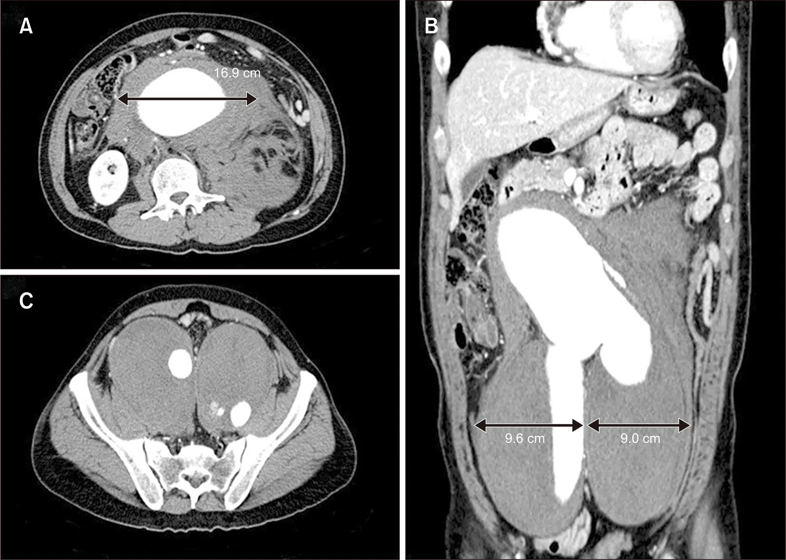

# 170 — Phình ĐMC bụng: dọa vỡ, vỡ & rò / AAA: rupture & fistula

**Tags:** `pattern:phinh-DMC` `vung:DMC-bung`
**Mức chắc chắn (certainty):** tổng hợp y văn (literature synthesis) — nhóm tự biên từ y văn mở, chưa gắn ca nguyên văn đơn lẻ.

## 1. Tổng quan — 3 cm + 5,5 cm + liềm tăng tỷ trọng

- **AAA = đường kính ≥ 3,0 cm**; mổ chương trình khi **≥ 5,5 cm** (nam) / ≥ 5,0 cm (nữ) hoặc tăng > 1 cm/năm.
- **Dọa vỡ:** **liềm tăng tỷ trọng (hyperdense crescent)** trong huyết khối + **draped aorta** (thành sau mất + ôm cột sống) + gián đoạn vôi hóa thành.
- **Vỡ:** máu sau phúc mạc + khối phình + tụt HA — tử vong > 80% không mổ kịp; **rò chủ–tá tràng** (nôn máu + đau + khối đập) = mổ tối khẩn.
- TẠI SAO sau phúc mạc chứa được một lúc: khoang kín ép tạm — nhưng mất bù là đột ngột.

## 2. Gamut đau bụng + khối đập + tụt HA

- **Vỡ AAA:** máu sau phúc mạc + phình + sốc — mổ/EVAR cấp cứu (cho phép HA thấp).
- **Dọa vỡ:** liềm + draped + đau mới — mổ sớm chương trình.
- **Rò chủ–tá tràng:** nôn máu + phình + khí quanh graft cũ — mổ tối khẩn.
- **Bóc tách lan xuống:** flap + 2 lòng (nối bài 070) — khác vỡ phình.

## 3. Bảng so sánh

| Thực thể (entity) | Hình ảnh (CTA) | Chốt | Xử trí |
|---|---|---|---|
| Vỡ AAA | **Máu sau phúc mạc + phình + sốc** | Tam chứng: đau + tụt HA + khối đập | Mổ/EVAR cấp cứu + cho phép HA thấp |
| Dọa vỡ | **Liềm + draped + gián đoạn vôi** | Đau mới + phình to | Mổ sớm (đừng chờ vỡ) |
| Rò chủ–tá tràng | **Khí quanh ĐMC/graft + nôn máu** | Nôn máu + phình/graft cũ | Mổ tối khẩn |
| Bóc tách | **Flap + 2 lòng** | Flap (bài 070) | Theo Stanford |

*Phình 16,9 cm + phình chậu 2 bên + máu sau phúc mạc. Nguồn: Lee et al., Vasc Specialist Int 2026 Fig. 1, CC BY-NC 4.0.*

## 4. Protocol CTA

- CTA động mạch (bolus-tracking ĐMC) + MPR + đo đường kính ngoài-ngoài vuông góc trục.
- Tầm soát: nam > 65 tuổi hút thuốc siêu âm 1 lần; theo dõi phình nhỏ định kỳ.

## 5. Cạm bẫy

- **Đau lưng + phình chưa vỡ** tưởng thoát vị đĩa đệm — sờ mạch đùi + CTA khi nghi ngờ.
- **Máu sau phúc mạc do nguyên nhân khác** (vỡ u thận, viêm tụy hoại tử) — tìm phình kèm.
- **EVAR rò type II** sau đặt graft — theo dõi túi phình, can thiệp khi tăng.

## 6. Tự lượng giá — Blind Quiz

**Ca 1 — Đau bụng + tụt HA + khối đập. Đọc CTA.**

- Hỏi: đường kính bao nhiêu? Máu ở đâu? Mổ mở hay EVAR ở ca này? Vì sao?

<b>Bấm để hiện đáp án</b>

- **Vỡ AAA khổng lồ 16,9 cm + phình chậu 2 bên + máu sau phúc mạc** — mổ mở (phình chậu mất landing zone EVAR + dính).
- Nguồn: Lee et al., Fig. 1, CC BY-NC 4.0.

**Ca 2 — Phình 6 cm + đau lưng mới + liềm tăng tỷ trọng:** vỡ hay dọa vỡ? Xử trí? *(Bảng mục 3.)*

<b>Bấm để hiện đáp án</b>

- **Dọa vỡ:** mổ sớm chương trình (đừng chờ vỡ).

## Bài liên quan chéo
- [100 – Tổng quan hệ Bụng](../100-tong-quan-he-bung/lesson.md)
- [070 – PE & ĐMC ngực](../070-thuyen-tac-phoi-dmc-cap/lesson.md) (bóc tách)
- [140 – Chấn thương tạng (dự kiến)](../140-lach-tang-dac/lesson.md) (máu sau phúc mạc)

> Không dùng để chẩn đoán độc lập khi chưa có người hướng dẫn.
