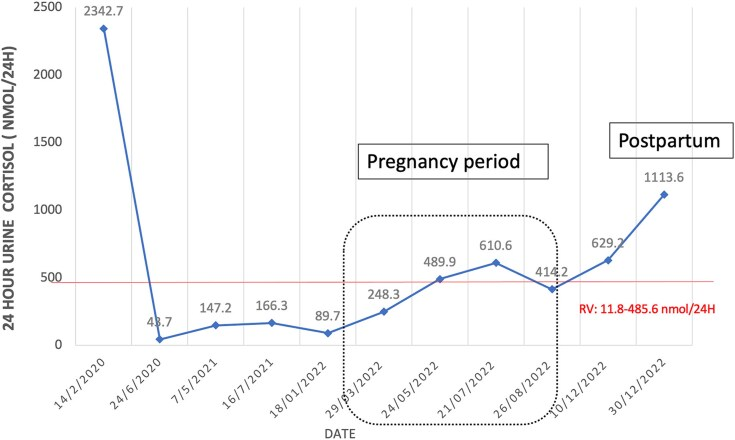
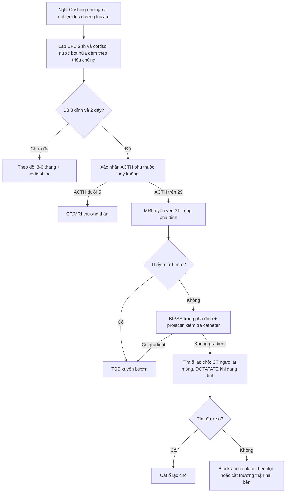
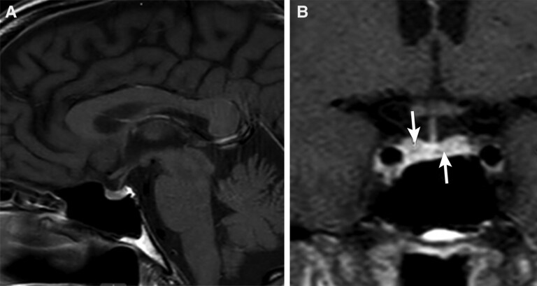
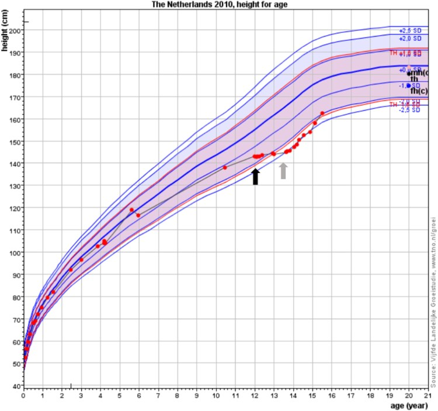

# 1700 — Hội chứng Cushing chu kỳ: cortisol dao động, xét nghiệm âm giả và bẫy "chụp đúng lúc trũng" / Cyclic Cushing syndrome

**Tags:** `pattern:cushing` `pattern:cushing-chu-ky` `pattern:microadenoma-tuyen-yen` `pattern:khong-khoi` `vung:tuyen-yen` `vung:thuong-than` `protocol:UFC-24h-lap-lai` `protocol:BIPSS`

**Mức chắc chắn (certainty):** tổng hợp y văn (literature synthesis) — 4 ca nguyên văn có ảnh (PMC11986810: UFC **2.342,7 → 48,7 nmol/24h** rồi tái phát sau sinh; PMC12559019: 3 ca thể "square wave"; PMC13402041: trẻ 12 tuổi chẩn đoán bằng cortisol tóc; PMC13613223: IPSS âm khi đang eucortisolemia) + bài nền 1696/1699.

> **Câu chốt:** Cushing chu kỳ **không phải** một bệnh riêng mà là **một kiểu diễn tiến** của mọi nguyên nhân Cushing, gặp ở **8–19%** ca. Sai lầm chết người không nằm ở chẩn đoán hình ảnh mà ở **thời điểm**: chụp MRI, làm **BIPSS** hay **PET** trong pha cortisol bình thường sẽ cho **kết quả âm giả**, và bệnh nhân bị gắn nhãn sai (thường là "ACTH lạc chỗ không rõ nguồn") rồi bị **cắt thượng thận hai bên** hoặc **mổ tuyến yên mò**. Tiêu chuẩn tối thiểu phải nhớ: **3 đỉnh + 2 đáy** (hoặc **2 đỉnh + 1 đáy**) cortisol.

## 1. Tổng quan bệnh học – cơ chế hình ảnh

- **Định nghĩa:** các đợt tăng cortisol (đỉnh) xen kẽ các giai đoạn cortisol **bình thường hoặc thấp** (đáy), có hoặc không có chu kỳ đều. Đỉnh kéo dài **vài giờ đến vài tháng**; pha xen kẽ **vài ngày đến vài tháng**, có ca **10–26 tháng** ("square wave").
- **Tần suất (số phải nhớ):** **8–19%** bệnh nhân Cushing; **14–18%** tùy tiêu chuẩn chẩn đoán; khoảng **15%** ở người lớn, và có tác giả cho rằng **dấu hiệu chu kỳ có thể gặp tới 70%** nếu lấy mẫu đủ dày. **Nguyên nhân: tuyến yên 67%, lạc chỗ 17%, thượng thận 11%.**
- **Ở trẻ: cực hiếm** — tới 2026 chỉ **6 ca** được báo cáo (2 nam/4 nữ, **3–15 tuổi**), **5/6 là Cushing do tuyến yên**, 1 ca là tăng sản vi nốt thượng thận. Vì vậy ở trẻ, "Cushing chu kỳ" gần như đồng nghĩa **phải loại trừ u tuyến yên**.
- **TẠI SAO cortisol lại dao động (cơ chế):** (1) **đồng hồ sinh học lạc nhịp trong tế bào u** — biểu hiện bất thường **CLOCK, PER1/2/3, TIMELESS**, làm mất nhịp cortisol; (2) **hoại tử/chảy máu vi thể trong u** theo chu kỳ; (3) **feedback âm tính bị dao động** (cortisol cao ức chế ACTH, ACTH xuống → cortisol xuống → ACTH bật lên); (4) **POMC/ACTH bài tiết không đều** ở u lạc chỗ. Đây là lý do **không có một xét nghiệm nào đủ** — phải lấy nhiều điểm theo thời gian.
- **TẠI SAO hình ảnh "âm" mà bệnh vẫn thật:** u tuyến yên trong thể chu kỳ vẫn **nhỏ (< 6 mm)**, còn tổn thương lạc chỗ có thể **rất nhỏ và không bắt FDG/DOTATATE**; nếu chụp lúc đáy, **không có lý do sinh học nào để u "sáng" hơn**. Đây là khác biệt cốt lõi với Cushing liên tục: **âm tính trên hình ảnh chỉ có giá trị khi chụp trong pha đỉnh**.
- **Ngưỡng xét nghiệm (dùng chung với bài 1696/1699):** UFC 24 giờ **> 70 µg/m² (193 nmol/24h)** ở trẻ; cortisol nửa đêm **> 4,4 µg/dL**; sau 1 mg dexamethasone cortisol **≥ 1,8 µg/dL**; ACTH **> 29 pg/mL** = phụ thuộc ACTH, **< 5 pg/mL** = phụ thuộc thượng thận. **Điểm khác biệt:** trong thể chu kỳ **tất cả các ngưỡng này có thể bình thường** ở pha đáy.
- **Cortisol tóc — "máy đo thời gian" của cortisol:** tóc mọc **~1 cm/tháng**, cortisol khuếch tán vào thân tóc → **1 cm tóc ≈ 1 tháng phơi nhiễm**. Tham chiếu ở **625 trẻ khỏe mạnh**: **50th percentile 2,51 pg/mg**, **97,5th percentile 14,9 pg/mg**. Ca trẻ 12 tuổi: **11 cm tóc**, cortisol **13,5–26,1 pg/mg** → chứng minh tăng cortisol kéo dài dù xét nghiệm máu/nước tiểu lúc khác bình thường.
- **Thai kỳ làm nhiễu:** UFC tăng sinh lý **2–3 lần** trong tam cá nguyệt 2–3; chỉ UFC **> 3 lần** giới hạn trên mới gợi ý Cushing thật. Ca PMC11986810: UFC **2342,7 nmol/24h** lúc chẩn đoán → **48,7** sau 4 tháng → dao động trong giới hạn **2 năm 4 tháng** → thụ thai tự nhiên → **1.113,6 nmol/24h lúc 8 tuần sau sinh**.

## 2. Mẫu hình + chẩn đoán phân biệt theo vị trí (Gamut)

- **Theo hình thái dao động:** **chu kỳ đều** (đỉnh–đáy cách nhau tương đối ổn định, thường 1–3 tháng); **chu kỳ không đều** (khoảng cách thay đổi); **"square wave"** (đỉnh rất nặng vài ngày–3 tháng rồi **eucortisolemia rất dài**, 10–26 tháng). Thể square wave gặp chủ yếu ở **ACTH lạc chỗ không định vị được**.
- **Theo nguồn (quan trọng hơn cho hình ảnh):**
  - **Tuyến yên (67%)** — microadenoma; MRI có thể âm; BIPSS dương **chỉ khi làm đúng pha**.
  - **Lạc chỗ (17%)** — carcinoid phế quản, NET tuyến ức/tụy, pheochromocytoma; ổ nhỏ, có thể chỉ lộ trên **68Ga-DOTATATE** hoặc CT ngực lát mỏng.
  - **Thượng thận (11%)** — adenoma, **PPNAD** (Carney), tăng sản vi nốt; CT thấy **hai thượng thận to nhẹ có nốt nhỏ** hoặc **một khối**.
- **Chẩn đoán phân biệt của "xét nghiệm lúc dương lúc âm":** **giả Cushing** (nghiện rượu, trầm cảm, béo, đái tháo đường mất kiểm soát, căng thẳng cấp); **rối loạn ăn tâm thần** (chán ăn tâm thần che Cushing — PMC13658278); **dùng corticoid giấu kín**; **sai kỹ thuật** (mẫu UFC thất thu, assay ACTH bị nhiễu kháng thể dị loài); **Cushing chu kỳ thật**.
- **Gợi nhớ "CYCLE":** **C**ortisol lặp lại theo triệu chứng, **Y**ếu tố khởi phát (nhiễm trùng, phẫu thuật, thai), **C**hẩn đoán bằng ≥ 3 đỉnh/2 đáy, **L**ấy mẫu **đúng pha** (UFC, LNSC, BIPSS), **E**ctopic (17%) là nhóm hay bị bỏ sót nhất.

## 3. Bảng so sánh phân biệt (ma trận đối chiếu)

| Thực thể (entity) | Hình ảnh điển hình | Chốt vào (rule-in) | Chốt loại (rule-out) | Gợi ý xác nhận |
|---|---|---|---|---|
| **Cushing chu kỳ do tuyến yên** | Microadenoma **< 6 mm**, có thể **không thấy**; hai thượng thận **to đều** khi đang đỉnh | **≥ 3 đỉnh + 2 đáy + ACTH cao + MRI/BIPSS dương trong pha đỉnh** | BIPSS âm **khi đang đáy** không loại trừ; MRI âm không loại trừ | Lặp UFC/LNSC theo triệu chứng; BIPSS hẹn đúng đỉnh; mô bệnh sau TSS |
| **Cushing chu kỳ do ACTH lạc chỗ** | Tuyến yên bình thường; **ổ phổi/tuyến ức/tụy**; có thể **không thấy ổ**; "square wave" | **ACTH rất cao + hạ K + BIPSS không gradient khi đang đỉnh + ổ ngoài sọ** | Có gradient trung ương rõ khi đỉnh → loại trừ | CT ngực lát mỏng, 68Ga-DOTATATE, EUS, theo dõi dài |
| **Cushing chu kỳ do thượng thận** | **Một khối** hoặc **hai bên nhiều nốt nhỏ**; đối bên teo (nếu một khối) | **ACTH < 5 pg/mL + hình ảnh thượng thận khớp** | ACTH cao → loại trừ | CT/MRI bụng lát mỏng, mô bệnh |
| **Giả Cushing** | Tuyến yên và thượng thận **bình thường** | **Bối cảnh rượu/trầm cảm/béo + test dex-CRH âm + cortisol nửa đêm không tăng** | Có đỉnh cortisol rõ kèm **triệu chứng + biến chứng** (đái tháo đường, hạ K, loãng xương) → loại trừ | Dex-CRH, LNSC lặp, theo dõi sau điều trị bệnh nền |
| **Rối loạn ăn tâm thần che Cushing** | Không u; **sụt cân** thay vì tăng cân; có thể loãng xương | **Suy dinh dưỡng + cortisol cao + ACTH không phù hợp** | Tăng cortisol thoáng qua, hết khi phục hồi dinh dưỡng → loại trừ | Đánh giá dinh dưỡng, LNSC/UFC lặp sau phục hồi |
| **Cushing liên tục (không chu kỳ)** | U thấy được; xét nghiệm **luôn** dương | **Mọi lần lấy mẫu đều dương, không có đáy** | Có ≥ 1 đáy rõ với cortisol thấp → chuyển nhóm chu kỳ | Theo dõi 3–6 tháng trước khi kết luận |

*UFC 24 giờ: **2.342,7 nmol/24h** lúc chẩn đoán → **48,7** sau 4 tháng → dao động **89,7–610,6** trong 2 năm 4 tháng (đường đỏ = giới hạn trên **485,6 nmol/24h**) → thai kỳ → **1.113,6** lúc 8 tuần sau sinh. Đây là "chứng cứ hình ảnh" của thể chu kỳ: một lần lấy mẫu bất kỳ có thể bình thường. Nguồn: Diah MIM và cộng sự, *JCEM Case Reports* 2025;3(5):luaf079, PMCID PMC11986810, CC BY 4.0.*

## 4. Protocol chụp + hệ phân độ/điểm chuẩn hóa

### 4.1. Tiêu chuẩn chẩn đoán (chốt trước khi chụp)
- **≥ 3 đỉnh và 2 đáy** cortisol (một số tác giả chấp nhận **2 đỉnh + 1 đáy**); "đáy" phải **dưới giới hạn trên** của assay, không chỉ "thấp hơn đỉnh".
- **Bộ xét nghiệm:** **UFC 24 giờ lặp ≥ 2 lần** và **cortisol nước bọt nửa đêm lặp ≥ 2 lần** (Endocrine Society khuyến cáo hai xét nghiệm này là chỉ báo chu kỳ tốt nhất); test 1 mg dexamethasone **có thể bình thường** ở pha đáy → **không dùng một lần**.
- **Lấy mẫu theo triệu chứng**, không theo lịch cố định: khi bệnh nhân thấy mặt tròn, tăng cân, huyết áp tăng, đường huyết xấu đi → lấy mẫu **ngay**.
- **Cortisol tóc** khi nghi chu kỳ mà xét nghiệm máu/nước tiểu âm: lấy **1 cm gần da = 1 tháng**; so với **97,5th percentile 14,9 pg/mg** (trẻ) — dùng để **chứng minh phơi nhiễm kéo dài**, không để định vị u.

### 4.2. Hình ảnh — chụp gì và chụp LÚC NÀO
- **MRI tuyến yên 3T động học** (lát **≤ 1,5 mm**, coronal T1 sau tiêm nhiều thì **15–30 giây**) — như bài 1696/1699; **hẹn chụp trong pha đỉnh** nếu có thể (không có bằng chứng u to hơn, nhưng tránh kết luận "âm" khi đang đáy).
- **BIPSS:** chỉ định khi MRI âm/không kết luận/u **< 6 mm**; **bắt buộc làm khi đang tăng cortisol** — ca PMC13613223 làm IPSS lúc cortisol sáng **8,7 µg/dL**, ACTH **30 pg/mL** → **không gradient** → kết luận sai là "ACTH lạc chỗ". Ngưỡng vẫn là **IPS:P > 2** trước và **> 3** sau CRH/desmopressin; **kiểm tra prolactin IPS:P ≥ 1,8**.
- **CT/MRI bụng:** tăng sản hai bên **đối xứng, không nốt** = phụ thuộc ACTH; **nhiều nốt nhỏ** = PPNAD; **một khối** = nguồn thượng thận.
- **68Ga-DOTATATE / CT ngực lát mỏng:** tìm ổ lạc chỗ; **âm khi chụp lúc đáy không có giá trị loại trừ**.
- **Thai kỳ:** MRI không cản từ là lựa chọn; UFC chỉ dương thật khi **> 3 lần** giới hạn trên; theo dõi sát **8 tuần sau sinh** vì tái phát đã được báo cáo.

### 4.3. Điều trị — nguyên tắc "đừng điều trị pha đáy"
- **Mổ u khi định vị được** (TSS hoặc cắt ổ lạc chỗ) — điều trị ưu tiên.
- **Khi không định vị được:** **block-and-replace** (ức chế sinh tổng hợp cortisol liều cao + hydrocortisone thay thế) để **không gây suy thượng thận trong pha đáy**; **osilodrostat 2 mg × 2/ngày** có thể dùng **theo đợt** vì tác dụng nhanh, đời sống ngắn (ca PMC13613223), nhưng **phải có hydrocortisone 15 mg sáng + 5 mg chiều** khi cortisol xuống thấp.
- **Cắt thượng thận hai bên:** lựa chọn khi không tìm được ổ và các đợt đe dọa tính mạng; **có thể mổ trong pha đáy** để tránh cơn cường cortisol chu phẫu (ca square wave 2). Hậu quả: suy thượng thận vĩnh viễn + **Nelson** (bài 1696).
- **Theo dõi:** dạy bệnh nhân **tự theo dõi cân, huyết áp, đường huyết mao mạch**, giữ **bộ test cortisol nước bọt/UFC tại nhà** để tự lấy mẫu khi có triệu chứng.

## 5. Biến thể bình thường và cạm bẫy

- **"Đáy" không có nghĩa là khỏi:** bệnh nhân có thể **hoàn toàn không có dấu hiệu Cushing** trong pha đáy (ca 70 tuổi trong PMC13613223 không có mặt tròn, không rạn da, nhưng vẫn có đợt cortisol 55,6 µg/dL). **Không có triệu chứng ≠ không có bệnh.**
- **Bẫy BIPSS âm giả:** gradient âm khi **cortisol thấp** là **âm giả**; luôn ghi cortisol/ACTH tại thời điểm lấy mẫu và **lặp lại khi đang đỉnh** trước khi kết luận "lạc chỗ".
- **Bẫy "ổ 2 mm" trên MRI:** một focus giảm tín hiệu **2 mm** ở tuyến yên **không chứng minh** nguồn trung ương — ca PMC12559019 có focus 2 mm nhưng **IPSS không gradient**, không tìm được ổ, cuối cùng **cắt thượng thận hai bên**. Ở người lớn, u tuyến yên không chức năng gặp ở **~10%** dân số → **ảnh nhỏ + xét nghiệm không khớp = không mổ**.
- **Bẫy "hết bệnh sau mổ":** sau TSS, cortisol thấp có thể là **pha đáy tự nhiên**, không phải lui bệnh; cần **theo dõi định kỳ ≥ 2 năm** trước khi khẳng định lui bệnh.
- **Bẫy thai kỳ:** UFC tăng **2–3 lần** là sinh lý; chỉ **> 3 lần** mới gợi ý bệnh; tái phát hay xảy ra **8 tuần sau sinh** (ca PMC11986810).
- **Bẫy điều trị:** cho ức chế sinh tổng hợp liều cố định trong pha đáy → **suy thượng thận cấp** (hạ HA, hạ Na, mệt); phải dùng chiến lược **block-and-replace**.
- **Bẫy chẩn đoán phân biệt:** chán ăn tâm thần và nghiện rượu đều làm cortisol cao — **đừng gắn nhãn Cushing chu kỳ** mà bỏ qua bối cảnh tâm lý/dinh dưỡng.

## 6. Tự lượng giá — Blind Quiz ngay trên trang tĩnh

**Ca 1 — Nữ 30 tuổi, mặt tròn, tăng 12 kg/1 năm, HA 208/121 mmHg; 4 tháng sau tự hết triệu chứng.**

- Gợi ý: ban đầu UFC **2.342,7 nmol/24h**, ACTH **66,9 pg/mL**, MRI có nốt **0,6 × 0,5 × 0,5 cm** bờ trái tuyến yên; 4 tháng sau UFC **48,7**.
- Câu hỏi: chẩn đoán là gì? Vì sao không được kết luận "u tuyến yên không hoạt động"? Điều gì xảy ra sau sinh?

<b>Bấm để hiện đáp án (findings + chẩn đoán)</b>

- Dấu hiệu: UFC dao động từ **2.342,7** xuống **48,7 nmol/24h** rồi trở lại **1.113,6** sau sinh — **3 đỉnh, 2 đáy**; trong pha đáy test 2 mg dexamethasone 48 giờ **ức chế** (cortisol **22 nmol/L = 0,8 µg/dL**).
- Chẩn đoán: **Cushing chu kỳ do microadenoma tuyến yên**; thụ thai tự nhiên trong pha eucortisolemia; **tái phát 8 tuần sau sinh**, sau đó **TSS**, lui bệnh (cortisol nửa đêm **< 3 nmol/L** sau 1 năm).
- Bài học: một MRI dương + một xét nghiệm âm **không** loại trừ nhau — phải đặt lên **trục thời gian**.
- Nguồn ảnh: Diah MIM, Ho JH, Tee HC, *JCEM Case Reports* 2025;3(5):luaf079, PMCID **PMC11986810**, CC BY 4.0.

**Ca 2 — Nữ 61 tuổi, tăng 9,1 kg trong 2 tuần, huyết áp khó kiểm soát, rậm lông; MRI tuyến yên "bình thường".**

- Gợi ý: cortisol sáng **38,4 µg/dL**, ACTH **118 pg/mL**, K **2,9 mEq/L**; IPSS **không gradient**; DOTATATE âm; cuối cùng **cắt thượng thận hai bên**.
- Câu hỏi: ổ 2 mm có ý nghĩa gì? Vì sao IPSS âm ở ca này? Có nên mổ tuyến yên thăm dò?

<b>Bấm để hiện đáp án (findings + chẩn đoán)</b>

- Dấu hiệu: **hai ổ giảm tín hiệu 2 mm** trong tuyến yên (mũi tên) — **không đặc hiệu**; không thấy khối.
- Chẩn đoán: **Cushing chu kỳ, nhiều khả năng ACTH lạc chỗ** (không định vị được); IPSS không gradient hỗ trợ lạc chỗ **nhưng phải đọc kèm pha cortisol**.
- Bài học: **ổ < 3 mm + IPSS không gradient + không có ổ ngoài sọ = không mổ tuyến yên mò**; theo dõi và điều trị block-and-replace/cắt thượng thận hai bên khi đe dọa tính mạng.
- Nguồn ảnh: Martinez-Gil M và cộng sự, *JCEM Case Reports* 2025;3(12):luaf176, PMCID **PMC12559019**, CC BY-NC-ND 4.0 (nguyên bản, không crop).

**Ca 3 — Bé trai 12 tuổi, tăng cân 18 tháng, cao chững lại; xét nghiệm lúc dương lúc âm.**

- Gợi ý: 2 lần UFC tăng; 2 test dexamethasone **không ức chế** nhưng **3 lần cortisol nước bọt nửa đêm bình thường**; test 2 mg/48 giờ **ức chế**; 11 cm tóc cho cortisol **13,5–26,1 pg/mg**.
- Câu hỏi: vì sao các test "mâu thuẫn" mà vẫn là Cushing? Công cụ nào đã phá thế bí? Điều gì trên biểu đồ chiều cao là bất thường?

<b>Bấm để hiện đáp án (findings + chẩn đoán)</b>

- Dấu hiệu: **tốc độ cao giảm dần** (đường chiều cao bẻ xuống khỏi kênh) trong khi cân tăng; tuổi xương chậm; MRI có hình ảnh **gợi ý adenoma tuyến yên**.
- Chẩn đoán: **Cushing chu kỳ do u tuyến yên ở trẻ** — chẩn đoán xác định nhờ **cortisol tóc** (1 cm = 1 tháng; tham chiếu 97,5th percentile **14,9 pg/mg**), rồi **TSS**; sau mổ đái tháo nhạt + suy giáp trung ương thoáng qua, lui bệnh **2 năm** nhưng vẫn mệt và BMI cao.
- Nguồn ảnh: Berkenbosch L, Straetemans S, *JCEM Case Reports* 2026;4(8):luag195, PMCID **PMC13402041**, CC BY-NC-ND 4.0 (nguyên bản, không crop).

## Bài liên quan chéo
- [1699 – Bệnh Cushing ở trẻ em: chậm tăng trưởng + tăng cân, MRI 3T, BIPSS](../1699-benh-cushing-tre-em/lesson.md)
- [1696 – Bệnh Cushing do u tuyến yên: MRI 3T động học, BIPSS, Nelson](../1696-benh-cushing-u-tuyen-yen/lesson.md)
- [1694 – Cushing do glucocorticoid ngoại sinh: thượng thận teo hai bên](../1694-cushing-do-glucocorticoid-ngoai-sinh/lesson.md)
- [1697 – Hội chứng tăng đông của Cushing: VTE chu phẫu](../1697-cushing-tang-dong-vte/lesson.md)
- [194 – Cushing do u vỏ thượng thận ở trẻ](../194-cushing-u-vo-thuong-than-tre-chu-phau/lesson.md)
- [155 – Thượng thận tình cờ](../155-thuong-than-tinh-co/lesson.md)

## Ảnh
- Ảnh tải từ **PMC** (`cdn.ncbi.nlm.nih.gov/pmc/blobs/...`), đúng file figure gốc; giấy phép từng ảnh trong `images/CREDITS.md`.
- **Không tạo composite:** 2 ảnh là **CC BY-NC-ND** (cấm phái sinh) và 2 ảnh còn lại thuộc bài khác — ghép sẽ vi phạm điều kiện ND.
- Số liệu chỉ trích (không dùng ảnh): PMC12559019, PMC13613223, PMC11986810, PMC13402041 — xem `sources.md`.

> Không dùng để chẩn đoán độc lập khi chưa có người hướng dẫn.
