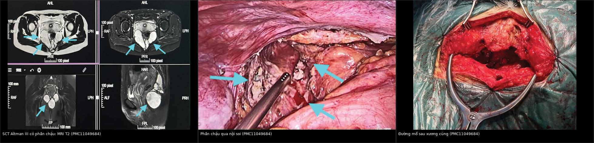
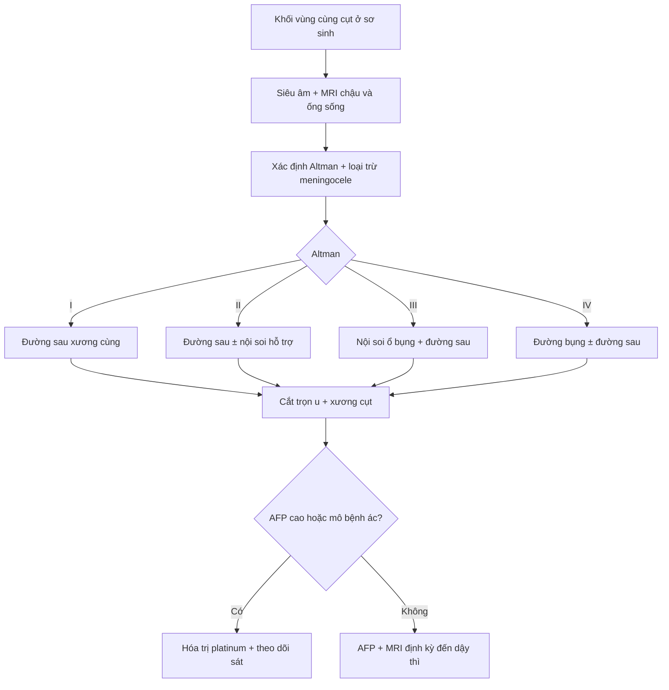
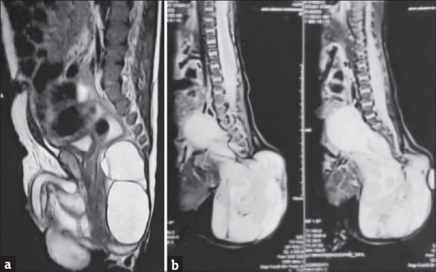
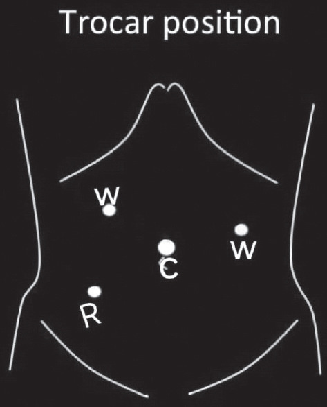

# 1701 — Đường mổ u quái cùng cụt: sau–qua xương cùng vs nội soi ổ bụng hỗ trợ / Surgical approach to sacrococcygeal teratoma

**Tags:** `pattern:khoi-truoc-xuong-cung` `pattern:u-nang-da-khoang` `vung:cung-cut` `score:Altman` `protocol:MRI-chau` `protocol:AFP` `incidentaloma:khong`

**Mức chắc chắn (certainty):** tổng hợp y văn (literature synthesis) — ghép loạt 95 ca đa trung tâm (PMC10506197), loạt 7 ca nội soi hỗ trợ (PMC11968056), 1 ca Altman III người lớn có đủ ảnh (PMC11049684) và 1 ca type IV sơ sinh (PMC13227553). Số liệu lấy từ toàn văn, không suy diễn ngoài nguồn.

## 1. Tổng hợp bệnh học – cơ chế hình ảnh

**Bệnh học.** U quái cùng cụt (sacrococcygeal teratoma — SCT) phát sinh từ **nút Hensen ở xương cụt**, chứa đủ 3 lá phôi. Đây là u hay gặp nhất ở sơ sinh với tần suất **1/40.000 trẻ sinh sống**, ưu thế nữ rõ (**74/95** ca trong loạt Ai Cập), **18%** có dị tật phối hợp (PMC10506197). Vì u xuất phát từ xương cụt, **cắt bỏ xương cụt là bắt buộc** — cả 95 ca trong loạt đều cắt u kèm xương cụt — nếu để lại xương cụt thì tái phát.

**Vì sao phải mổ sớm và trọn:** nguy cơ **ác tính hóa** (thành phần yolk sac), **vỡ u** khi u lớn, chảy máu, và **chèn ép trực tràng/bàng quang**. Tỷ lệ mô bệnh lành (mature) **82%**; tái phát tại chỗ **8,5%** ở theo dõi trung vị **57 tháng**, sống 5 năm **94%**, sống không biến cố **91%** (PMC10506197).

**Cơ chế hình ảnh — TẠI SAO tín hiệu như vậy:**

- **Nang dịch** trong u → **T2 rất sáng** (nước tự do), **T1 tối**; nhiều nang kích thước khác nhau tạo hình **đa thùy ("dough sign" trên siêu âm, "short line sign" khi có vách)** — ca người lớn PMC11049684 mô tả đúng các dấu này.
- **Mỡ trưởng thành** → **T1 sáng, T2 sáng, mất tín hiệu trên T1 fat-sat** — dấu hiệu của u quái trưởng thành, giúp phân biệt với nang đơn thuần.
- **Vôi hóa** → tối trên mọi chuỗi xung, **nhạy nhất trên CT**; là dấu hiệu mạnh của u quái (không có trong nang thần kinh màng não trước cùng).
- **Máu – đạm cao** → T1 sáng, T2 trung bình; **mức dịch–dịch** khi có chảy máu nhiều đợt.
- **Phần đặc** → T2 trung gian, ngấm thuốc; phần đặc lớn, không đều, kèm AFP cao gợi ý thành phần **ác tính (yolk sac)**.
- **Vì sao phải xem ống sống:** u có thể lan **trong ống sống (intradural)** hoặc kèm **meningocele trước cùng** — chọc/dẫn lưu nhầm nang thần kinh màng não gây viêm màng não; MRI là bắt buộc trước mổ.

**Ngưỡng và số liệu quyết định:**

| Chỉ số | Số liệu | Nguồn |
|---|---|---|
| Tần suất | **1/40.000** trẻ sinh sống; nữ 74/95 | PMC10506197 |
| Phân bố Altman | **74,7%** type I/II | PMC10506197 |
| Đường mổ trong thực hành | **75/95 (79%)** đường tầng sinh môn; **20/95 (21%)** phối hợp bụng–tầng sinh môn | PMC10506197 |
| Mô bệnh | mature **82%**; tái phát tại chỗ **8,5%** (trung vị 57 tháng); y văn **2–35%** | PMC10506197 |
| Di chứng chức năng | tiết niệu **7,4%** (5 ca Altman III, 2 ca IV); táo bón/đại tiện **12,6%** (8 ca III, 4 ca II) | PMC10506197 |
| Kết cục sau mổ | sống 5 năm **94%**, EFS **91%** | PMC10506197 |
| Nội soi hỗ trợ (n = 7) | mổ **2,7 giờ** (2–3,15 giờ); **không chảy máu trong mổ**; nằm viện trung vị **7 ngày**; **không** tiểu/đại tiện không tự chủ | PMC11968056 |

## 2. Mẫu hình + chẩn đoán phân biệt theo vị trí (gamut)

**Mẫu hình:** *khối vùng cùng cụt ở sơ sinh/nhũ nhi*, có thể **thấy được từ ngoài** hoặc **chỉ thấy trong khung chậu**, thường đa nang, có thành phần mỡ/vôi hóa. Việc chọn đường mổ **không dựa vào kích thước tuyệt đối** mà dựa vào **tỷ lệ phần ngoài / phần trong khung chậu** — chính là phân loại Altman:

- **Altman I:** chủ yếu ngoài, phần trước xương cùng nhỏ.
- **Altman II:** khối ngoài rõ + phần trong khung chậu đáng kể.
- **Altman III:** khối ngoài nhỏ nhưng **phần lớn nằm trong khung chậu**.
- **Altman IV:** hoàn toàn trước xương cùng, **không thấy khối ngoài** (dễ chẩn đoán muộn vì chỉ có bí tiểu/táo bón/khối bụng).

**Gamut theo khoang (khoang quyết định đường mổ):**

- **Khoang dưới cơ nâng (dưới sàn chậu):** SCT type I, lipoma, u mạch.
- **Khoang trước xương cùng trên cơ nâng:** SCT type II–IV, **nang thần kinh màng não trước cùng (anterior sacral meningocele)**, **nang đuôi (tailgut cyst)**, **trùng lặp trực tràng**, u quái trưởng thành, **u nguyên bào men**.
- **Trong ống sống:** lipomyelomeningocele, SCT lan trong màng cứng.
- **Xương cùng:** chordoma (người lớn), di căn, **bất sản xương cùng/Currarino** (kèm nang trước cùng + dị tật hậu môn trực tràng).

**Mnemonic "5 nang trước xương cùng"** — **S**CT, **M**eningocele, **T**ailgut cyst, **D**uplication trực tràng, **A**nterior sacral meningocele (trùng M) — điểm chung là đều là khối dịch T2 sáng; **chốt phân biệt bằng vôi hóa/mỡ (SCT), lỗ rò ra da (meningocele), vách mỏng không vôi (tailgut)**.

## 3. Bảng so sánh phân biệt (ma trận đối chiếu)

| Thực thể (entity) | Hình ảnh điển hình | Chốt vào (rule-in) | Chốt loại (rule-out) | Gợi ý xác nhận |
|---|---|---|---|---|
| **SCT Altman I** | Khối ngoài, đa nang ± mỡ ± vôi hóa; phần trước xương cùng nhỏ | **Khối ngoài + vôi hóa/mỡ + cuống từ xương cụt** | Khối hoàn toàn trong khung chậu (→ type III/IV) | MRI + AFP, mổ đường sau là đủ |
| **SCT Altman II** | Khối ngoài lớn + phần chậu vừa, đẩy trực tràng ra trước | **Phần ngoài ≥ phần chậu + mặt phẳng cắt qua cơ nâng thấy u** | Không có phần ngoài (→ type IV) | MRI sagittal; nội soi hỗ trợ khi phần chậu lớn |
| **SCT Altman III** | Khối ngoài nhỏ, **phần lớn trong khung chậu**, đè bàng quang/trực tràng | **Phần chậu > phần ngoài, u vượt qua cơ nâng** | Chỉ có khối ngoài (→ type I) | MRI + nội soi ổ bụng đánh giá phần trên |
| **SCT Altman IV** | Không khối ngoài; khối đa nang trước xương cùng, có thể lan ống sống | **Khối hoàn toàn trước cùng + AFP ± tăng** | Có khối ngoài (→ type I–III) | MRI toàn trục + CT xương cùng |
| **Nang thần kinh màng não trước cùng** | Nang dịch thông với ống sống qua **lỗ xương cùng**, bờ xương cùng gặm mòn | **Thấy cổ thông với ống sống trên MRI/CT myelography** | Không thông ống sống + có vôi hóa → SCT | MRI T2 sagittal + CT; **không chọc** |
| **Nang đuôi (tailgut cyst)** | Nang đơn/đa thùy, vách mỏng, **không vôi hóa, không mỡ**, thường ở người lớn | **Nang sạch, không thành phần u quái** | Có mỡ/vôi hóa → SCT | MRI + mô bệnh sau cắt |
| **Trùng lặp trực tràng** | Cấu trúc dạng ống có thành ruột, song song trực tràng | **Thành có lớp cơ, đồng tín hiệu với ruột** | Không có thành ruột → nang khác | MRI, nội soi trực tràng |
| **U quái ác tính/yolk sac** | Phần đặc lớn, ngấm thuốc, xâm lấn; **AFP rất cao** | **AFP tăng + phần đặc lớn** | AFP bình thường + u đa nang thuần → lành | AFP, mô bệnh, hóa trị platinum |
| **Currarino** | Bất sản xương cùng hình liềm + nang trước cùng + dị tật hậu môn | **Tam chứng trên phim/ MRI** | Không có bất sản xương cùng | MRI + X-quang cùng cụt |

*Trái: MRI T2 nhiều mặt phẳng — khối đa nang trước xương cùng, đẩy trực tràng ra trước. Giữa: phần khung chậu nhìn qua nội soi. Phải: đường mổ sau xương cùng hình chữ Y ngược. Nguồn: Medicine (Baltimore) 2024;103(17):e37887 (PMC11049684), CC BY 4.0. Ảnh ghép letterbox, giữ nguyên tỷ lệ.*

### Ba dấu hiệu quyết định đường mổ

- **Dấu "eo trên cơ nâng" (levator waist):** trên MRI sagittal, đoạn u thắt lại khi qua cơ nâng — nếu u chỉ nằm dưới cơ nâng thì đường sau đơn thuần đủ; nếu u **vượt lên trên** thì phải tính đường bụng/nội soi.
- **Dấu "đẩy trực tràng":** trực tràng bị đẩy ra trước và dẹt — mức độ đẩy phản ánh thể tích phần chậu, quyết định có cần nội soi hay không.
- **Dấu "mất liên tục xương cùng":** gợi ý meningocele/Currarino — **chống chỉ định chọc hút** và phải mổ có phối hợp thần kinh ngoại.

## 4. Protocol chụp + hệ phân độ/điểm chuẩn hóa

### 4.1 Protocol hình ảnh và xét nghiệm

- **Trước sinh:** siêu âm hình thái; MRI thai khi u lớn, có thành phần đặc, hoặc nghi suy tim thai do shunt.
- **Sau sinh:** siêu âm qua tầng sinh môn/bụng (đo nang, mỡ, vôi hóa) → **MRI chậu – cùng cụt** (T1, T2, T1 fat-sat, ± đối quang; **cắt qua toàn bộ ống sống** để loại trừ lan màng cứng).
- **CT xương cùng** khi MRI không rõ vôi hóa/bất sản xương cùng, hoặc để quy hoạch cắt xương cụt.
- **AFP huyết thanh trước mổ (baseline)** — tăng gợi ý thành phần yolk sac; **theo dõi AFP** sau mổ là chỉ dấu tái phát ác tính.
- **Đánh giá chức năng trước mổ:** siêu âm thận, bàng quang; hỏi táo bón/bí tiểu; không cần niệu động học thường quy.

### 4.2 Phân loại Altman = công cụ chọn đường mổ

| Altman | Vị trí | Đường mổ chuẩn | Ghi chú |
|---|---|---|---|
| **I** | Chủ yếu ngoài | **Đường sau xương cùng** (đường giữa hoặc chữ V/chevron) | Cắt u + xương cụt; đóng cân – da 2 lớp |
| **II** | Ngoài + phần chậu | **Đường sau ± nội soi hỗ trợ** | Nội soi khi phần chậu lớn, u vượt cơ nâng |
| **III** | Phần lớn trong chậu, ngoài nhỏ | **Nội soi ổ bụng + đường sau xương cùng** | Nội soi giải phóng phần trên, kiểm soát động mạch cùng giữa |
| **IV** | Hoàn toàn trước cùng | **Đường bụng (mở/nội soi) ± đường sau** | Nguy cơ lan ống sống; phối hợp ngoại thần kinh khi cần |

### 4.3 Kỹ thuật then chốt (loạt 7 ca nội soi hỗ trợ)

- **Tư thế:** nằm ngửa cho phần nội soi, sau đó đổi tư thế sấp cho đường sau.
- **4 trocar:** 1 trocar camera rốn, 2 trocar 5 mm cạnh trực tràng, 1 trocar 5 mm hố chậu phải; **CO₂ 10–12 mmHg**.
- **Bước quan trọng:** khâu treo **tử cung (bé gái) hoặc bàng quang (bé trai)** và **trực tràng** vào thành bụng trước để mở rộng khoang sau trực tràng; **bộc lộ và cắt động mạch cùng giữa (median sacral artery)**; **bảo tồn đám rối thần kinh trước cùng** bằng cách bám sát vỏ u; giải phóng u bằng điện đơn cực/dao siêu âm.
- **Sau đó:** đường sau xương cùng lấy trọn u + **xương cụt**, đóng cân – da, dẫn lưu.
- **Số liệu loạt 7 ca:** mổ **2,7 giờ**; **không truyền máu**; 71,43% ăn lại bình thường trong 3 ngày; nằm viện trung vị **7 ngày**; 2 ca hở vết mổ tầng sinh môn (điều trị tại chỗ); **không ca nào tiểu/đại tiện không tự chủ**. **Hạn chế:** n = 7, không có nhóm chứng, thời gian theo dõi ngắn — **không được kết luận nội soi ưu thế tuyệt đối** so với mổ mở.

### 4.4 Theo dõi sau mổ

- **AFP + siêu âm mỗi 3 tháng trong năm đầu**, **MRI ở 6 tháng**; sau đó **hàng năm đến hết tuổi dậy thì** (tái phát muộn đã được báo cáo tới 13% ở 5 năm).
- Đánh giá chức năng: hỏi tiểu/đại tiện mỗi lần khám; niệu động học khi có triệu chứng; **nguy cơ cao hơn ở Altman III/IV** — tư vấn trước mổ.

## 5. Biến thể bình thường và cạm bẫy

**Biến thể bình thường / lành tính dễ nhầm:**

- **Nang cùng cụt đơn thuần (sacrococcygeal cyst)** ở da: không thông ống sống, không có mỡ/vôi hóa bên trong.
- **Mỡ cùng cụt (sacral lipoma)** không có thành phần nang — T1 sáng đồng nhất, mất tín hiệu fat-sat.
- **U quái trưởng thành hoàn toàn nang (type IV)** có thể chỉ là một nang đơn thuần **7,0 × 3,9 cm** ở sơ sinh và được xử lý nội soi hỗ trợ (PMC13227553) — nhưng **vẫn phải cắt xương cụt**.

**Cạm bẫy (pitfall):**

- **Bỏ sót xương cụt:** tái phát 2–35%; đây là lỗi kỹ thuật hay gặp nhất và phòng được.
- **Vỡ u/thành u tràn trong mổ:** làm tăng tái phát — thao tác **en bloc**, không chọc hút u để "thu nhỏ".
- **Chọc hút nang thần kinh màng não trước cùng:** viêm màng não, rò dịch não tủy — luôn xem ống sống trên MRI.
- **Đọc Altman thấp hơn thực tế:** khối ngoài to che mất phần chậu (type III bị gọi là I) → mổ đường sau không lấy hết phần trên, tái phát; **luôn cắt MRI sagittal qua cơ nâng**.
- **Tổn thương thần kinh trước cùng:** rối loạn cương, bí tiểu, táo bón — bám sát vỏ u, không cắt rộng mô thần kinh.
- **Động mạch cùng giữa:** nguồn chảy máu chính khi u lớn; cần xác định và cắt có kiểm soát.
- **Hạ thân nhiệt và mất máu ở sơ sinh:** u lớn có thể chứa vài trăm mL; chuẩn bị máu, làm ấm phòng mổ.
- **Đóng da căng sau cắt u lớn:** hở vết mổ (2/7 ca trong loạt nội soi) — cân nhắc chuyển vạt/đóng đường giữa có kế hoạch.
- **Người lớn có khối trước cùng:** gamut khác (chordoma, tailgut, GIST) — **không mặc định là SCT** dù mô bệnh sau mổ là u quái.

## 6. Tự lượng giá — Blind Quiz

**Ca 1 — Sơ sinh 56 ngày, khối vùng cùng cụt. Nhìn MRI, phân loại Altman trước rồi mới mở đáp án.**

- Gợi ý lâm sàng: khối thấy rõ từ ngoài, không liệt chi dưới.
- Câu hỏi: (a) và (b) là Altman type nào? Dấu hiệu nào quyết định? Đường mổ tương ứng?

<b>Bấm để hiện đáp án (findings + chẩn đoán)</b>

- Dấu hiệu: (a) khối chủ yếu **trong khung chậu**, phần ngoài nhỏ → **Altman III**; (b) khối **ngoài lớn** kèm phần trước xương cùng → **Altman II**.
- Chốt: tỷ lệ phần ngoài/phần chậu trên MRI sagittal và việc u có vượt qua **cơ nâng** hay không.
- Đường mổ: III → **nội soi ổ bụng + đường sau xương cùng**; II → **đường sau ± nội soi hỗ trợ**; luôn **cắt xương cụt**.
- Nguồn ảnh: J Indian Assoc Pediatr Surg 2025;30(2):215–219 (PMC11968056), CC BY-NC-SA 4.0.

**Ca 2 — Cùng bệnh nhân Altman III. Ảnh dưới đây cho thấy gì và vì sao phải làm cả hai thì?**

- Gợi ý: u đa nang, đẩy trực tràng ra trước, phần ngoài nhỏ.
- Câu hỏi: Thứ tự hai thì? Cấu trúc nào phải kiểm soát và bảo tồn? Đường rạch da nào hay được dùng?

<b>Bấm để hiện đáp án</b>

- Dấu hiệu: MRI T2 — khối đa nang trước xương cùng, đẩy trực tràng; nội soi — phần chậu nằm sau trực tràng; đường mổ — rạch da **hình chữ Y ngược** cạnh xương cùng.
- Thứ tự: **thì bụng (nội soi) trước** để giải phóng phần trên và kiểm soát **động mạch cùng giữa**, rồi **thì sau xương cùng** lấy trọn u + xương cụt.
- Bảo tồn: **đám rối thần kinh trước cùng** và niệu quản; khâu treo trực tràng/tử cung – bàng quang vào thành bụng để mở khoang.
- Nguồn ảnh: Medicine (Baltimore) 2024;103(17):e37887 (PMC11049684), CC BY 4.0. Ảnh ghép letterbox.

**Ca 3 — Bố trí trocar dưới đây dùng cho bước nào, và vì sao lại đặt trocar như vậy?**

- Gợi ý: bệnh nhi 8 ngày–1,5 tuổi; u Altman II–III.
- Câu hỏi: 4 trocar nằm ở đâu? Vì sao cần treo trực tràng? Nguy cơ chính của thì nội soi?

<b>Bấm để hiện đáp án</b>

- Bố trí: **1 trocar camera ở rốn**, **2 trocar 5 mm cạnh trực tràng** (trái/phải), **1 trocar 5 mm hố chậu phải**; bơm **CO₂ 10–12 mmHg**.
- Vì sao treo trực tràng: kéo trực tràng lên thành bụng trước để **mở rộng khoảng sau trực tràng**, giúp bộc lộ u và động mạch cùng giữa an toàn.
- Nguy cơ: chảy máu từ **động mạch cùng giữa**, tổn thương thần kinh trước cùng, tràn khí/hạ thân nhiệt ở sơ sinh; trong loạt 7 ca **không có chảy máu trong mổ** và **không tiểu/đại tiện không tự chủ**.
- Nguồn ảnh: J Indian Assoc Pediatr Surg 2025;30(2):215–219 (PMC11968056), CC BY-NC-SA 4.0.

## Bài liên quan chéo

- [680 – U quái cùng cụt: chẩn đoán, phân loại Altman, nguy cơ ác tính & AFP](../680-u-quai-cung-cut-o-tre/lesson.md) — bài nền về **chẩn đoán**; bài này trả lời **mổ đường nào**.
- [674 – U quái tế bào mầm gan ở trẻ](../674-u-quai-te-bao-mam-gan-o-tre/lesson.md) — cùng nhóm u tế bào mầm, khác vị trí và cách theo dõi AFP.
- [673 – Chuyển tiếp người lớn – spina bifida – bàng quang thần kinh](../673-chuyen-tiep-nguoi-lon-spina-bifida-bang-quang-than-kinh/lesson.md) — theo dõi chức năng tiết niệu dài hạn.
- [672 – Biến chứng muộn sau tái tạo bàng quang](../672-bien-chung-muon-sau-tai-tao-bang-quang/lesson.md) — xử trí khi có bí tiểu/tiểu không tự chủ sau mổ.
- [646 – Hội chứng khoang bụng ở trẻ](../646-hoi-chung-khoang-bung-o-tre/lesson.md) — biến chứng áp lực sau mổ lớn ở sơ sinh.
- [1681 – Di chứng muộn niệu–sinh dục ở bé gái sau chấn thương khung chậu](../1681-di-chung-muon-nieu-sinh-duc-be-gai-sau-chan-thuong-khung-chau/lesson.md) — bảo tồn chức năng vùng chậu, đối chiếu cách tiếp cận khung chậu ở trẻ.
- [1705 – Theo dõi tiết niệu – đại tiện dài hạn sau cắt u quái cùng cụt](../1705-theo-doi-tiet-nieu-dai-tien-sau-cat-u-quai-cung-cut/lesson.md) — **sau mổ**: LUTD 19,6%, bàng quang thần kinh, tủy bám thấp, bậc thang TAI → ACE.

## Ảnh

- `1701_u-quai-cung-cut_MRI-PMC11049684-Fig4.jpg` — MRI T2 đa mặt phẳng, u đa nang trước xương cùng (CC BY 4.0).
- `1701_u-quai-cung-cut_noi-soi-PMC11049684-Fig5.jpg` — phần khung chậu nhìn qua nội soi (CC BY 4.0).
- `1701_u-quai-cung-cut_duong-mo-PMC11049684-Fig8.jpg` — đường mổ sau xương cùng hình chữ Y ngược (CC BY 4.0).
- `1701_u-quai-cung-cut_MRI-Altman-PMC11968056-Fig2.jpg` — MRI Altman III (a) và II (b) (CC BY-NC-SA 4.0).
- `1701_u-quai-cung-cut_so-do-cong-PMC11968056-Fig3.jpg` — sơ đồ 4 trocar (CC BY-NC-SA 4.0).
- `composite_1701_MRI-noi-soi-duong-mo.jpg` — ảnh ghép letterbox từ 3 ảnh cùng bài PMC11049684.

> Không dùng để chẩn đoán độc lập khi chưa có người hướng dẫn.
