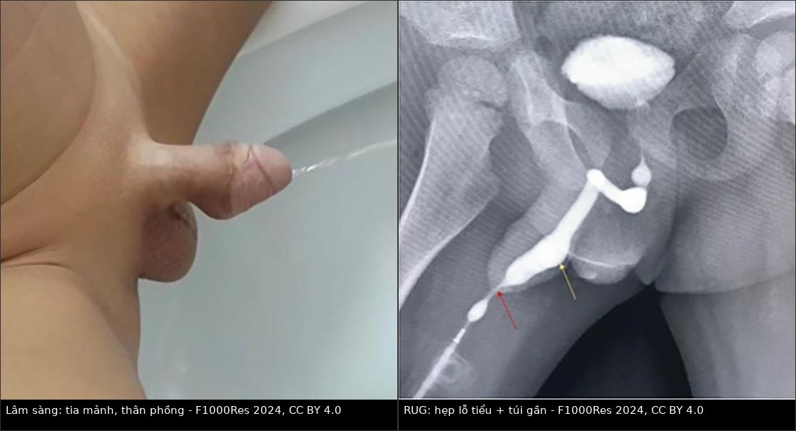
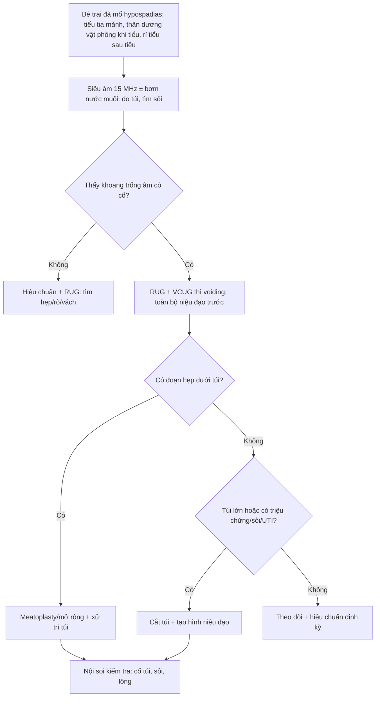
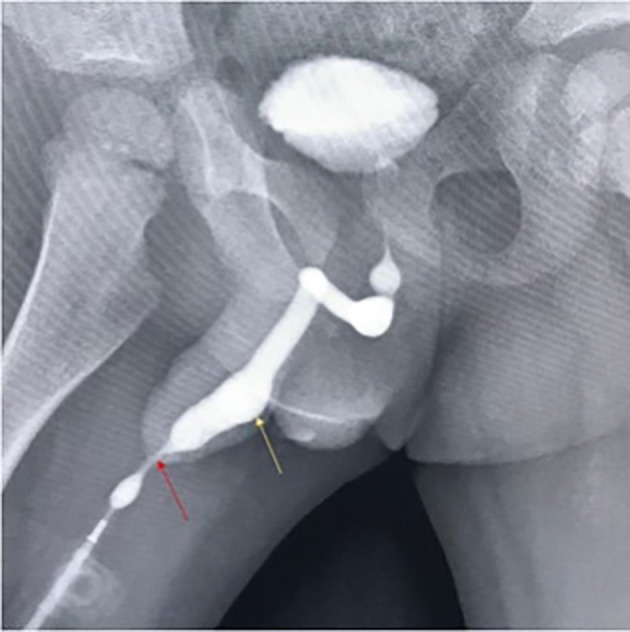
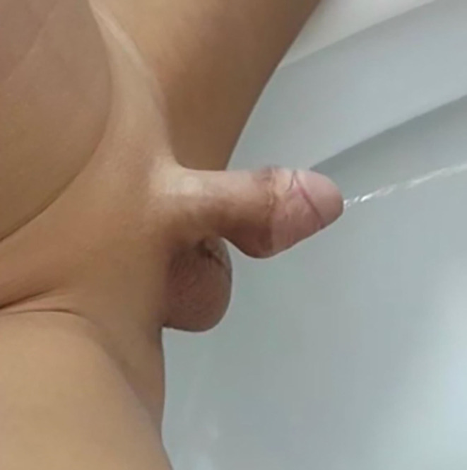
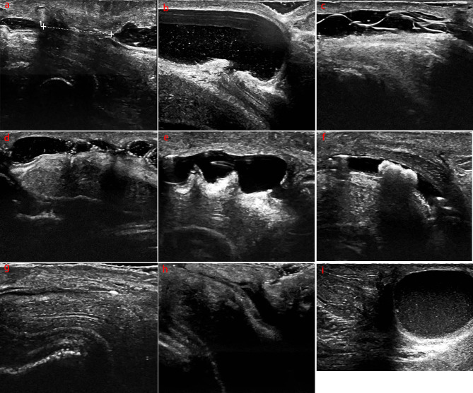

# 1702 — Túi niệu đạo sau tạo hình niệu đạo ở trẻ / Urethral diverticulum after hypospadias repair

**Tags:** `pattern:tui-nieu-dao` `pattern:hep-nieu-dao` `pattern:tia-tieu-manh` `pattern:u-dich-sau-tieu` `vung:duong-vat` `vung:khung-chau` `protocol:RUG` `protocol:VCUG` `protocol:sieu-am-tan-so-cao` `protocol:noi-soi-nieu-dao` `incidentaloma:khong`

**Mức chắc chắn (certainty):** tổng hợp y văn (literature synthesis) — ghép **2 ca nguyên văn có ảnh** (bé trai 2 tuổi sau TIP, PMC11231625; nam 45 tuổi sau mổ 2 thì, PMC10715992 làm mốc dài hạn), **1 loạt 159 trẻ** có phân tích đa biến (PMC12124023) và **1 loạt 121 trẻ** siêu âm tần số cao (PMC11165801). Mọi con số dưới đây lấy từ các bài ghi trong `sources.md`; chỗ nào nguồn không nói rõ thì ghi "chưa rõ".

## 1. Tổng quan bệnh học – cơ chế hình ảnh

**Túi niệu đạo (urethral diverticulum, UD) là gì?** Một khoang lót niêm mạc niệu đạo lồi ra ngoài lòng niệu đạo thật, **thông với lòng niệu đạo bằng một cổ**. Sau tạo hình niệu đạo (urethroplasty) vì lỗ tiểu lệch thấp (hypospadias — dị tật sinh dục nam hay gặp nhất, tần suất tăng liên tục 1980–2010), đây là biến chứng **hiếm nhưng để lại di chứng cơ năng nặng**: ứ nước tiểu, nhiễm trùng, sỏi, rỉ tiểu sau khi tiểu.

**Vì sao túi hình thành — chuỗi ba bước:**

1. **Tắc nghẽn hạ lưu tương đối (distal obstruction).** Lỗ tiểu hẹp (meatal stenosis) hoặc hẹp ngay sau mào quy đầu làm **áp lực đẩy nước tiểu tăng**; đoạn niệu đạo tái tạo **thành mỏng, ít mô đệm đỡ (unsupported)** là nơi giãn trước tiên. Trong loạt 159 trẻ, **4/14 (28,57%)** ca UD có hẹp lỗ tiểu/ven mào quy đầu, và túi xuất hiện **khoảng 1 tháng sau** khi phát hiện tia tiểu mảnh, tiểu khó (PMC12124023). Hẹp là **yếu tố độc lập** với **OR = 10,010 (95% CI 1,554–64,470)**.
2. **Niệu đạo tái tạo quá rộng hoặc vỏ bọc kém.** Mảnh ghép/vạt thiếu máu nuôi, hoặc mô ghép bị "căng" quanh niệu đạo mới → chỗ yếu phình ra khi có áp lực. Ghép vạt **MOIF (modified onlay island flap)** có **OR = 10,670 (1,913–59,505)**; riêng **TPIF** chỉ **1,96%** (PMC12124023).
3. **Chênh lệch giữa dung tích và đường thoát.** Khi cổ túi hẹp hơn thân túi, nước tiểu **vào dễ, ra khó** → túi to dần theo thời gian, không tự khỏi.

**Vì sao tín hiệu/hình ảnh lại như vậy (giải thích TẠI SAO):**

- **Niệu đạo niệu đồ ngược dòng (retrograde urethrogram, RUG) và VCUG:** cản quang iod (đậm độ **> 1.000 HU** trên CT, cản quang mạnh trên X-quang) điền đầy lòng niệu đạo → chỗ **giãn khu trú** hiện thành **bóng cản quang hình túi/bầu** gắn vào trục niệu đạo qua **cổ hẹp**. Vì chất lỏng chảy theo **đường trở lực thấp nhất**, khi bơm ngược dòng túi sẽ đầy **trước** khi qua được chỗ hẹp phía dưới — nên phải chụp **thì đang bơm/đang đi tiểu (voiding)**, không chỉ một phim sớm.
- **Siêu âm tần số cao (15 MHz):** nước tiểu là **dịch thuần, không echo** → túi là **khoang trống âm (anechoic)**, bờ đều, **nối với lòng niệu đạo bằng cổ**; bơm nước muối sinh lý vào niệu đạo (sonourethrography) làm khoang căng rõ và cho **đo đường kính chính xác** bằng mm. Sỏi trong túi: **echo dày + bóng cản âm phía sau (posterior acoustic shadowing)** do canxi hấp thu sóng âm mạnh; lông niệu đạo (biến chứng của vạt da có nang lông): **cấu trúc đường thẳng echo dày** — dễ nhầm với vật lạ.
- **Cộng hưởng từ (MRI):** nước tiểu **T2 rất sáng**, túi thành mỏng; nhưng **không cần thiết** cho chẩn đoán thường quy và ở trẻ cần an thần — chỉ dùng khi cần đánh giá mô mềm phức tạp (rò, ổ áp-xe, dị tật phối hợp).
- **Xơ/hẹp:** collagen cũ → **T2 tối**, **đậm độ mô mềm trên CT**, **echo dày trên siêu âm**; đoạn hẹp thường **ngắn, khu trú** ngay sau lỗ tiểu.

**Ngưỡng định lượng cần nhớ:**

| Chỉ số | Số liệu | Nguồn |
|---|---|---|
| Biến chứng chung sau mổ hypospadias | **8–56%** | PMC12124023 |
| Tần suất UD sau tạo hình niệu đạo có cắt dải niệu đạo (DUP) | y văn **1,5–14%**; loạt 159 trẻ: **8,64% (14/159)** | PMC12124023 |
| Thời điểm xuất hiện túi sau mổ cuối | **1–22 tháng**, trung bình **8,50 ± 6,61 tháng** | PMC12124023 |
| Tuổi mổ lần đầu | **6–83 tháng**, trung bình **24,13 ± 16,30 tháng** (n = 159) | PMC12124023 |
| Yếu tố độc lập của UD | **bề ngang quy đầu** OR **0,444 (0,220–0,895)**/mm · **BMI** OR **1,808 (1,318–2,481)** · **MOIF** OR **10,670 (1,913–59,505)** · **hẹp niệu đạo** OR **10,010 (1,554–64,470)** | PMC12124023 |
| Triệu chứng khi có túi | phồng mặt bụng dương vật khi tiểu **100% (14/14)** · tia chẻ như vòi sen **64,29%** · tia lệch **28,57%** · tiểu khó/tia mảnh **28,57%** · viêm đường tiểu **14,29%** · sỏi niệu đạo **7,14%** | PMC12124023 |
| Số mổ phải chịu (tính đến khi phát hiện UD) | **1–4 lần**, trung bình **2,43 ± 0,94** | PMC12124023 |
| Siêu âm 15 MHz sau mổ hypospadias (n = 121) | hẹp niệu đạo **26 (21,5%)** · ứ nước tiểu trong niệu đạo **12 (9,9%)** · vách trong lòng **17 (14,0%)** · lông niệu đạo **6 (5,0%)** · **túi niệu đạo 2 (1,65%)** · giãn khu trú 2 (1,65%) · sỏi 1 · canxi hóa 1 | PMC11165801 |
| Diễn tiến rất muộn | nam 45 tuổi, mổ 2 thì lúc **3 tuổi**, nhập viện vì tắc nghẽn **42 năm sau** — sỏi trong túi + hẹp | PMC10715992 |

## 2. Mẫu hình + chẩn đoán phân biệt theo vị trí (gamut)

**Mẫu hình chung:** *bé trai đã mổ hypospadias, tiểu tia mảnh, **thân dương vật phồng lên khi đang tiểu** rồi xẹp đi, kèm **rỉ nước tiểu sau khi tiểu** (post-void dribbling) và đôi khi phải **bóp nặn** cho hết nước.*

Ba câu hỏi phải trả lời trước khi đặt tên:

1. **Túi ở tầng nào?** (lỗ tiểu → hố thuyền (fossa navicularis) → niệu đạo dương vật → niệu đạo hành)
2. **Có tắc phía dưới túi không?** (không trả lời câu này thì mổ cắt túi sẽ tái phát)
3. **Có sỏi/lông/túi thừa thứ hai không?** (quyết định có phải mở niệu đạo rộng hơn)

**Gamut theo vị trí:**

- **Lỗ tiểu (meatus) – ven mào quy đầu:** **hẹp lỗ tiểu** đơn thuần (không có túi), sẹo xơ sau cắt bao quy đầu ở trẻ hypospadias.
- **Hố thuyền (fossa navicularis):** **túi nhỏ** ngay sau lỗ tiểu (thường do hẹp lỗ tiểu), **giãn khu trú** thoáng qua; vách niệu đạo bẩm sinh.
- **Niệu đạo dương vật (thân):** **túi niệu đạo sau tạo hình** (vị trí hay gặp nhất, đúng nơi đặt mảnh ghép), **rò niệu đạo–da** (lỗ rò ở mặt bụng, nước tiểu phụt ra ngoài chứ không phồng), **hẹp niệu đạo** dài.
- **Niệu đạo hành – hành xương mu:** **túi lớn + sỏi** (ứ đọng lâu), **van niệu đạo trước** (anterior urethral valve — giãn niệu đạo **phía trên van**, kèm bàng quang căng, trào ngược), **túi niệu đạo bẩm sinh** ở trẻ chưa mổ.
- **Ngoài niệu đạo (dễ nhầm trên lâm sàng):** **ứ nước tiểu trong niệu đạo** (pseudo-diverticulum — thấy trên siêu âm 9,9% loạt 121), **dị tật niệu đạo đôi (urethral duplication)**, nang ống niệu rốn tồn tại (patent urachus), **túi thừa bàng quang** (bladder diverticulum — vị trí trong khung chậu, không ở dương vật).

## 3. Bảng so sánh phân biệt (ma trận đối chiếu)

| Thực thể (entity) | Hình ảnh điển hình | Chốt vào (rule-in) | Chốt loại (rule-out) | Gợi ý xác nhận |
|---|---|---|---|---|
| **Túi niệu đạo sau tạo hình** | RUG/VCUG thì voiding: **bóng hình túi/bầu** gắn vào trục niệu đạo bằng **cổ hẹp**, thường có **đoạn hẹp ngay dưới**; siêu âm 15 MHz: khoang trống âm nối lòng niệu đạo | **Phồng mặt bụng dương vật khi tiểu + rỉ tiểu sau tiểu + tiền sử mổ hypospadias** | Không có cổ thông với lòng niệu đạo (giãn khu trú lan tỏa) | RUG thì voiding + nội soi niệu đạo (thấy cổ túi) |
| **Hẹp lỗ tiểu/niệu đạo (meatal stenosis, stricture)** | Tia cản quang **mảnh như sợi chỉ**, niệu đạo **giãn nhẹ phía trên** nhưng **không có cổ túi**; không phồng khi tiểu | **Tia mảnh + khó tiểu + đặt nong có trở lực** | Túi có cổ + phồng khi tiểu | Hiệu chuẩn (calibration) bằng nong, nội soi |
| **Rò niệu đạo–da (urethrocutaneous fistula)** | Cản quang thoát ra **mặt da** qua lỗ rò; **không có khoang kín** | **Nước tiểu phụt ra ngoài khi tiểu**, ướt quần lót, thấy lỗ rò trên da | Túi kín (cản quang đọng trong khoang, không ra da) | RUG + test xanh methylene, nội soi |
| **Sỏi niệu đạo** | Cản quang: **khuyết cản quang (filling defect)** trong túi hoặc lòng niệu đạo; siêu âm: echo dày + **bóng cản âm sau** | **Đau, bí tiểu cấp, sờ thấy cục cứng dọc niệu đạo** | Dịch thuần (không có echo/bóng cản âm) | Siêu âm, nội soi, X-quang không chuẩn bị |
| **Lông niệu đạo/bezoar (hair in neourethra)** | Siêu âm: **đường thẳng echo dày** trong lòng; nội soi: búi lông | Tiền sử **vạt da có nang lông** (TPIF/MOIF) + nhiễm trùng tái diễn | Tổn thương có bóng cản âm (sỏi) | Nội soi niệu đạo |
| **Vách/gờ niệu đạo (intraurethral septum/fold)** | Siêu âm: **dải echo dày vắt ngang lòng**, không phải khoang | **Hẹp dòng chảy tại chỗ, không ứ đọng** | Không có khoang kín | Nội soi |
| **Van niệu đạo trước (anterior urethral valve)** | VCUG: niệu đạo **giãn rộng phía trên van**, van hình **nắp/nêm**; bàng quang căng, có thể trào ngược | **Trẻ nhỏ, bí tiểu, nhiễm trùng, suy thận** (không có tiền sử mổ) | Tiền sử mổ hypospadias + cổ túi rõ | VCUG thì voiding, nội soi |
| **Túi niệu đạo bẩm sinh (congenital)** | Túi lớn, thành mỏng, thường **kèm hẹp/van**; phát hiện ở trẻ chưa mổ | **Chưa có phẫu thuật niệu đạo** | Đã mổ tạo hình tại đúng vị trí túi | VCUG, nội soi |

*Trái: đang đi tiểu — tia nước **rất mảnh** trong khi thân dương vật **căng phồng** (túi đầy). Phải: RUG — **hẹp lỗ tiểu** (mũi tên đỏ) và **túi niệu đạo gần** (mũi tên vàng) đổ đầy cản quang. Nguồn: F1000Research 2024;13:222 (PMC11231625), CC BY 4.0. Ảnh ghép letterbox, giữ nguyên tỷ lệ.*

### Ba dấu hiệu quyết định trên ảnh

- **Dấu "bóng bay" (ballooning) khi voiding:** túi chỉ đầy ở **thì đi tiểu**, xẹp ở thì nghỉ — nếu chỉ chụp phim sớm lúc bơm, túi có thể **chưa đầy** và bị bỏ sót.
- **Cổ túi (neck) hẹp hơn thân túi:** đây là dấu **phân biệt với giãn khu trú** (chỉ là niệu đạo rộng ra, không có cổ); nội soi xác nhận.
- **Đoạn hẹp ngay dưới túi:** bắt buộc phải tìm — quyết định có **mở rộng lỗ tiểu/meatoplasty** cùng lúc hay không (nếu không, túi tái phát).

## 4. Protocol chụp + hệ phân độ/điểm chuẩn hóa

### 4.1 Protocol hình ảnh

- **Bước 1 — Siêu âm tần số cao (15 MHz, đầu dò thẳng) ± bơm nước muối sinh lý vào niệu đạo (sonourethrography):** đo **đường kính túi (mm)**, chiều dài, độ dày thành, tìm **sỏi** (echo + bóng cản âm) và **ứ nước tiểu sau tiểu** (thể tích tồn dư). Đây là bước **không bức xạ, làm lại được nhiều lần** — ưu tiên ở trẻ (ALARA).
- **Bước 2 — Niệu đạo niệu đồ ngược dòng (RUG) ± VCUG:** bơm cản quang qua lỗ tiểu (RUG) để điền đầy **toàn bộ niệu đạo trước**; nếu nghi tổn thương **niệu đạo sau/bàng quang** thì làm **VCUG thì voiding**. Bắt buộc **≥ 2 phim: lúc đang bơm và lúc đi tiểu/rặn** — đây là điểm quyết định.
- **Bước 3 — Nội soi niệu đạo (urethroscopy) ± calibration bằng nong:** xác nhận **cổ túi**, đoạn hẹp phía dưới, sỏi/lông, và loại trừ rò.
- **Bước 4 — Chỉ định mổ:** túi **lớn + tiểu khó/tái phát nhiễm trùng/sỏi** → cắt túi + tạo hình niệu đạo + **meatoplasty**; túi nhỏ, không triệu chứng → **theo dõi** (trong loạt 14 ca: 9 ca được can thiệp/mổ, 4 ca theo dõi tiếp — PMC12124023).
- **Không dùng CT thường quy:** liều tuyến sinh dục ở trẻ; chỉ CT khi cần xương/ổ phức tạp.

### 4.2 Hệ phân độ/điểm chuẩn hóa

**Hiện chưa có hệ phân độ (grading) được kiểm chứng riêng cho túi niệu đạo sau tạo hình** — các bài trong `sources.md` phân tầng theo **kích thước + triệu chứng + có tắc nghẽn dưới**, không theo điểm số. Ghi rõ như vậy thay vì bịa một "RADS". Khung phân tầng thực hành (dựa trên tiêu chí mổ của loạt 159 trẻ):

| Tầng | Tiêu chí | Hướng xử trí |
|---|---|---|
| **Nhỏ, không triệu chứng** | Chỉ thấy trên siêu âm, không phồng khi tiểu, không rỉ tiểu | Theo dõi + hiệu chuẩn định kỳ |
| **Có triệu chứng, không tắc nghẽn** | Phồng khi tiểu, tia chẻ/lệch, rỉ sau tiểu | Cân nhắc cắt túi + tạo hình khi túi lớn |
| **Có tắc nghẽn dưới** | Hẹp lỗ tiểu/ven mào quy đầu (28,57% ca UD) | **Mở rộng lỗ tiểu/meatoplasty** + xử trí túi |
| **Biến chứng** | Sỏi (7,14%), nhiễm trùng tái diễn (14,29%) | Mổ: lấy sỏi + cắt túi/tạo hình |

## 5. Biến thể bình thường và cạm bẫy

**Biến thể "bình thường" dễ nhầm:**

- **Ứ nước tiểu trong niệu đạo sau tiểu (intraurethral urine accumulation):** gặp **12/121 (9,9%)** trẻ sau mổ — trên siêu âm là khoang trống âm **dọc lòng niệu đạo**, không có cổ, tự xẹp khi rặn tiểu lần hai. Đừng gọi là túi.
- **Giãn khu trú nhẹ (local urethral dilation) 2/121:** niệu đạo rộng ra **không có cổ**, thường do đoạn hẹp phía dưới; xử trí hẹp là đủ.
- **Vách/gờ trong lòng (17/121 và 2/121):** dải niêm mạc vắt ngang, không phải khoang.
- **Bóng catheter:** bóng của ống thông niệu đạo khi bơm cản quang tạo **khuyết cản quang tròn nhẵn** — không phải sỏi; rút bóng rồi chụp lại.

**Cạm bẫy (pitfall):**

- **Chỉ chụp một phim RUG lúc bơm:** túi chưa đầy → **âm tính giả**; phải có phim **đang đi tiểu**.
- **"Satisfaction of search":** đã thấy hẹp lỗ tiểu là dừng, không nhìn tiếp lên trên tìm túi — trong loạt 159 trẻ, **1/3 ca UD** đi kèm hẹp, nên thấy hẹp phải **chủ động tìm túi**.
- **Bỏ sót sỏi trong túi:** 7,14% ca UD có sỏi; siêu âm thấy echo + bóng cản âm — đừng chỉ đo kích thước túi.
- **Nhầm lông niệu đạo với sỏi:** lông là **đường thẳng echo dày, không có bóng cản âm**; sỏi có bóng. Điều trị khác nhau (sỏi: lấy sỏi; lông: cắt búi lông + có thể phải thay vạt).
- **Đặt ống thông "chữa khỏi":** ống thông làm xẹp túi tạm thời, triệu chứng giảm → tưởng ổn; khi rút ống túi đầy lại. Đánh giá phải **sau khi bỏ ống**.
- **Hẹp tái phát sau cắt túi:** nếu không giải quyết tắc nghẽn dưới, túi quay lại; phải kiểm tra **hiệu chuẩn lỗ tiểu** trong mổ.
- **Túi "im lặng" nhiều năm:** ca nam 45 tuổi chỉ nhập viện **42 năm** sau mổ — không được nói với gia đình là "hết nguy cơ sau 1 năm".

## 6. Tự lượng giá — Blind Quiz

**Ca 1 — Bé trai 2 tuổi, mổ tạo hình niệu đạo (TIP) lúc 18 tháng. Một năm sau: tia tiểu mảnh như kim, thân dương vật phồng lên khi tiểu, rỉ nước tiểu sau tiểu, phải bóp nặn. Ảnh RUG dưới đây cho thấy gì?**

- Gợi ý lâm sàng: siêu âm có **thể tích tồn dư sau tiểu tăng**, thành bàng quang dày.
- Câu hỏi: Tổn thương nằm ở đâu, hình dạng gì? Ba chẩn đoán phân biệt? Dấu hiệu nào chốt chẩn đoán?

<b>Bấm để hiện đáp án (findings + chẩn đoán)</b>

- Dấu hiệu: **hẹp lỗ tiểu** (mũi tên đỏ) — cột cản quang mảnh; ngay phía trên là **túi cản quang hình bầu** (mũi tên vàng) nối với trục niệu đạo. Bàng quang đầy, thành dày.
- Chẩn đoán: **túi niệu đạo sau tạo hình niệu đạo + hẹp lỗ tiểu**. Vì sao: hẹp lỗ tiểu làm tăng áp lực đẩy, đoạn niệu đạo tái tạo thành mỏng giãn thành túi; cản quang đọng trong túi vì cổ hẹp.
- Phân biệt: giãn khu trú (không có cổ), rò niệu đạo–da (cản quang ra da), ứ nước tiểu đơn thuần (không có khoang kín).
- Xử trí trong ca này: **cắt một phần túi + tạo hình niệu đạo, giữ dải niêm mạc giữa rộng 16 mm + meatoplasty**; 3 tháng sau tia tiểu bình thường, không phồng, không rỉ.
- Nguồn ảnh: F1000Research 2024;13:222 (PMC11231625), Fig. 5, CC BY 4.0.

**Ca 2 — Cùng bệnh nhân, ảnh chụp lúc đang đi tiểu. Bạn thấy gì, và vì sao dấu hiệu này quan trọng hơn cả kích thước túi?**

- Gợi ý: bố mẹ mô tả "cháu phải bóp cho hết nước".
- Câu hỏi: Mô tả tia nước và hình dạng thân dương vật. Dấu hiệu này gợi ý cơ chế gì?

<b>Bấm để hiện đáp án</b>

- Dấu hiệu: **tia nước rất mảnh, đi xa** (do hẹp lỗ tiểu tạo áp lực cao) trong khi **thân dương vật căng phồng ở mặt bụng** — túi đang đầy nước tiểu.
- Ý nghĩa: đây là **dấu hiệu lâm sàng đặc hiệu nhất** (100% ca trong loạt 159 trẻ có phồng mặt bụng khi tiểu); nó chứng minh có **khoang chứa** chứ không chỉ là niệu đạo hẹp. Kích thước túi một mình không quyết định mổ.
- Nguồn ảnh: F1000Research 2024;13:222 (PMC11231625), Fig. 4, CC BY 4.0.

**Ca 3 — Bộ ảnh siêu âm tần số cao (15 MHz) sau mổ hypospadias: 9 ô a–i. Ô nào là túi niệu đạo, ô nào dễ nhầm nhất với nó?**

- Gợi ý: 121 trẻ sau mổ; các ô lần lượt là hẹp niệu đạo, giãn khu trú, lông niệu đạo, vách, gờ, sỏi, canxi hóa, ứ nước tiểu, túi niệu đạo.
- Câu hỏi: Ô nào là túi? Hai ô nào dễ nhầm với túi nhất và phân biệt bằng gì?

<b>Bấm để hiện đáp án (findings + chẩn đoán)</b>

- Dấu hiệu: **ô (i)** — khoang trống âm lớn, bờ đều, **thông với lòng niệu đạo**; **ô (h)** — ứ nước tiểu trong lòng niệu đạo (dọc theo niệu đạo, không có cổ); **ô (b)** — giãn khu trú (không cổ, thường do hẹp dưới).
- Chẩn đoán: **túi niệu đạo (i)**; phân biệt với **ứ nước tiểu (h)** và **giãn khu trú (b)** bằng **cổ túi + hình dạng túi + có/không xẹp khi rặn tiểu**.
- Vì sao quan trọng: nếu gọi (h) là túi, trẻ bị mổ oan; nếu bỏ (i), trẻ tiếp tục ứ nước tiểu, nhiễm trùng và sỏi.
- Nguồn ảnh: BMC Urology 2024;24:121 (PMC11165801), Fig. 1, CC BY 4.0.

## Bài liên quan chéo

- [642 – Biến chứng muộn chấn thương niệu đạo nhi](../642-bien-chung-muon-chan-thuong-nieu-dao-nhi/lesson.md) — hẹp niệu đạo và tiểu không tự chủ sau chấn thương: cùng nhóm "niệu đạo nhiều lần mổ".
- [679 – Rò niệu đạo–da ở trẻ](../679-ro-nieu-dao-da-o-tre/lesson.md) — hàng chỗ phân biệt số 1 (nước tiểu ra da, không phồng).
- [637 – Chấn thương bàng quang – niệu đạo nhi](../637-chan-thuong-bang-quang-nieu-dao-nhi/lesson.md) — tổn thương cấp, nơi khởi đầu nhiều di chứng niệu đạo.
- [691 – Sỏi bàng quang và sỏi quanh catheter ở trẻ](../691-soi-bang-quang-va-soi-quanh-catheter-o-tre/lesson.md) — nguyên lý sỏi do ứ đọng và phòng tái phát.
- [677 – Chăm sóc ống dẫn lưu trên xương mu ở trẻ](../677-cham-soc-ong-dan-luu-tren-xuong-mu-o-tre/lesson.md) — quản lý dẫn lưu khi bí tiểu cấp.
- [1681 – Di chứng muộn niệu–sinh dục ở bé gái sau chấn thương khung chậu](../1681-di-chung-muon-nieu-sinh-duc-be-gai-sau-chan-thuong-khung-chau/lesson.md) — đối xứng "di chứng muộn sau chấn thương/mổ" ở bé gái.
- [672 – Biến chứng muộn sau tái tạo bàng quang](../672-bien-chung-muon-sau-tai-tao-bang-quang/lesson.md) — tư duy "theo dõi dài hạn sau tạo hình đường tiết niệu".

## Ảnh

- `1702_tui-nieu-dao_RUG-PMC11231625-Fig5.jpg` — RUG: hẹp lỗ tiểu + túi niệu đạo gần (CC BY 4.0).
- `1702_tui-nieu-dao_sinh-duc-PMC11231625-Fig4.jpg` — lâm sàng lúc đi tiểu: tia mảnh, thân phồng (CC BY 4.0).
- `1702_bien-chung-sau-mo_SIEU-AM-PMC11165801-Fig1.jpg` — bộ 9 kiểu hình siêu âm biến chứng sau mổ (CC BY 4.0).
- `composite_1702_sinh-duc-va-RUG.jpg` — ảnh ghép letterbox từ 2 ảnh cùng bài PMC11231625.
- Số liệu nguy cơ (n = 159) và sơ đồ quy trình **không** tải ảnh: bài PMC12124023 là **CC BY-NC-ND** — chỉ trích số liệu.

> Không dùng để chẩn đoán độc lập khi chưa có người hướng dẫn.
