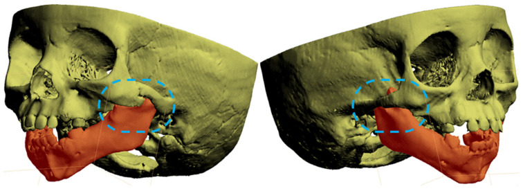
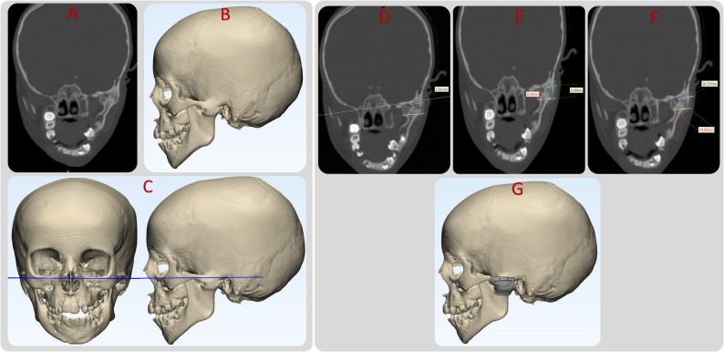
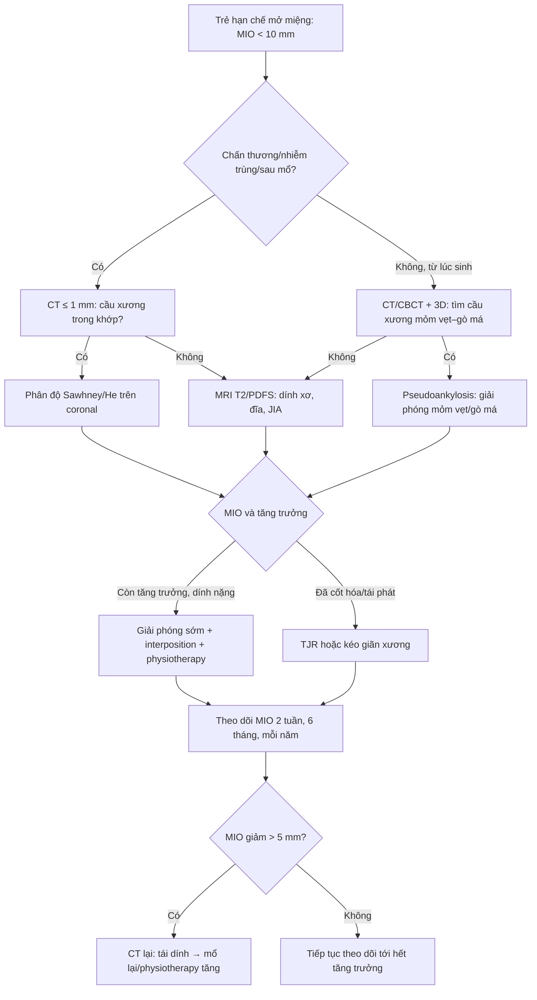
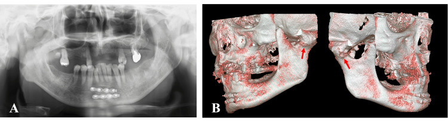
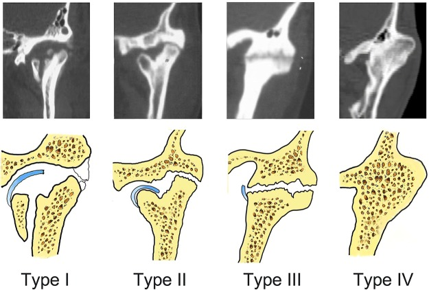

# 1703 — Dính khớp thái dương–hàm bẩm sinh ở trẻ: "cầu xương" trên CT, phân độ Sawhney/He, khi nào giải phóng & vì sao tái dính

**Tags:** `pattern:han-che-mo-mieng` `pattern:dinh-khop` `pattern:cau-xuong` `pattern:di-hinh-mat` `vung:khop-thai-duong-ham` `vung:ham-duoi` `vung:so-mat` `anatomy:khop-thai-duong-ham` `protocol:CT-lat-mong` `protocol:CBCT` `protocol:duong-tho-kho` `score:Sawhney` `score:He-A1-A4`
**Mức chắc chắn (certainty):** tổng hợp y văn (literature synthesis) — ghép **ca bẩm sinh có WES + CT 3D** (J Clin Med 2026, PMC12941516), **71 ca/102 khớp phân độ trên CT** (Sci Rep 2019, PMC6642162), **ca song phương có CBCT** (Cureus 2026, PMC13480297), **loạt 7 trẻ dùng guide CAD/CAM** (Maxillofac Plast Reconstr Surg 2026, PMC13346373), **gộp 8 nghiên cứu GA vs IA** (PLoS One 2015, PMC4444315) và **29 trẻ, tái dính 37,9%** (Turk J Trauma Emerg Surg 2023, PMC10198337). Không có ca do nhóm tự chụp.

> **Câu hỏi thực hành:** bé gái **5 ngày tuổi** được gọi là **vi mất sản nửa mặt** vì mặt hơi lệch và **chỉ mở miệng 3 mm**; không chấn thương, không nhiễm trùng. Hoặc bé **5 tuổi** té cằm, 2 năm sau **MIO 6 mm**, không đau, không sưng. Câu hỏi: **đây là dính khớp bẩm sinh hay mắc phải, trong khớp hay ngoài khớp, dính xơ hay dính xương — và khi nào phải mổ?**
> Bài chốt **ba quyết định**: **(1) trẻ mở miệng < 10 mm + không có nguyên nhân cấp = chụp CT/CBCT, không chờ "viêm khớp"; (2) cầu xương lồi cầu–ổ chảo/mỏm vẹt–gò má xác định dính xương, CT không thấy cầu xương không loại trừ dính xơ; (3) giải phóng sớm để cứu tăng trưởng hàm, nhưng trẻ tái dính cao hơn người lớn (37,9% vs 21,1%) nên phẫu thuật phải đi kèm physiotherapy và theo dõi MIO**. Nối [695 – Treacher Collins & Nager](../695-hoi-chung-treacher-collins-nager/lesson.md), [603 – Pierre Robin](../603-pierre-robin-tac-nghen-duong-tho/lesson.md), [692 – Microtia & atresia ống tai](../692-microtia-atresia-phuc-hoi-thinh-luc/lesson.md).

## 1. Tổng quan bệnh học – cơ chế hình ảnh: vì sao "không mở được miệng" lại là chuyện của sụn và xương

- **Định nghĩa:** dính khớp thái dương–hàm (temporomandibular joint ankylosis, TMJA) là **hợp nhất xơ hoặc xương** giữa lồi cầu xương hàm dưới với ổ chảo xương thái dương, đĩa khớp và/hoặc mỏm vẹt, làm **mất chuyển động hàm**. Trẻ có thể **chỉ mở được ≤ 5 mm** (thể nặng), không đưa hàm ra trước/sang bên; ăn, nói, vệ sinh răng và **đường thở** đều bị ảnh hưởng.
- **Ba cách phân loại phải trả lời cùng lúc:**
  - **Bẩm sinh (congenital) vs mắc phải (acquired):** bẩm sinh rất hiếm, có mã **ORPHA 210576**, mô tả lần đầu bởi Burket năm **1936**; mắc phải do **chấn thương (84,3% trong các loạt mắc phải)**, nhiễm trùng, phẫu thuật khớp, viêm khớp tự miễn (JIA), bệnh hệ thống.
  - **Thật (true/intra-articular) vs giả (pseudo/extra-articular):** thật = trong khớp lồi cầu–ổ chảo; giả = cầu xương **ngoài khớp**, điển hình **mỏm vẹt dính gò má (zygomatic–coronoid ankylosis)**, hoặc xương hóa cơ do **FOP**.
  - **Xơ (fibrous) vs xương (bony) vs hỗn hợp:** quyết định khả năng thấy trên CT và cách mổ.
- **TẠI SAO có cầu xương:** sau chấn thương/nhiễm trùng, máu tụ trong khớp + màng xương bị bóc → **canxi hóa và tạo xương non** lấp khoang khớp; lực nhai tiếp tục kích thích tạo xương nên cầu xương **dày dần theo thời gian**. Trên CT, xương non có **đậm độ > 200 HU**, bờ cortical liên tục với lồi cầu và ổ chảo — đó là lý do **CT là chìa khóa phân biệt xơ/xương**, còn X-quang panorama chỉ thấy **mất khoảng khớp**.
- **TẠI SAO dính xơ có thể "CT bình thường":** tổ chức xơ **30–60 HU**, không có bờ cortical, không cản quang; trên CT chỉ thấy **khoảng khớp hẹp hoặc mờ**, dễ đọc là bình thường. Khi nghi dính xơ, **MRI T2/PDFS** thấy dải xơ giảm tín hiệu + đĩa khớp di lệch; **không được loại trừ chỉ vì CT không có cầu xương**.
- **TẠI SAO trẻ khác người lớn:** lồi cầu là **trung tâm tăng trưởng** của hàm dưới. Dính khớp trước tuổi trưởng thành → hàm dưới **ngắn, lùi, lệch**, cắn hở/cắn ngược, **OSAS**. Trong loạt 71 ca, **MIO trung bình giảm theo độ**: type I **14,9 ± 8,2 mm**, II **11,6 ± 6,6 mm**, III **7,4 ± 4,9 mm**, IV **1,9 ± 2,9 mm**; **lùi hàm** 0% → 9% → 32% → **86%**, **OSAS** 0% → 0% → 4% → **29%**. **MIO tương quan nghịch với độ nặng (r = −0,644)**; **tuổi bị chấn thương càng nhỏ → càng nặng (r = −0,489)**; **thời gian trì hoãn càng dài → càng nặng (r = 0,733)**.
- **Ca bẩm sinh điển hình:** bé gái sinh đủ **40 tuần**, **3.470 g**, **MIO 3 mm lúc 5 ngày**, ban đầu chẩn đoán **vi mất sản nửa mặt**; **CT lúc 5 tháng** phát hiện **dính mỏm vẹt–gò má trái** (ngoài khớp); giải phóng lúc **2 tuổi** rồi **tái dính**, mổ lại lúc **3 tuổi** (đặt nội khí quản ống mềm rất khó), **kéo giãn xương lúc 7 tuổi**, **thay khớp hai bên lúc 8 tuổi**; cuối cùng **MIO 3 → 30 mm** nhờ phẫu thuật + physiotherapy liên tục. WES phát hiện **3 biến thể bệnh lý ở TCOF1, POLR1B (Treacher Collins) và DHODH (Miller)** dù trẻ **không có kiểu hình syndrome** — gợi ý **dính khớp bẩm sinh có thể là phần phổ của dị tật cung hầu I–II**.
- **Dịch tễ – chân dung:** dính khớp **một bên/hai bên ≈ 1,5:1**, **nam hơi nhiều hơn nữ**; thể mắc phải hay gặp ở trẻ **< 10 tuổi** (lồi cầu đang tăng trưởng). Bẩm sinh **không có tần suất quần thể đáng tin cậy** — y văn chỉ có ca lẻ và loạt nhỏ.

## 2. Mẫu hình + chẩn đoán phân biệt theo thời điểm và vị trí (Gamut)

- **Ba câu hỏi định khu (dùng trước khi nhìn chẩn đoán):**
  1. **Từ lúc sinh hay sau chấn thương/nhiễm trùng?** → bẩm sinh/syndrome vs mắc phải.
  2. **Trong khớp hay ngoài khớp?** → lồi cầu–ổ chảo vs mỏm vẹt–gò má, FOP, xương hóa cơ.
  3. **Xơ hay xương?** → CT có cầu xương không; nếu không, MRI.
- **Gamut theo tuổi khởi phát:**
  - **Sơ sinh – 6 tháng:** dính khớp bẩm sinh (thật hoặc mỏm vẹt–gò má), **syngnathia**, **Treacher Collins/Nager/Miller**, **Pierre Robin**, **OAVS/Goldenhar**, bất sản lồi cầu.
  - **1–10 tuổi:** di chứng **gãy lồi cầu bị bỏ sót**, nhiễm trùng tai–xương chũm lan khớp, **JIA**, sau phẫu thuật khớp.
  - **> 10 tuổi:** chấn thương, viêm khớp dạng thấp/ankylosing spondylitis, vôi hóa dây chằng, **FOP**.
- **Gamut theo vị trí:**
  - **Trong khớp:** cầu xương lồi cầu–ổ chảo (Sawhney II–IV), dính xơ (Sawhney I), gãy lồi cầu cũ di lệch.
  - **Ngoài khớp:** **mỏm vẹt–gò má** (bẩm sinh hoặc sau chấn thương), **tăng sản mỏm vẹt**, xương hóa cơ cắn/nhai, **FOP** (đa ổ, tiến triển).
  - **Hỗn hợp:** cầu xương trong khớp + dải xơ ngoài khớp — thường gặp sau mổ/mô sẹo.
- **Gamut theo hình ảnh:**
  - **Cầu xương dày, bờ cortical liên tục** → dính xương.
  - **Khoảng khớp hẹp, không cầu xương, đĩa khớp di lệch** → dính xơ (cần MRI).
  - **Cầu xương từ mỏm vẹt ra gò má, khớp còn khoảng trống** → giả dính khớp ngoài khớp.
  - **Xương hóa cơ lan tỏa, nhiều ổ, ngón cái ngắn** → FOP.
- **Mnemonic "3T" để không bỏ sót:** **T**rauma (gãy lồi cầu cũ), **T**issue (xơ vs xương), **T**rue vs pseudo (trong hay ngoài khớp).

## 3. Bảng so sánh phân biệt (ma trận đối chiếu)

| Thực thể (entity) | Hình ảnh điển hình | Chốt vào (rule-in) | Chốt loại (rule-out) | Gợi ý xác nhận |
|---|---|---|---|---|
| **Dính khớp bẩm sinh mỏm vẹt–gò má (pseudoankylosis)** | Cầu xương từ **mỏm vẹt lên gò má**, khoảng khớp lồi cầu–ổ chảo còn; 3D VR thấy rõ dải xương | **MIO rất nhỏ (3 mm trong ca bệnh) từ lúc sinh, không chấn thương, không nhiễm trùng** | Có gãy lồi cầu cũ/di lệch → nghĩ mắc phải | CT ≤ 1 mm + 3D VR; đối chiếu syndrome (TCS/Nager/Miller) |
| **Dính khớp xương trong khớp do chấn thương** | **Cầu xương lồi cầu–ổ chảo**, mất khoảng khớp, lồi cầu di lệch ra trước/trong | **Tiền sử té cằm + MIO giảm dần + cầu xương trên CT** | Khoảng khớp còn, không cầu xương → dính xơ | CT coronal/3D; đo chiều dày cầu xương, độ lan vào mỏm vẹt |
| **Dính xơ (Sawhney I, He A1)** | Khoảng khớp **hẹp/mờ**, không cầu xương; đĩa khớp di lệch, tín hiệu xơ trên T2 | **MIO hạn chế + CT không cầu xương + MRI có dải xơ** | Cầu xương rõ → dính xương | MRI T2/PDFS; đánh giá lại sau 3–6 tháng nếu nghi tiến triển |
| **Tăng sản mỏm vẹt / pseudoankylosis** | **Mỏm vẹt dài, cong**, chạm gò má; khớp bình thường | **MIO hạn chế nhưng khớp không dính, mỏm vẹt chạm gò má** | Cầu xương trong khớp, mất khoảng khớp → dính thật | CT 3D + đo khoảng mỏm vẹt–gò má |
| **FOP (fibrodysplasia ossificans progressiva)** | **Xương hóa cơ đa ổ**, dải xương ngoài khớp, ngón cái ngắn; tiến triển sau chấn thương nhẹ | **Trẻ có ngón cái ngắn + xương hóa mô mềm tái phát + MIO giảm** | Một ổ cầu xương đơn độc, không xương hóa cơ → không FOP | **Không sinh thiết/mổ**; chẩn đoán lâm sàng + gen ACVR1 |
| **JIA/viêm khớp tự miễn** | **Hẹp khớp đối xứng hai bên**, bào mòn lồi cầu, không cầu xương dày | **Đau + sưng + cứng buổi sáng + hẹp khớp hai bên** | Cầu xương một bên sau chấn thương → không JIA | MRI có phù tủy/xơ; RF/ANA; theo dõi tăng trưởng |
| **Trismus do nhiễm trùng cơ nhai/áp-xe** | **Phù cơ cắn/nhai**, ổ dịch, xương bình thường; há miệng đau | **Sốt + sưng má + đau khi há + khởi phát ngày** | Không sốt, không đau, MIO cố định nhiều năm → dính khớp | CT/MRI có cản quang; CRP; dẫn lưu |

*Ca bẩm sinh (J Clin Med 2026, PMC12941516): mô hình 3D hộp sọ — **dải xương nối mỏm vẹt với gò má trái** (khoanh xanh), hàm dưới in đỏ; bên phải chỉ biến đổi nhẹ. Đây là **dính khớp NGOÀI khớp** (pseudoankylosis), không phải cầu xương lồi cầu–ổ chảo. Nguồn: CC BY 4.0, nguyên bản.*

## 4. Protocol chụp + phân độ + chỉ định mổ

- **Bước 0 — đường thở trước hình ảnh:** trẻ **MIO 1–3 mm** không thể đặt đèn thanh quản thông thường. Ca **11 tuổi dính khớp hai bên** được đặt nội khí quản **qua mũi có Glidescope + guide ống ăn** vì không có ống mềm nhi; ca bẩm sinh mổ lần 2 phải **soi ống mềm**. **Luôn có kế hoạch B: mở khí quản cấp cứu (không cricothyroidotomy ở nhũ nhi) và dao mở đường thở**; không an thần sâu trước khi kiểm soát đường thở.
- **Bước 1 — đo và ghi bằng số:** **MIO (mm)** bằng thước kẹp; **đưa hàm ra trước và sang bên (mm)**; đo **khoảng cách cằm–cổ**, Mallampati, độ mở miệng; chụp **ảnh mặt thẳng/nghiêng** để theo dõi bất đối xứng.
- **Bước 2 — CT/CBCT là chuẩn:**
  - **CT đa lát ≤ 1 mm**, cửa sổ xương, **tái tạo coronal + sagittal + 3D VR**; coronal là mặt phẳng **bắt buộc** để phân độ He (A2 vs A3 phụ thuộc **kích thước mảnh lồi cầu còn lại so với 0,5 đầu lồi cầu**).
  - **CBCT** liều thấp hơn, đủ cho trẻ hợp tác; không dùng khi cần mô mềm/khối u.
  - Đo: **chiều dày cầu xương (mm)**, **độ lan lên mỏm vẹt/xuống bờ sau hàm**, **chiều cao cành lên hai bên**, **khoảng mỏm vẹt–gò má**, **góc lệch cằm**.
- **Bước 3 — MRI khi CT không giải thích được:** nghi **dính xơ**, **JIA**, **áp-xe**, hoặc cần đánh giá **đĩa khớp**. Chuỗi: T1, T2/PDFS, T1 sau tiêm ± fat-sat; không cần thuốc cản quang nếu chỉ tìm cầu xương.
- **Bước 4 — phân độ (bảng dưới) và chọn mổ:**

| Hệ phân độ | Định nghĩa then chốt | Ý nghĩa điều trị |
|---|---|---|
| **Sawhney 1986** (70 ca) | **I:** lồi cầu biến dạng nhưng còn thấy, không cử động do **dính xơ**; **II:** xương hợp nhất chủ yếu ở bờ trước/sau, **phần trong lồi cầu còn nguyên**; **III:** lan tới **cành lên + gò má**, mảnh lồi cầu teo di lệch; **IV:** **xóa hoàn toàn khớp** bằng khối xương từ nền sọ đến cành lên | I–II: giải phóng + interposition; III: cần vào rộng, cân nhắc mảnh ghép; IV: giải phóng khối lớn ± tái tạo |
| **He 2011** (84 ca/124 khớp, CT coronal) | **A1:** dính xơ, không cầu xương; **A2:** cầu xương bên, mảnh lồi cầu còn **> 0,5** đầu lồi cầu; **A3:** như A2 nhưng mảnh còn **< 0,5**; **A4:** cầu xương **hoàn toàn** | A2–A3 quyết định **có giữ được lồi cầu** hay phải tái tạo; A4 thường cần gap rộng/interposition |
| **Xia 2019** (71 ca/102 khớp) | **I:** không xương, khoảng khớp gần bình thường; **II:** cầu xương **bên**, còn **dải sáng** trong khớp; **III:** cầu xương **toàn bộ**, chỉ còn dải sáng; **IV:** cầu xương **lan rộng**, **mất dải sáng** | Dải sáng = còn khả năng tách khớp; mất dải sáng = khối liền, cần cắt rộng hơn |

- **Bước 5 — kỹ thuật mổ (theo bằng chứng):**
  - **Gap arthroplasty (GA) vs interpositional arthroplasty (IA):** gộp **8 nghiên cứu/272 bệnh nhân**, tái dính **13/120 (IA) vs 29/163 (GA)**, **RR 0,67 (95% CI 0,38–1,16)** — không khác có ý nghĩa; **MIO cải thiện thêm 1,96 mm (0,21–3,72)** ở IA. Kết luận thực dụng: **IA ít tái dính hơn về xu hướng, nhưng yếu tố quyết định là cắt đủ rộng và physiotherapy**.
  - **Khoảng cắt:** GA cổ điển cần **~10 mm**, IA **~5 mm**; cắt quá rộng → **ngắn cành lên, cắn hở**; cắt không hết **phía trong** → tái dính. Ca song phương 2026: bên phải **10 mm** (đường ngoài miệng + vạt cơ thái dương), bên trái **8 mm** (đường trong miệng + vạt mỡ má) vì ưu tiên giảm biến chứng; **MIO 6 → 43 mm**, giữ **38 mm sau 3,5 năm**.
  - **Vật liệu chen:** vạt **cơ–cân thái dương** (phổ biến, gần), **mỡ–bì**, **sụn sườn**, **vạt mỡ má**; tổng quan Chossegros: **da toàn bộ 92%** tốt, **cơ thái dương 83%**, sụn đồng loài kém.
  - **Trẻ:** **giải phóng sớm** để cho hàm dưới tăng trưởng, nhưng tái dính **37,9% (11/29 trẻ)** so với **21,1% (8/38 người lớn)** — phải **physiotherapy từ ngày 3, kéo dài ≥ 1 năm**; ca 7 tuổi đạt **35 mm lúc 2 tuần** và giữ **6 tháng**.
  - **Tái phát nhiều lần:** cân nhắc **kéo giãn xương** (ca bẩm sinh lúc 7 tuổi) và **thay khớp toàn bộ (TJR)** ở trẻ lớn/đã cốt hóa; TJR ở trẻ còn tăng trưởng cần theo dõi thay thế.
  - **Hướng dẫn CAD/CAM:** loạt **7 trẻ**, khe cắt **5 mm**, **MIO trước mổ 9,41 ± 4,73 mm → trong mổ 38,56 ± 1,91 mm**, không tái dính; sai lệch góc **2,36°/1,90°**, chiều cao cành lên **1,57/0,95 mm**; 1 ca **liệt nhánh VII tạm thời (HB III)**.

*Loạt 7 trẻ (Maxillofac Plast Reconstr Surg 2026, PMC13346373): **(A)** CT coronal — khối dính khớp trái; **(B)** phân đoạn và mô hình 3D; **(C)** tái định hướng theo mặt phẳng Frankfort; **(D–F)** kiểm tra hai mặt cắt sọ–lồi cầu và đo độ sâu; **(G)** guide cắt xương với khe **5 mm** và 4 lỗ vít. Khe hẹp giúp cắt chính xác, tránh lấy quá cành lên. Nguồn: CC BY 4.0, nguyên bản.*

- **Theo dõi sau mổ:** **MIO + đưa hàm ra trước/sang bên** lúc **2 tuần, 6 tuần, 3 tháng, 6 tháng**, sau đó **mỗi 6–12 tháng tới hết tăng trưởng**; **giảm > 5 mm** hoặc **lệch cằm tăng** → CT lại. **Không dùng X-quang thường quy** để theo dõi tái dính — phim khó thấy cầu xương sớm.

## 5. Biến thể bình thường và cạm bẫy

- **Bẫy 1 — gọi là "vi mất sản nửa mặt":** ca bẩm sinh bị chẩn đoán **hemifacial microsomia** lúc 5 ngày vì mặt lệch + MIO 3 mm; **chỉ CT lúc 5 tháng** mới thấy cầu xương mỏm vẹt–gò má. **MIO không giải thích được bằng bất đối xứng mặt** → phải chụp.
- **Bẫy 2 — "CT không có cầu xương = không dính khớp":** dính xơ (Sawhney I/He A1) **không có cầu xương**; nếu bỏ qua, trẻ bị bỏ sót và hàm dưới vẫn ngừng tăng trưởng. **MRI T2/PDFS** là bước tiếp theo.
- **Bẫy 3 — chỉ nhìn khớp, bỏ mỏm vẹt:** dính **mỏm vẹt–gò má** là **ngoài khớp**; mổ vào khớp sẽ **không giải phóng được**. Luôn dựng **3D VR** và đo khoảng mỏm vẹt–gò má.
- **Bẫy 4 — FOP:** xương hóa cơ đa ổ + **ngón cái ngắn**; **mổ/sinh thiết gây bùng phát**, là **chống chỉ định tuyệt đối**. Đừng "thử giải phóng" để xem.
- **Bẫy 5 — đường thở:** MIO 1–3 mm + dính hai bên = **đường thở khó cực độ**; đặt nội khí quản mù hoặc gây mê sâu trước khi kiểm soát đường thở có thể tử vong. Chuẩn bị **ống mềm nhi/Glidescope, guide, mở khí quản**.
- **Bẫy 6 — cắt quá tay:** cắt > 10–15 mm hoặc lấy quá nhiều cành lên → **ngắn hàm, cắn hở, lệch cằm**; cắt thiếu **phía trong** → **tái dính**. Đo trên CT trước, dùng guide nếu có.
- **Bẫy 7 — chờ "hết tăng trưởng" mới mổ:** trì hoãn làm **biến dạng mặt cố định** và **OSAS**; nhưng mổ quá sớm ở trẻ cũng **tái dính cao** — quyết định theo **độ nặng + tăng trưởng + khả năng physiotherapy**, không theo tuổi đơn thuần.
- **Bẫy 8 — coi khớp "bình thường" trên panorama:** panorama bỏ sót **dải sáng trong khớp** và cầu xương mảnh; **CT/CBCT coronal** mới đủ.

## 6. Tự lượng giá — Blind Quiz

**Ca 1 — Bé gái 5 ngày tuổi, mặt hơi lệch, chỉ mở miệng 3 mm, không chấn thương.**

- Câu hỏi: Tổn thương nằm **trong hay ngoài khớp**? Vì sao không được gọi ngay là "vi mất sản nửa mặt"? Bước tiếp theo?

<b>Bấm để hiện đáp án (findings + chẩn đoán)</b>

- Dấu hiệu (findings): **dải xương nối mỏm vẹt trái với gò má** (khoanh xanh), khoảng khớp lồi cầu–ổ chảo còn; hàm dưới in đỏ, bên phải biến đổi nhẹ.
- Chẩn đoán (diagnosis): **dính khớp bẩm sinh mỏm vẹt–gò má (zygomatic–coronoid ankylosis, pseudoankylosis)** — ngoài khớp, không phải cầu xương lồi cầu–ổ chảo.
- Vì sao: **MIO 3 mm từ lúc sinh** không thể giải thích chỉ bằng bất đối xứng mô mềm; cần **CT/CBCT + 3D VR**. Ca này WES có **TCOF1/POLR1B/DHODH**, gợi ý phổ dị tật cung hầu I–II.
- Nguồn ảnh: J Clin Med 2026 (PMC12941516), CC BY 4.0.

**Ca 2 — Bệnh nhân sau chấn thương hàm, nay mở miệng 6 mm, không đau.**

- Câu hỏi: Mô tả bất thường trên panorama (A) và CBCT 3D (B). Đây là dính xơ hay xương? Cần đo gì trước mổ?

<b>Bấm để hiện đáp án</b>

- Dấu hiệu (findings): **(A)** mất khoảng khớp, lồi cầu dính vào ổ chảo; **(B)** hai lồi cầu biến dạng, di lệch ra trong, **cầu xương lan rộng** (mũi tên đỏ), không thấy khe khớp.
- Chẩn đoán (diagnosis): **dính khớp xương hai bên sau chấn thương** (ảnh minh họa từ một ca **người lớn**; ở trẻ cơ chế và mẫu hình tương tự nhưng biến dạng tăng trưởng nhanh hơn — đây là suy luận, không phải ca trẻ).
- Cần đo: **chiều dày cầu xương, độ lan vào mỏm vẹt, chiều cao cành lên hai bên, khoảng mỏm vẹt–gò má**; phân độ **Sawhney/He** trên coronal; đánh giá **đường thở** trước mổ.
- Nguồn ảnh: Cureus 2026 (PMC13480297), CC BY 4.0.

**Ca 3 — Bốn kiểu dính khớp trên CT: nhìn hình, gọi tên và chọn hướng mổ.**

- Câu hỏi: Type I khác type IV ở đâu? Type nào còn khả năng "tách" khớp? Type IV thường kèm biến dạng gì?

<b>Bấm để hiện đáp án</b>

- Dấu hiệu (findings): **Type I** — không cầu xương, khoảng khớp gần bình thường, có callus rải rác (dính xơ/không xương); **Type II** — cầu xương **bên**, còn **dải sáng** trong khớp; **Type III** — cầu xương **toàn bộ**, chỉ còn dải sáng; **Type IV** — cầu xương **lan rộng**, **mất dải sáng**, không nhận ra lồi cầu/ổ chảo.
- Chẩn đoán (diagnosis): phân độ **Xia 2019** (71 ca): type IV có **MIO 1,9 ± 2,9 mm**, **lùi hàm 86%**, **OSAS 29%**; tương quan **r = −0,644** giữa độ và MIO.
- Điều trị: type I–II có thể **giải phóng + interposition**; type III–IV cần **cắt rộng, cân nhắc ghép/tái tạo**; type IV kèm biến dạng mặt nặng → kế hoạch **kéo giãn/TJR** sau khi giải phóng.
- Nguồn ảnh: Sci Rep 2019 (PMC6642162), CC BY 4.0.

## Bài liên quan chéo
- [600 – Tổng quan Hệ Nhi khoa](../600-tong-quan-nhi-khoa/lesson.md)
- [695 – Hội chứng Treacher Collins & Nager](../695-hoi-chung-treacher-collins-nager/lesson.md)
- [603 – Pierre Robin & tắc nghẽn đường thở trên](../603-pierre-robin-tac-nghen-duong-tho/lesson.md)
- [692 – Microtia & atresia ống tai](../692-microtia-atresia-phuc-hoi-thinh-luc/lesson.md)
- [300 – Tổng quan Hệ Cơ – Xương – Khớp](../300-tong-quan-he-co-xuong-khop/lesson.md)
- [612 – Cấp cứu đường thở trên trẻ em](../612-cap-cuu-duong-tho-tren-tre-em/lesson.md)

## Ảnh
- 4 ảnh, tất cả **CC BY 4.0** (J Clin Med 2026: 1; Sci Rep 2019: 1; Cureus 2026: 1; Maxillofac Plast Reconstr Surg 2026: 1) — **nguyên bản**, không crop/ghép; chi tiết trong `images/CREDITS.md`.
- Không tạo composite vì 4 bài gốc là 4 bệnh cảnh khác nhau (bẩm sinh, phân độ, song phương người lớn, lập kế hoạch ảo).

> Không dùng để chẩn đoán độc lập khi chưa có người hướng dẫn.
