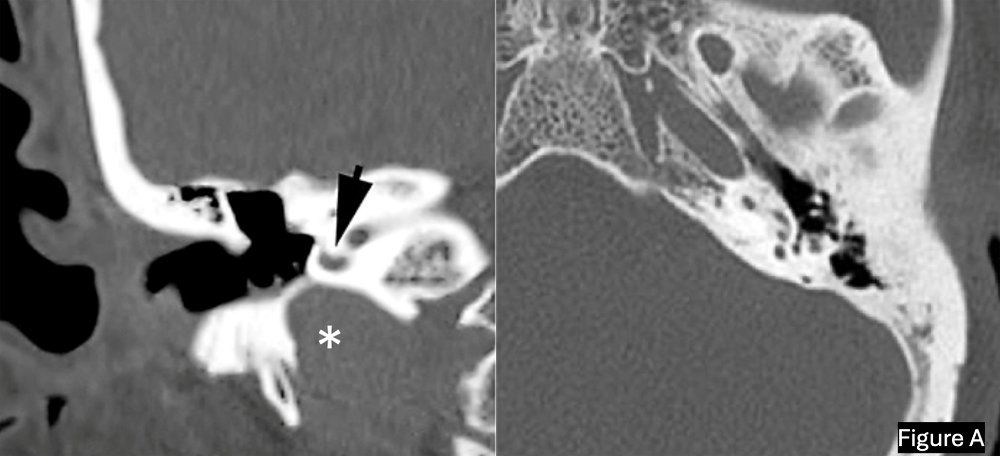
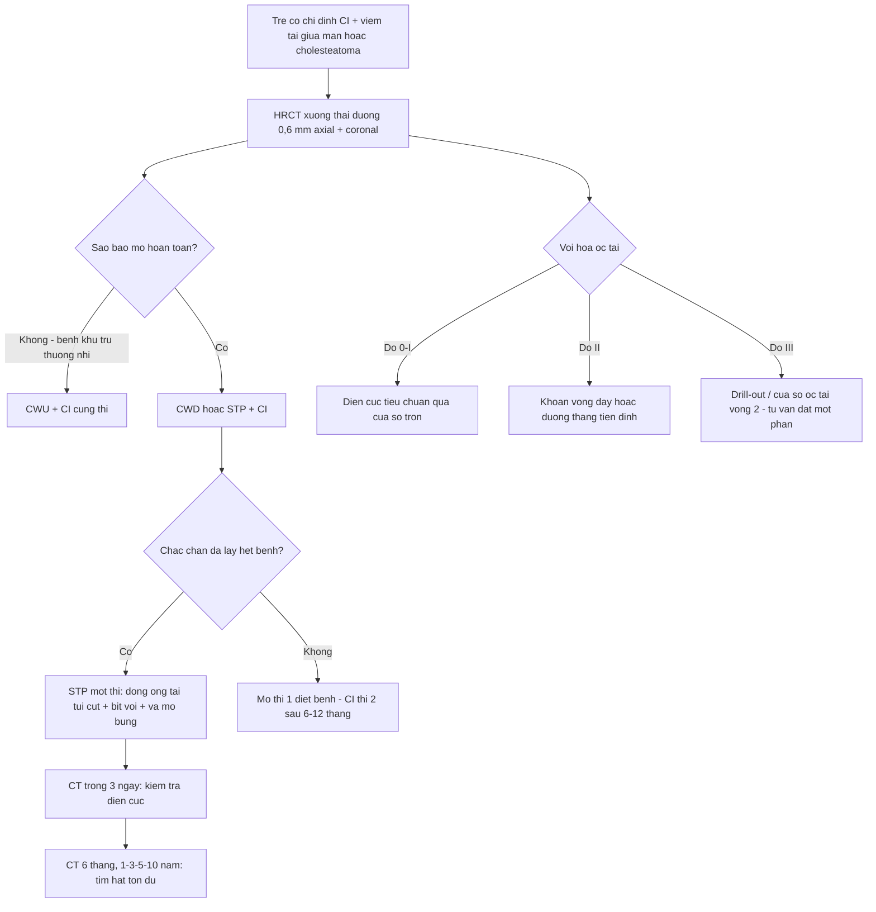
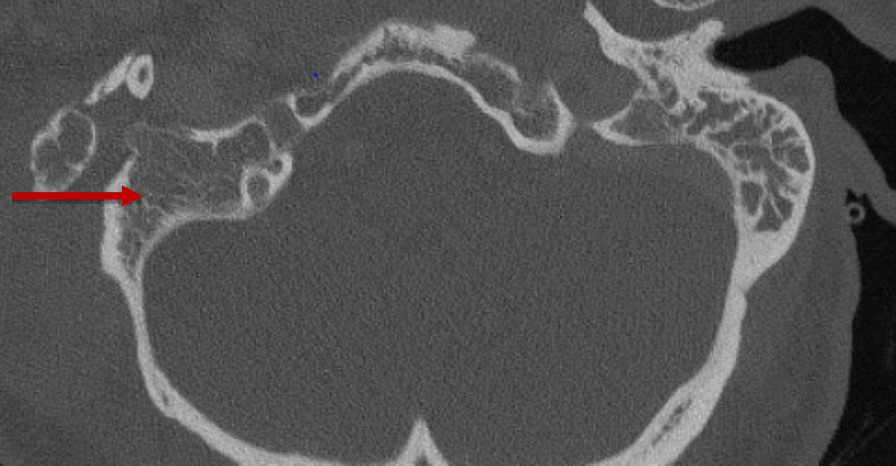
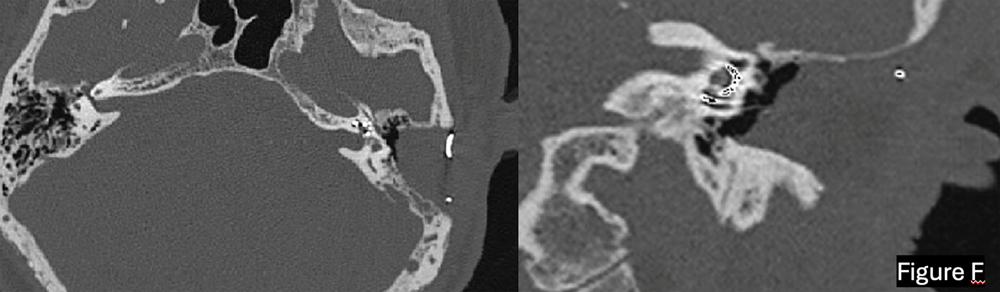

# 1704 — Viêm tai giữa mạn & cholesteatoma ở trẻ có cấy ốc tai: đọc HRCT trước mổ, chọn một thì hay hai thì, và khi nào phải tháo thiết bị

**Tags:** `pattern:cholesteatoma` `pattern:tieu-xuong` `pattern:khoi-mo-mem-xuong-thai-duong` `pattern:viem-tai-giua-man` `pattern:di-tru-dien-cuc` `vung:xuong-thai-duong` `vung:oc-tai` `vung:tai-giua` `anatomy:oc-tai` `protocol:HRCT-xuong-thai-duong` `protocol:MRI-DWI-non-EPI` `protocol:CT-hau-phau` `score:Gibson` `score:EAONO-JOS`
**Mức chắc chắn (certainty):** tổng hợp y văn (literature synthesis) — ghép **348 ca vách ngách đá toàn phần (subtotal petrosectomy, STP) + cấy ốc tai (CI) một thì** (Eur Arch Otorhinolaryngol 2025, PMC12518385), **thuật toán HRCT chọn đường mổ CWU vs CWD/STP** (World J Radiol 2026, PMC12968788), **gộp 84 nghiên cứu/12.819 bệnh nhân về tái phát cholesteatoma** (Biomedicines 2025, PMC12562222), **mô hình tốc độ phát triển cholesteatoma tồn dư (163 bệnh nhân)** (Eur Arch Otorhinolaryngol 2026, PMC13615138), **440 lượt cấy ốc tai ở trẻ — nguyên nhân tháo thiết bị** (Medicina 2025, PMC12472005) và **ca Bezold's abscess do cholesteatoma có ảnh CT** (J Med Case Rep 2024, PMC11241866). Không có ca do nhóm tự chụp.

> **Câu hỏi thực hành:** bé gái **4 tuổi**, điếc sâu hai tai (nghi sau viêm màng não phế cầu), **chảy mủ tai phải từng đợt 14 tháng**, khám thấy **túi co lõm (retraction pocket) thượng nhĩ phải có mảnh vảy trắng**. HRCT: **mờ hoàn toàn sào bào phải + tiêu xương cửa sổ thượng nhĩ + khuyết scutum**; ốc tai phải **vôi hóa vòng đáy < 180°**. Bố mẹ hỏi: *"Cấy ốc tai luôn được không, hay phải mổ tai trước?"*
> Câu hỏi: **HRCT nói gì về đường mổ (CWU – CWD – STP)? Có cấy một thì không? Vôi hóa ốc tai thay đổi kế hoạch điện cực thế nào? Sau mổ theo dõi cholesteatoma tồn dư bằng gì khi đã có nam châm trong đầu?**
> Bài chốt **bốn việc**: **(1) mờ hoàn toàn sào bào trên HRCT là biến số dự báo mạnh nhất của "phải mổ triệt để" (CWD/STP), còn sào bào thông khí tốt cho phép CWU; (2) STP + CI một thì là lựa chọn chuẩn khi tai còn bệnh — 348 ca của một trung tâm, biến chứng nhẹ 1,7%, không ca nào cholesteatoma tồn dư, nhưng nếu **không chắc đã lấy hết bệnh** thì phải mổ hai thì cách 6–12 tháng; (3) cholesteatoma ở trẻ tái phát 13% (so với 10% ở người lớn) và tồn dư có thể tới 40%, phát triển chậm — 95% đạt 3 mm (ngưỡng thấy trên hình) sau 28–35 tháng, nên lịch theo dõi phải dài; (4) có nam châm trong đầu thì DWI không-EPI mất giá trị → dùng CT xương thái dương, dựa vào tương phản mỡ–mô mềm của ổ vá để tìm hạt tồn dư.** Nối [497 – Theo dõi sau cấy ốc tai](../497-theo-doi-sau-cay-oc-tai-tre/lesson.md), [478 – Điếc tiếp âm/ANSD ở trẻ](../478-diec-tiep-am-ansd-tre/lesson.md), [692 – Microtia & atresia ống tai](../692-microtia-atresia-phuc-hoi-thinh-luc/lesson.md).

## 1. Tổng quan bệnh học – cơ chế hình ảnh: vì sao "một tai còn mủ" lại chặn đường vào ốc tai

- **Cholesteatoma là gì:** túi **biểu mô lát vảy sừng hóa (keratinizing squamous epithelium)** nằm lạc chỗ trong tai giữa/xương chủm, **bong vảy liên tục vào một khoang kín**. Bệnh không phải "viêm" mà là **bệnh tiêu xương do mô** — vảy sừng tích tụ gây **áp lực**, cộng với **viêm mạn tính hoạt hóa hủy cốt bào (RANKL, IL-1, TNF-α)** và **collagenase** do vi khuẩn/mô viêm tiết ra.
- **TẠI SAO phải lo thứ tự phẫu thuật:** điện cực cấy vào **thang nhĩ** qua **cửa sổ tròn** hoặc **cửa sổ ốc tai**; nếu tai giữa còn **mủ/ cholesteatoma**, vi khuẩn đi **theo điện cực vào ốc tai** (môi trường không hàng rào) → **viêm mê nhĩ (labyrinthitis) → mất tế bào lông và tế bào hạch xoắn vĩnh viễn**, đồng thời **nhiễm màng sinh học (biofilm) trên vỏ thiết bị** → **tháo thiết bị (explantation)**. Đây là lý do **"diệt bệnh trước, đặt thiết bị sau"** — hoặc **làm cả hai trong một thì nhưng phải bịt kín hoàn toàn** (đóng ống tai kiểu túi cụt + bịt vòi Eustache + vá ổ bằng mỡ bụng).
- **Ngưỡng định lượng bắt buộc nhớ:**
  - **Tái phát cholesteatoma (gộp 84 nghiên cứu, 12.819 bệnh nhân):** **trẻ 13%** vs **người lớn 10%**; **mắc phải 12%** vs **bẩm sinh 7%**; **giai đoạn muộn, bên trái và mổ lại** làm tăng nguy cơ (PMC12562222).
  - **Tồn dư (residual) sau mổ có thể tới 40%**; mô hình 163 bệnh nhân: **95% cholesteatoma tồn dư đạt ≥ 3 mm (ngưỡng nhìn thấy trên hình) sau 28–35 tháng**, và **≥ 5 mm (ngưỡng thấy khi mổ) sau 47–58 tháng** → **chụp quá sớm sẽ âm tính giả** (PMC13615138).
  - **Viêm màng não sau cấy ốc tai: 0,74% (202/27.358)**, xuất hiện **1 ngày – 72 tháng** sau mổ; **62 ca có viêm tai giữa trước đó** (bài 497, PMC9994524) — tức **tai giữa có bệnh là yếu tố nền**.
  - **Biến chứng chung sau CI: 13,7% (5,2% nặng)**, **cấy lại 11,7%** (bài 497, PMC13509191).
- **Con số của "một thì" (STP + CI, 348 ca, 2004–2019):** chỉ định gồm **viêm tai giữa mạn 128 ca (36%)**, **cholesteatoma tai giữa 67 ca (19%)**, **xốp xơ tai 69 (20%)**, **dị dạng giải phẫu 22 (6%)**, **thoát vị màng não 16 (5%)**, **gãy xương thái dương 20 (6%)**, **u nền sọ bên 6 (2%)**, **cholesteatoma xương đá 2 (< 1%)**, **cấy lại 6 (2%)**. **Đặt điện cực đủ 329/348 (94,5%)**; **biến chứng 6 ca (1,7%)**: **1 tháo thiết bị do nhiễm tai giữa → viêm mê nhĩ**, **3 rò sau tai (1 ca hỏng thiết bị)**, **1 tụ dịch não tủy dưới da**, **1 tụ dịch huyết thanh**; **0 ca cholesteatoma tồn dư/tái phát** trên CT theo dõi (PMC12518385).
- **Con số của các loạt khác (để so sánh, không lấy làm chuẩn):** Baranano **36 ca**: tháo thiết bị **8,3%**, điện cực lộ **2,8%**, áp-xe **8,3%**, rò ống tai **2,8%**; Polo **110 ca**: điện cực lộ **4 ca (3,6%)**, hỏng thiết bị **1**; Lyutenski **212 ca**: **94,4% mổ hai thì**, cholesteatoma tái phát **2,3%**, điện cực lộ **0,5%**; Szymański **19 ca**: đóng ống tai thất bại **5,2%** (bảng tổng hợp trong PMC12518385).
- **Ở trẻ, nguyên nhân tháo thiết bị (440 lượt cấy, 15 năm):** **hỏng phần cứng 2,27%**, **tụ dịch quanh vỏ 0,68%**, **tự lộ điện cực 0,22%**, **chấn thương làm lệch điện cực 0,22%** (PMC12472005) — nghĩa là **nhiễm trùng/tiêu da là nguyên nhân "phẫu thuật được", không phải hỏng máy**.

## 2. Mẫu hình + chẩn đoán phân biệt theo vị trí (gamut)

- **Theo vị trí trong tai giữa (vị trí quyết định đường mổ):**
  - **Thượng nhĩ – pars flaccida (attic):** hay nhất; **tiêu xương scutum** (dấu "mờ góc scutum" trên phim nghiêng/CT coronal), túi co lõm màng chùng; lan vào **thượng nhĩ trước → ống Fallope**.
  - **Xoang nhĩ – pars tensa (sinus tympani, mesotympanum):** thể "tiêu xương sào bào ít nhưng phá xương con", hay **mất xương đe**; khó thấy vì **xoang nhĩ nằm sau ống Fallope** — phải đọc **lát axial mỏng**.
  - **Sào bào – xương chủm:** khi đã mờ cả sào bào = **bệnh lan rộng** (biến số quyết định STP).
  - **Xương đá (petrous apex):** **liệt mặt + giảm thính lực + chóng mặt**; cholesteatoma xương đá **không có tiền sử viêm tai** — bẫy lớn.
  - **Bẩm sinh (congenital):** khối mô mềm **sau màng nhĩ nguyên vẹn**, không tiền sử viêm tai, thường **trước 5 tuổi**; **không có tiêu xương scutum**.
- **Theo biến chứng (gamut "đã vượt khỏi tai giữa"):** **viêm mê nhĩ/ rò mê đạo** (hay **ống bán khuyên bên – LSCC**, ~**60–70%** các rò mê đạo do cholesteatoma) · **liệt mặt** (xâm lấn ống Fallope) · **viêm màng não/áp-xe ngoài màng cứng** · **áp-xe Bezold** (tiêu mỏm chũm → **cơ ức đòn chũm**, hay ở trẻ có sào bào thông khí tốt) · **huyết khối xoang sigma**.
- **Gợi nhớ 4 chữ cho trẻ có CI + tai chảy mủ: SAFE — S**cutum/attic (đọc kỹ thượng nhĩ trước), **A**ir-bone gap tiến triển, **F**acial nerve (đường Fallope mất vỏ), **E**xtension (sào bào/xương đá/mê đạo).

## 3. Bảng so sánh phân biệt (ma trận đối chiếu)

| Thực thể (entity) | Hình ảnh điển hình (HRCT + MRI) | Chốt vào (rule-in) | Chốt loại (rule-out) | Gợi ý xác nhận |
|---|---|---|---|---|
| **Cholesteatoma mắc phải** | Khối mô mềm **thượng nhĩ ± sào bào**, **tiêu xương scutum/ xương con**, có **túi co lõm**; **DWI không-EPI sáng, ADC thấp** | **DWI sáng + ADC thấp + tiêu xương khu trú** | Chỉ mờ tai giữa không tiêu xương + DWI âm → nghĩ viêm niêm mạc | DWI không-EPI (b1000) + HRCT; mô bệnh khi mổ |
| **Cholesteatoma bẩm sinh** | Khối mô mềm **kín đáo sau màng nhĩ nguyên vẹn**, hay **quanh cửa sổ tròn/ ống Fallope**, **không có túi co lõm** | **Màng nhĩ nguyên vẹn + khối mô mềm + DWI sáng** | Tiêu xương scutum + tiền sử chảy mủ → thể mắc phải | HRCT + DWI; MRI T2 3D |
| **Viêm tai giữa mạn không cholesteatoma** | **Mờ nhầy tai giữa/sào bào**, **xương con còn**, **không tiêu xương scutum**, DWI âm | **DWI âm + xương con nguyên + không tiêu xương** | DWI sáng → cholesteatoma | DWI; đáp ứng kháng sinh/đặt ống thông khí |
| **U hạt cholesterol (cholesterol granuloma)** | **T1W TĂNG tín hiệu mạnh**, T2 sáng, **không hạn chế khuếch tán**, có thể tiêu xương đá | **T1 tăng + DWI âm** | DWI sáng → cholesteatoma | MRI T1 không/ có mỡ |
| **Mô hạt viêm (granulation tissue)** | Ngấm thuốc mạnh, **DWI không sáng rõ**, không tiêu xương tiến triển | **Ngấm thuốc + DWI âm/không rõ** | DWI sáng đậm → cholesteatoma | Theo dõi 3–6 tháng; mô bệnh |
| **Dịch/ nhầy đơn thuần** | **0–20 HU/dịch**, mức dịch–khí, không khối | **Mức dịch ngang + không có khối** | Có khối mô mềm đặc → nghĩ bệnh tổ chức | CT sau điều trị 6–8 tuần |

**Bảng chọn phẫu thuật (biến số HRCT → đường mổ):**

| Đường mổ | Chốt vào (rule-in) | Chốt loại (rule-out) | Hệ quả với thiết bị |
|---|---|---|---|
| **CWU (canal wall-up)** | **Sào bào thông khí tốt**, bệnh **khu trú thượng nhĩ/hang nhĩ**, **thành sau ống tai nguyên** | **Mờ hoàn toàn sào bào** → không đủ an toàn | Giữ giải phẫu ống tai; nguy cơ **tồn dư cao hơn** |
| **CWD (canal wall-down)** | **Mờ toàn bộ sào bào + tiêu xương rộng**, cần kiểm soát bệnh | Không có bệnh lan rộng | Ổ mở, cần làm sạch định kỳ; **khó giữ thiết bị sạch** |
| **STP (subtotal petrosectomy)** | **Bệnh mạn tái phát/khoét ổ, đã CWD, dị dạng nguy cơ rò dịch não tủy, cholesteatoma xương đá**, cần **vách ngăn hoàn toàn với môi trường ngoài** | Tai sạch, thính lực còn dùng được | **Chỉ định ưu tiên khi cấy CI**: đóng ống tai + bịt vòi + vá mỡ → điện cực **không lộ** |

*Trái (coronal): **bóng tĩnh mạch cảnh cao** (dấu hoa thị) **chạm trực tiếp vòng đáy ốc tai** (mũi tên) — bẫy chảy máu khi mở cửa sổ tròn. Phải (axial): **vôi hóa cửa sổ tròn + vòng đáy và đỉnh ốc tai** sau xốp xơ tai — đổi kế hoạch điện cực. Nguồn: Eur Arch Otorhinolaryngol 2025 (PMC12518385), CC BY 4.0.*

## 4. Protocol chụp + thuật toán chọn đường mổ (có Mermaid)

**HRCT xương thái dương (chuẩn vàng về xương — bắt buộc trước mọi CI có bệnh tai giữa):**
- **Lát 0,6–0,625 mm, tái tạo 0,3 mm**, xương (kernel bone), **cửa sổ xương rộng (WW 3.000–4.000, WL 400–600)**; **axial + coronal** (coronal bắt buộc để đọc **scutum** và **trần nhĩ**).
- **5 điểm phải ghi trong báo cáo:** (1) **mờ sào bào: khu trú hay hoàn toàn**; (2) **scutum/ thành sau ống tai**; (3) **xương con** (đe–bàn đạp, có mất nhánh dài không); (4) **vỏ ống Fallope** (ba đoạn, đặc biệt đoạn mê nhĩ); (5) **vôi hóa ốc tai theo độ I–III** + **bóng tĩnh mạch cảnh cao/ xoang sigma trước**.
- **Phân độ vôi hóa ốc tai (dùng trong thuật toán):** **độ 0** không vôi hóa · **độ I** vôi hóa **khu trú cửa sổ tròn, dày > 4 mm** · **độ II** lan **vòng đáy nhưng < 180°** · **độ III** **> 180°** hoặc quá vòng đáy; đo **chiều dài vôi hóa dọc vòng đáy**, **≥ 8 mm** = tắc nặng (PMC12968788).
- **Hiệu lực của thuật toán HRCT:** trong loạt 12 ca, **mờ hoàn toàn sào bào → CWD/STP đúng 5/5**, **sào bào thông khí → CWU đúng 7/7**; **đồng thuận liên quan sát κ = 0,85** — nhưng **khoảng tin cậy rất rộng (Se 63,1–100%)** nên đây là **khung tư duy, không phải công thức** (PMC12968788).
- **MRI bổ trợ (không thay HRCT):** **DWI không-EPI (non-EPI DWI) b1000, lát 3–4 mm** + **T1 sau tiêm** + **T2 3D**. Cholesteatoma: **sáng trên DWI, tối trên ADC, không ngấm hoặc ngấm viền**. **Nhưng: có nam châm trong đầu → DWI vùng xương thái dương mất giá trị** (giả ảnh 2–3 cm) → **theo dõi sau cấy bằng CT**.
- **CT ngay sau mổ (trong 3 ngày):** xác nhận **điện cực vào đủ vòng đáy**, không **gập (kink)/lật đầu (tip fold-over)**; đếm số điện cực thấy được trên lát axial.
- **Lịch theo dõi sau STP + CI:** CT ngay sau mổ → **6 tháng** → **1, 3, 5, 10 năm** (đây là lịch của loạt 348 ca, thay cho DWI vì nhiễu nam châm) — mục tiêu là **hạt cholesteatoma bị "nhốt" trong ổ vá mỡ** (PMC12518385).

**Ngưỡng quyết định "một thì hay hai thì" (thực hành):**
1. **Chắc chắn lấy hết bệnh + đóng kín được** → **một thì** (ưu tiên, vì trẻ không mất 6–12 tháng "tuổi nghe").
2. **Nghi còn cholesteatoma/ viêm không kiểm soát, hoặc vách ngăn không kín** → **hai thì**, CI đặt sau **6–12 tháng**; chấp nhận **chậm phục hồi thính lực** để đổi lấy **an toàn ốc tai**.
3. **Tai độc nhất (only hearing ear) hoặc ốc tai đã vôi hóa nặng** → **không chờ**; cân nhắc **STP một thì** để không mất cửa sổ cấy.
4. **Trẻ < 2 tuổi/ dị dạng ốc tai/ nguy cơ rò dịch não tủy** → **STP + bịt vòi + vá mỡ** là cách giảm **viêm màng não** (nền: **0,74%** sau CI — bài 497).

## 5. Biến thể bình thường và cạm bẫy

- **"Sào bào sạch" KHÔNG loại trừ bệnh thượng nhĩ.** Bệnh khu trú attic có thể **không làm mờ sào bào**; bỏ qua **lát coronal qua scutum** là lỗi hay gặp nhất. Ngược lại, **mờ hoàn toàn sào bào** là biến số mạnh nhất buộc mổ triệt để.
- **Cạm bẫy 1 — vôi hóa ốc tai trên HRCT:** vôi hóa **mờ, viền** dễ bị gọi là "nhiễu"; nhưng **độ III** đổi hoàn toàn kế hoạch (drill-out, tư vấn **đặt điện cực một phần**). Ở trẻ, **vôi hóa sau viêm màng não** tiến triển **nhanh trong vài tháng** → **chụp lại sát ngày mổ**, không dùng HRCT 6 tháng trước.
- **Cạm bẫy 2 — mỡ vá ổ giống cholesteatoma trên CT:** mỡ bụng **−50 đến −100 HU**, có **vách mảnh**, **không bắt thuốc**; hạt cholesteatoma **30–60 HU**, **bờ tròn, tăng dần kích thước**. Chính vì vậy **vá mỡ lại là "nền tương phản" tốt** để phát hiện hạt tồn dư (PMC12518385).
- **Cạm bẫy 3 — tin DWI khi đã có nam châm:** giả ảnh làm **vùng xương thái dương "trống"**; kết luận "không còn cholesteatoma" từ MRI ở trẻ có CI là **sai phương pháp**. Dùng **CT + lâm sàng (chảy mủ tái phát, túi co lõm)**.
- **Cạm bẫy 4 — bóng tĩnh mạch cảnh cao/ xoang sigma trước:** không phải bệnh, nhưng **đổi đường mổ** (nguy cơ chảy máu ồ ạt khi mở cửa sổ tròn) — phải báo trước mổ.
- **Cạm bẫy 5 — áp-xe Bezold bị đọc là "hạch cổ":** trẻ cholesteatoma + **sưng đau vùng mỏm chũm/ cổ**, sốt; CT cho thấy **tiêu vỏ ngoài xương chủm + khối mô mềm trong cơ ức đòn chũm**. **Đây là chống chỉ định cấy CI cho tới khi diệt ổ** — hình dưới.

**Biến thể bình thường dễ nhầm:** **thượng nhĩ còn thông khí một phần** ở trẻ nhỏ (đừng gọi là mờ bệnh lý) · **màng nhĩ dày** do sẹo · **mỏm trâm/ dây thần kinh lệch** · **vôi hóa dây chằng** quanh xương con.

*Mũi tên đỏ: **tiêu xương vỏ xương chủm** và **mờ toàn bộ sào bào phải**. Khi cholesteatoma phá vỏ ngoài, mủ lan vào **cơ ức đòn chũm** thành **áp-xe Bezold** — phải **diệt ổ trước**, không được đặt thiết bị vào tai đang nhiễm. Nguồn: J Med Case Rep 2024 (PMC11241866), CC BY 4.0.*

## 6. Tự lượng giá — Blind Quiz

**Ca 1 — Bé gái 4 tuổi, chảy mủ tai phải từng đợt, chuẩn bị cấy ốc tai:**

- Gợi ý: HRCT được chỉ định **trước** khi đặt lịch mổ; bố mẹ chỉ hỏi "khi nào cấy".
- Câu hỏi: hai bất thường trên hình là gì? Chúng thay đổi **kế hoạch mổ** ở điểm nào? Có phải hoãn cấy không?

<b>Bấm để hiện đáp án (findings + chẩn đoán)</b>

- **Bên trái:** **bóng tĩnh mạch cảnh cao** tiếp xúc **vòng đáy ốc tai** → nguy cơ **chảy máu nhiều** khi mở cửa sổ tròn; cần **chuẩn bị máu + đổi đường vào**.
- **Bên phải:** **vôi hóa cửa sổ tròn + vòng đáy/đỉnh ốc tai** → **không đặt được đủ điện cực theo đường chuẩn**; phải chuẩn bị **khoan vòng đáy/ đường thang tiền đình** và **tư vấn trước** khả năng đặt một phần.
- **Có hoãn không:** **không hoãn vì hai bất thường này**, nhưng phải **sửa kế hoạch kỹ thuật**. Hoãn chỉ khi **còn bệnh tai giữa hoạt động** hoặc **không chắc lấy hết cholesteatoma**.
- Nguồn ảnh: Eur Arch Otorhinolaryngol 2025, PMC12518385, CC BY 4.0.

**Ca 2 — Cùng nhóm bệnh nhi, CT sau mổ STP + CI một thì:**

- Câu hỏi: ba đậm độ chính trong ổ vá là gì? Làm sao chứng minh **điện cực vào đủ**? Vì sao ổ vá mỡ lại giúp **phát hiện cholesteatoma tồn dư** về sau?

<b>Bấm để hiện đáp án</b>

- **Ba đậm độ:** **khí (đen) rất ít/không còn**, **mỡ vá (−50 đến −100 HU)**, **điện cực kim loại (đốm trắng rất cao)**; xương đặc viền quanh.
- **Chứng minh đủ điện cực:** **đếm số chấm trắng trên lát axial** đi qua vòng đáy và **so với số điện cực của hãng**; kiểm tra **không gập/không lật đầu**; đối chiếu **đo ngưỡng điện – impedance** trên lâm sàng.
- **Vì sao mỡ giúp:** **mỡ là nền đồng nhất, đậm độ thấp** → hạt cholesteatoma (**30–60 HU**) **nổi bật**; nếu ổ toàn xương/khí thì khó thấy hạt nhỏ.
- Nguồn ảnh: Eur Arch Otorhinolaryngol 2025, PMC12518385, CC BY 4.0.

**Ca 3 — Bé trai 7 tuổi, đã cấy ốc tai tai trái 2 năm, nay sưng đau sau tai phải + sốt + cổ bên phải đau:**

- Gợi ý: tai phải **chưa cấy**; đã chảy mủ từng đợt 3 năm, gần đây **sưng vùng mỏm chũm**.
- Câu hỏi: tổn thương chính? Vì sao có **khối ở cổ**? Xử trí thứ tự ra sao — và có đặt CI tai này ngay không?

<b>Bấm để hiện đáp án</b>

- **Tiêu xương vỏ ngoài xương chủm + mờ toàn bộ sào bào** = cholesteatoma lan rộng; mủ phá vỏ → **áp-xe Bezold** trong **cơ ức đòn chũm** (khối cổ).
- **Thứ tự:** **dẫn lưu áp-xe + kháng sinh + mổ diệt bệnh (CWD/STP)** trước; **chỉ đặt CI khi tai đã sạch/đã bịt kín** — có thể **cùng một thì STP** nếu kiểm soát được, **không đặt vào tai đang mủ**.
- **Bài học:** khối cổ ở trẻ có bệnh tai mạn **luôn phải truy ngược về xương thái dương**.
- Nguồn ảnh: J Med Case Rep 2024, PMC11241866, CC BY 4.0.

## Bài liên quan chéo
- [497 – Theo dõi sau cấy ốc tai ở trẻ](../497-theo-doi-sau-cay-oc-tai-tre/lesson.md) (điện cực ngoài ốc tai, vôi hóa, EFI/EABR, viêm màng não 0,74%)
- [478 – Điếc tiếp âm/ANSD ở trẻ](../478-diec-tiep-am-ansd-tre/lesson.md) (chỉ định & kết quả ban đầu của CI)
- [692 – Microtia & atresia ống tai](../692-microtia-atresia-phuc-hoi-thinh-luc/lesson.md) (bất thường xương thái dương bẩm sinh)
- [236 – Viêm tai xương chũm & biến chứng nội sọ](../236-viem-tai-xuong-chum-bien-chung-noi-so/lesson.md) (đường lan nội sọ, áp-xe Bezold)
- [233 – Viêm tai ngoài ác tính/ hoại tử](../233-viem-tai-ngoai-ac-tinh-nen-so/lesson.md) (nhiễm trùng xương thái dương lan nội sọ; đối chiếu nhiễm trùng mạn)

## Ảnh
- Tên file: `1704_vtg-man-cholesteatoma_HRCT_PMC12518385-Fig1.png`, `1704_vtg-man-cholesteatoma_HRCT_PMC12518385-Fig3.png`, `1704_vtg-man-cholesteatoma_CT_PMC11241866-Fig2.jpg`.
- **Không tạo composite:** ba ảnh thuộc **ba bệnh nhân khác nhau** ở **ba thời điểm khác nhau** — ghép cạnh nhau dễ khiến người đọc tưởng cùng một ca.
- Nguồn + giấy phép từng ảnh: `images/CREDITS.md`.

> Không dùng để chẩn đoán độc lập khi chưa có người hướng dẫn.
