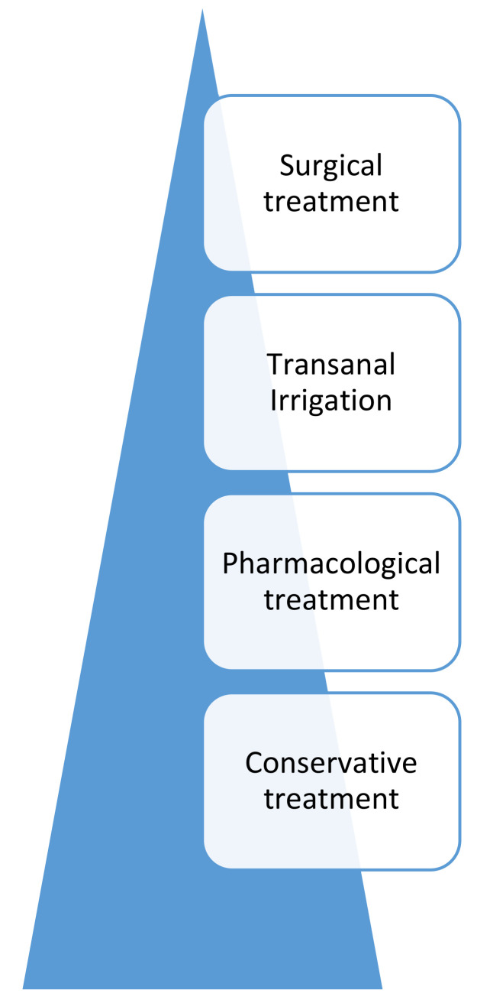
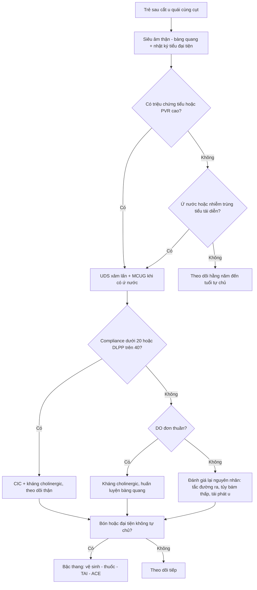
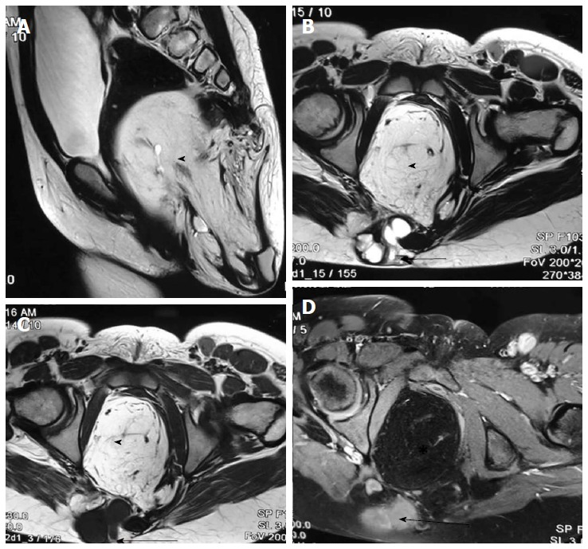
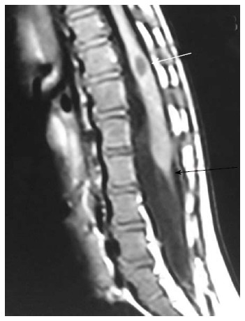
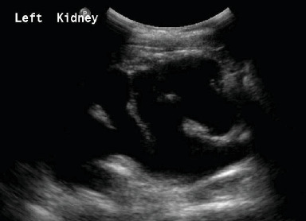

# 1705 — Theo dõi tiết niệu – đại tiện dài hạn sau cắt u quái cùng cụt (SCT): bàng quang thần kinh, tủy bám thấp, bón và đại tiện không tự chủ

**Tags:** `pattern:bang-quang-than-kinh` `pattern:thanh-bang-quang-day` `pattern:ton-luu-nuoc-tieu` `pattern:tro-nguoc-bang-quang-nieu-quan` `pattern:u-nuoc-than` `pattern:bon-man-tinh` `pattern:tuy-bam-thap` `vung:bang-quang` `vung:san-chau` `vung:cung-cut` `protocol:SA-than-bang-quang` `protocol:MCUG` `protocol:MRI-tuy-cung` `protocol:nieu-dong-hoc`

**Mức chắc chắn (certainty):** tổng hợp y văn (literature synthesis) — **1 đoàn hệ 46 sơ sinh** theo dõi **3–7 năm** với niệu động học (PMC13561697), **1 đoàn hệ 41 trẻ** có kết cục niệu–tiêu hóa (PMC6910050), **1 đoàn hệ 7 ca** Bosnia (PMC10081131), ghép với **1 nghiên cứu niệu động học 47 trẻ** để lấy ngưỡng áp lực (PMC13541730), **1 nghiên cứu siêu âm đa thức bàng quang thần kinh** lấy ngưỡng hình ảnh (PMC12890931), **2 tài liệu về đại tiện** (PMC8069792; PMC13025410), **1 đoàn hệ ruột–bàng quang ở dị tật hậu môn + bất sản cùng** để làm hàng phân biệt (PMC13219063) và **1 tổng quan hình ảnh tủy sống** (PMC5415887). Không có thử nghiệm ngẫu nhiên; chỗ suy luận được đánh dấu.

> **Câu chốt:** Sau cắt u quái cùng cụt, **không phải chỉ theo dõi tái phát u** — **19,6%** trẻ có rối loạn chức năng đường tiểu dưới (LUTD) trong theo dõi **4,9 ± 1,4 năm**, và **8/9 trẻ có triệu chứng** có bất thường niệu động học (PMC13561697). Trong khi đó **bàng quang thần kinh không tự khỏi**: **2 ca Altman IV** có **cơ detrusor không co** với **tồn lưu 118 mL và 80 mL**, Qmax **1,70 và 3,04 mL/s** — những trẻ này cần **thông tiểu ngắt quãng (CIC)** sớm, không phải "chờ lớn rồi tính". Bài này trả lời: **chụp gì, đo gì, khi nào can thiệp, và bẫy nào khiến hình ảnh bình thường mà trẻ vẫn tổn thương thận**.

## 1. Tổng quan bệnh học – cơ chế hình ảnh (TẠI SAO)

### 1.1 Dịch tễ và phân loại Altman

- **Tần suất:** SCT **1/30.000–40.000** trẻ sinh sống, ưu thế nữ (PMC13561697); đa số chẩn đoán trước sinh, mổ chủ yếu **trong 14 ngày đầu** (**69,6%**), đường mổ **cùng cụt sau (89,1%)** (PMC13561697).
- **Altman I–IV** (dựa trên MRI trước mổ, PMC13561697):
  - **I:** chủ yếu ngoài xương cùng, **lồi hoàn toàn** ra ngoài;
  - **II:** chủ yếu ngoài, **> 50%** thể tích lồi ra ngoài;
  - **III:** chủ yếu **trước xương cùng**, **≤ 50%** lồi ra ngoài;
  - **IV:** **hoàn toàn trước xương cùng**, **không có khối lồi** — hiếm, khoảng **10%**, thường phát hiện **muộn** ở nhũ nhi/trẻ nhỏ.
- **Vì sao type III/IV nguy hiểm hơn về chức năng:** khối nằm trong khung chậu, **đè và tách sàn chậu, bàng quang, trực tràng**, và đường mổ phải đi qua **đám rối thần kinh cùng – dây chằng cùng cụt**; đồng thời type IV **không có khối nhìn thấy** nên chẩn đoán muộn, khối đã lớn.

### 1.2 Sinh lý bệnh — 4 cơ chế gây rối loạn tiểu và đại tiện

1. **Hiệu ứng khối (mass effect) từ trong bào thai:** khối lớn chèn ép **cơ nâng hậu môn, cơ thắt niệu đạo, bàng quang** và **kéo giãn các sợi thần kinh cùng**; trong type II, **đường kính u lớn hơn có ý nghĩa ở nhóm có LUTD** (t = −2,781; P < 0,05) (PMC13561697). Nghiên cứu đoàn hệ khác ghi nhận **không có LUTD khi u < 9 cm** (dẫn trong PMC13561697).
2. **Tổn thương thần kinh–cơ trong mổ:** cắt u + **cắt xương cụt** làm mất điểm tựa sàn chậu; rễ **S2–S4** (đối giao cảm bàng quang, vận động cơ detrusor) và **dây thần kinh thẹn** (cơ thắt ngoài, cảm giác) có thể bị kéo/đốt.
3. **Tủy bám thấp (tethered cord) đi kèm:** SCT là dị tật **thoái triển ống thần kinh thứ phát** — cùng nhóm với **caudal agenesis, filar lipoma, tight filum** (PMC5415887). Tủy bám thấp gây **bàng quang thần kinh kiểu dưới** (detrusor không co, dung tích nhỏ, PVR cao) và **bón/đại tiện không tự chủ**.
4. **Vòng xoắn bàng quang – ruột:** bón mạn làm **đầy trực tràng → chèn bàng quang → tiểu gấp/són tiểu/ứ nước**; điều trị bón đôi khi cải thiện triệu chứng tiểu mà không cần can thiệp niệu khoa.

### 1.3 TẠI SAO hình ảnh lại như vậy (vật lý + mô bệnh)

- **Siêu âm — thành bàng quang dày và trabeculation:** khi áp lực trong bàng quang cao kéo dài, **cơ detrusor phì đại** → thành dày, bề mặt **lồi lõm từng bó cơ (trabeculation)**; các hốc giữa các bó tạo **túi thừa giả**. Nước tiểu là **dịch đồng nhất, không hồi âm** → ứ nước thận hiện thành **khoang đen, giãn đài bể thận**, và **mỏng nhu mô** khi tiến triển. Tồn lưu sau đi tiểu (PVR) đo được ngay sau khi trẻ đi tiểu.
- **Ngưỡng siêu âm định lượng** (PMC12890931): thể tích bàng quang dự đoán **VV = 30 × (tuổi + 1) mL** (dùng cho trẻ **≥ 2 tuổi**, tối đa **390 mL**); **PVR < 10% VV dự đoán** được coi là "bàng quang rỗng"; bàng quang thần kinh có **VV lúc rỗng tăng, thành bàng quang dày hơn, độ cứng (shear wave velocity) tăng**; **ngưỡng SWV lúc làm đầy 2,47 m/s: AUC 0,89, Se 90,4%, Sp 74,0%**.
- **MCUG (chụp bàng quang–niệu đạo khi đi tiểu):** cản quang cho thấy **hình dạng bàng quang** — bàng quang **thành dày, nhiều túi thừa, dạng "quả thông/đèn Giáng sinh"** là dấu của **bàng quang tăng áp lực mạn**; **trào ngược bàng quang–niệu quản (VUR)** phân độ **I–V** theo mức lan lên niệu quản/đài thận và giãn.
- **MRI tủy cùng:** dịch não tủy **T2 rất sáng** viền quanh tủy → thấy rõ **đuôi tủy (conus)**. Bình thường **conus trên thân đốt L2**; **tủy bám thấp** khi conus **dưới L2** kèm **filum dày > 2 mm** và/hoặc **mỡ trong filum** (PMC5415887). Mỡ **T1 sáng, T2 sáng, tắt tín hiệu khi fat-sat** — dấu của **filar lipoma**.
- **Niệu động học (UDS):** đo **áp lực detrusor (Pdet) – thể tích – dòng chảy**. Ngưỡng thực hành: **compliance < 20 mL/cmH₂O** là giảm (PMC13541730; loạt SCT dùng **< 10 mL/cmH₂O** — PMC13561697); **DLPP > 40 cmH₂O** là nguy cơ cao cho đường tiết niệu trên (PMC13541730); **detrusor overactivity (DO)**, **bàng quang không co (underactive)**, **rối loạn đồng vận cơ thắt–detrusor** là các kiểu thường gặp.

### 1.4 Số liệu kết cục cần nhớ

| Chỉ số | Số liệu | Nguồn |
|---|---|---|
| LUTD sau cắt SCT | **19,6%** (9/46), chủ yếu **tiểu nhiều lần + són tiểu**; theo Altman **I 16,7% · II 19,2% · III 20,0% · IV 22,2%** (không khác biệt, p = 0,489/0,99) | PMC13561697 |
| U tổn thương lớn | u **> 10 cm: 27,3%** có LUTD vs **≤ 10 cm: 23,1%** (p = 0,74) | PMC13561697 |
| Bất thường niệu động học | **8/9 (88,9%)** trẻ có LUTD: **DO 5 ca**, **bàng quang thần kinh 2 ca** (đều Altman IV), **PVR 118 và 80 mL**, **Qmax 1,70 và 3,04 mL/s**, **1 ca compliance kém** | PMC13561697 |
| Kết cục niệu–tiêu hóa | són tiểu **12,2%** khi nhập viện, **7,2%** tồn tại; **bón 4,9%**; **không ca nào đại tiện không tự chủ** (41 trẻ) | PMC6910050 |
| Loạt nhỏ | **3/7 (42,9%)** có rối loạn bàng quang và trực tràng sau mổ | PMC10081131 |
| Tài liệu cũ | **rối loạn hậu môn–trực tràng 29%**; **bàng quang thần kinh "hơn 3/4"** trong một loạt cũ (trích dẫn trong bài) | PMC6910050 |
| Trẻ không triệu chứng | Các nghiên cứu trước cho thấy trẻ **không triệu chứng vẫn có thể** bất thường niệu động học; loạt 46 trẻ chỉ làm UDS ở trẻ **có triệu chứng** nên tác giả thừa nhận **có thể đánh giá thấp** tỷ lệ thật (số cụ thể: chưa rõ) | PMC13561697 |

## 2. Mẫu hình + chẩn đoán phân biệt theo kiểu rối loạn (gamut)

**Đọc theo "kiểu bệnh" chứ không theo tên mổ:**

- **Kiểu A — Bàng quang tăng hoạt động (DO), không do thần kinh:** tiểu gấp, són tiểu ban ngày, **PVR thấp**, thành bàng quang dày nhẹ, **không ứ nước thận**; hay gặp sau mổ do kích thích/viêm.
- **Kiểu B — Bàng quang thần kinh dưới (underactive/acontractile):** **PVR cao**, dòng **plateau/tháp**, **không có co detrusor chủ động**, có thể **ứ nước + VUR**; đây là kiểu của **2 ca Altman IV** trong loạt 46 trẻ (PMC13561697).
- **Kiểu C — Tắc đường ra:** hẹp niệu đạo sau mổ, **van niệu đạo sau** (bé trai), hẹp cổ bàng quang; bàng quang **rất dày, nhiều túi thừa**, dòng yếu, PVR cao.
- **Kiểu D — VUR:** nguyên phát (bất thường lỗ niệu quản) vs **thứ phát do áp lực cao** (kiểu B/C); phân biệt bằng **UDS + MCUG**, vì xử trí khác nhau (kháng sinh dự phòng/nội soi tiêm chất vs **giải áp lực**).
- **Kiểu E — Bón/đại tiện không tự chủ:** do **rối loạn cơ thắt hậu môn**, **tủy bám thấp**, **hẹp hậu môn sau mổ**, hoặc **Currarino/dị tật hậu môn** đi kèm; đánh giá bằng **nhật ký đại tiện + Bristol + thời gian vận chuyển đại tràng**.
- **Kiểu F — Tủy bám thấp:** có thể **không triệu chứng**, hoặc **bàn chân khoèo mắc phải, đau lưng, yếu chi dưới, tiểu không kiểm soát tiến triển**; MRI là chuẩn.
- **Kiểu G — Tái phát u trước cùng:** khối chèn bàng quang/trực tràng → **triệu chứng tiểu mới xuất hiện sau một thời gian ổn định**; phải loại trừ trước khi quy cho "di chứng mổ".

## 3. Bảng so sánh phân biệt (ma trận đối chiếu)

| Thực thể (entity) | Hình ảnh điển hình | Chốt vào (rule-in) | Chốt loại (rule-out) | Gợi ý xác nhận |
|---|---|---|---|---|
| **Bàng quang thần kinh dưới sau cắt SCT** | Siêu âm: **PVR cao > 10% VV dự đoán**, thành dày; MCUG: bàng quang **dạng quả thông**, có thể VUR; MRI: **conus dưới L2, filum > 2 mm** | **PVR cao + không có co detrusor trên UDS + tổn thương tủy/rễ cùng** | PVR thấp, UDS có co detrusor bình thường → không phải kiểu thần kinh | UDS + MRI tủy cùng; đối chiếu với mốc trước mổ |
| **DO không do thần kinh (sau mổ)** | Bàng quang dung tích **nhỏ**, thành dày nhẹ, **PVR thấp**, không ứ nước | **DO trên pha làm đầy + PVR thấp + không có bất thường tủy** | Có **PVR cao/tủy bám thấp** → kiểu thần kinh | UDS; điều trị kháng cholinergic, theo dõi |
| **Tắc đường ra (hẹp niệu đạo/van niệu đạo sau)** | Bàng quang **rất dày, nhiều túi thừa**, **niệu đạo sau giãn** trên MCUG, dòng mỏng | **Hẹp/van thấy trên MCUG + bàng quang dày + PVR cao** | Niệu đạo sau bình thường, không chênh áp → không tắc | MCUG thì đi tiểu; siêu âm thận; đo niệu đồ |
| **VUR thứ phát do áp lực cao** | MCUG: **VUR độ III–V**, niệu quản giãn, đài thận tù; siêu âm: ứ nước, mô thận mỏng | **VUR + Pdet cao/DLPP > 40 cmH₂O + bàng quang dày** | VUR độ thấp, Pdet bình thường, không ứ nước → nguyên phát | MCUG + UDS; theo dõi chức năng thận |
| **Tủy bám thấp (tethered cord)** | MRI T2 sagittal: **conus dưới L2**, **filum dày > 2 mm**, mỡ trong filum (T1 sáng) | **Conus dưới L2 + filum > 2 mm**; có/không triệu chứng | Conus trên L2, filum mảnh → không bám thấp | MRI toàn bộ tủy; hội chẩn ngoại thần kinh |
| **Bón mạn sau mổ** | Ổ bụng: **nhiều phân trong đại tràng**, trực tràng đầy; không có khối | **Nhật ký đại tiện + Bristol 1–2 + thời gian vận chuyển chậm** | Đại tiện đều, không phân ứ → không phải nguyên nhân tiểu | Nhật ký 2 tuần; X-quang cản quang đánh dấu (nếu cần) |
| **Rối loạn hậu môn–trực tràng do mổ** | Không có tổn thương đặc hiệu trên hình ảnh; **sẹo/ hẹp hậu môn**, mất phản xạ | **Són phân + hẹp/mất cảm giác hậu môn + không có tủy bám thấp** | MRI có tủy bám thấp/khối → do thần kinh, không chỉ do cơ | Thăm khám + MRI; đánh giá cơ thắt |
| **Tái phát u trước cùng** | MRI: **khối trước cùng mới**, ngấm thuốc, có thể vôi hóa; AFP tăng | **Khối mới + AFP tăng/không giảm** | Không khối, AFP về bình thường → di chứng mổ | MRI chậu + AFP theo lịch |
| **Currarino / bất sản cùng (hàng phân biệt)** | **Bất sản cùng, khối trước cùng, rò trực tràng–cùng**; bàng quang thần kinh | **Bất sản xương cùng + khối + tiền sử gia đình** | Xương cùng bình thường → không phải Currarino | MRI chậu–tủy; X-quang cùng cụt; tư vấn di truyền |

## 4. Protocol theo dõi + ngưỡng can thiệp

### 4.1 Lịch theo dõi (đề xuất dựa trên kết cục của các đoàn hệ)

- **Trước ra viện:** siêu âm thận–bàng quang (ứ nước? PVR?) + nhật ký tiểu/đại tiện cơ bản; **MRI chậu–tủy cùng** nếu chưa có hoặc nếu u type III/IV, có bất thường thần kinh, hoặc nghi tủy bám thấp.
- **3–6 tháng:** siêu âm thận–bàng quang lặp lại; đánh giá **có triệu chứng hay không** (tiểu gấp, són, tiểu yếu, nhiễm trùng tiểu tái diễn, bón).
- **Hằng năm đến tuổi kiểm soát đại tiểu tiện (khoảng 5–6 tuổi):** siêu âm + nhật ký; **MCUG/UDS** chỉ khi có chỉ định (xem dưới).
- **Sau tuổi đi học:** đánh giá lại khi có **triệu chứng mới**, **nhiễm trùng tiểu**, **tăng huyết áp**, **bàn chân khoèo mắc phải**, hoặc **đại tiện không tự chủ**.

### 4.2 Khi nào làm gì — ngưỡng cụ thể

| Tình huống | Việc cần làm | Ngưỡng / lý do |
|---|---|---|
| Có triệu chứng tiểu (tiểu gấp, són, tiểu yếu, tiểu nhiều lần) | **UDS xâm lấn** + siêu âm PVR | Ngưỡng: **compliance < 20 mL/cmH₂O**, **DLPP > 40 cmH₂O**, có DO hay không co detrusor (PMC13541730) |
| **PVR > 10% VV dự đoán** (VV = 30 × [tuổi + 1] mL, tối đa 390 mL) | Lặp lại siêu âm sau đi tiểu; cân nhắc **CIC** nếu PVR cao kéo dài | PVR < 10% = "rỗng" (PMC12890931); PVR cao → ứ trệ, nhiễm trùng, áp lực cao |
| **Ứ nước thận / VUR** trên siêu âm | **MCUG** (khi không nhiễm trùng cấp) + đánh giá chức năng thận | VUR độ **III–V** hoặc ứ nước tiến triển → can thiệp |
| Nghi **tủy bám thấp** (bất thường thần kinh, tiểu không kiểm soát tiến triển, bàn chân khoèo) | **MRI toàn bộ tủy sống** | Conus **dưới L2**, filum **> 2 mm** (PMC5415887) |
| **Bón/đại tiện không tự chủ** | Nhật ký + Bristol; bậc thang: **vệ sinh/ăn kiêng → thuốc → TAI → ACE/phẫu thuật** | Bậc thang theo PMC8069792; TAI dùng ở **66,7%** trẻ ≥ 4 tuổi trong nhóm nguy cơ cao (PMC13219063) |
| **Không triệu chứng, không bất thường hình ảnh** | **Không UDS thường quy** — theo dõi lâm sàng | Tác giả loạt 46 trẻ: "không đủ bằng chứng cho sàng lọc niệu động học thường quy ở trẻ không triệu chứng" (PMC13561697) |
| Nghi **tái phát u** | MRI chậu có cản quang + **AFP** | AFP không giảm/ tăng lại; khối mới trước cùng |

### 4.3 Bậc thang điều trị đại tiện (theo PMC8069792)

1. **Bảo tồn:** chế độ ăn, uống nước, thói quen đi đại tiện, vệ sinh hậu môn.
2. **Thuốc:** laxative thẩm thấu/kích thích, thụt tháo.
3. **TAI (transanal irrigation):** bơm nước ấm qua trực tràng theo lịch; hiệu quả và được dùng rộng rãi ở trẻ có rối loạn thần kinh ruột.
4. **ACE (Malone antegrade continence enema) / cecostomy:** khi TAI thất bại hoặc không dung nạp. Loạt 31 trẻ: **MACE** có **25%** phải mổ lại, nằm viện **7,5 vs 4,5 ngày**, mô hạt **13,5% vs 82,6%** so với cecostomy nội soi; **kết cục tự chủ tương đương sau 10 năm** (PMC13025410).

*Bậc thang từ dưới lên: **bảo tồn → thuốc → TAI → phẫu thuật** (ACE/cecostomy). Ảnh: Mosiello G và cs., *J Clin Med* 2021, Fig. 1 (PMC8069792), CC BY 4.0.*

## 5. Biến thể bình thường và cạm bẫy

- **"Không triệu chứng" không đồng nghĩa "không bệnh":** tác giả loạt 46 trẻ ghi nhận một phần trẻ có bất thường niệu động học **không triệu chứng** — nhưng chính bài đó **không khuyến cáo UDS thường quy**; giải pháp thực hành là **siêu âm + nhật ký** đều đặn, chỉ UDS khi có dấu hiệu (mâu thuẫn có chủ đích, ghi rõ).
- **Đo PVR sai cách:** phải đo **ngay sau khi trẻ đi tiểu**, cùng tư thế, cùng loại máy; PVR **thay đổi theo lượng nước tiểu và lo lắng** — một lần PVR cao chưa đủ chẩn đoán, cần **≥ 2 lần** và so với **10% VV dự đoán**.
- **Bàng quang căng đầy giả ứ nước thận:** siêu âm khi bàng quang quá đầy làm **giãn đài bể thận giả**; luôn cho trẻ đi tiểu rồi chụp lại trước khi kết luận.
- **Thành bàng quang dày là dấu phụ thuộc người đo:** đo ở **thành trước, hai điểm A/B**, khi bàng quang đầy **≥ 60% VV dự đoán**; nếu không chuẩn hóa, "thành dày" có thể chỉ là **co bóp sinh lý**.
- **DO ở trẻ nhỏ có thể thoáng qua:** đừng dán nhãn "bàng quang thần kinh" chỉ vì một lần UDS có DO — cần **bối cảnh thần kinh + PVR + hình ảnh tủy**.
- **Bón là "kẻ giả danh" kinh điển:** trẻ bón mạn có thể **tiểu gấp, són, nhiễm trùng tiểu**; điều trị bón trước, tránh can thiệp niệu khoa không cần thiết.
- **Tủy bám thấp có thể im lặng:** không triệu chứng vẫn có thể có conus thấp; ngược lại **mỡ trong filum đơn thuần** là biến thể, chỉ có ý nghĩa khi kèm **tủy bám thấp/triệu chứng** (PMC5415887).
- **Đừng mặc định "Altman III/IV = nguy cơ cao hơn":** trong loạt 46 trẻ, tỷ lệ LUTD **không khác** giữa các type (16,7–22,2%, p = 0,489/0,99); yếu tố quyết định là **kích thước u trong type II** và **mức xâm lấn sàn chậu** — tư vấn gia đình theo số liệu này, không theo cảm tính (PMC13561697).
- **Triệu chứng mới sau giai đoạn ổn định** phải nghĩ **tái phát u** hoặc **tủy bám thấp tiến triển**, không quy ngay cho "di chứng mổ".

## 6. Tự lượng giá — Blind Quiz

**Ca 1 — Bé gái 2 ngày tuổi, khối vùng cùng cụt lớn, chân yếu nhẹ.**

- Câu hỏi: Khối nằm ở khoang nào? Thuộc Altman type nào? Cấu trúc nào bị đe dọa và cần đánh giá thêm trên MRI?

<b>Bấm để hiện đáp án (findings + chẩn đoán)</b>

- **Findings:** (A) T2 sagittal: khối **hỗn hợp, nhiều nang và vách**, nằm **trước xương cùng**, đẩy trực tràng ra sau và bàng quang ra trước; (B, C) axial T2/T1: khối **lan vào khung chậu**, có thành phần đặc; (D) T1 fat-sat sau tiêm: **viền/vách ngấm thuốc**.
- **Chẩn đoán:** **u quái cùng cụt type III** (chủ yếu trước xương cùng, ≤ 50% lồi ra ngoài) — type có **nguy cơ chèn ép bàng quang–trực tràng và tổn thương đám rối cùng** khi mổ.
- **Cần đánh giá thêm:** **tủy sống toàn bộ** (conus, filum, mỡ trong filum), **niệu quản–thận** (ứ nước do chèn), và **cấu trúc cơ thắt** — vì các yếu tố này quyết định theo dõi tiết niệu – đại tiện sau mổ.
- Nguồn ảnh: Kumar J, Afsal M, Garg A, *World J Radiol* 2017, Fig. 23 (PMC5415887), CC BY-NC 4.0. **Phản biện:** ảnh minh họa type III ở trẻ lớn hơn; phân loại Altman dựa trên **MRI trước mổ**, không dựa vào kích thước khối.

**Ca 2 — Trẻ 6 tuổi sau cắt SCT, tiểu không kiểm soát tiến triển và bàn chân khoèo mắc phải.**

- Câu hỏi: Đuôi tủy nằm ngang đốt nào? Filum có bất thường? Chẩn đoán và hệ quả với bàng quang?

<b>Bấm để hiện đáp án (findings + chẩn đoán)</b>

- **Findings:** **conus nằm thấp dưới L2** (mũi tên trắng); **filum ngắn, dày > 2 mm** (mũi tên đen) — hình **tight filum terminale**.
- **Chẩn đoán:** **tủy bám thấp (tethered cord)** — giải thích được **bàng quang thần kinh kiểu dưới** (PVR cao, không co detrusor) và **bàn chân khoèo mắc phải**.
- **Hệ quả:** cần **UDS** (compliance, DLPP), **siêu âm thận**, và **hội chẩn ngoại thần kinh** để cân nhắc giải phóng tủy; theo dõi sát vì tổn thương thận có thể tiến triển **dù chưa có triệu chứng tiểu rõ**.
- Nguồn ảnh: Kumar J, Afsal M, Garg A, *World J Radiol* 2017, Fig. 17 (PMC5415887), CC BY-NC 4.0.

**Ca 3 — Trẻ 5 tuổi sau cắt SCT, nhiễm trùng tiểu tái diễn, tiểu ngắt quãng.**

- Câu hỏi: Mô tả hình dạng bàng quang? Có dấu hiệu gì của áp lực cao? Bước tiếp theo?

<b>Bấm để hiện đáp án (findings + chẩn đoán)</b>

- **Findings:** bàng quang **thành dày, nhiều túi thừa nhỏ (outpouching)** ở thành bên, bờ **lồi lõm** — dấu của **bàng quang tăng áp lực mạn**; hình dạng **"quả thông/đèn Giáng sinh"**.
- **Chẩn đoán:** **bàng quang tăng áp lực** (kiểu thần kinh/tắc đường ra) — cần **UDS** để phân biệt **DO**, **không co detrusor**, hay **tắc cổ bàng quang**; **MCUG thì đi tiểu** để tìm **VUR** và hẹp niệu đạo.
- **Bước tiếp:** **UDS + siêu âm thận**; nếu **DLPP > 40 cmH₂O** hoặc **VUR độ cao** → **CIC ± kháng cholinergic**, theo dõi chức năng thận.
- **Lưu ý nguồn:** ảnh lấy từ ca **hội chứng niệu–mặt** (không phải SCT) — dùng làm **hình mẫu của bàng quang tăng áp lực**, không phải ca SCT; không suy ra tỷ lệ cho SCT từ ca này.
- Nguồn ảnh: Alkeraithe F và cs., *Case Rep Urol* 2025, Fig. 2 (PMC12431806), CC BY 4.0.

**Ca 4 — Trẻ 4 tuổi sau cắt SCT, sốt, đau hông lưng trái.**

- Câu hỏi: Dấu hiệu chính? Mức độ ứ nước? Nguy cơ nếu bỏ qua?

<b>Bấm để hiện đáp án (findings + chẩn đoán)</b>

- **Findings:** **giãn rộng đài bể thận**, các khoang dịch thông nhau, **nhu mô thận mỏng** — ứ nước thận **mức độ nặng**.
- **Chẩn đoán:** **ứ nước thận do áp lực cao/trào ngược** trên nền bàng quang thần kinh; cần **MCUG + UDS**, đánh giá chức năng thận và kháng sinh theo nhiễm trùng.
- **Nguy cơ:** tiếp tục ứ nước → **mất nhu mô thận không hồi phục**; ở trẻ sau cắt SCT, đây là lý do phải **siêu âm định kỳ dù trẻ không than phiền**.
- Nguồn ảnh: Alkeraithe F và cs., *Case Rep Urol* 2025, Fig. 4 (PMC12431806), CC BY 4.0.

## Bài liên quan chéo
- [1701 – Đường mổ u quái cùng cụt: sau–qua xương cùng vs nội soi hỗ trợ](../1701-duong-mo-u-quai-cung-cut/lesson.md) — phần **mổ** và giải phẫu presacral.
- [680 – U quái cùng cụt ở trẻ](../680-u-quai-cung-cut-o-tre/lesson.md) — chẩn đoán, AFP, phân loại và điều trị u.
- [671 – Nhiễm trùng tiểu ở trẻ có bàng quang thần kinh](../671-nhiem-trung-tieu-bang-quang-than-kinh-o-tre/lesson.md) — nhiễm trùng tiểu tái diễn và kháng sinh dự phòng.
- [672 – Biến chứng muộn sau tái tạo bàng quang](../672-bien-chung-muon-sau-tai-tao-bang-quang/lesson.md) — khi đã phải tăng dung tích/ruột non.
- [673 – Chuyển tiếp người lớn ở spina bifida/bàng quang thần kinh](../673-chuyen-tiep-nguoi-lon-spina-bifida-bang-quang-than-kinh/lesson.md) — mô hình chuyển tiếp cho trẻ lớn.
- [1702 – Túi niệu đạo sau tạo hình niệu đạo ở trẻ](../1702-tui-nieu-dao-sau-tao-hinh-nieu-dao-o-tre/lesson.md) — hàng phân biệt của "tiểu ngắt quãng, nhiễm trùng tái diễn".

## Ảnh
- `1705_..._MRI_PMC5415887-F23.jpg` — SCT type III, MRI T2/T1 và T1 fat-sat sau tiêm (CC BY-NC 4.0).
- `1705_..._MRI_PMC5415887-F17.jpg` — tight filum terminale, conus thấp (CC BY-NC 4.0).
- `1705_..._MCUG_PMC12431806-F2.jpg` — bàng quang thành dày, túi thừa (CC BY 4.0; ca hội chứng niệu–mặt, dùng làm hình mẫu).
- `1705_..._US_PMC12431806-F4.jpg` — ứ nước thận nặng, nhu mô mỏng (CC BY 4.0).
- `1705_..._so-do_PMC8069792-F1.jpg` — bậc thang điều trị rối loạn thần kinh ruột (CC BY 4.0).
- Nguồn + giấy phép từng ảnh: `images/CREDITS.md`.

> Không dùng để chẩn đoán độc lập khi chưa có người hướng dẫn.
