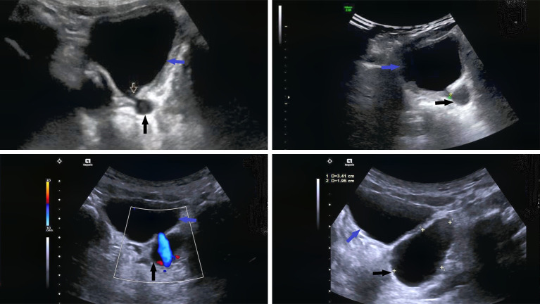
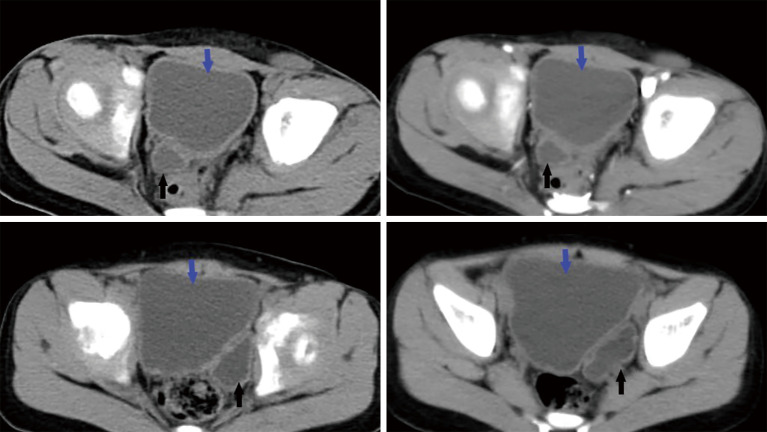
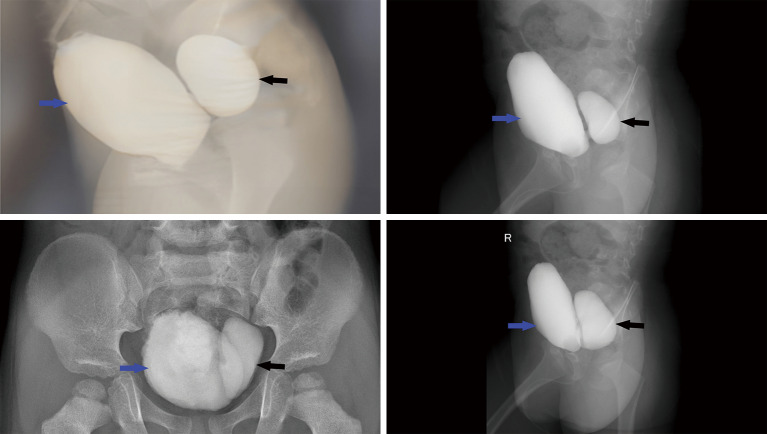
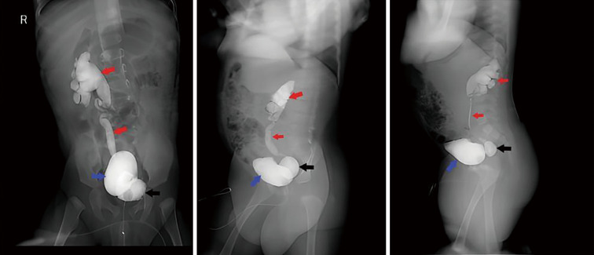
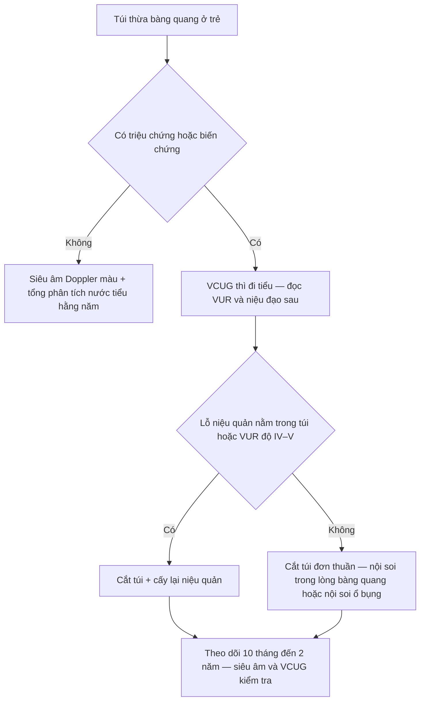
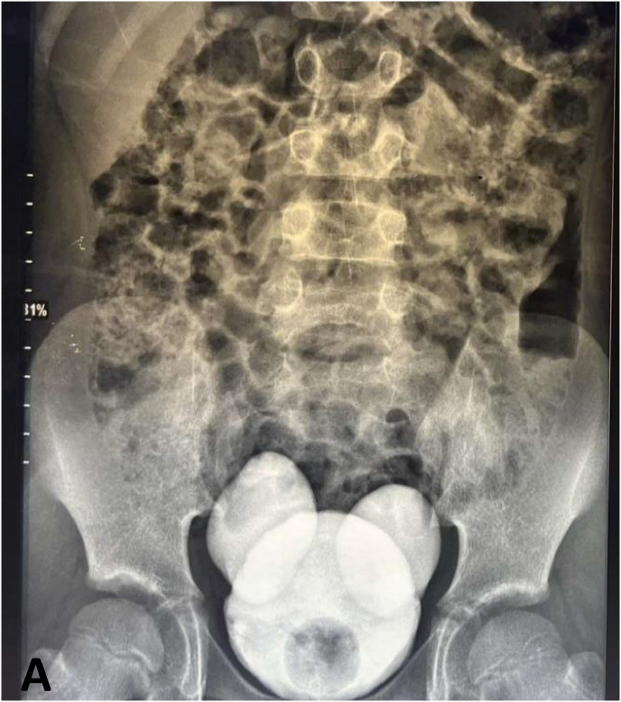

# 1706 — Túi thừa bàng quang ở trẻ / Pediatric bladder diverticulum

**Tags:** `pattern:tui-thua-bang-quang` `pattern:thanh-bang-quang-day` `pattern:tro-nguoc-bang-quang-nieu-quan` `pattern:u-nuoc-than` `vung:bang-quang` `vung:khung-chau` `protocol:VCUG` `protocol:SA-than-bang-quang` `protocol:CT-bang-quang` `protocol:MRI-bang-quang`

**Mức chắc chắn (certainty):** tổng hợp y văn (literature synthesis) — **1 loạt 10 trẻ có đủ 4 phương thức hình ảnh và đối chiếu mô bệnh** (PMC11320504), **2 ca nguyên văn có ảnh** (PMC13195786 túi thừa Hutch hai bên; PMC13273907 Hutch khổng lồ kèm VUR), cộng **1 ca túi thừa khổng lồ ở nhũ nhi** và **1 ca ở thiếu niên** để lấy phổ bệnh cảnh (PMC12107597; PMC12311440). Không có thử nghiệm ngẫu nhiên; chỗ suy luận được đánh dấu rõ.

> **Câu chốt:** Túi thừa bàng quang ở trẻ **không phải "một cái bóng nước vô hại"**. Ba con số quyết định cách đọc: **(1)** siêu âm chỉ phát hiện **60%**, CT **70%**, MRI **70%**, còn **VCUG 100%** (PMC11320504); **(2)** khoảng **90%** túi thừa bẩm sinh nằm **ngay cạnh lỗ niệu quản** nên **túi và trào ngược bàng quang–niệu quản (vesicoureteral reflux, VUR) là cặp bài trùng** — **5/10** ca trong loạt có VUR độ IV–V; **(3)** túi **nhỏ lại khi bàng quang căng** và **to ra khi đi tiểu** — nên phim chụp **lúc đang làm đầy** rất dễ "âm tính giả".

## 1. Tổng quan bệnh học – cơ chế hình ảnh (TẠI SAO)

### 1.1 Túi thừa thật và túi thừa "giả" khác nhau ở lớp cơ

- **Định nghĩa:** túi thừa bàng quang (bladder diverticulum) là **niêm mạc bàng quang lồi ra ngoài qua lớp cơ detrusor** qua một **cổ hẹp** (PMC11320504).
- **Túi thừa bẩm sinh (nguyên phát, primary/congenital):** thành túi **có sợi cơ trơn của thành bàng quang** — mô bệnh ca mổ trong loạt 10 trẻ cho thấy **biểu mô trụ/niêm mạc còn lại, mô xơ trên và dưới biểu mô, các bó cơ trơn thưa thớt** (PMC11320504). Vị trí điển hình: **cạnh lỗ niệu quản (paraureteral, còn gọi túi thừa Hutch)**, **quanh niệu quản (perivesical)** hoặc **sau–bên (posterolateral)**.
- **Túi thừa mắc phải (thứ phát, acquired):** hình thành do **tắc nghẽn đường ra kéo dài** (van niệu đạo sau, hẹp niệu đạo, bàng quang thần kinh) → **áp lực trong lòng bàng quang cao** đẩy niêm mạc qua các khe giữa bó cơ; thành túi **KHÔNG có sợi cơ**, thường **nhỏ, nhiều cái, kèm bàng quang trabeculation nặng** (PMC11320504).
- **Tần suất:** túi thừa bàng quang ở trẻ được trích dẫn **1,7%** (PMC11320504; PMC9614072); **nam trội hơn** — cả 10 ca trong loạt đều là bé trai, tuổi **1,5–7 tuổi, trung bình 3,3 tuổi** (PMC11320504). Cơ chế được giả định: **tắc nghẽn đường ra thoáng qua trong tử cung ở thai nam** (góc niệu đạo, nang tuyến Cowper, van niệu đạo sau) (PMC11320504).
- **Vị trí:** khoảng **90%** túi thừa bẩm sinh nằm **quanh lỗ niệu quản**, **10%** ở **thành sau–bên**; thể sau–bên thường **to hơn và có triệu chứng hơn** (ứ nước tiểu, nhiễm trùng tái diễn, sỏi) (PMC11320504).

### 1.2 TẠI SAO hình ảnh lại như vậy — vật lý và cơ học dòng chảy

- **Siêu âm:** nước tiểu là **dịch đồng nhất, không hồi âm** → túi thừa là **khoang trống âm (anechoic)**, bờ đều, **nằm sát đáy bàng quang/lỗ niệu quản**, và điều quan trọng nhất là **thấy được kênh/cổ thông với lòng bàng quang** (PMC11320504). Vì cổ túi hẹp, **kích thước túi thay đổi ngay trong một lần khám** khi bàng quang căng/xẹp — đây chính là dấu hiệu động học giúp phân biệt với **nang vùng chậu kín** (không thay đổi, không có kênh).
- **CT:** nước tiểu **0–10 HU**; túi hiện là **bóng dịch sau bàng quang**. Trên **thì muộn sau tiêm cản quang**, thuốc đi từ bàng quang **vào túi** → **chứng minh thông thương** bằng hình ảnh, không cần suy đoán (PMC11320504). Thành bàng quang trong ca minh họa dày **8–10 mm** — dấu hiệu **tăng áp lực đường ra** đi kèm.
- **MRI:** nước tiểu **T1 dài (tối), T2 dài (rất sáng)**; túi có tín hiệu **đồng nhất với nước tiểu trong bàng quang** ở mọi chuỗi (PMC11320504). Giá trị chính là **tương quan với niệu quản, tử cung/trực tràng và cơ nâng hậu môn** trước mổ, không phải để "nhìn thấy túi".
- **VCUG (voiding cystourethrography):** đây là chỗ **vật lý dòng chảy quyết định chẩn đoán**. Khi **làm đầy**, bàng quang căng và **chèn ép túi** → túi **nhỏ, có khi không thấy**. Khi **đi tiểu**, áp lực trong bàng quang tăng và **cổ túi mở** → cản quang **tràn vào túi**, túi **căng to** (PMC11320504). Vì vậy **chỉ chụp pha làm đầy là bỏ sót**; bắt buộc có **ảnh thì voiding**, tốt nhất thêm **thì sau đi tiểu (post-void)**.
- **Vì sao VUR đi kèm:** túi thừa Hutch nằm **ngay tại lỗ niệu quản**, làm **mất van niệu quản–bàng quang** (đoạn niệu quản trong thành bị kéo vào túi) → **trào ngược**. Trong loạt 10 ca: **5 ca có VUR**, trong đó **độ IV–V**, kèm **ứ nước thận 2 ca** (PMC11320504). Một ca Hutch khổng lồ **4 × 4 cm** có **VUR độ II** (PMC13273907).

### 1.3 Ngưỡng định lượng cần nhớ

| Chỉ số | Số liệu | Nguồn |
|---|---|---|
| Tần suất túi thừa bàng quang ở trẻ | **1,7%** | PMC11320504; PMC9614072 |
| Tuổi trong loạt 10 trẻ | **1,5–7 tuổi**, trung bình **3,3 tuổi**; **10/10 là bé trai** | PMC11320504 |
| Vị trí so với lỗ niệu quản | **~90% cạnh/ quanh lỗ niệu quản**, **~10% sau–bên** | PMC11320504 |
| Độ nhạy từng phương thức | **SA 60% · CT 70% · MRI 70% · VCUG 100%** (n = 10) | PMC11320504 |
| Túi thừa kèm VUR | **5/10 ca**, VUR **độ IV–V**; ứ nước thận **2/10** | PMC11320504 |
| Độ dày thành bàng quang trong ca minh họa | **8–10 mm** | PMC11320504 |
| Kích thước túi trong loạt | **1,7 × 1,5 × 1,4 cm** → **5,4 × 3,8 × 3,4 cm** | PMC11320504 |
| Túi thừa Hutch khổng lồ | **4 × 4 cm**, VUR **độ II**, bé trai **7 tuổi** | PMC13273907 |
| Nguy cơ ung thư trong túi thừa (người lớn) | **0,8–10%** túi thừa bàng quang — **cực hiếm ở trẻ** | PMC9107804 |

## 2. Mẫu hình + chẩn đoán phân biệt theo vị trí (Gamut)

**Mẫu hình cốt lõi:** một **bóng dịch (nang) nằm sát thành bàng quang**, **thông với lòng bàng quang bằng cổ hẹp**, **to ra ở thì đi tiểu**.

- **Theo vị trí:**
  - **Cạnh lỗ niệu quản (paraureteral / Hutch):** hay nhất, **kèm VUR**, có thể **một hoặc hai bên** — hai bên cho hình **"bàng quang Mickey Mouse"** trên VCUG (PMC13195786).
  - **Sau–bên (posterolateral):** túi **to**, **ít liên quan VUR**, nhưng **chèn ép, ứ nước tiểu, sỏi, nhiễm trùng**; trong loạt là **2 ca** (PMC11320504).
  - **Quanh niệu quản (perivesical):** **3 ca**; lỗ niệu quản **nằm cạnh** túi chứ không ở trong túi.
  - **Đỉnh bàng quang:** nghĩ **di tích ống niệu rốn (urachal remnant)** hơn là túi thừa thật — xem mục (5).
- **Theo cơ chế:** **một túi lớn, thành có cơ** = bẩm sinh; **nhiều túi nhỏ + trabeculation + thành dày** = mắc phải do tăng áp lực (van niệu đạo sau, bàng quang thần kinh).
- **Theo triệu chứng:** **nhiễm trùng tiểu sốt**, **tiểu không tự chủ/tiểu gấp**, **tiểu máu**, **bí tiểu**, **đau bụng/hông lưng**; một số **hoàn toàn không triệu chứng** (PMC11320504; PMC12107597).

## 3. Bảng so sánh phân biệt (ma trận đối chiếu)

| Thực thể (entity) | Hình ảnh điển hình | Chốt vào (rule-in) | Chốt loại (rule-out) | Gợi ý xác nhận |
|---|---|---|---|---|
| **Túi thừa bẩm sinh cạnh lỗ niệu quản (Hutch)** | Túi **một/bên**, cổ hẹp ngay tại lỗ niệu quản; **to ở thì voiding**; thường **kèm VUR** | **Cổ túi nhìn thấy trên SA + cản quang vào túi ở thì voiding**; **VUR cùng bên** | Túi **không có cổ**, không đổi kích thước theo thì → nang kín | **VCUG thì voiding** (chuẩn vàng, 100%); SA để sàng lọc |
| **Túi thừa bẩm sinh sau–bên** | Túi **lớn**, thành mỏng, **xa lỗ niệu quản**, ít VUR | **Túi lớn sau–bên + ứ nước tiểu/sỏi** trên CT/MRI | **Nhiều túi nhỏ + trabeculation** → thể mắc phải | CT/MRI có cản quang thì muộn |
| **Túi thừa/giả túi do tăng áp lực (van niệu đạo sau, bàng quang thần kinh)** | **Nhiều túi nhỏ**, **thành bàng quang dày, trabeculation**, bàng quang **hình quả lê**, **không có túi lớn đơn độc** | **Trabeculation + thành dày + niệu đạo sau giãn** trên VCUG; **creatinin/ứ nước** | **Một túi lớn có cổ rõ, thành bàng quang mỏng** → bẩm sinh | VCUG **thì voiding nhìn niệu đạo sau**; siêu âm thận |
| **Bàng quang hình quả lê do van niệu đạo sau (PUV)** | Bàng quang **dài, hẹp dần về cổ**, thành dày, **không có túi tách rời** | **Van niệu đạo sau thấy trên VCUG + bàng quang quả lê** | **Có túi riêng có cổ** → túi thừa thật | VCUG thì voiding + nội soi niệu đạo |
| **Ureterocele** | **Cấu trúc nang nằm TRONG lòng bàng quang**, "đầu rắn hổ mang", ở lỗ niệu quản | **Nang trong lòng + niệu quản giãn phía trên** | **Túi nằm NGOÀI thành bàng quang** → túi thừa | SA + VCUG/CT niệu đồ |
| **Nang vùng chậu khác (urachal, nang buồng trứng, nang mạc treo/lymphangioma)** | Bóng dịch **không thông** với bàng quang; vị trí **trên đỉnh** hoặc **sau bàng quang** | **Không có cổ, không đổi theo thì, không ngấm cản quang từ bàng quang** | **Có kênh nối + cản quang vào bóng ở thì voiding** → túi thừa | MRI T2 + VCUG; mô bệnh nếu mổ |
| **Túi niệu đạo (sau tạo hình niệu đạo)** | Túi **ở niệu đạo dương vật**, **phồng khi tiểu**, tia tiểu mảnh | **Vị trí dưới cổ bàng quang + RUG thì voiding đầy túi** | **Túi ở trên, trong khung chậu** → túi thừa bàng quang | RUG/VCUG thì voiding (bài 1702) |

*Bốn mặt cắt siêu âm cùng một bệnh nhi: khối nang (mũi tên đen) nằm sau bàng quang (mũi tên xanh), **kênh nối nhỏ** (mũi tên trắng) mở vào lòng bàng quang; kích thước khối **thay đổi ngay trong lần khám** tùy mức căng bàng quang. Nguồn: *Quant Imaging Med Surg* 2024, Fig. 1 — PMC11320504, **CC BY-NC-ND 4.0**, nguyên bản.*

*CT không cản quang 4 lát: bóng dịch (mũi tên đen) sau bàng quang (mũi tên xanh), **thông với bàng quang**; thành bàng quang dày **8–10 mm**. Nguồn: PMC11320504, Fig. 2, **CC BY-NC-ND 4.0**, nguyên bản.*

### Dấu hiệu đọc chuẩn xác trên VCUG

- **Thì làm đầy:** túi **nhỏ lại hoặc biến mất** vì bàng quang căng chèn ép → **đừng kết luận "không có túi"**.
- **Thì đi tiểu:** túi **căng to**, thấy **cổ túi**; đây là ảnh **chốt chẩn đoán** (PMC11320504).
- **Hai bên, đối xứng, hai quả "tai" cạnh bàng quang** = **"bàng quang Mickey Mouse"** — túi thừa Hutch hai bên (PMC13195786).
- **Luôn đọc niệu đạo sau trong cùng thì voiding**: van niệu đạo sau vừa là **nguyên nhân giả túi**, vừa là **bệnh kèm** phải xử trí.

*Bốn ảnh VCUG: cản quang vào bàng quang (mũi tên xanh) rồi **tràn vào túi sau** (mũi tên đen) qua cổ túi — bằng chứng thông thương. Nguồn: PMC11320504, Fig. 6, **CC BY-NC-ND 4.0**, nguyên bản.*

*Cùng bệnh nhi: túi thừa (mũi tên đen) + **trào ngược lên niệu quản và bể thận phải** (mũi tên đỏ) — cặp bài trùng Hutch–VUR. Nguồn: PMC11320504, Fig. 7, **CC BY-NC-ND 4.0**, nguyên bản.*

## 4. Protocol chụp + phân loại và chỉ định can thiệp

### 4.1 Thứ tự hình ảnh (theo độ nhạy thực đo)

1. **Siêu âm bụng–bàng quang (sàng lọc, không bức xạ):** khảo sát **lúc bàng quang căng và sau khi đi tiểu**, tìm **bóng nang + cổ/kênh nối**, đo kích thước (mm), xem **ứ nước thận hai bên**. Độ nhạy chỉ **60%** — **âm tính không loại trừ** (PMC11320504).
2. **VCUG có thì đi tiểu (chuẩn vàng):** đặt catheter, bơm cản quang, chụp **AP + chếch + nghiêng**, **bắt buộc ảnh đang đi tiểu và sau đi tiểu**; ghi **độ VUR** và **hình thái niệu đạo sau**. Độ nhạy **100%** trong loạt 10 ca (PMC11320504).
3. **CT hoặc MRI khi cần mổ:** đánh giá **kích thước, số túi, tương quan lỗ niệu quản**, **thành bàng quang**, và **đường mổ**; CT **có cản quang thì muộn** cho thấy thuốc vào túi; MRI (T2) tốt cho mô mềm và **tránh bức xạ** ở trẻ (PMC11320504).
4. **Niệu động học (urodynamics)** khi nghi **bàng quang thần kinh/rối loạn tống xuất**; **nội soi bàng quang** khi cần xác định **lỗ niệu quản nằm trong hay cạnh túi** trước khi quyết định cấy lại niệu quản.
5. **Xét nghiệm:** tổng phân tích nước tiểu + cấy khi có triệu chứng; creatinin nếu ứ nước hai bên.

### 4.2 Phân loại dùng trong thực hành

- **Theo liên quan lỗ niệu quản:** **cạnh lỗ niệu quản (paraureteral/Hutch)** · **quanh niệu quản (perivesical)** · **sau–bên (posterolateral)** — cách phân loại này quyết định **có phải cấy lại niệu quản hay không** (PMC11320504).
- **Theo nguồn gốc:** **bẩm sinh (thành có cơ)** vs **mắc phải (không cơ, nhiều túi nhỏ)** — quyết định **điều trị nguyên nhân tắc nghẽn** thay vì chỉ cắt túi.
- **Chỉ định mổ** (PMC11320504; PMC13273907): **bí tiểu/tắc nghẽn do túi**, **nhiễm trùng tiểu tái diễn**, **sỏi trong túi**, **tiểu máu**, **ứ nước thận**, **VUR độ cao kèm lỗ niệu quản trong túi**, **túi khổng lồ chèn ép**.
- **Theo dõi không mổ:** túi **tình cờ, không triệu chứng** → **siêu âm Doppler màu hằng năm + tổng phân tích nước tiểu** (PMC11320504); một ca túi khổng lồ ở thiếu niên được theo dõi ổn định khi gia đình từ chối mổ (PMC12311440) — nhưng đây là **lựa chọn cá biệt, không phải chuẩn**.

### 4.3 Sơ đồ quyết định

### 4.4 Kết quả phẫu thuật trong loạt 10 trẻ

- **10/10 mổ thành công**; thì gian mổ **83–290 phút, trung bình 207 phút**; gồm **cắt túi nội soi ổ bụng** và **cắt túi qua lòng bàng quang**, ca có VUR **được cấy lại niệu quản** (PMC11320504).
- Theo dõi **10 tháng – 2 năm**: **hết tiểu không tự chủ và bí tiểu**, **không còn nhiễm trùng tiểu**, **siêu âm không còn túi**, **VCUG không còn túi và không còn VUR** (PMC11320504).

## 5. Biến thể bình thường và cạm bẫy

- **Cạm bẫy 1 — chỉ chụp pha làm đầy:** túi **xẹp khi bàng quang căng**, dễ kết luận âm tính. Bắt buộc **ảnh thì voiding** (PMC11320504).
- **Cạm bẫy 2 — gọi mọi "túi" là Hutch:** van niệu đạo sau và bàng quang thần kinh tạo **nhiều giả túi nhỏ + trabeculation**; gọi nhầm là Hutch sẽ **mổ túi mà bỏ nguyên nhân tắc nghẽn** → tái phát. Đọc kỹ **niệu đạo sau** và **độ dày thành bàng quang**.
- **Cạm bẫy 3 — "bàng quang Mickey Mouse" bị đọc thành bàng quang đôi:** hai túi Hutch hai bên tạo **hai "tai"** đối xứng; **bàng quang đôi thật** có **vách ngăn trong lòng** — phân biệt bằng **VCUG + nội soi**, không dựa vào bóng trên phim (PMC13195786).
- **Cạm bẫy 4 — nang vùng chậu "giả túi":** nang ống niệu rốn, nang buồng trứng, nang mạc treo **không có cổ, không đổi kích thước theo thì, không ngấm cản quang từ bàng quang**. Nếu chỉ có siêu âm, **dễ mổ nhầm**; cần **VCUG hoặc CT/MRI thì muộn**.
- **Cạm bẫy 5 — bỏ sót VUR đối bên:** túi to một bên có thể **che/đổi hướng dòng**; luôn chụp **cả hai bên** và ghi **độ VUR** theo phân độ quốc tế.
- **Cạm bẫy 6 — thoả mãn tìm kiếm (satisfaction of search):** thấy túi rồi dừng, bỏ **sỏi trong túi**, **ứ nước thận**, **van niệu đạo sau**, **túi thừa thứ hai**.
- **Biến thể bình thường dễ nhầm:** **bàng quang căng đầy** tạo **góc nhọn giả túi** ở đáy; **bóng ruột chứa dịch** cạnh bàng quang; **túi thừa rất nhỏ (< 1 cm)** không triệu chứng — **không can thiệp**, chỉ theo dõi.
- **Biến chứng cần nhớ (hiếm nhưng nặng):** **vỡ túi thừa tự phát** gây **đau bụng cấp, dịch ổ bụng** (đã báo ở người lớn, PMC10460264); **ung thư trong túi thừa** chiếm **0,8–10%** túi thừa ở người lớn, **hầu như không gặp ở trẻ** — không dùng con số này để chỉ định cắt túi ở trẻ không triệu chứng (PMC9107804).

## 6. Tự lượng giá — Blind Quiz

**Ca 1 — Bé trai 3 tuổi, sốt, đái buốt tái diễn. Siêu âm bàng quang:**

- Gợi ý lâm sàng: nhiễm trùng tiểu sốt tái diễn, không có bí tiểu.
- Câu hỏi: Khối nang nằm ở đâu? Có dấu hiệu gì chứng minh nó **thông với bàng quang**? Ba chẩn đoán phân biệt?

<b>Bấm để hiện đáp án (findings + chẩn đoán)</b>

- **Dấu hiệu:** khối **trống âm** sau bàng quang, có **kênh/cổ nối với lòng bàng quang** (mũi tên trắng); **kích thước thay đổi** khi bàng quang căng/xẹp.
- **Chẩn đoán:** **túi thừa bàng quang bẩm sinh** (thể quanh/cạnh lỗ niệu quản).
- **Phân biệt:** nang ống niệu rốn (đỉnh bàng quang, không cổ) · nang buồng trứng/nang mạc treo (không cổ) · ureterocele (nang **trong** lòng bàng quang).
- **Bước tiếp:** **VCUG có thì đi tiểu** — đây là phương thức duy nhất đạt **100%** trong loạt (PMC11320504).
- Nguồn ảnh: *Quant Imaging Med Surg* 2024, Fig. 1 — PMC11320504, **CC BY-NC-ND 4.0**.

**Ca 2 — Bé trai 5 tuổi, tiểu máu + đau hông lưng. VCUG dưới đây:**

- Câu hỏi: Hai cấu trúc cản quang là gì? Vì sao **phải chụp thì đi tiểu** mới thấy rõ? Nếu chỉ chụp lúc bơm đầy thì sai thế nào?

<b>Bấm để hiện đáp án</b>

- **Dấu hiệu:** bàng quang (mũi tên xanh) + **túi thừa** (mũi tên đen) đổ đầy qua **cổ hẹp** ở thì voiding.
- **Vì sao:** khi làm đầy, bàng quang căng **chèn ép túi** → túi nhỏ/không thấy; khi đi tiểu, **áp lực trong bàng quang tăng, cổ túi mở** → túi căng to.
- **Sai lầm thường gặp:** chỉ chụp pha làm đầy → **âm tính giả**, bỏ sót túi và bỏ sót VUR.
- Nguồn ảnh: PMC11320504, Fig. 6, **CC BY-NC-ND 4.0**.

**Ca 3 — Bé trai 7 tuổi, khối vùng bẹn tái diễn + tiểu ít. VCUG:**

- Câu hỏi: Ngoài túi thừa, có bất thường gì ở đường tiết niệu trên? Điều đó thay đổi chỉ định mổ thế nào?

<b>Bấm để hiện đáp án</b>

- **Dấu hiệu:** túi thừa (đen) + **VUR lên niệu quản và bể thận phải** (đỏ) — **trào ngược độ cao**.
- **Ý nghĩa:** túi thừa Hutch làm **mất cơ chế van** tại lỗ niệu quản → VUR; VUR độ IV–V kèm lỗ niệu quản trong túi là **chỉ định cắt túi + cấy lại niệu quản**, không chỉ cắt túi đơn thuần (PMC11320504; PMC13273907).
- **Theo dõi sau mổ:** siêu âm + VCUG kiểm tra; loạt 10 ca **không tái phát, hết VUR** trong **10 tháng – 2 năm**.
- Nguồn ảnh: PMC11320504, Fig. 7, **CC BY-NC-ND 4.0**.

**Ca 4 — Bé trai 11 tuổi, tiểu khó, không sốt. VCUG lúc bàng quang vừa đầy một nửa:**

- Câu hỏi: Mô tả hình dạng bàng quang. Chẩn đoán? Phân biệt với bàng quang đôi bằng cách nào?

<b>Bấm để hiện đáp án</b>

- **Dấu hiệu:** bàng quang trung tâm + **hai túi thừa đối xứng hai bên** ở vùng lỗ niệu quản → **"bàng quang Mickey Mouse"** (PMC13195786).
- **Chẩn đoán:** **túi thừa Hutch hai bên**; ca này **không có VUR**, nhưng có **detrusor overactivity + rối loạn đồng vận cơ thắt** trên niệu động học.
- **Phân biệt bàng quang đôi:** bàng quang đôi thật có **vách ngăn trong lòng**; túi thừa Hutch là **hai túi ngoài thành có cổ** — xác nhận bằng **nội soi bàng quang**.
- Nguồn ảnh: *Urol Case Rep* 2026, Fig. 2A — PMC13195786, **CC BY-NC-ND 4.0**.

## Bài liên quan chéo
- [1702 – Túi niệu đạo sau tạo hình niệu đạo ở trẻ](../1702-tui-nieu-dao-sau-tao-hinh-nieu-dao-o-tre/lesson.md) — cùng "túi" nhưng **dưới cổ bàng quang**, RUG thì voiding.
- [691 – Soi bàng quang và soi quanh catheter ở trẻ](../691-soi-bang-quang-va-soi-quanh-catheter-o-tre/lesson.md) — kỹ thuật soi và đọc lỗ niệu quản.
- [635 – Dị tật tiết niệu nhi: SFU, VUR, PUV](../635-di-tat-tiet-nieu-nhi-SFU-VUR-PUV/lesson.md) — phân độ VUR và van niệu đạo sau.
- [671 – Nhiễm trùng tiểu ở trẻ bàng quang thần kinh](../671-nhiem-trung-tieu-bang-quang-than-kinh-o-tre/lesson.md) — chỉ định VCUG sau nhiễm trùng tiểu sốt.
- [1705 – Theo dõi tiết niệu sau cắt u quái cùng cụt](../1705-theo-doi-tiet-nieu-dai-tien-sau-cat-u-quai-cung-cut/lesson.md) — bàng quang thần kinh và tồn lưu.
- [600 – Tổng quan Nhi khoa](../600-tong-quan-nhi-khoa/lesson.md)

> Không dùng để chẩn đoán độc lập khi chưa có người hướng dẫn.
