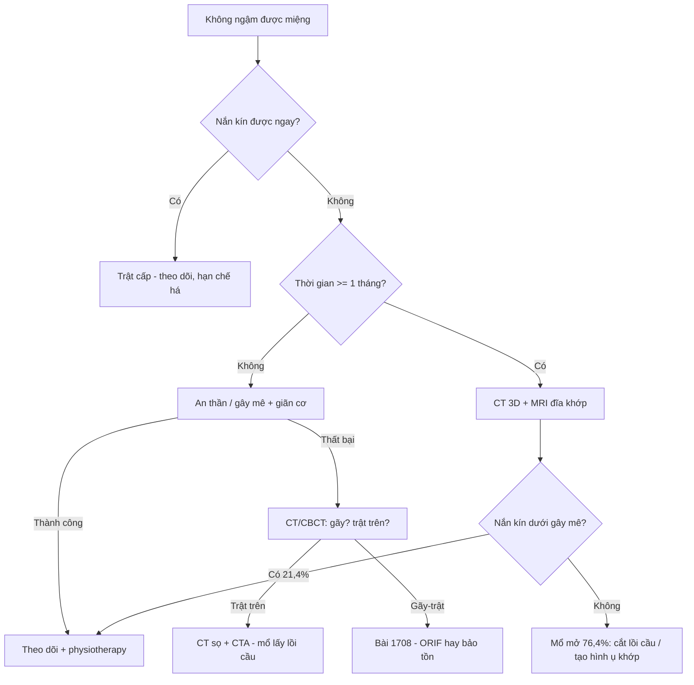
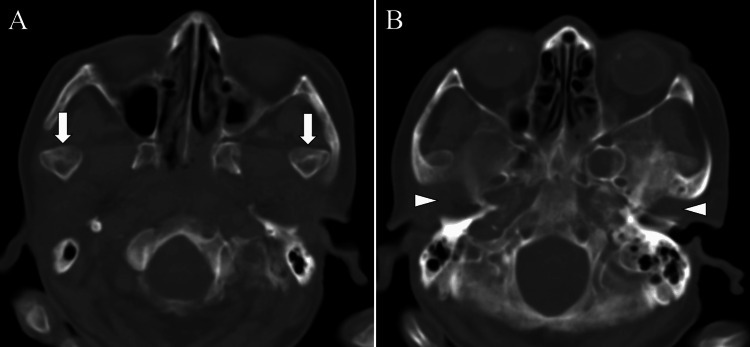
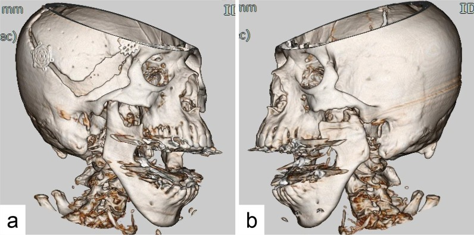
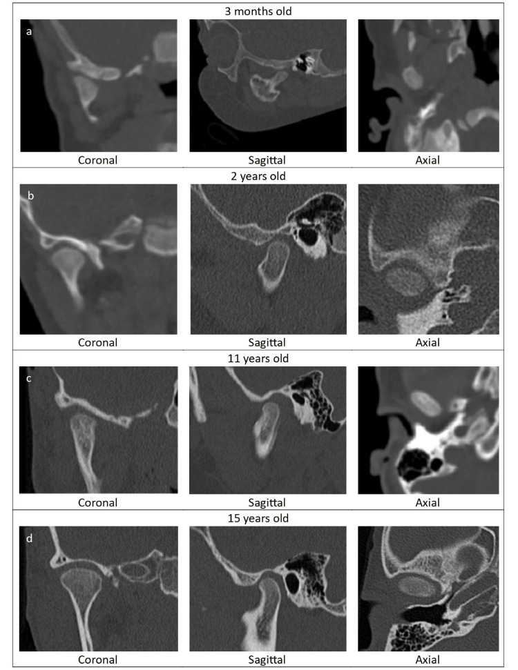
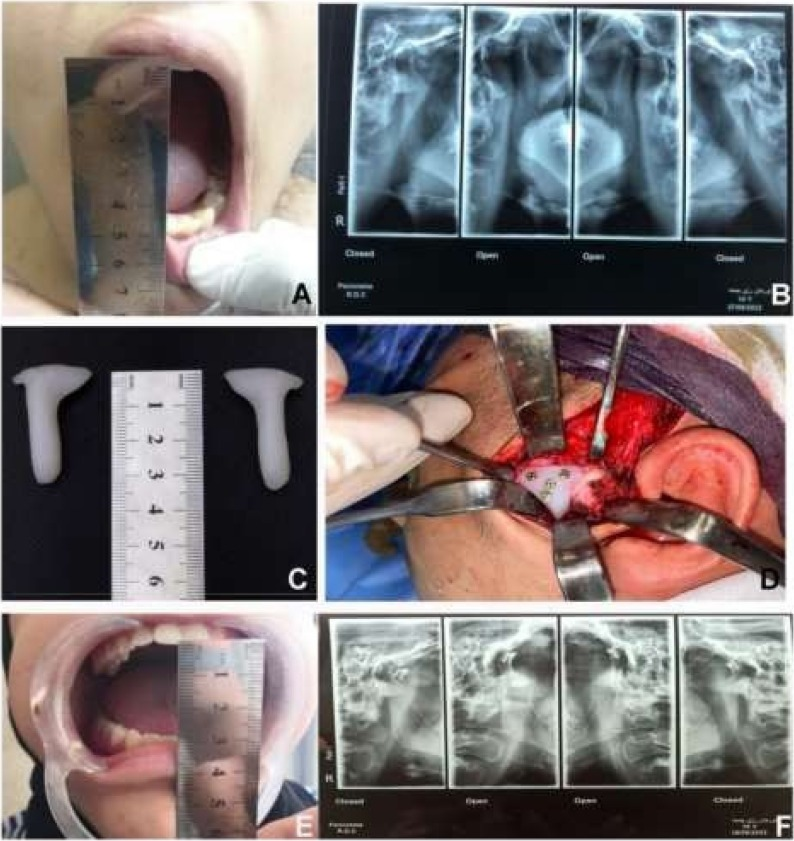

# 1707 — Trật khớp thái dương–hàm ở trẻ: "ổ chảo trống", lồi cầu ra trước ụ khớp, khi nào nắn kín & khi nào mổ

**Tags:** `pattern:truot-khop` `pattern:o-chao-trong` `pattern:khong-ngam-mieng` `pattern:le-lech-ham` `vung:khop-thai-duong-ham` `vung:ham-duoi` `vung:so-mat` `anatomy:khop-thai-duong-ham` `protocol:CT-lat-mong` `protocol:CBCT` `protocol:toan-hinh` `score:acute-chronic-recurrent` `score:MIO`
**Mức chắc chắn (certainty):** tổng hợp y văn (literature synthesis) — ghép **tổng quan có hệ thống trật khớp tái diễn ở trẻ** (J Clin Med 2025, PMC12609451), **tổng quan 229 ca trật khớp mạn** (Medicina 2025, PMC12471310), **260 ca trật khớp** (Clin Oral Investig 2023, PMC10329618), **32 ca cấp cứu** (Open Access Emerg Med 2018, PMC6214416), **116 ca trật khớp lên hố sọ giữa** (J Clin Med 2023, PMC10253349) và 4 ca nguyên văn có ảnh (PMC11458201, PMC9219198, PMC10324983, PMC13157379). Không có ca do nhóm tự chụp; **bằng chứng riêng cho trẻ rất mỏng** (xem mục 5, điểm 1).

> **Câu hỏi thực hành:** bé **26 tháng** bỗng **không ngậm được miệng**, chảy nước bọt, không sốt, không chấn thương; hoặc bé **14 tuổi** cứ **há miệng ngáp là trật** 3–4 lần/tháng; hoặc bà **79 tuổi** nằm hồi sức sau xuất huyết não, **8 tuần không ăn được** vì "không ngậm được hàm" mà không ai để ý. Câu hỏi: **đây là trật khớp trước, trật khớp trên vào hố sọ, gãy lồi cầu có di lệch, hay bán trật do tăng vận động?**
> Bài chốt **ba quyết định**: **(1) khớp thái dương–hàm là khớp DUY NHẤT phải "soi" trên mọi CT sọ ở trẻ chấn thương và mọi CT ở bệnh nhân đột quỵ/thở máy — ổ chảo trống là dấu hiệu chốt; (2) nắn kín NGAY là điều trị đầu tay, nhưng thành công giảm mạnh sau 1 tháng (nắn kín 21,4% ở trật mạn) nên trễ chẩn đoán = phải mổ; (3) trẻ tái diễn ưu tiên điều trị bảo tồn/tiêm (botulinum, tiêm máu tự thân), mổ (cắt ụ khớp, Dautrey, ghép ụ khớp) chỉ khi thất bại — vì mổ ở trẻ có nguy cơ dính khớp và ảnh hưởng tăng trưởng**.

## 1. Tổng quan bệnh học – cơ chế hình ảnh: vì sao lồi cầu "vượt ụ khớp" rồi không tự về

- **Định nghĩa:** trật khớp thái dương–hàm (temporomandibular joint dislocation/luxation) là **đầu lồi cầu ra khỏi ổ chảo và không tự trở về**; **bán trật (subluxation)** = vượt ụ khớp nhưng **tự về**; **trật (luxation)** = **không tự về**, phải có người nắn.
- **Phân loại theo thời gian (dùng để chọn điều trị):**
  - **Cấp (acute):** < **1 tháng**.
  - **Mạn/trật khớp tồn tại lâu (long-standing, protracted, chronic):** **≥ 1 tháng** không được nắn — mốc này được chọn vì **phần lớn báo cáo dùng 1 tháng** (Medicina 2025, PMC12471310).
  - **Tái diễn (recurrent/habitual):** nhiều đợt, giữa các đợt khớp về vị trí bình thường — chiếm **61,9%** trong 260 ca (Clin Oral Investig 2023) và **62,5%** trong 32 ca cấp cứu (Open Access Emerg Med 2018).
- **TẠI SAO lồi cầu ra TRƯỚC là kiểu gặp nhiều nhất:** khi há miệng, lồi cầu **xoay** rồi **trượt ra trước** tới đỉnh ụ khớp; cơ chân bướm ngoài (lateral pterygoid) kéo lồi cầu ra trước, còn **cơ nhai – thái dương – chân bướm trong co thắt phản xạ** giữ hàm ở tư thế mở → lồi cầu **mắc kẹt trước ụ khớp**, không trượt ngược lại được. Đây là lý do **không nắn được bằng cách bảo bệnh nhân "ngậm lại"** và là lý do phải **kéo hàm xuống rồi đẩy ra sau** (Hippocrates/Nélaton).
- **TẠI SAO thấy "ổ chảo trống" trên CT:** trên lát **axial** ngang ổ chảo, khoang chứa lồi cầu **rỗng** (chỉ còn mỡ/tổ chức quanh khớp), còn lồi cầu nằm **trước ụ khớp**; trên **coronal** và **3D VR** thấy rõ lồi cầu **vượt qua ụ khớp**. Vì không có tổn thương mô mềm – xương, **không có phù tủy, không có đường gãy** — hình ảnh "trống" này là dấu hiệu **duy nhất**, nên rất dễ bị đọc lướt.
- **TẠI SAO TRẺ dễ trật hơn:** ổ chảo trẻ sơ sinh **nông và phẳng**, lồi cầu **tròn, ngắn**, dây chằng – bao khớp **lỏng**; ổ chảo **sâu dần theo tuổi** (ảnh CT 3 tháng → 2 tuổi → 11 tuổi → 15 tuổi, PMC10324983). Vì vậy trẻ nhỏ có thể trật khi **ăn, khóc, ngáp, nha sĩ há miệng lâu** — không cần chấn thương mạnh. **Tăng vận động khớp (hypermobility)** gặp ở **8–39%** trẻ tuổi học đường và là yếu tố nền của thể tái diễn; hội chứng **Ehlers–Danlos** (bất thường collagen/elastin) làm mất vững dây chằng.
- **Dịch tễ – chân dung:**
  - Tần suất **2,5–25/100.000 người/năm**; tổng quan hệ thống ghi **79 ca cấp, 35 ca mạn, 311 ca tái diễn**.
  - **260 ca Phần Lan (2007–2020):** **61,9% tái diễn**, **40,0% không rõ nguyên nhân (spontaneous)**, chỉ **1,9% phải mổ**; có **bệnh thần kinh** → nguy cơ tái diễn **1,34 lần**; **tình trạng toàn thân kém** → **1,57 lần**; **chụp toàn hình (panoramic)** chỉ được dùng ở **21%** ca.
  - **32 ca Bern:** tuổi trung bình **42,06**, **93,7% không do chấn thương**, **59,4% hai bên**, **62,5% mạn/tái diễn**, **31/32 điều trị bảo tồn**, **38,7% cần an thần/giảm đau khi nắn**.
  - **Trẻ em:** trật khớp **hiếm** và **phần lớn do chấn thương**; thể **tái diễn ở trẻ còn hiếm hơn** — tổng quan 2000–2025 chỉ tìm được **9 nghiên cứu** (5 ca bệnh, 3 loạt ca, 1 bệnh–chứng), tuổi **26 tháng – 17 tuổi**.
- **TẠI SAO trật khớp MẠN khó nắn:** sau vài tuần, **co thắt cơ + xơ hóa trong khớp** làm lồi cầu **dính vào vị trí mới**; một số ca tạo **khớp giả (pseudoarticulation/nearthrosis)** — tổng quan 229 ca chỉ ghi nhận **6 ca**. Vì vậy **thời gian trật là biến số tiên lượng mạnh nhất**: nắn kín khả thi ở **21,4% (49/229)** so với **76,4% (175/229)** phải mổ mở, và nhóm nắn kín có thời gian trật **4,9 tháng** so với **14,8 tháng** ở nhóm mổ (**p = 0,001**).
- **Thể đặc biệt – trật khớp LÊN hố sọ giữa (superior/central dislocation):** lồi cầu **xuyên qua trần ổ chảo** vào hố sọ giữa, thường sau **chấn thương cằm hướng lên trên–ra sau**; **116 ca/104 bài**: **80%** ca **xuyên hoàn toàn** phải mổ mở, sau **22 ngày** **100%** phải mổ mở; nam phải mổ mở nhiều hơn **OR 4,959 (1,208–20,365)**.
- **Sinh lý bệnh của biến chứng:** trật khớp lâu → **co rút cơ nhai, xơ hóa**, giảm dinh dưỡng sụn, về lâu có thể **dính khớp** (bài 1703) — đây là lý do **không được "chờ xem"** ở trẻ.

## 2. Mẫu hình + chẩn đoán phân biệt theo vị trí và cơ chế (Gamut)

- **Ba câu hỏi định khu (hỏi trước khi nhìn chẩn đoán):**
  1. **Lồi cầu ở đâu?** — trước ụ khớp (trước), trong hố sọ giữa (trên), trong ống tai ngoài (sau), lệch bên/trong (thường kèm gãy).
  2. **Có đường gãy lồi cầu/ổ chảo không?** — quyết định "trật khớp đơn thuần" hay "gãy–trật".
  3. **Bao lâu rồi?** — < 1 tháng (cấp) vs ≥ 1 tháng (mạn) vs tái diễn.
- **Gamut theo hướng di lệch:**
  - **Ra trước (anterior) — > 90%:** há miệng quá mức (ngáp, nha khoa, nội soi, đặt nội khí quản), động kinh, loạn trương lực cơ do thuốc; **một bên → lệch hàm sang bên đối diện**, **hai bên → cằm ra trước, cắn hở trước, không ngậm được**.
  - **Lên trên vào hố sọ giữa (superior/central):** chấn thương cằm mạnh; nguy cơ **rách màng não, rò dịch não tủy, máu tụ nội sọ**, tổn thương dây VII.
  - **Ra sau (posterior):** vào **ống tai ngoài**, thường kèm **gãy ống tai/xương thái dương**.
  - **Sang bên/ra trong (lateral/medial):** gần như luôn kèm **gãy lồi cầu hoặc gãy cành lên**.
- **Gamut theo nguyên nhân ở trẻ:**
  - **Chấn thương** (hay nhất ở trẻ em): té cằm, tai nạn xe, va chạm khi chơi.
  - **Động kinh/co giật** và **loạn trương lực cơ cấp do thuốc** (metoclopramide, thuốc chống loạn thần, chống nôn): há miệng không kiểm soát.
  - **Tăng vận động/dẻo khớp, Ehlers–Danlos, hội chứng Down**: thể tái diễn.
  - **Y sinh (iatrogenic):** nha khoa, nội soi tiêu hóa, đặt nội khí quản kéo dài, thở máy (bệnh nhân **không thể báo** đau/không ngậm được).
  - **Bẩm sinh/sơ sinh:** ổ chảo phẳng, dây chằng lỏng — tiếng "click" khi bú, hàm lệch, **tự khỏi trong 1 tháng** (ca 6 ngày tuổi, PMC10324983).
- **Gamut theo hình ảnh trên CT sọ (khi không nghĩ tới khớp):**
  - **Ổ chảo trống + lồi cầu trước ụ khớp** → trật khớp trước.
  - **Lồi cầu trong hố sọ giữa + mảnh xương trần ổ chảo** → trật khớp trên.
  - **Lồi cầu lệch trong + đường gãy cổ lồi cầu** → gãy–trật (bài 1708).
  - **Khoảng khớp rộng bất thường hai bên, không di lệch** → bán trật/tăng vận động, không phải trật.
- **Mnemonic "3 Đ":** **Đ**ầu lồi cầu ở đâu (vị trí), **Đ**ường gãy (có/không), **Đ**ộ dài thời gian (cấp/mạn/tái diễn).

## 3. Bảng so sánh phân biệt (ma trận đối chiếu)

| Thực thể (entity) | Hình ảnh điển hình | Chốt vào (rule-in) | Chốt loại (rule-out) | Gợi ý xác nhận |
|---|---|---|---|---|
| **Trật khớp trước cấp (anterior acute luxation)** | Lồi cầu **trước ụ khớp**, ổ chảo **trống**, không đường gãy, không phù tủy | **Không ngậm được miệng + cắn hở trước + ổ chảo trống trên CT/OPG** | Có **đường gãy cổ lồi cầu** → gãy–trật, không phải trật đơn thuần | Nắn kín tại giường; X-quang/CT sau nắn để xác nhận |
| **Trật khớp mạn (≥ 1 tháng)** | Lồi cầu **xa ụ khớp**, **xơ/co rút**, có thể **khớp giả**; MIO không đo được vì không ngậm được | **Thời gian ≥ 1 tháng + nắn kín thất bại** | **Cầu xương lồi cầu–ổ chảo** → dính khớp (bài 1703), không phải trật | CT 3D + MRI đĩa khớp; thử nắn dưới gây mê |
| **Trật khớp tái diễn (recurrent/habitual)** | Giữa các đợt **khớp bình thường**; đợt trật **cùng một hướng**; ụ khớp **thấp/dốc** | **≥ 2–3 đợt/6 tháng, tự nắn được hoặc nắn dễ** | **Bán trật (subluxation) tự về** → không phải luxation, chỉ theo dõi | Đo MIO, phim há–ngậm miệng, MRI đĩa khớp |
| **Trật khớp trên vào hố sọ giữa (superior)** | Lồi cầu **trong hố sọ giữa**, **vỡ trần ổ chảo**, khí/máu nội sọ | **Chấn thương cằm + lồi cầu trên mức trần ổ chảo trên coronal/3D** | Chỉ **gãy trần ổ chảo** mà lồi cầu còn dưới → gãy xương thái dương | CT sọ lát mỏng + **mạch máu não (CTA)** nếu có máu tụ |
| **Gãy–trật lồi cầu (fracture-dislocation)** | **Đường gãy cổ/đầu lồi cầu** + mảnh lồi cầu **lệch trong/ra trước**, **mất chiều cao cành lên** | **Đường gãy rõ + mảnh lồi cầu ra khỏi ổ chảo** | Không đường gãy, chỉ lồi cầu ra trước → trật đơn thuần | CT đa bình diện (bài 1708), đo chiều cao cành lên |
| **Trật khớp do loạn trương lực cơ (dystonia)** | Trật **hai bên**, tái diễn, kèm **vẹo cổ, co giật cơ mặt**, dùng thuốc an thần/chống nôn | **Tiền sử thuốc + trật hai bên + không đau kiểu chấn thương** | Trật do chấn thương đơn thuần (không có yếu tố thuốc) | Ngừng thuốc, hội chẩn thần kinh; nắn + theo dõi |
| **Bán trật do tăng vận động (subluxation)** | Lồi cầu **vượt ụ khớp khi há tối đa** nhưng **tự về**, ổ chảo không trống khi ngậm | **Há miệng > 40 mm, "lắc" khớp, tự nắn** | **Không tự về** → trật thật, cần nắn | Phim há/ngậm, MRI; điều trị bảo tồn – bài tập |

## 4. Protocol chụp + cách nắn & hệ phân độ

- **Bước 1 — lâm sàng trước, phim sau:** đo **MIO (maximal interincisal opening, mm)**, ghi **cắn hở trước**, **lệch cằm**, khả năng **ngậm miệng**, dấu **chảy nước bọt/khó nói**; hỏi **thuốc** (chống nôn, chống loạn thần), **động kinh**, **chấn thương**, **số đợt trước**.
- **Bước 2 — khi nào chụp:** trật điển hình **nắn được ngay** thì **không bắt buộc chụp** (chỉ **21%** ca được chụp toàn hình trong loạt 260 ca; **51,8%** nhóm tái diễn có chụp). **Bắt buộc chụp** khi: **chấn thương**, **nắn thất bại**, **trật mạn**, **nghi trật trên**, **trẻ không hợp tác/không rõ cơ chế**, **trước mổ**.
- **Bước 3 — chọn modality:**
  - **Toàn hình (panoramic/OPG):** rẻ, thấy **lồi cầu trước ụ khớp** khi há; **hạn chế**: chồng hình, không đánh giá **nội khớp** và **trần ổ chảo**, không đo được di lệch chính xác.
  - **CT/CBCT (chọn lựa khi cần quyết định):** **axial + coronal + 3D VR**, lát **≤ 1 mm**; trả lời **4 câu**: lồi cầu ở đâu, ụ khớp còn nguyên không, có **đường gãy** không, **trần ổ chảo** có vỡ không. Với trẻ: **trường chiếu nhỏ, liều thấp**, tránh chụp lặp.
  - **MRI:** không dùng để chẩn đoán trật cấp, nhưng **cần** khi **trật mạn/tái diễn** (đĩa khớp, tràn dịch, bao khớp) và **trước mổ** — quyết định **cắt ụ khớp/ghép ụ khớp** hay chỉ **can thiệp đĩa**.
- **Bước 4 — nắn (thuật toán):**
  1. **Hippocrates/Nélaton:** hai ngón cái đặt trên răng hàm dưới hai bên, các ngón còn lại dưới cằm; **ấn xuống** rồi **đẩy ra sau–lên**. Có thể dùng **wrist pivot**, **gag reflex**, kỹ thuật ngoài miệng.
  2. **Thất bại/lần 2:** **an thần – giảm đau** (N₂O, midazolam, propofol, ketofol); **38,7%** ca trong loạt 32 ca cần analgosedation.
  3. **Vẫn thất bại:** **nắn dưới gây mê + giãn cơ** — ca 79 tuổi sau đột quỵ nắn kín thành công dưới gây mê sau khi nắn thường thất bại (PMC11458201).
  4. **Mạn ≥ 1 tháng:** thử **nắn kín dưới gây mê** trước (21,4% thành công); nếu thất bại → **mổ mở** (76,4%): **treo móc mỏm vẹt 18,8%**, **cắt lồi cầu 10,9%**, **tạo hình ụ khớp 8,7%**, **cắt ụ khớp 8,3%**, cắt đĩa 4,4%, phẫu thuật chỉnh hàm 4,4%.
  5. **Tái diễn:** **bảo tồn** (bài tập, máng, hạn chế há) → **botulinum toxin A vào cơ chân bướm ngoài** (phương pháp xâm lấn tối thiểu hay dùng nhất ở trẻ) → **tiêm máu tự thân/arthrocentesis** → **mổ** (Dautrey, cắt ụ khớp, **ghép ụ khớp in 3D**). Ở loạt trẻ: tiêm máu tự thân **33–36 tháng không tái phát**, Dautrey **28–36 tháng**, botulinum lặp lại **9 tháng**, cắt ụ khớp sau thất bại **6 tháng** không tái phát.
- **Phân độ thời gian (dùng trong bài này, không phải RADS):**

- **Sau nắn:** **mềm/dinh dưỡng lỏng 1–2 tuần**, **không há tối đa**, giảm đau, **physiotherapy sớm** (tránh co rút), hẹn **1–2 tuần** và **1 tháng**; ở trẻ đang lớn: **theo dõi tăng trưởng hàm** tới khi trưởng thành.
- **Bằng chứng ngoại suy cho thể tái diễn khó:** **11 bệnh nhân > 16 tuổi** ghép **ụ khớp nhân tạo in 3D**: MIO **giảm có kiểm soát**, đau VAS **8,80 → 6,29** sau 6 tháng, **18,2% nhiễm trùng phải lấy implant** — dùng để giải thích **biến chứng của mổ**, không để chỉ định ở trẻ nhỏ (PMC13157379).

## 5. Biến thể bình thường và cạm bẫy

- **Bẫy 1 — "ổ chảo trống" do lát cắt sai:** lát axial **trên** ổ chảo cũng "trống". Cách tránh: **lần theo lồi cầu từ thân hàm lên** trên **coronal/3D**, và xác định **ụ khớp** cùng lát; ổ chảo trống thật phải đi kèm **lồi cầu nằm trước ụ khớp**.
- **Bẫy 2 — gãy lồi cầu bị đọc thành "trật khớp":** trong ca **trật khớp hai bên mạn**, CT còn cho thấy **gãy mỏm lồi cầu bên trái** (PMC9219198) — nếu chỉ thấy "lồi cầu ra trước" mà bỏ đường gãy, kế hoạch điều trị sai (cắt lồi cầu thay vì nắn/cố định). **Luôn cuộn hết lồi cầu ở cả hai bên.**
- **Bẫy 3 — trật khớp trên bị nhầm là chấn thương sọ:** lồi cầu **trong hố sọ giữa** dễ bị đọc là "mảnh xương lạc"; hỏi thêm **chảy máu tai, rò dịch não tủy, liệt VII**, và **mổ mở là bắt buộc sau 22 ngày** (116 ca).
- **Bẫy 4 — trẻ sơ sinh "click" khi bú:** ổ chảo phẳng sinh lý + dây chằng lỏng → **tiếng click, lệch hàm khi há, tự hết trong 1 tháng** (ca 6 ngày tuổi). **Không** gắn nhãn dính khớp/loạn sản khi CT chưa có cầu xương; theo dõi + khám lại.
- **Bẫy 5 — bệnh nhân không "kêu" được:** đột quỵ, hôn mê, đặt nội khí quản, sa sút trí tuệ — biểu hiện chỉ là **không ăn được, chảy nước bọt, sốt do sặc**; ca 79 tuổi bị **8 tuần** mới chẩn đoán. Trên **mọi CT sọ** của nhóm này, **phải nhìn ổ chảo hai bên**.
- **Bẫy 6 — từ ngữ phân loại:** tiếng Anh **"dislocated"** = **ra khỏi khớp (exarticulation)**, còn tiếng Đức **"disloziert"** = **di lệch (displaced)**; đọc phân loại Loukota/Neff mà không để ý ngôn ngữ sẽ **xếp sai độ nặng** (bài 1708).
- **Bẫy 7 — bỏ sót "satisfaction of search":** trẻ té cằm có **gãy xương hàm** rõ → dừng lại ở đó và bỏ **trật khớp thái dương–hàm** cùng bên. Trong chấn thương hàm, **luôn kiểm tra khớp TMJ hai bên** như một phần của đọc CT sọ–mặt.

## 6. Tự lượng giá — Blind Quiz

**Ca 1 — Bà 79 tuổi, xuất huyết não phải, mở khí quản, 8 tuần chỉ nuốt được qua sonde. Nhìn CT sọ, mô tả trước khi đọc đáp án.**

- Gợi ý lâm sàng: không đau hàm, không chấn thương; điều dưỡng ghi "không ngậm được miệng" nhưng bị cho là di chứng đột quỵ.
- Câu hỏi: Dấu hiệu chính ở hai ổ chảo là gì? Lồi cầu nằm ở đâu? Vì sao **không** nghĩ tới gãy xương? Ba chẩn đoán phân biệt?

<b>Bấm để hiện đáp án</b>

- Dấu hiệu (findings): **A** — hai **ổ chảo trống** (mũi tên trắng), không thấy lồi cầu trong ổ; **B** — hai **lồi cầu nằm trước ụ khớp** (đầu mũi tên).
- Chẩn đoán (diagnosis): **trật khớp thái dương–hàm trước, hai bên, mạn (8 tuần)**. Vì sao: **không có đường gãy, không phù tủy, không mảnh xương** → trật đơn thuần; thời gian 8 tuần giải thích vì sao nắn thường thất bại (thử nắn thường thất bại, phải nắn kín **dưới gây mê + giãn cơ**).
- Phân biệt: **gãy–trật lồi cầu** (sẽ có đường gãy + mất chiều cao cành lên), **dính khớp** (cầu xương, MIO hạn chế chứ không phải "không ngậm được"), **trật khớp trên** (lồi cầu trong hố sọ giữa).
- Nguồn ảnh: Cureus 2024 (PMC11458201), CC BY 4.0 — ca nguyên văn, ảnh nguyên bản.

**Ca 2 — Người lớn trẻ, miệng há không ngậm được nhiều tháng; CT 3D hai bên.**

- Gợi ý lâm sàng: cằm ra trước, không cắn được, đã từng mổ sọ bên phải.
- Câu hỏi: Hai lồi cầu nằm ở đâu so với ụ khớp? Có gì bất thường ở lồi cầu bên trái? Điều đó thay đổi kế hoạch mổ thế nào?

<b>Bấm để hiện đáp án</b>

- Dấu hiệu (findings): cả **hai lồi cầu vượt qua ụ khớp** (a: bên phải, b: bên trái); bên trái còn **đường gãy mỏm lồi cầu phía trong**.
- Chẩn đoán (diagnosis): **trật khớp hai bên mạn + gãy mỏm lồi cầu trái**. Vì đã mạn và có mảnh gãy, nhóm tác giả chọn **cắt lồi cầu trong miệng** thay vì nắn đơn thuần.
- Bài học: **trật khớp và gãy lồi cầu có thể cùng tồn tại**; đọc 3D phải xoay đủ góc và **theo dõi mỏm lồi cầu**, không chỉ nhìn vị trí.
- Nguồn ảnh: J Med Case Rep 2022 (PMC9219198), CC BY 4.0 — ảnh nguyên bản.

**Ca 3 — Bốn em bé 3 tháng, 2 tuổi, 11 tuổi, 15 tuổi: cùng một khớp, bốn hình dạng.**

- Câu hỏi: Ổ chảo thay đổi thế nào theo tuổi? Vì sao trẻ nhỏ dễ trật hơn? Đâu là "giới hạn bình thường" của trẻ 3 tháng?

<b>Bấm để hiện đáp án</b>

- Dấu hiệu (findings): **3 tháng** — ổ chảo **rất phẳng, nông**, lồi cầu tròn; **2 tuổi** — ổ chảo bắt đầu lõm; **11 tuổi** — ổ chảo sâu, lồi cầu dài; **15 tuổi** — gần giống người lớn, ụ khớp rõ.
- Chẩn đoán/ý nghĩa: đây là **quá trình sâu hóa ổ chảo theo tuổi**, không phải bệnh. Vì ổ chảo nông + dây chằng lỏng, trẻ nhỏ trật khớp với lực rất nhỏ (bú, khóc, ngáp); **"click" ở trẻ sơ sinh thường tự hết trong 1 tháng** (ca 6 ngày tuổi trong bài gốc).
- Cạm bẫy: gọi **"loạn sản lồi cầu"** khi thấy ổ chảo phẳng ở trẻ < 6 tháng là **overcall** — cần đối chiếu tuổi và theo dõi.
- Nguồn ảnh: Cureus 2023 (PMC10324983), CC BY 4.0 — ảnh nguyên bản.

**Ca 4 — Trẻ lớn, trật khớp tái diễn nhiều năm; phim há–ngậm trước và sau đặt implant ụ khớp.**

- Gợi ý: đã thất bại bảo tồn và tiêm; MIO trước mổ rất lớn.
- Câu hỏi: Trên phim **há miệng**, lồi cầu đi tới đâu? Sau can thiệp, vì sao MIO **giảm** lại là mục tiêu? Hai biến chứng cần nói trước với gia đình?

<b>Bấm để hiện đáp án</b>

- Dấu hiệu (findings): **B (trước mổ)** — khi há, lồi cầu **vượt hẳn ụ khớp** (không còn tiếp xúc ổ chảo); **F (sau mổ)** — lồi cầu **dừng trước ụ khớp**, khớp còn khoảng trống.
- Chẩn đoán (diagnosis): **trật khớp tái diễn do tăng vận động**, điều trị bằng **ghép ụ khớp (augmentation eminoplasty)** để tạo "chốt" cơ học — vì vậy **MIO giảm có chủ đích**, đổi lại hết trật.
- Số liệu: 11 ca > 16 tuổi, đau **8,80 → 6,29/10**, **18,2% nhiễm trùng phải lấy implant**, không tái phát trong 6 tháng theo dõi (ngắn).
- Nguồn ảnh: Maxillofac Plast Reconstr Surg 2026 (PMC13157379), CC BY 4.0 — ảnh nguyên bản (gồm ảnh lâm sàng mở miệng của bài gốc).

## Bài liên quan chéo
- [1703 – Dính khớp thái dương–hàm bẩm sinh ở trẻ](../1703-dinh-khop-thai-duong-ham-bam-sinh/lesson.md)
- [1708 – Gãy lồi cầu xương hàm dưới ở trẻ](../1708-gay-loi-cau-xuong-ham-duoi-o-tre/lesson.md)
- [1706 – Túi thừa bàng quang ở trẻ](../1706-tui-thua-bang-quang-o-tre/lesson.md) (bẫy "bàng quang Mickey Mouse" — cùng nhóm bẫy hình học trên mặt cắt)
- [600 – Tổng quan Hệ Nhi khoa](../600-tong-quan-nhi-khoa/lesson.md)

## Ảnh
- 5 ảnh, tất cả **CC BY 4.0**: Cureus 2024 (PMC11458201) 2 ảnh; J Med Case Rep 2022 (PMC9219198) 1; Cureus 2023 (PMC10324983) 1; Maxillofac Plast Reconstr Surg 2026 (PMC13157379) 1 — **nguyên bản**, không crop/ghép.
- **Không tạo composite**: các bài gốc khác bệnh cảnh (đột quỵ, trật mạn hai bên, giải phẫu theo tuổi, can thiệp ụ khớp) nên ghép sẽ gây hiểu sai "cùng một ca".
- Ảnh của **Int J Surg Case Rep 2026 (PMC13166655)** có hình OPG + 3D + MRI rất đẹp nhưng **CC BY-NC-ND** → **chỉ dẫn link** trong `sources.md`.

> Không dùng để chẩn đoán độc lập khi chưa có người hướng dẫn.
