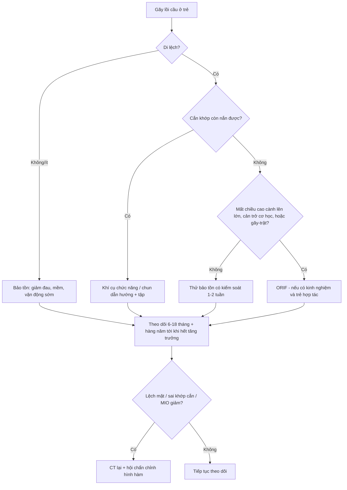
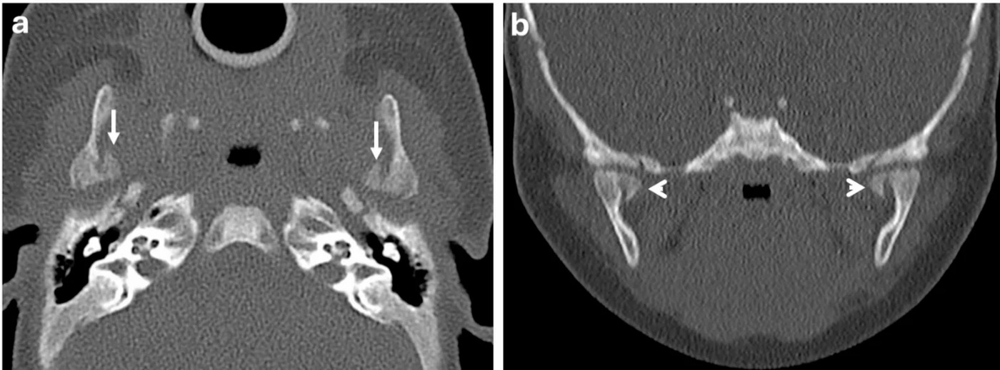
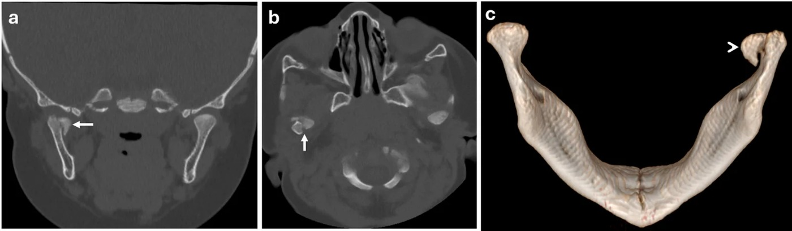
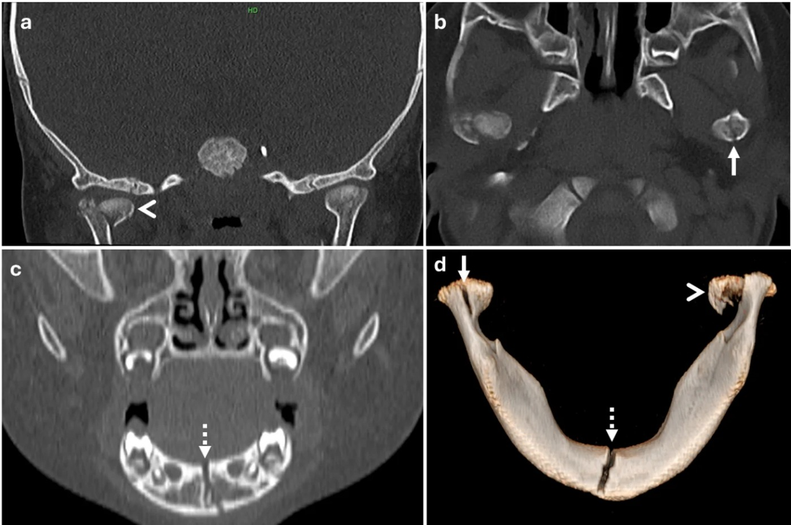
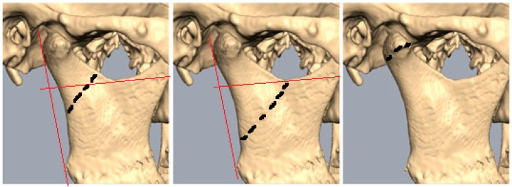
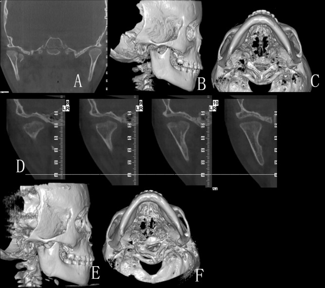

# 1708 — Gãy lồi cầu xương hàm dưới ở trẻ: phân độ Loukota/Neff, mất chiều cao cành lên, góc di lệch và khi nào ORIF

**Tags:** `pattern:gay-xuong` `pattern:gay-loi-cau` `pattern:mat-chieu-cao-canh-len` `pattern:di-lech-ham` `vung:loi-cau-ham-duoi` `vung:ham-duoi` `vung:khop-thai-duong-ham` `vung:so-mat` `anatomy:khop-thai-duong-ham` `protocol:CT-lat-mong` `protocol:CBCT` `protocol:toan-hinh` `score:Loukota-Neff` `score:goc-di-lech` `protocol:ORIF`
**Mức chắc chắn (certainty):** tổng hợp y văn (literature synthesis) — ghép **5 nhũ nhi gãy lồi cầu phát hiện trên CT sọ** (Oral Radiol 2026, PMC13619684), **tổng quan 116 bài quản lý gãy lồi cầu ở trẻ đang lớn** (J Clin Med 2024, PMC11594661), **tổng quan tự sự 2021–2026 về phục hồi chức năng – tăng trưởng** (Children 2026, PMC13703360), **71 trẻ/77 ổ gãy** (Children 2025, PMC11941330), **184 ca + góc di lệch** (Front Oral Health 2026, PMC13153062), **22 trẻ nội khớp điều trị kín** (Sci Rep 2022, PMC9675802), **9 trẻ lấy mảnh gãy** (Med Oral Patol Oral Cir Bucal 2025, PMC12221151) và **495 khớp/13 năm** (Craniomaxillofac Trauma Reconstr 2026, PMC13298168). Không có ca do nhóm tự chụp.

> **Câu hỏi thực hành:** bé **4 tuần tuổi** ngã từ tay người thân, chụp CT sọ vì "đập đầu" — tình cờ thấy **hai đường gãy dọc qua lồi cầu**, không di lệch. Hoặc bé **6 tháng** ngã bàn ăn, **từ chối bú, không chịu ngậm ti giả**; CT mặt: **gãy đầu lồi cầu vỡ vụn, đẩy vào trong 5 mm**. Hoặc bé **5 tuổi** ngã cằm, **cắn lệch**, CT: **gãy nội khớp hai bên + gãy giao cằm**. Câu hỏi: **gãy ở tầng nào, mất bao nhiêu chiều cao cành lên, góc di lệch bao nhiêu — và trẻ này nên "chờ tái tạo", đeo khí cụ chức năng, hay mổ ORIF?**
> Bài chốt **ba quyết định**: **(1) mọi CT sọ ở nhũ nhi/trẻ nhỏ phải đọc lồi cầu hai bên — gãy lồi cầu bị bỏ sót 14,8% và có thể là dấu hiệu duy nhất của chấn thương do người khác gây ra (NAT); (2) "gãy lồi cầu" không phải một bệnh: tầng gãy (đầu/cổ/nền) + góc di lệch quyết định — góc ≥ 60° làm biến chứng tăng từ 5,9% lên 36–42,9%; (3) trẻ còn lớn có khả năng tái tạo rất mạnh nên bảo tồn/khí cụ chức năng là mặc định, ORIF chỉ cho di lệch nặng – không nắn được – cản trở cơ học, và phải tránh bất động kéo dài vì nguy cơ dính khớp**.

## 1. Tổng quan bệnh học – cơ chế hình ảnh: vì sao "ngã cằm" lại gãy lồi cầu

- **Cơ chế (TẠI SAO):** lực tác động vào **cằm/giao cằm** truyền dọc theo cung hàm dưới tới **lồi cầu** — nơi xương **mỏng nhất, cổ lồi cầu hẹp, giàu mạch máu** — rồi **tập trung** ở cổ/đầu lồi cầu; vì vậy gãy lồi cầu là **gãy do lực gián tiếp**, không cần đánh trực tiếp vào khớp. Trẻ có **đầu lồi cầu lớn, vỏ xương mỏng, cành lên ngắn** → dễ gãy hơn.
- **Dịch tễ – định lượng:**
  - Gãy lồi cầu chiếm **25–40%** (có loạt **25–45%**) **mọi gãy xương hàm dưới**; ở trẻ, **mỏm lồi cầu chiếm 40–70%** gãy xương hàm dưới.
  - **Một bên ≈ 80%**, **hai bên ≈ 20%**; **nam:nữ ≈ 1,8:1 – 2,6:1**.
  - Gãy xương hàm dưới chiếm **20–50%** gãy xương mặt ở trẻ; gãy xương mặt trẻ **< 5 tuổi** ít gặp (tỉ lệ mặt/hộp sọ nhỏ, nhiều mô mỡ đệm).
  - **Bỏ sót 14,8%** gãy xương hàm ở trẻ ngay lần khám đầu; dấu hiệu lâm sàng duy nhất liên quan bỏ sót là **vết thương da vùng hàm**.
- **TẠI SAO trẻ nhỏ bị ở ĐẦU lồi cầu, trẻ lớn bị ở CỔ/NỀN:** trong loạt 77 ổ gãy, **gãy đầu lồi cầu ở trẻ trung bình 9,2 tuổi**, **cổ lồi cầu 7,6 tuổi**, **dưới lồi cầu 12 tuổi** — càng nhỏ càng dễ gãy **nội khớp**. Nhũ nhi gần như chỉ có **gãy nội khớp** (5/5 ca trong PMC13619684).
- **TẠI SAO hình ảnh lại khó:** vỏ xương lồi cầu ở nhũ nhi chỉ **~1 mm**, đường gãy **không di lệch** lại chạy **dọc** — trùng với **bờ lõm/ống mạch**; trên **toàn hình (OPG)** lồi cầu bị **chồng hình** bởi xương thái dương và cung gò má. Vì vậy **CT lát mỏng + đa bình diện** là chuẩn; OPG chỉ để **sàng lọc**.
- **TẠI SAO trẻ tái tạo tốt nhưng vẫn phải theo dõi:** lồi cầu là **trung tâm tăng trưởng sụn – xương**; khả năng tái tạo **cao nhất < 5 tuổi**, **giảm 6–12 tuổi**, **gần người lớn sau 12 tuổi**. Trong 22 trẻ gãy nội khớp điều trị kín: **mảnh gãy liền ở đúng vị trí di lệch**, **lồi cầu KHÔNG tự về ổ chảo**, và **"tiêu ngang" (horizontal resorption) mỏm bên** làm mặt khớp hạ xuống ngang mỏm trong; **chiều cao cành lên do mảnh gãy quyết định** — nếu mảnh tụt nhiều thì **ORIF phù hợp hơn**.
- **TẠI SAO gãy ở trẻ có thể để lại di chứng:** mảnh gãy lệch + đĩa khớp lệch + **bất động kéo dài** → **dính khớp (ankylosis)**, **lệch mặt**, **sai khớp cắn**, đau mạn. Ghép sụn sườn ở < 18 tuổi còn cho **tái dính 6%**, **quá phát 14%**, **thiếu tăng trưởng 22%**, **lệch mặt 20%** — cho thấy "mổ rồi là xong" là sai.
- **NAT — không được bỏ qua:** trong **9.741 trẻ ≤ 5 tuổi** có gãy xương mặt (National Trauma Data Bank), **2,0%** là **chấn thương do người khác (non-accidental trauma, NAT)**; nhóm NAT có **gãy xương hàm 38,9% vs 21,1%**, và **gãy lồi cầu 75,8% vs 21,1%**. Trong 4 tuần tuổi, một đường gãy lồi cầu "không khớp cơ chế" là **chỉ định sàng lọc**.

## 2. Mẫu hình + chẩn đoán phân biệt theo tầng và theo bắt chước (Gamut)

- **Ba câu hỏi định khu:**
  1. **Tầng nào?** đầu lồi cầu (nội khớp) / cổ lồi cầu / nền (dưới lồi cầu) — theo **đường vuông góc với bờ sau cành lên qua khuyết sigma**: **> 50% trên đường = cổ**, **50% dưới = dưới lồi cầu**, **đường chạy qua đầu lồi cầu = đầu lồi cầu**.
  2. **Kiểu gì?** không di lệch / di lệch / vỡ vụn / **ra khỏi khớp (dislocated)** — chú ý **"dislocated" (Anh) ≠ "disloziert" (Đức = displaced)**.
  3. **Mất bao nhiêu chiều cao cành lên và góc di lệch bao nhiêu?** — hai biến số quyết định mổ hay không.
- **Gamut theo tầng gãy:**
  - **Đầu lồi cầu (nội khớp, diacapitular):** trẻ nhỏ, ngã thấp; dễ bỏ sót; nguy cơ **dính khớp** và **tiêu lồi cầu** cao nhất; cần **MRI** nếu nghi đĩa khớp lệch.
  - **Cổ lồi cầu:** hay gặp ở trẻ lớn/thanh niên; mảnh gãy thường **di lệch ra trước–trong**; ORIF qua đường **sau hàm/sau tai** dễ hơn.
  - **Nền/dưới lồi cầu:** thường kèm **gãy giao cằm** đối diện; có thể dùng **vít xuyên mũi/đường trong miệng**.
- **Gamut theo hình ảnh "bắt chước gãy":**
  - **Lồi cầu chẻ đôi (bifid condyle)** — hai mỏm lồi cầu, bờ vỏ liên tục, không phù tủy.
  - **Sụn tăng trưởng/mặt khớp chưa cốt hóa** ở nhũ nhi — đường sáng ngang, **đối xứng hai bên**.
  - **Ống mạch/bè xương dày** — đường sáng **không cắt vỏ**, không phù tủy.
  - **Tiêu lồi cầu tự phát/JIA** — mất chiều cao cành lên **từ từ**, không đường gãy cấp, có viêm khớp.
  - **Gãy bệnh lý (nang xương, u)** — vỏ mỏng, mảnh "vỏ trứng", cần MRI.
- **Mnemonic "LEVEL":** **L**oukota (đầu/cổ/nền), **E**levation loss (chiều cao cành lên), **V**olume/comminution, **E**xtra-articular vs intra, **L**ateral shift (góc di lệch).

## 3. Bảng so sánh phân biệt (ma trận đối chiếu)

| Thực thể (entity) | Hình ảnh điển hình | Chốt vào (rule-in) | Chốt loại (rule-out) | Gợi ý xác nhận |
|---|---|---|---|---|
| **Gãy đầu lồi cầu nội khớp (không di lệch)** | Đường gãy **dọc/ngang qua đầu lồi cầu**, **cắt mặt khớp**, không di lệch; có thể chỉ thấy trên **coronal** | **Đường gãy cắt mặt khớp + phù tủy + đau khi há** | Bờ vỏ liên tục, đối xứng hai bên → **biến thể/bifid** | CT lát ≤ 1 mm; MRI nếu nghi đĩa khớp |
| **Gãy cổ lồi cầu di lệch** | Mảnh lồi cầu **ra trước–trong**, **mất chiều cao cành lên**, cắn lệch | **Đường gãy trên đường khuyết sigma > 50% + di lệch + mất chiều cao** | Gãy **nền** (dưới đường) → đường mổ khác | CT 3D + đo chiều cao cành lên hai bên |
| **Gãy nền/dưới lồi cầu** | Đường gãy **dưới khuyết sigma**, thường kèm **gãy giao cằm** | **Đường gãy 50% dưới đường + gãy cung trước** | Gãy cổ đơn thuần (không có gãy cung trước) | CT 3D, đo góc di lệch |
| **Gãy–trật (dislocated)** | Lồi cầu **ra khỏi ổ chảo** + đường gãy; **không nắn được** bằng bảo tồn | **Lồi cầu ngoài ổ chảo + đường gãy + cản trở cơ học** | Trật khớp đơn thuần (bài 1707) → nắn kín | CT 3D; thử nắn dưới gây mê |
| **Vỡ vụn nhiều mảnh (comminuted)** | Nhiều mảnh đầu lồi cầu, **mất mặt khớp**, có thể **di lệch vào trong** | **≥ 2 mảnh + mất mặt khớp + không còn chỗ bắt vít** | Gãy hai mảnh đơn giản → ORIF khả thi | CT 3D; **MRI** đánh giá đĩa |
| **Lồi cầu chẻ đôi (bifid) / biến thể** | Hai mỏm lồi cầu, **bờ vỏ liên tục**, không phù tủy, hai bên đối xứng | **Bờ vỏ liền + không phù tủy + đối xứng** | Đường gãy thật (cắt vỏ, phù tủy) | So sánh bên đối diện, theo dõi |
| **Tiêu lồi cầu (JIA/tự phát)** | Mất chiều cao cành lên **mạn**, mặt khớp **phẳng/tiêu**, không đường gãy cấp | **Tiến triển nhiều tháng + viêm khớp + không chấn thương** | Gãy cấp (đường gãy rõ, phù tủy) | MRI, theo dõi 6–12 tháng |

## 4. Protocol chụp + phân độ & thuật toán điều trị

- **Bước 1 — CT là chuẩn, chụp đúng cách:**
  - **CT xương hàm mặt, lát ≤ 1 mm**, cửa sổ xương, **dựng coronal + sagittal + 3D VR**; ở trẻ **giảm liều theo cân nặng** (5 ca nhũ nhi dùng **CTDIvol 14–25,12 mGy**, **DLP 228,8–332 mGy·cm**).
  - **OPG** chỉ **sàng lọc** khi hợp tác tốt và đủ 2D — **chồng hình**, không đánh giá **nội khớp/di lệch chính xác**.
  - **CBCT** trường nhỏ: độ phân giải xương cao, **ít mô mềm**; dùng khi câu hỏi **chỉ về xương** và sẽ đổi điều trị.
  - **MRI**: **không thay thế CT** cho gãy xương cấp; bổ sung khi cần **đĩa khớp, sụn, tràn dịch, bao khớp**, hoặc triệu chứng kéo dài.
  - **Nguyên tắc ALARA:** không chụp lặp thường quy; một lần CT đủ cho quyết định, chụp lại chỉ khi **thay đổi điều trị**.
- **Bước 2 — đo ba số bắt buộc:**
  1. **Chiều cao cành lên (ramus/ramal height)** hai bên → chênh **mm**.
  2. **Góc di lệch (dislocation angle)** = góc giữa **trục dài mảnh lồi cầu** và **trục dài cành lên**, đo trên **CT 3D đa bình diện ở mặt phẳng di lệch tối đa**; giá trị trung bình trong loạt 184 ca: **85,4 ± 29,5° (phải)**, **82,2 ± 27,5° (trái)**.
  3. **Mức độ vỡ vụn** và **vị trí đĩa khớp** (nếu có MRI).
- **Bước 3 — ngưỡng tiên lượng (dùng để tư vấn, không phải chỉ định tuyệt đối):**

| Góc di lệch | Tỷ lệ biến chứng sau điều trị (n = 91 ca mổ) |
|---|---|
| **< 60°** | **5,9% (1/17)** |
| **60–89°** | **36,0% (9/25)** |
| **≥ 90°** | **42,9% (21/49)** |

  - **OR 1,27 mỗi 10° (1,04–1,57), p = 0,021**; biến chứng chung **29,0% (49/169)**, nặng **7,7%**, nhẹ **17,8%**; **tháo dụng cụ 43,1%** ở nhóm mổ.
- **Bước 4 — thuật toán điều trị (không có "một chuẩn" cho mọi ca):**

  - **Bốn lựa chọn:** **bảo tồn (expectative)** — giảm đau, ăn mềm, vận động sớm; **khí cụ chức năng/chun dẫn hướng** — khi cắn khớp còn nắn được; **bất động liên hàm (MMF)** ngắn — chỉ khi không giữ được khớp cắn bằng cách khác; **ORIF** — khi di lệch nặng/không nắn được/cản trở cơ học/gãy–trật.
  - **Thực hành đa trung tâm (14 đơn vị):** bảo tồn **28%**, MMF **26%**, ORIF **46%** — cho thấy **dao động rất lớn**, không có đồng thuận.
  - **Tránh MMF ở trẻ:** nhiều bất lợi (hại răng/nha chu, đường thở, vệ sinh, suy dinh dưỡng, cứng hàm) và **tăng nguy cơ dính khớp**; ưu tiên **vận động sớm + chun dẫn hướng**.
  - **Kết quả khi làm đúng (495 khớp/13 năm):** MIO **18,77 mm → 40 mm** lúc 6 tháng, vận động sang bên **~9,6 mm** đối xứng, khớp cắn phục hồi; biến chứng chủ yếu **yếu dây VII thoáng qua**.
- **Theo dõi:** khám + **chụp lại ở 6 và 18 tháng**, sau đó **hằng năm tới khi hết tăng trưởng**, tìm **lệch mặt, sai khớp cắn, hạn chế há, dính khớp**; trẻ **< 4 tuổi** hoặc **> 12 tuổi** ít cần chỉnh hình xương hơn nhóm **4–11 tuổi** (chỉnh hình 22% ở 4–7 tuổi, 17% ở 8–11 tuổi).

## 5. Biến thể bình thường và cạm bẫy

- **Bẫy 1 — bỏ sót trên CT sọ "vì chỉ định chấn thương đầu":** 5 nhũ nhi trong PMC13619684 được **phát hiện gãy lồi cầu tình cờ trên CT sọ**; không có dấu hiệu lâm sàng. **Đọc lồi cầu hai bên trên MỌI CT sọ ở trẻ < 2 tuổi** là quy tắc, không phải "khi nghi".
- **Bẫy 2 — nhũ nhi không "kêu đau":** biểu hiện chỉ là **từ chối bú, không ngậm ti giả, quấy khóc**; gãy **không di lệch** vẫn có thể **cắt mặt khớp** (gãy nội khớp) — tìm trên **coronal**, không chỉ axial.
- **Bẫy 3 — gọi "bifid condyle"/biến thể là gãy, và ngược lại:** bờ vỏ **liên tục**, **không phù tủy**, **đối xứng** → biến thể. Đường gãy thật **cắt vỏ** và có **phù tủy** (nếu chụp đủ sớm).
- **Bẫy 4 — dịch thuật phân loại:** **"dislocated"** (Anh) = **ra khỏi khớp**; **"disloziert"** (Đức) = **di lệch**. Đọc Loukota/Neff mà không phân biệt sẽ **đánh giá sai độ nặng** và chọn sai đường mổ.
- **Bẫy 5 — kết luận lệch mặt quá sớm:** trẻ có thể **tái tạo gần hoàn toàn** (restitutio ad integrum) nếu **< 6 tuổi**, và bù trừ bằng **dày ổ chảo + tăng chiều cao cành lên**; đánh giá lệch mặt **trước 6–12 tháng** dễ **overcall**. Ngược lại, **mảnh gãy tụt nhiều** thì tái tạo **không kéo mảnh về ổ chảo** — cần CT lại đúng lúc.
- **Bẫy 6 — bất động kéo dài:** MMF > 2–3 tuần ở trẻ làm **cứng hàm, tiêu sụn, dính khớp**; "để yên cho liền" không đồng nghĩa "bó hàm".
- **Bẫy 7 — NAT:** cơ chế **không khớp** với hình ảnh, **nhiều gãy ở các vị trí khác nhau**, trẻ **< 12 tháng** → **sàng lọc xương toàn thân**, khám mắt, hội chẩn bảo vệ trẻ; tỉ lệ gãy lồi cầu trong NAT **75,8%** so với **21,1%** ở chấn thương do tai nạn.

## 6. Tự lượng giá — Blind Quiz

**Ca 1 — Bé 4 tuần tuổi, ngã từ tay anh họ 4 tuổi, chụp CT sọ vì "đập đầu". Nhìn hình, mô tả trước.**

- Gợi ý: khám lâm sàng **bình thường**, đang bú tốt, không nôn.
- Câu hỏi: Đường gãy ở đâu, có di lệch không, có cắt mặt khớp không? Xử trí? Có cần làm gì thêm vì tuổi của bé?

<b>Bấm để hiện đáp án</b>

- Dấu hiệu (findings): **a (axial)** — hai đường gãy **dọc** qua hai lồi cầu (mũi tên), **ít di lệch**, mảnh trong hơi tụt xuống; **b (coronal)** — đường gãy **cắt vào mặt khớp** hai bên (đầu mũi tên).
- Chẩn đoán (diagnosis): **gãy nội khớp hai bên, không di lệch** ở nhũ nhi. Điều trị: **bảo tồn** (giảm đau, theo dõi 2 tuần), vì trẻ còn tái tạo mạnh và không có cản trở cơ học.
- Vì tuổi **4 tuần** + cơ chế: **đánh giá NAT** (bệnh sử, khám toàn thân, sàng lọc xương nếu nghi) — trong bài gốc, 2 tháng sau bé quay lại với **vết bầm đùi không khớp lời khai** và được sàng lọc.
- Nguồn ảnh: Oral Radiol 2026 (PMC13619684), CC BY 4.0 — ảnh nguyên bản.

**Ca 2 — Bé 6 tháng, ngã bàn ăn, bỏ bú; CT mặt thấy gãy đầu lồi cầu.**

- Câu hỏi: Mô tả 3 thành phần (vỡ vụn, di lệch, mặt khớp)? Vì sao nhóm tác giả vẫn chọn **bảo tồn** dù di lệch 5 mm? Điều gì phải theo dõi?

<b>Bấm để hiện đáp án</b>

- Dấu hiệu (findings): **a coronal + b axial** — gãy **vỡ vụn** đầu lồi cầu phải, **đẩy vào trong ~5 mm**, **cắt mặt khớp**; **c** — 3D nhìn sau thấy **mảnh trong di lệch** (đầu mũi tên).
- Chẩn đoán (diagnosis): **gãy nội khớp vỡ vụn, di lệch trong** ở nhũ nhi **6 tháng**. Bảo tồn vì: trẻ **còn rất nhiều tiềm năng tái tạo**, không có **cản trở cơ học** rõ (bé vẫn bú được sau giảm đau), và mổ ở tuổi này **nguy cơ tổn thương trung tâm tăng trưởng + dây VII**.
- Theo dõi: **MIO, khớp cắn, tăng trưởng hàm**, hẹn **2 tuần – 6 tháng – hằng năm**; dặn cha mẹ **đau khớp/ hạn chế há** về sau.
- Nguồn ảnh: Oral Radiol 2026 (PMC13619684), CC BY 4.0.

**Ca 3 — Bé 11 tháng, bầm mặt + bụng, CT sọ phát hiện bất thường hai lồi cầu.**

- Câu hỏi: Ba ổ gãy là gì? Vì sao "xơ hóa" ở bên trái lại quan trọng? Bước tiếp theo bắt buộc?

<b>Bấm để hiện đáp án</b>

- Dấu hiệu (findings): **a** — lồi cầu **trái** không di lệch nhưng **bờ xơ hóa** (mũi tên); **b** — lồi cầu **phải vỡ vụn, di lệch** (đầu mũi tên); **c** — **đường gãy giao cằm** chạy lên mỏm răng cửa; **d** — 3D thấy cả ba ổ.
- Chẩn đoán (diagnosis): **gãy lồi cầu hai bên + gãy giao cằm**, trong đó bên trái **đang liền/xơ hóa** → **chấn thương nhiều đợt**. Đây là **NAT** cho tới khi chứng minh ngược.
- Bước tiếp theo: **sàng lọc xương toàn thân** (bài gốc tìm thêm **gãy xương đùi + gãy sườn**), khám mắt, hội chẩn bảo vệ trẻ; xương hàm điều trị **bảo tồn**.
- Nguồn ảnh: Oral Radiol 2026 (PMC13619684), CC BY 4.0.

**Ca 4 — Ba hình 3D cùng một khớp: hãy gọi tầng gãy và chọn đường tiếp cận.**

- Câu hỏi: Đường đỏ nằm ở đâu? Tầng nào ứng với "trên 50%", "dưới 50%", "qua đầu lồi cầu"? Cách mổ khác nhau thế nào?

<b>Bấm để hiện đáp án</b>

- Dấu hiệu (findings): đường đỏ **vuông góc với bờ sau cành lên qua khuyết sigma**; **giữa (ảnh 2)** — đường gãy **trên 50%** so với đường → **cổ lồi cầu**; **phải (ảnh 3)** — **qua đầu lồi cầu** → **nội khớp**; **trái (ảnh 1)** — **50% dưới** → **dưới lồi cầu**.
- Ý nghĩa: **tầng gãy quyết định đường mổ** — nội khớp: đường **trước tai/trong ống tai**; cổ: **sau hàm – sau tuyến mang tai**; nền: **dưới hàm cao/trong miệng**.
- Số liệu bối cảnh: **77 ổ gãy** ở 71 trẻ — **35 đầu lồi cầu, 7 cổ, 35 dưới lồi cầu**; không có khác biệt biến chứng **có/không mổ** trong loạt này (nhóm mổ nhỏ).
- Nguồn ảnh: Children 2025 (PMC11941330), CC BY 4.0.

**Ca 5 — Bé 5 tuổi, gãy nội khớp phải điều trị kín; ảnh dưới là CT lúc gãy và sau 7 tháng.**

- Câu hỏi: Mảnh gãy có về ổ chảo không? Điều gì xảy ra với mỏm bên của lồi cầu? Vì sao điều này quyết định chiều cao cành lên?

<b>Bấm để hiện đáp án</b>

- Dấu hiệu (findings): **A–C** — gãy nội khớp phải, mảnh **di lệch trong/xuống**; **D** — các lát cắt dọc lồi cầu theo thời gian: mỏm bên **tiêu dần theo chiều ngang ("horizontal resorption")** tới khi **ngang mặt khớp mỏm trong**; **E–F** — 3D sau: lồi cầu **dẹt, thấp hơn bên đối diện**.
- Ý nghĩa: điều trị kín **không đưa mảnh về ổ chảo**; mảnh liền tại chỗ di lệch và **quyết định chiều cao cành lên**. Vì vậy khi **mảnh tụt nhiều**, tác giả bài gốc khuyến nghị **ORIF + cố định vững** thay vì tiếp tục chờ.
- Nguồn ảnh: Sci Rep 2022 (PMC9675802), CC BY 4.0.

## Bài liên quan chéo
- [1703 – Dính khớp thái dương–hàm bẩm sinh ở trẻ](../1703-dinh-khop-thai-duong-ham-bam-sinh/lesson.md)
- [1707 – Trật khớp thái dương–hàm ở trẻ](../1707-trat-khop-thai-duong-ham-o-tre/lesson.md)
- [600 – Tổng quan Hệ Nhi khoa](../600-tong-quan-nhi-khoa/lesson.md)
- [300 – Tổng quan Hệ Cơ – Xương – Khớp](../300-tong-quan-he-co-xuong-khop/lesson.md)

## Ảnh
- 5 ảnh, tất cả **CC BY 4.0**: Oral Radiol 2026 (PMC13619684) 3 ảnh; Children 2025 (PMC11941330) 1; Sci Rep 2022 (PMC9675802) 1 — **nguyên bản**, không crop/ghép.
- **Không tạo composite**: mỗi ảnh đến từ một bệnh cảnh khác nhau (nhũ nhi không di lệch, vỡ vụn, NAT, sơ đồ phân tầng, tái tạo) — ghép sẽ gợi ý sai "cùng một ca".
- Ảnh WebP của PMC13619684 được chuyển sang JPEG, **không đổi khung/nhãn**.

> Không dùng để chẩn đoán độc lập khi chưa có người hướng dẫn.
