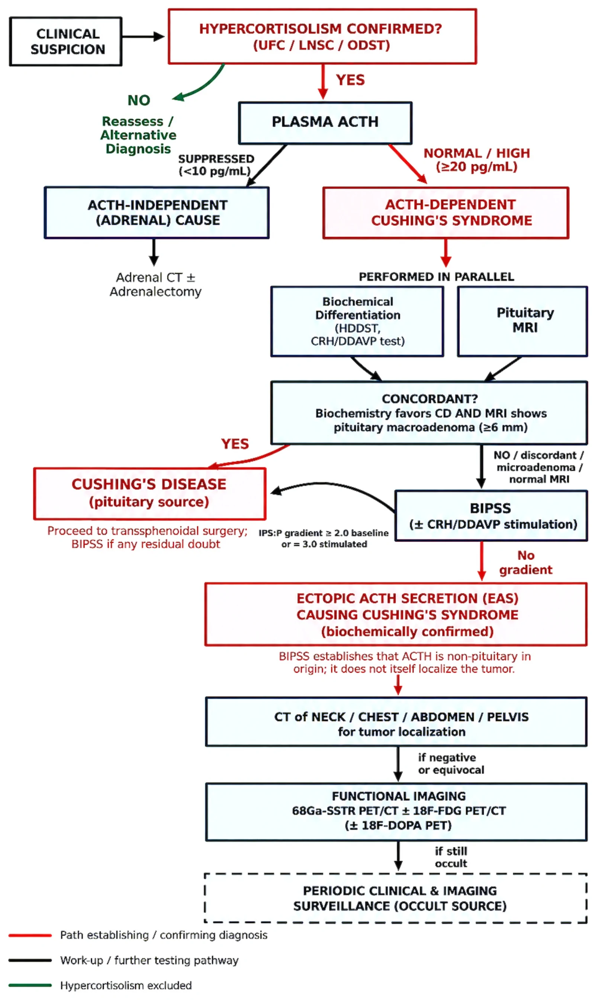
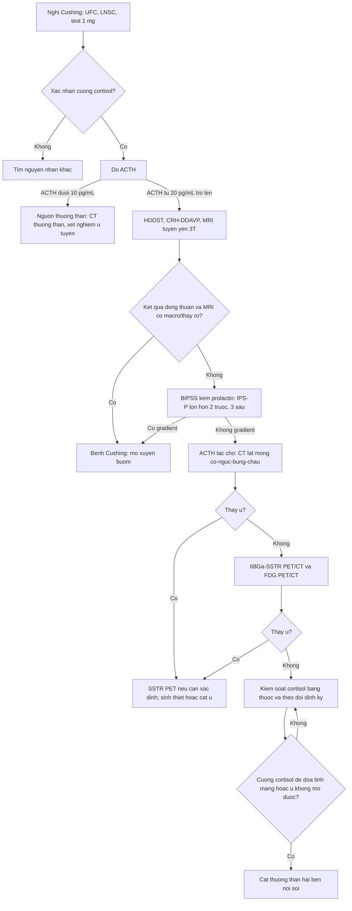
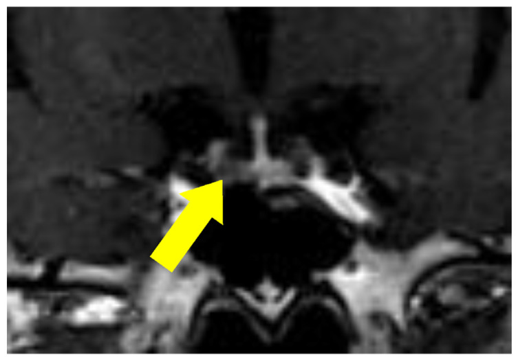
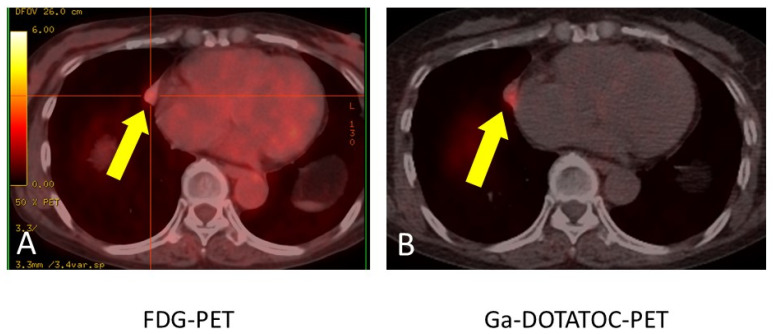
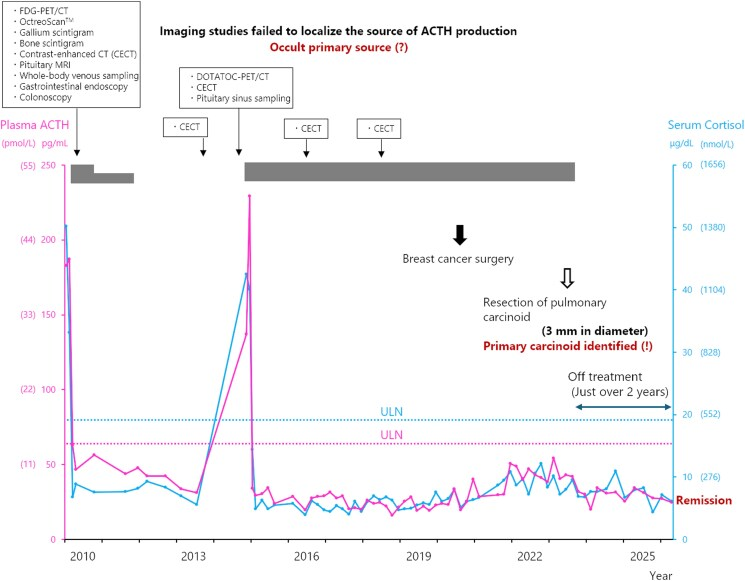

# 1709 — ACTH lạc chỗ ẩn: thuật toán tìm ổ, cái bẫy "u tuyến yên 4 mm", và khi nào cắt thượng thận hai bên

**Tags:** `pattern:cushing` `pattern:cuong-thuong-than` `pattern:u-neuroendocrine` `vung:tuyen-yen` `vung:trung-that` `vung:thuong-than` `score:IPS-P-gradient` `protocol:CT-nguc-lat-mong` `protocol:68Ga-DOTATATE` `protocol:EUS`
**Mức chắc chắn (certainty):** tổng hợp y văn (literature synthesis) — ghép **tổng quan 2026 về hội chứng ACTH lạc chỗ** (J Clin Med 2026, PMC13706564, CC BY), **đoàn hệ 173 ca ACTH lạc chỗ** (Endocr Connect 2025, PMC12464338, CC BY), **ca 68 tuổi u tuyến yên 4 mm "giả" rồi tìm ra NET phổi 11 mm** (J Clin Med 2025, PMC12734348, CC BY) và **ca ẩn 14 năm với carcinoid phổi 3 mm** (JCEM Case Rep 2026, PMC13389703, CC BY-NC-ND). Không có ca do nhóm tự chụp.

> **Câu hỏi thực hành (kịch bản tổng hợp từ các ca/đoàn hệ dưới đây, không phải ca nguyên văn):** nữ **52 tuổi**, tăng huyết áp, hạ kali máu, tăng đường huyết, teo cơ gốc chi; **ACTH 96 pg/mL**, **cortisol 38 µg/dL**, **UFC 1.850 nmol/24h**, không đổi tư thế; **MRI tuyến yên có "nhân 4 mm"**; CT ngực–bụng **không thấy u**. Câu hỏi: **có mổ tuyến yên luôn không, tìm ổ bằng gì tiếp theo, và nếu không bao giờ tìm thấy thì xử trí thế nào?**
> Bài chốt **ba quyết định**: **(1) "U tuyến yên nhỏ" không đồng nghĩa bệnh Cushing — phải chứng minh nguồn trung ương bằng BIPSS trước khi mổ; (2) tìm ổ theo bậc: CT lát mỏng → 68Ga-SSTR PET/CT ± FDG → EUS, và lặp lại khi bệnh đang "đỉnh"; (3) nguồn ẩn không có nghĩa là bó tay: kiểm soát cortisol bằng thuốc, theo dõi định kỳ, và **cắt thượng thận hai bên** khi đe dọa tính mạng/không còn cách nào.** Nối [1696 – Bệnh Cushing do u tuyến yên](../1696-benh-cushing-u-tuyen-yen/lesson.md), [1700 – Cushing chu kỳ](../1700-cushing-chu-ky/lesson.md), [1699 – Cushing ở trẻ](../1699-benh-cushing-tre-em/lesson.md), [1694 – Cushing do glucocorticoid ngoại sinh](../1694-cushing-do-glucocorticoid-ngoai-sinh/lesson.md), [155 – Thượng thận](../155-thuong-than-tinh-co/lesson.md).

## 1. Tổng quan bệnh học – cơ chế hình ảnh: vì sao u chỉ 3 mm mà gây hạ kali nặng và làm mờ cả hình ảnh

- **Tần suất:** hội chứng ACTH lạc chỗ (ectopic ACTH syndrome — EAS) chiếm **10–20%** mọi ca cường thượng thận nội sinh; trong số Cushing phụ thuộc ACTH, EAS khoảng **15%** (PMC13706564, PMC13389703). Nguồn **không tìm thấy (occult)** ở **8–20%** ca EAS.
- **Vì sao khó tìm:** u gây bệnh thường **vài milimét**; trong ca ẩn kinh điển, **carcinoid phổi 3 mm** chỉ được phát hiện **tình cờ sau 14 năm**, trong lúc mổ di căn phổi của một ung thư vú khác (PMC13389703). Đây không phải ngoại lệ hiếm — đó là **bản chất của bệnh**: u nhỏ, chậm phát triển, nằm trong phổi/trung thất với **nhiễu chuyển động hô hấp**.
- **TẠI SAO hạ kali máu và nhiễm trùng nặng:** cortisol tăng rất cao **bão hòa enzym 11β-HSD2** ở thận (enzym chuyển cortisol thành cortisone) → cortisol **gắn vào thụ thể mineralocorticoid** → giữ natri, mất kali, tăng huyết áp và **hạ kali máu nặng**. Đồng thời cortisol liều cao gây **suy giảm miễn dịch** — ca 68 tuổi trong PMC12734348 nhập viện vì **viêm phổi do Nocardia + Aspergillus**, phải thở máy không xâm nhập trước khi tìm được u.
- **Vì sao ACTH không bị ức chế:** u lạc chỗ tự tiết ACTH, không chịu **phản hồi âm của cortisol**; cortisol cao nhưng **ACTH vẫn cao/bình thường** → **tăng sản thượng thận HAI BÊN**, không phải một khối thượng thận. Đây là lý do **"u thượng thận" trên CT ở bệnh nhân ACTH cao là tăng sản, không phải nguyên nhân**.
- **Vì sao hình ảnh hay âm tính:** ngoài kích thước nhỏ, cortisol cao có thể **giảm biểu hiện thụ thể somatostatin 2 (SSTR2)** — giả thuyết được nêu trong ca 14 năm, nơi **nghiệm pháp octreotide ức chế ACTH > 50%** dự báo đáp ứng và có thể giúp **giữ SSTR2** cho lần chụp sau (PMC13389703). Vì vậy **một lần PET âm không loại trừ**, nhất là khi chưa kiểm soát cortisol.
- **Định lượng trong đoàn hệ 173 ca EAS** (PMC12464338): tuổi trung vị **42 (29–55)**; **UFC 3.011 nmol/24h**, **LNSC 87,2 nmol/L**; **tử vong 28,9%**; sống **3 năm 77%**, **5 năm 70%**; **di căn 25,4%**; **u ẩn 26 ca (15%)** có sống **3 và 5 năm chỉ 58%**; **cắt thượng thận hai bên 47 ca (27,2%)** — **32 ca vì cường cortisol đe dọa tính mạng trước khi tìm được u**, 15 ca vì bệnh không mổ được/tái phát.
- **Yếu tố tiên lượng tử vong (đa biến):** tuổi **≥ 51** (HR **3,53**), **di căn** (HR **2,93**), **cường cortisol còn hoạt động** (HR **5,58**), **LNSC > 130 nmol/L** (HR **2,81**). Điểm cốt lõi: **kiểm soát cortisol là can thiệp sống còn**, không chờ tìm ra u.

## 2. Mẫu hình + chẩn đoán phân biệt theo vị trí (gamut)

- **Lồng ngực — hơn một nửa số ca:** **carcinoid phế quản 20–40%**, **ung thư phổi tế bào nhỏ (SCLC) 10–40%**, **u neuroendocrine tuyến ức 5–10%** (PMC13706564). Trên CT: nốt **nhỏ, bắt thuốc, bờ rõ**, có thể gây **xẹp phổi/xẹp thùy** nếu ở trung tâm; u tuyến ức ở **trung thất trước**.
- **Ổ bụng:** **u neuroendocrine tụy 10–20%**, **pheochromocytoma/paraganglioma 2–6%**. Pheo tiết ACTH lạc chỗ là ca "hai trong một": vừa tăng catecholamine, vừa Cushing — **kiểm soát huyết áp trước khi can thiệp**.
- **Nơi khác:** **ung thư giáp thể tủy 2–10%**, hiếm hơn ở **tuyến tiền liệt, đường tiêu hóa, buồng trứng**.
- **Không tìm thấy (occult) 8–20%:** hầu hết về sau là **carcinoid phế quản nhỏ, chậm phát triển**, có thể **âm tính trên CT và PET trong nhiều năm**. Đây là một "vị trí" trong gamut, không phải chẩn đoán loại trừ.
- **Hai kiểu hình lâm sàng – hình ảnh:**
  - **Thể hung hãn:** SCLC hoặc NET độ cao, **hạ kali rất nặng, teo cơ, sụt cân, tăng huyết áp kháng trị, nhiễm trùng cơ hội**; u thường **thấy được** nhưng bệnh đã lan.
  - **Thể âm thầm:** carcinoid phổi/thymic độ thấp, **béo trung tâm, mặt tròn, rạn da** giống bệnh Cushing; u **rất nhỏ**, có khi chỉ phát hiện nhờ **mổ vì lý do khác**.
- **Hệ quả trên hình ảnh:** **tăng sản thượng thận hai bên** (nhánh dày, thân dày) — dấu hiệu **gợi ý ACTH phụ thuộc**, không định vị được u. Đừng dừng lại ở "u thượng thận".

## 3. Bảng so sánh phân biệt (ma trận đối chiếu)

| Thực thể | Hình ảnh / xét nghiệm điển hình | Chốt vào (rule-in) | Chốt loại (rule-out) | Gợi ý xác nhận |
|---|---|---|---|---|
| **Bệnh Cushing do u tuyến yên** | Microadenoma **< 10 mm** (trung bình **5 mm**), MRI **3T động học**; ACTH không bị ức chế hoàn toàn; **BIPSS có gradient trung tâm** | **IPS:P ≥ 2 trước / ≥ 3 sau kích thích + MRI phù hợp** | **BIPSS không gradient** + MRI chỉ có nốt nhỏ không đặc hiệu → nghĩ lạc chỗ | BIPSS; MRI 3T; thử mô bệnh sau mổ |
| **ACTH lạc chỗ — carcinoid phổi** | Nốt phổi **nhỏ, bắt thuốc**, **SSTR-avid** trên 68Ga-DOTATATE, FDG **thấp**; có thể xẹp phổi | **U phổi SSTR+ + ACTH lạc chỗ đã chứng minh bằng BIPSS + mô bệnh ACTH+** | Nốt phổi **không bắt SSTR**, không đổi theo điều trị → không chắc | CT lát mỏng; DOTATATE; **VATS + IHC ACTH** |
| **ACTH lạc chỗ — SCLC** | Khối **trung tâm, lớn, hoại tử**, hạch trung thất; **FDG rất cao** | **Khối phổi trung tâm + FDG cao + hạ kali nặng** | Tổn thương **nhỏ, FDG thấp, SSTR cao** → nghĩ carcinoid | FDG-PET; sinh thiết |
| **ACTH lạc chỗ — u tuyến ức** | Khối **trung thất trước**, SSTR+, có thể xâm lấn màng phổi | **Khối trung thất trước + SSTR+ + ACTH cao** | Trung thất bình thường trên CT lát mỏng | CT/MRI trung thất; DOTATATE; mô bệnh |
| **ACTH lạc chỗ — NET tụy** | Khối tụy **bắt thuốc thì động mạch**, SSTR+; có thể di căn gan | **Khối tụy + SSTR+ + ACTH cao** | Tụy bình thường trên **EUS** → giảm khả năng | **EUS + FNA**; DOTATATE; CT bụng 3 thì |
| **ACTH lạc chỗ — pheo** | Khối thượng thận **bắt thuốc mạnh**, có thể **hai bên**; tăng metanephrine | **Metanephrine tăng + khối thượng thận** | Metanephrine bình thường → loại trừ | Metanephrine; MIBG/DOTATATE; chẹn alpha trước mổ |
| **Nguồn ẩn (occult)** | CT + SSTR PET **âm tính**, có thể **âm tính nhiều năm**; ACTH vẫn cao | **BIPSS không gradient + không thấy u sau CT lát mỏng và SSTR PET** | Thấy u SSTR+ ở lần chụp lặp → không còn ẩn | Theo dõi định kỳ; lặp PET khi đang đỉnh; kiểm soát cortisol |

*Lưu đồ: xác nhận cường cortisol → ACTH → phân biệt trung ương/lạc chỗ (HDDST, CRH/DDAVP, MRI, BIPSS) → CT lát mỏng → 68Ga-SSTR PET/CT ± FDG → theo dõi định kỳ nếu còn ẩn. Nguồn: J Clin Med 2026 (PMC13706564), CC BY 4.0, nguyên bản.*

## 4. Protocol chẩn đoán – định vị – điều trị (kèm sơ đồ quyết định)

- **Bước 1 — xác nhận cường cortisol và ACTH phụ thuộc:** **UFC 24h**, **cortisol nửa đêm (LNSC hoặc cortisol huyết thanh 23:00)**, **test ức chế dexamethasone 1 mg**. **ACTH ≥ 20 pg/mL** = phụ thuộc ACTH; **ACTH < 10 pg/mL** = nguồn thượng thận (u tuyến/vỏ thượng thận). Không có bước này thì mọi hình ảnh đều vô nghĩa.
- **Bước 2 — phân biệt tuyến yên với lạc chỗ:** **HDDST 8 mg** (ức chế > 50% gợi ý tuyến yên, nhưng không đủ), **CRH/DDAVP**, **MRI tuyến yên 3T động học**. Nếu **MRI bình thường, chỉ có microadenoma < 6 mm, hoặc kết quả không phù hợp** → **BIPSS** (lấy máu xoang đá dưới hai bên + ngoại vi, trước và sau CRH/desmopressin). **IPS:P ≥ 2 trước, ≥ 3 sau kích thích** = nguồn trung ương; **không gradient** = lạc chỗ. Kiểm tra đặt catheter bằng **tỉ lệ prolactin IPS:P ≥ 1,8–2**.
- **Bước 3 — định vị ổ:** **CT lát mỏng cổ–ngực–bụng–chậu** (ngực **≤ 1–2 mm**, có cản quang) là bước đầu; sau đó **68Ga-SSTR PET/CT (DOTATATE/DOTATOC)** ± **18F-FDG PET/CT**. **SSTR PET có độ nhạy 57–82%** để tìm nguồn EAS; **FDG** hữu ích cho **SCLC/NET độ cao**, nhưng **thường âm hoặc rất thấp ở carcinoid biệt hóa tốt**. **EUS** cho tụy/thượng thận; **18F-DOPA** là lựa chọn bổ sung.
- **Bước 4 — nếu vẫn ẩn:** **kiểm soát cortisol** bằng **metyrapone, ketoconazole, osilodrostat** (ức chế tổng hợp cortisol) hoặc **mitotane**; **theo dõi định kỳ bằng CT/PET**, đặc biệt **khi bệnh đang đỉnh** (Cushing chu kỳ — xem 1700). **Không mổ tuyến yên "mò"** khi chưa chứng minh nguồn trung ương.
- **Bước 5 — điều trị triệt để:** **cắt u** (VATS/cắt thùy phổi, cắt tuyến ức, cắt tụy, cắt thượng thận nếu pheo) là điều trị khỏi; trước mổ phải **ổn định cortisol, kali, huyết áp, đường huyết** và **điều trị nhiễm trùng**.
- **Bước 6 — cắt thượng thận hai bên (bilateral adrenalectomy — BLA):** chỉ định khi **cường cortisol đe dọa tính mạng không kiểm soát được bằng thuốc**, **u không mổ được**, hoặc **nguồn ẩn kéo dài**. Trong đoàn hệ 173 ca, **27,2%** phải BLA, **32 ca làm trước khi tìm được u**. BLA **kiểm soát cortisol ngay** nhưng **phải thay glucocorticoid + mineralocorticoid suốt đời**; **không có nguy cơ hội chứng Nelson** như trong bệnh Cushing (vì không có u tuyến yên), nhưng **phải theo dõi u lạc chỗ** vì u có thể **lộ ra, tiến triển hoặc tái phát sau BLA**. Nội soi ổ bụng là đường ưu tiên.
- **Sơ đồ quyết định:**

## 5. Biến thể bình thường và cạm bẫy

- **"Nhân 4 mm ở tuyến yên" không phải bằng chứng bệnh Cushing:** trong ca PMC12734348, bệnh nhân **68 tuổi** có nhân **4 mm** được cho là microadenoma; **mổ xuyên bướm không cải thiện cortisol**, mô bệnh là **u tuyến yên KHÔNG chức năng**. U tình cờ tuyến yên gặp ở **~10% dân số** — **không mổ khi chưa có BIPSS**.
- **BIPSS dương tính giả ở EAS:** một số u lạc chỗ vẫn đáp ứng CRH và có gradient; thêm vào đó **dòng chảy bất thường** hoặc **đặt catheter sai** có thể tạo gradient giả. Luôn kiểm tra **prolactin IPS:P** và **lặp khi bệnh đang đỉnh** nếu nghi chu kỳ.
- **BIPSS âm tính giả:** xoang đá dưới bên phải đổ trực tiếp vào tĩnh mạch cảnh, hoặc **dòng chéo**; nếu prolactin thấp, kết quả **không đáng tin**.
- **FDG "nhẹ" không loại trừ carcinoid:** trong ca PMC12734348, **FDG SUVmax 2,4** (rất thấp), trong khi **DOTATOC SUVmax 4,1** trên cùng nốt **11 mm** cạnh màng tim. Bỏ qua vì "FDG không đáng kể" là **bỏ sót u**.
- **CT âm tính không loại trừ:** ca 14 năm có **CT ngực âm tính năm 2018**, u **3 mm** chỉ thấy năm 2023 khi mổ di căn phổi vú. Với u ẩn, **theo dõi dài hạn** là một phần của phác đồ, không phải thất bại.
- **Tăng sản thượng thận hai bên ≠ u thượng thận:** ACTH cao + thượng thận to hai bên là **hệ quả**, mổ thượng thận một bên sẽ **không chữa khỏi** và có thể gây **suy thượng thận**.
- **Cushing chu kỳ:** xét nghiệm và BIPSS lúc "pha trũng" có thể **âm tính giả**; phải **lặp nhiều lần, lấy mẫu khi đỉnh** (xem 1700).
- **Hạ kali máu và nhiễm trùng là nguyên nhân tử vong trước khi tìm được u:** phải **điều trị nội khoa song song**, không chờ chẩn đoán mô học.
- **Sau BLA:** **không có Nelson** (không có u tuyến yên), nhưng **u lạc chỗ vẫn có thể lộ ra**; theo dõi bằng **CT/PET định kỳ** và **ACTH/cortisol** (ACTH sẽ rất cao do mất phản hồi âm — đừng nhầm là u tiến triển).

## 6. Tự lượng giá — Blind Quiz ngay trên trang tĩnh

**Ca 1 — "Nhân 4 mm" ở tuyến yên: mổ luôn hay không?**

- **Bối cảnh:** nữ **68 tuổi**, tăng huyết áp, hạ kali, tăng đường huyết, mặt tròn, teo cơ; **ACTH 60,9 pg/mL**, **cortisol 58,4 µg/dL**, **UFC 3,5 mg/24h**; MRI có **nhân 4 mm** ở thùy trước trái.
- **Câu hỏi:** (1) Nhân 4 mm này có đủ chẩn đoán bệnh Cushing? (2) Bước tiếp theo là gì? (3) Nếu mổ tuyến yên mà cortisol không giảm thì nghĩ gì?

<b>Bấm để hiện đáp án (findings + chẩn đoán)</b>

- **Dấu hiệu:** MRI T1 sau gadolinium: **ổ giảm tín hiệu 4 mm** ở thùy trước trái, bờ không rõ — **không đặc hiệu**; không có dấu hiệu xâm lấn/xoang.
- **Chẩn đoán:** **không đủ**. Nhân nhỏ ở tuyến yên gặp ở **~10% người bình thường**; cần **BIPSS** để chứng minh nguồn trung ương (IPS:P **≥ 2** trước, **≥ 3** sau CRH). Trong ca này BIPSS không làm được vì **huyết khối tĩnh mạch sâu**, nên đã mổ xuyên bướm **vừa chẩn đoán vừa điều trị** — và **cortisol không giảm**, mô bệnh là **u tuyến yên không chức năng**.
- **Bài học:** "MRI có u" **không thay thế** chứng minh sinh hóa; nếu mổ mà không giảm cortisol → **tìm nguồn lạc chỗ**, đừng mổ lại tuyến yên.
- **Nguồn ảnh:** J Clin Med 2025 (PMC12734348), CC BY 4.0, nguyên bản.

**Ca 2 — FDG "nhẹ" và DOTATOC "dương": nốt nào là thủ phạm?**

- **Bối cảnh:** sau khi mổ tuyến yên thất bại, CT ngực thấy **nốt 11 mm cạnh màng tim phải**, ban đầu bị cho là **tổn thương nấm**.
- **Câu hỏi:** (1) Hai PET cho thấy gì? (2) Vì sao FDG thấp mà vẫn phải nghi? (3) Bước xác nhận và điều trị?

<b>Bấm để hiện đáp án (findings + chẩn đoán)</b>

- **Dấu hiệu:** **FDG-PET**: ổ bắt nhẹ, **SUVmax 2,4**; **68Ga-DOTATOC PET**: cùng vị trí, **SUVmax 4,1** — **bắt mạnh hơn FDG**.
- **Vì sao FDG thấp vẫn nghi:** carcinoid biệt hóa tốt **không háo glucose mạnh**, nhưng **giàu thụ thể somatostatin**; **SSTR PET** mới là phương thức định vị phù hợp. FDG chỉ nổi bật ở **SCLC/NET độ cao**.
- **Xác nhận:** **VATS cắt thùy giữa phổi phải**, mô bệnh **NET ACTH dương**, **Ki-67 2,7%**; sau mổ **ACTH và cortisol bình thường**.
- **Nguồn ảnh:** J Clin Med 2025 (PMC12734348), CC BY 4.0, nguyên bản.

**Ca 3 — 14 năm "không tìm thấy u": theo dõi hay bỏ cuộc?**

- **Bối cảnh:** nữ **68 tuổi** (năm 2009) có Cushing phụ thuộc ACTH nặng; **DOTATOC PET âm tính**, không thấy u; được điều trị **octreotide LAR** vì **nghiệm pháp octreotide ức chế ACTH > 50%**.
- **Câu hỏi:** (1) Vì sao vẫn theo dõi thay vì cắt thượng thận hai bên ngay? (2) U được tìm thấy thế nào? (3) Bài học về "âm tính trên PET"?

<b>Bấm để hiện đáp án (findings + chẩn đoán)</b>

- **Dấu hiệu:** dòng thời gian: **2009–2023** ACTH/cortisol dao động nhưng được kiểm soát bằng octreotide; **2020** ung thư vú; **2023** khi mổ di căn phổi, phát hiện **nốt 3 mm** cạnh mô phổi, cắt và chứng minh **carcinoid ACTH+/SSTR2+**; sau đó **cortisol bình thường, trục HPA hồi phục**, ngừng thuốc.
- **Vì sao chưa BLA:** bệnh **kiểm soát được bằng thuốc**, không đe dọa tính mạng cấp; BLA là lựa chọn khi **thất bại nội khoa/không mổ được u** và phải chấp nhận **suy thượng thận suốt đời**. Kiểm soát cortisol lâu dài còn có thể **giữ biểu hiện SSTR2**, tạo điều kiện tìm u sau này (giả thuyết của tác giả).
- **Bài học:** **PET âm không loại trừ u 3 mm**; với EAS ẩn, **theo dõi nhiều năm + phối hợp đa chuyên khoa** (kể cả khi mổ vì bệnh khác) có thể là "cầu nối tới khỏi bệnh".
- **Nguồn ảnh:** JCEM Case Rep 2026 (PMC13389703), CC BY-NC-ND 4.0, nguyên bản.

## Bài liên quan chéo
- [1696 – Bệnh Cushing do u tuyến yên (MRI 3T, BIPSS, Nelson)](../1696-benh-cushing-u-tuyen-yen/lesson.md)
- [1700 – Hội chứng Cushing chu kỳ](../1700-cushing-chu-ky/lesson.md)
- [1699 – Bệnh Cushing ở trẻ em](../1699-benh-cushing-tre-em/lesson.md)
- [1694 – Cushing do glucocorticoid ngoại sinh](../1694-cushing-do-glucocorticoid-ngoai-sinh/lesson.md)
- [155 – Thượng thận: tình cờ & tăng sản](../155-thuong-than-tinh-co/lesson.md)
- [1675 – Vô kinh trung ương trên MRI tuyến yên](../1675-vo-kinh-trung-uong-mri-tuyen-yen/lesson.md)

## Ảnh
- `1709_acth-lac-cho_Algorithm_PMC13706564-F1.webp` — lưu đồ chẩn đoán và định vị EAS — CC BY 4.0.
- `1709_acth-lac-cho_MRI-tuyen-yen_PMC12734348-F2.jpg` — MRI tuyến yên: nhân 4 mm — CC BY 4.0.
- `1709_acth-lac-cho_PET-FDG-DOTATOC_PMC12734348-F7.jpg` — FDG (SUVmax 2,4) vs DOTATOC (4,1) — CC BY 4.0.
- `1709_acth-lac-cho_Timeline_PMC13389703-F1.jpg` — dòng thời gian 14 năm — CC BY-NC-ND 4.0.
- Không tạo composite: có ảnh **CC BY-NC-ND** nên chỉ dùng nguyên bản, không ghép/crop.

> Không dùng để chẩn đoán độc lập khi chưa có người hướng dẫn.
