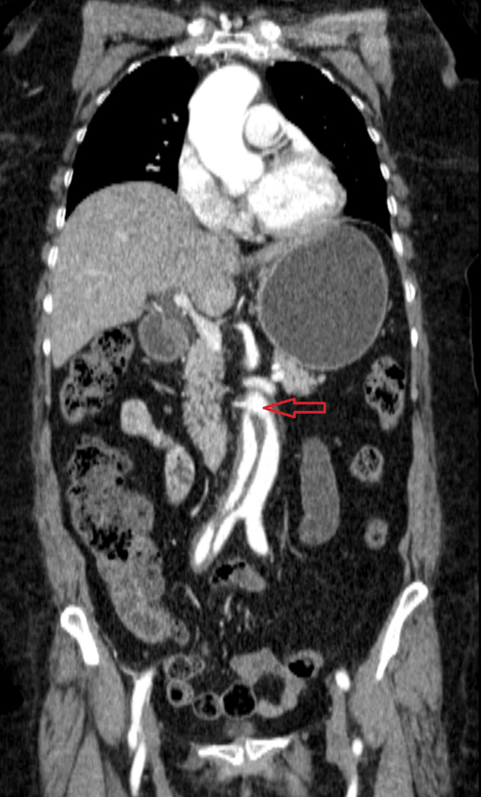
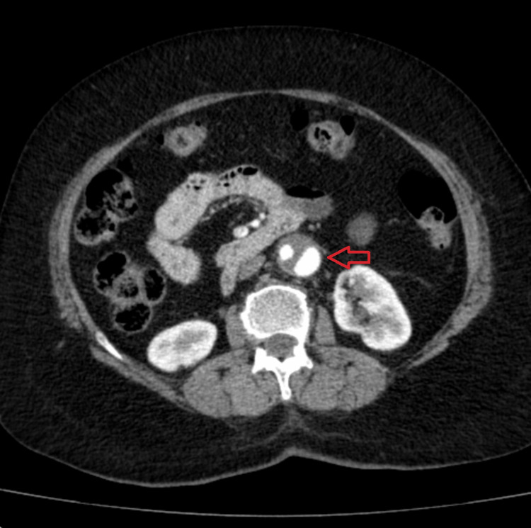
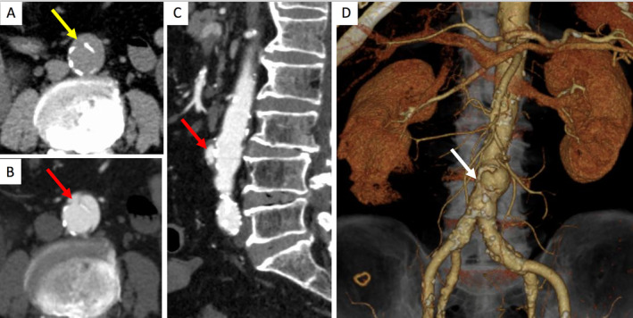
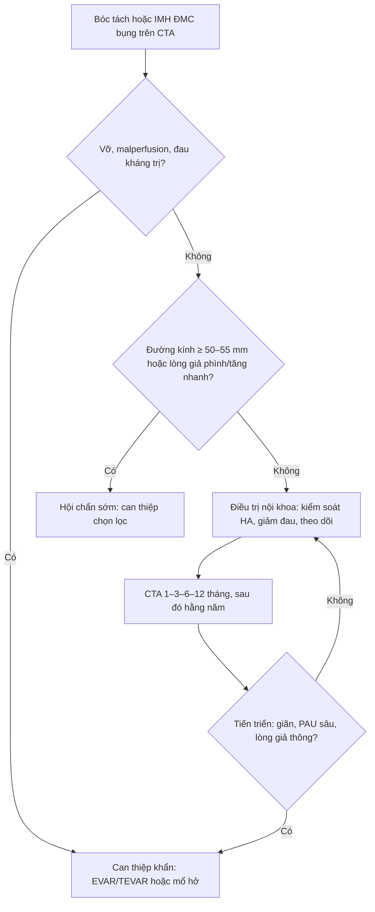

# 171 — Bóc tách ĐMC bụng & khối máu tụ trong thành / Abdominal aortic dissection & intramural hematoma

**Tags:** `pattern:boc-tach` `vung:DMC-bung` `protocol:CTA-DMC` `incidentaloma:IMH`
**Mức chắc chắn (certainty):** tổng hợp y văn (literature synthesis) — tổng hợp cohort + ca nguyên văn có ảnh CC BY/CC BY-NC, ghi PMCID từng ảnh.

## 1. Tổng quan bệnh học – cơ chế hình ảnh

- **Bóc tách ĐMC bụng đơn độc (isolated abdominal aortic dissection — IAAD):** vết rách nội mạc nằm **hoàn toàn dưới cơ hoành**, không có bóc tách ĐMC ngực. IAAD chiếm **1,1–4,1%** tổng số bóc tách ĐMC; một cohort 7.572 ca bóc tách chỉ có **159 ca IAAD (2,1%)** (Shaiea 2025, PMC12387512).
- **Phổ bệnh học của “thành ĐMC mỏng manh”:** cùng một cơ chất là **mất toàn vẹn thành mạch**, biểu hiện thành 4 hình thái hay chồng lấp: **bóc tách** (máu vào lớp áo giữa tạo lòng giả), **IMH** (máu trong thành do vỡ vasa vasorum, không có vết rách nội mạc rõ), **PAU** (loét xuyên qua mảng xơ vữa vào áo giữa) và **phình/thoái hóa**. Vì vậy IMH có thể tiến triển thành bóc tách, PAU có thể tiến triển thành IMH hoặc phình giả (Montatore 2026, PMC13302428).
- **TẠI SAO thấy được trên CT:**
  - **Vạt nội mạc (intimal flap)** là cấu trúc tuyến mảnh, **không ngấm thuốc**, nằm giữa hai lòng; lòng thật thường nhỏ hơn, ngấm thuốc sớm và mạnh; lòng giả lớn hơn, ngấm thuốc chậm/ít hơn hoặc **tắc hoàn toàn** (không ngấm) — chênh lệch nồng độ iod giữa hai lòng tạo “double-lumen”.
  - **IMH** là máu đông trong thành: trên **CT không cản quang** có hình **liềm tăng tỷ trọng** bám theo thành, dày **5–15 mm**; máu cấp có đậm độ khoảng **50–70 HU**, cao hơn cơ và mỡ, nhưng **không ngấm thuốc** sau tiêm.
  - **PAU** là ổ loét đáy xơ vữa ăn sâu vào thành: sau tiêm thấy **ổ đối quang lồi ra ngoài lòng mạch**, thường nằm ngay trên một mảng vôi hóa; có thể kèm IMH quanh ổ loét.
- **Ngưỡng định lượng cần nhớ:**
  - ĐMC bụng **≥ 30 mm** (đường kính ngoài–ngoài) = phình; ngưỡng can thiệp chương trình chung của phình ĐMC bụng là **≥ 55 mm ở nam / ≥ 50 mm ở nữ**, hoặc **tăng > 10 mm/năm**, hoặc có triệu chứng (bài 170).
  - **IMH dày 5–15 mm**; các dấu hiệu nguy cơ cao trên CTA: **đường kính tối đa > 50–55 mm**, **máu tụ quanh ĐMC**, **ổ loét/ULP**, **thành dày dai dẳng** (PMC13302428).
  - **PAU sâu > 20 mm**, PAU lan nhanh hoặc kèm IMH dai dẳng = nguy cơ cao, cần can thiệp (PMC13302428).
  - Phân loại theo **chiều dài**: IAAD **khu trú ≤ 50 mm** (focal) vs **lan rộng > 50 mm** (extensive). Trong cohort 159 ca, nhóm focal lớn tuổi hơn, nhiều triệu chứng hơn, đường kính lớn hơn và **sống 10 năm ước tính 70% vs 90%** ở nhóm extensive (PMC12387512).
- **Diễn tiến tự nhiên:** cohort 68 ca IAAD (55,9% điều trị nội khoa, 39,7% EVAR, 4,4% mổ hở) cho thấy nhóm nội khoa có tử vong **21,0%** so với **3,7%** ở EVAR; lòng giả **tắc hoàn toàn** có xu hướng sống tốt hơn lòng giả còn thông (PMC9996307). Đây là dữ liệu quan sát, có **thiên lệch chọn bệnh** (bệnh nhân nặng hơn có thể được chọn nội khoa) — không được đọc là “EVAR tốt hơn mọi trường hợp”.
- **Biểu hiện lâm sàng:** đau bụng/lưng/hông, đau lan xuống chân, **thiếu máu tạng hoặc chi**, tăng huyết áp, hoặc **không triệu chứng** (tình cờ trên siêu âm/CT). Ca nguyên văn: nữ 60 tuổi đau hông–chân kiểu “điện giật” rồi tê/yếu, **không có 5P của thiếu máu chi**, CTA phát hiện bóc tách hạ vị thận lan tới chạc ba chủ–chậu (PMC13152642). Vì vậy **không được loại trừ bóc tách chỉ vì không có thiếu máu chi điển hình**.

## 2. Mẫu hình + chẩn đoán phân biệt theo vị trí (gamut)

- **Mẫu hình chính:** trong lòng ĐMC bụng có **vạt nội mạc** → hai lòng; hoặc **liềm tăng tỷ trọng thành** trên không cản quang; hoặc **ổ loét lồi** trên nền vôi hóa.
- **Gamut theo vị trí:**
  - **Dưới thận (infrarenal, zone 9):** hay gặp IAAD nhất; thường liên quan xơ vữa, có thể lan tới động mạch chậu; can thiệp bằng **EVAR/khâu bịt entry** nếu có biến chứng; mổ hở khi không có vùng neo.
  - **Cạnh tạng (paravisceral, zone 6–8) / trên thận:** bóc tách liên quan **thân tạng, SMA, động mạch thận** → nguy cơ **thiếu máu gan–lách–ruột–thận**; cần CTA đa thì và hội chẩn mạch máu; cân nhắc **fenestrated/branched EVAR** hoặc mổ hở.
  - **Trên thân tạng (supraceliac, zone 5):** thường là phần tiếp nối của bóc tách ngực type B lan xuống; phải chụp toàn bộ ĐMC để tìm entry chính.
  - **Chạc ba chủ–chậu:** hẹp/tắc chậu, thiếu máu chi dưới; đánh giá thêm động mạch chậu hai bên trước khi đặt stent-graft.
  - **Trong túi phình (dissecting AAA):** lòng giả làm tăng đường kính, nguy cơ vỡ cao hơn; dấu hiệu dọa vỡ giống bài 170.
- **Gamut theo biến chứng — nhớ “DAMP”:** **D**issection (bóc tách lan), **A**neurysm (lòng giả phình/tăng đường kính), **M**alperfusion (tạng/chi), **P**erforation/rupture (vỡ, máu sau phúc mạc).

## 3. Bảng so sánh phân biệt (ma trận đối chiếu)

| Thực thể (entity) | Hình ảnh điển hình (US/CT/CTA) | Chốt vào (rule-in) | Chốt loại (rule-out) | Gợi ý xác nhận |
|---|---|---|---|---|
| Bóc tách ĐMC bụng đơn độc (IAAD) | **Vạt nội mạc + hai lòng** trong ĐMC bụng; lòng thật nhỏ hơn; lòng giả có thể tắc | **Vạt nội mạc thấy rõ ở ≥ 2 bình diện + không có bóc tách ngực** | **Không thấy vạt, chỉ có khối giảm đậm độ bám thành → nghĩ huyết khối thành** | CTA toàn ĐMC, MPR; siêu âm bụng có thể thấy flap (85,4% ca IAAD) |
| IMH ĐMC bụng | **Liềm tăng tỷ trọng 5–15 mm** trên không cản quang, không có vạt; có thể **đẩy vôi hóa nội mạc vào trong** | **Liềm tăng tỷ trọng + không ngấm thuốc + không có lòng giả** | **Có vạt/lòng giả → bóc tách; có ổ loét đối quang → PAU** | CT không cản quang + CTA; theo dõi CTA 1–3 tháng |
| PAU (loét xuyên mảng xơ vữa) | **Ổ đối quang lồi ra ngoài lòng**, sát vôi hóa; ± IMH, ± phình giả | **Ổ loét đối quang có cổ rõ, sâu > 20 mm hoặc lan nhanh** | **Khối giảm đậm độ không đối quang → huyết khối/thrombus** | CTA; đo độ sâu/rộng, tìm máu tụ quanh ĐMC |
| Huyết khối thành trong phình ĐMC | Khối giảm đậm độ **không ngấm thuốc**, lệch tâm, trong túi phình ≥ 30 mm | **Phình ≥ 30 mm + huyết khối bám thành, không có vạt** | **Liềm tăng tỷ trọng trên không cản quang → IMH, không phải thrombus đơn thuần** | So sánh không cản quang với CTA; đo đường kính ngoài–ngoài |
| Viêm ĐMC / aortitis | Thành dày **đồng tâm**, ngấm thuốc, thâm nhiễm mỡ quanh ĐMC; ± phình | **Thành dày đồng tâm + viêm quanh mạch + CRP/IgG4 tăng** | **Có vạt/IMH khu trú → bệnh lý cấu trúc, không chỉ viêm** | MRI T2/STIR, PET-CT, xét nghiệm viêm |
| Vỡ phình ĐMC | **Máu sau phúc mạc 40–70 HU**, mất liên tục thành, thoát thuốc | **Máu sau phúc mạc + tụt HA + đau** | **Không có máu ngoài lòng, thành còn liên tục → chưa vỡ** | CTA cấp cứu; mổ/EVAR |
| Bóc tách ngực type B lan xuống | Vạt liên tục từ ĐMC ngực → bụng; entry thường ở ngực | **Tổn thương liên tục trên toàn bộ ĐMC** | **Tổn thương khu trú dưới cơ hoành → IAAD** | CTA ngực–bụng–chậu “từ đỉnh tới bẹn” |

### Dấu hiệu chốt cần đọc đúng
- **Vạt nội mạc:** đường mảnh, sắc nét, **không ngấm thuốc**, di động theo nhịp tim; phân biệt với **dây nhiễu chuyển động (motion artifact)** — artifact thường mờ, lặp lại theo chu kỳ và biến mất ở thì khác.
- **Di lệch vôi hóa nội mạc (displaced intimal calcification):** trên CT không cản quang, vôi hóa **đi vào trong** so với vị trí thành mạch dự kiến; đây là dấu gián tiếp của máu trong thành/bóc tách. Trong 41 ca IAAD phát hiện tình cờ, **78,0%** có di lệch vôi hóa trên CT và **85,4%** có flap trên siêu âm (Tsubouchi 2025, PMC11907223).
- **Đo đúng:** đường kính **ngoài–ngoài**, vuông góc trục mạch; ghi thêm chiều dài đoạn bóc tách (≤ 50 mm vs > 50 mm), vị trí entry/re-entry, lòng giả thông/tắc, và tình trạng các nhánh tạng.

*Bóc tách ĐMC hạ vị thận lan tới chạc ba chủ–chậu; mũi tên đỏ chỉ vạt nội mạc. Nguồn: Al Madhwahi N et al., Cureus 2026 (PMC13152642), Fig. 1, CC BY 4.0.*

*Trục ngang: lòng thật nhỏ, ngấm thuốc mạnh; lòng giả lớn hơn, ngấm thuốc ít hơn; mũi tên đỏ chỉ vạt. Nguồn: Al Madhwahi N et al., Cureus 2026 (PMC13152642), Fig. 2, CC BY 4.0.*

*(A) CT không cản quang: vôi hóa nội mạc bị đẩy vào trong (mũi tên vàng). (B,C) CTA: vạt nội mạc/hai lòng. (D) Dựng hình 3D. Nguồn: Tsubouchi H et al., J Clin Ultrasound 2025 (PMC11907223), Fig. 3, CC BY-NC 4.0 — giữ nguyên ảnh, không crop/ghép.*

## 4. Protocol chụp + hệ phân độ/điểm chuẩn hóa

- **Chỉ định CTA:** đau bụng/lưng/hông không rõ nguyên nhân ở người có yếu tố nguy cơ (tăng huyết áp, hút thuốc, xơ vữa, phình ĐMC đã biết), thiếu máu tạng/chi, hoặc phát hiện bất thường ĐMC trên siêu âm/X-quang.
- **Protocol tối thiểu:**
  1. **CT không cản quang** trước tiêm: tìm liềm tăng tỷ trọng (IMH), vôi hóa và di lệch vôi hóa.
  2. **CTA động mạch** bụng–chậu, lát mỏng **≤ 1 mm**, bolus-tracking ở ĐMC bụng; **quét từ đỉnh phổi/ngực dưới tới bẹn** để không bỏ sót entry ở ngực hoặc lan xuống chậu.
  3. **Thì muộn 60–90 giây** khi nghi lòng giả chậm ngấm, endoleak hoặc thiếu máu tạng.
  4. MPR theo trục mạch, trục cong (curved planar) và dựng hình 3D để đo entry/re-entry.
- **Những gì phải ghi trong báo cáo:** vị trí theo **zone (5, 6–8, 9)**, chiều dài bóc tách, đường kính tối đa, entry/re-entry, lòng giả thông/tắc, huyết khối, **nhánh tạng nào bị chạm**, dấu vỡ/dọa vỡ, máu tụ quanh ĐMC, PAU (độ sâu/rộng), và bệnh lý ĐMC ngực đi kèm.
- **Theo dõi:** IAAD/IMH không biến chứng → CTA lặp **1–3 tháng**, sau đó **6–12 tháng**, rồi **hằng năm** nếu ổn định; bệnh nhân có lòng giả thông, phình hóa hoặc PAU sâu cần theo dõi sát hơn. Đây là khung thực hành, chưa có thử nghiệm ngẫu nhiên riêng cho IAAD.

- **Điều trị nội khoa:** kiểm soát huyết áp và nhịp tim, giảm đau, điều trị yếu tố nguy cơ; mục tiêu huyết áp tâm thu thường **100–120 mmHg** (cá thể hóa theo tuổi/bệnh nền), tránh tụt huyết áp gây thiếu máu tạng.
- **Can thiệp:** **EVAR/TEVAR bịt entry** khi có biến chứng hoặc nguy cơ cao; **fenestrated/branched EVAR** khi cần bảo tồn nhánh tạng; **mổ hở** (bắc cầu chủ–chậu, thay đoạn mạch) khi giải phẫu không phù hợp hoặc nhiễm trùng. Ca nguyên văn được mổ hở bằng **bắc cầu chủ–đùi hai bên bằng PTFE** vì không có vùng neo (PMC13152642).

## 5. Biến thể bình thường và cạm bẫy

- **Biến thể bình thường:** ĐMC bụng có thể hơi lượn sóng, vôi hóa rải rác ở người lớn tuổi; **không** gọi là bóc tách nếu không có vạt/lòng giả/liềm máu. Đường kính < 30 mm và thành mỏng đều là bình thường.
- **Cạm bẫy 1 — artifact chuyển động:** vạt giả do nhịp tim/thở thường mờ, không liên tục, thay đổi giữa các lát; vạt thật sắc nét, thấy ở nhiều bình diện và có hai lòng.
- **Cạm bẫy 2 — huyết khối thành vs IMH:** huyết khối trong túi phình **giảm đậm độ**, không ngấm thuốc, nằm trong lòng mạch đã giãn; IMH **tăng đậm độ trên không cản quang**, dày 5–15 mm, bám thành và có thể đẩy vôi hóa vào trong. Chỉ nhìn thì CTA có thể nhầm — **luôn đối chiếu ảnh không cản quang**.
- **Cạm bẫy 3 — bỏ sót entry ở ngực:** IAAD có thể là phần thấp của bóc tách type B; nếu chỉ chụp bụng sẽ bỏ sót entry và đánh giá sai nguy cơ. Chụp **toàn bộ ĐMC từ ngực tới bẹn**.
- **Cạm bẫy 4 — “không có 5P” không loại trừ:** ca nguyên văn có mạch mu chân rõ, màu da bình thường nhưng vẫn bóc tách; triệu chứng thần kinh do thiếu máu thần kinh hông/đám rối có thể là biểu hiện đầu tiên.
- **Cạm bẫy 5 — malperfusion tạng kín đáo:** men gan/troponin/creatinine có thể chưa tăng sớm; phải đánh giá **nhánh tạng trên CTA** (động mạch thận, SMA, thân tạng) chứ không chỉ nhìn flap.
- **Cạm bẫy 6 — gọi IMH là “phình có huyết khối”:** IMH không phải huyết khối trong lòng; điều trị và tiên lượng khác (nguy cơ tiến triển thành bóc tách/vỡ), cần theo dõi CTA sớm.

## 6. Tự lượng giá — Blind Quiz

**Ca 1 — Nữ 60 tuổi, đau hông phải kiểu điện giật lan xuống chân rồi tê/yếu. Mạch chân rõ, không có 5P. CTA bụng dưới.**

- Gợi ý lâm sàng: tăng huyết áp, đau khởi phát đột ngột, không thiếu máu chi điển hình.
- Câu hỏi: Dấu hiệu chính là gì? Vì sao không có 5P vẫn phải nghĩ bóc tách? Ba chẩn đoán phân biệt và bước xử trí?

<b>Bấm để hiện đáp án (findings + chẩn đoán)</b>

- **Findings:** vạt nội mạc trong ĐMC hạ vị thận, tạo hai lòng, lan tới chạc ba chủ–chậu; lòng giả tắc hoàn toàn ở một đoạn.
- **Chẩn đoán:** bóc tách ĐMC bụng đơn độc (IAAD) — thiếu máu chi không phải điều kiện bắt buộc vì **nhánh thần kinh/đám rối** có thể bị thiếu máu trong khi mạch mu chân còn đập.
- **Phân biệt:** huyết khối thành trong phình (không có vạt, giảm đậm độ), IMH (liềm tăng tỷ trọng, không có lòng giả), bóc tách type B lan xuống (phải chụp ngực).
- **Xử trí:** CTA toàn ĐMC; hội chẩn mạch máu; ca này không có vùng neo nên được **mổ hở bắc cầu chủ–đùi hai bên**, sau đó triệu chứng thần kinh hết.
- Nguồn ảnh: Al Madhwahi N et al., Cureus 2026 (PMC13152642), Fig. 1, CC BY 4.0.

**Ca 2 — Bệnh nhân lớn tuổi, tình cờ phát hiện bất thường ĐMC bụng trên siêu âm. CT không cản quang và CTA bụng.**

- Gợi ý lâm sàng: không đau, phát hiện khi khám sức khỏe; có hút thuốc và gan nhiễm mỡ.
- Câu hỏi: Dấu hiệu nào trên CT không cản quang gợi ý bóc tách? Cần làm gì tiếp theo?

<b>Bấm để hiện đáp án (findings + chẩn đoán)</b>

- **Findings:** (A) vôi hóa nội mạc bị **đẩy vào trong** so với thành ĐMC; (B,C) CTA thấy vạt nội mạc/hai lòng; (D) dựng hình 3D cho thấy đoạn bóc tách.
- **Chẩn đoán:** IAAD phát hiện tình cờ. Trong loạt 41 ca, **78,0%** có di lệch vôi hóa trên CT và **85,4%** có flap trên siêu âm.
- **Xử trí:** CTA toàn ĐMC để xác định chiều dài/entry/nhánh tạng; nếu không biến chứng → kiểm soát huyết áp và theo dõi CTA 1–3 tháng, 6–12 tháng, sau đó hằng năm.
- Nguồn ảnh: Tsubouchi H et al., J Clin Ultrasound 2025 (PMC11907223), Fig. 3, CC BY-NC 4.0.

## Bài liên quan chéo
- [100 – Tổng quan hệ Bụng](../100-tong-quan-he-bung/lesson.md)
- [170 – Phình ĐMC bụng: dọa vỡ, vỡ & rò](../170-phinh-DMC-bung/lesson.md)
- [070 – Thuyên tắc phổi & hội chứng ĐMC cấp](../070-thuyen-tac-phoi-dmc-cap/lesson.md)
- [175 – Chèn ép mạch bụng & nút mạch tạng](../175-chen-ep-mach/lesson.md)

## Ảnh
- `171_boc-tach-DMC-bung_CTA_PMC13152642-F1-CCBY40.jpg` — CTA trục dọc, vạt nội mạc; Al Madhwahi N et al., Cureus 2026, CC BY 4.0.
- `171_boc-tach-DMC-bung_CTA_PMC13152642-F2-CCBY40.jpg` — CTA trục ngang, hai lòng; Al Madhwahi N et al., Cureus 2026, CC BY 4.0.
- `171_di-lech-voi-hoa_CT_PMC11907223-F3-CCBYNC40.jpg` — CT không cản quang + CTA, di lệch vôi hóa; Tsubouchi H et al., J Clin Ultrasound 2025, CC BY-NC 4.0 (giữ nguyên, không crop/ghép).
- Nguồn + giấy phép từng ảnh: `images/CREDITS.md`.

> Không dùng để chẩn đoán độc lập khi chưa có người hướng dẫn.
