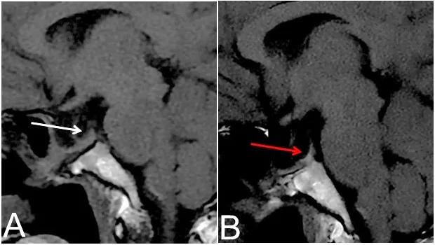
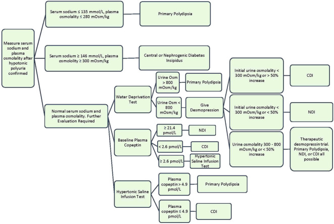
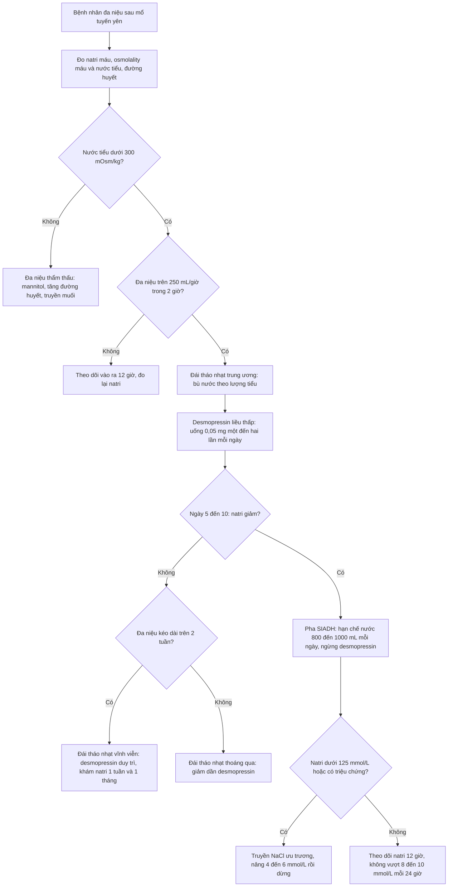
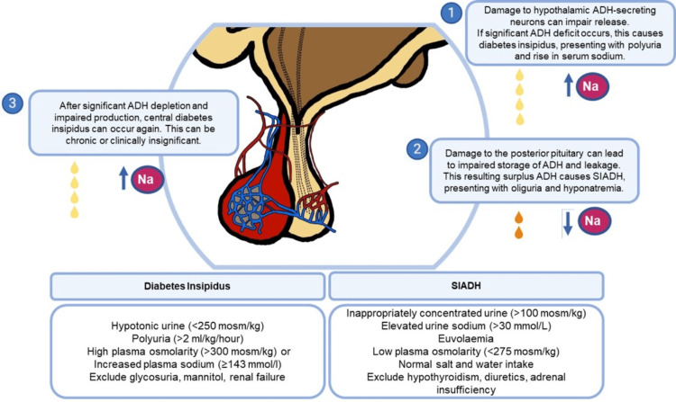

# 1710 — Đái tháo nhạt trung ương sau mổ tuyến yên: ba pha, điểm sáng thùy sau trên T1 và ngưỡng desmopressin / Central diabetes insipidus after pituitary surgery: triphasic response, posterior pituitary bright spot and desmopressin thresholds

**Tags:** `pattern:da-nieu` `pattern:khat-nuoc` `pattern:ha-natri` `pattern:tang-natri` `pattern:mat-diem-sang-T1` `vung:tuyen-yen` `vung:ho-yen` `protocol:MRI-tuyen-yen` `protocol:xet-nghiem-nuoc-tieu` `score:Na-huyet-thanh`
**Mức chắc chắn (certainty):** tổng hợp y văn (literature synthesis) — số liệu từ một nghiên cứu tiến cứu 58 bệnh nhân sau mổ xuyên bướm, một đoàn hệ nhi 73 bệnh nhân, tổng quan chẩn đoán – điều trị đái tháo nhạt 2025, và một bài tổng quan hình ảnh MRI tuyến yên sau mổ 2026. Không có RCT nào so sánh trực tiếp các phác đồ theo dõi natri; phần “chọn phác đồ” là tổng hợp có suy luận, đã ghi rõ.

> **Vì sao bài này quan trọng:** bài **1699** và **1696** đều kết thúc bằng câu “theo dõi đái tháo nhạt thoáng qua sau mổ xuyên bướm”, nhưng không bài nào trả lời ba câu hỏi của buổi khám hôm sau mổ: **(1) đa niệu này là đái tháo nhạt thật hay do truyền dịch/đường huyết? (2) nếu thật thì đang ở pha nào của tam pha? (3) trên MRI, mất điểm sáng thùy sau là bình thường hay là bằng chứng mất chức năng vĩnh viễn?** Trả lời sai câu (1) dẫn tới truyền dịch thừa hoặc desmopressin thừa; sai câu (2) dẫn tới xử trí ngược pha (dùng desmopressin trong pha SIADH → hạ natri nặng); sai câu (3) dẫn tới gọi nhầm thay đổi sau mổ là tái phát u và xạ lại không cần thiết.

## 1. Tổng quan bệnh học – cơ chế hình ảnh – vì sao “đa niệu” chưa chắc là đái tháo nhạt

- **Trục bình thường:** ADH (arginine vasopressin, AVP) được tổng hợp ở **nhân trên thị và nhân cạnh não thất của hạ đồi**, vận chuyển dọc **cuống tuyến yên** trong các sợi trục có bọc myelin, rồi **tích trữ dạng hạt (granule) cùng neurophysin II** ở **thùy sau tuyến yên**. Khi cần, hạt được phóng thích vào tuần hoàn → gắn thụ thể **V2** ở ống góp thận → **aquaporin-2** chen vào màng đỉnh → tái hấp thu nước tự do.
- **TẠI SAO thùy sau sáng trên T1:** bản thân mô tuyến không “sáng vì mỡ”. Độ sáng đến từ **protein trong hạt bài tiết (vasopressin–neurophysin)** làm **giảm thời gian T1** của nước trong mô. Vì vậy **mất điểm sáng T1 = mất kho dự trữ hạt**, không phải mất mô; và **điểm sáng có thể xuất hiện lại** khi kho hạt hồi phục. Đây là lý do hình ảnh T1 **không phải** chỉ điểm tuyệt đối của chức năng thùy sau.
- **Kích thước bình thường:** điểm sáng thùy sau **2–8 mm** theo trục trên–dưới, có mặt ở **95,9%** trong loạt **1.017 người** bình thường (vắng ở ~4%, nhiều hơn ở người lớn tuổi và nam). **Cuống tuyến yên dày 2–3 mm**, thuôn từ **3,2 mm ở giao thoa thị giác xuống 2 mm ở chỗ bám tuyến yên**, ngấm thuốc đồng nhất.
- **Vì sao mổ gây đái tháo nhạt:** thao tác trên **cuống và thùy sau** gây **sốc sợi trục (axonal shock)** → AVP không xuống được thùy sau → **đa niệu nhược trương trong 24 giờ đầu**. Sau đó sợi trục thoái hóa **phóng thích AVP ồ ạt, không điều hòa** → **SIADH (hạ natri)** vào khoảng **ngày 5–10**. Cuối cùng, nếu trục không hồi phục → **đái tháo nhạt vĩnh viễn** từ **tuần 2–3**. Đây là **tam pha (triphasic response)**, và là lý do một bệnh nhân có thể vừa “đa niệu” vừa “hạ natri” trong cùng một tuần nằm viện.
- **Tần suất định lượng:**
  - Đái tháo nhạt trung ương chiếm **1/25.000 người**; tới **36%** ca mắc phải do **chấn thương đầu hoặc mổ xuyên trán/xuyên bướm**.
  - Sau mổ xuyên bướm, đái tháo nhạt trung ương gặp **~20%**; **cao hơn** khi mổ **u sọ hầu** so với u tuyến yên.
  - Nghiên cứu tiến cứu **58 bệnh nhân u tuyến yên**: **27,6% (16 ca)** đái tháo nhạt thoáng qua; **3,4% (2 ca)** thoáng qua rồi SIADH; **8,6% (5 ca)** SIADH đơn thuần; **8,6% (5 ca)** đái tháo nhạt dai dẳng; **1 ca** tam pha đầy đủ. Khởi phát trung vị **ngày 2 sau mổ**, lui bệnh trung vị **ngày 4**; lúc **6 tuần** còn **5 ca (11%)** dai dẳng. Yếu tố dự báo: **tuổi trẻ hơn, thể tích u lớn hơn, có apoplexy trên MRI, Knosp cao hơn** (p < 0,05).
  - Đoàn hệ **nhi 73 bệnh nhân** sau mổ u vùng yên: **69,7%** có đái tháo nhạt sớm; trong số đó **16% thoáng qua, 84% vĩnh viễn**; **54,8% (23/42)** ca vĩnh viễn có **tam pha** trước đó. **50%** dao động natri **≥ 10 mmol/L/24 giờ** trong 10 ngày đầu, biên độ tối đa **30 mmol/L/24 giờ**.

## 2. Mẫu hình + chẩn đoán phân biệt theo trục thời gian sau mổ (Gamut)

Không phân loại theo “vị trí tổn thương” mà theo **mốc ngày sau mổ**, vì cùng một bệnh nhân đi qua nhiều mẫu hình:

- **Ngày 1–3 — đa niệu nhược trương:** nước tiểu **> 2 mL/kg/giờ** (người lớn thường **> 3 L/ngày**), tỉ trọng thấp, **osmolality nước tiểu < 300 mOsm/kg**; natri máu **bình thường hoặc tăng**. Đây là pha **thiếu AVP**.
- **Ngày 5–10 — SIADH:** nước tiểu cô đặc trở lại (**> 300 mOsm/kg**, natri niệu **> 30 mmol/L**), bệnh nhân **euvolemic**, natri máu **giảm**. Đây là pha **AVP phóng thích không điều hòa**; **không phải** “đái tháo nhạt đã khỏi”.
- **Tuần 2–4 — đái tháo nhạt vĩnh viễn:** đa niệu quay lại và **không tự hết**; cần desmopressin duy trì.
- **Bất kỳ lúc nào — đái tháo nhạt kèm mất khát (adipsic DI):** tổn thương **vùng trước thị–hạ đồi**, bệnh nhân **không khát** → **tăng natri nặng**, nguy cơ tử vong; đây là thể **phải truyền nước theo cân nặng**, không chờ khát.
- **Bất kỳ lúc nào — đa niệu do thẩm thấu:** mannitol, đường huyết cao, truyền nhiều muối, hồi phục suy thận → **osmolality nước tiểu cao**, không phải đái tháo nhạt.
- **Bất kỳ lúc nào — hạ natri do nguyên nhân khác:** **suy thượng thận cấp** (thường kèm hạ áp, hạ đường huyết), **hội chứng mất muối não (cerebral salt wasting)** sau tổn thương não (giảm thể tích, natri niệu cao), **dùng thiazide**.

*Sagittal T1 không cản từ sau mổ xuyên bướm. (A) 3 tháng: **không thấy điểm sáng thùy sau** (mũi tên trắng). (B) 6 tháng: **điểm sáng xuất hiện lại** (mũi tên đỏ) ở người lâm sàng ổn, natri bình thường, không tái phát u. Bài học: vắng điểm sáng ở mốc 3 tháng **không đồng nghĩa** đái tháo nhạt vĩnh viễn. Nguồn: Daskareh M et al., *Diagnostics* 2026 (PMC13511195) Fig. 7, **CC BY 4.0**.*

## 3. Bảng so sánh phân biệt (ma trận đối chiếu)

| Thực thể (entity) | Hình ảnh/lâm sàng điển hình | Chốt vào (rule-in) | Chốt loại (rule-out) | Gợi ý xác nhận |
|---|---|---|---|---|
| **Đái tháo nhạt trung ương thoáng qua** | Ngày 1–3 sau mổ; đa niệu **> 2 mL/kg/giờ**; nước tiểu **< 300 mOsm/kg**; natri bình thường/tăng nhẹ; tự hết trong **vài ngày** | **Osmolality nước tiểu < 300 + đa niệu sau mổ + đáp ứng desmopressin** (tăng > 50%) | Nước tiểu **> 800 mOsm/kg** sau khát nước → không phải đái tháo nhạt | Theo dõi vào–ra 12 giờ; desmopressin liều thấp |
| **Đái tháo nhạt trung ương vĩnh viễn** | Đa niệu kéo dài **> 2 tuần**, không giảm; cần desmopressin liên tục; MRI có thể **mất điểm sáng T1** | **Đa niệu tái phát sau pha SIADH (tam pha) hoặc kéo dài > 2 tuần** | Đa niệu hết trong **48–72 giờ** → thoáng qua | Desmopressin duy trì; theo dõi natri |
| **SIADH sau mổ** | Ngày **5–10**; natri **< 135 mmol/L**; nước tiểu **> 300 mOsm/kg**, natri niệu **> 30 mmol/L**; euvolemic | **Hạ natri + nước tiểu cô đặc + euvolemic + loại trừ suy thượng thận/suy giáp** | Nước tiểu **< 100 mOsm/kg** hoặc đa niệu → không phải SIADH | Hạn chế nước **800–1.000 mL/ngày**; theo dõi Na 12 giờ |
| **Tam pha (triphasic)** | Đa niệu **→** hạ natri **→** đa niệu lại; mỗi pha **vài ngày–1 tuần** | **Chuỗi 3 pha điển hình trên bảng theo dõi vào–ra + natri** | Chỉ một pha đơn độc, không đổi chiều → không gọi tam pha | Không dùng desmopressin trong pha SIADH |
| **Đái tháo nhạt do thẩm thấu** | Đa niệu nhưng nước tiểu **> 300 mOsm/kg**; có mannitol/đường huyết cao/truyền muối | **Osmolality nước tiểu cao + osmolal gap tăng** | Nước tiểu nhược trương → không phải thẩm thấu | Ngừng mannitol, kiểm soát đường huyết |
| **Suy thượng thận cấp sau mổ** | Hạ natri, hạ áp, hạ đường huyết, tăng kali; thường **ngày 1–3** | **Cortisol thấp + ACTH không tăng phù hợp + đáp ứng với hydrocortisone** | Cortisol bình thường/đủ → loại trừ | Hydrocortisone **100 mg IV** rồi **200 mg/24 giờ** |
| **Mất muối não (CSW)** | Hạ natri + **giảm thể tích** (mạch nhanh, CVP thấp), natri niệu **> 40 mmol/L**, sau tổn thương não | **Hạ natri + giảm thể tích + natri niệu cao** | Euvolemic + nước tiểu cô đặc → SIADH | Truyền NaCl 0,9%; không hạn chế nước |
| **Đái tháo nhạt + mất khát** | Không khát, natri **tăng nặng > 150 mmol/L**, có thể co giật | **Không khát + tăng natri + đa niệu** | Có khát bình thường → thể thông thường | Truyền nước theo cân nặng; desmopressin + theo dõi sát |

*Thuật toán: xác nhận đa niệu nhược trương → đo natri và osmolality máu → test khát nước ± desmopressin, hoặc copeptin nền/sau truyền nước muối ưu trương. Nguồn: Flynn K et al., *Front Endocrinol* 2025 (PMC11750692) Fig. 2, **CC BY 4.0**.*

## 4. Protocol: theo dõi, chẩn đoán, hình ảnh và xử trí theo pha

**Theo dõi hậu phẫu (bắt buộc, đây là nơi quyết định kết cục):**
- Ghi **vào–ra mỗi 6–12 giờ**, cân nặng mỗi ngày, khát và dấu mất nước.
- **Natri máu mỗi 12 giờ** trong **3–5 ngày đầu**, sau đó mỗi ngày tới khi ổn định; đo thêm nếu đổi triệu chứng.
- **Osmolality máu/niệu** khi bắt đầu đa niệu; **đường huyết** để loại trừ đa niệu thẩm thấu.
- **Ngưỡng chẩn đoán đái tháo nhạt sau mổ:** đa niệu **> 250 mL/giờ trong 2 giờ liên tiếp** + osmolality nước tiểu **< 100 mOsm/kg** (hoặc thấp hơn osmolality máu) + natri máu bình thường/tăng.
- **Ngưỡng chẩn đoán SIADH:** natri **< 135 mmol/L**, osmolality máu thấp, nước tiểu **> 100 mOsm/kg** (thực tế thường **> 300**), natri niệu **> 30 mmol/L**, euvolemic, loại trừ suy thượng thận/suy giáp.
- **Tốc độ sửa natri an toàn:** không vượt **8–10 mmol/L/24 giờ** (chậm hơn ở người nghiện rượu, suy dinh dưỡng, hạ kali) để tránh **hủy myelin thẩm thấu**; nếu hạ natri có triệu chứng thần kinh, nâng **4–6 mmol/L** nhanh rồi dừng.

**Xác định nguyên nhân trung ương (khi đái tháo nhạt kéo dài hoặc không điển hình):**
- **Test khát nước:** người bình thường cô đặc nước tiểu **> 800 mOsm/kg**; đái tháo nhạt giữ **< 300**; thể **300–800** là bán phần hoặc uống nước nhiều.
- **Desmopressin 2–4 µg tiêm dưới da/tĩnh mạch** (không dùng đường xịt vì hấp thu không ổn định): osmolality nước tiểu **tăng > 50%** = đái tháo nhạt trung ương hoàn toàn; **< 15%** = đái tháo nhạt thận hoàn toàn; thể bán phần tăng **tới 45%**.
- **Copeptin:** nền **> 21,4 pmol/L** chẩn đoán đái tháo nhạt thận (**Se 100%, Sp 100%**); sau truyền nước muối ưu trương đưa natri **> 150 mmol/L**, copeptin **< 4,9 pmol/L** = đái tháo nhạt trung ương, **≥ 4,9 pmol/L** = uống nước nhiều nguyên phát.

**MRI tuyến yên sau mổ (đọc có cấu trúc, không “soi tìm u”):**
- Chuỗi tối thiểu: **sagittal T1 không cản từ lát 2,5 mm**, **coronal T2**, **coronal T1 động học** (22 giây/lát) và **T1 sau tiêm**, **sagittal T1 sau tiêm**.
- Đo và ghi: **điểm sáng thùy sau** (có/không, mm), **đường kính cuống** tại chỗ hẹp nhất (bình thường **2–3 mm**), độ lệch cuống, chất độn hố yên, nốt ngấm thuốc trong ổ mổ.
- Ý nghĩa: **cuống lệch nhưng mảnh** ở mốc 3–6 tháng là thay đổi lành tính (khoảng **một nửa** cuống lệch tự về giữa khi gelfoam và dịch tiêu đi); **cuống dày > 3 mm, ngấm mạnh, lan thành dải trên yên** mới đáng lo. Trên MRI trong mổ, **đường kính cuống tối thiểu ≥ 2,9 mm** dự báo suy vỏ thượng thận mới (**OR ~ 29**) và thiếu AVP (**OR ~ 6**), nhưng **ở mốc 3 tháng khác biệt không còn**.
- **Điểm sáng thùy sau âm trước mổ** là yếu tố dự báo đái tháo nhạt sau mổ: trong **65 bệnh nhân u tuyến yên**, **10/32** ca có đái tháo nhạt so với **1/33** ca không có (hồi quy logistic: yếu tố độc lập).

**Điều trị theo pha:**
1. **Pha đa niệu:** bù nước theo lượng nước tiểu + nhu cầu không nhận thấy; **desmopressin liều thấp nhất hiệu quả** — uống khởi đầu **0,05 mg × 1–2 lần/ngày**, dải thường dùng **0,1–1,2 mg/ngày** chia 2–3 lần; xịt mũi **10 µg/0,1 mL**, **10–40 µg/ngày** (trẻ **10–30 µg**); ngậm dưới lưỡi **27,7 µg/ngày (nữ)**, **55,3 µg/ngày (nam)**, uống **1 giờ trước ngủ**, hạn chế nước **1 giờ trước và 8 giờ sau**. Mục tiêu là **để “aquaresis” xảy ra mỗi ngày**, tránh desmopressin phủ kín 24 giờ.
2. **Pha SIADH:** **hạn chế nước 800–1.000 mL/ngày**, theo dõi natri **12 giờ/lần**; chỉ truyền NaCl ưu trương khi có triệu chứng hoặc natri **< 125 mmol/L**; **không dùng desmopressin** trong pha này.
3. **Pha đái tháo nhạt vĩnh viễn:** desmopressin duy trì, giáo dục **không uống quá nhiều nước** khi đã dùng thuốc (nguy cơ hạ natri); khám lại natri sau **1 tuần**, **1 tháng**, rồi mỗi **3–6 tháng**.
4. **Đái tháo nhạt + mất khát:** truyền nước theo cân nặng (**tính theo lượng nước tiểu + 500 mL/ngày**), desmopressin có thể cần, theo dõi natri sát vì nguy cơ **tăng–giảm natri xen kẽ**.

*Cơ chế ba pha: (1) tổn thương nơ-ron tiết AVP → đái tháo nhạt; (2) tổn thương thùy sau → AVP thoát ra không điều hòa → SIADH; (3) mất AVP kéo dài → đái tháo nhạt mạn. Khung dưới là ngưỡng phân biệt nước tiểu nhược trương và nước tiểu cô đặc. Nguồn: Kamal MA et al., *Cureus* 2023 (PMC10346128) Fig. 2, **CC BY 4.0**.*

## 5. Biến thể bình thường và cạm bẫy

- **“Mất điểm sáng thùy sau = đái tháo nhạt vĩnh viễn”:** sai. Điểm sáng **có thể mất tạm thời sau mổ rồi xuất hiện lại** (Hình 1). Ngược lại, **~4% người bình thường không có điểm sáng**, và trong loạt u tuyến yên nhiều ca đái tháo nhạt thoáng qua **vẫn còn** điểm sáng trước mổ. Dùng một mình dấu hiệu này để tiên lượng là **overcall**.
- **“Cuống dày sau mổ = tái phát”:** sai. **Lệch cuống nhưng mảnh, ngấm đều** ở mốc 3–6 tháng là thay đổi định vị sau mổ; chỉ **dày > 3 mm, ngấm mạnh thành dải** mới đáng lo. Đừng đo cuống trên lát dày 5 mm — dùng lát **2,5 mm**.
- **“Chất độn hố yên là u tồn dư”:** mỡ tự thân **T1 sáng, không ngấm thuốc**, tồn tại nhiều tháng–năm; gelfoam có thể tạo **ổ ngấm thuốc tròn** sớm. Đối chiếu phim ngay sau mổ và **không** kết luận u tồn dư nếu không có nốt **≥ 3–4 mm** ngấm muộn kèm xét nghiệm tăng.
- **“Đa niệu ngày đầu là đái tháo nhạt” — bỏ qua đa niệu thẩm thấu:** mannitol trong mổ, đường huyết cao, truyền nhiều muối đều gây đa niệu nhưng **nước tiểu > 300 mOsm/kg**. Luôn đo osmolality nước tiểu **trước** khi dùng desmopressin.
- **“Hạ natri ngày 5 là SIADH” — bỏ qua suy thượng thận:** cortisol thấp sau mổ gây hạ natri **và** hạ áp; điều trị bằng **hydrocortisone** chứ không phải hạn chế nước. Đo cortisol sáng **ngày 1–2** ở mọi ca có hạ natri.
- **“Dùng desmopressin để chặn đa niệu trong tam pha”:** trong pha SIADH, desmopressin + truyền dịch là công thức gây **hạ natri nặng**; phải **ngừng desmopressin** khi natri bắt đầu giảm.
- **“Đái tháo nhạt chỉ gây tăng natri”:** đái tháo nhạt nặng gây **mất nước → giảm thể tích dịch não tủy**, và trên MRI có thể thấy **tràn dịch dưới màng cứng hai bên + ngấm màng não lan tỏa** giả **hạ áp nội sọ**. Ca được báo cáo: natri **149 mmol/L**, sau đó **123 mmol/L** (tam pha), 2 tháng sau MRI có **tràn dịch dưới màng cứng + ngấm màng não**, **hết sau khi điều trị đái tháo nhạt**; đừng quy ngay cho rò dịch não tủy.
- **“Điều trị đái tháo nhạt bằng hạn chế nước”:** ngược hoàn toàn — hạn chế nước là điều trị **SIADH**; với đái tháo nhạt, hạn chế nước gây **tăng natri và suy tuần hoàn**.

## 6. Tự lượng giá — Blind Quiz

**Ca 1 — Nữ 43 tuổi, mổ xuyên bướm u tuyến yên không hoạt động (Knosp 3). Ngày 2: nước tiểu 350 mL/giờ, osmolality niệu 120 mOsm/kg, natri 146 mmol/L; ngày 7: nước tiểu 60 mL/giờ, natri 128 mmol/L; ngày 15: đa niệu trở lại, natri 149 mmol/L.**

- Câu hỏi: (1) Ba pha này tên gì? (2) Ngày 7 xử trí thế nào? (3) Ngày 15 có cần desmopressin lâu dài không?

<b>Bấm để hiện đáp án (findings + chẩn đoán)</b>

- Dấu hiệu: **tam pha điển hình** — đa niệu nhược trương ngày 2 (osmolality niệu **120 mOsm/kg**, natri **146**), SIADH ngày 7 (natri **128**, nước tiểu cô đặc), đái tháo nhạt tái phát ngày 15 (natri **149**).
- Ngày 7: **ngừng desmopressin**, **hạn chế nước 800–1.000 mL/ngày**, theo dõi natri **12 giờ/lần**; chỉ truyền NaCl ưu trương nếu natri **< 125 mmol/L** hoặc có triệu chứng thần kinh, và không nâng quá **8–10 mmol/L/24 giờ**.
- Ngày 15: đái tháo nhạt sau pha SIADH thường là **vĩnh viễn**; bắt đầu desmopressin duy trì liều thấp và hẹn khám natri **1 tuần** rồi **1 tháng**. Không kết luận vĩnh viễn chỉ dựa vào một lần đo — theo dõi **≥ 2 tuần**.
- Nguồn: khung tam pha theo Kamal MA et al., *Cureus* 2023 (PMC10346128), CC BY 4.0.

**Ca 2 — Nam 55 tuổi, 3 tháng sau mổ u tuyến yên, không đa niệu, natri bình thường. MRI kiểm tra: không thấy điểm sáng thùy sau, cuống lệch trái 2 mm, có mảnh mỡ T1 sáng không ngấm ở sàn hố yên.**

- Câu hỏi: (1) Có phải đái tháo nhạt vĩnh viễn không? (2) Mảnh T1 sáng là gì? (3) Cần làm gì tiếp?

<b>Bấm để hiện đáp án</b>

- **Không.** Bệnh nhân **không đa niệu, natri bình thường** → thùy sau còn đủ chức năng; **mất điểm sáng T1 ở mốc 3 tháng có thể hồi phục** (Hình minh họa: 3 tháng mất, 6 tháng xuất hiện lại). Điểm sáng là **kho hạt vasopressin–neurophysin**, không phải “mô thùy sau”.
- Mảnh **T1 sáng, không ngấm thuốc ở sàn hố yên** là **mỡ tự thân/gelfoam độn** — dấu hiệu sau mổ bình thường, tồn tại nhiều tháng–năm; **không phải u tồn dư**.
- Cuống **lệch nhưng mảnh 2 mm** là thay đổi định vị; theo dõi lâm sàng + natri, **không xạ lại**. Chỉ chụp lại khi có triệu chứng hoặc xét nghiệm tuyến yên bất thường.
- Nguồn ảnh: Daskareh M et al., *Diagnostics* 2026 (PMC13511195) Fig. 7, CC BY 4.0.

**Ca 3 — Nam 60 tuổi, mổ u sọ hầu, ngày 4 đa niệu 4 L/ngày, natri 151 mmol/L, bệnh nhân không khát và uống rất ít; huyết áp 95/60 mmHg.**

- Câu hỏi: (1) Vì sao “không khát” là dấu hiệu nặng? (2) Xử trí nước và desmopressin? (3) Bẫy nào nếu chỉ hạn chế nước?

<b>Bấm để hiện đáp án</b>

- **Đái tháo nhạt kèm mất khát (adipsic DI)** — tổn thương vùng trước thị/hạ đồi làm mất cảm giác khát; natri **151 mmol/L** đã tăng. Không khát khiến bệnh nhân **không tự bù nước**, nguy cơ **tăng natri nặng, co giật, huyết khối**.
- Xử trí: **bù nước theo lượng nước tiểu + nhu cầu không nhận thấy** (ví dụ lượng tiểu + **500 mL/ngày**), theo dõi natri **mỗi 12 giờ**; **desmopressin** để giảm đa niệu nhưng phải giảm liều ngay nếu natri giảm; tránh sửa natri quá **8–10 mmol/L/24 giờ**.
- Bẫy: **hạn chế nước** (điều trị của SIADH) sẽ làm **tăng natri nặng hơn**; đồng thời huyết áp **95/60** gợi ý cần đánh giá **suy thượng thận** kèm theo (cortisol sáng, cân nhắc hydrocortisone).

## Bài liên quan chéo
- [1699 – Bệnh Cushing ở trẻ: MRI 3T, BIPSS, tăng trưởng sau lui bệnh](../1699-benh-cushing-tre-em/lesson.md)
- [1696 – Bệnh Cushing do u tuyến yên: MRI động học, BIPSS, hội chứng Nelson](../1696-benh-cushing-u-tuyen-yen/lesson.md)
- [245 – U tuyến yên chảy máu/nhồi máu: pituitary apoplexy](../245-u-tuyen-yen-chay-mau-nhoi-mau-pituitary-apoplexy/lesson.md)
- [246 – Hội chứng Sheehan: hoại tử tuyến yên sau sinh](../246-hoi-chung-sheehan-hoai-tu-tuyen-yen-sau-sinh/lesson.md)
- [432 – Vùng yên: giải phẫu và tiếp cận tổn thương](../432-vung-yen/lesson.md)
- [244 – Rò dịch não tủy nền sọ](../244-ro-dich-nao-tuy-nen-so/lesson.md)

## Ảnh
- `1710_dai-thao-nhat_T1_PMC13511195-Fig7-CCBY.webp` — Daskareh M et al., *Diagnostics* 2026 (PMC13511195) Fig. 7, **CC BY 4.0**, nguyên bản.
- `1710_dai-thao-nhat_So-do_PMC10346128-Fig2-CCBY.jpg` — Kamal MA et al., *Cureus* 2023 (PMC10346128) Fig. 2, **CC BY 4.0**, nguyên bản.
- `1710_dai-thao-nhat_So-do_PMC11750692-Fig2-CCBY.jpg` — Flynn K et al., *Front Endocrinol* 2025 (PMC11750692) Fig. 2, **CC BY 4.0**, nguyên bản.
- Không tải ảnh từ Radiopaedia/AuntMinnie; chỉ dẫn link ở `sources.md`.

> Không dùng để chẩn đoán độc lập khi chưa có người hướng dẫn.
