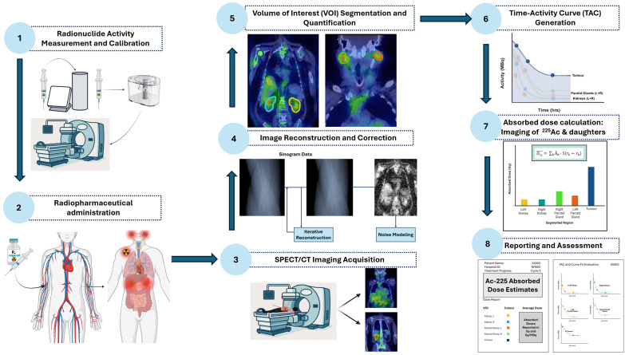
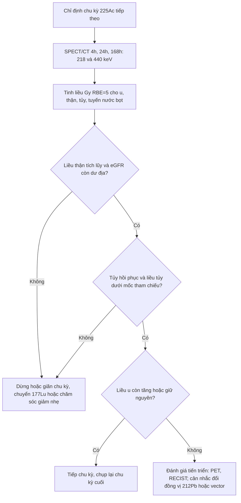
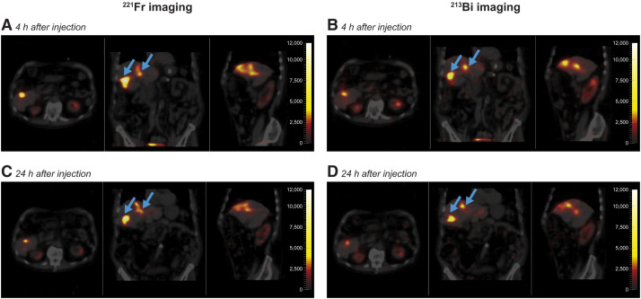
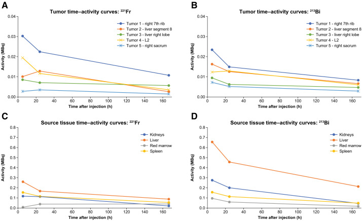

# 1711 — Dosimetry cá thể hóa cho ²²⁵Ac: đo liều u – thận – tủy, hiệu chỉnh tái phân bố hạt nhân con và ngưỡng dừng / Individualised dosimetry for actinium-225 targeted alpha therapy

**Tags:** `pattern:xa-tri-hat-alpha` `pattern:dosimetry` `pattern:doc-than` `pattern:doc-tuy` `vung:than` `vung:tuy-xuong` `vung:tuyen-nuoc-bot` `score:RBE` `protocol:SPECT-CT` `protocol:dosimetry` `incidentaloma:khong`

**Mức chắc chắn (certainty):** tổng hợp y văn (literature synthesis) — tự biên từ **1 phân tích dosimetry của thử nghiệm pha 1b/3 ACTION-1** ([²²⁵Ac]Ac-DOTATATE, 9 bệnh nhân × 4 chu kỳ, PMC13435548), **1 tổng quan phương pháp dosimetry ảnh cho ²²⁵Ac** (PMC12838896), **1 nghiên cứu khả thi SPECT ²²⁵Ac-PSMA ở 4 bệnh nhân mCRPC** (PMC12858698), **1 nghiên cứu tiền lâm sàng xác định cơ quan giới hạn liều** (PMC13106407) và **2 tổng quan vật lý chọn đồng vị** (PMC13610509, PMC12985603). **Chưa có ngưỡng dừng tiền cứu nào được xác nhận** — phần ngưỡng dừng ghi rõ là **suy luận từ số liệu chu kỳ**, không phải khuyến cáo cấp 1.

> **Câu chốt:** với ²²⁵Ac, **hoạt độ tiêm không dự báo được liều** — 4 hạt alpha đi qua 6 mắt xích phân rã, **giật lùi hạt nhân (recoil) 100–200 keV** có thể **bứt hạt nhân con khỏi chelator**, và ta **không chụp được chính ²²⁵Ac** mà chỉ chụp **²²¹Fr (218 keV, 11,4%)** và **²¹³Bi (440 keV, 25,9%)**. Vì vậy "100 kBq/kg" chỉ là **điểm khởi đầu**, còn quyết định dừng/tiếp phải dựa trên **liều hấp thụ có trọng số RBE (Gy RBE=5) cho u, thận và tủy xương đỏ** — với 2 mốc tham chiếu thực tế: **thận 22,3 Gy và tủy 1,1 Gy sau 4 chu kỳ** ở ACTION-1 (PMC13435548).

## 1. Tổng quan bệnh học – cơ chế hình ảnh

- **Vì sao ²²⁵Ac khó đo liều hơn ¹⁷⁷Lu (vật lý, không phải kỹ thuật):**
  - **Chuỗi phân rã 6 mắt xích:** ²²⁵Ac (**T½ 9,92 ngày**) → ²²¹Fr (**4,8 phút**) → ²¹⁷At (**33 ms**) → ²¹³Bi (**45,6 phút**) → ²¹³Po (**4,2 µs**, 28,9% năng lượng) / ²⁰⁹Tl (**2,2 phút**, 0,2% năng lượng) → ²⁰⁹Pb (0,7%) → ²⁰⁹Bi bền. Tổng cộng **4 hạt alpha, 2 hạt beta, 2 photon** cho mỗi phân rã ²²⁵Ac.
  - **Giật lùi hạt nhân 100–200 keV** đủ **phá liên kết hóa học** và **bứt hạt nhân con khỏi chelator** (PMC12838896). Nếu hạt nhân con rời u → **liều vào thận/tủy**, và **liều u không còn suy ra được từ hoạt độ tiêm**.
  - **Hình ảnh chỉ là "gián tiếp":** ²²⁵Ac **không có photon dùng được**; ta chụp **²²¹Fr 218 keV (11,4%)** làm **đại diện cho ²²⁵Ac** và **²¹³Bi 440 keV (25,9%)** làm **đại diện cho các hạt nhân con phía sau**. Hoạt độ tiêm thường chỉ **4–8 MBq** → **thống kê đếm kém**, đòi hỏi chuẩn hóa camera và hiệu chỉnh thể tích riêng phần (PVE).
  - **RBE ≈ 5 (MIRD Pamphlet 22):** hạt alpha có **LET ~80 keV/µm**, **quãng chạy 40–100 µm** — **cùng một "Gy" không cùng hiệu ứng sinh học** với tia x. Vì vậy mọi liều phải ghi **Gy RBE=5**, và **RBE thực có thể khác theo mô** (phụ thuộc khả năng sửa đứt sợi đôi) — **"chưa rõ" RBE đúng cho từng mô**.
- **TẠI SAO phải đo liều thay vì dùng hoạt độ cố định:** trong ACTION-1, cùng **4 chu kỳ × 10,2 MBq** (tổng **31,67 ± 6,57 MBq**, 21,1–42,5 MBq), liều **hệ số RBE=5** là:
  - **Thận: 519,8 ± 224,7 mGy/MBq (chu kỳ 1) → 575,2 ± 352,6 mGy/MBq (chu kỳ 4)** — **tăng nhẹ**, và **tổng 4 chu kỳ = 22,3 Gy**.
  - **Tủy xương đỏ: 28,6 ± 12,1 → 24,6 ± 14,1 mGy/MBq** — **tổng 1,1 Gy**.
  - **Gan: 453,6 ± 279,5 → 415,4 ± 220,7 mGy/MBq; lách: 882,2 ± 424,4 → 862,5 ± 281,4 mGy/MBq.**
  - **U (40 tổn thương, 25 ở chu kỳ 1 + 15 ở chu kỳ 4): 488–8.775 mGy/MBq**, tức **0,49–8,78 Gy/MBq** — **biên độ 18 lần** giữa các u. **10 u thấy ở chu kỳ 1 không còn thấy ở chu kỳ 4**; phần lớn u có liều **giảm** ở chu kỳ 4.
  - **Đối chiếu có ý nghĩa lâm sàng:** 4 chu kỳ **¹⁷⁷Lu-DOTATATE 7,4 GBq** cho thận **19,4 Gy** và tủy **1,0 Gy**. Nghĩa là **²²⁵Ac ở liều đang thử nghiệm cho liều thận/tủy TƯƠNG ĐƯƠNG ¹⁷⁷Lu**, nhưng **liều u cao hơn nhiều lần** — đây chính là lý do "alpha mạnh hơn" **không** đồng nghĩa "độc hơn".
- **Vì sao cơ quan giới hạn liều thay đổi theo vector (không phải theo đồng vị):**
  - **²²⁵Ac-DOTATATE:** thận và tủy là **cơ quan giới hạn** (số ACTION-1 ở trên); **²¹³Bi chủ yếu ở lại u** cùng DOTATATE, chỉ **một phần nhỏ** đi thận — bằng chứng: thời gian lưu (residence time) của **²¹³Bi ở thận 3,76 giờ** so với **²²¹Fr 2,10 giờ**, trong khi ở u **²¹³Bi không cao hơn ²²¹Fr** (PMC13435548). Điều này **làm yên tâm** giả thuyết cũ rằng ²¹³Bi tự do dồn vào thận.
  - **²²⁵Ac-PSMA:** thận vẫn là **cơ quan giới hạn thực hành** (liều **1,55 ± 0,38 Gy/6,87 MBq**, tức **0,23 ± 0,07 Gy/MBq**, 4 bệnh nhân mCRPC — PMC12858698), nhưng **tuyến nước bọt có thể là cơ quan giới hạn SINH HỌC**: trong mô hình chuột, **tuyến mang tai nhận 0,56 Gy** so với **thận 0,29 Gy** ở cùng 5 kBq, và **giảm tiết nước bọt > 60%** dù thận chỉ tổn thương ống thận nhẹ; **tương quan liều–chức năng ρ = 0,776** (PMC13106407). Tỉ lệ u/cơ quan ở người: **tủy 14,84 · thượng thận 6,35 · tuyến nước bọt 4,96 · thận 1,55** (PMC12858698).
- **Cái gì đo được, cái gì chỉ suy luận:** phần **²²⁵Ac + ²¹⁷At** **giả định** cùng phân bố với ²²¹Fr (vì T½ quá ngắn so với thời gian chụp); phần **²¹³Po/²⁰⁹Tl** **giả định** cùng phân bố với ²¹³Bi. Đây là **giả định**, không phải đo — phải ghi trong báo cáo liều.

## 2. Mẫu hình + chẩn đoán phân biệt theo vị trí (gamut)

Bài này là **bài dosimetry**, nên "gamut" là **gamut nguyên nhân của một liều bất thường** — tức khi liều thận/tủy/u không khớp kỳ vọng thì nghĩ tới đâu.

- **Mẫu hình 1 — liều thận cao bất tương xứng với hoạt độ tiêm:** (a) **hạt nhân con rời chelator** (recoil) → ²¹³Bi tự do vào thận; (b) **chelator kém bền** (DOTA với ²¹³Bi có thể mất tới **37%** do hiệu ứng chuyển hoán nội — PMC12985603); (c) **ống thận tái hấp thu peptide** (DOTATATE/PSMA đều qua thận); (d) **hiệu chỉnh PVE sai** (thận nhỏ, nhiễu).
- **Mẫu hình 2 — liều tủy cao:** (a) **di căn tủy** (u trong xương hút thuốc → "tủy" đo được thực ra là u); (b) **²²⁵Ac tự do** lưu trong xương; (c) **VOI tủy đặt sai** (L3–L5 như ACTION-1, nhưng bệnh nhân có di căn cột sống).
- **Mẫu hình 3 — liều u thấp dù u bắt thuốc mạnh trên PET:** (a) **u nhỏ < 2 cm** → PVE làm **giảm liều biểu kiến**; (b) **hoại tử trung tâm** → hoạt độ phân bố không đều, S-value khối cầu không đúng; (c) **u giảm kích thước** giữa 2 chu kỳ → không còn VOI để so; (d) **bắt thuốc không đồng nhất** → liều trung bình che lấp ổ "lạnh".
- **Gamut theo vector (bảng chọn cơ quan cần đo):**

| Vector | Cơ quan giới hạn chính | Cơ quan phải đo thêm | Dấu hiệu lâm sàng tương ứng |
|---|---|---|---|
| ²²⁵Ac-DOTATATE (NET) | **Thận, tủy xương đỏ** | Gan, lách | Creatinin/eGFR, CTM |
| ²²⁵Ac-PSMA (mCRPC) | **Thận** | **Tuyến nước bọt** (± thượng thận) | Khô miệng, creatinin |
| ²²⁵Ac-antibody | **Tủy** (T½ dài, phơi nhiễm tủy kéo dài) | Gan | CTM |
| ¹⁷⁷Lu (đối chứng) | Thận, tủy | — |  |

## 3. Bảng so sánh phân biệt (ma trận đối chiếu)

| Thực thể / lựa chọn | Đặc điểm định lượng | Chốt vào (rule-in) | Chốt loại (rule-out) | Gợi ý xác nhận |
|---|---|---|---|---|
| **Tiếp ²²⁵Ac khi liều thận còn dư địa** | ACTION-1: thận **22,3 Gy RBE=5/4 chu kỳ**; ¹⁷⁷Lu tương đương **19,4 Gy** | **Liều thận tích lũy dưới mốc tham chiếu của đơn vị + eGFR ổn định + tủy hồi phục** | **Liều thận đã chạm mốc + eGFR giảm** → không tiếp | SPECT/CT ²²¹Fr + ²¹³Bi, TAC 3 điểm |
| **Dừng vì tủy** | ACTION-1: tủy **1,1 Gy RBE=5/4 chu kỳ**; ¹⁷⁷Lu **1,0 Gy** | **Giảm ≥ 2 dòng tế bào độ 2–3 + liều tủy tích lũy cao** | CTM bình thường + liều tủy thấp → tiếp được | CTM mỗi chu kỳ + VOI tủy L3–L5 |
| **Đổi sang ²¹²Pb** | **T½ 10,63 giờ** (²¹²Bi 60,54 phút) vs ²²⁵Ac **9,92 ngày**; 1 alpha/chuỗi chính | **Vector nhỏ, thải nhanh; cần khớp T½ sinh học ngắn; nguồn ²²⁵Ac khan** | **Cần phơi nhiễm kéo dài (kháng thể)** → ²¹²Pb thải trước khi tới u | Generator ²²⁸Th hoặc **²²⁴Ra/²¹²Pb**; đo giữ ²¹²Bi |
| **Đổi sang ²²³Ra (chỉ xương)** | **T½ 11,43 ngày**, tự tìm xương, **không cần vector** | **Di căn xương dạng tạo xương, không có đích phân tử** | **U tạng/không xương** → không dùng | Xạ hình xương/SPECT |
| **¹⁷⁷Lu thay vì alpha** | **T½ 6,65 ngày**, LET 0,1–1 keV/µm, cross-fire | **U lớn, bắt thuốc đồng nhất, cần cross-fire** | **U nhỏ/kháng ¹⁷⁷Lu, đã tiến triển** → alpha | ¹⁷⁷Lu-PSMA/DOTATATE đã dùng |

*Từ chuẩn hóa hoạt độ → chụp SPECT/CT (cửa sổ 218 và 440 keV) → tái tạo/hiệu chỉnh → phân đoạn VOI → đường cong hoạt độ–thời gian → tính liều voxel bằng VSV kernel → báo cáo Gy và Gy/MBq kèm bất định. Nguồn: Ramonaheng K et al., *Cancers* 2026 (PMC12838896), Fig. 6, CC BY 4.0.*

### Ba "chốt" khác biệt so với dosimetry beta
- **Không có "liều trung bình an toàn":** hạt alpha **không cross-fire** — một ổ tế bào không bắt thuốc **không được "cứu"** bởi tế bào bên cạnh. Vì vậy **liều trung bình u** có thể đẹp trong khi **ổ kháng thuốc vẫn sống**.
- **RBE không hằng số:** dùng **5** theo MIRD 22 là **quy ước**, không phải hằng số sinh học; báo cáo phải nêu rõ.
- **Ngưỡng mô phỏng từ xạ ngoài (EBRT 23 Gy cho thận) KHÔNG chuyển được** sang alpha vì khác LET, suất liều và phân bố không gian (PMC12838896).

## 4. Protocol chụp + hệ phân độ/điểm chuẩn hóa

- **Chuẩn bị & hiệu chuẩn:**
  - Đo hoạt độ bằng **dose calibrator hiệu chuẩn riêng cho ²²⁵Ac**, đo **hoạt độ còn trong bơm/ống tiêm** để có **hoạt độ thực tiêm**.
  - **Hiệu chuẩn camera–calibrator bằng phantom** (ống trụ hoạt độ đều hoặc **quả cầu nóng**) với **cùng protocol chụp bệnh nhân**; bắt buộc vì hoạt độ tiêm chỉ **4–8 MBq**.
- **Chụp (theo ACTION-1, PMC13435548 + tổng quan PMC12838896):**
  - **SPECT/CT, collimator năng lượng cao (HE)**, 3 cửa sổ: **92 keV (25%)**, **218 keV ± 20%** (²²¹Fr), **440 keV ± 20%** (²¹³Bi); **60 projection/đầu, 30 giây/projection** (dao động 15–60 projection, 30–210 giây tùy protocol).
  - **3 thời điểm: 4 ± 1 giờ, 24 ± 2 giờ, 168 ± 24 giờ** sau tiêm — đủ để dựng đường cong hoạt độ–thời gian (TAC); một số protocol dùng **6/24/48/96 giờ** (PMC12858698).
  - **Trường nhìn** phủ gan, **hai thận**, **tủy L3–L5**, và u trong tầm; VOI u chọn u **> 2 cm** và **bắt thuốc hơn nền ở mọi thời điểm**.
  - **Chụp lại ở chu kỳ 1 và chu kỳ cuối** (ACTION-1 chụp chu kỳ 1 và 4) để phát hiện **liều u giảm/kidney tăng**.
- **Tính liều:**
  - TAC fit **một hoặc hai hàm mũ**; tích phân hoạt độ → **TIAC**; liều bằng **MIRD S-value** (khối cầu theo thể tích u) hoặc **voxel S-value (VSV) kernel** cho bản đồ liều 3D.
  - Nhân **RBE = 5** cho phần alpha → báo cáo **Gy RBE=5** (và nêu cả Gy vật lý).
  - **Báo cáo tối thiểu:** hoạt độ tiêm (MBq), **Gy và Gy/MBq** cho u/thận/tủy/gan/lách, **bất định**, số chu kỳ, và **giả định phân bố hạt nhân con**.
- **Ngưỡng dừng — thực tế hiện có (suy luận, không phải khuyến cáo cấp 1):**
  - **Không có ngưỡng alpha được xác nhận tiền cứu.** Mốc dùng để **đối chiếu nội bộ**: thận **~22 Gy RBE=5** và tủy **~1 Gy RBE=5** sau **4 chu kỳ** (ACTION-1) — tương đương liều của 4 chu kỳ ¹⁷⁷Lu chuẩn; nếu **liều tích lũy vượt mốc này ở chu kỳ 3–4**, đó là **tín hiệu cân nhắc dừng/giãn chu kỳ**, không phải "ngưỡng tuyệt đối".
  - **Thận:** thêm **eGFR/creatinin** mỗi chu kỳ; **eGFR giảm** kèm liều thận cao → **dừng**.
  - **Tủy:** **CTM trước mỗi chu kỳ**; giảm **≥ 2 dòng** độ 2–3 → **hoãn/giảm liều**.
  - **Tuyến nước bọt (PSMA):** theo dõi **khô miệng** — đây có thể là **độc tính giới hạn liều sớm nhất**, trước cả thận (PMC13106407).
- **Flowchart quyết định theo liều:**

## 5. Biến thể bình thường và cạm bẫy

- **Cạm bẫy 1 — "²¹³Bi dồn vào thận":** lo ngại cũ cho rằng ²¹³Bi tự do làm tăng liều thận. Dữ liệu ACTION-1 cho thấy **²¹³Bi ở lại u cùng DOTATATE**, chỉ **một phần nhỏ** vào thận — nhưng **không được bỏ đo**: nếu **chelator kém** hoặc **u không nội hóa**, ²¹³Bi có thể rời u; **phải chụp cả 2 cửa sổ**, không suy từ ²²¹Fr.
- **Cạm bẫy 2 — bỏ qua PVE:** u **nhỏ** và **thận** đều bị **hiệu ứng thể tích riêng phần**; không hiệu chỉnh thì **liều u bị đánh giá thấp** và **liều thận bị đánh giá sai** — dẫn tới **tiếp liều khi đã độc** hoặc **dừng khi còn dư địa**.
- **Cạm bẫy 3 — "u biến mất = khỏi":** **10 u** thấy ở chu kỳ 1 **không còn thấy ở chu kỳ 4**; đó có thể là **đáp ứng**, nhưng cũng có thể là **u nhỏ đi dưới ngưỡng phân giải** → **không đo được liều**, không phải "liều 0".
- **Cạm bẫy 4 — liều thận tăng khi u giảm:** khi **khối u thu nhỏ**, phần hoạt độ "dồn" sang thận → **hệ số liều thận tăng ở chu kỳ 4** (519,8 → 575,2 mGy/MBq). **Đừng ngạc nhiên và đừng bỏ chu kỳ đo cuối.**
- **Cạm bẫy 5 — nhầm tủy với di căn xương:** VOI tủy L3–L5 có thể **nằm trên đốt di căn** → "liều tủy" thực ra là **liều u**. Luôn đối chiếu **MRI/CT** và **PET** trước khi đặt VOI.
- **Cạm bẫy 6 — dùng ngưỡng EBRT:** **23 Gy** cho thận là ngưỡng của **xạ ngoài phân liều**, **không** áp cho alpha (khác LET, suất liều, phân bố). Dùng nó để "cho qua" hoặc "dừng" đều **không có cơ sở**.
- **Biến thể bình thường cần biết:** **²²⁷Ac** (T½ 21,8 năm) lẫn **0,1–0,2% hoạt độ** trong ²²⁵Ac sản xuất bằng **spallation ²³²Th** — ảnh hưởng **quản lý chất thải** và **thời gian lưu trữ phân rã** (100 ngày giảm 1.000 lần; 1 năm giảm > 1 triệu lần), **không** làm sai liều đáng kể ở mức tạp chất này.

## 6. Tự lượng giá — Blind Quiz

**Ca 1 — Cùng 4 chu kỳ ²²⁵Ac, cùng "100 kBq/kg". Nhìn 2 đồng vị ở 2 thời điểm, giải thích vì sao liều u và liều thận không đi cùng nhau.**

- Gợi ý: bệnh nhân GEP-NET sau 4 chu kỳ ¹⁷⁷Lu; ảnh trên là **4 giờ**, dưới là **24 giờ**; trái **²²¹Fr (218 keV)**, phải **²¹³Bi (440 keV)**, mũi tên chỉ u.
- Câu hỏi: (1) Hai đồng vị có cùng vị trí không? (2) Điều đó nói gì về tái phân bố hạt nhân con? (3) Nếu ²¹³Bi xuất hiện ở thận nhiều hơn u thì xử trí thế nào?

<b>Bấm để hiện đáp án</b>

- **Findings:** u (mũi tên) **bắt cả ²²¹Fr và ²¹³Bi** ở cả 2 thời điểm; **²¹³Bi không tách khỏi u**, chỉ có **một phần nhỏ ở thận**.
- **Ý nghĩa:** với **²²⁵Ac-DOTATATE**, hạt nhân con **phân rã tại chỗ** → 4 hạt alpha **dồn vào u**, **không** dồn vào thận. Đây là bằng chứng **chống lại** giả thuyết "²¹³Bi tự do gây độc thận".
- **Nếu ²¹³Bi ở thận > u:** nghĩ **chelator kém bền**, **u không nội hóa**, hoặc **hoạt độ tự do trong chế phẩm** → **kiểm tra chất lượng**, **đo lại liều thận**, **cân nhắc đổi vector/đồng vị**.
- Nguồn ảnh: Sgouros G et al., *J Nucl Med* 2026 (PMC13435548), Fig. 4, CC BY 4.0.

**Ca 2 — Ba đường cong hoạt độ–thời gian: u, thận, tủy. Đọc và quyết định chu kỳ 5.**

- Gợi ý: trục tung là **hoạt độ (MBq)**, trục hoành **giờ sau tiêm**; (A, B) u; (C, D) cơ quan nguồn.
- Câu hỏi: (1) Vì sao cần **3 thời điểm** mà không phải 1? (2) Tại sao hoạt độ **giảm** theo thời gian nhưng **liều vẫn tăng**? (3) Cần thêm gì để quyết định chu kỳ 5?

<b>Bấm để hiện đáp án</b>

- **Vì sao 3 thời điểm:** liều = **tích phân hoạt độ theo thời gian (TIAC)**; ²²⁵Ac có **T½ vật lý 9,92 ngày** nhưng **thải sinh học** khác nhau theo mô — 1 điểm không phân biệt được "giữ lâu" với "thải nhanh". 4 giờ bắt **phân bố**, 24 giờ bắt **thải sớm**, 168 giờ bắt **đuôi**.
- **Hoạt độ giảm ≠ liều giảm:** liều phụ thuộc **diện tích dưới đường cong**, không phải giá trị tại 1 điểm; một mô giữ hoạt độ **thấp nhưng rất lâu** có thể nhận liều **cao hơn** mô bắt đậm rồi thải nhanh.
- **Quyết định chu kỳ 5:** cần **liều tích lũy thận/tủy (Gy RBE=5)**, **eGFR/creatinin**, **CTM**, và **liều u chu kỳ 4 so chu kỳ 1**. Trong ACTION-1, **nhiều u giảm liều ở chu kỳ 4** — nếu u **không còn giảm** và thận **đã chạm ~22 Gy**, tiếp chu kỳ 5 **không có lợi ích rõ**.
- Nguồn ảnh: Sgouros G et al., *J Nucl Med* 2026 (PMC13435548), Fig. 3, CC BY 4.0.

**Ca 3 — "Tại sao không dùng 23 Gy cho thận như xạ ngoài?"**

<b>Bấm để hiện đáp án</b>

- Vì **23 Gy** là ngưỡng của **xạ ngoài phân liều** (photon, suất liều thấp, phân bố đều). Alpha có **LET ~80 keV/µm**, **quãng chạy 40–100 µm**, **không cross-fire**, và **RBE ≈ 5** → cùng "Gy" nhưng **hiệu ứng sinh học khác**; ngưỡng phải là **Gy RBE=5**, và **vẫn chưa được xác nhận tiền cứu**.
- Cách làm thực dụng: dùng **mốc nội bộ** (ví dụ 22,3 Gy thận/1,1 Gy tủy sau 4 chu kỳ của ACTION-1) + **chức năng tạng** + **đáp ứng u**, và **ghi rõ đây là suy luận**.

## Bài liên quan chéo
- [1695 – ²²⁵Ac-DOTATATE sau thất bại ¹⁷⁷Lu ở PPGL](../1695-ac225-dotatate-ppgl-sau-lu177/lesson.md)
- [177 – Điều trị & theo dõi PPGL: alpha-block, phẫu thuật, PRRT/MIBG](../177-dieu-tri-va-theo-doi-ppgl/lesson.md)
- [185 – Độc tính & theo dõi sau PRRT/¹³¹I-MIBG: suy tủy, độc thận](../185-doc-tinh-va-theo-doi-sau-prrt-mibg-ppgl/lesson.md)
- [6114 – Di chứng muộn của huyết khối tĩnh mạch cửa sau catheter rốn (EHPVO)](../6114-ehpvo-sau-catheter-ron/lesson.md)

## Ảnh
- `images/1711_dosimetry-workflow_Chart_PMC12838896-Fig6.jpg` — Fig. 6, PMC12838896, **CC BY 4.0**.
- `images/1711_tac-fr-bi_Chart_PMC13435548-Fig3.jpg` — Fig. 3, PMC13435548, **CC BY 4.0**.
- `images/1711_pet-spect-fr-bi_SPECT-CT_PMC13435548-Fig4.jpg` — Fig. 4, PMC13435548, **CC BY 4.0**.
- Chi tiết nguồn/giấy phép: `images/CREDITS.md` và `sources.md`.

> Không dùng để chẩn đoán độc lập khi chưa có người hướng dẫn.
