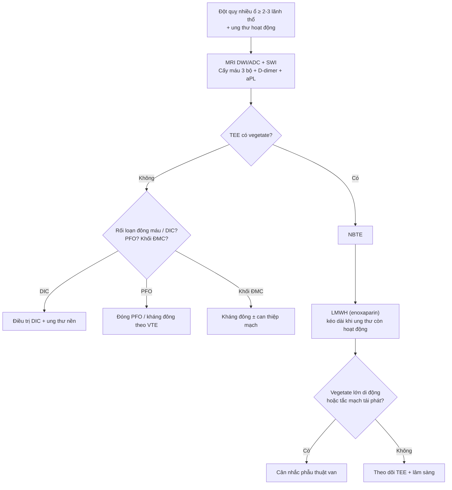
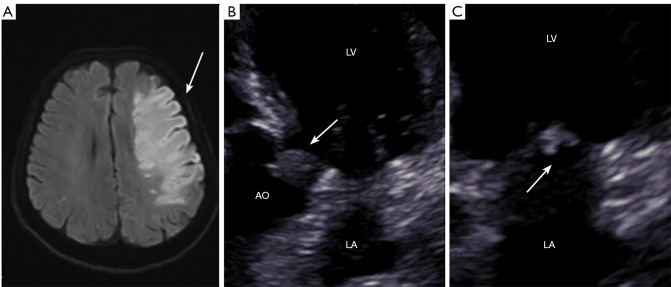
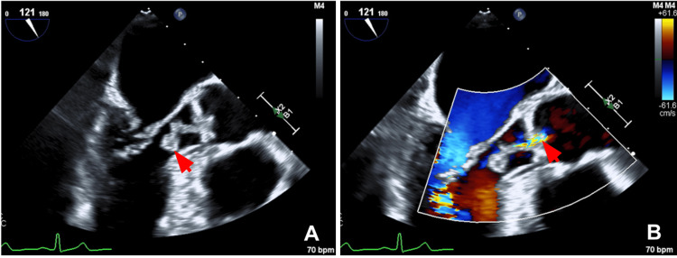
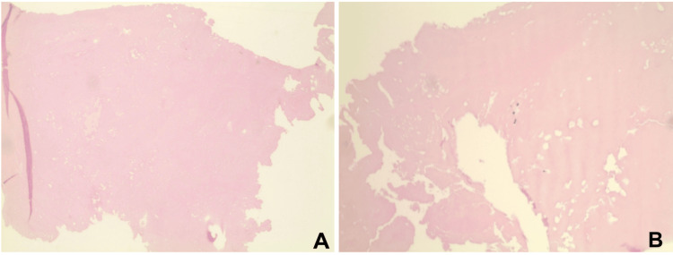

# 1712 — Trousseau thể ĐỘNG MẠCH: nhồi máu não nhiều ổ & viêm nội tâm mạc không nhiễm khuẩn (arterial Trousseau / NBTE)

**Tags:** `pattern:nhoi-mau-nao` `pattern:nhieu-o` `pattern:vegetate` `vung:nao` `vung:tim` `score:TOAST` `protocol:MRI-DWI` `protocol:TEE` `protocol:PET-CT` `incidentaloma:khong`

**Mức chắc chắn (certainty):** tổng hợp y văn (literature synthesis) — **1 phân tích hệ thống 163 bệnh nhân NBTE** (*Anatol J Cardiol* 2022, PMC9623215, CC BY-NC 4.0), **1 tổng quan cơ chế/điều trị đột quỵ do ung thư** (*J Stroke* 2024, PMC11164583, CC BY-NC 4.0), **1 tổng quan hệ thống 82 nghiên cứu về đột quỵ do rối loạn đông máu do ung thư** (*J Neurol* 2026, PMC13590450, CC BY 4.0), **1 ca nguyên văn có ảnh TEE + mô bệnh** (*Cureus* 2026, PMC13020894, CC BY 4.0), **1 loạt 3 ca Trousseau–NBTE có ảnh MRI/TEE** (*Quant Imaging Med Surg* 2026, PMC12971317, CC BY-NC-ND 4.0) và **1 ca NBTE có TTE âm/TEE dương** (*Cureus* 2026, PMC13566118, CC BY 4.0). Nhóm **không có bệnh nhân của mình**; chỗ số liệu bài gốc không nhất quán được ghi rõ.

> **Câu chốt:** ở bệnh nhân ung thư, **đột quỵ nhiều ổ ở nhiều lãnh thổ mạch** không phải "đột quỵ thông thường" — đó là **thuyên tắc rải rác từ một nguồn tim**: **NBTE chiếm 20–25% các tai biến mạch máu não ở người ung thư** và được tìm thấy **1,2%** trong tử thiết (PMC9623215). Ba số phải thuộc: **(1)** **30% tử vong trong viện** ở 163 ca NBTE (PMC9623215); **(2)** NBTE có **80% tử vong và 50% tái phát đột quỵ trong 6 tháng** (PMC11164583 dẫn y văn); **(3)** **enoxaparin tái phát 3,4% (1/29) so với warfarin 16,0% (8/50)** và D-dimer giảm **3,88 so với 17,42 µg/mL** (p = 0,026) (PMC11164583). Nghĩa là: **nghi NBTE → làm TEE (không phải TTE) → tìm ung thư ẩn → kháng đông bằng LMWH, không chờ cấy máu**.

## 1. Tổng quan bệnh học – cơ chế hình ảnh

### 1.1 Vì sao "vegetate vô khuẩn" lại gây thuyên tắc — và vì sao cấy máu âm

- **NBTE (nonbacterial thrombotic endocarditis, còn gọi marantic endocarditis)** là **cục huyết khối tiểu cầu–fibrin vô khuẩn** bám trên **đường đóng của van** (line of closure), nơi dòng chảy xoáy + tổn thương nội mạc do cytokine/kháng thể. Bệnh nền hay gặp: **ung thư (~80% ca NBTE)**, **hội chứng kháng phospholipid (APS)** và **lupus (SLE)** (PMC9623215).
- Vì tổn thương **không có bạch cầu/vi khuẩn**, bệnh nhân **không sốt điển hình** và **cấy máu âm** — khác hoàn toàn viêm nội tâm mạc nhiễm khuẩn (IE). Mô bệnh của ca Weber: **khối fibrin đồng nhất, không tế bào, không viêm, không vi sinh vật** (PMC13020894, Fig. 2).
- Nhưng cục huyết khối **rất giòn (friable)**: bong ra thành nhiều mảnh nhỏ → **nhiều ổ nhồi máu ở nhiều lãnh thổ khác nhau cùng lúc**. Đây là **cơ chế vật lý** của dấu hiệu "nhiều ổ": một động mạch không thể tạo ra hai ổ nhồi máu ở hai bán cầu và hai hệ tuần hoàn (trước + sau) cùng một thời điểm.
- **TẠI SAO DWI sáng:** thiếu máu cấp → bơm Na⁺/K⁺-ATPase thất bại → phù độc tế bào (cytotoxic edema) → nước chuyển nội bào → **khuếch tán bị hạn chế**: **DWI tăng tín hiệu, ADC giảm**. Tổn thương **< 4,5 giờ** đã dương trên DWI, trước khi T2/FLAIR đổi tín hiệu; vì vậy DWI là **bản đồ phân bố lãnh thổ**, không chỉ là "phát hiện nhồi máu".
- **TẠI SAO TEE thấy mà TTE không:** vegetate NBTE **nhỏ, dẹt, di động**, thường **< 1 cm**; đầu dò TEE **tần số cao (5–7 MHz)** nằm sát van (thực quản sau nhĩ trái), trong khi TTE **2–5 MHz** phải xuyên sườn/phổi. Trong ca Rao, **TTE hoàn toàn không thấy vegetate**, **TEE thấy 2 tổn thương trên van động mạch chủ** (PMC13566118); trong 163 ca, vegetate chỉ được thấy **khi tử thiết ở 24 ca** (PMC9623215).

### 1.2 Dịch tễ — ba bộ số cần nhớ

- **163 ca NBTE** (141 báo cáo ca + 10 loạt ca): tuổi trung bình **46 ± 17**, **69% nữ**; **đột quỵ là biểu hiện đầu tiên ở 54%**, và **70% có đột quỵ trong quá trình bệnh**; **ung thư 46,6%**, **APS 36,2%**, **SLE 22%**; ung thư hay gặp: **phổi 23,6%**, **buồng trứng 15,8%**, **tụy 13,3%** (PMC9623215).
- **Van bị ảnh hưởng:** **hai lá 66,7%**, **động mạch chủ 35%**, **ba lá 9,2%** (PMC9623215) — nghĩa là **van trái chiếm ưu thế**, và thể van ba lá sẽ biểu hiện bằng **thuyên tắc phổi** chứ không phải đột quỵ.
- **Tỉ lệ tử vong:** **30% trong viện** (PMC9623215); trong đột quỵ do ung thư nói chung, tử vong **30 ngày 25–50%** (PMC13590450). NBTE là **dấu hiệu tiên lượng rất xấu**: **80% tử vong, 50% tái phát trong 6 tháng** (PMC11164583 dẫn y văn).
- **Bộ số "nhiễm" cần biết:** **nhồi máu lách/thận 19%**, **suy tim 18%**, **nhồi máu cơ tim 14,7%**, **thiếu máu chi cấp 12%** trong cùng 163 ca (PMC9623215) — tức NBTE là bệnh **toàn thân**, không chỉ não.

### 1.3 Một mâu thuẫn trong chính bài gốc (ghi để không chọn bừa)

- Bài phân tích hệ thống ghi **hai bộ tỉ lệ phát hiện vegetate**: phần "Highlights/Results" ghi **TTE 27% (44 ca), TEE 41,1% (67 ca)** (tính trên toàn bộ 163 ca), còn phần "Results" ghi **TTE 42,9%, TEE 58,3%** (tính trên số ca thực sự được làm siêu âm) (PMC9623215). **Cả hai đều đúng với mẫu số khác nhau**; bài này dùng **44/163 = 27%** và **67/163 = 41,1%** khi nói về toàn bộ đoàn hệ, và ghi rõ **24 ca chỉ phát hiện khi tử thiết**.
- **Ý nghĩa thực hành:** ngay cả trong một đoàn hệ được làm siêu âm, **~1/5 vegetate chỉ thấy khi mổ tử thi** — tức **TEE âm không loại trừ NBTE** nếu bệnh cảnh phù hợp.

## 2. Mẫu hình + chẩn đoán phân biệt theo vị trí (gamut)

### 2.1 Gamut theo SỐ LÃNH THỔ nhồi máu trên DWI

- **Một lãnh thổ, một ổ:** xơ vữa động mạch lớn, bóc tách, bệnh mạch máu nhỏ, bệnh mạch máu do xạ — **không phải NBTE** (NBTE gây thuyên tắc rải rác).
- **Nhiều ổ, nhiều lãnh thổ (≥ 2, đặc biệt ≥ 3 — "three territories sign"):** **NBTE**, **DIC/vi huyết khối do ung thư**, **thuyên tắc nghịch (paradoxical embolism qua PFO)**, **thuyên tắc nhiễm khuẩn**, **viêm mạch**, **hạ huyết áp toàn thân** (ổ ở vùng ranh giới).
- **Nhiều ổ nhưng cùng một hệ động mạch:** thuyên tắc từ mảng xơ vữa động mạch cảnh/động mạch chủ, **thrombus trong quai động mạch chủ ở bệnh nhân ung thư** (PMC12790225).
- **Nhồi máu hai bên + tổn thương đồi thị:** nghĩ **thuyên tắc từ tim** hoặc **huyết khối xoang tĩnh mạch sâu** (thể khác).

### 2.2 Gamut theo VAN bị tổn thương (khi TEE thấy vegetate)

- **Van hai lá (66,7%)** → thuyên tắc não/lách/thận.
- **Van động mạch chủ (35%)** → thuyên tắc não, mạch vành, chi.
- **Van ba lá (9,2%)** → **thuyên tắc phổi** (bệnh cảnh hô hấp, không đột quỵ).
- **Van nhân tạo** → phân biệt **huyết khối van cơ học** (cần siêu âm cạnh giường/fluoroscopy) với NBTE; ca APS + van cơ học đã được báo cáo (PMC13007521).

### 2.3 Gamut theo BỆNH NỀN (quyết định điều trị)

- **Ung thư tiến triển/di căn** — 80% NBTE; **di căn gặp ở 69,2–83,3%** bệnh nhân đột quỵ do ung thư sau khi loại trừ nguyên nhân thông thường (PMC11164583).
- **APS/kháng phospholipid** — 36,2% trong đoàn hệ NBTE; hình ảnh **không phân biệt được** với NBTE do ung thư, phải **xét nghiệm aPL** (PMC9623215).
- **SLE** — 22%; tổn thương van kiểu **Libman–Sacks**.
- **DIC** — vừa huyết khối vừa chảy máu; D-dimer tăng, fibrinogen giảm, tiểu cầu giảm.

## 3. Bảng so sánh phân biệt (ma trận đối chiếu)

| Thực thể (entity) | Hình ảnh điển hình | Chốt vào (rule-in) | Chốt loại (rule-out) | Gợi ý xác nhận |
|---|---|---|---|---|
| **NBTE do ung thư** | DWI **nhiều ổ ≥ 2–3 lãnh thổ**; vegetate nhỏ trên đường đóng van; **cấy máu âm**; D-dimer rất cao | **Nhiều lãnh thổ + vegetate + cấy âm + ung thư hoạt động** | Vegetate lớn phá hủy van + cấy dương → IE; 1 ổ đơn độc → nguyên nhân khác | **TEE** (không phải TTE), cấy máu 3 bộ, D-dimer, CT ngực/bụng/chậu |
| **Viêm nội tâm mạc nhiễm khuẩn (IE)** | Vegetate **lớn, không đều**, di động; **áp-xe/ phá hủy van**; ổ nhồi máu có thể nhiều | **Cấy máu dương + sốt + vegetate lớn** | Cấy âm 3 bộ + vegetate nhỏ + bệnh ung thư → NBTE | Cấy máu trước kháng sinh; TEE; PET/CT khi nghi áp-xe |
| **Libman–Sacks/APS** | Vegetate nhỏ, dẹt, **hai lá**; có thể kèm huyết khối động mạch/tĩnh mạch | **aPL dương + tiền sử huyết khối/sảy thai** | aPL âm + ung thư hoạt động → NBTE | Lupus anticoagulant, anti-cardiolipin, anti-β2GPI (2 lần cách ≥ 12 tuần) |
| **DIC/vi huyết khối do ung thư** | Nhiều ổ nhỏ **vùng ranh giới**; không vegetate; rối loạn đông máu | **Fibrinogen giảm, tiểu cầu giảm, D-dimer tăng, PT kéo dài** | Không có rối loạn đông máu → NBTE | Đông máu toàn bộ + phết máu |
| **Thuyên tắc nghịch (PFO)** | Nhiều ổ + **huyết khối tĩnh mạch sâu/PE**; có thể thấy PFO | **VTE + PFO trên siêu âm cản quang** | Không VTE, không PFO → NBTE | Siêu âm tim cản quang/bubble study, siêu âm Doppler chi dưới |
| **Thrombus quai động mạch chủ** | Nhồi máu **một hoặc nhiều lãnh thổ** nhưng **khối trong quai ĐMC** trên CTA | **Khối trong lòng ĐMC + không vegetate** | Vegetate van + không khối ĐMC → NBTE | CTA ngực; TEE |
| **Bệnh mạch máu do xạ** | Hẹp **dài, nhẵn, không vôi**, trong trường chiếu; 1 lãnh thổ | **Tiền sử xạ + hẹp trong trường chiếu** | Nhiều lãnh thổ ngoài trường chiếu → NBTE | CTA/MRA; so phim xạ trị |

## 4. Protocol chẩn đoán + nguyên tắc điều trị

### 4.1 Trình tự chẩn đoán (không bỏ bước nào)

1. **MRI não:** DWI + ADC + **SWI** (loại trừ chảy máu, vi chảy máu, di căn) + MRA/CTA. Đếm **số lãnh thổ** và ghi **"three territories sign"**.
2. **Siêu âm tim qua thực quản (TEE)** — **không dừng ở TTE**; nếu TEE âm mà nghi cao, **lặp TEE** sau vài ngày (vegetate có thể bong đi rồi tái tạo).
3. **Cấy máu 3 bộ trước kháng sinh** + **D-dimer**, công thức máu, đông máu, **aPL**.
4. **Tìm ung thư ẩn:** CT ngực/bụng/chậu có cản quang (đồng thời tìm **nhồi máu lách/thận — 19%**, di căn), **PET/CT** khi CT âm mà nghi cao.
5. **Đánh giá toàn thân:** nhồi máu cơ tim (troponin/ECG), thiếu máu chi, thuyên tắc phổi (CTA phổi nếu nghi).

### 4.2 Phân tầng và điều trị

- **Kháng đông:** **LMWH là lựa chọn thực hành**; bằng chứng tốt nhất là **enoxaparin so với warfarin**: tái phát **1/29 (3,4%)** so với **8/50 (16,0%)**, D-dimer sau điều trị **3,88 so với 17,42 µg/mL** (p = 0,026) (PMC11164583). **DOAC** chưa chứng minh vượt LMWH (nhóm NOAC so LMWH: tái phát **57% vs 49%**, p = 0,096); **UFH** tốt hơn DOAC trong một nghiên cứu nhỏ (**4% vs 31%**, p = 0,008) (PMC11164583).
- **Thời gian:** **kéo dài khi ung thư còn hoạt động** — không có mốc "3–6 tháng" cố định; ngừng kháng đông phải cân nhắc **nguy cơ chảy máu não (di căn não, SWI có vi chảy máu)**.
- **Phẫu thuật van:** trong 163 ca, **11,7% thay van cơ học**, **8,5% van sinh học**, **7,3% cắt vegetate** (PMC9623215); ca Weber **khối 1,8 cm di động** được mổ sớm để ngăn thuyên tắc (PMC13020894). **Chỉ định chưa được chuẩn hóa** — cân nhắc khi **vegetate lớn/di động + tắc mạch tái phát dù đã kháng đông**.
- **Điều trị ung thư nền** là phần quan trọng nhất: NBTE là **dấu hiệu bệnh tiến triển**, không phải bệnh van đơn thuần.

### 4.3 Theo dõi

- **TEE lặp** sau 1–2 tuần và khi có biến cố mới; **MRI não lặp** nếu lâm sàng xấu.
- **D-dimer** dùng để theo dõi đáp ứng (giảm khi hiệu quả) nhưng **không có ngưỡng tuyệt đối** được chuẩn hóa — số liệu bài gốc: **3,88 vs 17,42 µg/mL** ở 2 nhóm điều trị (PMC11164583).
- Theo dõi **nhồi máu lách/thận** trên CT bụng nếu đau bụng/sốt.

## 5. Biến thể bình thường và cạm bẫy

- **TTE âm không loại trừ NBTE:** ca Rao có **TTE bình thường**, **TEE thấy 2 vegetate** trên van động mạch chủ (PMC13566118); **27% vegetate chỉ thấy khi tử thiết** (PMC9623215). Nếu nghi cao → **TEE, rồi lặp TEE**.
- **Sốt ở bệnh nhân ung thư không đồng nghĩa nhiễm khuẩn:** "sốt do u" và NBTE có thể cùng tồn tại; **cấy máu âm 3 bộ** mới đủ để nghiêng về NBTE, nhưng **đã dùng kháng sinh trước đó** làm cấy âm giả.
- **Vegetate "biến mất" sau thuyên tắc:** cục huyết khối bong đi → TEE âm; **không kết luận "không có NBTE"** nếu DWI vẫn nhiều ổ và D-dimer rất cao.
- **"Nhiều ổ" không phải đặc quyền của NBTE:** rung nhĩ + mảng xơ vữa quai ĐMC, viêm mạch, DIC đều cho hình ảnh tương tự; **bối cảnh ung thư + vegetate + cấy âm** mới chốt.
- **APS/Libman–Sacks không phân biệt được bằng hình ảnh:** **36,2%** đoàn hệ NBTE có APS (PMC9623215) — phải làm **aPL**, vì điều trị và tiên lượng khác.
- **Kháng đông ở bệnh nhân có di căn não:** nguy cơ **chảy máu nội sọ**; trước khi kháng đông mạnh, cần **MRI/SWI** và cân nhắc **lọc màng/IVC filter** nếu chống chỉ định.
- **"Satisfaction of search":** thấy vegetate là dừng → **bỏ sót ung thư ẩn** (di căn 69,2–83,3% ca đột quỵ do ung thư) và **bỏ sót nhồi máu lách/thận** (19%) — phải chụp **ngực–bụng–chậu**.
- **Đừng nhầm với IE chỉ vì có vegetate:** IE có **phá hủy van, áp-xe, cấy dương**; NBTE **không phá hủy** nhưng vẫn có thể gây hở van (ca Weber: hở nhẹ).

## 6. Tự lượng giá — Blind Quiz

**Ca 1 — Nữ 57 tuổi, ung thư dạ dày, đột ngột yếu nửa người. Nhìn MRI trước, mô tả trước.**

- Gợi ý lâm sàng: ung thư dạ dày tiến triển, đột quỵ cấp, không sốt, cấy máu âm.
- Câu hỏi: (1) Ổ nhồi máu nằm ở đâu, có **mấy lãnh thổ**? (2) Hình B và C là gì, thấy gì? (3) Chẩn đoán và bước tiếp theo?

<b>Bấm để hiện đáp án (findings + chẩn đoán)</b>

- **Findings:** (A) MRI (FLAIR/DWI) — **ổ nhồi máu lớn bán cầu trái** (mũi tên), lan vỏ–dưới vỏ; (B) TTE trục dài — **vegetate bám van động mạch chủ** (mũi tên), cạnh nhĩ trái/thất trái; (C) TTE — **vegetate van hai lá** (mũi tên).
- **Chẩn đoán:** **NBTE (Trousseau thể động mạch)** với vegetate **hai van** (ĐMC + hai lá) ở bệnh nhân ung thư dạ dày; đột quỵ do thuyên tắc.
- **Bước tiếp theo:** **TEE** để đánh giá van chính xác, **cấy máu 3 bộ**, **D-dimer**, **aPL**, **CT ngực–bụng–chậu** tìm di căn/nhồi máu tạng; khởi động **LMWH** nếu không có chống chỉ định.
- **Nguồn ảnh:** Tang H, Zhang W, Liang C, Li S, Wu J, *Quant Imaging Med Surg* 2026, PMC12971317 Fig. 4 — **CC BY-NC-ND 4.0**, nguyên bản, không chỉnh sửa.

**Ca 2 — Nữ 65 tuổi, đau ngực, troponin âm, siêu âm tim qua thực quản có khối trên van. Xem ảnh.**

- Câu hỏi: (1) Mô tả khối trên van? (2) Có phải viêm nội tâm mạc nhiễm khuẩn? (3) Vì sao cấy máu âm mà vẫn chẩn đoán NBTE?

<b>Bấm để hiện đáp án</b>

- **Findings:** (A) TEE trục dài — **khối di động 1,8 cm bám van động mạch chủ** (mũi tên); (B) Doppler màu thì tâm trương — **dòng hở van động mạch chủ nhẹ** (mũi tên).
- **Chẩn đoán:** **NBTE** — khối **di động, không phá hủy van**, cấy máu âm, không sốt; mô bệnh sau mổ là **fibrin vô khuẩn** (Fig. 2).
- **Vì sao không phải IE:** vegetate NBTE **nhỏ–vừa, fibrin–tiểu cầu, không viêm**; IE thường **lớn, không đều, phá hủy van/áp-xe**, cấy dương. Tuy vậy **phân biệt trên hình ảnh không tuyệt đối** — cần cấy máu + bệnh cảnh.
- **Nguồn ảnh:** Weber P, Govil D, Bradley C, Lynch S, *Cureus* 2026;18(2):e104191, PMC13020894 Fig. 1 — **CC BY 4.0**, nguyên bản.

**Ca 3 — Cùng bệnh nhân ca 2, kết quả mô bệnh sau mổ van.**

- Câu hỏi: (1) Mô bệnh mô tả gì? (2) Vì sao đây là bằng chứng "vô khuẩn"? (3) Điều này thay đổi điều trị thế nào?

<b>Bấm để hiện đáp án</b>

- **Findings:** (A, B) H&E — **khối fibrin đồng nhất, không tế bào**, **không thâm nhiễm viêm**, **không thấy vi sinh vật**.
- **Vì sao "vô khuẩn":** không có bạch cầu/vi khuẩn → không phải IE; đây là **huyết khối tiểu cầu–fibrin** điển hình của NBTE.
- **Điều trị:** **không kháng sinh kéo dài**; **kháng đông (LMWH)** + **điều trị ung thư nền**; phẫu thuật khi vegetate lớn/di động hoặc tắc mạch tái phát.
- **Nguồn ảnh:** Weber P et al., *Cureus* 2026, PMC13020894 Fig. 2 — **CC BY 4.0**, nguyên bản.

## Bài liên quan chéo
- [1693 – Thrombophlebitis migrans (Trousseau thể TĨNH MẠCH)](../1693-thrombophlebitis-migrans-trousseau/lesson.md) (cùng bệnh nhân ung thư, thể tĩnh mạch)
- [211 – Đột quỵ não](../211-dot-quy-nao/lesson.md) (đọc DWI/ADC, phân bố lãnh thổ)
- [200 – Tổng quan hệ Thần kinh](../200-tong-quan-he-than-kinh/lesson.md)
- [1435 – Hội chứng masquerade nội nhãn: u lympho & viêm "giả u"](../1435-hoi-chung-masquerade-u-lympho-noi-nhan/lesson.md) (bệnh ác tính biểu hiện như viêm — cùng nguyên lý "không đáp ứng điều trị thường")
- [1904 – Thuyên tắc phổi nhiễm khuẩn ở bụng–chậu](../1904-thuyen-tac-phoi-nhiem-khuan-o-bung-chau/lesson.md)

## Ảnh
- 3 ảnh: TEE + mô bệnh từ PMC13020894 (**CC BY 4.0**, nguyên bản), MRI + TTE từ PMC12971317 (**CC BY-NC-ND 4.0**, **nguyên bản, không crop/ghép/đổi màu**).
- Nguồn + giấy phép từng file trong `images/CREDITS.md`.

> Không dùng để chẩn đoán độc lập khi chưa có người hướng dẫn.
