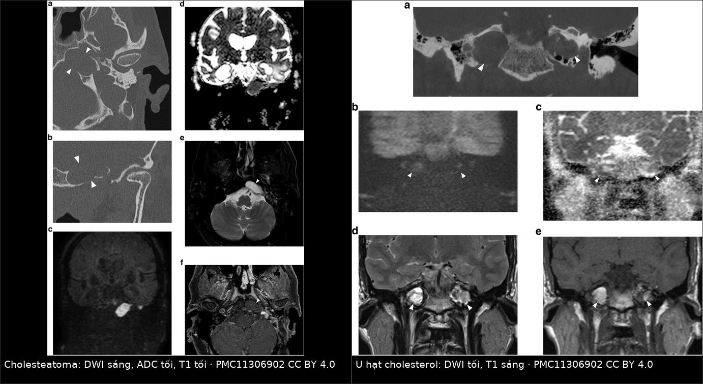
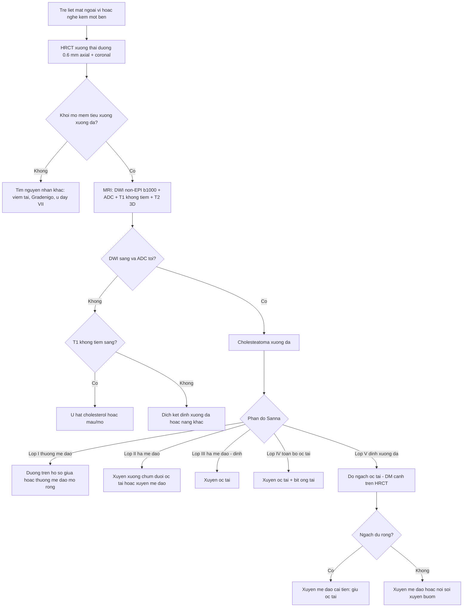
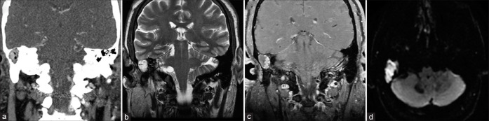
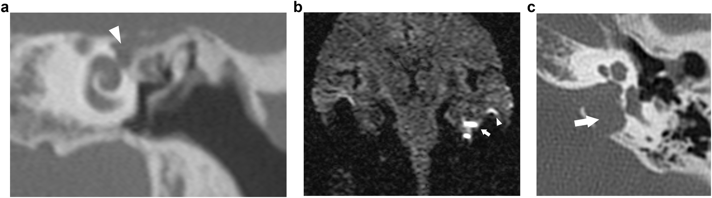

# 1713 — Cholesteatoma xương đá (petrous bone cholesteatoma) ở trẻ: "liệt mặt Bell" không phải Bell, phân độ Sanna và chỗ đứng của DWI không-EPI

**Tags:** `pattern:cholesteatoma` `pattern:tieu-xuong` `pattern:khoi-mo-mem-xuong-da` `pattern:han-che-khuech-tan` `pattern:liet-day-vii` `vung:xuong-da` `vung:oc-tai` `vung:ho-so-sau` `anatomy:oc-tai` `protocol:HRCT-xuong-thai-duong` `protocol:MRI-DWI-non-EPI` `score:Sanna`

**Mức chắc chắn (certainty):** tổng hợp y văn (literature synthesis) — ghép **tổng quan hình ảnh cholesteatoma bẩm sinh** (Insights Imaging 2024, PMC11306902, CC BY 4.0), **160 ca cholesteatoma xương đá có liệt dây VII được mổ** (Head Face Med 2025, PMC12117717), **tổng quan hệ thống 8 trẻ / 9 tổn thương đỉnh xương đá** (Surg Neurol Int 2022, PMC9699891), **khuyến cáo ESR Essentials về hình ảnh cholesteatoma tai giữa** (Eur Radiol 2025, PMC11913933), **18 ca đường thượng mê đạo mở rộng** (Eur Arch Otorhinolaryngol 2024, PMC11065940) và **đo đạc HRCT ngách ốc tai–động mạch cảnh** (J Otolaryngol Head Neck Surg 2026, PMC12905107). Không có ca do nhóm tự chụp.

> **Câu hỏi thực hành:** bé gái **9 tuổi**, **liệt mặt phải độ III House–Brackmann (H-B)** tiến triển **3 tuần**, **nghe kém phải** phát hiện khi kiểm tra thính lực học đường, **màng nhĩ liền, không chảy mủ, không đau tai**. Bác sĩ tuyến trước chẩn đoán **"liệt mặt Bell"** và cho corticoid 10 ngày, không đỡ. HRCT xương thái dương: **khối mô mềm bờ nhẵn, tiêu xương thượng mê đạo phải, kéo tới đỉnh xương đá**. Bố mẹ hỏi: *"Có phải do lạnh không? Chụp thêm gì nữa? Mổ có mất nghe không?"*
> Bài chốt **bốn việc**: **(1) ở trẻ, liệt mặt ngoại vi KHÔNG có bằng chứng viêm tai cấp/ herpes phải được chụp hình ảnh — cholesteatoma xương đá là nguyên nhân kinh điển nhưng hay bị gọi nhầm là Bell; (2) khối tiêu xương bờ nhẵn + DWI sáng + ADC tối là bộ ba chốt cholesteatoma, còn T1 sáng mới là u hạt cholesterol; (3) phân độ Sanna I–V không phải học thuộc — mỗi lớp quyết định một đường mổ và một mức đánh đổi thính lực; (4) liệt mặt đã kéo dài thì kết quả hồi phục phụ thuộc chủ yếu vào THỜI GIAN, không phải vào tay mổ.** Nối [1704 – Viêm tai giữa mạn & cholesteatoma ở trẻ có cấy ốc tai](../1704-vtg-man-cholesteatoma-tre-cay-oc-tai/lesson.md), [236 – Viêm tai xương chũm & biến chứng nội sọ](../236-viem-tai-xuong-chum-bien-chung-noi-so/lesson.md), [497 – Theo dõi sau cấy ốc tai ở trẻ](../497-theo-doi-sau-cay-oc-tai-tre/lesson.md).

## 1. Tổng quan bệnh học – cơ chế hình ảnh: vì sao keratin lại "sáng DWI mà tối T1"

- **Bản chất:** cholesteatoma xương đá (petrous bone cholesteatoma — PBC) là **nang biểu bì (epidermoid cyst)** — túi **biểu mô lát vảy sừng hóa** nằm **phía trong vỏ ốc tai (medial to the otic capsule)**, bong vảy keratin liên tục vào một khoang kín. Về mô học nó **giống hệt** cholesteatoma tai giữa; điều khác là **vị trí** và **hệ quả lên dây VII, mê đạo, ống tai trong, động mạch cảnh trong (ICA)**.
- **Nguồn gốc:** **bẩm sinh (congenital PBC)** khi xuất phát từ di tích biểu mô phôi thai (hay gặp quanh **hạch gối – geniculate ganglion**), hoặc **mắc phải** do cholesteatoma tai giữa lan vào. **PBC bẩm sinh chiếm 12–15% tổng số PBC**, tuổi chẩn đoán trung bình **38–46 tuổi** ở người lớn — nghĩa là **thể bẩm sinh vẫn có thể lặng lẽ tới tuổi trưởng thành**, và ở trẻ em thường chỉ lộ ra khi **đã có biến chứng**.
- **Dịch tễ học cần nhớ:** PBC **chiếm 4–9% mọi tổn thương xương đá**; cholesteatoma nói chung ở trẻ **3–6/100.000**; **lớp I (thượng mê đạo) chiếm khoảng một nửa** các ca.
- **TẠI SAO DWI sáng – ADC tối:** vảy keratin **xếp lớp, mất nước, rất nhớt** → nước trong tổn thương **không khuếch tán tự do**. Trên **DWI b1000** tổn thương **sáng**, trên **bản đồ ADC** **tối**. Đây là **hạn chế khuếch tán thật**, không phải "T2 shine-through" — nên **bắt buộc xem ADC**, và đây là lý do DWI **phân biệt được với mô hạt viêm, sẹo, dịch**.
- **TẠI SAO T1 tối:** keratin **không có mỡ, không có sản phẩm máu**, và ít proton tự do linh động → **T1 thấp hơn chất trắng**, T2 trung bình–cao. **Ngược lại, u hạt cholesterol (cholesterol granuloma)** có **T1 sáng** vì **xuất huyết vi thể lặp lại** trong một tế bào khí bị tắc → **methemoglobin** (sắt hóa trị 3, thuận từ) **rút ngắn T1**. Đây là **cặp phân biệt quan trọng nhất của đỉnh xương đá**, và là cạm bẫy số 1 khi chỉ đọc DWI.
- **TẠI SAO tiêu xương bờ nhẵn:** tổn thương **lớn chậm** gây **áp lực** + hoạt hóa **hủy cốt bào** (RANKL, IL-1, TNF-α) → xương tiêu **theo bờ cong mềm, có viền xơ mảnh**. Đây là **vùng chuyển tiếp hẹp** kiểu lành tính; **không có phản ứng màng xương, không có thành phần mô mềm xâm lấn ngoài xương**.
- **Ngưỡng định lượng bắt buộc nhớ:**
  - **ADC của cholesteatoma:** ngưỡng công bố **thay đổi theo kỹ thuật, dải 759–1.370 × 10⁻⁶ mm²/s** → **không dùng một con số tuyệt đối**, phải so **với mô não cùng lát** và **với bên đối diện** (PMC11913933).
  - **DWI không-EPI phát hiện được tổn thương 2–3 mm**; **giá trị tiên đoán dương/âm ≥ 89,8% và 80,5%** trong theo dõi tồn dư (PMC11913933).
  - **Tiêu xương thấy trên CT ở 50–97%** ca cholesteatoma; **tiêu xương con 82%**, hay nhất là **xương đe (incus)** (PMC11913933).
  - **Tổng quan 8 trẻ / 9 tổn thương đỉnh xương đá:** **nghe kém dẫn truyền 77%**, **thủng màng nhĩ 86%**, **tái phát 50%** với **thời gian tái phát trung bình 3,5 năm (SD 1,73)**, theo dõi **32,6 tháng (SD 21,7)**, **canal-wall up 60%**, **0 biến chứng phẫu thuật**, **5/7 trẻ (71%) có thủng nhĩ cải thiện thính lực** (PMC9699891). Cỡ mẫu **rất nhỏ** — đọc như **tín hiệu**, không phải tỷ lệ chuẩn.
  - **Loạt 160 ca PBC có liệt mặt** (trung bình **34,1 ± 13,5 tuổi**, dao động **5,58–77**): **thượng mê đạo 80 ca (50,0%)**, **toàn bộ ốc tai 53 (33,1%)**, **đỉnh 15 (9,4%)**, **hạ mê đạo–đỉnh 12 (7,5%)**; đường mổ hay dùng **trên hố sọ giữa 70 (43,8%)**, **xuyên ốc tai 27 (16,9%)**, **xuyên mê đạo 26 (16,3%)** (PMC12117717).

## 2. Mẫu hình + chẩn đoán phân biệt theo vị trí (gamut)

- **Mẫu hình cốt lõi:** **khối mô mềm bờ nhẵn, tiêu xương "khoét" ở xương đá, không có vôi hóa trong khối, không có phản ứng xương**; **DWI b1000 sáng, ADC tối, T1 tối, T2 trung bình–cao**; **không ngấm thuốc hoặc chỉ ngấm viền**.
- **Theo lớp giải phẫu (phân độ Sanna 1993 — vị trí quyết định đường mổ):**
  - **Lớp I — thượng mê đạo (supralabyrinthine):** **trên mê đạo xương**, hay **ôm hạch gối/đoạn nhĩ dây VII**, lan ra **trần nhĩ**. **Hay nhất (~50%)**, và **hay gây liệt mặt nhất** vì dây VII nằm ngay trong ổ bệnh.
  - **Lớp II — hạ mê đạo (infralabyrinthine):** **dưới mê đạo**, lan tới **ICA phía trước, hố sọ sau phía sau, ống tai trong–clivus phía trong, bóng cảnh–dây thần kinh sọ thấp phía dưới**.
  - **Lớp III — hạ mê đạo–đỉnh (infralabyrinthine-apical):** lớp II **vượt qua ICA ra trước** vào đỉnh xương đá.
  - **Lớp IV — toàn bộ (massive):** **toàn bộ vỏ ốc tai**, kết hợp **trên + dưới mê đạo**; gần như **luôn mất thính lực bên bệnh**.
  - **Lớp V — đỉnh (apical):** **khu trú ở đỉnh xương đá**, thường coi là **bẩm sinh**; **không đụng mê đạo** → về lý thuyết **giữ được nghe**, nhưng đường vào rất hẹp (xem mục 4).
- **Theo triệu chứng khởi phát (gamut "trẻ đến từ phòng khám nào"):**
  - **Nghe kém dẫn truyền + màng nhĩ liền** → nghĩ **thể bẩm sinh lớp I/II/V** (khác cholesteatoma tai giữa vì **không có túi co lõm**).
  - **Liệt mặt ngoại vi tiến triển** → **lớp I** hay gặp nhất; **chẩn đoán phân biệt bắt buộc** với **Bell, Ramsay–Hunt, u dây VII, viêm tai giữa biến chứng**.
  - **Chóng mặt + rò mê đạo** → tổn thương **đã ăn vào ốc tai/mê đạo** (lớp II–IV).
  - **Đau sau mắt + liệt dây VI + viêm tai** → **hội chứng Gradenigo** (viêm đỉnh xương đá — petrous apicitis): **không phải cholesteatoma**, nhưng là hàng phân biệt cấp cứu ở trẻ.
  - **Tình cờ trên MRI sọ** → **lớp V**, phải phân biệt với **dịch kẹt (trapped fluid)** và **u hạt cholesterol** trước khi nói tới mổ.
- **Gợi nhớ 5 lớp theo câu "Sống trên–dưới–vượt–nuốt–đỉnh":** **S**upralabyrinthine → **I**nfralabyrinthine → **I**nfralabyrinthine-apical → **M**assive → **A**pical = **S-I-I-M-A**; mẹo nhớ **"trên, dưới, dưới-xa, cả ốc tai, chỉ đỉnh"**.

## 3. Bảng so sánh phân biệt (ma trận đối chiếu)

| Thực thể (entity) | Hình ảnh điển hình (HRCT + MRI) | Chốt vào (rule-in) | Chốt loại (rule-out) | Gợi ý xác nhận |
|---|---|---|---|---|
| **Cholesteatoma xương đá (PBC)** | Khối mô mềm **bờ nhẵn tiêu xương**, **DWI b1000 sáng, ADC tối, T1 tối**, T2 trung bình–cao, **không ngấm thuốc** | **ADC tối + T1 tối + tiêu xương bờ nhẵn** | **T1 sáng mạnh** → không phải cholesteatoma (nghĩ u hạt cholesterol) | DWI không-EPI + ADC + HRCT; mô bệnh khi mổ |
| **U hạt cholesterol (cholesterol granuloma)** | **T1 TĂNG sáng cả khi không tiêm**, T2 rất sáng, **DWI tối/ADC cao**, khối **bờ nhẵn, đối xứng hai bên** hay gặp | **T1 sáng + DWI tối + ADC cao** | **T1 tối + DWI sáng** → cholesteatoma | MRI T1 không tiêm + T2; theo dõi nếu không triệu chứng |
| **Dịch kẹt đỉnh xương đá (trapped fluid / petrous apex effusion)** | **T1 tối, T2 rất sáng**, **không hạn chế khuếch tán**, **không tiêu xương, không làm rộng đỉnh**; thường kèm **viêm tai giữa cùng bên** | **T2 sáng + DWI tối + không tiêu xương** | **Có tiêu xương + DWI sáng** → bệnh tổ chức | Điều trị tai giữa rồi MRI lại 3–6 tháng |
| **Sụn thịt (chondrosarcoma) xương đá** | T2 **rất sáng, chia múi (lobulated)**, **vôi hóa "vòng cung" 50%**, ngấm thuốc **dạng vòng–cung** | **Vôi hóa + ngấm thuốc + bờ không đều** | **Không vôi hóa, không ngấm, DWI sáng đậm** → cholesteatoma | CT xương + MRI có cản từ; sinh thiết |
| **U dây thần kinh (schwannoma) ống tai trong** | **Làm rộng ống tai trong**, ngấm thuốc **đồng nhất**, T1 đồng tín hiệu, T2 sáng | **Ngấm thuốc đậm + rộng ống tai trong** | **Không ngấm thuốc** → không phải schwannoma | MRI T1 sau tiêm |
| **Viêm đỉnh xương đá (petrous apicitis / Gradenigo)** | **Ngấm thuốc màng não–xương**, có thể **ổ áp-xe hạn chế khuếch tán**, kèm **viêm tai giữa/xoang**, **liệt dây VI** | **Sốt + đau sau mắt + liệt VI + ngấm thuốc** | **Khối bờ nhẵn mạn tính không viêm** → u/nang | MRI có cản từ + kháng sinh; dẫn lưu nếu áp-xe |

*Trái — cholesteatoma lớp V: (a, b) HRCT khối tiêu xương bờ nhẵn ở đỉnh xương đá; (c) **DWI b1000 sáng**; (d) **ADC tối** (hạn chế khuếch tán thật); (e) T2 sáng; (f) T1 sau tiêm **không ngấm**. Phải — **u hạt cholesterol hai bên**: (a) tiêu xương bờ nhẵn đối xứng; (b) **DWI tối**; (c) **ADC cao**; (d) T2 rất sáng; (e) **T1 không tiêm đã sáng** (methemoglobin). Cùng một "khối đỉnh xương đá", hai bản chất hoàn toàn khác — và chỉ **cặp DWI + T1** mới tách được. Nguồn: Insights Imaging 2024 (PMC11306902), CC BY 4.0; ảnh ghép bằng `tools/make_composite.py`, giữ nguyên tỷ lệ.*

**Ba câu hỏi đọc ảnh theo thứ tự (không đảo):**
1. **Có tiêu xương không?** (HRCT) — không tiêu xương thì **gần như loại cholesteatoma**, nghĩ **dịch kẹt**.
2. **DWI b1000 có sáng và ADC có tối không?** — có → **cholesteatoma**; không → đi tiếp.
3. **T1 không tiêm có sáng không?** — sáng → **u hạt cholesterol** (hoặc máu/mỡ); tối → **dịch/nang khác**.

## 4. Protocol chụp + phân độ Sanna + ngưỡng xử trí dây VII

**HRCT xương thái dương (bắt buộc, là "bản đồ phẫu thuật"):**
- **Collimation 0,5–0,75 mm**, tái tạo **lát 0,3 mm**, **kernel xương**, cửa sổ xương rộng; **axial + coronal** (coronal để đọc **trần nhĩ, scutum, ốc tai, ống Fallope**). CBCT cho **độ phân giải 0,15–0,5 mm** với liều thấp hơn nhưng **dễ nhiễu do cử động** — cân nhắc ở trẻ nhỏ (PMC11913933).
- **Sáu điều phải ghi trong báo cáo:** (1) **lớp Sanna**; (2) **quan hệ với ốc tai – tiền đình – ống bán khuyên**; (3) **ống Fallope: đoạn nào mất vỏ, hạch gối có bị ôm**; (4) **ICA đoạn ngang/dọc và lỗ cảnh** (bóng cảnh cao); (5) **ống tai trong – bao dây VII/VIII**; (6) **trần nhĩ/trần xương đá** (nguy cơ rò dịch não tủy).

**MRI (bắt buộc để chốt bản chất, không thay HRCT):**
- **DWI không-EPI (non-EPI DWI: HASTE / PROPELLER / BLADE), lát 2–3 mm**, **b0 (hoặc b50) + b1000**, **cộng bản đồ ADC tính toán**; **T1 không tiêm**, **T2 3D CISS/SPACE** để định vị giải phẫu; **T1 sau tiêm** chỉ khi nghi u/viêm.
- **ADC định lượng:** đặt ROI trong phần đặc nhất của tổn thương, **so với chất trắng cùng lát và bên đối diện**; dải ngưỡng công bố **759–1.370 × 10⁻⁶ mm²/s** nên **không dùng số tuyệt đối** (PMC11913933).
- **Ghép ảnh (fusion) DWI + T2 3D** giúp định vị tổn thương **quanh ốc tai/ống Fallope** — đúng chỗ dao mổ đi qua.

**Phân độ Sanna 1993 (5 lớp) → đường mổ và đánh đổi thính lực:**

| Lớp | Vị trí | Đường mổ hay dùng | Thính lực |
|---|---|---|---|
| **I — thượng mê đạo** | Trên mê đạo xương, quanh hạch gối | **Trên hố sọ giữa (middle fossa)** hoặc **thượng mê đạo mở rộng qua xương chũm** | **Có thể giữ nghe** nếu ốc tai còn nguyên |
| **II — hạ mê đạo** | Dưới mê đạo, tới ICA/bóng cảnh | **Xuyên xương chũm – dưới ốc tai (infracochlear)** hoặc **xuyên mê đạo** | Thường **mất nghe** nếu đi xuyên mê đạo |
| **III — hạ mê đạo–đỉnh** | Vượt ICA vào đỉnh | **Xuyên ốc tai (transcochlear) / xuyên mê đạo** | **Mất nghe có kế hoạch** |
| **IV — toàn bộ** | Toàn bộ vỏ ốc tai | **Xuyên ốc tai + bịt ống tai (blind sac)** | **Mất nghe chắc chắn** |
| **V — đỉnh** | Khu trú đỉnh xương đá | **Xuyên mê đạo cải tiến (mở ngách ốc tai–ĐM cảnh)**, **nội soi qua bướm/xuyên clivus** | **Có thể giữ nghe** nếu ngách đủ rộng |

- **Ngách ốc tai–động mạch cảnh (cochlear–carotid recess):** tam giác **trước–trên ốc tai (TASC)** tiếp cận được qua nội soi tai **3 mm ở 80%** trường hợp; tam giác **trước–dưới (TAIC)** chỉ **62,5%** → **đo trước mổ trên HRCT** để biết có giữ được ốc tai hay không (PMC12905107).

**Ngưỡng xử trí dây VII (dữ liệu 160 ca PBC có liệt mặt — PMC12117717):**

| Tình huống | Can thiệp | Kết quả |
|---|---|---|
| **H-B III–IV, liệt < 12 tháng** | **Giải ép (decompression)** | **H-B I–II: 100% (22/22)** |
| **H-B V–VI, liệt < 2 tháng** | **Giải ép** | **H-B I–II: 88,9% (8/9)** |
| **Đứt/không còn dẫn truyền, < 12 tháng** | **Nối tận–tận / chuyển đường (rerouting)** | **H-B III: 77,8% (14/18)** |
| **Mất đoạn < 12 tháng** | **Ghép dây tai lớn (great auricular nerve)** | **H-B III: 75%** |
| **Liệt hoàn toàn kéo dài, không nối được** | **Nối dây hạ thiệt–mặt (hypoglossal–facial)** | **H-B IV: 58,3% (7/12)** |
| **Bất kỳ** | — | **Chức năng trước mổ kém và thời gian liệt dài = yếu tố tiên lượng xấu độc lập** |

- **Suy luận thực hành từ bảng trên:** thứ quyết định kết quả là **thời gian liệt**, không phải kỹ thuật — nên **"theo dõi Bell 3–6 tháng" ở trẻ có khối xương đá là sai lầm**, vì cửa sổ **< 12 tháng (tốt nhất < 2 tháng với liệt nặng)** trôi qua trong lúc chờ.

**Theo dõi sau mổ:** **MRI DWI không-EPI + nội soi tai** là trụ cột; **CT rất kém** trong phát hiện tồn dư vì mô mềm hậu phẫu (dịch, sẹo, mỡ vá) không phân biệt được với cholesteatoma. **Thời điểm phát hiện tồn dư/tái phát trung bình khoảng 3 năm** ở cholesteatoma mắc phải → **chụp 6–12 tháng, sau đó hằng năm tới 3–5 năm**; **trẻ có bệnh lan rộng vẫn có thể phải mổ nhìn lại (second look)** dù MRI âm tính (PMC11913933, PMC11306902).

## 5. Biến thể bình thường và cạm bẫy

- **Cạm bẫy 1 — "Bell ở trẻ":** liệt mặt ngoại vi ở trẻ **hiếm khi vô căn** so với người lớn và **luôn phải loại bệnh tai – xương đá**. Quy tắc an toàn: **liệt mặt + nghe kém cùng bên + màng nhĩ liền** → **HRCT xương thái dương**, không chờ.
- **Cạm bẫy 2 — chỉ đọc DWI, không đọc T1:** **u hạt cholesterol, mỡ vá, sáp tai (cerumen), silastic, mô hạt, mủ** đều có thể **sáng trên DWI không-EPI** → **dương tính giả**. **Bộ ba bắt buộc: DWI + T1 không tiêm + T2 3D**; **T1 sáng** là dấu hiệu **loại** cholesteatoma mạnh nhất (PMC11913933).
- **Cạm bẫy 3 — "đỉnh xương đá bất đối xứng" trên MRI:** **tủy xương đỉnh còn mỡ** bên này và **đặc (marrow)** bên kia là **biến thể bình thường**, **T1 sáng, không tiêu xương, không hạn chế khuếch tán** — đừng gọi là tổn thương. Đối chiếu **HRCT**: không tiêu xương = không bệnh tổ chức.
- **Cạm bẫy 4 — dịch kẹt sau viêm tai:** **T2 rất sáng, T1 tối, DWI tối**, **không tiêu xương**; đa số **tự hết** khi tai giữa thông thoáng. Chỉ **MRI lại sau 3–6 tháng** nếu còn triệu chứng; **đừng mổ đỉnh xương đá vì "khối tăng T2"**.
- **Cạm bẫy 5 — mỡ vá sau mổ giống tồn dư:** mỡ bụng **T1 sáng, T2 sáng, không hạn chế khuếch tán**; cholesteatoma tồn dư **T1 tối, DWI sáng**. Vì thế **đọc MRI sau mổ phải có T1 không tiêm**, và **so với MRI nền ngay sau mổ**.
- **Cạm bẫy 6 — mất nghe "không giải thích được" sau mổ lớp I:** nguyên nhân hay gặp là **làm tổn thương ốc tai khi khoan quanh bao ốc tai** hoặc **rò mê đạo không nhận ra**; trên hình hậu phẫu thấy **mất tín hiệu dịch mê đạo trên T2 3D/CISS** — dấu hiệu **mất dịch nội dịch**, không phải tồn dư.
- **Biến thể bình thường dễ nhầm:** **đỉnh xương đá khí hóa một bên** (không đối xứng) · **bóng cảnh cao** (đổi đường mổ, không phải bệnh) · **xoang sigma trước** · **ống tai trong hẹp bẩm sinh** · **màng nhĩ dày do sẹo** ở trẻ đã từng đặt ống thông khí.

## 6. Tự lượng giá — Blind Quiz

**Ca 1 — Nam 17 tuổi, chảy mủ tai phải sau chấn thương, nghe kém tiến triển:**

- Gợi ý: khối **2 cm** vùng **ống tai ngoài đoạn trong/đỉnh xương đá**; không có tiền sử viêm tai mạn rõ.
- Câu hỏi: (1) Khối nằm ở đâu và **có tiêu xương không**? (2) Ảnh (d) là chuỗi xung gì, và **tín hiệu đó nói gì**? (3) Nếu đây là trẻ **chưa có liệt mặt**, có được theo dõi không?

<b>Bấm để hiện đáp án (findings + chẩn đoán)</b>

- **Vị trí/tiêu xương:** khối **mô mềm bờ nhẵn** ở **phần trong ống tai ngoài, lan vào xương đá**, **tiêu xương kiểu khoét** — vùng chuyển tiếp **hẹp**, không phản ứng màng xương.
- **(d) là DWI b1000:** **sáng đậm**, tương ứng **hạn chế khuếch tán** của keratin → **cholesteatoma** (không phải dịch, không phải mô hạt).
- **Có theo dõi được không:** tổn thương **đã tiêu xương và có triệu chứng (chảy mủ, nghe kém)** → **không theo dõi đơn thuần**; **mổ lấy bệnh là điều trị chuẩn**. Theo dõi chỉ dành cho **khối nhỏ, không triệu chứng, không tiêu xương tiến triển** ở người lớn.
- **Phản biện nguồn:** đây là **ca trong tổng quan hệ thống** (n = 8 trẻ), tác giả ghi nhận **khởi phát sau chấn thương** — **không điển hình** cho cholesteatoma bẩm sinh (thường không có tiền sử chấn thương); nhiều khả năng **bệnh có sẵn, chấn thương chỉ làm lộ triệu chứng**. Không sửa nguồn, chỉ ghi chú.
- Nguồn ảnh: Surg Neurol Int 2022 (PMC9699891), **CC BY-NC-SA 4.0** — nguyên bản, không chỉnh sửa.

**Ca 2 — Nữ 55 tuổi, liệt mặt trái đột ngột, điếc trái lâu năm:**

- Gợi ý: màng nhĩ liền; không đau, không chảy mủ; liệt mặt **ngoại vi** hoàn toàn.
- Câu hỏi: (1) Tổn thương **lớp Sanna** nào? (2) Vì sao **liệt mặt** lại là triệu chứng hay gặp của lớp này? (3) Đường mổ nào cho phép **giữ nghe**, và điều kiện để chọn đường đó là gì?

<b>Bấm để hiện đáp án</b>

- **(a) Coronal CT:** khối mô mềm **ngay trên mê đạo xương**, bờ nhẵn, **không phá ốc tai** → **lớp I — thượng mê đạo (supralabyrinthine)**.
- **(b) DWI b1000:** **sáng** ở cùng vị trí → **hạn chế khuếch tán** = cholesteatoma. **(c) Axial CT:** khối **ôm mặt trước ống Fallope/hạch gối**.
- **Vì sao liệt mặt:** lớp I **nằm sát hạch gối và đoạn nhĩ dây VII** — dây VII là cấu trúc **giải phẫu bị vây quanh đầu tiên**, nên **liệt mặt là dấu hiệu đặc trưng** của lớp này (và hay bị chẩn đoán nhầm là Bell).
- **Đường mổ giữ nghe:** **trên hố sọ giữa** hoặc **thượng mê đạo mở rộng qua xương chũm** — **điều kiện**: **ốc tai và mê đạo còn nguyên trên HRCT**, **còn nghe hữu ích bên bệnh**, và **dây VII còn dẫn truyền** (nếu phải chuyển đường dây VII thì cân nhắc lại).
- Nguồn ảnh: Insights Imaging 2024 (PMC11306902), **CC BY 4.0**.

**Ca 3 — Nam 34 tuổi, chụp MRI sọ vì đau đầu, phát hiện tổn thương đỉnh xương đá HAI BÊN:**

- Gợi ý: **không liệt mặt, không nghe kém mới**, tổn thương **đối xứng hai bên**, bờ nhẵn.
- Câu hỏi: (1) Bên phải ảnh ghép — **DWI và T1** nói gì? (2) Vì sao **T1 sáng** mà không cần tiêm thuốc? (3) Có mổ không?

<b>Bấm để hiện đáp án</b>

- **DWI tối, ADC cao** (không hạn chế khuếch tán) và **T1 không tiêm đã sáng** → **u hạt cholesterol (cholesterol granuloma)**, **không phải cholesteatoma**.
- **Vì sao T1 sáng:** xuất huyết vi thể lặp lại trong tế bào khí bị tắc → **methemoglobin** (sắt hóa trị 3, thuận từ) **rút ngắn thời gian T1** → tăng tín hiệu **nội tại**, không liên quan cản từ.
- **Có mổ không:** **tổn thương hai bên, không triệu chứng, không tiêu xương tiến triển** → **theo dõi MRI**; can thiệp (dẫn lưu/mở thông) chỉ khi **đau đầu không kiểm soát, liệt mặt, chóng mặt, hoặc chèn ép**.
- **Bài học:** **"khối đỉnh xương đá hai bên" gần như luôn là u hạt cholesterol hoặc dịch kẹt**, không phải cholesteatoma — và **T1 là chìa khóa**, DWI chỉ là cửa phụ.
- Nguồn ảnh: Insights Imaging 2024 (PMC11306902), **CC BY 4.0**; ảnh ghép giữ nguyên tỷ lệ, có dải attribution.

## Bài liên quan chéo
- [1704 – Viêm tai giữa mạn & cholesteatoma ở trẻ có cấy ốc tai](../1704-vtg-man-cholesteatoma-tre-cay-oc-tai/lesson.md) (chọn CWU/CWD/STP, cholesteatoma xương đá là chỉ định STP + CI)
- [236 – Viêm tai xương chũm & biến chứng nội sọ](../236-viem-tai-xuong-chum-bien-chung-noi-so/lesson.md) (đường lan nội sọ, áp-xe Bezold, huyết khối xoang sigma)
- [497 – Theo dõi sau cấy ốc tai ở trẻ](../497-theo-doi-sau-cay-oc-tai-tre/lesson.md) (viêm màng não sau cấy 0,74%; DWI mất giá trị khi có nam châm)
- [720 – Cholesteatoma xương thái dương](../720-temporal-bone-cholesteatoma/lesson.md) (nền tảng cholesteatoma tai giữa/sào bào)

## Ảnh
- `1713_cholesteatoma-xuong-da_CT-MRI_PMC9699891-Fig2.jpg` — ca trẻ 17 tuổi, 4 ô (CT coronal, T2, T1 sau tiêm, DWI).
- `1713_cholesteatoma-xuong-da_CT-MRI_PMC11306902-Fig2.png` — lớp I thượng mê đạo, 3 ô (CT coronal, DWI, CT axial).
- `1713_cholesteatoma-xuong-da_CT-MRI_PMC11306902-Fig10.png` và `1713_cholesteatoma-xuong-da_MRI_PMC11306902-Fig11.png` — nguyên bản dùng để ghép composite (giữ trong thư mục để truy nguyên).
- `composite_cholesteatoma-vs-cholesterol-granuloma.jpg` — ghép bằng `tools/make_composite.py`, **không crop, không kéo giãn**, nền đen + dải attribution.
- Nguồn + giấy phép từng ảnh: `images/CREDITS.md`. **Không ghi tên tác giả** (chưa đối chiếu chắc chắn với PMID/PMCID) — attribution dùng **tạp chí + năm + PMCID**.

> Không dùng để chẩn đoán độc lập khi chưa có người hướng dẫn.
