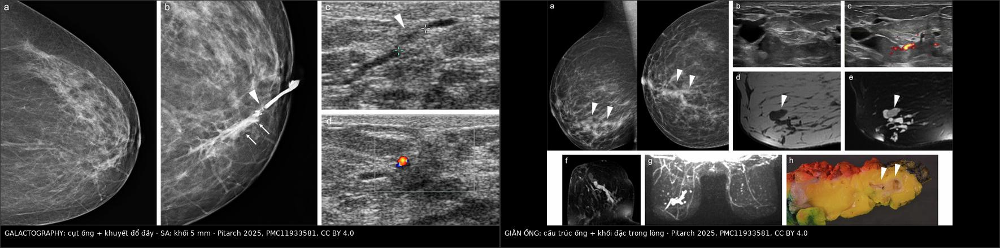
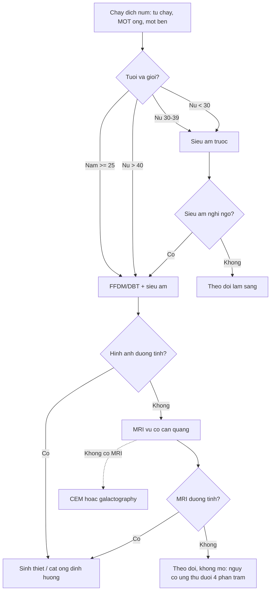
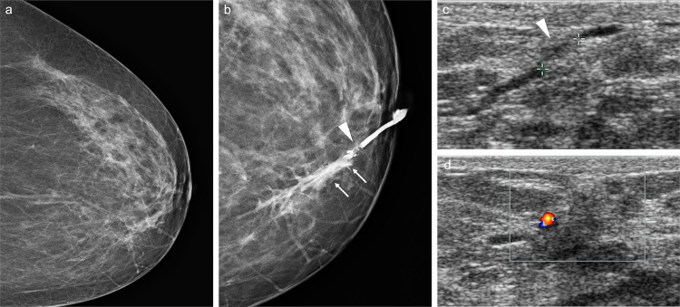
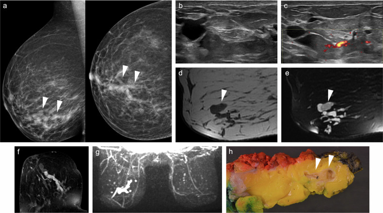

# 1714 — Chảy dịch núm một ống bệnh lý / Pathological nipple discharge (uniductal, spontaneous)

**Tags:** `pattern:chay-dich-num` `pattern:ong-tuyen-gian` `pattern:not-trong-ong` `pattern:khuyet-dop-day` `vung:vu` `vung:num-vu` `score:BI-RADS` `protocol:sieu-am-tan-so-cao` `protocol:galactography` `protocol:MRI-vu` `protocol:soi-ong-dan`
**Mức chắc chắn (certainty):** tổng hợp y văn (literature synthesis) — số liệu đọc trực tiếp từ toàn văn bài tổng quan đa phương thức về chảy dịch núm (*Insights Imaging* 2025, PMC11933581, CC BY 4.0), có **ca nguyên văn** cho quiz (Fig. 1 và Fig. 4 của bài đó).

## 1. Tổng quan bệnh học – cơ chế hình ảnh

- **Hai loại chảy dịch, hai thái độ hoàn toàn khác nhau.** Chảy dịch **sinh lý (physiological)** thì **hai bên, nhiều ống, không tự chảy** (chỉ ra khi bóp), màu trắng–xanh–vàng; nguyên nhân thường gặp nhất là **tăng prolactin do thuốc** (đặc biệt thuốc chống loạn thần), có thai/cho bú, suy thận, xơ gan, u tuyến yên. Chảy dịch **bệnh lý (pathological nipple discharge, PND)** thì **một bên, MỘT ống, tự chảy, kéo dài, bất kể màu** — chỉ cần **một** trong bốn đặc điểm này là phải hình ảnh hóa. Hơn **80%** phụ nữ có chảy dịch núm ít nhất một lần trong đời, nhưng **ung thư chỉ 3–23%** ở nhóm PND; nhóm **chảy máu** có nguy cơ cao nhất, và **tới 12%** ca PND **không chảy máu** vẫn có ung thư.
- **Vì sao "một ống" là chìa khóa giải phẫu:** mỗi núm có **15–20 lỗ ống tuyến sữa** đổ riêng ra da. Dịch tự chảy từ **đúng một lỗ** nghĩa là tổn thương khu trú trong **một nhánh ống** — đó cũng chính là lý do **soi ống dẫn (ductoscopy)** và **chụp ống dẫn (galactography)** có thể "đi theo" tổn thương, trong khi siêu âm/mammography chỉ thấy nó khi tổn thương đủ to.
- **TẠI SAO hình ảnh hay âm tính (vật lý):**
  - **Nhũ ảnh:** tổn thương nằm trong ống **1–2 mm** ngay sau núm, bị mô tuyến dày đặc và chính núm che phủ; dấu hiệu duy nhất thường chỉ là **cấu trúc ống hình ống dạng nhánh tụ về núm** hoặc **vi vôi hóa hình que** trong chất tiết cô đặc. Vì vậy phải có **phim phóng đại ± chụp núm nghiêng**.
  - **Siêu âm:** đầu dò thẳng **12–18 MHz** cho **trục ngang 0,1–0,2 mm**, đủ thấy **khối trong lòng ống 5 mm**; nhưng vùng sau quầng có **bóng khí giữa đầu dò–da–núm** và nhiều cấu trúc hội tụ, nên phải đặt đầu dò **vuông góc trục ống** và quét cả dọc lẫn ngang.
  - **Galactography:** bơm **0,2–0,3 mL** cản quang không ion qua cannula tù **30 G** vào đúng lỗ ống đang chảy. Cản quang **lấp đầy lòng ống** nên khối trong lòng trở thành **khuyết đổ đầy (filling defect)** và chỗ tắc thành **hình "cụt" (ductal cut-off)** — đây là phép "đúc khuôn" giải phẫu mà không modality nào khác làm được.
  - **MRI:** dịch giàu **protein và máu** làm **ngắn T1** → ống giãn **tăng tín hiệu trên T1 fat-sat trước tiêm**; ống chứa dịch **tăng tín hiệu T2**; nhú ống trong (papilloma) **giảm tín hiệu T2/T1** và **ngấm thuốc thì động mạch–muộn**, nhiều nhú có thể tạo **non-mass enhancement (NME) hình đường/đoạn** giống DCIS. MRI nhìn được **toàn bộ hệ ống + mô vú quanh** mà không cần đặt cannula, nên thấy được tổn thương **xa núm** và **vú đối bên**.
  - **CEM (chụp nhũ ảnh cản quang):** dùng **iod** + hiệu chỉnh năng lượng để thấy **tăng sinh mạch u**, không phụ thuộc mật độ tuyến — nhưng **kém nhạy hơn MRI với tổn thương < 5 mm** (**MRI 100% vs CEM 65%** cho nhú ống trong).
- **Ngưỡng định lượng cần nhớ:**
  - **Nhú ống trong (intraductal papilloma) = 36,8–57%** nguyên nhân PND; **giãn ống (duct ectasia) = 5,5–33%**, thường **> 50 tuổi**, đối xứng hai bên.
  - **Tế bào học dịch núm:** độ nhạy chỉ **11–34,6%**, độ đặc hiệu **81–100%**, **âm giả tới 65%** → **không dùng để loại trừ ung thư**.
  - **Siêu âm:** độ nhạy **36–83%**, độ đặc hiệu **12–84%** (dao động rất rộng).
  - **Galactography:** nhạy **77,4%** / đặc hiệu **75,7%** (146 ca); **MRI** cùng loạt: **85,7% / 71,4%**.
  - **MRI:** nhạy **85,71%**, đặc hiệu **98,53%**, PPV **92,31%**, **NPV 97,1%**; MRI âm sau hình ảnh thường quy âm → nguy cơ ung thư **< 4%** (103 phụ nữ); gộp: **MRI 92%/76%** so với **galactography 69%/39%**.
  - **Ductoscopy:** độ chính xác **95,3%** so với **MRI 83,6%**; **NPV 98–100%**.

## 2. Mẫu hình + chẩn đoán phân biệt theo vị trí (Gamut)

- **Khuôn 1 — Dịch tự chảy một ống, trong/thanh dịch, không sờ thấy khối.** Gamut theo vị trí: **nhú ống trong trung tâm (central papilloma)** ngay sau núm > **giãn ống** > **viêm quanh ống (periductal mastitis)** > **núm tuyến (nipple adenoma)**. Chốt: **khối trong lòng ống có cuống mạch** trên siêu âm.
- **Khuôn 2 — Dịch lẫn máu.** Gamut: **nhú ống trong** vs **DCIS/ung thư biểu mô** vs **viêm quanh ống** vs **loét ống do giãn ống**. Máu **không** đồng nghĩa ung thư, nhưng **máu + khối/núm co kéo** thì phải loại ung thư.
- **Khuôn 3 — Dịch một ống + khối sau quầng sờ được.** Gamut: **papilloma lớn** vs **ung thư nhú (papillary carcinoma)** vs **áp-xe/viêm quanh ống** vs **nang sau quầng vỡ**. Chốt: **bờ khối, ngấm thuốc, hạch**.
- **Khuôn 4 — Dịch nhiều ống, hai bên, màu đục/sữa.** Gamut: **sinh lý/tăng prolactin** vs **giãn ống** vs **bệnh tuyến vú dạng nang–xơ (fibrocystic)**. Chốt: **không cần hình ảnh hóa nếu thuần sinh lý**, nhưng **vẫn phải loại "dịch bất thường một bên"**.
- **Khuôn 5 — Nam giới chảy dịch.** Gamut: **ung thư vú nam** vs **gynecomastia** vs **giãn ống/núm tuyến**. Chốt: ung thư ở **23–57%** nam có PND → **chụp nhũ ảnh từ 25 tuổi**, không trấn an bằng "nam ít bị".
- **Khuôn 6 — Dịch tái phát sau cắt ống.** Gamut: **còn ống bệnh lý chưa cắt** vs **papilloma tái phát** vs **ung thư bị bỏ sót** vs **viêm quanh ống**. Chốt: **đối chiếu mô bệnh cũ + MRI** trước khi mổ lại.
- **Gợi nhớ "DUCT":** **D**ischarge một ống tự chảy · **U**ltrasound 12–18 MHz là bước đầu · **C**ytology không loại trừ · **T**issue (MRI/CEM/ductoscopy) khi hình ảnh thường quy âm.

## 3. Bảng so sánh phân biệt (ma trận đối chiếu)

| Thực thể (entity) | Hình ảnh điển hình (SA / nhũ ảnh / galactography / MRI) | Chốt vào (rule-in) | Chốt loại (rule-out) | Gợi ý xác nhận |
|---|---|---|---|---|
| **Nhú ống trong (intraductal papilloma)** | SA: **khối giảm âm 3–10 mm trong lòng ống giãn**, **có cuống mạch trên Doppler**; galactography: **khuyết đổ đầy + cụt ống**; MRI: **nốt giảm T2 trong ống tăng T2**, ngấm thuốc, có thể NME hình đường | **Khối trong lòng ống + mạch trong cuống + ống dẫn về núm** | **Khối NGOÀI ống, không liên quan ống dẫn** → nghĩ u khác; **xâm lấn mô đệm** → không phải papilloma đơn thuần | SA + cắt ống dẫn/soi ống dẫn; VAB nếu tổn thương xa núm |
| **Giãn ống (duct ectasia)** | Nhũ ảnh: **cấu trúc ống dạng nhánh tụ về núm ± vôi hóa hình que**; SA: **ống giãn, dịch trong/echo lẫn mảnh vụn**; MRI: **ống tăng T2, tăng T1 trước tiêm do protein**, thường **không ngấm** | **Nhiều ống giãn đối xứng sau quầng, > 50 tuổi, không khối đặc** | **Khối đặc trong ống có mạch** → phải loại papilloma/ung thư | SA hai bên + đối chiếu lâm sàng |
| **Viêm quanh ống (periductal mastitis)** | SA: **dày thành ống, giảm âm quanh ống, có thể áp-xe**; MRI: **ngấm kiểu vòng/viền hoặc NME** giống DCIS | **Đau + dày thành ống + ngấm viền, đáp ứng kháng sinh** | **Nốt đặc có mạch, không viêm** → không phải viêm quanh ống | Lâm sàng + kháng sinh; sinh thiết nếu không lui |
| **DCIS / ung thư biểu mô** | Nhũ ảnh: **vi vôi hóa đa hình xếp tuyến tính**; SA: **khối bờ không đều, dày da, hạch bất thường**; MRI: **NME đoạn hoặc khối ngấm nhanh–thoát** | **Vi vôi hóa ác tính + NME/khối + hạch** | **Chỉ ống giãn, không vôi hóa, không ngấm** → nguy cơ thấp | Nhũ ảnh phóng đại + MRI + sinh thiết |
| **Núm tuyến (nipple adenoma)** | **Tổn thương trong chính núm**, SA giảm âm đồng nhất, mạch tăng, CEUS ngấm mạnh; nhũ ảnh chỉ **núm to/bất đối xứng** | **Trợt/nốt núm + tổn thương khu trú trong núm** | **Tổn thương sau quầng, không ở núm** → không phải u tuyến núm | Sinh thiết punch + cắt trọn (bài 1692) |
| **Giãn ống + chất tiết cô đặc (inspissated)** | MRI: **ống tăng T1 mạnh do protein**; CT có thể **giả khối tăng đậm độ** | **Tăng T1 lan dọc ống, không ngấm, cùng tín hiệu chất tiết** | **Ngấm thuốc rõ và giảm T2** → là mô đặc, không phải chất tiết | So sánh T1 trước tiêm với T2/T1 sau tiêm |
| **Nang biểu bì / u tuyến syringomatous ở quầng** | Tổn thương **nông trong da–quầng**, có thể vôi hóa; syringomatous **xâm lấn mô mỡ**, bờ không rõ | **Vị trí trong da/quầng + cấu trúc nang sừng** | **Trong lòng ống tuyến sữa** → không phải tổn thương da | Sinh thiết/cắt trọn |
| **Ung thư nhú (papillary carcinoma)** | Khối **trong ống giãn**, có thể **vôi hóa, ngấm mạnh không đều**, hạch | **Cấu trúc nhú ác trên mô bệnh, mất lớp cơ biểu mô** | **Có lớp cơ biểu mô (p63+) bao quanh** → lành | Cắt trọn + IHC p63/CK5/6 |

*Trái: **galactography** — ống bị "cụt" và **khuyết đổ đầy** sát núm (đầu mũi tên), cản quang thoát ra mô quanh ống ở các nhánh xa (mũi tên), kèm **siêu âm khối 5 mm trong lòng ống giãn** có tín hiệu Doppler. Phải: **giãn ống** — cấu trúc ống dạng nhánh trên nhũ ảnh, **khối đặc trong lòng ống giãn** trên siêu âm, **ống tăng T2 và khối giảm T2** trên MRI, kèm tiêu bản đại thể. Nguồn: Pitarch M và cs., *Insights Imaging* 2025, Fig. 1 và Fig. 4 (CC BY 4.0).*

### Ba dấu hiệu quyết định trên ảnh
- **Khuyết đổ đầy (filling defect):** khối chiếm chỗ trong lòng ống đã bơm cản quang; **bờ tròn nhẵn + ống dẫn vào** gợi papilloma; **bờ nham nhở + cụt hoàn toàn** gợi ung thư.
- **Dấu "cụt ống" (ductal cut-off):** đầu ống tận cùng đột ngột, không có nhánh — nhưng **cản quang thoát ra mô quanh ống cũng tạo hình giả "cụt"**, nên phải đọc kèm siêu âm tại chỗ.
- **Khối trong lòng ống có mạch:** siêu âm Doppler thấy **mạch trong cuống** là dấu mạnh nhất của papilloma; khối **không có mạch** thường là chất tiết/mảnh vụn.

## 4. Protocol chụp + phân độ BI-RADS + xử trí

**Bước 1 — xác nhận là bệnh lý:** hỏi **tự chảy? một lỗ? một bên? kéo dài?**; bóp quanh quầng để xác định **một ống** và **màu dịch**; khám tìm **khối, co kéo núm, hạch**; xét nghiệm **prolactin/TSH** nếu dịch hai bên hoặc nghi thuốc.

**Bước 2 — chọn modality theo tuổi/giới (theo bài tổng quan):**
1. **Nữ > 40 tuổi:** **FFDM hoặc DBT + siêu âm** là đầu tay. DBT cho **độ nhạy 100%** và **độ đặc hiệu 82,9%** so với **61,9%** của MRI trong một loạt 53 ca — nhưng cỡ mẫu nhỏ.
2. **Nữ 30–39 tuổi:** **siêu âm trước**, thêm FFDM/DBT nếu siêu âm nghi ngờ hoặc có yếu tố nguy cơ. **Nữ < 30:** siêu âm.
3. **Nam giới:** **FFDM/DBT từ 25 tuổi** (nguy cơ ung thư 23–57% khi có PND), siêu âm bổ trợ.
4. **Hình ảnh thường quy âm hoặc không kết luận:** **MRI vú có cản quang** là bước kế tiếp, **thay thế galactography** ở nơi có MRI. **MRI âm đủ để theo dõi, không cần mổ** (NPV 97,1%; nguy cơ ung thư sau MRI âm < 4%).
5. **Không có MRI hoặc chống chỉ định:** **CEM ± sinh thiết dưới hướng CEM** (nhạy 91–96%, đặc hiệu 74–77%).
6. **Galactography:** khi cần **định vị ống bệnh lý trước mổ** hoặc MRI không sẵn; **không còn là "chuẩn vàng"** vì xâm lấn, khó đặt cannula và dễ thoát cản quang.
7. **Ductoscopy (0,9 mm):** chọn bệnh nhân **có thể tránh mổ**; **NPV 98–100%**, độ chính xác 95,3% — nhưng **không thấy được các nhánh xa** và cần dụng cụ/gây mê.

**Bước 3 — BI-RADS và ngưỡng can thiệp:**
- **Khối đặc trong lòng ống + chảy dịch một ống = BI-RADS 4** (không được 2 chỉ vì "nghĩ lành"), trừ khi đã có mô bệnh lành và hình ảnh phù hợp → **BI-RADS 2**.
- **Chỉ giãn ống, không khối, không vôi hóa = BI-RADS 2–3**, theo dõi.
- **Tỉ lệ ung thư ở ca PND được mổ ống dẫn: 9,3–37%**; nhưng nếu **hình ảnh thường quy âm và không có bất thường lâm sàng**, tỉ lệ ung thư gộp chỉ **8,1% (2,3–13,5%)** — nghĩa là **~9/10 ca mổ là lành tính**. Đây là lý do **MRI âm được phép theo dõi**.
- **Chỉ định mổ vì triệu chứng:** dịch kéo dài **> 2 năm**, ướt áo, ảnh hưởng sinh hoạt — **cắt ống dẫn định hướng (microdochectomy)** hoặc cắt ống lớn; biến chứng: **không cho con bú được, hoại tử sau quầng, bỏ sót tổn thương ngoại vi**.
- **Sinh thiết hút chân không (VAB):** lấy được tổn thương trong ống **nếu không quá sát núm/da** — vừa chẩn đoán vừa điều trị ở tổn thương lành.

## 5. Biến thể bình thường và cạm bẫy

- **"Dịch" không phải bệnh:** bóp núm ở phụ nữ có thai/cho bú, dùng thuốc chống loạn thần, suy giáp — **hai bên, nhiều ống, không tự chảy** thì **không cần chụp**; điều trị nguyên nhân (ngừng thuốc nếu được) là đủ.
- **Cạm bẫy 1 — tin vào tế bào học âm:** độ nhạy **11–34,6%**, âm giả tới **65%**; một tiêu bản "không tế bào ác" **không loại trừ** ung thư.
- **Cạm bẫy 2 — đọc "cụt ống" trên galactography khi cản quang thoát ra ngoài:** thoát cản quang quanh ống tạo hình giả tắc; luôn so với **siêu âm đúng vị trí** và chụp thêm bình diện.
- **Cạm bẫy 3 — giãn ống có viêm ngấm thuốc kiểu vòng trên MRI:** có thể **bắt chước DCIS** (ngấm vòng, NME); dấu loại là **không có vi vôi hóa, không khối đặc, đáp ứng kháng sinh**.
- **Cạm bẫy 4 — máu/protein tăng T1 bị đọc là "mỡ" hoặc "u máu":** tín hiệu T1 cao trong ống **mất tín hiệu trên chuỗi fat-sat**, nhưng **vẫn tăng trên T1 sau tiêm** nếu là mô; dùng ảnh trừ (subtraction) để phân biệt.
- **Cạm bẫy 5 — bỏ qua tổn thương ngoại vi:** siêu âm chỉ quét sau quầng sẽ bỏ sót papilloma/DCIS ở **xa núm**; MRI là modality duy nhất nhìn toàn hệ ống.
- **Cạm bẫy 6 — "nam giới thì hiếm":** PND ở nam có ung thư **23–57%**, cao hơn nữ; **không được trấn an** khi chưa chụp.
- **Cạm bẫy 7 — dịch tái phát sau cắt:** kiểm tra **mô bệnh toàn bộ ống đã cắt** và **MRI** trước khi mổ lại, tránh cắt lần hai trong mô sẹo.

## 6. Tự lượng giá — Blind Quiz

**Ca 1 — Nữ 63 tuổi, dịch thanh dịch tự chảy một ống vú trái, tế bào học âm tính.**

- Gợi ý: nhũ ảnh thường quy **không bất thường**; bơm cản quang vào đúng lỗ ống đang chảy.
- Câu hỏi: (1) Dấu hiệu chính trên galactography? (2) Khối trên siêu âm nằm ở đâu và kích thước bao nhiêu? (3) Ba chẩn đoán phân biệt và dấu hiệu nào chốt?

<b>Bấm để hiện đáp án (findings + chẩn đoán)</b>

- Dấu hiệu: **(b)** ống bị **cụt** gần núm với **khuyết đổ đầy** (đầu mũi tên) và **cản quang thoát ra mô quanh ống** ở các nhánh xa (mũi tên); **(c)** **khối 5 mm trong lòng ống giãn**, **(d)** có **tín hiệu Doppler**.
- Chẩn đoán: **nhú ống trong (intraductal papilloma) không atypia** — mô bệnh từ sinh thiết kim lõi dưới siêu âm; bệnh nhân từ chối cắt ống và mất theo dõi.
- Vì sao: khối **nằm trong lòng ống, có mạch nuôi** → mô đặc trong ống; **nhũ ảnh âm** là điển hình vì tổn thương chỉ **5 mm** sau núm.
- Nguồn ảnh: Pitarch M và cs., *Insights Imaging* 2025, Fig. 1b–d (CC BY 4.0).

**Ca 2 — Nữ 50 tuổi, dịch thanh dịch tự chảy một ống vú phải; nhũ ảnh thấy "cấu trúc hình ống".**

- Gợi ý: không sờ thấy khối; dịch tái diễn nhiều tháng.
- Câu hỏi: (1) Cấu trúc hình ống trên nhũ ảnh là gì? (2) Trên MRI, vì sao ống **tăng tín hiệu T2** còn khối bên trong **giảm tín hiệu T2**? (3) Khi nào **không** cần mổ?

<b>Bấm để hiện đáp án (findings + chẩn đoán)</b>

- Dấu hiệu: **(a)** cấu trúc ống dạng nhánh tụ về núm (đầu mũi tên); **(b–c)** **giãn ống + khối đặc trong lòng ống** có mạch Doppler; **(d)** T1 sau tiêm: ống giảm tín hiệu, che lấp khối; **(e)** T2 fat-sat: **ống tăng tín hiệu**, **khối giảm tín hiệu** bên trong; **(f–g)** MIP và ảnh sau tiêm cho **NME hình đường**; **(h)** đại thể: ống giãn chứa khối.
- Chẩn đoán: **nhú ống trong kèm giãn ống** — mô bệnh xác nhận; **NME hình đường của nhiều nhú có thể giống DCIS**, nên phải có mô bệnh.
- Vì sao: dịch trong ống **nhiều nước → T2 sáng**; mô nhú **đặc, ít nước → T2 tối** và **ngấm thuốc**; đây là nguyên lý "tương phản nước–mô" của MRI vú.
- Không cần mổ khi: **MRI âm** sau hình ảnh thường quy âm và **không có triệu chứng khó chịu** — theo dõi là đủ (nguy cơ ung thư < 4%); mổ chỉ để **giải quyết triệu chứng** khi dịch kéo dài > 2 năm.
- Nguồn ảnh: Pitarch M và cs., *Insights Imaging* 2025, Fig. 4a–h (CC BY 4.0).

## Bài liên quan chéo

- [1692 — U tuyến núm (nipple adenoma)](../1692-u-tuyen-num-vu/lesson.md) (nguyên nhân khác của chảy dịch + trợt núm)
- [1690 — Bệnh Paget của núm](../1690-benh-paget-num-vu/lesson.md) (trợt núm một bên)
- [513 — Tổn thương vú nguy cơ cao](../513-ton-thuong-vu-nguy-co-cao/lesson.md) (papilloma có atypia, xử trí)
- [510 — Vú: BI-RADS, nhũ ảnh, siêu âm, MRI](../510-vu-BIRADS-nhu-anh-sieu-am-MRI/lesson.md)
- [516 — Hình ảnh vú sau điều trị](../516-hinh-anh-vu-sau-dieu-tri/lesson.md)
- [500 — Tổng quan Vú & Sản phụ khoa](../500-tong-quan-vu-san-phu-khoa/lesson.md)

> Không dùng để chẩn đoán độc lập khi chưa có người hướng dẫn.
