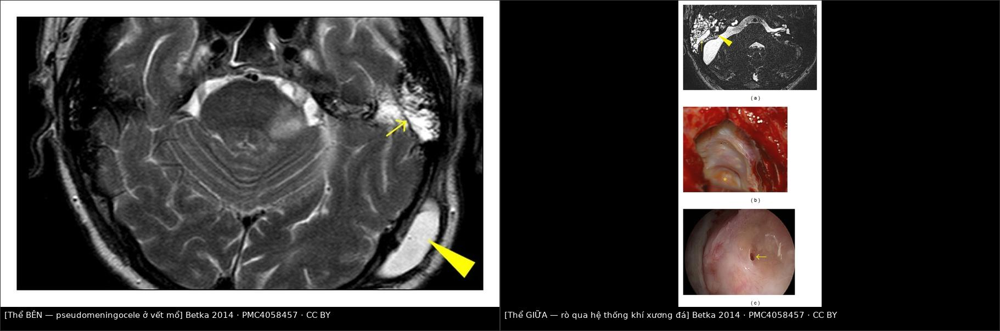
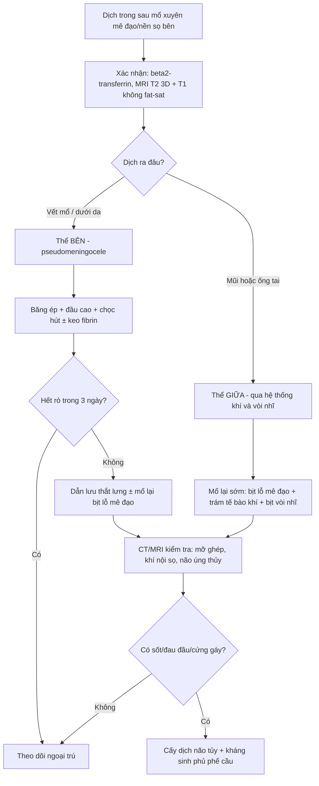
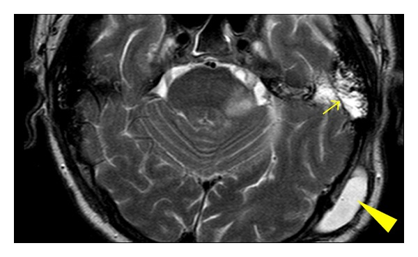
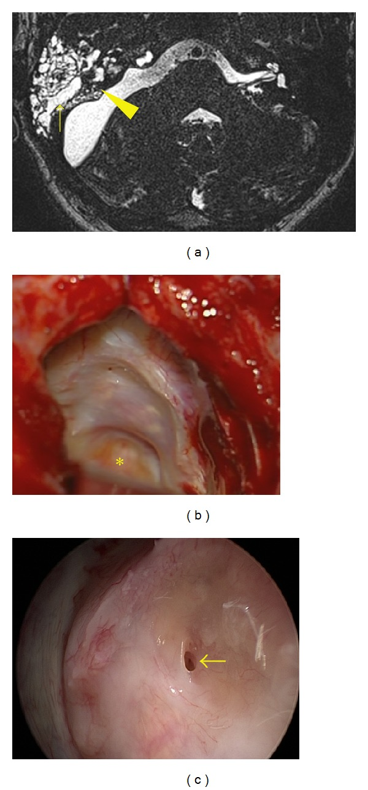

# 1715 — Rò dịch não tủy sau mổ xuyên mê đạo / nền sọ bên: thể bên (pseudomeningocele) vs thể giữa (rỉ mũi)

**Tags:** `pattern:ro-dich-nao-tuy` `pattern:pseudomeningocele` `pattern:phu-neo-duoi-da` `pattern:tu-dich-duoi-da` `pattern:viem-mang-nao` `vung:tai` `vung:xuong-da` `vung:nen-so` `vung:oc-tai` `anatomy:oc-tai` `protocol:MRI-T2-CISS` `protocol:HRCT-xuong-thai-duong` `protocol:dan-luu-that-lung`

**Mức chắc chắn (certainty):** tổng hợp y văn (literature synthesis) — 1 loạt 333 ca mổ u dây VIII có **ảnh MRI phân biệt thể bên/thể giữa** (*Biomed Res Int* 2014, PMC4058457, CC BY), 1 loạt **1.006 ca** u dây VIII (*Acta Otorhinolaryngol Ital* 2016, PMC5225797), 1 tổng quan 50 năm phẫu thuật nền sọ bên (*Acta Otorhinolaryngol Ital* 2019, PMC6540636), 1 tổng quan hình ảnh rò dịch não tủy (PMC5761172) + 1 nghiên cứu 182 bệnh nhân về **β2-transferrin** (PMID 15492165). Không có thử nghiệm ngẫu nhiên về thời điểm mổ lại/dẫn lưu — chỗ suy luận ghi rõ.

> **Câu chốt:** sau mổ xuyên mê đạo, khoang dưới nhện **thông trực tiếp** với hệ thống khí xương đá và vết mổ. Dịch não tủy đi ra theo **hai đường** — **thể bên**: ra vết mổ/dưới da thành **pseudomeningocele**, thường **tự khỏi** (chọc hút ± keo sinh học); **thể giữa**: qua **hệ thống khí → tai giữa → vòi nhĩ → mũi**, đây là thể **phải mổ lại**, vì đường ra không bao giờ tự bịt và mỗi ngày rò là một ngày nguy cơ **viêm màng não**. Phân biệt bằng **hình thái + vị trí + xét nghiệm β2-transferrin**, không bằng "chảy nhiều hay ít".

## 1. Tổng quan bệnh học – cơ chế hình ảnh (TẠI SAO)

### 1.1 Dịch tễ

- **Rò dịch não tủy (CSF leak)** là biến chứng **thường gặp nhất** của phẫu thuật u dây thần kinh VIII, các loạt gần đây **2–10,6%** (PMC6540636).
- Loạt **1.006 ca** (1990–2006): rò dịch não tủy **9%**, **viêm màng não 1,2%**, mổ lại vì rò **1,9%**; rò giảm dần **11,6% → 9,7% → 7,1%** (p < 0,01) và mổ lại **3,4% → 0,9%** (p < 0,05); viêm màng não mủ **1,9% → 1,3% → 0,7%** (PMC5225797).
- **Theo kích thước u** (cùng loạt): rò **5,0%** (độ 1) · **7,4%** (độ 2) · **9,5%** (độ 3) · **14,7%** (độ 4) — u lớn là yếu tố nguy cơ độc lập (PMC5225797).
- **Đường mổ quyết định kiểu rò:** với **xuyên mê đạo (translabyrinthine)**, rò qua **vết mổ** chiếm **54%**; với **sau xoang sigma**, **rỉ mũi** chiếm **68%**; với **hố sọ giữa**, **rỉ mũi 70%** (Mangus, trích trong PMC4058457).
- **Kỹ thuật tốt làm giảm mạnh:** **1.803 ca xuyên mê đạo liên tiếp** với bịt mê đạo bằng mỡ + đóng kín → rò **< 1%** (Merkus, trích trong PMC5225797); ghép **mỡ so với cơ** để bịt tế bào khí xương đá: **2,2% vs 5,7%** (420 ca, PMC4058457).

### 1.2 Sinh lý bệnh — ba "cửa" có thể hở

1. **Cửa mê đạo (medial):** mở ống tai trong → rách màng não → **khoang dưới nhện thông với mê đạo và các tế bào khí quanh ống tai trong**. Nếu mảnh mỡ/cân không bịt kín **bờ sau lỗ mở ống tai trong** (nơi màng não mỏng nhất), dịch đi vào hệ thống khí.
2. **Cửa tế bào khí (giữa):** tế bào khí xương đá **chưa được trám sáp xương/mỡ** → dịch chạy vào **tai giữa**, rồi qua **vòi nhĩ** ra **mũi** (người bệnh thấy **nước trong chảy một bên mũi, tăng khi cúi/khịt mũi**) hoặc ra **ống tai ngoài** nếu màng nhĩ/vách ống tai không kín.
3. **Cửa vết mổ (lateral):** đóng **cân–cơ–da không kín** hoặc **không có lớp mỡ bịt** → dịch tụ **dưới da** thành **pseudomeningocele** (khối phồng, căng, không đau, dễ bị chọc nhầm là "tụ dịch").

- **Vì sao thể bên hay tự khỏi:** đường rò ngắn, dưới da, **áp lực mô mềm + băng ép** làm dịch ngừng; cơ thể tạo phản ứng xơ bịt lại. Trong 333 ca, **208/333 (62,5%)** có thể bên và **205/208** khỏi chỉ bằng **chọc hút ± keo sinh học + băng ép** (84 người cần 1–6 lần keo); **mổ lại < 1%** (PMC4058457).
- **Vì sao thể giữa KHÔNG tự khỏi:** đường rò là **ống cứng** (tế bào khí + vòi nhĩ) thông với **khoang mũi vô khuẩn bẩn**; chênh áp giữa khoang dưới nhện và mũi **không bao giờ bằng 0**, và **nhiễm khuẩn đi ngược** dễ dàng. Trong 333 ca chỉ **2 ca (0,6%)** thể giữa nhưng **cả 2 phải mổ lại** (PMC4058457).

### 1.3 TẠI SAO nhìn thấy trên MRI/CT (vật lý)

| Đại lượng | Con số / đặc điểm | Ý nghĩa đọc phim |
|---|---|---|
| Tín hiệu dịch não tủy trên T2W | **Rất sáng** (T2 dài ~1.000–2.000 ms), đồng tín hiệu với dịch não thất | Nước trong tế bào khí **cùng tín hiệu** dịch não tủy = nghi rò |
| Mỡ ghép trên T1W **không fat-sat** | **Sáng** | Phân biệt **mỡ ghép** với **dịch**: T1 sáng = mỡ, T1 tối + T2 sáng = dịch |
| Mỡ ghép trên T2W | Sáng (như dịch) | **Không dùng T2 một mình** để kết luận rò |
| Dịch não tủy trên CT | **0–15 HU** | Không phân biệt được với dịch tiết/thanh dịch — CT chỉ để xem **xương, khí, vị trí mỡ ghép** |
| Khí nội sọ | **−1.000 HU** | **Pneumocephalus** sau dẫn lưu quá mức — dấu hiệu cảnh báo |
| β2-transferrin | Dương tính = có dịch não tủy; cần **0,5 mL** dịch | Xét nghiệm **đặc hiệu** (không có trong nước mũi/nước tai bình thường) |

- **Vì sao cần T2 lát mỏng 3D (CISS/FIESTA/DRIVE):** đường rò chỉ **1–2 mm**, chạy qua các tế bào khí có vách xương mảnh; lớp 3D 0,5–1 mm cho thấy **dải dịch liên tục** từ ống tai trong ra vòi nhĩ — đây là dấu chốt hình ảnh.
- **Vì sao T1 không fat-sat là bắt buộc:** mảnh mỡ ghép **sáng trên T1** đúng vị trí lỗ mở ống tai trong; nếu mỡ **đã di trú/teo** thì chỗ đó **T1 tối, T2 sáng** — tương ứng **lỗ rò hở**.

## 2. Mẫu hình + chẩn đoán phân biệt theo vị trí (Gamut)

- **Theo vị trí dịch thoát ra:**
  - **Vết mổ / dưới da** (thể bên) → pseudomeningocele;
  - **Mũi một bên** (thể giữa) → qua vòi nhĩ;
  - **Ống tai ngoài** (thể giữa biến thể) → qua màng nhĩ/vách ống tai đã bịt;
  - **Họng** (hiếm) → dịch chảy xuống, bệnh nhân chỉ **ho/khó chịu khi nằm**, không thấy nước ra ngoài.
- **Theo thời điểm:** **sớm < 7 ngày** (kỹ thuật đóng kín chưa hiệu lực) vs **muộn 1–6 tuần** (mỡ teo, nhiễm khuẩn nhẹ, tăng áp lực nội sọ). Rò **muộn** phải tìm **tăng áp lực nội sọ** (béo phì, ngưng thở khi ngủ) và **nhiễm**.
- **Nhóm "rò + sốt/đau đầu":** không chờ — **viêm màng não** cho tới khi loại trừ; chọc dở khoang dưới nhện khi chưa loại trừ tăng áp lực.
- **Nhớ 3 tầng: "Mê đạo – Tế bào khí – Vết mổ"**: mỗi tầng có **cách xử lý khác nhau** (bịt lại lỗ mê đạo / trám tế bào khí + bịt vòi nhĩ / khâu lại + dẫn lưu).

## 3. Bảng so sánh phân biệt (ma trận đối chiếu)

| Thực thể (entity) | Hình ảnh điển hình | Chốt vào (rule-in) | Chốt loại (rule-out) | Gợi ý xác nhận |
|---|---|---|---|---|
| **Rò thể bên (pseudomeningocele)** | Khối **dưới da vết mổ**, căng, **T2 sáng đồng tín hiệu dịch não tủy**, **T1 tối**, không ngấm; có **cổ thông** với khoang dưới nhện | **Khối dưới da + cổ thông + β2-transferrin dương** | Khối **T1 sáng** (mỡ ghép/di chứng), không cổ thông → không phải rò | MRI T1 + T2; siêu âm tại giường; chọc hút dưới vô khuẩn |
| **Rò thể giữa (rỉ mũi qua vòi nhĩ)** | **Dải dịch T2 sáng** từ ống tai trong → tế bào khí → tai giữa → vòi nhĩ; **mờ tế bào khí**; có thể **khí nội sọ** | **Dải dịch liên tục trên T2 3D + nước trong một bên mũi + β2-transferrin dương** | T2 các tế bào khí **tối**, không có dải liên tục → không rò | MRI T2 3D lát 0,5–1 mm; CT xương đá; nội soi mũi |
| **Seroma/thanh dịch vết mổ** | Khối dưới da **T1 tối, T2 sáng**, **không cổ thông**, β2-transferrin **âm** | **β2-transferrin âm + không thấy đường rò** | **β2-transferrin dương hoặc cổ thông** → là dịch não tủy | Xét nghiệm dịch; MRI |
| **Mỡ ghép di trú/teo** | Mỡ ghép **T1 sáng** lệch vị trí; **không có dịch T2 sáng mới** | **T1 sáng = mỡ**, không có dải dịch | **T1 tối + T2 sáng tại lỗ mê đạo** → nghi hở | So phim MRI sau mổ sớm |
| **Nhiễm khuẩn vết mổ** | Dày da, **ngấm thuốc**, khí trong mô mềm, dịch đục | **Sốt + dịch đục + khí trong mô mềm** | Dịch **trong, β2-transferrin âm** → không phải rò | Cấy dịch; CT; kháng sinh |
| **Tụ máu vết mổ** | **T1 sáng, T2 tối/sáng tùy tuổi máu**, không có cổ thông | **T1 sáng (methemoglobin) + không có dải dịch** | **T1 tối + T2 rất sáng + β2-transferrin dương** → rò | MRI; theo dõi |
| **Rò dịch não tủy do tăng áp lực nội sọ (rò "tự phát" kiểu nền sọ trước)** | Rò **nhiều đợt**, tái phát sau vá; **rỗng tuyến yên**, hẹp xoang tĩnh mạch | **Rò tái phát + dấu hiệu tăng áp lực nội sọ** | Áp lực bình thường, một đợt sau mổ → rò do kỹ thuật | MRI não; đo áp lực mở khi chọc; cân nhắc shunt |

*Trái: **thể bên** — T2W axial: **pseudomeningocele ở vết mổ chẩm (mũi tên đầu lớn)** + dịch não tủy lấp hệ thống khí xương thái dương (mũi tên nhỏ). Phải: **thể giữa** — (a) T2W: dải dịch từ ống tai trong vào tế bào khí (mũi tên đầu), mũi tên nhỏ chỉ đường rò; (b) mổ lại: lỗ rò ở bờ sau lỗ mở ống tai trong (dấu \*), ống tai trong đã đóng; (c) nội soi: lỗ rò. Ảnh ghép letterbox từ 1 nguồn **CC BY** (PMC4058457).*

### Ba câu hỏi quyết định xử trí
1. Dịch ra **đâu**? (dưới da → thể bên; mũi/tai → thể giữa)
2. Có **nhiễm** không? (sốt, đau đầu, cứng gáy, dịch đục → cấy + kháng sinh, không chờ)
3. Có **tăng áp lực nội sọ** không? (rò tái phát nhiều đợt, đau đầu tư thế, papilledema)

## 4. Protocol chụp + xử trí

### 4.1 Chẩn đoán

- **Bước 1 — xác nhận dịch là dịch não tủy:** **β2-transferrin** (miễn dịch cố định/immunoblot) là **chuẩn vàng không xâm lấn**; chỉ cần **0,5 mL** dịch là đủ; đây là xét nghiệm **đặc hiệu** cho dịch não tủy người (PMC5761172; Warnecke 2004, PMID 15492165). **Glucose/que thử không dùng để khẳng định** (dương/âm giả nhiều).
- **Bước 2 — tìm đường rò:** **MRI T2 3D lát mỏng 0,5–1 mm** (CISS/FIESTA/DRIVE) + **T1 không fat-sat** để phân biệt mỡ ghép với dịch; **CT xương đá lát ≤ 1 mm** để xem **vị trí mỡ ghép, tế bào khí hở, vôi hóa, khí nội sọ**.
- **Bước 3 — nội soi mũi** khi có rỉ mũi: xác định bên và điểm chảy (thường **quanh vòi nhĩ** sau mổ nền sọ bên).
- Với rò nền sọ **trước**, số liệu tham chiếu: **HRCT độ chính xác 92% (Se 92%/Sp 100%)**, **MR cisternography 89% (Se 87%/Sp 100%)**; khi nhiều ổ khuyết xương, **hợp nhất CT + MRI** giúp định vị (PMC5761172). Không suy rộng số này cho rò sau xuyên mê đạo.

### 4.2 Xử trí (thực hành, không có RCT)

- **Thể bên (pseudomeningocele) — điều trị bảo tồn trước:**
  - **Băng ép + nằm đầu cao 30°**, tránh rặn/khịt mũi;
  - **Chọc hút dưới vô khuẩn** ± **keo fibrin** vào khoang; có thể lặp **1–6 lần** (PMC4058457);
  - **Dẫn lưu thắt lưng** khi rò **kéo dài > 24 giờ** (đa số chuyên gia) — mục tiêu giảm áp lực để lỗ rò tự bịt; **tháo sớm** khi hết rò để tránh **pneumocephalus** và quá dẫn lưu;
  - **Mổ lại khi:** rò > 3 ngày không giảm, pseudomeningocele tái phát nhiều lần, nhiễm, hoặc **thiếu mỡ ghép trên MRI** tại lỗ mê đạo.
- **Thể giữa (rỉ mũi) — mổ lại sớm, không chờ:**
  - **Vá lại lỗ mê đạo** bằng mỡ/cân + **trám toàn bộ tế bào khí hở**, **bịt vòi nhĩ** bằng bó cơ/fat plug;
  - **Đóng kín ống tai ngoài** (blind sac) nếu đường mổ đã mở ống tai;
  - **Dẫn lưu thắt lưng** hỗ trợ **±** đặt **van não thất** nếu tăng áp lực nội sọ.
- **Kháng sinh:** không dự phòng kéo dài "để chờ"; khi có **dấu hiệu viêm màng não** → cấy dịch não tủy + kháng sinh theo kinh nghiệm phủ **phế cầu** rồi theo cấy.
- **Số liệu tiên lượng:** rò làm nguy cơ viêm màng não tăng từ **3% lên 14%** (Selesnick, trích trong PMC4058457); bảo tồn thành công tới **70%** các ca rò nói chung (PMC6540636).

## 5. Biến thể bình thường và cạm bẫy

- **Mờ tế bào khí ngay sau mổ là bình thường:** máu/dịch trong tế bào khí **1–2 tuần đầu**; chỉ gọi rò khi có **dải dịch T2 liên tục** hoặc **dịch thoát ra ngoài**.
- **Mỡ ghép sáng T2 y như dịch:** đọc **T1 không fat-sat** — mỡ **sáng**, dịch **tối**; trên T2 fat-sat mỡ tối còn dịch vẫn sáng.
- **"Rò ra ống tai" khi ống tai đã bịt kín:** gần như không thể; nếu có nước ở ống tai ngoài thì phải nghĩ **dịch từ vòi nhĩ trào ra**, tức thể giữa — đừng chỉ khâu da.
- **Chọc hút pseudomeningocele không vô khuẩn** → đưa vi khuẩn vào khoang dưới nhện; luôn **vô khuẩn + xét nghiệm β2-transferrin** trước.
- **Dẫn lưu thắt lưng quá mức** → **pneumocephalus**, đau đầu tư thế, tụ máu dưới màng cứng; phải theo dõi tri giác và chụp CT khi đau đầu mới.
- **Rò tái phát nhiều đợt** → tìm **tăng áp lực nội sọ** (béo phì, ngưng thở khi ngủ, hẹp xoang tĩnh mạch); vá mà không xử lý áp lực thì sẽ rò lại.
- **Viêm màng não có thể xuất hiện TRƯỚC khi thấy rò:** sốt + đau đầu sau mổ nền sọ bên = cấy dịch não tủy, không chờ dịch chảy.

## 6. Tự lượng giá — Blind Quiz

**Ca 1 — Bệnh nhân sau mổ u dây VIII đường xuyên mê đạo, ngày 5 thấy khối phồng căng ở vết mổ sau tai, không sốt.**

- Gợi ý: khối phồng tăng khi cúi, không đau, không rỉ mũi.
- Câu hỏi: Đây là thể nào của rò? Vì sao **không cần mổ lại ngay**? Hai dấu hiệu trên ảnh?

<b>Bấm để hiện đáp án (findings + chẩn đoán)</b>

- Dấu hiệu: **pseudomeningocele dưới da vùng chẩm (mũi tên đầu lớn)** + **dịch não tủy lấp hệ thống khí xương thái dương (mũi tên nhỏ)** — đường rò ngắn ra vết mổ.
- Chẩn đoán: **thể bên** — chiếm **62,5%** các rò trong loạt 333 ca; **205/208** khỏi bằng chọc hút ± keo + băng ép, mổ lại **< 1%**.
- Vì sao không mổ ngay: đường rò dưới da, băng ép + giảm áp hiệu quả; mổ lại khi rò > 3 ngày/tái phát/nhiễm.
- Nguồn ảnh: Betka J và cs., *Biomed Res Int* 2014 (PMC4058457), **CC BY**.

**Ca 2 — Bệnh nhân sau mổ xuyên mê đạo 2 tuần, nước trong chảy một bên mũi khi cúi; không sốt.**

- Gợi ý: dịch trong, vị mặn, tăng khi khịt mũi; β2-transferrin dương.
- Câu hỏi: Vì sao thể này **phải mổ lại** dù bệnh nhân chỉ "chảy nước mũi"? Tìm lỗ rò ở đâu trong ảnh?

<b>Bấm để hiện đáp án (findings + chẩn đoán)</b>

- Dấu hiệu: (a) **dải dịch T2 sáng từ ống tai trong vào hệ thống khí** (mũi tên đầu = lỗ rò; mũi tên nhỏ = đường rò); (b) mổ lại: **lỗ rò ở bờ sau lỗ mở ống tai trong** (dấu \*), ống tai trong đã đóng; (c) nội soi: lỗ rò.
- Chẩn đoán: **thể giữa** — chỉ **0,6% (2/333)** nhưng **cả 2 phải mổ lại**; rò làm nguy cơ viêm màng não tăng **3% → 14%**.
- Vì sao phải mổ: đường rò thông với mũi, **không tự bịt**; mỗi ngày chờ là một ngày nguy cơ nhiễm.
- Nguồn ảnh: Betka J và cs., *Biomed Res Int* 2014 (PMC4058457), **CC BY**.

**Ca 3 — Cùng bệnh nhân ca 2 sau mổ lại: kiểm tra mỡ ghép và tế bào khí.**

- Câu hỏi: Trên T2, làm sao phân biệt **mỡ ghép** với **dịch não tủy**? Nếu mỡ ghép di trú thì ảnh trông thế nào?

<b>Bấm để hiện đáp án (findings + chẩn đoán)</b>

- Phân biệt: **T1 không fat-sat** — mỡ **sáng**, dịch **tối**; T2 thì cả hai đều sáng nên **không dùng T2 một mình**.
- Mỡ ghép di trú/teo: mỡ **lệch khỏi lỗ mê đạo**, tại lỗ mê đạo **T1 tối + T2 sáng** = **hở**, tương ứng lỗ rò (như ô phải, hình (a)).
- Nguồn ảnh: ảnh ghép nội bộ từ Betka J và cs., *Biomed Res Int* 2014 (PMC4058457), **CC BY**.

## Bài liên quan chéo
- [1713 – Cholesteatoma xương đá ở trẻ](../1713-cholesteatoma-xuong-da-o-tre/lesson.md)
- [720 – Cholesteatoma xương thái dương](../720-temporal-bone-cholesteatoma/lesson.md)
- [236 – Viêm tai xương chũm & biến chứng nội sọ](../236-viem-tai-xuong-chum-bien-chung-noi-so/lesson.md)
- [3026 – Tụt não nghịch lý sau chọc dò/shunt](../3026-tut-nao-nghich-ly-sau-choc-do-shunt-mo-so/lesson.md)

## Ảnh
- `1715_ro-dich-nao-tuy-sau-mo-xuyen-me-dao_MRI_PMC4058457-F1.jpg` — T2W: pseudomeningocele + dịch trong hệ thống khí (CC BY).
- `1715_ro-dich-nao-tuy-sau-mo-xuyen-me-dao_MRI_PMC4058457-F2.jpg` — T2W + mổ lại + nội soi: thể giữa (CC BY).
- `images/composite_the-ben-vs-the-giua.jpg` — ảnh ghép đối chiếu hai thể.
- Nguồn + giấy phép từng ảnh: `images/CREDITS.md`; link gốc: `sources.md`.

> Không dùng để chẩn đoán độc lập khi chưa có người hướng dẫn.
