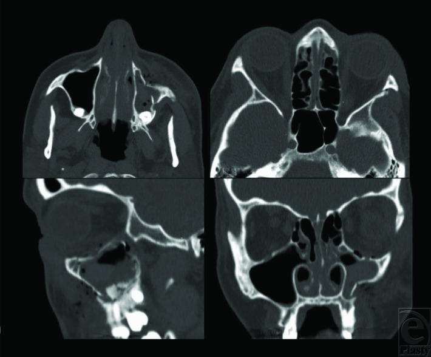
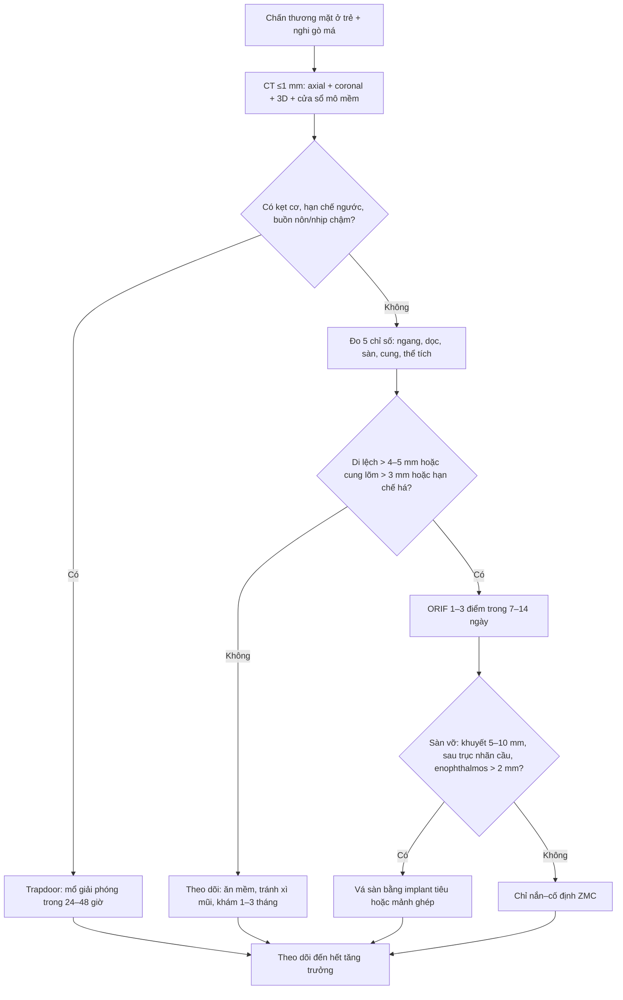
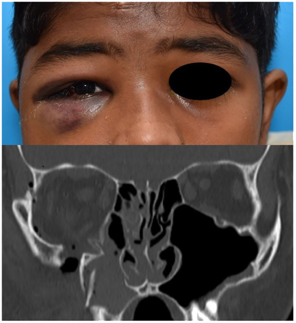
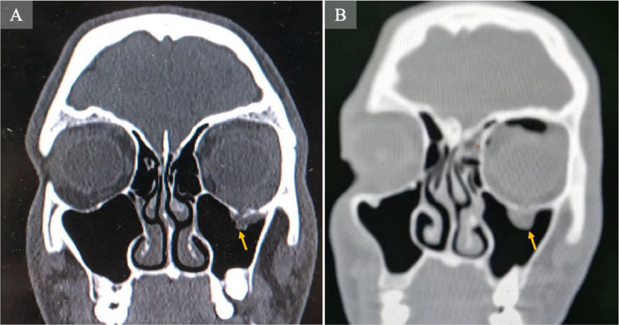
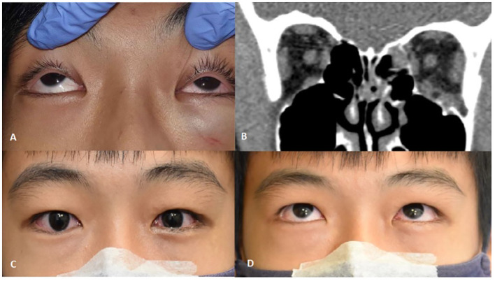

# 1716 — Gãy phức hợp gò má–hàm trên (ZMC) ở trẻ: bốn trụ đỡ, phân độ Zingg, ngưỡng di lệch và khi nào mổ

**Tags:** `pattern:gay-xuong` `pattern:mat-loi-go-ma` `pattern:di-lech-trong` `pattern:trapdoor-o-mat` `pattern:teardrop` `vung:go-ma` `vung:so-mat` `vung:hoc-mat` `vung:xoang-ham` `anatomy:bon-tru-do` `protocol:CT-lat-mong` `protocol:coronal` `protocol:CT-3D` `score:Zingg` `score:do-di-lech-mm` `score:the-tich-o-mat` `protocol:ORIF`
**Mức chắc chắn (certainty):** tổng hợp y văn (literature synthesis) — ghép **98 trẻ ≤ 17 tuổi gãy xương mặt** (J Clin Med 2025, PMC12786729), **43 trẻ gãy ổ mắt được mổ** (Front Ophthalmol 2025, PMC11965933), **207 ca vỡ sàn ổ mắt, 26 ca bỏ sót** (Med Oral Patol Oral Cir Bucal 2024, PMC11365048), **51 trẻ gãy thành ổ mắt, đa trung tâm châu Âu** (Eur J Trauma Emerg Surg 2026, PMC13668967), **127 ca đo thể tích ổ mắt** (J Clin Med 2024, PMC11204536), **272 ca gãy gò má theo Zingg** (J Dent Sci 2026, PMC12825491), **tổng quan ngưỡng hình thái ZMC** (Craniomaxillofac Trauma Reconstr 2025, PMC12731674), **54 nghiên cứu vật liệu tái tạo ổ mắt trẻ** (Craniomaxillofac Trauma Reconstr 2026, PMC13024892) và 2 ca nguyên văn (Eplasty 2014, PMC4145677; Radiol Case Rep 2025, PMC11785544). Không có ca do nhóm tự chụp.

> **Câu hỏi thực hành:** bé **12 tuổi** ngã xe đạp, **sưng quanh ổ mắt phải**, **tê môi trên phải**, **há miệng chỉ được 25 mm**; CT sọ "bình thường" theo báo cáo cấp cứu. Hoặc bé **15 tuổi** bị đấm vào mắt, **KHÔNG sưng, KHÔNG bầm**, chỉ **nhìn đôi khi ngước lên** và **buồn nôn**. Hoặc bé **8 tuổi** ngã cầu thang, CT có **đường gãy qua gò má phải + xoang hàm mờ**.
> Ba quyết định của bài: **(1) đọc đủ 4 trụ đỡ trên CT lát mỏng có coronal — gãy ZMC bị bỏ sót ở trẻ nhiều gấp ~9 lần người lớn; (2) đo 5 con số (di lệch ngang/dọc, chênh sàn ổ mắt, lõm cung, thay đổi thể tích ổ mắt) để biết có cần mổ; (3) phân biệt "gãy ZMC thường" với **trapdoor sàn ổ mắt** — thể thứ hai là **cấp cứu trong 24–48 giờ** dù phim trông rất nhẹ.**

## 1. Tổng quan bệnh học – cơ chế hình ảnh: vì sao gò má "sập" và vì sao trẻ dễ bỏ sót

### 1.1. Bốn trụ đỡ quyết định tên gọi và kiểu gãy

- Gò má là **xương dày nhất của tầng giữa mặt**, nhưng nó chỉ nối với phần còn lại qua **4 khớp mỏng**: **(1) trán–gò má (frontozygomatic)**, **(2) gò má–hàm trên (zygomaticomaxillary buttress)**, **(3) cung gò má–thái dương (zygomaticotemporal)**, **(4) gò má–bướm (zygomaticosphenoid)**.
- TẠI SAO đường gãy luôn chạy qua khớp: lực tác động vào **thân gò má** (khối xương cứng) sẽ **truyền ra 4 khớp mỏng** và làm đứt lần lượt các khớp đó — vì vậy **Zingg type B = đứt cả 4 khớp** là kiểu hay gặp nhất (**51,8%** trong 272 ca; J Dent Sci 2026, PMC12825491). Gãy **type A** chỉ ở **một** vị trí: **A1 = cung gò má**, **A2 = bờ ngoài ổ mắt**, **A3 = bờ dưới ổ mắt**; **type C = vỡ vụn** (cùng bài).
- TẠI SAO gò má trông "sập" (mất lồi má): thân gò má **xoay quanh trục cung** ra sau–vào trong; đỉnh gò má (malar eminence) tụt xuống và ra sau. Trên CT, đo **khoảng cách từ thành ngoài gò má tới đường giữa** so với bên lành, hoặc **chiều cao gò má–gò má (intermalar height)** — chênh **> 4–5 mm ngang** hoặc **> 2–3 mm dọc** thường đủ gây bất đối xứng thấy được (Craniomaxillofac Trauma Reconstr 2025, PMC12731674).
- TẠI SAO gãy ZMC kéo theo ổ mắt: gò má tạo **thành ngoài + một phần sàn ổ mắt**. Khi gò má tụt xuống, **sàn ổ mắt hạ theo** → **thể tích ổ mắt tăng** → nhãn cầu tụt ra sau (enophthalmos) và lệch xuống (hypoglobus); ngưỡng được dùng trong thực hành là **bất đối xứng thể tích > 5%** (PMC12731674). Thể tích ổ mắt **tăng theo tuổi** (127 ca, p = 0,022; J Clin Med 2024, PMC11204536) — nghĩa là **trẻ nhỏ chịu lực tốt hơn nhưng cũng dễ có kiểu gãy "bật lò xo"** hơn.

### 1.2. Vì sao trẻ khác người lớn (cơ học xương đang lớn)

- Trẻ có **tỉ lệ sọ:mặt lớn, xương đàn hồi, vỏ xương mỏng, nhiều mô mỡ đệm** → gãy xương mặt **hiếm hơn** (chỉ **1–15%** tổng số gãy xương mặt) và khi gãy thường **greenstick/không di lệch** (J Clin Med 2025, PMC12786729).
- TẠI SAO trẻ dễ **trapdoor**: xương đàn hồi **mở ra rồi bật lại** như cánh cửa lò xo, **kẹp cơ thẳng dưới/mô mỡ** vào đường gãy. Kẹt cơ → **thiếu máu cơ → xơ hóa** và hạn chế vận nhãn vĩnh viễn nếu không giải phóng sớm; đồng thời kích thích **phản xạ ổ mắt–tim (oculocardiac reflex)** gây **mạch chậm, buồn nôn, nôn**.
- TẠI SAO trẻ dễ bị bỏ sót: **thiếu dấu hiệu ngoài** ("white-eyed blowout"), **không phù nề**, trẻ **không hợp tác khám vận nhãn**, và **bác sĩ đọc CT sọ chỉ tập trung não**. Trong 207 ca vỡ sàn ổ mắt được mổ: **13% (26/207) bị bỏ sót lần khám đầu**, trong đó **40% ở người < 18 tuổi so với 10% ở người ≥ 18 tuổi** (aOR **9,3**; KTC 2,4–35); **62%** ca bỏ sót có **khám mắt không đủ**, **50%** do **đọc sai CT** (Med Oral Patol Oral Cir Bucal 2024, PMC11365048).

### 1.3. Dịch tễ – định lượng

- Gãy gò má chiếm **~25%** chấn thương xương mặt và là **gãy tầng giữa mặt phổ biến thứ hai**; **> 70%** được mổ (Front Oral Health 2025, PMC12546370).
- Trong **272 ca** gãy gò má: type **B 51,8%**; **29,4%** có **chấn thương sọ não** đi kèm; gãy **hai bên 8,8%** và nhóm hai bên có sọ não **58,3% so với 26,6%** (p < 0,05); ở người **< 60 tuổi**, type A có **OR 2,38** cho sọ não (J Dent Sci 2026, PMC12825491).
- Trong **98 trẻ ≤ 17 tuổi** (tuổi trung bình **12**): **sàn ổ mắt 33,7%**, **gò má 16,3%**, hàm dưới 24,5%, mỏm lồi cầu 16,3%; **mổ 76,5%**; **chấn thương thần kinh trung ương 32,7%**; tháo nẹp **19 ca** sau ~**3 tháng** (J Clin Med 2025, PMC12786729).
- Trong **43 trẻ gãy ổ mắt được mổ**: **25,6%** là **gãy phức hợp sọ–mặt**, và **ZMC là loại phức hợp hay nhất (45,4%)**; **kẹt mô 56%**, **53% mổ trong 24 giờ đầu** (Front Ophthalmol 2025, PMC11965933).
- Trong **51 trẻ gãy thành ổ mắt** (tuổi trung bình **12,1**; **84,3%** sàn đơn thuần): **nhìn đôi 84,3%**; **68,6% mổ trong 2 ngày**; sau 6 tháng còn **11,8%** di chứng — nhìn đôi **5,9%**, tê thần kinh dưới ổ mắt **3,9%**, enophthalmos **3,9%** (Eur J Trauma Emerg Surg 2026, PMC13668967).

## 2. Mẫu hình + chẩn đoán phân biệt theo vị trí và theo tuổi (Gamut)

### 2.1. Gamut theo phân độ Zingg (chọn theo số khớp bị đứt)

1. **Type A1 — chỉ cung gò má:** lõm cung, **há miệng hạn chế do mỏm vẹt chạm cung**; thân gò má còn đúng vị trí. Gãy cung "hình chữ V" là kiểu hay gặp; **chỉ cần mổ khi hạn chế há nặng** dù di lệch nhỏ.
2. **Type A2 — chỉ khớp trán–gò má:** bờ ngoài ổ mắt bậc thang, **thường kèm rách mi trên**; dễ đọc nhầm "bình thường" trên lát cắt ngang nếu không dựng coronal.
3. **Type A3 — chỉ bờ dưới ổ mắt:** bậc thang bờ dưới, **tê má/môi trên**, có thể kèm vỡ sàn.
4. **Type B — đứt cả 4 khớp (kiểu phổ biến nhất):** **mất lồi má + hạ bờ dưới ổ mắt + sập sàn + trismus**; đây là kiểu cần đo đủ 5 chỉ số và quyết định mổ.
5. **Type C — vỡ vụn:** nhiều mảnh, mất mặt khớp, **khó tái lập độ lồi**; thường do lực lớn (tai nạn giao thông), hay kèm chấn thương sọ.

### 2.2. Gamut theo tuổi và cơ chế

- **< 5 tuổi:** gãy xương mặt rất hiếm; nếu có thường **greenstick, không di lệch**, hay bỏ sót; ưu tiên **theo dõi + ăn mềm**.
- **6–12 tuổi:** ngã, xe đạp, thể thao; **gãy khớp + sàn ổ mắt**; mầm răng vĩnh viễn còn trong xương hàm trên → cố định phải tránh chân răng/mầm răng.
- **13–18 tuổi:** ẩu đả, thể thao, xe máy; kiểu **type B/C** như người lớn nhưng **tái tạo nhanh** và còn **trung tâm tăng trưởng**.

### 2.3. Gamut "bắt chước" (đọc sai là mổ oan hoặc bỏ sót)

- **Vỡ sàn ổ mắt đơn thuần (blow-out):** bờ ổ mắt còn liền, chỉ sàn/mặt trong vỡ; **không mất lồi má**.
- **Trapdoor sàn ổ mắt:** đường gãy **khe hở hẹp, bờ liền**, cơ kẹt; phim **trông rất nhẹ** — thể dễ bỏ sót nhất.
- **NOE (mũi–ổ mắt–sàng):** gãy **dây chằng góc trong (medial canthal tendon)**, **telecanthus**, không có mất lồi gò má.
- **Le Fort II/III:** gãy **cả tầng giữa**, di lệch **hàm trên + mũi**, không khu trú ở gò má.
- **Hội chứng xoang im lặng (silent sinus syndrome):** xoang hàm **xẹp dần, mờ**, **enophthalmos + hypoglobus**, **KHÔNG chấn thương, KHÔNG đường gãy** (đã báo ở trẻ; Cureus 2026, PMC13200221).
- **Di lệch khớp do tăng trưởng/không đối xứng:** trẻ có **bất đối xứng nhẹ sẵn có**; luôn so bên lành và **so phim cũ**.

**Gợi nhớ 3 dấu hiệu lâm sàng của ZMC:** **mất lồi má** (Malar flattening) – **tê môi trên/má** (Maxillary nerve) – **hạn chế há** (Mouth opening). Thiếu cả 3 **không loại trừ** ZMC.

## 3. Bảng so sánh phân biệt (ma trận đối chiếu)

| Thực thể (entity) | Hình ảnh điển hình | Chốt vào (rule-in) | Chốt loại (rule-out) | Gợi ý xác nhận |
|---|---|---|---|---|
| **ZMC type B (đứt 4 khớp)** | Đường gãy qua **khớp trán–gò má + bờ dưới ổ mắt + trụ gò má–hàm trên + cung**; thân gò má xoay vào trong–ra sau; sàn ổ mắt hạ | **≥ 3 trong 4 khớp có bậc thang/di lệch + mất lồi má** | Bờ ổ mắt liền, chỉ cung gãy → type A1 | CT ≤ 1 mm + coronal + 3D; đo intermalar height |
| **ZMC type A1 (cung đơn thuần)** | Cung gò má **lõm hình chữ V**, thân gò má còn đúng chỗ | **Lõm cung > 3 mm + hạn chế há** (mỏm vẹt chạm cung) | Có bậc thang ở khớp trán–gò má → không phải A1 | Lát cắt ngang qua cung + hỏi há miệng |
| **Type A2/A3 (một bờ ổ mắt)** | Bậc thang **bờ ngoài** hoặc **bờ dưới** ổ mắt, các khớp khác liền | **Bậc thang khu trú một bờ + đau chói tại chỗ** | Di lệch lan 4 khớp → type B | Coronal + đo bậc thang (mm) |
| **Vỡ sàn ổ mắt đơn thuần** | Khuyết sàn, **mỡ/cơ sa vào xoang hàm**, **dấu giọt lệ (tear-drop)**, bờ ổ mắt liền | **Thể tích ổ mắt tăng, khuyết sàn ≥ 5–10 mm hoặc sau trục nhãn cầu** | Bờ ổ mắt gãy + mất lồi má → ZMC | Coronal cửa sổ mô mềm; đo thể tích |
| **Trapdoor sàn ổ mắt (trẻ)** | Khe gãy **hẹp, bờ liền**, **cơ thẳng dưới kẹt**, giọt lệ; **không phù nề ngoài** | **Hạn chế ngước + đau khi vận nhãn + buồn nôn/nhịp chậm** | Phù nề nhiều, không hạn chế vận nhãn → theo dõi | Coronal mô mềm; khám vận nhãn bắt buộc |
| **NOE** | Gãy **xương mũi + mỏm trán hàm trên + thành trong ổ mắt**, **telecanthus** | **Telecanthus + dấu "bài kiểm tra dây chằng góc trong" dương** | Không telecanthus, không tổn thương thành trong → không phải NOE | CT + khám góc mắt trong |
| **Le Fort II/III** | Đường gãy **chéo qua mũi–hàm trên–gò má** hoặc **qua gò má–mũi**, di lệch cả khối hàm trên | **Di lệch khối hàm trên + cắn hở/khớp cắn lệch** | Di lệch chỉ khu trú gò má → ZMC | CT 3D toàn khối mặt; khám khớp cắn |
| **Hội chứng xoang im lặng** | Xoang hàm **mờ/xẹp**, thành xoang **cong vào trong**, **enophthalmos**, **không đường gãy** | **Xẹp xoang tiến triển + không chấn thương** | Có đường gãy/di lệch xương → chấn thương | So phim cũ; MRI/CT theo dõi |

*Bốn bình diện trước mổ (người lớn 43 tuổi, ngã đập mặt): thân gò má trái **mất độ lồi**, di lệch tại **khớp gò má–bướm** và **trụ gò má–hàm trên**; **sàn ổ mắt chỉ di lệch tối thiểu**. Nguồn: Eplasty 2014 (PMC4145677), CC BY 2.0 — ảnh nguyên bản, không crop.*

### 3.1. Dấu hiệu chốt trên từng bình diện

- **Axial:** cung gò má (lõm/V), thành ngoài ổ mắt, **khớp gò má–bướm** (khớp này là "chìa khóa" của việc nắn đúng — nếu khớp bướm còn liền thì gò má ít xoay).
- **Coronal:** **bờ dưới ổ mắt + sàn + trụ gò má–hàm trên**; đây là bình diện **bắt buộc** — thiếu coronal là lý do hay gặp nhất khiến bỏ sót sàn ổ mắt.
- **Sagittal:** độ lồi gò má so với bên lành, độ sâu xoang hàm.
- **3D VR:** dùng để **giải thích cho gia đình** và **lập kế hoạch nắn**, không thay lát mỏng.

## 4. Protocol chụp + phân độ & thuật toán điều trị

### 4.1. Protocol

- **CT xương mặt, lát ≤ 1 mm**, cửa sổ xương **+ cửa sổ mô mềm**, dựng **axial + coronal + sagittal + 3D VR**; ở trẻ **giảm liều theo cân nặng** (ALARA — xem bài 010/9420).
- **Bắt buộc thêm coronal mô mềm** khi nghi **trapdoor/kẹt cơ**: cửa sổ xương cho thấy đường gãy nhưng **chỉ cửa sổ mô mềm mới thấy cơ thẳng dưới dày, kéo, hoặc giọt lệ**.
- **Không cần MRI thường quy**; MRI chỉ khi nghi **tổn thương thần kinh thị, dây chằng góc trong, hoặc đĩa khớp**.
- **CBCT** thay thế được khi câu hỏi thuần xương và bệnh nhi hợp tác (liều thấp hơn), nhưng **không đánh giá mô mềm**.

### 4.2. Năm con số phải đo (báo cáo bằng mm/%)

| Chỉ số | Cách đo | Ngưỡng hành động |
|---|---|---|
| Di lệch **ngang** thân gò má | Khoảng cách thành ngoài gò má → đường giữa, so bên lành | **> 4–5 mm** → cân nhắc mổ |
| Di lệch **dọc** (tụt gò má) | Chênh chiều cao điểm thấp nhất gò má hai bên | **> 2–3 mm** → bất đối xứng rõ |
| **Chênh sàn ổ mắt** | Chênh độ cao sàn hai bên tại cùng lát coronal | **> 2 mm** → nguy cơ nhìn đôi/enophthalmos |
| **Lõm cung gò má** | Độ lõm sâu nhất của cung so đường nối hai đầu | **> 3 mm** → hạn chế há, thường phải can thiệp |
| **Bất đối xứng thể tích ổ mắt** | Phân đoạn tự động hoặc vẽ tay từng lát | **> 5%** → nguy cơ cơ năng/thẩm mỹ |

Nguồn ngưỡng: Craniomaxillofac Trauma Reconstr 2025 (PMC12731674) — tác giả ghi rõ đây là ngưỡng **từ cohort hồi cứu**, chưa có thử nghiệm ngẫu nhiên.

### 4.3. Chỉ định mổ — phân biệt "gãy ZMC" và "tổn thương sàn ổ mắt"

- **Mổ nắn–cố định ZMC** khi có: **di lệch thấy được/bất đối xứng > 4–5 mm**, **hạn chế há do cung chèn mỏm vẹt**, **di lệch gây cản trở cơ học**, hoặc **gãy không vững (unstable)** sau khi nắn thử (Eplasty 2014, PMC4145677; PMC12731674).
- **Thăm dò–vá sàn ổ mắt** khi có **một trong các**: **kẹt cơ với hạn chế ngước**, **sàn vỡ vụn**, **enophthalmos > 2 mm**, **khuyết sàn nằm sau trục nhãn cầu**, **khuyết sàn 5–10 mm trên CT** (Eplasty 2014, PMC4145677).
- **Thời điểm:** nắn ZMC thường trong **7–14 ngày** (sau khi hết phù cấp, trước khi xương liền) (PMC12731674); **kẹt cơ/trapdoor là ngoại lệ — mổ sớm**, thực tế **53% trẻ được mổ trong 24 giờ** (PMC11965933) và **68,6% trong 2 ngày** (PMC13668967). Ca trapdoor nguyên văn được giải phóng cơ sau **8 giờ** (PMC11785544).
- **Cố định:** 1 điểm (chỉ trụ gò má–hàm trên) cho di lệch nhẹ; **2–3 điểm** (thêm bờ dưới ổ mắt, khớp trán–gò má) cho type B/C; khớp **gò má–bướm** là mốc kiểm tra nắn đúng.
- **Vật liệu ở trẻ:** ưu tiên **nẹp/vít tiêu (resorbable)** khi mổ để tránh can thiệp lần hai và giảm ảnh hưởng tăng trưởng (Eur Arch Paediatr Dent 2026, PMC13331832); trong loạt 43 trẻ, **64,3% implant là tiêu** (PMC11965933). Tổng quan 54 nghiên cứu (562 bệnh nhân) **không có thử nghiệm ngẫu nhiên**, bằng chứng chủ yếu hồi cứu (PMC13024892). Nếu dùng titanium, loạt 98 trẻ **tháo nẹp 19 ca sau ~3 tháng** vì lý do tăng trưởng (PMC12786729).
- **Theo dõi:** khám lại **1 tuần, 1 tháng, 3 tháng**, sau đó **theo tuổi đến khi hết tăng trưởng**; đánh giá **khớp cắn, há miệng, vận nhãn, độ lồi má**, cân nhắc **chỉnh nha** (PMC13331832).

### 4.4. Thuật toán

## 5. Biến thể bình thường và cạm bẫy

- **Cạm bẫy 1 — "thỏa mãn tìm kiếm" (satisfaction of search):** CT sọ chấn thương được đọc để tìm máu tụ nội sọ; **gò má và sàn ổ mắt bị bỏ qua**. Đây là lý do chính khiến **40% ca < 18 tuổi bị bỏ sót** (PMC11365048). Cách tránh: **đọc lại theo checklist 4 trụ đỡ + sàn trên coronal** ở mọi CT sọ có chấn thương mặt.
- **Cạm bẫy 2 — "white-eyed blowout":** trẻ **không sưng, không bầm**, chỉ **nhìn đôi khi ngước + buồn nôn**; phim coronal có **giọt lệ**. Trong nhóm < 18 tuổi, các dấu hiệu **nhìn đôi/hạn chế vận nhãn (p = 0,005), đau khi vận nhãn (p = 0,010), buồn nôn/nôn (p < 0,001), nhịp chậm (p = 0,014)** phổ biến hơn người lớn, còn **phù nề quanh ổ mắt ít hơn** (p < 0,001) (PMC11365048).
- **Cạm bẫy 3 — bỏ sót nhịp chậm:** **phản xạ ổ mắt–tim** do kẹt cơ/căng mô có thể gây **nhịp chậm và ngất**; trẻ buồn nôn sau chấn thương mắt **không phải "say xe"**.
- **Cạm bẫy 4 — nhầm gãy cung với trật khớp thái dương–hàm:** cả hai đều **hạn chế há**; gãy cung chèn **mỏm vẹt**, còn trật khớp có **lồi cầu trước ụ khớp** (bài 1707). Khám + CT coronal phân biệt.
- **Cạm bẫy 5 — bậc thang giả ở khớp đang lớn:** trẻ có **khớp sọ mặt còn sụn**, bờ khớp có thể **không đều hai bên**; chỉ gọi gãy khi có **đường gãy cắt vỏ + phù tủy** hoặc **bậc thang khu trú**.
- **Cạm bẫy 6 — khí trong ổ mắt/xoang:** sau chấn thương, **xì mũi, thổi kèn, gây mê bằng mask** có thể đẩy khí vào ổ mắt; dặn **không xì mũi**, tránh bay trong 2 tuần.
- **Biến thể bình thường:** **cung gò má hai bên không đối xứng hoàn toàn**, **xoang hàm có vách ngăn**, **mào xương trên sàn** — so bên lành và đọc đa bình diện trước khi kết luận.

## 6. Tự lượng giá — Blind Quiz

**Ca 1 — Trẻ chấn thương mặt, sưng–bầm quanh ổ mắt phải**

- Gợi ý lâm sàng: sưng–bầm quanh ổ mắt phải (ảnh lâm sàng kèm theo); không có máu tụ nội sọ. Các dấu hiệu khác (**tê môi trên, hạn chế há**) phải khám mới biết — không thấy trên ảnh.
- Câu hỏi: Đường gãy đi qua **mấy khớp nối**? Thuộc **type Zingg** nào? Cần đo **chỉ số nào** trước khi quyết định?

<b>Bấm để hiện đáp án (findings + chẩn đoán)</b>

- Dấu hiệu: **coronal cửa sổ xương** — thân gò má phải **di lệch vào trong, vỡ vụn**; xoang hàm phải mờ do máu.
- Chẩn đoán: **gãy ZMC type B/C, di lệch** — vì lực truyền qua thân gò má làm đứt các khớp mỏng; cần đo **di lệch ngang (> 4–5 mm), dọc (> 2–3 mm), chênh sàn (> 2 mm), lõm cung (> 3 mm)** và **thể tích ổ mắt (> 5%)** để quyết định ORIF.
- Nguồn ảnh: Front Ophthalmol 2025 (PMC11965933), Fig. 7 — CC BY 4.0, ảnh nguyên bản.

**Ca 2 — Bé trai 15 tuổi bị đấm vào mắt trái**

- Gợi ý lâm sàng: **không phù nề, không bầm**, đau khi vận nhãn, **không ngước lên được**, nhìn đôi; không có dấu hiệu phản xạ ổ mắt–tim.
- Câu hỏi: Dấu hiệu trên ảnh gọi là gì? Vì sao phim trông "nhẹ" mà vẫn phải mổ?

<b>Bấm để hiện đáp án (findings + chẩn đoán)</b>

- Dấu hiệu: **dấu giọt lệ (tear-drop sign)** — mô mềm/cơ thẳng dưới sa xuống qua khe gãy sàn ổ mắt trái, mũi tên vàng; bờ ổ mắt còn liền.
- Chẩn đoán: **trapdoor sàn ổ mắt** — xương trẻ đàn hồi **bật lại** và kẹp cơ, gây **thiếu máu cơ** và hạn chế vận nhãn; ca này được **giải phóng cơ sau 8 giờ**. Đây là **cấp cứu**, không chờ hết phù.
- Nguồn ảnh: Radiol Case Rep 2025 (PMC11785544), Fig. 1 — CC BY-NC-ND 4.0, ảnh nguyên bản (không crop).

**Ca 3 — Trẻ hạn chế ngước mắt trái sau chấn thương**

- Gợi ý lâm sàng: **hạn chế ngước mắt trái + nhìn đôi**, sưng nhẹ; 1 tuần sau mổ vá sàn bằng **implant tiêu**, vận nhãn cải thiện.
- Câu hỏi: Tổn thương nằm ở **thành nào của ổ mắt**? Vì sao chọn **vật liệu tiêu** ở trẻ?

<b>Bấm để hiện đáp án (findings + chẩn đoán)</b>

- Dấu hiệu: (A) hạn chế ngước mắt trái; (B) **coronal cửa sổ mô mềm** — gãy **thành trong + sàn ổ mắt trái**, **cơ thẳng dưới dày và tròn lại**, mô mềm phù ở sàn; (C, D) 1 tuần sau mổ, phù giảm, vận nhãn tốt hơn.
- Chẩn đoán: **gãy sàn + thành trong ổ mắt có kẹt cơ** (thể phức hợp), vá bằng **implant tiêu** — vì trẻ còn tăng trưởng, vật liệu tiêu tránh phải mổ lấy và giảm ảnh hưởng lên xương đang lớn.
- Nguồn ảnh: Front Ophthalmol 2025 (PMC11965933), Fig. 6 — CC BY 4.0, ảnh nguyên bản.

## Bài liên quan chéo
- [1707 – Trật khớp thái dương–hàm ở trẻ](../1707-trat-khop-thai-duong-ham-o-tre/lesson.md) — cùng "hạn chế há", khác cơ chế.
- [1708 – Gãy lồi cầu xương hàm dưới ở trẻ](../1708-gay-loi-cau-xuong-ham-duoi-o-tre/lesson.md) — gãy tầng dưới cùng cơ chế ngã cằm.
- [1703 – Dính khớp thái dương–hàm bẩm sinh](../1703-dinh-khop-thai-duong-ham-bam-sinh/lesson.md) — hạn chế há mạn, không chấn thương.
- [420 – Vỡ sàn hốc mắt & hội chứng khoang](../420-vo-san-hoc-mat/lesson.md) — thể chỉ có sàn, không mất lồi gò má.
- [010 – Giải phẫu ngực cắt lớp & biến thể](../010-giai-phau-nguc-cat-lop/lesson.md) — nguyên lý ALARA khi chụp trẻ (tham chiếu liều).

## Ảnh
- Ảnh tải từ gói `supplementaryFiles` của Europe PMC, đúng file figure trong bài gốc; **không crop, không kéo giãn**.
- Nguồn + giấy phép từng ảnh: `images/CREDITS.md`.

> Không dùng để chẩn đoán độc lập khi chưa có người hướng dẫn.
