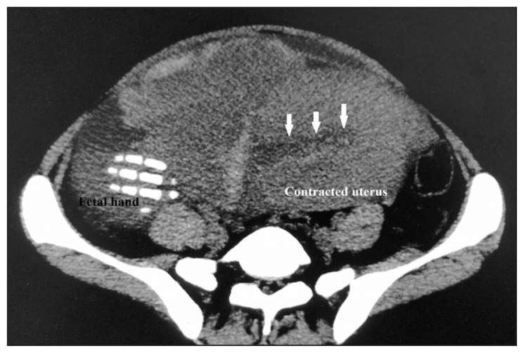
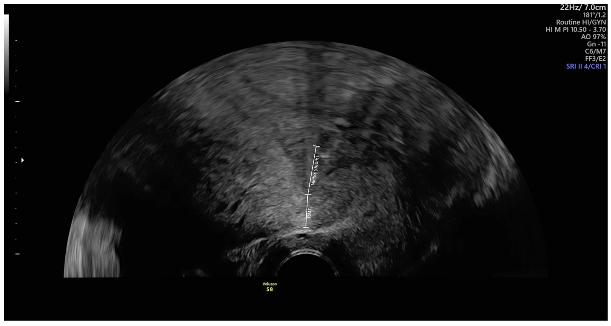
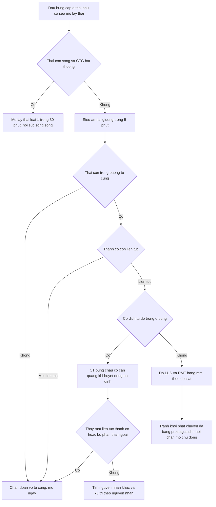
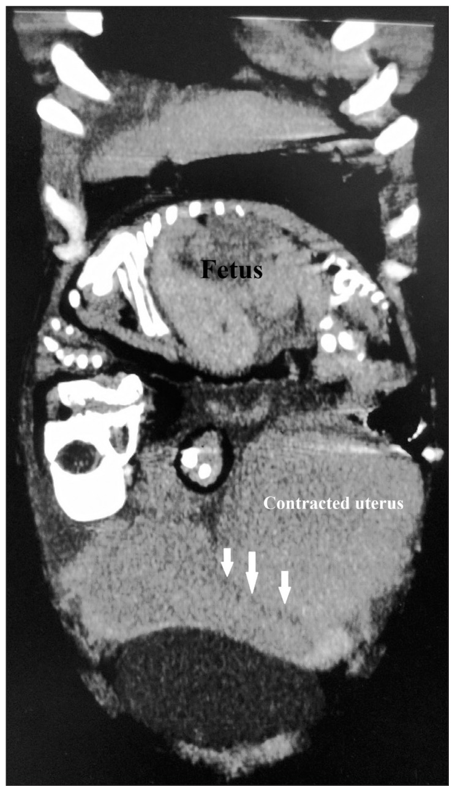
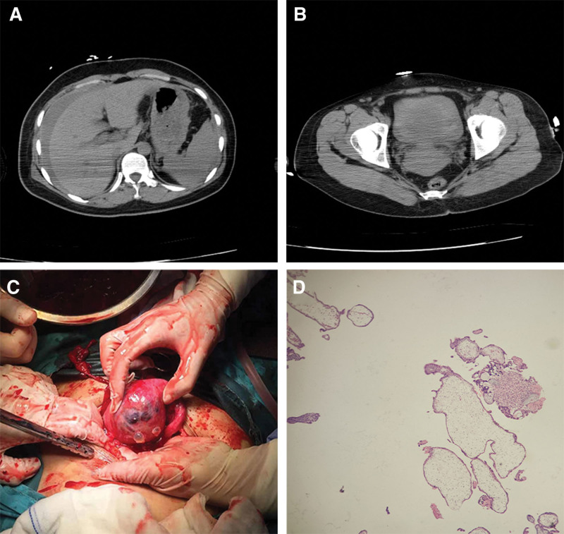
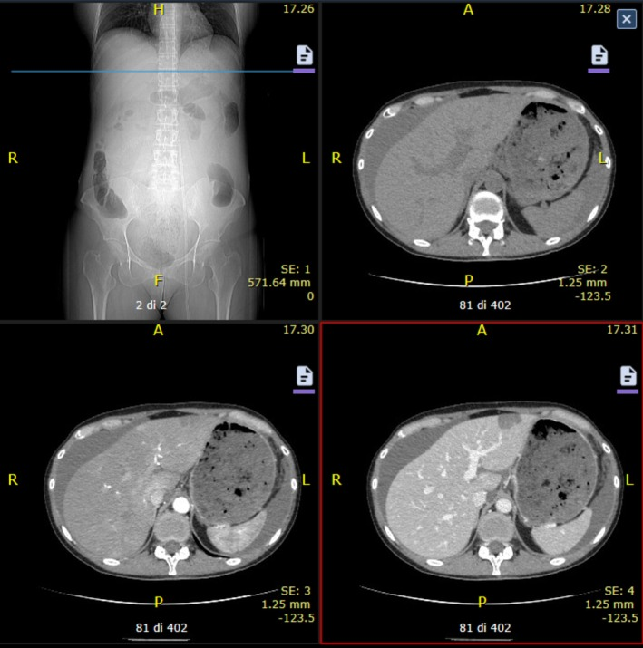

# 1717 — Vỡ tử cung trên sẹo mổ lấy thai: dấu tiền triệu, ngưỡng đo sẹo & chọn TOLAC / Uterine rupture on a prior cesarean scar

**Tags:** `pattern:vo-tu-cung` `pattern:dich-o-bung` `pattern:thai-ky` `vung:tu-cung-phan-phu` `protocol:TVUS-thai` `protocol:CT-bung` `protocol:TOLAC`
**Mức chắc chắn (certainty):** tổng hợp y văn (literature synthesis) — đoàn hệ lớn (11.947–270.329 ca TOLAC), 1 khuyến cáo FIGO 2025, nhiều ca lâm sàng có hình ảnh; **không có thử nghiệm ngẫu nhiên** so sánh "chụp gì trước", nên mọi con số dưới đây là kết cục quan sát.

## 1. Tổng quan bệnh học – cơ chế hình ảnh

- **Định nghĩa tách đôi (phải nói rõ trước khi trích bất kỳ con số nào):** **vỡ hoàn toàn (complete rupture)** = rách đủ 3 lớp nội mạc–cơ–thanh mạc, thai/bộ phận thai ra ổ bụng; **nứt sẹo hay dehiscence (partial rupture)** = chỉ nội mạc–cơ, **thanh mạc còn nguyên**, thường không có máu tự do và **phát hiện tình cờ khi mổ lấy thai** (J Clin Med 2025, PMC12295210). Vì vậy cùng một vấn đề mà y văn ghi **0,06% → 3,8%**: chênh lệch định nghĩa + mẫu số, không phải chênh lệch chất lượng chăm sóc.
- **Tần suất (số liệu gộp, ghi mẫu số):** một sẹo mổ lấy thai ngang đoạn dưới → vỡ **0,3–0,7%** khi thử chuyển dạ đường âm đạo (TOLAC — trial of labor after cesarean) (**FIGO 2025**, PMC12447697); **< 0,02%** khi mổ lấy thai chủ động **không chuyển dạ** (PMC12295210); **~0,5%** TOLAC theo tổng quan (PMC12295210); **dehiscence tới 3,8%** (PMC12295210); tử cung **không sẹo**: **~1/15.000 ca sinh** (PMC12295210), dải **0,4–0,6/10.000** (Cureus 2026, PMC12917422).
- **Ba đoàn hệ lớn cho ba mẫu số khác nhau — đọc cùng nhau mới đúng:**
  - **Stockholm–Gotland 11.947 ca TOLAC ≥ 37 tuần: 216 ca vỡ = 1,8%** (Sci Rep 2026, PMC13087215). Con số cao gấp 3–4 lần 0,5% vì gộp cả dehiscence và vì vùng có tỷ lệ khởi phát chuyển dạ cao — **đừng dùng 1,8% để tư vấn**.
  - **Pháp, 11 trung tâm, 16 năm: 199/31.668 lượt TOLAC = 0,63% vỡ hoàn toàn**, thai sinh đường âm đạo thành công **72,9%** (Acta Obstet Gynecol Scand 2025, PMC11782053).
  - **Mỹ 2014–2021, 270.329 thai một thai có 1 sẹo mổ lấy thai: 957 ca vỡ = 0,354%** (3,54/1.000) (Acta Obstet Gynecol Scand 2025, PMC11683537).
- **TẠI SAO sẹo là điểm yếu (cơ học + mô bệnh):** sẹo đoạn dưới là **collagen xơ**, gần như không có sợi cơ trơn co rút và **không có màng rụng (decidua)**; lực căng thành tử cung tỉ lệ **áp lực buồng ối × bán kính** (Laplace) → cơn co càng mạnh, tử cung càng to thì lực tác động lên **đúng vòng sẹo** càng lớn. Mô sẹo chịu lực kéo kém hơn cơ lành, nên **cơn co dồn dập + khởi phát chuyển dạ bằng prostaglandin** là hai bàn đạp cộng lực.
- **TẠI SAO hình ảnh thấy được (vật lý):**
  - **Siêu âm:** cơ tử cung đồng âm trung bình; sẹo là **dải giảm âm mỏng** ở mặt trước eo. Vỡ = **mất liên tục đường viền cơ** — có thể chỉ **1–3 mm**, nên phải dùng đầu dò tần số cao, lát cắt đúng trục và **ghi bằng mm**.
  - **Máu trong ổ bụng trên siêu âm:** máu tươi **echo dày**, sau đông thành **khối echo hỗn hợp**, sau ly giải thành **dịch echo trống** — cùng một lượng máu cho 3 hình ảnh khác nhau theo **thời gian**, không theo lượng.
  - **CT:** máu cấp **35–70 HU** (cục máu đông tới **50–70 HU**), cơ tử cung ngấm thuốc **40–60 HU** ở thì tĩnh mạch, xương thai **> 200 HU**; dịch ổ bụng **quanh gan, túi cùng Douglas, rãnh cạnh đại tràng** là nơi máu đọng sớm nhất. Chỗ **mất liên tục cơ** chỉ thấy khi cắt **đúng mặt phẳng vuông góc với vòng sẹo** — đây là lý do CT có thể "âm tính giả" nếu lớp cắt dày.
  - **MRI:** cơ tử cung **T2 trung bình–thấp**; sẹo là **dải T2 tối**; vỡ = **đứt dải T2 tối + máu T1 sáng (methemoglobin)** ngoài thành. DWI **không có vai trò** — máu cấp cũng hạn chế khuếch tán, dễ đọc nhầm thành "mủ/ác tính".
- **Ngưỡng đo sẹo — và giới hạn của nó (cửa định lượng quan trọng nhất):** đo **bề dày toàn bộ đoạn dưới (LUS — lower uterine segment)** và **bề dày cơ còn lại (RMT — residual myometrial thickness)** ở **36–38 tuần**, bàng quang nửa đầy, 3 lần đo lấy trung bình. Nghiên cứu 161 sản phụ đang chuyển dạ: **LUS 2,3 mm** và **RMT 1,9 mm** là điểm cắt tốt nhất cho khiếm khuyết thành tử cung — nhưng **AUC chỉ 0,60 (KTC 51–70%) và 0,61 (52–71%)**, tức **gần như tung đồng xu**; khiếm khuyết thành gặp **25,9% (42/161)**, vỡ **2,5% (4/161)**, dehiscence **23,5% (38/161)** (BMC Pregnancy Childbirth 2022, PMC9107280).
- **Ngưỡng liên quan "túi thừa sẹo" (isthmocele):** niche gặp **42–84%** sau mổ lấy thai, **khiếm khuyết lớn với RMT < 2,2 mm gặp 11–45%**; **mất > 50% bề dày cơ tại niche làm tăng nguy cơ vỡ** (Geburtshilfe Frauenheilkd 2024, PMC11303011).
- **Sau sinh đường âm đạo thành công, sẹo vẫn "hở":** siêu âm trong vài ngày đầu sau sinh thấy **đường rạch trên 90% (27/30) bằng siêu âm qua bụng**, RMT trung vị **12,0 mm (IQR 8,0–19,0)**; **khiếm khuyết ≥ 2 mm ở 63% (17/27)**; siêu âm đầu dò âm đạo thấy **29/29**, RMT trung vị **9,9 mm (7,5–14,5)** (Medicina 2026, PMC13609557). Nghĩa là **"có khuyết sẹo" không đồng nghĩa "đã vỡ"** — phải đọc cùng bối cảnh.

## 2. Mẫu hình + chẩn đoán phân biệt theo vị trí và thời điểm (Gamut)

Bốn câu hỏi theo thứ tự, đúng như khi cầm đầu dò:

1. **Thai còn sống không, đang ở trong hay ngoài buồng tử cung?**
2. **Thành tử cung còn liên tục không, chỗ mất liên tục ở đâu, dài bao nhiêu mm?**
3. **Có máu tự do trong ổ bụng không, ở đâu (quanh gan, Douglas, rãnh cạnh đại tràng)?**
4. **Sẹo cũ là loại nào** (ngang đoạn dưới / thân tử cung / sau myomectomy / sau nội soi buồng tử cung)?

Gamut theo **vị trí** (vị trí quyết định nguyên nhân và tiên lượng):

- **Mặt trước eo tử cung (sẹo ngang đoạn dưới):** thể điển hình, **~90%** các ca vỡ có sẹo (PMC12917422).
- **Đáy/thân tử cung:** sẹo **mổ lấy thai thể cổ điển (classical)** — nguy cơ vỡ **1–12%** (Clin Case Rep 2021, PMC8143273); sẹo **sau myomectomy** — nguy cơ chung **0,30% (40/13.381)**, nhưng **6,82% (3/44) nếu đã vào buồng tử cung** so với **1,19% (4/336)** khi không vào, **OR 6,07** (Obstet Gynecol Int 2026, PMC13676031).
- **Thành sau / góc:** sau **mổ lạc nội mạc sâu (DIE)** hoặc sau **chửa góc/sừng tử cung** — vỡ **không có sẹo mặt trước**, dễ bị loại trừ oan vì "không có sẹo".
- **Tử cung không sẹo:** chuyển dạ tắc nghẽn, **misoprostol tự dùng**, chấn thương, dị dạng tử cung — ở nước thu nhập thấp chiếm **57% (42/74)** các ca vỡ (Front Glob Womens Health 2026, PMC13438401).
- **Tại vị trí bánh nhau:** vỡ trên **phổ nhau cài răng lược (PAS)** — bánh nhau xuyên cơ làm thành tử cung mỏng < 1 mm rồi rách (bài 560, 1604).
- **Cổ tử cung / eo sau morcellation:** hiếm, nhưng là "vị trí mù" trên siêu âm qua bụng.

Gamut theo **thời điểm**:

- **Trước chuyển dạ (tam cá nguyệt 2–3):** thường sẹo **thân tử cung**, **PAS**, hoặc **dị dạng** — đau âm ỉ nhiều ngày, **không có cơn co**.
- **Trong chuyển dạ:** hay gặp nhất; **CTG bất thường là dấu hiệu sớm nhất và thường duy nhất**.
- **Ngay sau sinh đường âm đạo:** chảy máu sau sinh với **tử cung co tốt** — bẫy kinh điển (Cureus 2026, PMC12917422; J Med Case Rep 2026, PMC13485830).

**Gợi nhớ SCAR:** **S**car (loại sẹo), **C**ontraction (cơn co/khởi phát chuyển dạ), **A**nomaly (dị dạng, PAS, nhau bất thường), **R**are (không sẹo: chấn thương, misoprostol, chửa góc).

## 3. Bảng so sánh phân biệt (ma trận đối chiếu)

| Thực thể (entity) | Hình ảnh điển hình (US/CT/MRI) | Chốt vào (rule-in) | Chốt loại (rule-out) | Gợi ý xác nhận |
|---|---|---|---|---|
| **Vỡ hoàn toàn trên sẹo đoạn dưới** | Mất liên tục cơ mặt trước eo; thai hoặc bộ phận thai **ngoài buồng**; tử cung **co nhỏ, lệch bên**; dịch ổ bụng hỗn hợp echo | **Thai ngoài buồng + mất liên tục thành cơ + dịch ổ bụng** — chốt ngay, không cần thêm | Tử cung còn bao quanh thai + **không dịch ổ bụng** → không phải vỡ | TVUS tại giường + CT khi ổn định; **mổ cấp cứu** |
| **Nứt sẹo / dehiscence (không hoàn toàn)** | Đáy sẹo **< 2 mm**, "cửa sổ" (window) giảm âm, **không máu tự do**, thai trong buồng | Phát hiện lúc mổ lấy thai: **thanh mạc còn nguyên**, không máu ổ bụng | **Có máu tự do + thai ngoài buồng** → đã là vỡ hoàn toàn | Mổ lấy thai theo kế hoạch; ghi mô tả mm |
| **Vỡ ở tử cung KHÔNG sẹo** | Rách **góc/thành sau/đáy**, thành cơ xa sẹo vẫn đều; bối cảnh chuyển dạ tắc nghẽn hoặc misoprostol | **Không tiền sử mổ tử cung + cơn co dồn dập + thai ngoài buồng** | Có sẹo mặt trước + mất liên tục đúng sẹo = vỡ sẹo | Hỏi kỹ tiền sử nạo/hút, **nội soi buồng tử cung**, chấn thương |
| **Vỡ do PAS** | Bánh nhau xuyên cơ, **mất clear zone**, hồ máu, **mạch bắc cầu**, cơ **< 1 mm**, vỡ đúng chỗ bánh nhau | **Bánh nhau + mất clear zone + mạch bắc cầu + vỡ tại vị trí bánh nhau** | Bánh nhau bình thường + vỡ ở đáy không liên quan bánh nhau | MRI khi mặt phẳng sau khó; ê-kíp PAS + mổ có chuẩn bị |
| **Nhau bong non (abruptio)** | Bánh nhau dày, **khối máu sau bánh nhau**, tử cung thấm máu (Couvelaire), thai suy | **Tụ máu sau bánh nhau + tím thành cơ + CTG bất thường** | **Thành cơ liên tục, không mất liên tục** + không có khối sau bánh nhau | TVUS; theo dõi CTG; fibrinogen |
| **Nhau tiền đạo chảy máu** | Bánh nhau che lỗ trong, **không đau**, tử cung mềm, thành cơ liên tục | **Máu âm đạo không đau + bánh nhau che os** | **Mất liên tục thành + dịch ổ bụng** → không phải chỉ previa | TVUS đầu dò âm đạo; đo mép nhau tới os tính bằng mm |
| **Vỡ mạch máu khác (phình lách, chửa ngoài tử cung vỡ, vỡ gan)** | **Dịch ổ bụng nhiều nhưng tử cung nguyên vẹn**; thấy túi phình hoặc túi thai ngoài | **Tử cung nguyên + nguồn chảy thấy được ngoài tử cung** | Thai trong buồng + **mất liên tục thành cơ** | CT có cản quang; DSA khi nghi phình |
| **U xơ thoái triển đỏ / xoắn tử cung** | Đau khu trú đúng u, sốt nhẹ, **không dịch ổ bụng**, không mất liên tục thành | **Viền tăng T1 quanh u + khối xơ đặc trưng + không dịch** | **Dịch ổ bụng + mất liên tục thành** → loại | MRI; theo dõi giảm đau |
| **Bụng cấp không sản khoa (ruột thừa, sỏi niệu quản)** | Tử cung bình thường, **không máu ổ bụng**, ổ bệnh ngoài tử cung | **Ruột thừa > 7 mm + viêm mô quanh**; sỏi + ứ nước thận | **Dịch máu + thai ngoài buồng** → loại | MRI không cản từ (bài 1817), siêu âm bụng |

*Ghi chú phản biện:* bảng này xếp theo **thứ tự cần loại trừ trong 5 phút đầu**, không theo tần suất. "Chốt loại" mạnh nhất là **tử cung còn nguyên + không dịch ổ bụng**; ngược lại **"sẹo mỏng" một mình không chốt được gì** (xem mục 5).

### Dấu hiệu chốt trên từng phương thức (đọc đúng chuỗi)

- **Siêu âm qua bụng:** thai/bộ phận thai **ngoài buồng** + **tử cung rỗng co nhỏ** + dịch **quanh gan và Douglas**. Cạm bẫy: tử cung rỗng co nhỏ bị đọc thành **"nhau tiền đạo"** — đúng như tiêu đề ca Ann Saudi Med 2016 (PMC6074206).
- **Siêu âm đầu dò âm đạo:** đo **RMT và LUS** tại sẹo; tìm **mất liên tục ≥ 2 mm** và "cửa sổ" — nhưng nhớ **AUC ~0,6**.
- **CT:** (1) **dịch tự do** quanh gan/lách/rãnh cạnh đại tràng; (2) **đứt đường viền cơ** ở mặt phẳng vuông góc vòng sẹo; (3) **bộ phận thai ngoài tử cung** (xương thai > 200 HU); (4) tử cung **co nhỏ, đẩy lệch**.
- **MRI:** **đứt dải T2 tối của cơ** + **máu T1 sáng** ngoài thành; hữu ích khi siêu âm mơ hồ ở thai phụ **ổn định**.

*Nguồn: Ann Saudi Med 2016, Fig. 3 (PMC6074206), CC BY-NC-ND 4.0 — dùng nguyên bản, không crop/ghép.*

## 4. Protocol chụp + phân loại + quyết định

**Nguyên tắc số 1: hình ảnh không được làm chậm mổ.** Nếu thai còn sống + bụng cấp + CTG bất thường, **mổ lấy thai loại 1 (quyết định → mổ ≤ 30 phút)** song song với hồi sức; siêu âm chỉ để trả lời 4 câu hỏi, không phải để "xác nhận".

| Bước | Việc làm | Ngưỡng/thông số cụ thể |
|---|---|---|
| 1 | Đánh giá lâm sàng + CTG | Đau sẹo, **mất trương lực/ngừng cơn co**, nhịp tim thai **giảm sâu kéo dài** hoặc **mất dao động**; HA, mạch, Hb |
| 2 | Siêu âm tại giường (≤ 5 phút) | 4 câu hỏi mục 2; dịch **Morison/Douglas**; đo **RMT (mm)** nếu thấy sẹo |
| 3 | Quyết định mổ | Thai sống + nghi vỡ = **mổ ngay**, không chờ CT/MRI |
| 4 | CT bụng–chậu **có cản quang** | Khi siêu âm không kết luận, thai đã chết, hoặc cần loại trừ nguyên nhân khác; liều thai **~25 mGy** cho 1 thì bụng–chậu, **< 50 mGy** nên không có ngưỡng cấm (Diagnostics 2024, PMC10855036) |
| 5 | MRI bụng–chậu | Thai phụ **ổn định**, siêu âm mơ hồ, nghi nguyên nhân không sản khoa (bài 1817) |
| 6 | Xét nghiệm song song | Nhóm máu + **cross-match 2–4 đơn vị**, Hb/Hct, fibrinogen, lactat, khí máu |

**Đo sẹo đúng kỹ thuật (khi chưa có biến cố):**

- Thời điểm **36–38 tuần**, **bàng quang nửa đầy**, đầu dò **đường bụng cong tần số cao** hoặc đầu dò âm đạo; đo **vuông góc với vòng sẹo**, **3 lần**, lấy trung bình, **ghi cả LUS và RMT bằng mm**.
- Điểm cắt tham chiếu: **LUS 2,3 mm / RMT 1,9 mm** (PMC9107280) — dùng để **hội chẩn**, **không** để tuyên bố "an toàn".

*Nguồn: Medicina 2026, Fig. 2 (PMC13609557), CC BY 4.0. Ảnh cho thấy "khuyết sẹo" tồn tại ngay cả sau một ca sinh đường âm đạo thành công — khuyết sẹo không đồng nghĩa với vỡ.*

**Không có hệ phân độ RADS cho vỡ tử cung**; dùng 2 hệ phân loại:

1. **Hoàn toàn vs không hoàn toàn (complete vs partial)** — quyết định thái độ mổ và tiên lượng thai: ở 112 ca Cologne, vỡ hoàn toàn gắn với **mổ lâu hơn, băng huyết, truyền máu, chuyển ICU, toan nặng, Apgar thấp, chuyển NICU, cần hồi sức sơ sinh** đều cao hơn có ý nghĩa (p = 0,003 đến < 0,001) (PMC12295210).
2. **Bảng tiêu chí chọn TOLAC** (FIGO 2025, PMC12447697): thai đường âm đạo thành công **60–80%**; lợi thế nhất khi **đã từng sinh đường âm đạo**, **chỉ định mổ lần trước không tái diễn**, **khoảng cách 2 lần sinh ≥ 18 tháng**, **BMI < 30 kg/m²**, **chuyển dạ tự nhiên**.

**Các yếu tố điều chỉnh nguy cơ (số liệu để tư vấn, không để "chấm điểm"):**

- **Khởi phát chuyển dạ:** aOR **1,63 (1,20–2,22)** so với chuyển dạ tự nhiên; **prostaglandin aOR 2,58 (1,77–3,74)**; **bóng chèn (balloon) aOR 0,99 (0,61–1,61)** — không tăng (PMC13087215).
- **Oxytocin (meta 14 nghiên cứu/48.457 ca TOLAC):** vỡ **0,7%** khi chuyển dạ tự nhiên vs **2,2%** khi khởi phát; **1,4%** khi dùng oxytocin vs **0,5%** khi không (BMC Pregnancy Childbirth 2021, PMC7786988).
- **Tiền sử sinh đường âm đạo:** **aOR 0,30 (0,2–0,5)** — yếu tố bảo vệ mạnh nhất; **Bishop < 6 → aOR 1,8**; **ngừng mở cổ ≥ 1 giờ → aOR 1,8** (PMC11782053).
- **Khoảng cách thai < 18 tháng:** **aOR 1,55 (1,19–2,02)**; **tăng co (augmentation) aOR 1,94 (1,70–2,21)** (PMC11683537).
- **Đa sản (≥ 5 lần sinh): KHÔNG phải yếu tố nguy cơ** — vỡ **0,2% vs 0,6% vs 0,9%** (đa sản / 3–4 lần / 2 lần), **aOR 0,16** (Pregnancy 2026, PMC13344267). Đây là phản biện trực tiếp với định kiến "đẻ nhiều thì dễ vỡ".

## 5. Biến thể bình thường và cạm bẫy

- **"Khuyết sẹo" là biến thể thường gặp, không phải bệnh:** sau một ca sinh đường âm đạo thành công, **63% vẫn còn khiếm khuyết ≥ 2 mm** và **RMT trung vị 9,9 mm** trên siêu âm đầu dò âm đạo (PMC13609557). Đừng biến một khiếm khuyết không triệu chứng thành chỉ định mổ.
- **Vỡ không triệu chứng:** **22,7% (5/22)** ca vỡ hoàn toàn **không đau** — dấu hiệu duy nhất là CTG và/hoặc thiếu máu (J Pers Med 2026, PMC13301781). Ngược lại, đau bụng chỉ có **72,7%**.
- **"Cửa sổ" thấy lúc mổ lấy thai lại không phải vỡ:** màng bụng còn nguyên + không máu tự do = **dehiscence**, không phải vỡ hoàn toàn; đừng ghi "vỡ tử cung" vào bệnh án khi chưa có bằng chứng thủng thanh mạc.
- **Bề dày sẹo không phải giấy thông hành:** AUC 0,60–0,61 (PMC9107280); một sẹo **3,5 mm** vẫn có thể vỡ và một sẹo **1,5 mm** vẫn sinh đường âm đạo an toàn. Dùng số đo để **hội chẩn**, không để **cam kết**.
- **Tử cung co nhỏ bị đọc thành "nhau tiền đạo":** trên siêu âm, tử cung rỗng co chặt trông như khối cơ dày bất thường; chốt lại bằng **dịch ổ bụng + thai ngoài buồng** (PMC6074206).
- **Vỡ biểu hiện SAU sinh:** chảy máu sau sinh với **tử cung co tốt** vẫn có thể là vỡ; đừng chỉ quy cho đờ tử cung (PMC12917422, PMC13485830).
- **Nhiều lần mổ lấy thai không tuyến tính:** trong 112 ca Cologne, **> 2 lần mổ lấy thai có OR 0,66 (0,13–3,22)** — không tăng; đừng tư vấn "càng nhiều sẹo càng nguy hiểm" như một quy luật.
- **Khoảng thời gian vỡ → lấy thai không quyết định tất cả:** có ca vỡ trên PAS, **khoảng cách 19,5 giờ, trẻ sống** (Cureus 2024, PMC11549534) — ngược lại J Pers Med 2026 thấy **khoảng cách triệu chứng → sinh liên quan kết cục xấu (p = 0,032)**. Kết luận đúng: **rút ngắn thời gian là tốt, nhưng không dùng một con số thời gian để tiên lượng cá nhân**.
- **Bỏ sót vì "gán đau cơ–xương":** ca MRI 2019 (PMC6662414) đau bụng **3 ngày** được điều trị như đau cơ; khi siêu âm thấy dịch ngoài tử cung mới chụp MRI. Ở thai phụ có sẹo, **đau bụng mới = nghi vỡ cho tới khi chứng minh ngược lại**.
- **Sai lầm hệ thống:** đợi CT ở bệnh nhân đang sốc. Trong vỡ tử cung, **thời gian là yếu tố duy nhất kiểm soát được**.

## 6. Tự lượng giá — Blind Quiz

**Ca 1 — Thai phụ 24 tuổi, thai đủ tháng, đau bụng, siêu âm thấy tử cung rỗng và co nhỏ.**

- Gợi ý lâm sàng: thai đủ tháng, không nghe được tim thai, bụng chướng.
- Câu hỏi: Cấu trúc nào nằm **ngoài** buồng tử cung? Mũi tên chỉ vào đâu? Ba chẩn đoán phân biệt và dấu hiệu nào chốt?

<b>Bấm để hiện đáp án (findings + chẩn đoán)</b>

- **Dấu hiệu:** bàn tay thai nhi (chuỗi xương nhỏ, > 200 HU) nằm trong ổ bụng **ngoài tử cung**; **tử cung co nhỏ**, đẩy lệch sang phải; mũi tên chỉ **chỗ mất liên tục thành tử cung**; ổ bụng nhiều dịch.
- **Chẩn đoán:** **vỡ tử cung hoàn toàn** — thai và bộ phận thai ra ổ bụng.
- **Ba phân biệt:** nhau bong non (thành cơ liên tục), nhau tiền đạo (thai trong buồng), vỡ mạch máu khác (tử cung nguyên).
- **Vì sao chốt:** xương thai **ngoài** buồng tử cung là bằng chứng **không thể giải thích cách khác** — thành tử cung đã mất tính toàn vẹn.
- **Nguồn ảnh:** Ann Saudi Med 2016, Fig. 3 (PMC6074206), CC BY-NC-ND 4.0.
- **Phản biện:** siêu âm ban đầu của chính ca này bị đọc nhầm thành **nhau tiền đạo** vì tử cung co nhỏ — cho thấy giá trị của việc **tìm dịch ổ bụng** trước khi kết luận.

**Ca 1 (tiếp) — mặt phẳng tràng (coronal) cùng ca, xác nhận toàn cảnh:**

<b>Bấm để hiện đáp án</b>

- **Dấu hiệu:** toàn bộ thai nhi nằm trong ổ bụng, **phía trên và tách khỏi** tử cung co nhỏ; mũi tên chỉ chỗ mất liên tục thành; dịch tự do quanh gan.
- **Giá trị của mặt phẳng tràng:** chứng minh **toàn bộ** thai ngoài buồng — loại bỏ khả năng "thoát vị một phần" hay ảo ảnh mặt phẳng ngang.
- **Nguồn ảnh:** Ann Saudi Med 2016, Fig. 4 (PMC6074206), CC BY-NC-ND 4.0.

**Ca 2 — Thai phụ đau bụng cấp, CT bụng–chậu có cản quang: dịch quanh gan rất nhiều.**

- Gợi ý lâm sàng: đau bụng dữ dội, choáng, thai không cử động.
- Câu hỏi: Dịch trong ổ bụng là dịch gì? Ô nào chứng minh chẩn đoán? Nếu chỉ có ô A–B thì có kết luận được không?

<b>Bấm để hiện đáp án (findings + chẩn đoán)</b>

- **Dấu hiệu:** (A) **dịch tự do quanh gan và lách** số lượng lớn — đậm độ dịch **35–60 HU**, tức **máu**; (B) tử cung to, khó thấy chỗ vỡ trên lát đơn độc; (C) **thai/túi thai thò ra ngoài thành tử cung** khi mổ; (D) mô bệnh học bánh nhau.
- **Chẩn đoán:** **vỡ tử cung** (trong ca gốc là tử cung **không sẹo**, kèm **nhau cài răng lược** trên mô bệnh).
- **Trả lời câu hỏi then chốt:** chỉ ô A–B **KHÔNG** đủ — chẩn đoán nằm ở **mất liên tục thành + thai ra ngoài**, mà lát cắt ngang đơn độc có thể bỏ sót. Phải **dựng đa bình diện** và **đọc cả ổ bụng**, không chỉ đọc tử cung.
- **Nguồn ảnh:** Medicine 2023, Fig. 2 (PMC10270498), CC BY 4.0.

**Ca 3 — Thai phụ có tiền sử mổ bóc u xơ, đau bụng, CT bụng–chậu có cản quang.**

- Gợi ý lâm sàng: đau bụng tăng dần, không có sẹo mổ lấy thai; trước đó vài tháng có mổ bóc u xơ.
- Câu hỏi: Dịch ở đâu, dày bao nhiêu? Vì sao "không có sẹo mổ lấy thai" không loại trừ vỡ tử cung?

<b>Bấm để hiện đáp án (findings + chẩn đoán)</b>

- **Dấu hiệu:** **dịch tự do quanh gan dày ~3 cm**, **hạ sườn trái ~2 cm**; các lát cắt cho thấy dịch đậm độ máu, không thấy rõ chỗ vỡ trên CT.
- **Chẩn đoán:** **vỡ tử cung sau mổ bóc u xơ (myomectomy)** — mổ thấy **vỡ 10 cm ở đáy tử cung**, thành cơ đứt tới buồng tử cung.
- **Trả lời:** nguy cơ vỡ sau myomectomy **0,30% (40/13.381)**, nhưng **6,82%** nếu lần mổ đã **vào buồng tử cung** so với **1,19%** khi không vào (**OR 6,07**) (PMC13676031) — nên **luôn hỏi tiền sử mổ tử cung**, không chỉ mổ lấy thai.
- **Nguồn ảnh:** Int J Gynaecol Obstet 2026, Fig. 1 (PMC12988390), CC BY 4.0.
- **Phản biện:** CT **không thấy chỗ vỡ** ở ca này — một lần nữa cho thấy **dịch máu ổ bụng ở thai phụ là dấu hiệu chỉ điểm**, còn chỗ rách có thể phải mổ mới xác định.

## Bài liên quan chéo
- [500 – Tổng quan Hệ Vú & Sản Phụ khoa](../500-tong-quan-vu-san-phu-khoa/lesson.md)
- [1604 – Thai kỳ sau điều trị chửa ở sẹo mổ lấy thai: tái phát, PAS & kết cục sinh sản](../1604-thai-ky-sau-chua-seo-mo-lay-thai/lesson.md)
- [552 – Chửa ngoài tử cung ở sẹo mổ lấy thai & chửa ở góc](../552-chua-ngoai-tu-cung-seo-mo-lay-thai-va-chua-goc/lesson.md)
- [560 – Nhau cài răng lược (PAS) cấp cứu sản](../560-nhau-cai-rang-luoc-PAS-cap-cuu-san/lesson.md)
- [1640 – Xoắn tử cung trong thai kỳ](../1640-xoan-tu-cung-trong-thai-ky/lesson.md)
- [1631 – Thai tiếp tục sau chửa ở sẹo mổ lấy thai](../1631-thai-tiep-tuc-sau-chua-seo-mo-lay-thai/lesson.md)
- [553 – Đảo ngược tử cung do sinh](../553-dao-nguoc-tu-cung-do-sinh/lesson.md)
- [1817 – Đau bụng cấp ở thai phụ: protocol MRI không cản từ](../1817-dau-bung-cap-thai-phu-mri/lesson.md)

## Ảnh
- Tên file: `1717_vo-tu-cung_CT-axial_PMC6074206.jpg`, `1717_vo-tu-cung_CT-coronal_PMC6074206.jpg`, `1717_vo-tu-cung_CT_PMC10270498.jpg`, `1717_vo-tu-cung_CT_PMC12988390.jpg`, `1717_seo-tu-cung_TVS_PMC13609557.jpg`.
- Nguồn + giấy phép từng ảnh trong `images/CREDITS.md`. Ảnh **CC BY-NC-ND** giữ **nguyên bản, không crop/ghép**; ảnh **CC BY** dùng được nhưng vẫn giữ nguyên bố cục gốc.
- Không tải ảnh nào từ nguồn cấm hoặc giấy phép mơ hồ.

> Không dùng để chẩn đoán độc lập khi chưa có người hướng dẫn.
