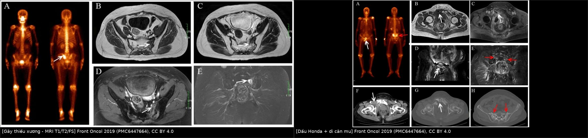
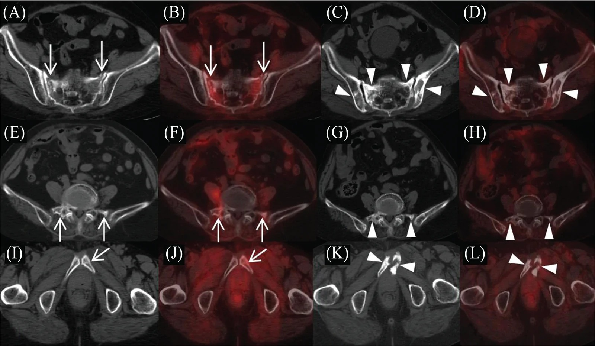
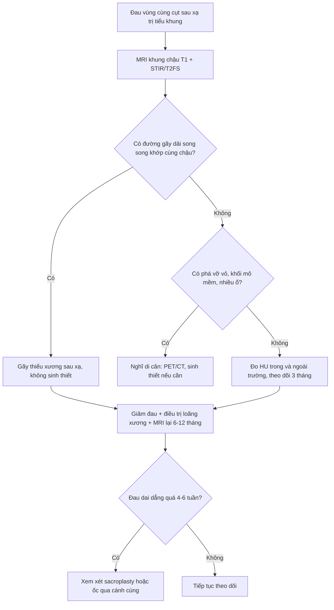
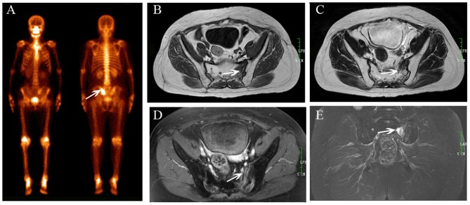
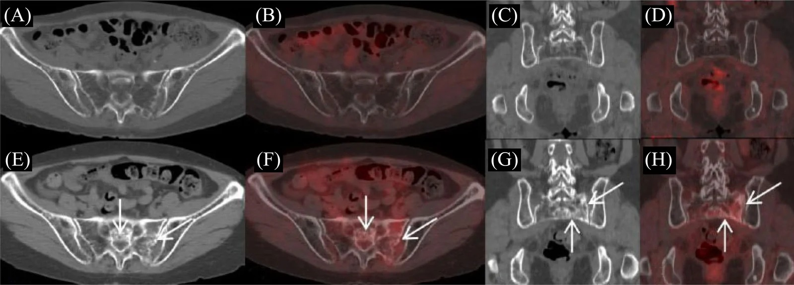
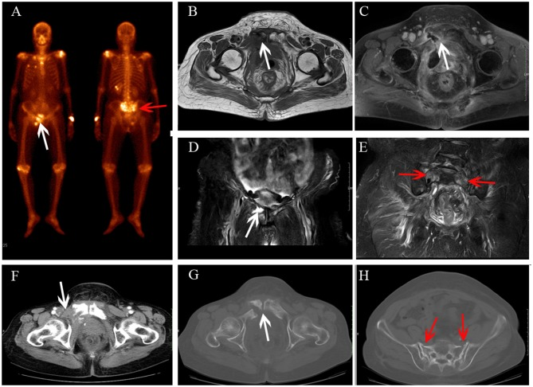

# 1718 — Gãy xương cùng do thiếu xương sau xạ trị tiểu khung: phân biệt với di căn xương

**Tags:** `pattern:phu-tuy-xuong` `pattern:gay-thieu-xuong` `vung:khung-chau` `vung:cot-song-cung-cut` `score:pet-suv` `protocol:MRI-khung-chau` `anatomy:xuong-cung` `incidentaloma:di-can-xuong`
**Mức chắc chắn (certainty):** tổng hợp y văn (literature synthesis) — ghép **phân tích gộp 11.272 bệnh nhân** (Arch Orthop Trauma Surg 2026, PMC13009100), **đoàn hệ 121 bệnh nhân có liều–thể tích** (In Vivo 2026, PMC13321962), **32 bệnh nhân PET/CT định lượng** (Curr Med Imaging 2026, PMC13584083) và **40 bệnh nhân/57 tổn thương đối chiếu MRI với chuẩn ≥ 12 tháng** (Front Oncol 2019, PMC6447664). Không có ca do nhóm tự chụp.

> **Câu hỏi thực hành:** bệnh nhân **62 tuổi**, ung thư cổ tử cung **xạ trị 14 tháng trước**, đau vùng cùng cụt tăng khi ngồi/đứng. PET/CT giám sát: **dải ngấm FDG nhẹ hai cánh xương cùng, SUVmax 2,4**, không có ổ khác. Bác sĩ lâm sàng hỏi: **"Di căn xương hay gãy do xạ? Có phải sinh thiết không?"**
> Bài chốt **năm điểm**: **(1) gãy thiếu xương sau xạ gặp 17% (KTC 15–20%) sau xạ tiểu khung — đây là chuyện thường, không phải chuyện hiếm; (2) hình ảnh chốt là ĐƯỜNG GÃY dọc/ lượn sóng SONG SONG khớp cùng chậu trên nền xương thưa, KHÔNG phá vỡ vỏ, KHÔNG khối mô mềm; (3) FDG ngấm NHẸ theo dải (SUVmax trung bình 2,45 ± 0,74; tỉ lệ so gan 1,46 ± 0,38) — khác di căn ngấm cục, đậm; (4) xương trong trường chiếu mất **~41 HU** so với ngoài trường (36,8 vs 78,0 HU, p < 0,001) — mật độ xương là dấu hiệu bối cảnh; (5) **không sinh thiết** khi hình ảnh điển hình; sinh thiết xương đã xạ dễ không lành và dễ nhiễm.**

*Trái: gãy thiếu xương xương cùng sau xạ — đường gãy thấy trên T1, T2 và FS T2 (mũi tên trắng). Phải: cùng bệnh nhân vừa có dấu "Honda" ở xương cùng vừa có di căn xương mu (mũi tên đỏ) — tình huống bẫy điển hình. Nguồn: Front Oncol 2019 (PMC6447664), CC BY 4.0. Ảnh ghép letterbox, giữ nguyên tỉ lệ.*

## 1. Tổng quan bệnh học – cơ chế hình ảnh: vì sao xương cùng "nứt" sau tia xạ

- **Bệnh học:** tia xạ liều trị liệu làm tổn thương **tế bào tạo xương, tế bào nội mô xoang tủy và mạch máu nhỏ** → giảm sinh xương, **xơ hóa tủy, giảm mật độ khoáng tại chỗ**. Xương vẫn còn hình dạng nhưng **"giòn" như gỗ khô": chịu lực kém dù không có khối u xâm lấn**. Xương cùng là nơi chịu lực nén dọc trục của toàn bộ thân mình, truyền qua **hai cánh xương cùng** xuống khung chậu → đó là lý do gãy thường **hai bên, đối xứng, chạy dọc song song khớp cùng chậu** (dấu "Honda"/H-sign trên xạ hình).
- **TẠI SAO mật độ xương là dấu hiệu định lượng:** trên CT, mô xương đã xạ mất khoáng nhưng **không mất thể tích** → HU giảm. Đo trên 32 bệnh nhân: **36,8 ± 28,6 HU trong trường chiếu so với 78,0 ± 37,3 HU ngoài trường chiếu (p < 0,001)** (PMC13584083). Một ca cụ thể: **39 HU trong trường so với 110 HU ngoài trường**, ranh giới đúng mép trường chiếu — nghĩa là **bản đồ HU vẽ lại được hình dạng trường xạ**.
- **TẠI SAO MRI là modality chốt (vật lý từng chuỗi):**
  - **Phù tủy** = nước tự do tăng → **T1 giảm tín hiệu, STIR/T2 fat-sat tăng tín hiệu** mạnh.
  - **Đường gãy** là **dải mô xơ + mảnh xương chết, không có tế bào/mỡ** → **giảm tín hiệu trên CẢ T1 và T2/STIR** (dải tối cắt ngang vùng phù sáng). Chính "dải tối trong vùng sáng" là thứ phân biệt **gãy** với **di căn** (di căn thay tủy bằng tế bào → T1 tối nhưng T2 **sáng**, và **phá vỡ vỏ**, và có **mô mềm**).
  - Sau tiêm, vùng gãy **ngấm thuốc** do viêm sửa chữa — đừng nhầm với u; dấu hiệu phân biệt vẫn là **hình dạng dải + không có khối**.
- **TẠI SAO PET/CT không "bắt" được gãy thiếu xương mạnh:** quá trình sửa chữa xương là **viêm + tạo xương**, không phải tăng sinh tế bào ác tính → **FDG nhẹ**. Đo 32 bệnh nhân: ngấm **nhẹ, lan tỏa/ dải rải rác song song khớp cùng chậu ở 96,8% (31/32)**, **SUVmax trung bình 2,45 ± 0,74 (dải 1,5–5,1; trung vị 2,4)**, **tỉ lệ so gan (SUR-BP) 1,46 ± 0,38**; trong theo dõi, một ca **giảm từ 3,4 xuống 1,4** (PMC13584083). Di căn thường **ngấm cục, đậm, không theo hình khớp**.
- **Thời gian — khi nào nghĩ tới:** trung vị **14 tháng sau xạ trị** (PMC13584083); trong loạt 121 bệnh nhân, gãy xuất hiện trong theo dõi sau xạ, tỷ lệ **25,6% (31/121)** (PMC13321962). **93,7% là nữ đã mãn kinh** — nền loãng xương cộng thêm.
- **Tần suất nền — con số phải nhớ:** gộp **11.272 bệnh nhân**: **17% (KTC 95%: 15–20%)** gãy thiếu xương khung chậu sau xạ; **xương cùng/khớp cùng chậu chiếm 71%**, **xương mu 11,6%**, thân xương cùng **41,9%** (PMC13009100). Phân nhóm: **xạ triệt căn 25% vs xạ bổ trợ 6%**; **IMRT 8%**, **3D-CRT 11%**, **AP/PA 22%**, **4 trường 18%**, **VMAT/carbon-ion 30%** (liều ≥ 55 Gy); **MRI phát hiện 19%** so với modality khác **14%**.
- **Yếu tố nguy cơ đã kiểm định:** trong 121 bệnh nhân, **tuổi ≥ 55**, **BMI ≤ 20,5**, **liều trung bình xương cùng ≥ 38 Gy**, **HU xương cùng < 142** liên quan có ý nghĩa ở phân tích đơn biến; **BMI thấp và liều trung bình cao** vẫn độc lập ở đa biến; **38 Gy là điểm cắt ROC** của loạt này (PMC13321962). Gãy **tập trung ở vùng liều cao hơn trong xương cùng** (phân tích hợp nhất CT hoạch định với CT theo dõi).

## 2. Mẫu hình + chẩn đoán phân biệt theo vị trí (Gamut)

- **Mẫu hình 1 — gãy thiếu xương điển hình:** **hai cánh xương cùng, dải phù đối xứng, đường gãy dọc song song khớp cùng chậu**, không phá vỡ vỏ; thường **kèm gãy mu (28,1%)**, **cánh chậu (25%)**, **mỏm ngang L5 hai bên (6,2%)** (PMC13584083). Vị trí hay gặp: **S1–S3**, và **một bên cánh (53,1%) / hai bên (37,5%) / lan thân (9,4%)**.
- **Mẫu hình 2 — gãy một bên "không điển hình":** chỉ một cánh xương cùng → dễ đọc thành di căn; tìm **đường gãy + xương thưa quanh + bờ vỏ nguyên**.
- **Mẫu hình 3 — gãy + di căn cùng lúc:** đây là bẫy thật (Hình phải của composite): tổn thương **dạng dải ở xương cùng** (lành) nhưng **ổ tiêu xương + mô mềm ở xương mu** (ác). **Không được "thỏa mãn tìm kiếm"** — phải đọc hết khung chậu.
- **Gamut theo vị trí tổn thương ở khung chậu đã xạ:**
  - **Xương cùng/khớp cùng chậu:** gãy thiếu xương (hay nhất), di căn, sacroiliitis, gãy do loãng xương do corticoid, viêm xương sau xạ.
  - **Xương mu/ngành mu:** gãy thiếu xương, di căn, **gãy do suy yếu (pathological)**, viêm xương–hoại tử do xạ.
  - **Cánh chậu/thân chậu:** gãy thiếu xương, di căn xương (ung thư phụ khoa hay di căn), di căn tiêu xương, tổn thương do xạ (xơ đặc).
  - **Thân đốt L5:** gãy xẹp do loãng xương, di căn, gãy do xạ.
- **Mnemonic "SIF" để không bỏ:** **S**ong song khớp cùng chậu (đường gãy) — **I**t's osteopenic (xương thưa trong trường chiếu) — **F**racture line on all sequences (đường gãy thấy trên mọi chuỗi).

## 3. Bảng so sánh phân biệt (ma trận đối chiếu)

| Thực thể (entity) | Hình ảnh điển hình | Chốt vào (rule-in) | Chốt loại (rule-out) | Gợi ý xác nhận |
|---|---|---|---|---|
| **Gãy thiếu xương sau xạ (SIF)** | Dải phù tủy **đối xứng hai cánh xương cùng**, **đường gãy dọc/ lượn sóng song song khớp cùng chậu** thấy trên **T1 + T2 + FS T2**; vỏ nguyên; **HU 36,8 vs 78,0** trong/ngoài trường; FDG **nhẹ dạng dải**, **SUVmax 2,45 ± 0,74**, **SUR-BP 1,46 ± 0,38** | **Đường gãy trên mọi chuỗi + xương thưa đúng trường chiếu + không mô mềm** | **Phá vỡ vỏ, khối mô mềm, ngấm FDG cục đậm → không phải SIF** | MRI T1 + STIR/T2FS; **theo dõi 12 tháng** (tổn thương giảm dần) |
| **Di căn xương** | Ổ **T1 tối, T2/STIR sáng**, thường **nhiều ổ, không đối xứng**, **phá vỡ vỏ**, **mô mềm**, có thể xơ đặc; FDG **cục, đậm** | **Phá vỡ vỏ + mô mềm + ngấm cục + nhiều ổ ngoài trường xạ** | Đường gãy dạng dải + bờ vỏ nguyên → nghiêng SIF | MRI + PET/CT + so phim cũ; **sinh thiết chỉ khi vẫn không chắc** |
| **Viêm xương sau xạ** | Phù tủy lan rộng, **ngấm thuốc mạnh**, có thể **khí trong mô mềm**, loét da/ đường rò | **Khí trong mô mềm + đường rò + sốt** | Không khí, không rò, không sốt → ít nghĩ | Cấy, CT; MRI có thể quá đánh giá |
| **Sacroiliitis (viêm khớp cùng chậu)** | Phù **quanh khớp**, **bờ khớp mờ**, có thể **dính khớp**; hai bên đối xứng | **Phù quanh khớp + bờ khớp mờ + bối cảnh viêm khớp trục** | Phù ngoài khớp, đường gãy trong xương → SIF | MRI; HLA-B27, lâm sàng |
| **Gãy do loãng xương (không do xạ)** | Giống SIF nhưng **không tương ứng trường chiếu**, xương thưa toàn khung | **HU thấp toàn thân + không ranh giới trường xạ** | **Ranh giới HU đúng mép trường chiếu → do xạ** | So sánh HU trong/ngoài trường; DXA |
| **Tái phát u tại xương cùng** | Khối **mô mềm** trong/ quanh xương, **tiêu xương không bờ**, xâm lấn ống sống | **Khối mô mềm + tiêu xương + chèn ép rễ** | Chỉ có dải phù + đường gãy → không phải tái phát | MRI + PET/CT; sinh thiết khi có khối |

*Hai bối cảnh của cùng bài toán: bên trái là gãy thiếu xương thuần (đường gãy dải, không khối); bên phải là bệnh nhân có **cả** dấu Honda **và** di căn xương mu — bẫy "thỏa mãn tìm kiếm". Nguồn: Front Oncol 2019 (PMC6447664), CC BY 4.0.*

### Dấu hiệu cần đo (đừng chỉ mô tả)
- **Đường gãy:** có/không, hướng (song song khớp cùng chậu?), độ dài, có **phá vỡ vỏ** không.
- **Mật độ:** HU trong trường so với ngoài trường (cùng độ cao, cùng cửa sổ); ngưỡng bất thường gợi ý: **< 142 HU** (điểm cắt đơn biến của loạt 121 ca) (PMC13321962).
- **SUVmax và SUR-BP:** SIF **≈ 2,45 / 1,46**; ghi cả **hình thái** (dải song song khớp) vì hình thái mạnh hơn con số (PMC13584083).
- **Tổn thương kèm theo:** đọc **toàn khung chậu** (mu, chậu, L5) — vì 28,1% / 25% / 6,2% có gãy kèm (PMC13584083).

*Ba bệnh nhân sau xạ trị cổ tử cung: đường gãy **răng cưa, song song khớp cùng chậu** ở hai cánh xương cùng (mũi tên), kèm gãy mỏm ngang L5, ngành mu trái và khớp mu — gãy "theo chuỗi" của cùng một cơ chế thiếu xương. Nguồn: Curr Med Imaging 2026 (PMC13584083), CC BY 4.0.*

## 4. Protocol chụp + hệ phân tầng xử trí

- **Khi nào chụp:** đau vùng cùng cụt/ mông/ háng **khởi phát sau xạ tiểu khung**, đặc biệt **6–24 tháng** sau xạ; đau khi **ngồi/đứng/đi**; đau không tương xứng với hình ảnh X-quang.
- **Trình tự modality:**
  1. **MRI khung chậu** (không cần cản quang là đủ): **T1W sagittal + axial**, **STIR hoặc T2 fat-sat axial/ coronal**, thêm **T1 sau tiêm** nếu cần phân biệt viêm/u. Đây là chuẩn.
  2. **CT** (lát ≤ 1 mm, cửa sổ xương): xác nhận **đường gãy, xơ đặc, vỏ**, và đo **HU** trong/ngoài trường.
  3. **PET/CT** khi cần loại trừ di căn toàn thân: đọc **hình thái ngấm** + **SUVmax** + **SUR-BP**.
  4. **Xạ hình xương** nếu không có MRI: tìm dấu **"Honda"/H-sign** — nhưng **chỉ 20/40 bệnh nhân có dấu này**, nên **không có Honda không loại trừ** (PMC6447664).
- **Độ chính xác của MRI (để biết mình tin được bao nhiêu):** 40 bệnh nhân, **57 tổn thương (43 gãy thiếu xương, 14 di căn)**: **Se 95,3% (41/43), Sp 92,8% (13/14), Acc 94,7% (54/57)**, **kappa 0,962** giữa 2 bác sĩ đọc (PMC6447664). Chuẩn tham chiếu: hình ảnh + lâm sàng + theo dõi **≥ 12 tháng**.
- **Xử trí (bằng chứng còn mỏng — không có RCT):**
  - **Giảm đau, vận động có kiểm soát, tránh chịu lực mạnh**; đa số giảm đau và lành trong **nhiều tháng** (theo dõi MRI 12–14 tháng cho thấy vùng phù **giảm dần**) (PMC6447664).
  - **Điều trị loãng xương nền** (canxi, vitamin D, thuốc chống hủy xương/ tạo xương) — quyết định theo DXA và bệnh nền; **chưa rõ** mức lợi ích riêng cho SIF sau xạ.
  - **Can thiệp xâm lấn** (bơm xi măng xương cùng/ sacroplasty, ốc qua cánh cùng) dành cho **đau dai dẳng, không giảm sau vài tuần điều trị nội khoa** — chỉ định theo đơn vị; **chưa có số liệu đối chứng**.
  - **Tránh sinh thiết** khi hình ảnh điển hình: xương đã xạ kém lành, nguy cơ nhiễm và rò; **sinh thiết chỉ khi có khối mô mềm/ tiêu xương/ tiến triển không khớp lời giải thích**.
- **Sơ đồ quyết định:**

## 5. Biến thể bình thường và cạm bẫy

- **Cạm bẫy 1 — "không có dấu Honda thì không phải gãy thiếu xương".** Trong loạt 40 bệnh nhân, **chỉ 20 người có H-sign** trên xạ hình (PMC6447664); độ nhạy của xạ hình thấp hơn MRI (gộp: **MRI phát hiện 19% vs modality khác 14%**) (PMC13009100). **MRI là chuẩn, không phải xạ hình.**
- **Cạm bẫy 2 — thỏa mãn tìm kiếm.** Thấy Honda ở xương cùng là "xong", bỏ qua **di căn xương mu** cùng bệnh nhân (hình phải của composite) — đúng ca trong PMC6447664 (Honda + di căn xương mu tiến triển thành gãy bệnh lý sau 6 tháng).
- **Cạm bẫy 3 — FDG "dương tính" là di căn.** SIF **ngấm FDG thật** (SUVmax 1,5–5,1) và có thể **tăng trong giai đoạn sớm**; dải **song song khớp cùng chậu** + **không có ổ ngoài trường xạ** quan trọng hơn con số SUV. Ngược lại, di căn xơ đặc có thể ngấm **không cao** — **SUV không phải chốt**.
- **Cạm bẫy 4 — xơ đặc sau xạ đọc thành "đáp ứng điều trị".** Xơ đặc quanh khớp cùng chậu gặp **87,5% (28/32)** ở SIF (PMC13584083) — đó là **phản ứng sửa chữa của gãy**, không phải u lành đi.
- **Cạm bẫy 5 — đường gãy bị "che" trên CT.** Chỉ **68,7% (22/32)** thấy đường gãy giảm đậm độ trên CT (PMC13584083); **CT âm không loại trừ** — cần MRI.
- **Cạm bẫy 6 — gãy tiến triển/ gãy mới.** Trong theo dõi, có ca **gãy mới ở cánh chậu phải** sau 14 tháng (PMC6447664). Đau tăng lại sau một đợt ổn định → chụp lại, đừng mặc định "đau do xạ".
- **Biến thể bình thường dễ nhầm:** **tủy đỏ tái chuyển** sau xạ/ hóa trị (T1 tối hơn, STIR hơi sáng, **đối xứng, không đường gãy**); **đảo tín hiệu mỡ lành** quanh khớp cùng chậu; **mảnh xương bờ khớp** (osteophyte) tạo "đường giả" trên một lát cắt — xem lại nhiều bình diện.

## 6. Tự lượng giá — Blind Quiz

**Ca 1 — Nữ sau xạ trị cổ tử cung, đau vùng cùng cụt. Nhìn ảnh, mô tả trước.**

- Gợi ý lâm sàng: xạ trị tiểu khung vì ung thư cổ tử cung; đau vùng cùng cụt một bên; xạ hình có ổ tăng hấp thu.
- Câu hỏi: Có đường gãy không? Nó thấy trên những chuỗi nào? 3 chẩn đoán phân biệt? Dấu hiệu nào loại trừ di căn?

<b>Bấm để hiện đáp án (findings + chẩn đoán)</b>

- Dấu hiệu: trên **T1 (B)**, **T2 (C)**, **T1 sau tiêm (D)** và **FS T2 coronal (E)** đều có **đường gãy** (mũi tên trắng) trong vùng **phù tủy giảm T1/ tăng T2**; xạ hình (A) tăng hấp thu kiểu "Honda" thể không điển hình.
- Chẩn đoán: **gãy thiếu xương sau xạ** — vì **đường gãy thấy trên mọi chuỗi** + **bờ vỏ nguyên, không khối mô mềm**.
- Phân biệt: di căn xương (T2 sáng, phá vỡ vỏ, mô mềm), viêm xương sau xạ (khí, rò), sacroiliitis (phù quanh khớp).
- Nguồn ảnh: Front Oncol 2019 (PMC6447664), CC BY 4.0.

**Ca 2 — Nữ 68 tuổi, 30 tháng sau xạ trị, đau háng. Nhìn CT/PET, quyết định trước khi đọc đáp án.**

- Gợi ý lâm sàng: xạ trị cổ tử cung; đau háng > 1 tháng; PET/CT được chỉ định vì "theo dõi sau điều trị".
- Câu hỏi: Hai thời điểm 10 tháng và 30 tháng khác nhau thế nào? FDG có "nóng" không? Di căn hay gãy?

<b>Bấm để hiện đáp án (findings + chẩn đoán)</b>

- 10 tháng (A–D): xương thưa, **không tăng FDG**. 30 tháng (E–H): **đường gãy giảm đậm độ/ gãy vỏ** ở cánh xương cùng trái + thân, **xơ đặc không bờ rõ** quanh đó, **FDG ngấm nhẹ lan tỏa** (SUVmax **3,0**).
- Chẩn đoán: **gãy thiếu xương sau xạ** — ngấm **nhẹ + dạng dải**, không có ổ đậm/ mô mềm; mật độ xương giảm đúng trường chiếu.
- **Phản biện:** SUVmax 3,0 nằm **trong dải SIF (1,5–5,1)**, nhưng cũng có thể gặp ở di căn nhỏ — vì vậy phải đọc **hình thái** và **theo dõi**, không chốt bằng SUV.
- Nguồn ảnh: Curr Med Imaging 2026 (PMC13584083), CC BY 4.0.

**Ca 3 — Nữ 67 tuổi, rò âm đạo–tiêu hóa sau xạ. Nhìn ảnh, tìm "cái bẫy".**

- Gợi ý lâm sàng: ung thư cổ tử cung đã xạ; dịch phân qua âm đạo; xạ hình có **hai ổ** tăng hấp thu.
- Câu hỏi: Ổ nào lành, ổ nào ác? Dấu hiệu nào trên MRI/CT nói điều đó? Sai lầm hay gặp là gì?

<b>Bấm để hiện đáp án (findings + chẩn đoán)</b>

- Xương cùng: **dấu Honda** (mũi tên đỏ) — **gãy thiếu xương**, phù tủy đối xứng, **không khối**.
- Xương mu phải: **thay đổi mô mềm trên T1 và T1 sau tiêm (B, C)**, **tiêu xương trên FS T2 (D)**, và trên CT sau 6 tháng: **khối mô mềm + gãy bệnh lý** (F, G) → **di căn xương**.
- Bài học: **thỏa mãn tìm kiếm** — thấy Honda rồi dừng lại là bỏ di căn. Luôn đọc **toàn khung chậu** và so **vỏ xương + mô mềm**, không chỉ nhìn tín hiệu tủy.
- Nguồn ảnh: Front Oncol 2019 (PMC6447664), CC BY 4.0.

## Bài liên quan chéo
- [1626 – Tái phát âm đạo sau xạ trị](../1626-tai-phat-vom-am-dao-sau-xa-tri/lesson.md) (cùng bối cảnh "đau sau xạ": đừng gán mọi thứ cho tái phát)
- [581 – Di căn não–xương ung thư phụ khoa](../581-di-can-nao-xuong-ung-thu-phu-khoa/lesson.md) (phía ác tính của ma trận)
- [3017 – Gãy nén đốt sống loãng xương, vertebroplasty](../3017-gay-nen-dot-song-loang-xuong-vertebroplasty/lesson.md) (cùng nguyên lý gãy thiếu xương + can thiệp xi măng)
- [307 – Gãy xẹp đốt sống sau SBRT](../307-gay-xep-dot-song-sau-sbrt/lesson.md) (gãy do xạ ở trục dọc)
- [306 – Theo dõi sau SBRT di căn xương RCC](../306-theo-doi-sau-sbrt-di-can-xuong-rcc/lesson.md) (phân biệt đáp ứng – tiến triển trên xương)

## Ảnh
- `images/1718_gay-xuong-cung_MRI_PMC6447664-F1.jpg`, `images/1718_gay-xuong-cung_MRI-xa-hinh_PMC6447664-F4.jpg` — Front Oncol 2019, PMC6447664, CC BY 4.0.
- `images/1718_gay-xuong-cung_CT-PET_PMC13584083-F1.jpg`, `...-F3.jpg`, `...-F4.jpg` — Curr Med Imaging 2026, PMC13584083, CC BY 4.0.
- `images/composite_sif-vs-di-can.jpg` — ảnh ghép letterbox từ 2 ảnh Front Oncol (CC BY 4.0), giữ nguyên ảnh gốc.
- Chi tiết giấy phép từng ảnh: `images/CREDITS.md`.

> Không dùng để chẩn đoán độc lập khi chưa có người hướng dẫn.
