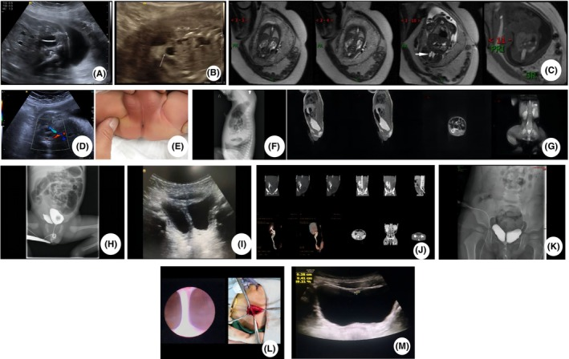
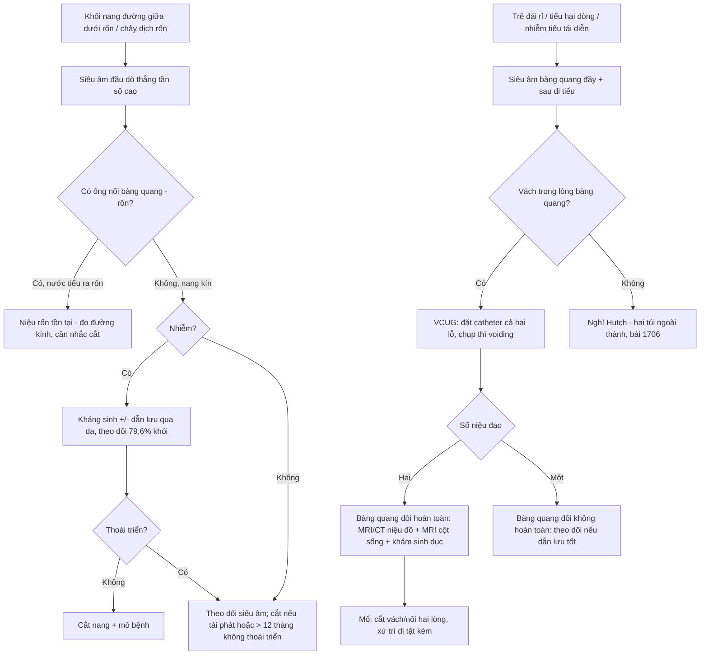
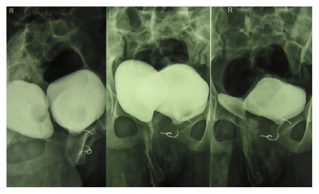
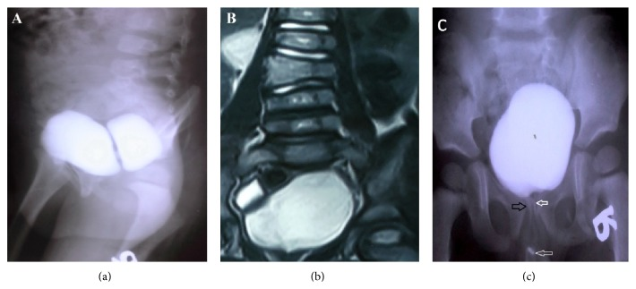
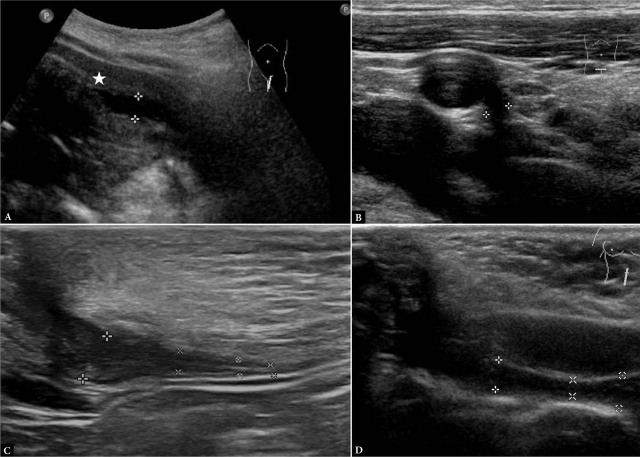
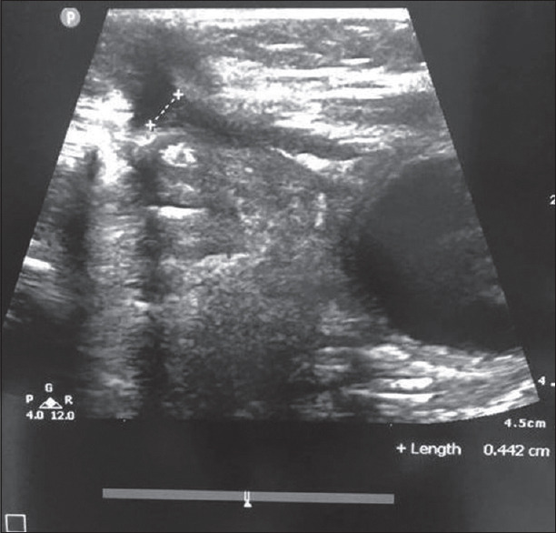

# 1719 — Bàng quang đôi, vách bàng quang và nang niệu rốn ở trẻ (bladder duplication, vesical septum & urachal cyst)

**Tags:** `pattern:bang-quang-doi` `pattern:bach-trong-long-bang-quang` `pattern:khoi-nang-duong-giua` `pattern:ro-ron` `pattern:u-nuoc-than` `pattern:di-tat-cot-song` `vung:bang-quang` `vung:ron-bung` `vung:khung-chau` `protocol:VCUG` `protocol:SA-bung` `protocol:MRI-bang-quang` `protocol:CT-nieu-do` `incidentaloma:khong`

**Mức chắc chắn (certainty):** tổng hợp y văn (literature synthesis) — **1 ca nguyên văn có ảnh siêu âm thai + MRI thai + CT niệu đồ** (PMC10980783), **1 ca bàng quang đôi hoàn toàn có VCUG + MRI niệu** (PMC4745289), **1 ca bàng quang đôi mặt phẳng vành + MRI cột sống** (PMC4465739), **1 ca bàng quang đôi không hoàn toàn có IVU + MRI** (PMC4310127), **1 loạt 15 trẻ đối chiếu siêu âm với mô bệnh niệu rốn** (PMC12777947), **1 loạt 49 nhũ nhi nang niệu rốn nhiễm** (PMC13462251), cùng 3 ca/bài về niệu rốn có ảnh (PMC11968037; PMC10064585; PMC11180779). Chỗ suy luận được ghi rõ.

> **Câu chốt:** Hai bệnh cảnh trong một bài vì cùng một trục: **đường giữa dưới rốn**. Ba con số quyết định cách đọc: **(1)** bàng quang đôi **KHÔNG phải "hai cái bóng hai bên"** — cái chốt là **vách trong lòng bàng quang (septum)** trên VCUG, còn **"bàng quang Mickey Mouse" của bài 1706 là HAI TÚI THỪA NGOÀI THÀNH** (hai "tai" nằm ngoài bàng quang) → **đọc nhầm là cắt nhầm túi thừa**; **(2)** bàng quang đôi **hoàn toàn** đi kèm **dị tật sinh dục ngoài 90%**, **dị tật tiêu hóa dưới tới 42%**, **dị tật cột sống 15%** → luôn phải **chụp cột sống và khám sinh dục**; **(3)** **siêu âm phân loại niệu rốn chỉ khớp mô bệnh 70% (κ 0,66)** nên **loại niệu rốn quyết định có mổ hay theo dõi**, và **nang niệu rốn nhiễm ở nhũ nhi tự khỏi 79,6%** — mổ ngay trong giai đoạn viêm là sai lầm (PMC12777947; PMC4310127; PMC13462251).

## 1. Tổng quan bệnh học – cơ chế hình ảnh (TẠI SAO)

### 1.1 Bàng quang đôi — phôi thai và phân loại

- **Phôi thai:** bàng quang hình thành từ **xoang niệu sinh dục (urogenital sinus)**; bàng quang đôi là hậu quả của **một vách trung mô chia đôi ống niệu–sinh dục** ở giai đoạn rất sớm. Vì thế tổn thương **không đơn thuần là "niệu"**: vách phôi này cùng lúc có thể chia **trực tràng, âm đạo, tử cung, cột sống** → **"hội chứng nhân đôi đuôi (caudal duplication syndrome)"**.
- **Phân loại Abrahamson (kinh điển, vẫn dùng):**
  - **Hoàn toàn (complete):** hai bàng quang **riêng biệt**, mỗi bên **một niệu đạo riêng**; có thể **kèm hai tử cung/hai âm đạo** hoặc **dương vật đôi**.
  - **Không hoàn toàn (incomplete):** hai khoang **thông nhau**, **một niệu đạo chung** — thường **không cần mổ** nếu cả hai nửa dẫn lưu tốt.
  - **Mặt phẳng (plane):** **dọc (sagittal)** = hai bàng quang **cạnh nhau**, phổ biến hơn **2,5 : 1**; **vành (coronal)** = **trước–sau**, thường đi kèm **tật lỗ tiểu trên (epispadias)/phức hợp lỗ tiểu trên – lộ bàng quang** và **dãn khớp mu**.
- **Hình ảnh vì sao vậy:** nước tiểu là **dịch 0–10 HU**, **T1 tối – T2 rất sáng**; vách giữa là **cấu trúc mô mềm thật** (không phải dịch) → trên VCUG là **khuyết đầy (filling defect)** chia bóng cản quang thành hai nửa; trên siêu âm là **dải echo giữa hai khoang trống âm**; trên MRI là **dải tín hiệu trung gian giữa hai túi nước tiểu T2 sáng**. Chẩn đoán nằm ở **vách + hai lỗ niệu đạo + quan hệ với niệu quản**, không ở "số lượng bóng".
- **Đi kèm (bắt buộc nhớ):** trong **40 ca bàng quang đôi hoàn toàn**: **90%** có **nhân đôi cơ quan sinh dục ngoài**, **tới 42%** có **nhân đôi ruột dưới**, **15%** có **spina bifida/meningocele/myelomeningocele** (PMC4310127 dẫn Kossow & Morales).
- **Vì sao phải đọc cả khung chậu:** **dãn khớp mu (pubic diastasis)** và **giảm sản xương cùng** là dấu **có sẵn trên phim** giúp phân biệt **bàng quang đôi thật** với **túi thừa hai bên** — ca 14 tuổi trong bài có **dãn khớp mu + giảm sản xương cùng** (PMC4745289).

### 1.2 Niệu rốn (urachus) — 4 thể và TẠI SAO thành nang

- **Phôi thai:** niệu rốn nối **đỉnh bàng quang với rốn**; bình thường **xơ hoá thành dây rốn giữa (median umbilical ligament)**. Khi tồn tại từng đoạn → **4 thể** (định nghĩa theo hình 1 của PMC12777947):
  1. **Túi niệu rốn (urachal diverticulum):** đoạn **phía dưới (sát bàng quang)** không xơ → **đỉnh bàng quang lồi lên** thành túi.
  2. **Nang niệu rốn (urachal cyst):** **hai đầu xơ, đoạn giữa còn** → **nang kín** ở đường giữa.
  3. **Xoang niệu rốn (urachal sinus):** đoạn **phía rốn** không xơ → **ngách hở ra rốn**, chảy dịch.
  4. **Niệu rốn tồn tại (patent urachus):** **toàn bộ ống còn** → **nước tiểu chảy ra rốn**.
- **Tần suất:** **nang niệu rốn ~1/5.000 trẻ sinh sống** (PMC10064585); trong các loạt niệu rốn có triệu chứng, **nang chiếm 52–75%**, **xoang ~46%** (các loạt khác nhau, PMC12777947).
- **TẠI SAO nang "đặc/giả đặc" khi nhiễm:** biểu mô niệu rốn **tiết nhầy** + **bong tế bào** → dịch đặc, có **echo bên trong**, không hoàn toàn trống âm. Khi **nhiễm**, thành nang **dày, ngấm thuốc**, mô mỡ quanh **tăng đậm độ** → trên CT **giả u/áp-xe**, dễ nhầm với **áp-xe ruột thừa hoặc khối u**. Trên MRI, dịch đặc **T1 có thể không tối hoàn toàn** — đây là lý do **một mình tín hiệu T1 không loại trừ nang nhiễm**.
- **Vì sao phải theo dõi/loại bỏ:** niệu rốn tồn tại là nơi phát sinh **ung thư biểu mô tuyến niệu rốn** ở người lớn (hiếm nhưng tiên lượng xấu) — lý do kinh điển để **cắt nang có triệu chứng/tái phát**, nhưng **không cắt mọi niệu rốn không triệu chứng ở trẻ**.
- **Số liệu điều trị (quan trọng cho quyết định):** **49 nhũ nhi ≤ 12 tháng** nang niệu rốn nhiễm lần đầu, điều trị **bảo tồn** (kháng sinh ± dẫn lưu qua da): **khỏi hoàn toàn 79,6% (39/49)**, **thoái triển ≥ 50% 8,2%**, **phải mổ 12,2% (6/49)**; biểu hiện rốn **79,6%**, **tạo áp-xe 75,5%** (PMC13462251).

### 1.3 Ngưỡng định lượng cần nhớ

| Chỉ số | Số liệu | Nguồn |
|---|---|---|
| Tỉ lệ mặt phẳng bàng quang đôi | **dọc : vành = 2,5 : 1** | PMC4310127 |
| Dị tật đi kèm (bàng quang đôi hoàn toàn, n = 40) | **sinh dục ngoài 90%** · **tiêu hóa dưới ≤ 42%** · **cột sống 15%** | PMC4310127 (dẫn Kossow & Morales) |
| Nang niệu rốn | **~1/5.000 trẻ sinh sống** | PMC10064585 |
| Phân bố thể niệu rốn | **nang 52–75%** · **xoang ~46%** (các loạt khác nhau) | PMC12777947 |
| Siêu âm vs mô bệnh (niệu rốn) | **khớp 70%**, **κ 0,66 (KTC 0,3–1)**, n = 15, tuổi trung vị **0,2 tuổi** | PMC12777947 |
| Nang niệu rốn nhiễm ở nhũ nhi (n = 49) | **khỏi hoàn toàn 79,6%** · thoái triển **8,2%** · **mổ 12,2%**; áp-xe **75,5%** | PMC13462251 |
| Chẩn đoán trước sinh | **27,5 tuần** đã thấy vách bàng quang + thận đa nang; **MRI thai** xác nhận bàng quang đôi | PMC10980783 |
| Tuổi biểu hiện bàng quang đôi hoàn toàn | **14 tuổi** (đái rỉ từ nhỏ) — chẩn đoán muộn là quy luật | PMC4745289 |
| Tuổi biểu hiện thể vành | **6 tuổi** (tiểu hai dòng) + **dương vật đôi** | PMC4465739 |

## 2. Mẫu hình + chẩn đoán phân biệt theo vị trí (gamut)

- **Mẫu hình A — VÁCH trong lòng bàng quang, hai khoang đều chứa nước tiểu:** **bàng quang đôi** (hoàn toàn nếu hai niệu đạo, không hoàn toàn nếu một niệu đạo); phân biệt **túi thừa Hutch hai bên ("Mickey Mouse")** — túi **ngoài thành**, **không có vách chia lòng**; **bàng quang thần kinh/trabeculation** — nhiều giả túi nhỏ, không vách; **vách do bóng catheter/bóng đổ đầy**.
- **Mẫu hình B — khối nang đường giữa DƯỚI RỐN ở trẻ:** **nang niệu rốn**; phân biệt **nang ống niệu–rốn (omphalomesenteric/Meckel)** — thường **lệch phải, nối ruột**, **nang buồng trứng** (bé gái), **nang mạc treo**, **áp-xe thành bụng**, **u máu rốn**.
- **Mẫu hình C — chảy DỊCH/NƯỚC TIỂU ra rốn:** **niệu rốn tồn tại** (nước tiểu, liên tục) · **xoang niệu rốn** (dịch nhầy, ngắt quãng) · **u hạt rốn (umbilical granuloma)** (mô đỏ, không có ống) · **ống niệu–rốn tồn tại** (dịch phân, hôi).
- **Mẫu hình D — TIỂU HAI DÒNG/hai lỗ niệu đạo:** **bàng quang đôi hoàn toàn** · **niệu đạo đôi** (một bàng quang) · **lỗ tiểu trên (epispadias)** · **rò niệu đạo–trực tràng**.
- **Mẫu hình E — hai bàng quang + BẤT THƯỜNG CỘT SỐNG:** **hội chứng nhân đôi đuôi**; phân biệt **bàng quang đôi đơn thuần** (không có dị tật ruột/sinh dục), **thoát vị tủy–màng tủy**, **dính tủy (tethered cord)** — đều phải **MRI cột sống** trước mổ.
- **Gợi nhớ:** **vách ở TRONG = đôi thật**; **tai ở NGOÀI = Hutch**; **nang ở GIỮA, dưới rốn, không liên quan ruột = niệu rốn**.

## 3. Bảng so sánh phân biệt (ma trận đối chiếu)

| Thực thể (entity) | Hình ảnh điển hình (US/VCUG/CT/MRI) | Chốt vào (rule-in) | Chốt loại (rule-out) | Gợi ý xác nhận |
|---|---|---|---|---|
| **Bàng quang đôi hoàn toàn** | **Hai bàng quang riêng**, **hai niệu đạo**; VCUG: hai bóng, **hai ống dẫn thuốc**; thường **dãn khớp mu**, **giảm sản xương cùng** | **Hai niệu đạo đổ riêng vào từng bàng quang** + vách mô mềm giữa hai lòng | Một niệu đạo chung + hai khoang thông nhau → **không hoàn toàn**, không phải thể này | **VCUG có thì đi tiểu + đặt catheter cả hai lỗ**; MRI/CT niệu đồ trước mổ |
| **Bàng quang đôi không hoàn toàn** | **Vách chia lòng**, hai khoang **thông nhau**, **một niệu đạo**; có thể chỉ thấy **khuyết đầy** khi bơm cản quang | **Vách + thông thương + một niệu đạo**; hai nửa **dẫn lưu tốt** | Hai niệu đạo riêng, hai bóng tách biệt → thể hoàn toàn | VCUG (thì làm đầy + đi tiểu); siêu âm sau đi tiểu |
| **Túi thừa Hutch hai bên ("Mickey Mouse")** | **Hai túi NGOÀI thành** cạnh lỗ niệu quản, **to lên khi đi tiểu**; **không có vách trong lòng** | **Cổ túi thấy được**, cản quang **vào túi ở thì voiding**; **VUR cùng bên** | **Vách chia lòng bàng quang trung tâm** → bàng quang đôi | VCUG thì voiding; nội soi (bài 1706) |
| **Nang niệu rốn** | Khối **đường giữa dưới rốn**, **không thông bàng quang/rốn**; thành mỏng khi chưa nhiễm, **dày + ngấm thuốc khi nhiễm** | **Nang kín ở đường giữa**, **hai đầu xơ**, không thấy ống nối rốn–bàng quang | **Ống thông suốt rốn–bàng quang** (nước tiểu ra rốn) → **niệu rốn tồn tại** | Siêu âm đầu dò thẳng tần số cao; CT/MRI khi nhiễm; mô bệnh |
| **Niệu rốn tồn tại** | **Ống echo thấp chạy từ đỉnh bàng quang tới rốn**; **nước tiểu ra rốn**; trên VCUG cản quang **đi lên rốn** | **Thấy ống liên tục bàng quang–rốn** (đo được đường kính, mm) | **Nang kín**, không có ống → không phải thể này | Siêu âm + VCUG (bơm qua rốn hoặc qua bàng quang) |
| **Xoang niệu rốn** | Ngách **hở ra rốn**, **không thông bàng quang**; hay **chảy dịch nhầy tái phát** | **Ngách từ rốn đi xuống, cụt**, không tới bàng quang | Ống tới bàng quang → niệu rốn tồn tại | Siêu âm + chụp lỗ rốn (fistulogram) |

*Panel A–D: **siêu âm thai 27,5 tuần** thấy **vách bất thường trong bàng quang thai** (A, B) và **MRI thai xác nhận bàng quang đôi** (C); lặp lại 31 tuần vẫn thấy vách (D). Các panel còn lại (E–M): hậu môn không lỗ, VCUG với **khuyết đầy chia bàng quang thành hai nửa** (H), CT niệu đồ 3 tuổi: **thiểu sản thận trái + thận phải có niệu quản đôi + bàng quang đôi không hoàn toàn** (J). Nguồn: Clin Case Rep 2024 (PMC10980783), Fig. 1, **CC BY 4.0**.*

## 4. Protocol chụp + hệ phân tầng chẩn đoán

- **Siêu âm bụng–bàng quang (đầu tay, không bức xạ):** khảo sát **bàng quang đầy và sau đi tiểu**; tìm **vách echo giữa hai khoang**, **đo kích thước**, xem **ứ nước thận**, **dị tật sinh dục** (tử cung đôi, âm đạo vách). Với khối rốn: **đầu dò thẳng tần số cao (7–12 MHz)**, đo **chiều dài/đường kính ống** (mm) và **tìm chỗ nối bàng quang/rốn**.
- **VCUG (chuẩn vàng cho bàng quang đôi):** đặt catheter (và **đặt cả hai lỗ nếu nghi hoàn toàn**), bơm cản quang, chụp **AP + chếch + nghiêng**, **bắt buộc ảnh đang đi tiểu và sau đi tiểu**; ghi **số niệu đạo**, **vách**, **VUR** và **hình thái niệu đạo sau**; đọc thêm **khớp mu** và **xương cùng** trên phim.
- **MRI/CT niệu đồ (trước mổ):** xác định **quan hệ niệu quản – vách – cơ quan sinh dục – trực tràng**, phát hiện **thận niệu quản đôi, thận lạc chỗ/hình móng ngựa**, và **dị tật cột sống**. Không cần cản quang lặp lại nếu VCUG đã rõ — mục tiêu là **bản đồ mổ**.
- **Đánh giá chức năng thận:** siêu âm + **DMSA** khi có **ứ nước/thận nghi giảm chức năng** (ca thể vành có **thận hình móng ngựa, chức năng phải 60% – trái 40%**, PMC4465739).
- **Cột sống:** **siêu âm tủy** ở trẻ **< 3–6 tháng** (cửa sổ còn mở), **MRI cột sống** khi nghi **dính tủy/dị tật**; **15%** bàng quang đôi hoàn toàn có dị tật cột sống → **đừng bỏ qua**.
- **Niệu rốn:** siêu âm là đủ khi **thể đơn giản, không nhiễm**; **CT/MRI** khi **nhiễm, tái phát, hoặc nghi u**. Theo dõi bảo tồn hợp lý ở **nhũ nhi nang nhiễm lần đầu** (khỏi **79,6%**), **dẫn lưu qua da** khi áp-xe; **cắt nang** khi **tái phát, rò kéo dài, hoặc sau 12 tháng không thoái triển**.

## 5. Biến thể bình thường và cạm bẫy

- **Cạm bẫy 1 — "bàng quang Mickey Mouse" bị đọc thành bàng quang đôi:** hai **túi thừa Hutch** hai bên tạo **hai "tai" NGOÀI thành**; bàng quang đôi thật có **vách TRONG lòng**. Đọc **vị trí vách** (trong hay ngoài) và **thì voiding**, không đếm bóng (bài 1706; PMC4310127).
- **Cạm bẫy 2 — bỏ sót thể KHÔNG hoàn toàn vì "chỉ thấy một bàng quang":** khi bàng quang căng, **vách bị ép** và chỉ còn **khuyết đầy mờ**; phải chụp **thì đi tiểu + sau đi tiểu** và đối chiếu siêu âm. Ca 27,5 tuần chỉ thấy **"vách bất thường"**, phải lặp siêu âm + MRI mới xác nhận (PMC10980783).
- **Cạm bẫy 3 — không khám sinh dục/không chụp cột sống:** **90%** có nhân đôi sinh dục ngoài, **15%** có dị tật cột sống. Ca 14 tuổi có **hai niệu đạo, hai âm đạo, dãn khớp mu, giảm sản xương cùng** — tất cả đều **thấy được trên lâm sàng + phim thường quy** nếu chịu tìm (PMC4745289).
- **Cạm bẫy 4 — mổ ngay nang niệu rốn đang viêm:** mô viêm phù nề làm **mất mặt phẳng giải phẫu**; **79,6%** nang nhiễm ở nhũ nhi khỏi với **kháng sinh ± dẫn lưu**. Mổ trong viêm = **tăng biến chứng**, không phải "dứt điểm sớm" (PMC13462251).
- **Cạm bẫy 5 — nang niệu rốn nhiễm bị gọi là "áp-xe ruột thừa" hoặc "khối u":** thành nang dày, ngấm thuốc, mỡ quanh viêm → trên CT **giả u**. Đối chiếu **vị trí đường giữa, liên quan đỉnh bàng quang**, và **tiền sử chảy dịch rốn** (PMC10064585; PMC11180779).
- **Cạm bẫy 6 — u hạt rốn (umbilical granuloma) bị điều trị như niệu rốn:** u hạt **đáp ứng bạc nitrat**, **không có ống** trên siêu âm; niệu rốn tồn tại **chảy nước tiểu liên tục** và **thấy ống** (Hình 5 dưới). Điều trị sai → **rò kéo dài, nhiễm trùng rốn tái phát**.
- **Biến thể bình thường / dương tính giả hay gặp:** **(a)** **bóng catheter** trong lòng bàng quang tạo "vách giả" — bơm rồi **rút catheter** chụp lại; **(b)** **nếp gấp thành bàng quang** ở bàng quang căng non; **(c)** **"túi niệu rốn nhỏ" (urachal diverticulum)** ở đỉnh bàng quang — **thường không triệu chứng, không cần mổ**; **(d)** **dây rốn giữa (median umbilical ligament)** là **dải xơ bình thường**, không phải ống tồn tại.
- **Điểm thực hành:** **không cắt mọi niệu rốn không triệu chứng**; **không mổ bàng quang đôi không hoàn toàn dẫn lưu tốt**; **luôn khám sinh dục + cột sống** trước khi kết luận "chỉ là dị tật bàng quang".

## 6. Tự lượng giá — Blind Quiz

**Ca 1 — Thai 27,5 tuần, siêu âm thấy bất thường trong bàng quang thai; mẹ không có bệnh lý.**

- Gợi ý: thai có **thận trái đa nang**; sau sinh trẻ có **hậu môn không lỗ**.
- Câu hỏi: Dấu hiệu chính trong bàng quang thai là gì? Nêu 3 chẩn đoán phân biệt và cách xác nhận trước sinh.

<b>Bấm để hiện đáp án (findings + chẩn đoán)</b>

- Dấu hiệu: **vách mô mềm chia bàng quang thai thành hai khoang** (A, B); **MRI thai xác nhận bàng quang đôi** (C); lặp 31 tuần vẫn thấy (D).
- Chẩn đoán: **bàng quang đôi (không hoàn toàn)** trong **hội chứng nhân đôi** — kèm **thận đa nang/thiểu sản**, **hậu môn không lỗ**, bàn tay–chân thừa ngón.
- Phân biệt: **túi thừa Hutch** (túi ngoài thành), **bàng quang thần kinh/trabeculation**, **nang trong khung chậu ép vào bàng quang**.
- Xác nhận: **MRI thai** + siêu âm lặp; sau sinh **VCUG** (khuyết đầy chia hai nửa) và **CT niệu đồ** (bàng quang đôi không hoàn toàn + thận niệu quản đôi phải + thiểu sản thận trái ở 3 tuổi).
- Nguồn ảnh: Clin Case Rep 2024 (PMC10980783), Fig. 1, CC BY 4.0.

**Ca 2 — Bé gái 14 tuổi, đái rỉ từ nhỏ, đã mổ "khâu khớp mu" lúc 5 tuổi nhưng vẫn rỉ; khám thấy HAI lỗ niệu đạo và hai lỗ âm đạo.**

- Câu hỏi: Mô tả hình ảnh VCUG? Vì sao đã mổ khớp mu mà vẫn rỉ?

<b>Bấm để hiện đáp án (findings + chẩn đoán)</b>

- Dấu hiệu: **hai bàng quang cạnh nhau**, mỗi bàng quang đổ vào **niệu đạo cùng bên**; **dãn khớp mu** với chỉ khâu kim loại; **giảm sản xương cùng**.
- Chẩn đoán: **bàng quang đôi hoàn toàn, mặt phẳng dọc** — mỗi niệu đạo dẫn lưu bàng quang cùng bên; **rỉ nước tiểu từ niệu đạo phải** do **cơ chế van cổ bàng quang bên đó không hoạt động**, không phải do khớp mu.
- Xử trí trong ca gốc: **tiêm chất làm đầy (bulking agent) ở cổ bàng quang/niệu đạo gần** để tăng kháng lực — minh hoạ rằng **không nhất thiết phải cắt bỏ một bàng quang**.
- Bài học: **đái rỉ từ nhỏ + hai lỗ niệu đạo** phải chụp VCUG **đặt catheter cả hai lỗ**, không chỉ một.
- Nguồn ảnh: Case Rep Surg 2016 (PMC4745289), Fig. 1, CC BY 4.0.

**Ca 3 — Bé trai 6 tuổi, tiểu hai dòng, dương vật có hai quy đầu.**

- Câu hỏi: Dấu hiệu ở (a) và (b)? Vì sao phải chụp MRI cột sống ở bệnh cảnh này?

<b>Bấm để hiện đáp án (findings + chẩn đoán)</b>

- Dấu hiệu: **(a)** hai bàng quang **mặt phẳng vành** — bàng quang phụ **nằm trước** bàng quang chính, **không có VUR**; **(b)** **đốt sống "bướm" (butterfly vertebrae) L1–L3**; **(c)** **hai niệu đạo** cùng xuất phát từ **bàng quang chính** (mũi tên).
- Chẩn đoán: **bàng quang đôi mặt phẳng vành + dương vật đôi (glans diphallia) + đốt sống bướm + thận hình móng ngựa** (DMSA: phải **60%**, trái **40%**).
- Vì sao MRI cột sống: **15%** bàng quang đôi hoàn toàn có dị tật cột sống; **dị tật đốt sống đổi cách mổ** (tránh làm tổn thương tủy/dính tủy) và **tiên lượng kiểm soát tiểu**.
- Mổ: **cắt vách + nối thông hai lòng** — không cắt bỏ bàng quang phụ.
- Nguồn ảnh: Case Rep Urol 2015 (PMC4465739), Fig. 2, CC BY.

**Ca 4 — Bé trai 2 tháng, chảy dịch rốn từ lúc rụng rốn, không sốt; siêu âm đường giữa dưới rốn.**

- Câu hỏi: Bốn thể niệu rốn trên siêu âm khác nhau ở đâu? Thể nào cần mổ?

<b>Bấm để hiện đáp án (findings + chẩn đoán)</b>

- Dấu hiệu: **(A) túi niệu rốn** — đỉnh bàng quang lồi lên (dấu ★), đoạn dưới không xơ; **(B) nang niệu rốn** — nang kín, hai đầu xơ; **(C) xoang niệu rốn** — ngách hở ra rốn; **(D) niệu rốn tồn tại** — ống liên tục suốt chiều dài.
- Thể cần can thiệp: **niệu rốn tồn tại** (nước tiểu ra rốn, nguy cơ nhiễm) và **nang/xoang có triệu chứng hoặc tái phát**; **túi niệu rốn nhỏ không triệu chứng** thường chỉ theo dõi.
- Con số: siêu âm phân loại **khớp mô bệnh 70%** (κ **0,66**, n = 15, tuổi trung vị **0,2 tuổi**) — đủ tốt để **định hướng**, nhưng **quyết định mổ dựa trên triệu chứng + diễn tiến**, không chỉ hình ảnh.
- Nguồn ảnh: J Ultrason 2025 (PMC12777947), Fig. 1, **CC BY-NC-ND 4.0** (nguyên bản, không cắt ghép).

**Ca 5 — Sơ sinh 21 ngày, rốn ướt liên tục, "không khô" dù đã bôi cồn; nghi u hạt rốn.**

- Câu hỏi: Dấu hiệu trên siêu âm? Nếu chỉ bôi bạc nitrat thì hậu quả là gì?

<b>Bấm để hiện đáp án (findings + chẩn đoán)</b>

- Dấu hiệu: **ống echo thấp chạy từ rốn xuống**, đo được **chiều dài/đường kính 0,442 cm** — **niệu rốn tồn tại**, không phải u hạt.
- Chẩn đoán: **niệu rốn tồn tại (patent urachus)** — nước tiểu rỉ ra rốn.
- Hậu quả nếu điều trị sai: bôi bạc nitrat chỉ làm **đông mô hạt**, ống vẫn còn → **rò kéo dài, nhiễm trùng rốn tái phát, viêm mô tế bào**. Đúng: **siêu âm xác định ống** → **cắt ống** (nội soi hoặc mổ hở) khi có chỉ định.
- Nguồn ảnh: J Indian Assoc Pediatr Surg 2025 (PMC11968037), Fig. 5, **CC BY-NC-SA 4.0**.

## Bài liên quan chéo
- [1706 – Túi thừa bàng quang ở trẻ](../1706-tui-thua-bang-quang-o-tre/lesson.md) — "bàng quang Mickey Mouse" của Hutch, khác vách trong lòng
- [635 – Dị tật tiết niệu nhi: SFU, VUR, PUV](../635-di-tat-tiet-nieu-nhi-SFU-VUR-PUV/lesson.md) — phân độ ứ nước và trào ngược
- [691 – Soi bàng quang và soi quanh catheter ở trẻ](../691-soi-bang-quang-va-soi-quanh-catheter-o-tre/lesson.md) — nội soi xác nhận vách
- [1682 – Rò bàng quang–âm đạo ở trẻ](../1682-ro-bang-quang-am-dao-o-tre/lesson.md) — khuyết thành bàng quang trên VCUG
- [1702 – Túi niệu đạo sau tạo hình niệu đạo](../1702-tui-nieu-dao-sau-tao-hinh-nieu-dao-o-tre/lesson.md) — bệnh cảnh niệu đạo sau mổ
- [3045 – Catheter rốn ở sơ sinh (UVC/UAC)](../3045-catheter-ron-so-sinh-uvc-uac/lesson.md) — bối cảnh rốn–bàng quang ở sơ sinh

> Không dùng để chẩn đoán độc lập khi chưa có người hướng dẫn.
