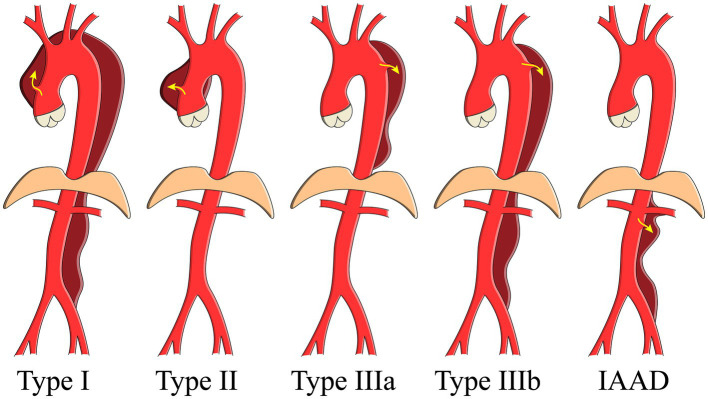
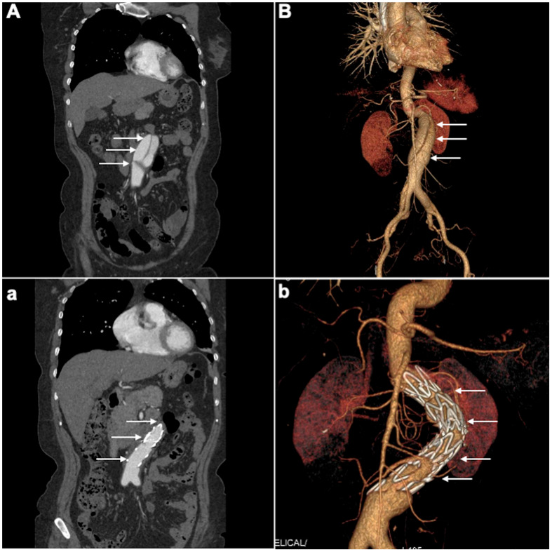
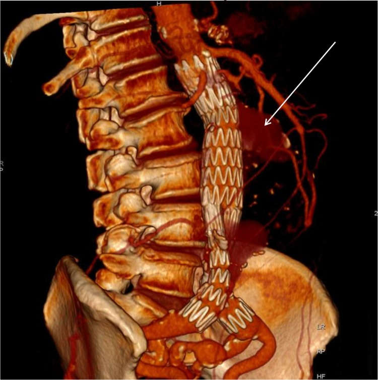
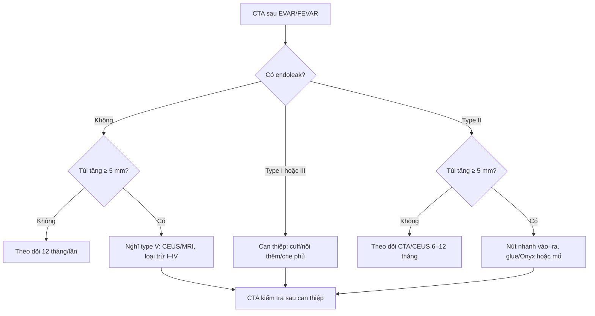
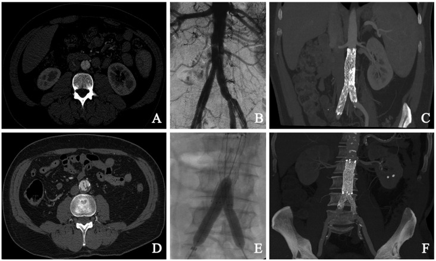

# 172 — Theo dõi & biến chứng sau can thiệp bóc tách động mạch chủ bụng / Follow-up after endovascular repair of abdominal aortic dissection

**Tags:** `pattern:boc-tach` `pattern:endoleak` `vung:DMC-bung` `score:endoleak` `protocol:CTA-theo-doi` `protocol:FEVAR`
**Mức chắc chắn (certainty):** tổng hợp y văn (literature synthesis) — số liệu từ đoàn hệ tiến cứu IAAD (PMC9996307), loạt EVAR có CTA 8 năm (PMC5152934), loạt FEVAR dài hạn (PMC5485015) và tổng quan endoleak type II (PMC4780400); chưa có RCT riêng cho **lịch chụp sau can thiệp IAAD**.

## 1. Tổng quan bệnh học – cơ chế hình ảnh

- **Bóc tách động mạch chủ bụng đơn độc (isolated abdominal aortic dissection, IAAD):** vạt nội mạc tách lớp trong động mạch chủ **dưới cơ hoành**, không lan lên ngực. IAAD chiếm **1,3%** tổng số bóc tách ĐMC trong registry IRAD và khoảng **5,1/1.000.000 người/năm**; **67,6%** nằm dưới động mạch thận. Trong đoàn hệ 68 ca: tuổi trung bình **61,2**, nam **80,9%**, tăng huyết áp **74,5%**, đường kính ĐMC **27,6 ± 9,9 mm**.
- **TẠI SAO đặt stent có ích:** stent-graft phủ **lỗ vào (entry tear)** → lòng thật được mở rộng, lòng giả mất áp lực hệ thống và huyết khối dần. Nhưng lòng giả có thể **vẫn thông** qua nhánh tạng, động mạch thắt lưng, mạc treo dưới hoặc **lỗ vào thứ phát ở xa** — vì vậy “đặt stent xong” không đồng nghĩa “khỏi bệnh”; theo dõi phải đánh giá **cả lòng thật, lòng giả và nhánh tạng**.
- **TẠI SAO CTA 3 pha:** pha không cản quang phân biệt **vôi hóa với endoleak**; pha động mạch thấy **type I/III** và lòng thật; pha muộn **70–120 giây** thấy **type II lưu lượng thấp** (dòng ngược từ nhánh). Thiếu pha muộn là lý do sót type II.
- **Kết cục sau can thiệp:** trong 68 ca IAAD, **55,9%** điều trị nội khoa, **39,7%** EVAR, **4,4%** mổ mở; theo dõi trung bình **2,4 năm**, tử vong **13,2%** (nội khoa **21,0%** vs EVAR **3,7%**). Sống 5 năm toàn đoàn hệ **84,8%**; nhóm EVAR/mổ **96,6%** vs nội khoa **76,3%**. Ba ca nội khoa phải chuyển EVAR ở **1,3; 1,7; 1,9 năm**.
- **Ngưỡng can thiệp IAAD:** đường kính **> 3 cm**, vỡ, **malperfusion** (thiếu máu tạng/chi) hoặc **đau không giảm** dù kiểm soát huyết áp. IAAD có thể vỡ ở khoảng **15%**, tử vong **17–28%**; mổ mở có tử vong trong viện **25–30%** so với **10%** ở can thiệp nội mạch; một loạt EVAR ghi nhận tử vong 30 ngày **0%**.

*Sơ đồ phân loại: type I–IIIb và **IAAD** (cột phải) — bóc tách chỉ khu trú ở ĐMC bụng. Nguồn: Wu J và cs., Front Cardiovasc Med 2023;10:1002832 (PMC9996307), Fig. 1, CC BY 4.0.*

## 2. Mẫu hình + chẩn đoán phân biệt theo vị trí (gamut)

**Mẫu hình theo thời điểm sau can thiệp — mỗi mốc có biến chứng ưu tiên:**

- **Sớm (≤ 30 ngày):** biến chứng tại chỗ chọc (giả phình, máu tụ, hẹp/tắc mạch đùi), **endoleak type I/III**, **tắc nhánh tạng** (động mạch thận → tăng creatinin/thiếu niệu), **thiếu máu tủy sống** (nhất là khi phủ động mạch thắt lưng dài), **bóc tách ngược dòng (retrograde type A)** sau TEVAR.
- **Trung hạn (1–12 tháng):** **endoleak type II** (dòng ngược mạc treo dưới/thắt lưng), **hẹp nhánh tạng** sau FEVAR, **lòng giả còn thông một phần**, túi giảm chậm hoặc không giảm.
- **Muộn (> 12 tháng):** **di trú/gãy/kink stent**, type I/III muộn, **nhiễm trùng graft/rò chủ–ruột**, **phình mới ở vùng tiếp giáp**, tắc nhánh tạng muộn, giãn lòng giả.

**Gamut “túi/đường kính tăng sau can thiệp”:** endoleak type I/III (áp lực hệ thống), type II có tăng túi, **type V/endotension** (tăng áp lực không thấy rò), nhiễm trùng graft, phình mới/progression, hoặc **sai số đo** (khác mặt cắt/khác pha). Với bóc tách, thêm: **lòng giả giãn** do còn thông với lỗ vào xa hoặc nhánh lớn.

*Trên: CTA trước can thiệp (A) và dựng 3D (B) — vạt nội mạc, hai lòng. Dưới: sau EVAR (a, b) — stent phủ lỗ vào, lòng giả không còn ngấm thuốc. Nguồn: Shaiea S và cs., J Clin Med 2025;14:5849 (PMC12387512), Fig. 4, CC BY 4.0.*

## 3. Bảng so sánh phân biệt (ma trận đối chiếu)

| Thực thể (entity) | Hình ảnh điển hình | Chốt vào (rule-in) | Chốt loại (rule-out) | Gợi ý xác nhận |
|---|---|---|---|---|
| **Endoleak type I/III** | Rò ở cổ trên/dưới (Ia/Ib) hoặc khớp graft (III); ngấm sớm thì động mạch | **Ngấm thuốc sớm, cùng áp lực hệ thống, túi tăng nhanh** | Ngấm muộn 70–120 giây + nhánh vào → type II | CTA 3 pha; sửa ngay bằng cuff/nối thêm |
| **Endoleak type II** | Dòng ngược từ mạc treo dưới/thắt lưng vào túi; thấy rõ pha muộn | **Ngấm muộn + thấy nhánh vào/ra + túi ổn định** | Ngấm sớm + cổ/khớp → type I/III | CTA muộn/CEUS; chỉ can thiệp khi túi tăng ≥ 5 mm |
| **Type V/endotension** | Túi tăng nhưng **không thấy rò** trên CTA 3 pha | **Loại trừ I–IV + túi tăng ≥ 5 mm** | Có rò kín đáo trên CEUS/MRI → không phải V | CEUS/MRI, đo thể tích, theo dõi sát |
| **Hẹp/tắc nhánh tạng (FEVAR)** | Hẹp gốc stent nhánh thận/ĐM mạc treo tràng trên; thận giảm ngấm | **Hẹp có ý nghĩa + tăng creatinin/thiếu máu tạng** | Nhánh thông tốt, creatinin ổn định → theo dõi | CTA/duplex, DSA nong/stent lại |
| **Lòng giả còn thông/giãn** | Vạt nội mạc còn, lòng giả ngấm thuốc; đường kính lòng giả tăng | **Lòng giả còn ngấm + tăng đường kính theo thời gian** | Lòng giả huyết khối hoàn toàn, không tăng | CTA các thì, so sánh cùng mức |
| **Di trú/gãy/kink stent** | Stent lệch khỏi vị trí, gãy khung, gập góc | **Di trú đáng kể + hở cổ/mất seal** | Stent đúng vị trí, không hở | X-quang/CTA, so phim gốc |
| **Nhiễm trùng graft/rò chủ–ruột** | Khí quanh graft, tụ dịch, giả phình; rò khí/ruột | **Khí trong túi/graft + sốt + cấy dương** | Khí thoáng qua sau mổ, không sốt → theo dõi | CT có cản quang, PET/CT, nội soi |
| **Biến chứng tại chỗ chọc** | Giả phình, máu tụ, hẹp mạch đùi | **Khối đập theo mạch + hẹp > 50% trên duplex** | Máu tụ đơn thuần, mạch đùi bình thường | Duplex, CTA, sửa nếu có triệu chứng |

*Dựng 3D CTA sau EVAR: mũi tên chỉ dòng ngược từ nhánh vào túi — **type II**. Nguồn: Brown A và cs., Vasc Health Risk Manag 2016;12:53–63 (PMC4780400), Fig. 2, CC BY-NC 3.0 (giữ nguyên, không chỉnh sửa).*

## 4. Protocol chụp + hệ phân độ/điểm chuẩn hóa

- **CTA 3 pha (không cản quang + động mạch + muộn 70–120 giây)** là chuẩn theo dõi; đo **đường kính túi theo trục nhỏ trên mặt cắt ngang**, cùng mức và cùng pha với lần trước. **Túi tăng ≥ 5 mm** so với CTA trước EVAR (trong 6 tháng) được coi là **tăng có ý nghĩa**.
- **Lịch theo ESVS:** CTA + X-quang trong **30 ngày**; nếu không endoleak/biến chứng, lặp hình ảnh **khoảng mỗi 12 tháng**. Với **FEVAR**, các loạt lớn dùng mốc **1 tháng**, rồi **6–12 tháng/lần** và hằng năm vì nhánh tạng có thể hẹp muộn — đây là **thực hành giám sát**, chưa có RCT ấn định khoảng cách.
- **Thay thế/ bổ sung:** duplex có cản quang (CEUS) nhạy với dòng chậm, không nhiễm xạ; MRI/MRA khi cần đánh giá lòng giả và nhánh, nhưng kim loại gây nhiễu. X-quang/fluoroscopy để phát hiện **gãy khung, di trú, mất khớp nối**.
- **Phân độ endoleak (I–V)** là hệ phân loại chuẩn để quyết định: **I/III → can thiệp**; **II → theo dõi nếu túi ổn định, can thiệp nếu túi tăng ≥ 5 mm**; **V → loại trừ I–IV, theo dõi sát**.
- **Số liệu FEVAR:** 173 bệnh nhân, **572 nhánh tạng**; thành công kỹ thuật ban đầu **79,2%**, sau chỉnh sửa **95,4%**; theo dõi trung vị **34 tháng**; **sống 5 năm 59,4%**; **không còn mất nhánh ở 90,1%** sau 5 năm; **không can thiệp lại ở 62,8%** sau 5 năm (tức **37,2%** phải can thiệp lại); không có tử vong do phình. Tổng quan FEVAR/CH-EVAR: **patency 95,9%** (FEVAR) và **97%** (CH-EVAR); can thiệp lại **10,7%** vs **9,5%**; tử vong 30 ngày **1,1%** vs **3,8%**.
- **Type II dai dẳng:** tỷ lệ chung **3,8–45%**; type I gặp **5–30%**. Trong registry Nhật, **type II dai dẳng** làm tăng nguy cơ tăng túi, can thiệp lại và **vỡ/tử vong do phình ~2% ở 10 năm**; yếu tố nguy cơ gồm **tuổi, nữ, đường kính cổ gần, bệnh thận mạn**.

## 5. Biến thể bình thường và cạm bẫy

- **Thiếu pha muộn** là lỗi thường gặp nhất: type II lưu lượng thấp chỉ hiện ở **70–120 giây**; một pha động mạch có thể “sạch” giả tạo.
- **Vôi hóa thành ĐMC** trông như ngấm thuốc trên pha có cản quang — luôn đối chiếu **pha không cản quang**.
- **Nhiễu kim loại của khung stent** có thể giả **type III**; đổi mặt cắt, dựng lại theo trục stent, dùng pha muộn để xác nhận.
- **Túi tăng không thấy rò** = nghĩ **type V/endotension**, nhưng trước hết phải loại trừ type II kín đáo bằng CEUS/MRI; đừng mổ ngay chỉ vì một lần đo.
- **Lòng giả huyết khối một phần** không phải là thành công hoàn toàn; có thể tái thông, nhất là khi còn nhánh lớn cấp máu.
- **Hẹp nhánh tạng có thể không triệu chứng** — creatinin tăng nhẹ sau FEVAR phải tìm hẹp gốc stent thận trước khi quy về thuốc cản quang.
- **IAAD dễ bị nhầm với phình có huyết khối thành** nếu chỉ nhìn một mặt cắt; tìm **vạt nội mạc + hai lòng** trên nhiều bình diện và dấu **di lệch vôi hóa**.
- **Sốt sau EVAR** có thể là phản ứng viêm, nhưng **khí quanh graft/tụ dịch** phải loại trừ nhiễm trùng — không hạ sốt đơn thuần rồi bỏ theo dõi.

## 6. Tự lượng giá — Blind Quiz

**Ca 1 — Nam 71 tuổi, đau bụng–lưng; CTA trước mổ, mổ đặt stent, và CTA 8 năm sau.**

- Gợi ý: đau bụng và lưng, tăng huyết áp; không có phình ĐMC; tổn thương giới hạn dưới động mạch thận.
- Câu hỏi: Ảnh A cho thấy gì? Can thiệp nào đã làm? Ảnh C nói gì sau 8 năm?

<b>Bấm để hiện đáp án (findings + chẩn đoán)</b>

- Dấu hiệu: (A) vạt nội mạc, hai lòng — **IAAD**; (B) chụp mạch hoàn tất sau đặt stent; (C) CTA 8 năm: stent đúng vị trí, **không tái phát, không giãn**, lòng giả không còn.
- Chẩn đoán: IAAD được điều trị bằng **stent-graft chia đôi**; theo dõi CTA 1 tháng, duplex 3–6–12 tháng rồi hằng năm.
- Bài học: IAAD không có phình vẫn có thể cần can thiệp khi đau không giảm; theo dõi dài hạn cho thấy stent bền.
- Nguồn: Giribono AM và cs., Acta Radiol Open 2016;5:2058460116681042 (PMC5152934), Fig. 1, CC BY-NC 3.0 (giữ nguyên, không chỉnh sửa).

**Ca 2 — CTA trước và sau EVAR ở bệnh nhân bóc tách ĐMC bụng; mũi tên chỉ lòng giả.**

- Gợi ý: bóc tách khu trú dưới động mạch thận; stent phủ lỗ vào.
- Câu hỏi: Trước mổ có gì? Sau mổ thay đổi ra sao? Còn nguy cơ gì?

<b>Bấm để hiện đáp án (findings + chẩn đoán)</b>

- Dấu hiệu: trước mổ — vạt nội mạc, lòng giả chiếm ưu thế (A, B); sau mổ — stent phủ lỗ vào, **lòng giả không còn ngấm thuốc**, lòng thật mở rộng (a, b).
- Chẩn đoán: **IAAD điều trị EVAR**; nguy cơ còn lại là **endoleak type II từ nhánh**, hẹp nhánh tạng, hoặc lòng giả tái thông qua lỗ vào xa.
- Theo dõi: CTA 3 pha ở 30 ngày và 12 tháng; đo túi/lòng giả cùng mức.
- Nguồn: Shaiea S và cs., J Clin Med 2025;14:5849 (PMC12387512), Fig. 4, CC BY 4.0.

**Ca 3 — Sau EVAR, CTA 3D thấy dòng ngược vào túi. Phân loại và xử trí?**

- Gợi ý: bệnh nhân không đau, túi không đổi sau 6 tháng; không có sốt.
- Câu hỏi: Đây là type mấy? Nguồn dòng? Khi nào mới can thiệp?

<b>Bấm để hiện đáp án (findings + chẩn đoán)</b>

- Dấu hiệu: dòng ngược từ nhánh (mạc treo dưới/thắt lưng) vào túi, thấy rõ ở pha muộn — **endoleak type II**.
- Xử trí: **theo dõi** nếu túi ổn định; can thiệp (nút cả đầu vào–ra, glue/Onyx, hoặc mổ) khi **túi tăng ≥ 5 mm**, type II dai dẳng có tăng túi.
- Cạm bẫy: thiếu pha muộn dễ bỏ sót; đừng nút một đầu vì còn dòng “flow-through”.
- Nguồn: Brown A và cs., Vasc Health Risk Manag 2016;12:53–63 (PMC4780400), Fig. 2, CC BY-NC 3.0 (giữ nguyên, không chỉnh sửa).

## Bài liên quan chéo
- [100 – Tổng quan hệ Bụng](../100-tong-quan-he-bung/lesson.md)
- [171 – Bóc tách ĐMC bụng & IMH](../171-boc-tach-dong-mach-chu-bung-va-IMH/lesson.md)
- [170 – Phình ĐMC bụng: dọa vỡ, vỡ & rò](../170-phinh-DMC-bung/lesson.md)
- [840 – AAA sau EVAR: Endoleak I–V & PAD](../840-aorta-endoleak-pad/lesson.md)
- [920 – Nút mạch trong chảy máu tiêu hóa & can thiệp mạch](../920-vascular-embolization-gi-bleed/lesson.md)

> Không dùng để chẩn đoán độc lập khi chưa có người hướng dẫn.
