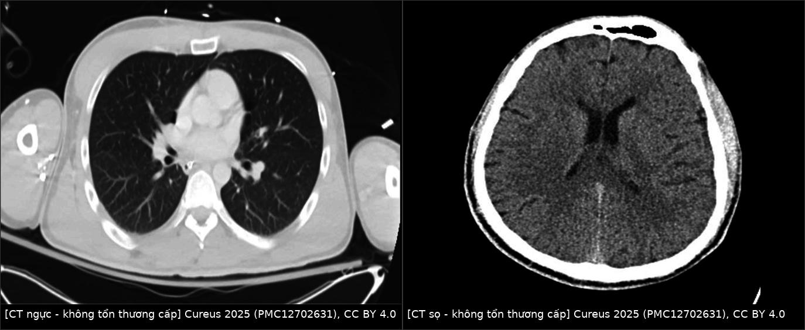
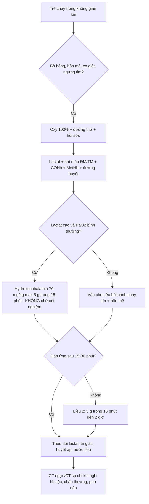
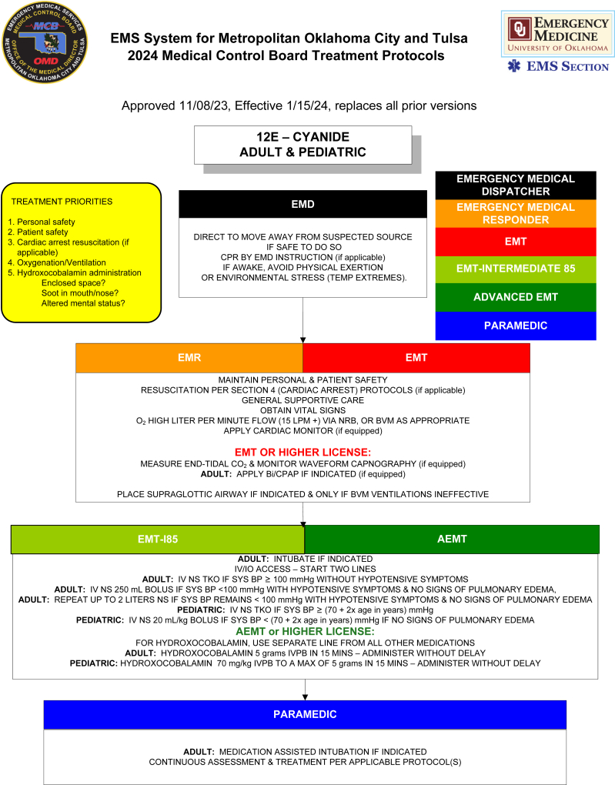
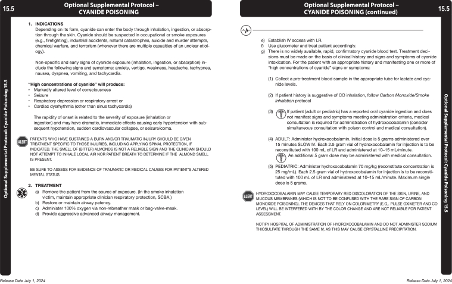

# 1720 — Ngộ độc cyanid do khói lửa ở trẻ: khi nào nghĩ, đo gì, và vì sao hình ảnh bình thường

**Tags:** `pattern:toan-lactic` `pattern:hinh-anh-binh-thuong` `vung:toan-than` `vung:phoi` `score:lactate` `protocol:hydroxocobalamin` `protocol:khi-mau-dong-mach`
**Mức chắc chắn (certainty):** tổng hợp y văn (literature synthesis) — ghép **tổng quan phạm vi 21 bài/512 bệnh nhân** (JACEP Open 2026, PMC12961199), **tổng quan hệ thống 6 nghiên cứu/1.238 bệnh nhân** (Emerg Med Int 2025, PMC12767669), **ca nhi 7 tuổi ngưng tim sau cháy nhà** (Cureus 2025, PMC12135720) và **ca người lớn hôn mê sau hít khói** (Cureus 2025, PMC12702631). Không có ca do nhóm tự chụp.

> **Câu hỏi thực hành:** bé trai **7 tuổi** được đưa vào cấp cứu sau khi lôi ra từ **phòng cháy kín**: bồ hóng quanh mũi, không phản ứng, mạch có nhưng thở yếu. Khí máu: **pH 7,05, lactat 16 mmol/L, PaO₂ bình thường**, COHb **51,5%**, MetHb **2,0%**. Bố mẹ hỏi: **"Chụp CT xem cháu bị gì?"**
> Bài chốt **năm điểm**: **(1) chìa khóa không nằm ở ảnh mà ở LACTAT — toan lactic nặng kèm PaO₂ bình thường; (2) COHb bình thường hoặc thấp KHÔNG loại trừ ngộ độc cyanid, và co-oximetry không đo được cyanid; (3) hình ảnh học (X-quang/CT ngực, CT sọ) thường BÌNH THƯỜNG — CT không dùng để chẩn đoán, chỉ để tìm hít sặc/phù não; (4) thuốc giải độc là **hydroxocobalamin 70 mg/kg (tối đa 5 g) trong 15 phút**, cho ngay khi nghi ngờ, **không dùng nitrit**; (5) dấu hiệu nhận biết muộn nhất là **nước tiểu đỏ** — vô hại nhưng làm sai hàng loạt xét nghiệm so màu.**

*Trái: CT ngực không cản quang — không tổn thương cấp. Phải: CT sọ không cản quang — không tổn thương nội sọ cấp. Ca người lớn 40 tuổi hôn mê sau hít khói, lactat tăng mạnh, hồi phục sau hydroxocobalamin (Cureus 2025, PMC12702631, CC BY 4.0). Ảnh ghép letterbox, giữ nguyên tỉ lệ.*

## 1. Tổng quan bệnh học – cơ chế hình ảnh: vì sao bệnh nhân "chết tế bào" mà phim chụp trắng trơn

- **Nguồn gốc cyanid trong đám cháy:** đốt cháy vật liệu chứa nitơ — **polyurethane (nệm, ghế), len, lụa, nylon, nhựa, giấy** — sinh **hydrogen cyanid (HCN)**. Trong **không gian kín** (phòng, xe, tàu), HCN không thoát ra được nên nồng độ hít vào tăng vọt; đây là lý do bài này đặt trọng tâm vào **bối cảnh cháy kín**, không phải vào hình ảnh.
- **Cơ chế phân tử — TẠI SAO lactat tăng mà oxy máu bình thường:** HCN gắn **cytochrome c oxidase (phức hợp IV)** của chuỗi hô hấp ty thể → chặn bước cuối chuyển electron sang O₂ → tế bào **không dùng được oxy dù oxy vẫn đủ trong máu** ("thiếu oxy nhiễm độc", histotoxic hypoxia). Hậu quả ba tầng, mỗi tầng để lại một dấu hiệu đo được:
  1. **Chuyển hóa yếm khí** → **toan lactic**: ca nhi 7 tuổi có **lactat 16 mmol/L** (bình thường < 2 mmol/L) (PMC12135720); trong 12 nghiên cứu có số lactat trước điều trị, dải rộng **0,36 → > 20 mmol/L** (PMC12961199).
  2. **Mô không "rút" oxy** → **gradient O₂ động–tĩnh mạch thu hẹp** (PaO₂ – PvO₂ nhỏ), đúng như ca người lớn 40 tuổi: lactat tăng mạnh, **gradient PaO₂–PvO₂ tối thiểu** (PMC12702631). Đây là dấu hiệu *rẻ tiền và đặc hiệu hơn* nhiều xét nghiệm khác: nếu tĩnh mạch vẫn "đỏ" thì oxy đang bị trả lại, không được dùng.
  3. **Tế bào thần kinh và cơ tim nhạy nhất** → hôn mê, co giật, loạn nhịp, tụt huyết áp, rồi **ngưng tim**; tổn thương não do thiếu oxy có thể **không hồi phục** dù lactat đã bình thường (PMC12135720).
- **TẠI SAO hình ảnh bình thường — vật lý của từng modality:**
  - **CT ngực:** cyanid không tạo đông đặc, không tạo phù kẽ ngay; tổn thương nếu có là do **hít sặc/bỏng nhiệt–hóa chất** (bồ hóng, phù thanh môn, xẹp tiểu thùy) chứ không do độc chất toàn thân. CT ngực ở ca 40 tuổi: **không bất thường cấp** (PMC12702631).
  - **CT sọ:** trong giờ đầu, hình ảnh có thể hoàn toàn bình thường vì tổn thương ở mức **ty thể**, chưa đủ phù để đổi đậm độ. Phù não/hoại tử vỏ não nếu xuất hiện thường **muộn 24–72 giờ**; vì vậy **CT sọ bình thường không loại trừ** và cũng không giúp quyết định cho thuốc giải độc. Ca 40 tuổi: CT sọ **không tổn thương nội sọ cấp**, điện não chỉ có **hoạt động delta nhịp nhàng từng đợt** (bệnh não mức độ trung bình) (PMC12702631).
  - **X-quang ngực** cũng thường bình thường; giá trị thật của nó là tìm **hít sặc, phù phổi, tràn khí** — tức biến chứng của khói, không phải của cyanid.
- **CO và HCN — hai khí độc đi cùng nhau, đừng lấy COHb làm "chứng nhận an toàn":** CO gắn hemoglobin, HCN chặn ty thể; co-oximetry chỉ đọc **COHb/MetHb**, **không có kênh đo cyanid**. Ca nhi 7 tuổi có **COHb 51,5%** (nặng) nhưng đó chỉ là phần nổi của tảng băng; ngược lại, bệnh nhân cháy kín có **COHb thấp** vẫn có thể ngộ độc cyanid nặng. Vì vậy **quyết định điều trị dựa trên bối cảnh + lactat + lâm sàng**, không dựa trên COHb.
- **Con số nền — điều trị thực tế trông như thế nào:** tổng quan phạm vi **21 bài/512 bệnh nhân**: **45,9% (235) được dùng thuốc trước khi tới viện**; liều phổ biến **5 g hoặc 10 g**; **66,0% (318/482) sống ra viện**; tác dụng phụ thường gặp **nước tiểu đỏ 2,9% (15/512)**, **đỏ da/phát ban 1,8% (9/512)**; **tổn thương thận cấp (AKI) 38 bệnh nhân trong 5 nghiên cứu** (PMC12961199).
- **Mặt trái của thuốc — phải biết trước khi cho:** tổng quan hệ thống **6 nghiên cứu/1.238 bệnh nhân** không đủ chất lượng để gộp; **tỷ lệ tử vong tương đương** giữa nhóm hydroxocobalamin và nhóm chỉ hồi sức; **2 nghiên cứu ghi nhận AKI nhiều hơn** ở nhóm dùng thuốc (một nghiên cứu 739 bệnh nhân: **38,1% vs 27,2%**), **1 nghiên cứu** thấy **22,2%** bệnh nhân tăng MetHb sau dùng thuốc (PMC12767669). Nghĩa là: **cho khi nghi ngờ cao, nhưng không cho như một "vitamin" vô hại**.
- **Vì sao trẻ khác người lớn:** trẻ có **tần số thở cao hơn và dung tích cặn chức năng nhỏ hơn** → tính theo kg, lượng HCN vào phổi trong cùng thời gian lớn hơn; **tỉ lệ diện tích da/thể tích lớn** → mất nhiệt, mất dịch nhanh; **dự trữ glycogen thấp** → dễ **hạ đường huyết** song hành, và hạ đường huyết làm bệnh não nặng thêm. Vì vậy ở trẻ phải **đo đường huyết** cùng lúc với khí máu.

## 2. Mẫu hình + chẩn đoán phân biệt theo bối cảnh (Gamut)

- **Mẫu hình chốt (pattern) — 4 tầng, càng lên cao càng phải cho thuốc ngay:**
  1. **Ngưng tim/ngừng thở tại hiện trường** ở đám cháy không gian kín, hồi sinh tim phổi khó, không đáp ứng epinephrine.
  2. **Hôn mê/co giật + toan lactic nặng (lactat thường > 10 mmol/L)** mà **PaO₂ bình thường**, không có nguyên nhân khác (sốc, co giật kéo dài, thiếu máu chi).
  3. **Bồ hóng quanh mũi/miệng, đờm đen, khàn, thở rít** (bỏng đường thở) **kèm rối loạn tri giác** — hít khói + độc chất.
  4. **Hồi phục nhanh, rõ rệt sau hydroxocobalamin** (tri giác, huyết áp, lactat) — dấu hiệu "chẩn đoán bằng điều trị" mạnh nhất trong y văn ca (PMC12702631).
- **Gamut theo "toan lactic + hình ảnh bình thường" (thứ tự nghĩ trong phòng cấp cứu):**
  - **Cyanid (HCN)** — bối cảnh cháy, lactat rất cao, gradient A–V hẹp.
  - **CO** — bối cảnh cháy, COHb cao, lactat thường tăng vừa (thiếu oxy mô), nhưng **COHb bình thường không loại trừ CO** nếu đo muộn/đã thở oxy.
  - **Methemoglobin** — xanh tím không đáp ứng oxy, MetHb > 1,5%, **SpO₂ "kẹt" ~85%** dù PaO₂ cao; chú ý **nitrit** dùng nhầm sẽ đẩy MetHb lên.
  - **H₂S (cống, hầm biogas)** — ức chế cytochrome giống cyanid nhưng bối cảnh khác (không cháy), mùi trứng thối.
  - **Thiếu máu chi/chèn ép (crush), co giật kéo dài, sốc nhiễm khuẩn muộn** — lactat cao nhưng có ổ nguyên nhân rõ trên lâm sàng/CT.
  - **Lỗi chuyển hóa bẩm sinh ở nhũ nhi** (toan lactic + hôn mê, không có bối cảnh cháy) — đừng gán cho khói khi trẻ không hề phơi nhiễm.
- **Gamut theo tổn thương đường thở (khi có ảnh):** bỏng nhiệt thanh môn → **phù nề, hẹp đường thở**; hít hạt bồ hóng → **xẹp tiểu thùy, đông đặc quanh phế quản**; hít khí nóng + hóa chất → **hoại tử niêm mạc, bong trợt**; **phù phổi muộn 24–48 giờ**. Ảnh **không** dùng để chẩn đoán ngộ độc cyanid.
- **Gợi nhớ nhanh bằng "3 K":** **K**hông gian **k**ín (cháy trong phòng/xe) — **K**hông giải thích được toan lactic — **K**hông có bất thường trên phim.

## 3. Bảng so sánh phân biệt (ma trận đối chiếu)

| Thực thể (entity) | Hình ảnh / xét nghiệm điển hình | Chốt vào (rule-in) | Chốt loại (rule-out) | Gợi ý xác nhận |
|---|---|---|---|---|
| **Ngộ độc cyanid (HCN)** | CT ngực/sọ **bình thường**; **lactat rất cao** (0,36 → > 20 mmol/L trong y văn); **gradient PaO₂–PvO₂ hẹp**; HCN máu **0–135 μmol/L** nhưng thường không kịp | **Cháy kín + hôn mê/ngưng tim + lactat cao + PaO₂ bình thường** | COHb bình thường **không** loại trừ; CT bình thường **không** loại trừ | **Cho hydroxocobalamin và đánh giá đáp ứng** (chẩn đoán bằng điều trị) |
| **Ngộ độc CO** | CT ngực/sọ thường bình thường; **COHb cao** (ca nhi: **51,5%**); lactat tăng vừa | **COHb cao + bối cảnh cháy + đáp ứng oxy 100%** | COHb bình thường không loại trừ nếu đã thở oxy/đo muộn | Co-oximetry, khí máu; **thở oxy 100%** là điều trị |
| **Methemoglobin** | Xanh tím, **SpO₂ kẹt ~85%** không đáp ứng oxy; **MetHb > 1,5%** (ca nhi: 2,0%) | **MetHb cao + máu "sô-cô-la" + không đáp ứng oxy** | SpO₂ bình thường trên khí máu → nghĩ cyanid hơn | Co-oximetry; **không dùng nitrit** |
| **Hít khói/bỏng đường thở đơn thuần** | **Bồ hóng, phù thanh môn, xẹp tiểu thùy, đông đặc** trên X-quang/CT; nội soi thấy bỏng | **Tổn thương đường thở thấy được + bồ hóng** | Không có tổn thương đường thở **không** loại trừ ngộ độc toàn thân | Nội soi ống mềm, CT ngực |
| **Sốc nhiễm khuẩn / crush / co giật kéo dài** | Có ổ nhiễm, phù mô, tổn thương cơ trên CT; lactat cao nhưng có nguyên nhân | **Ổ nguyên nhân rõ + đáp ứng hồi sức dịch/kháng sinh** | Lactat cao đơn độc không đủ | Cấy, CK, CT vùng nghi ngờ |

*CT ngực (trái) và CT sọ (phải) của ca hôn mê sau hít khói: không tổn thương cấp — hình ảnh không phải chìa khóa, lactat và bối cảnh mới là. Nguồn: Cureus 2025 (PMC12702631), CC BY 4.0.*

## 4. Protocol chụp – xét nghiệm + hệ phân tầng điều trị

- **Nguyên tắc:** **không chờ xét nghiệm để cho thuốc**. Ảnh học đứng **sau** ba việc: đường thở – thở – tuần hoàn; và **sau** ba mẫu xét nghiệm lấy cùng lúc.
- **Bộ xét nghiệm tối thiểu (lấy cùng lúc với dựng đường truyền):**
  - **Khí máu động mạch + tĩnh mạch** (tính **gradient PaO₂–PvO₂** — hẹp là dấu hiệu chốt sinh lý).
  - **Lactat** (động học lactat là thước đo đáp ứng điều trị tốt hơn COHb).
  - **Co-oximetry** (COHb, MetHb) — nhớ: **không đo được cyanid**.
  - **Đường huyết, điện giải/ khoảng trống anion, creatinin, men gan, amylase, ECG** (cyanid gây loạn nhịp; trẻ dễ hạ đường huyết).
- **Chẩn đoán hình ảnh — chỉ định hẹp, mục tiêu khác:**
  - **X-quang ngực thẳng** tại giường: tìm hít sặc, phù phổi, tràn khí.
  - **CT ngực** khi nghi tổn thương đường thở/ phổi nặng hoặc để loại trừ nguyên nhân khác ở trẻ hôn mê.
  - **CT sọ** khi có chấn thương đầu, co giật, hoặc bất đối xứng thần kinh; **không** dùng để chẩn đoán ngộ độc.
  - **Nội soi phế quản ống mềm** khi nghi bỏng đường thở (khàn, thở rít, bồ hóng nhiều) — đây mới là "chẩn đoán hình ảnh" có giá trị nhất cho phần hô hấp.
- **Điều trị (theo phác đồ và y văn đã dẫn):**
  - **Oxy 100%**, kiểm soát đường thở sớm (đặt nội khí quản nếu hôn mê/ bỏng đường thở), hồi sức tuần hoàn.
  - **Hydroxocobalamin: trẻ 70 mg/kg IV (tối đa 5 g) truyền 15 phút; người lớn 5 g trong 15 phút**; **liều 2 (5 g) truyền 15 phút – 2 giờ** nếu chưa đáp ứng (PMC12961199; PMC12135720). Phác đồ EMS Oklahoma/Tulsa ghi rõ: **"ADULT: 5 g IVPB in 15 mins; PEDIATRIC: 70 mg/kg IVPB to a max of 5 g in 15 mins — administer without delay"**.
  - **Trường hợp ngưng tim: có thể đẩy nhanh** — ca nhi 7 tuổi được **đẩy 5 g trong 2 phút**, dung nạp tốt, **COHb giảm 13,8% trong 20 phút**, các thông số chuyển hóa cải thiện dần (PMC12135720). Đây là **ca đơn lẻ**, không phải khuyến cáo cứng.
  - **KHÔNG dùng amyl nitrit/natri nitrit** ở bệnh nhân cháy: nitrit tạo **methemoglobin**, làm giảm thêm khả năng chuyên chở oxy — đặc biệt nguy hiểm khi đồng thời có CO. **Natri thiosulfat** là thuốc bổ trợ, không thay thế hydroxocobalamin.
  - **Theo dõi sau thuốc:** huyết áp (thuốc làm **tăng huyết áp**), nước tiểu (đỏ), **creatinin** và **amylase** — nhưng đọc kết quả **sau khi đã biết thuốc gây nhiễu so màu**.
- **Sơ đồ phân tầng (dùng ngay tại cửa cấp cứu):**

## 5. Biến thể bình thường và cạm bẫy

- **Cạm bẫy 1 — "COHb bình thường nên không phải cyanid".** Hai khí độc độc lập; co-oximetry **không có kênh cyanid**. Đã có bệnh nhân hôn mê, lactat rất cao, hồi phục sau hydroxocobalamin dù không đo được HCN (PMC12702631).
- **Cạm bẫy 2 — "CT bình thường nên não không tổn thương".** Tổn thương là **ty thể**, không phải cấu trúc; CT bình thường trong giờ đầu là **quy luật**, không phải bằng chứng lành. Ca nhi 7 tuổi cuối cùng vẫn **tổn thương não thiếu oxy không hồi phục** (PMC12135720).
- **Cạm bẫy 3 — nhiễu xét nghiệm do chính thuốc.** Hydroxocobalamin có **màu đỏ đậm** → làm sai các xét nghiệm **đo màu (colorimetric)**: **creatinin, amylase, AST/ALT, bilirubin, CK, acid uric** và cả **co-oximetry (SpCO/SpMet)**. Hệ quả thực tế: (a) **"suy thận" giả** sau thuốc; (b) **"viêm tụy" giả** do amylase tăng; (c) **COHb/MetHb đọc sai** sau thuốc — đừng dùng số đo sau thuốc để kết luận. Cách tránh: lấy mẫu **trước** khi cho thuốc nếu không chậm trễ, và đo lại bằng phương pháp khác/khí máu.
- **Cạm bẫy 4 — dùng nitrit.** Nitrit biến hemoglobin thành methemoglobin → **giảm vận chuyển oxy** trên nền bệnh nhân đã thiếu oxy mô. Ở trẻ và ở bệnh nhân cháy, **hydroxocobalamin là lựa chọn đầu tay**.
- **Cạm bẫy 5 — bỏ qua người thứ hai.** Cháy kín thường có **nhiều nạn nhân** (anh chị em, người cứu); trẻ "tỉnh" vẫn có thể đang toan lactic. Sàng lọc **tất cả** người từ đám cháy bằng lactat.
- **Cạm bẫy 6 — hạ đường huyết và hạ thân nhiệt ở trẻ.** Đo đường huyết trước khi kết luận "hôn mê do cyanid"; sưởi ấm; xử trí hạ đường huyết song song.
- **Biến thể bình thường dễ nhầm:** **nước tiểu đỏ/vàng cam sau hydroxocobalamin** không phải máu niệu — chỉ là màu thuốc; **da đỏ thoáng qua** không phải phản ứng dị ứng nặng. Ngược lại, **phát ban thật + tụt huyết áp** sau truyền là phản vệ → ngừng thuốc.

## 6. Tự lượng giá — Blind Quiz

**Ca 1 — Nam 40 tuổi, hôn mê sau hít khói trong sân tù. Nhìn 2 phim, mô tả trước khi đọc đáp án.**

- Gợi ý lâm sàng: khói dày, không gian hạn chế; hôn mê, thở yếu phải đặt nội khí quản; lactat tăng mạnh; gradient PaO₂–PvO₂ tối thiểu.
- Câu hỏi: Có tổn thương cấp trên CT không? Nếu hình ảnh bình thường thì dấu hiệu nào dẫn tới chẩn đoán? 3 chẩn đoán phân biệt?

<b>Bấm để hiện đáp án (findings + chẩn đoán)</b>

- Dấu hiệu: **CT ngực không tổn thương cấp**; **CT sọ không tổn thương nội sọ cấp**. Điện não: **hoạt động delta nhịp nhàng từng đợt**, phù hợp bệnh não mức độ trung bình, không có phóng điện động kinh.
- Chẩn đoán: **ngộ độc cyanid do hít khói** — nghĩ vì **toan lactic nặng + gradient A–V hẹp + bối cảnh cháy kín**, và **hồi phục rõ sau hydroxocobalamin** (chẩn đoán bằng điều trị).
- Phân biệt: ngộ độc CO (COHb), methemoglobin (MetHb, SpO₂ kẹt), hít khói đơn thuần (tổn thương đường thở).
- **Phản biện:** ca này **không đo được HCN** — chẩn đoán là **suy luận từ sinh lý + đáp ứng điều trị**, không phải bằng xét nghiệm xác nhận; đây là thực tế thường gặp và là lý do phải cho thuốc theo nghi ngờ.
- Nguồn ảnh: Cureus 2025 (PMC12702631), CC BY 4.0; ảnh ghép letterbox.

**Ca 2 — Bé gái 7 tuổi, bất động sau cháy nhà. Nhìn phác đồ, trả lời liều thuốc trước.**

- Gợi ý lâm sàng: được đưa ra khỏi nhà đang cháy, không mạch tại hiện trường, hồi sinh tim phổi trên đường đi; vào viện còn toan nặng, lactat **16 mmol/L**, COHb **51,5%**, MetHb **2,0%**.
- Câu hỏi: Liều hydroxocobalamin cho trẻ? Đường và thời gian truyền? Khi ngưng tim có thể làm khác đi không? Điều gì chắc chắn **không** dùng?

<b>Bấm để hiện đáp án (findings + chẩn đoán)</b>

- Liều: **70 mg/kg IV, tối đa 5 g, truyền 15 phút** (phác đồ EMS Oklahoma/Tulsa; FDA qua PMC12135720). Người lớn: **5 g/15 phút**; liều 2 nếu chưa đáp ứng.
- Trong ca này: **5 g đẩy nhanh trong 2 phút** vì đang ngưng tim → dung nạp tốt, **COHb giảm 13,8% trong 20 phút**, chuyển hóa cải thiện; nhưng trẻ vẫn **tổn thương não thiếu oxy không hồi phục** → thuốc cứu sống nhưng **không hoàn nguyên tổn thương đã xảy ra**.
- **Không dùng nitrit** (amyl nitrit/natri nitrit) vì tạo methemoglobin; natri thiosulfat chỉ bổ trợ.
- Nguồn: phác đồ trong JACEP Open 2026 (PMC12961199, Fig 2A — in lại với sự cho phép của EMS Oklahoma City/Tulsa), CC BY 4.0; số liệu ca: Cureus 2025 (PMC12135720), CC BY 4.0.
- **Phản biện:** "đẩy nhanh 2 phút" là **ca đơn lẻ**, chưa có nghiên cứu so sánh; chỉ nên áp dụng khi ngưng tim và đã có đường truyền tốt.

**Ca 3 — Sau khi cho hydroxocobalamin, bệnh nhân có creatinin 3,1 mg/dL và amylase 900 U/L. Nhìn phác đồ, quyết định trước khi đọc đáp án.**

- Gợi ý lâm sàng: trước thuốc creatinin 0,6 mg/dL, amylase bình thường; nước tiểu **đỏ sẫm** sau truyền; bệnh nhân tỉnh dần, huyết áp ổn.
- Câu hỏi: Có phải suy thận cấp + viêm tụy cấp không? Cơ chế? Làm gì tiếp?

<b>Bấm để hiện đáp án (findings + chẩn đoán)</b>

- Đây là **nhiễu xét nghiệm so màu do hydroxocobalamin** (thuốc có màu đỏ đậm): **creatinin, amylase, AST/ALT, bilirubin, CK, acid uric**, và cả **co-oximetry** đều có thể đọc sai. Nước tiểu đỏ là **chromaturia** (2,9% trong 512 bệnh nhân — PMC12961199), không phải máu niệu.
- Việc cần làm: **không** chẩn đoán suy thận/viêm tụy trên số đo sau thuốc; **đo lại** bằng phương pháp không so màu (enzymatic cho creatinin), theo dõi nước tiểu, và **nhớ AKI thật vẫn có thể xảy ra** (38 bệnh nhân/5 nghiên cứu; một nghiên cứu 739 ca: **38,1% vs 27,2%**) → nếu creatinin vẫn cao sau khi hết màu thuốc, lúc đó mới kết luận.
- Nguồn: JACEP Open 2026 (PMC12961199), CC BY 4.0; Emerg Med Int 2025 (PMC12767669), CC BY 4.0.

## Bài liên quan chéo
- [090 – Bỏng hít đường thở ở trẻ](../090-bong-hit-duong-tho-o-tre/lesson.md) (phần đường thở của cùng đám cháy)
- [087 – Viêm phổi hít dầu hỏa/hydrocarbon](../087-viem-phoi-hit-dau-hoa-hydrocarbon/lesson.md) (hít chất độc — cơ chế tổn thương phổi)
- [604 – Dẫn lưu màng ngoài tim nhũ nhi](../604-dan-luu-mang-ngoai-tim-nhu-nhi/lesson.md) (hồi sức – thủ thuật cấp cứu ở trẻ)
- [933 – An toàn thuốc cản quang](../933-an-toan-thuoc-can-quang/lesson.md) (nhiễu xét nghiệm do thuốc)

## Ảnh
- `images/1720_ngo-doc-cyanid_CT-nguc_PMC12702631-F1.jpg`, `images/1720_ngo-doc-cyanid_CT-nao_PMC12702631-F2.jpg` — Cureus 2025, PMC12702631, CC BY 4.0.
- `images/composite_hinh-anh-binh-thuong.jpg` — ảnh ghép letterbox từ 2 ảnh trên (CC BY 4.0, giữ nguyên ảnh gốc).
- `images/1720_ngo-doc-cyanid_phac-do-EMS_PMC12961199-F2a.jpg`, `...-F2b.jpg` — JACEP Open 2026, PMC12961199, CC BY 4.0 (phác đồ EMS Oklahoma City/Tulsa, in lại với sự cho phép).
- Chi tiết giấy phép từng ảnh: `images/CREDITS.md`.

> Không dùng để chẩn đoán độc lập khi chưa có người hướng dẫn.
