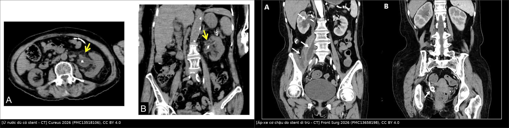
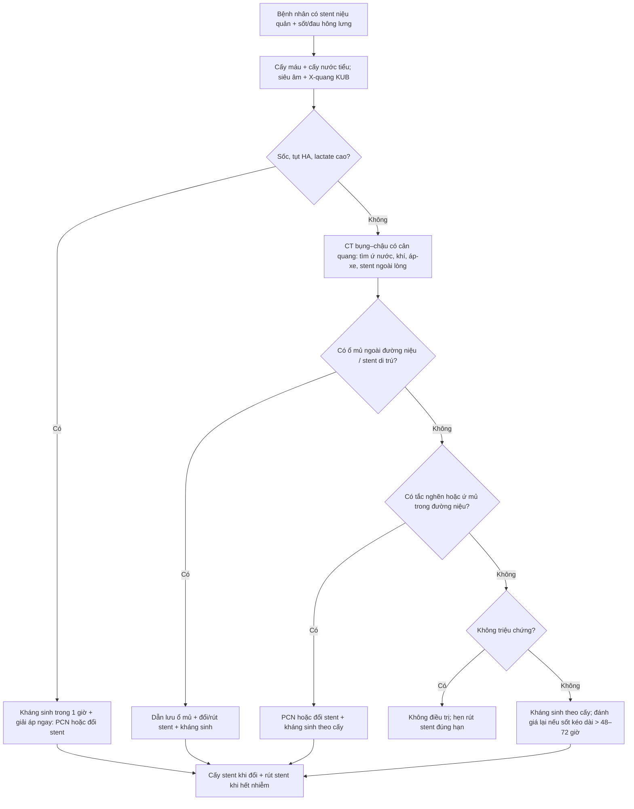
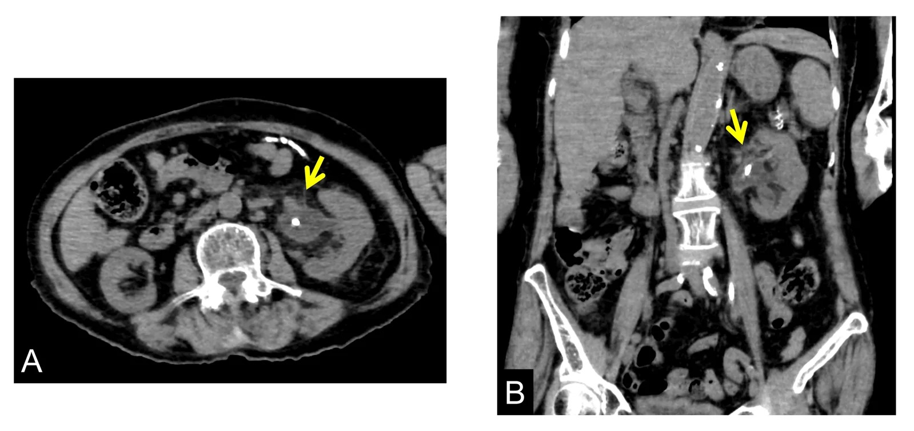
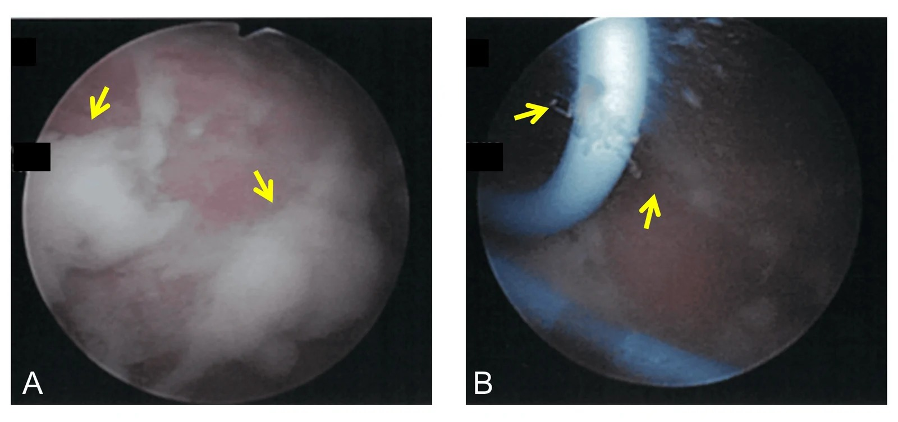
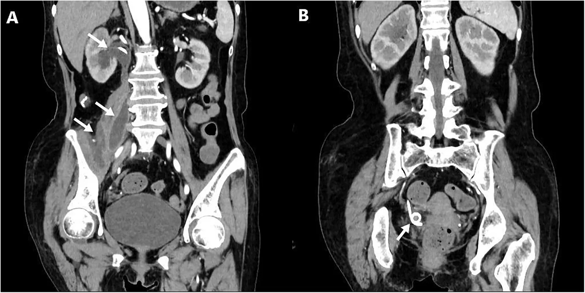
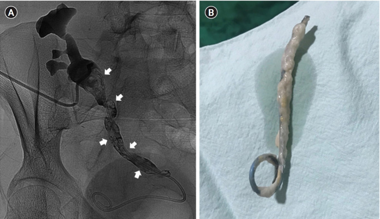

# 1721 — Nhiễm khuẩn stent niệu quản: khuẩn niệu – nhiễm niệu – nhiễm stent & khi nào phải lấy stent

**Tags:** `pattern:di-vat` `pattern:ket-voi` `pattern:u-nuoc` `pattern:ap-xe` `pattern:khi-duong-tieu` `vung:nieu-quan` `vung:bang-quang` `vung:than` `score:FECal` `score:KUB-score` `protocol:CT-KUB-khong-can-quang` `protocol:CT-co-can-quang` `protocol:dan-luu-qua-da` `incidentaloma:stent-luu-quen`

**Mức chắc chắn (certainty):** tổng hợp y văn (literature synthesis) — ghép **ca MRSA huyết nhiễm từ stent** (Cureus 2026, PMC13518106, CC BY 4.0), **ca áp-xe cơ chậu do stent di trú** (Frontiers in Surgery 2026, PMC13658198, CC BY 4.0), **ca nhiễm nấm Candida trên stent thận ghép** (Kidney Research and Clinical Practice 2022, PMC9576452, CC BY-NC-ND 4.0), **400 ca cấy biofilm trên stent** (BMC Urology 2023, PMC10576326, CC BY 4.0), **355 trẻ đặt stent** (Translational Pediatrics 2025, PMC11982989, CC BY-NC-ND 4.0), **200 ca rút stent sau cắt bàng quang** (Eur J Clin Microbiol Infect Dis 2026, PMC13428704, CC BY 4.0), **phân tích gộp 2.148 người ghép thận** (Clinical Transplantation and Research 2025, PMC12783010, CC BY-NC 4.0) và **phân tích gộp PCN vs stent trong nhiễm khuẩn niệu tắc nghẽn** (Medicina 2024, PMC11206041, CC BY 4.0). Không có ca do nhóm tự chụp; số nào chỉ là suy luận của người viết đều ghi rõ.

> **Câu hỏi thực hành:** cụ bà **83 tuổi**, đặt **stent niệu quản trái 5 tháng** vì viêm thận–bể thận do sỏi, đã **đổi stent 86 ngày trước**, nay **sốt 40,2 °C**, lú lẫn, **WBC 18.000/µL**. Siêu âm/CT cho thấy **thận trái vẫn ứ nước dù stent nằm đúng chỗ**. Câu hỏi: **đây là nhiễm khuẩn niệu thường, nhiễm stent, hay ổ mủ cần dẫn lưu — và phải làm gì trước: kháng sinh, đổi stent hay rút stent?**
> Bài chốt **bốn quyết định**: **(1) "stent nằm đúng vị trí" KHÔNG có nghĩa là "stent đang dẫn lưu tốt" — ứ nước kèm sốt trên phim có stent là tín hiệu phải can thiệp;** **(2) phân biệt khuẩn niệu không triệu chứng (không điều trị) – nhiễm niệu có triệu chứng – nhiễm stent/biofilm (phải lấy nguồn nhiễm);** **(3) biofilm chỉ có trên stent: cấy nước tiểu âm không loại trừ, và kháng sinh đơn thuần không diệt được biofilm;** **(4) sốc nhiễm khuẩn/tắc nghẽn → giải áp trước (PCN hoặc đổi stent), rồi mới lấy/đổi stent khi ổn định.** Nối [1660 – Stent niệu quản lưu quên & kết vôi](../1660-stent-nieu-quan-luu-quen/lesson.md), [1620 – Ứ nước thận, urinoma & khối tiểu khung lành tính](../1620-u-nuoc-than-urinoma-khoi-tieu-khung-lanh-tinh/lesson.md), [152 – Sỏi niệu, ứ nước & nhiễm trùng niệu trên](../152-soi-nieu/lesson.md), [100 – Tổng quan Hệ Bụng](../100-tong-quan-he-bung/lesson.md).

## 1. Tổng quan bệnh học – cơ chế hình ảnh

### 1.1 Ba mức độ, ba quyết định khác nhau

- **Khuẩn niệu không triệu chứng (asymptomatic bacteriuria, ASB):** cấy nước tiểu dương nhưng **không sốt, không đau, không thay đổi bạch cầu**. Ở người có stent, đây là **trạng thái thường gặp do cột màng sinh học**, **không phải nhiễm trùng cần điều trị** — trừ **thai kỳ** và **thủ thuật có chấn thương niêm mạc** (đặt/đổi stent, soi bàng quang, tán sỏi).
- **Nhiễm khuẩn niệu có triệu chứng (symptomatic UTI):** **sốt ≥ 38 °C + triệu chứng đường tiểu hoặc đau hông lưng**, thường kèm **bạch cầu niệu**. Điều trị kháng sinh theo cấy + **xử lý yếu tố tắc nghẽn**.
- **Nhiễm stent (stent infection / stent-associated UTI):** **nhiễm trùng lấy stent làm ổ** — sốt tái phát, cấy máu và cấy nước tiểu **cùng một chủng**, **mủ/bã trắng chảy ra từ lỗ bên của stent khi đổi stent**, hoặc **áp-xe quanh thận/cơ chậu**. Đây là thể **phải lấy nguồn nhiễm** (đổi hoặc rút stent), không chỉ kháng sinh.
- **Nhiễm khuẩn huyết/choáng nhiễm khuẩn (urosepsis):** sốt + **rối loạn chức năng tạng** (tụt huyết áp, lactate cao, lú lẫn, thiểu niệu). Đây là **cấp cứu**: **giải áp + kháng sinh trong 1 giờ**, không chờ kết quả cấy.

### 1.2 Vì sao stent lại thành ổ nhiễm — sinh lý bệnh

1. Trong **vài giờ** sau đặt, bề mặt polymer bị phủ **màng sinh học (conditioning film)** gồm protein, ion, tế bào.
2. Vi khuẩn bám vào và tiết **ma trận ngoại bào (EPS)** → **biofilm**: vi khuẩn trong biofilm **chậm chuyển hóa, kháng kháng sinh gấp nhiều lần** so với vi khuẩn tự do, và **tránh được bạch cầu**.
3. Biofilm **không thấy trên hình ảnh**; nó chỉ lộ ra khi **cấy stent** hoặc khi **lớp bã trắng bám quanh stent** được nhìn thấy lúc rút.
4. **Ứ trệ nước tiểu + sỏi + đái tháo đường + suy dinh dưỡng + đặt lâu** làm biofilm dày nhanh; **kết vôi** (encrustation) là lớp canxi bám trên biofilm — **kết vôi và nhiễm trùng là hai mặt của cùng một quá trình**.

### 1.3 Ngưỡng định lượng: bao nhiêu phần trăm, bao nhiêu ngày

- **Biofilm trên stent phổ biến hơn cấy nước tiểu rất nhiều:** trong **400 bệnh nhân** sỏi đường niệu trên có stent Double-J, **cấy biofilm dương 42% (168/400)** trên mẫu stent, trong khi **cấy nước tiểu chỉ 3,2% (13/400)** (p < 0,05); **vi khuẩn biofilm kháng kháng sinh cao hơn** vi khuẩn trong nước tiểu (PMC10576326).
- **Thời gian đặt là yếu tố nguy cơ:** ở **167 bệnh nhân ung thư** có stent, **tỷ lệ tạo biofilm 34,73% (58/167)**; **đặt ≥ 90 ngày**, tuổi cao, hóa trị, thiếu máu, nhiễm khuẩn niệu là yếu tố nguy cơ (PMC8666721).
- **Trẻ em:** **355 trẻ** đặt stent sau mổ niệu, **32 ca (9,01%)** có **sốt do nhiễm khuẩn niệu liên quan stent (FUSAUTI)**; **nữ 34,4% vs nam 18,6%** (p = 0,04); **tiền sử nhiễm khuẩn niệu 37,5% vs 20,7%** (p = 0,03); **thời gian đặt 52,7 ± 9,6 vs 48,2 ± 9,7 ngày** (p = 0,01); **OR độc lập: nữ 2,15 · tiền sử nhiễm khuẩn niệu 7,31 · mỗi ngày đặt thêm 1,05** (PMC11982989).
- **Stent lưu quên:** **nhiễm khuẩn niệu 40,2%**, và **> 90% *E. coli* kháng quinolone** ở nhóm này; kết vôi **9,2% ở 6 tuần → 47,5% ở 6–12 tuần → 76,3% sau 12 tuần** (PMC10913558; PMC8771125 — chi tiết ở bài 1660).
- **Rút stent sớm ở người ghép thận:** rút **≤ 3 tuần** giảm nhiễm khuẩn niệu so với **> 3 tuần** — **OR 0,53 (95% CI 0,32–0,87)**, **không tăng biến chứng niệu khoa** (PMC12783010).

### 1.4 TẠI SAO hình ảnh trông như vậy (vật lý + mô bệnh)

- **Stent polymer có pha chất cản quang** → luôn **tăng đậm độ** trên X-quang/CT, kể cả khi không kết vôi. Vì vậy **thấy stent không có nghĩa là stent thông**.
- **Ứ nước dù có stent** là dấu hiệu **mất chức năng dẫn lưu**: stent **tắc do bã/biofilm/kết vôi**, **coil lạc chỗ**, **stent gãy**, hoặc **ổ mủ chèn ép**. Trên CT, **bể thận giãn > 1 cm** kèm **mô mềm quanh thận** là gợi ý mạnh.
- **Mủ trong đường niệu** (pyonephrosis): trên siêu âm là **dịch có echo lơ lửng**; trên CT là **dịch đậm độ cao hơn nước tiểu** (nhưng **không đủ để chẩn đoán** — cần lâm sàng). **Khí trong đường niệu** (khí trong bể thận/niệu quản) trên CT **rất gợi ý nhiễm khuẩn sinh hơi** — nhưng **khí ngay sau thủ thuật có thể lành tính**.
- **Áp-xe ngoài đường niệu:** nhiễm từ stent có thể lan **ra sau phúc mạc/cơ chậu** (áp-xe cơ chậu) — trên CT là **ổ dịch có vỏ ngấm thuốc**, có thể **cách xa thận**; đây là lý do **phải đọc toàn bộ bụng–chậu**, không chỉ vùng thận.
- **Vì sao kháng sinh đơn thuần thất bại:** biofilm là **màng sinh học bảo vệ**; kháng sinh diệt vi khuẩn tự do nhưng **không đạt nồng độ diệt biofilm**, và **stent vẫn là dị vật**. Nguyên tắc ngoại khoa: **phải loại bỏ ổ nhiễm** (rút/đổi stent, dẫn lưu áp-xe).

## 2. Mẫu hình + chẩn đoán phân biệt theo vị trí (gamut)

**Mẫu hình chính:** **bệnh nhân có stent niệu quản + sốt/đau hông lưng + hình ảnh ứ nước hoặc ổ dịch quanh thận**, với **stent vẫn nằm đúng vị trí**.

| Vị trí / bối cảnh | Hình ảnh chốt | Gamut cần loại trừ |
|---|---|---|
| **Bể thận – niệu quản (trong đường niệu)** | **Ứ nước dù có stent**, **dịch đục**, **khí trong bể thận**, **bã/kết vôi bám stent** | Sỏi mới tắc, cục máu, stent gãy/di trú, cản quang tồn dư |
| **Quanh thận – sau phúc mạc** | **Ổ dịch có vỏ ngấm thuốc**, **mô mềm quanh thận**, **khí trong mô** | Áp-xe thận, áp-xe cơ thắt lưng, máu tụ nhiễm, rò sau mổ |
| **Cơ chậu – hố chậu** | **Ổ dịch trong cơ chậu**, **stent di trú ra ngoài niệu quản**, **dịch tỷ trọng cao** | Áp-xe cơ chậu do nguyên nhân khác, máu tụ, u hoại tử, rò ruột |
| **Bàng quang** | **Bã/mủ quanh coil dưới**, **sỏi bàng quang**, **bóng Foley** | Sỏi bàng quang đơn thuần, u bàng quang, dị vật khác |
| **Thận ghép** | **Ứ nước thận ghép**, **khuyết lòng niệu quản ghép**, **stent bị bọc trắng** | Thải ghép, hẹp miệng nối, huyết khối, nhiễm CMV/BK |
| **Toàn thân (không ổ khu trú)** | **Cấy máu dương**, **không ổ dịch rõ** | Viêm nội tâm mạc, nhiễm catheter, ổ nhiễm ngoài niệu |

- **Gamut theo tác nhân:** **E. coli** (hay nhất, kháng quinolone cao ở stent lưu lâu), **Klebsiella/Proteus/Pseudomonas** (sinh urease → kết vôi nhanh), **Enterococcus**, **Staphylococcus** (biofilm ở bệnh nhân ung thư), **Candida** (thận ghép, đái tháo đường, dùng kháng sinh dài), **MRSA** (hiếm nhưng nặng, có ca huyết nhiễm từ stent) (PMC10576326; PMC8666721; PMC13518106; PMC9576452).
- **Mẹo nhớ 3 câu hỏi:** **(1) Có tắc nghẽn không? (2) Có ổ mủ ngoài đường niệu không? (3) Có chỉ định bỏ stent không?** — trả lời 3 câu này quyết định **giải áp – dẫn lưu – lấy stent**.

## 3. Bảng so sánh phân biệt (ma trận đối chiếu)

| Thực thể (entity) | Hình ảnh điển hình | Chốt vào (rule-in) | Chốt loại (rule-out) | Gợi ý xác nhận |
|---|---|---|---|---|
| **Nhiễm stent (stent infection)** | Stent đúng vị trí + **ứ nước** hoặc **bã/mủ quanh coil**; CT có thể bình thường | **Sốt + cấy máu và nước tiểu cùng chủng + mủ từ lỗ bên stent khi đổi stent** | Cấy âm và không ổ dịch → nghĩ nguyên nhân khác | **Đổi stent + cấy stent**; không chỉ dựa hình ảnh |
| **Khuẩn niệu không triệu chứng** | Không có ứ nước, không ổ dịch | **Cấy dương nhưng không sốt/không đau/không tăng bạch cầu** | **Sốt hoặc đau hông lưng** → không phải ASB | Không điều trị (trừ thai/thủ thuật) |
| **Sỏi niệu quản tắc trên stent** | **Sỏi mới** kèm giãn niệu quản trên, có thể **bóng stent xuyên qua** | **Sỏi + giãn trên chỗ tắc** | Stent tắc do bã mà không có sỏi → nhiễm stent | CT lát mỏng; so phim cũ |
| **Áp-xe cơ chậu do stent di trú** | **Ổ dịch trong cơ chậu**, **stent ra ngoài lòng niệu quản**, dịch tỷ trọng cao | **Stent ngoài lòng + ổ dịch cơ chậu** | Stent trong lòng + ứ nước đơn thuần → nhiễm stent | CT có cản quang; **creatinin dịch ≈ huyết thanh = nước tiểu** |
| **Nhiễm nấm (Candida)** | **Khuyết lòng niệu quản** trên chụp cản quang ngược dòng, **stent bọc màng trắng** | **Cấy máu/nước tiểu Candida + khuyết lòng + stent bọc trắng** | Khuyết lòng do sỏi/máu/cục bã → không phải nấm | Cấy stent + nhuộm; **rút/đổi stent** |
| **Viêm thận–bể thận sinh hơi** | **Khí trong nhu mô thận/bể thận**, có thể **khí trong tĩnh mạch** | **Khí trong nhu mô + sốt + đái tháo đường** | Khí trong lòng bể thận đơn thuần sau thủ thuật → lành tính | CT; **dẫn lưu + kháng sinh; cân nhắc cắt thận** |
| **Thải ghép cấp (thận ghép)** | Thận ghép to, **phù nhu mô**, tăng tín hiệu T2, **không ứ nước** | **Creatinin tăng + thận to + không ứ nước** | **Ứ nước + stent tắc** → nhiễm/tắc, không phải thải ghép | Siêu âm Doppler + sinh thiết |

- **Ảnh ghép đối chiếu:**  — trái: **ứ nước dù stent nằm đúng chỗ** (CT ngang + vành); phải: **áp-xe cơ chậu do stent di trú** (CT vành, mũi tên chỉ ổ dịch và stent ngoài lòng). Tạo bằng `tools/make_composite.py` (letterbox, giữ tỉ lệ).

## 4. Protocol chụp + hệ phân độ/điểm chuẩn hóa

### 4.1 Protocol

- **Bước 1 — siêu âm thận–đường niệu:** phát hiện **ứ nước**, **dịch đục/mủ**, **áp-xe quanh thận**; nhanh, không bức xạ, làm được tại giường. **Siêu âm không loại trừ** nhiễm stent.
- **Bước 2 — X-quang KUB:** xác nhận **stent còn nguyên, đúng vị trí**, phát hiện **gãy/di trú**, sỏi lớn. **Không đánh giá được** lớp biofilm/kết vôi mỏng.
- **Bước 3 — CT bụng–chậu có cản quang (thì tĩnh mạch cửa):** **chuẩn để tìm ổ mủ** (áp-xe quanh thận, cơ chậu, sau phúc mạc), **khí trong mô**, **huyết khối**, và **stent ngoài lòng**. Với bệnh nhân sốc, có thể **CT không cản quang trước** để không trì hoãn dẫn lưu.
- **Bước 4 — CT không cản quang lát ≤ 1–2 mm + 3D VR:** khi nghi **kết vôi stent** (xem bài 1660) — đo **FECal 1–5**, **KUB score 3–15**; **KUB score ≥ 9** gợi ý cần nhiều thì/nhiều phương thức.
- **Bước 5 — cấy trước can thiệp:** **cấy máu 2 bộ + cấy nước tiểu** trước kháng sinh nếu không trì hoãn; khi đổi stent, **cấy stent/bã quanh stent** — đây là mẫu **nhạy nhất** vì biofilm không đổ vào nước tiểu.
- **Bước 6 — dẫn lưu:** **PCN** khi **ứ mủ nặng, thận ứ nước lớn, sốc, hoặc không đặt được stent ngược dòng**; **đổi stent** khi đường vào ngược dòng thuận lợi và cần tiếp tục dẫn lưu.

### 4.2 Ngưỡng và bằng chứng xử trí

| Tình huống | Quyết định | Bằng chứng / ngưỡng |
|---|---|---|
| **Khuẩn niệu không triệu chứng có stent** | **Không điều trị** (trừ thai kỳ, thủ thuật niêm mạc) | Nguyên tắc IDSA 2019; tránh kháng sinh dự phòng kéo dài |
| **Nhiễm niệu có triệu chứng, không tắc** | Kháng sinh theo cấy **7 ngày** (fluoroquinolone/trimethoprim–sulfamethoxazole nếu nhạy) | Hướng dẫn nhiễm khuẩn niệu; **không cần đổi stent** nếu stent còn thông |
| **Nhiễm niệu + tắc nghẽn/ứ mủ** | **Giải áp trước**: PCN hoặc stent; **PCN và stent tương đương** về thời gian hết sốt, bạch cầu, thời gian nằm viện, tỷ lệ thành công (PMC11206041) | 8 nghiên cứu, phân tích gộp |
| **Nhiễm stent có mủ/bã, sốt tái phát** | **Đổi hoặc rút stent** + kháng sinh theo cấy stent | Ca MRSA: đổi stent + teicoplanin → hết sốt, cấy âm (PMC13518106) |
| **Nhiễm Candida trên stent** | **Rút/đổi stent + fluconazole** | Ca thận ghép: PCN + fluconazole + đổi stent (PMC9576452) |
| **Người ghép thận** | **Rút stent ≤ 3 tuần** | **UTI OR 0,53 (0,32–0,87)**, không tăng biến chứng (PMC12783010) |
| **Sau rút stent** | **Không cần cấy định kỳ nếu không triệu chứng** | Chiến lược theo cấy **không giảm** nhiễm khuẩn toàn thân sau rút (4% vs 7%, p = 0,54) (PMC13428704) |

- **Lưu ý về kháng sinh theo cấy trước rút stent:** trong **200 ca** sau cắt bàng quang, chiến lược **theo cấy** không tốt hơn **nitrofurantoin theo kinh nghiệm** (nhiễm khuẩn toàn thân sớm **7% vs 4%**, OR 0,56; p = 0,54); cấy trước rút thường mọc **vi khuẩn không điển hình = colonization** (PMC13428704). **Đừng leo thang kháng sinh chỉ vì cấy dương ở người không triệu chứng.**

### 4.3 Thuật toán xử trí

- **Nguyên tắc vàng:** **không có "kháng sinh đặc trị biofilm"** — nguồn nhiễm là **vật thể**, phải **bỏ vật thể** hoặc **đổi vật thể**. Trong ca MRSA, chính **đổi stent** cùng kháng sinh đích mới cắt được sốt (PMC13518106).
- **Thứ tự ưu tiên:** **giải áp (sống còn) → kháng sinh đích → lấy ổ nhiễm (stent/áp-xe) → phòng tái phát (rút đúng hạn, hẹn rõ ngày)**.
- **Khi nào rút hẳn thay vì đổi:** stent **đã hết chỉ định** (sỏi đã sạch, không còn tắc, không cần bảo vệ miệng nối), hoặc **nhiễm nấm/đa kháng không kiểm soát được** — rút hẳn + dẫn lưu ngoài nếu cần.
- **Phòng ngừa:** **chỉ đặt stent khi có chỉ định**, **rút đúng hẹn** (đổi **4–6 tháng** với stent polymer lưu lâu; **2–3 tháng** nếu còn sỏi hoạt động), **sổ đăng ký stent**, và **không điều trị khuẩn niệu không triệu chứng**.

## 5. Biến thể bình thường và cạm bẫy

- **"Stent nằm đúng chỗ" ≠ "stent thông":** ca MRSA có stent đúng vị trí nhưng **thận vẫn ứ nước** và **mủ chảy từ lỗ bên** — hình ảnh chỉ cho thấy **vị trí**, không cho thấy **chức năng dẫn lưu** (PMC13518106).
- **Khí trong đường niệu sau thủ thuật:** có thể là **khí lành tính** do soi/đặt stent; chỉ coi là nhiễm sinh hơi khi có **khí trong nhu mô**, **sốt**, **đái tháo đường**, hoặc **khí tăng dần** trên phim lặp.
- **Cấy nước tiểu âm không loại trừ nhiễm stent:** biofilm **42%** vs nước tiểu **3,2%** — nếu nghi nhiễm stent, **cấy stent/bã** mới đúng (PMC10576326).
- **Cấy dương không đồng nghĩa phải kháng sinh:** ở người có stent không triệu chứng, cấy dương là **colonization**; điều trị chỉ tạo **chọn lọc vi khuẩn kháng** (PMC13428704).
- **Áp-xe có thể ở xa:** **áp-xe cơ chậu** do stent di trú có thể là **ổ nhiễm duy nhất**; đọc CT **từ thận xuống chậu**, không dừng ở thận (PMC13658198).
- **Khuyết lòng niệu quản trên chụp cản quang không phải luôn là sỏi:** có thể là **nấm (Candida)**, cục máu, bã; ở thận ghép, **khuyết lòng + sốt** phải nghĩ nấm (PMC9576452).
- **Bỏ sót kết vôi:** lớp vôi **1 mm** trên lát **5 mm** bị **hiệu ứng một phần thể tích** → "stent bình thường"; dùng **lát ≤ 1–2 mm + 3D VR** (bài 1660).
- **Đừng chờ cấy trước khi giải áp:** trong sốc nhiễm khuẩn, **mỗi giờ chậm trễ tăng tử vong**; cấy **trước** kháng sinh nhưng **không trì hoãn dẫn lưu**.

## 6. Tự lượng giá — Blind Quiz

**Ca 1 — Nữ 83 tuổi, stent niệu quản trái 5 tháng, sốt 40,2 °C**

- Gợi ý lâm sàng: sa sút trí tuệ, bệnh thận mạn; stent đặt 5 tháng trước vì viêm thận–bể thận do sỏi; đổi stent lần đầu **86 ngày** trước; WBC **18.000/µL**, CRP tăng.
- Câu hỏi: (1) Vì sao có stent mà thận vẫn ứ nước? (2) Chẩn đoán nào giải thích sốt cao? (3) Bước xử trí đầu tiên?

<b>Bấm để hiện đáp án (findings + chẩn đoán)</b>

- Dấu hiệu: **(A) CT ngang** — bể thận trái giãn, **stent (chấm cản quang) nằm trong lòng** nhưng không dẫn lưu hết; **(B) CT vành** — ứ nước thận trái, stent chạy xuống niệu quản.
- Chẩn đoán: **nhiễm stent (stent-associated UTI) + nhiễm khuẩn huyết do MRSA** — cấy máu, nước tiểu bàng quang và nước tiểu bể thận **cùng MRSA**.
- Xử trí: **đổi stent cấp cứu** — thấy **bã mủ trắng trong bàng quang và chảy từ lỗ bên stent**; **teicoplanin** theo kháng sinh đồ; hết sốt, cấy âm ngày 6.

*Nguồn: Cureus 2026 (PMC13518106), CC BY 4.0.*
- Vì sao: biofilm trong lòng stent **cản trở dẫn lưu và bảo vệ vi khuẩn** → chỉ kháng sinh không đủ; **nguồn nhiễm là stent**.
- Nguồn ảnh: *Cureus* 2026, Figure 1 — **PMC13518106**, CC BY 4.0 (nguyên bản, không crop).

**Ca 2 — Nữ 63 tuổi, viêm khớp dạng thấp, đau hông lưng phải, sốt**

- Gợi ý lâm sàng: stent niệu quản phải **6 tháng** sau mổ cắt đoạn niệu quản; đau mạn sườn, sốt; không đáp ứng kháng sinh.
- Câu hỏi: (1) Ổ dịch nằm ở đâu? (2) Dấu hiệu nào cho biết dịch là nước tiểu? (3) Vì sao phải dẫn lưu ổ dịch **và** xử lý stent?

<b>Bấm để hiện đáp án (findings + chẩn đoán)</b>

- Dấu hiệu: **(A) CT vành** — **khối dài trong cơ chậu phải**, thận phải ứ nước, **stent ra ngoài lòng niệu quản** (mũi tên); **(B)** stent nằm lệch trong khung chậu.
- Chẩn đoán: **áp-xe cơ chậu do stent di trú, nhiễm *Candida tropicalis*** — **creatinin dịch dẫn lưu 5.334 µmol/L ≈ nước tiểu**, chứng minh dịch từ đường niệu.
- Xử trí: **2 ống dẫn lưu qua da + đổi stent + kháng nấm toàn thân**; CT 1 tháng gần như bình thường.
- Vì sao: **dịch niệu thoát ra ngoài qua chỗ niệu quản tổn thương** → ổ nhiễm ngoài đường niệu; **chỉ kháng sinh không thể thấm vào ổ mủ**.
- Nguồn ảnh: *Frontiers in Surgery* 2026, Figure 1 — **PMC13658198**, CC BY 4.0 (nguyên bản, không crop).

**Ca 3 — Bệnh nhân ghép thận, sốt, ứ nước thận ghép, khuyết lòng niệu quản**

- Gợi ý lâm sàng: ghép thận, dùng tacrolimus + mycophenolate; creatinin **2,6 mg/dL**, CRP **6,11 mg/dL**, có mủ trong nước tiểu; siêu âm thận ghép ứ nước.
- Câu hỏi: (1) Khuyết lòng là gì? (2) Vì sao phải rút/đổi stent? (3) Kháng sinh nào?

<b>Bấm để hiện đáp án (findings + chẩn đoán)</b>

- Dấu hiệu: **(A)** chụp cản quang ngược dòng qua PCN — **nhiều khuyết lòng trong niệu quản ghép** (mũi tên); **(B)** stent sau rút **bọc màng trắng dày**.
- Chẩn đoán: **nhiễm stent do *Candida albicans*** — cấy máu và nước tiểu cùng *C. albicans*.
- Xử trí: **PCN giải áp + fluconazole tĩnh mạch + đổi stent**; cấy màng trắng quanh stent xác nhận *Candida*.
- Vì sao: nấm tạo **màng sinh học dày** trên stent, **không thấy trên hình ảnh thường quy**; khuyết lòng do **bã nấm**, không phải sỏi.
- Nguồn ảnh: *Kidney Research and Clinical Practice* 2022, Figure 1 — **PMC9576452**, CC BY-NC-ND 4.0 (nguyên bản, không crop, không ghép).

## Bài liên quan chéo
- [100 – Tổng quan Hệ Bụng](../100-tong-quan-he-bung/lesson.md)
- [1660 – Stent niệu quản lưu quên & kết vôi](../1660-stent-nieu-quan-luu-quen/lesson.md)
- [1620 – Ứ nước thận, urinoma & khối tiểu khung lành tính](../1620-u-nuoc-than-urinoma-khoi-tieu-khung-lanh-tinh/lesson.md)
- [152 – Sỏi niệu, ứ nước & nhiễm trùng niệu trên](../152-soi-nieu/lesson.md)
- [190 – Sỏi đường niệu trên & sỏi thận ghép ở bàng quang thần kinh](../190-soi-nieu-quan-than-ghep-bang-quang-than-kinh/lesson.md)
- [137 – Theo dõi stent/dẫn lưu đường mật: di trú, tắc, nhiễm trùng](../137-theo-doi-stent-dan-luu-duong-mat-di-tru-tac-nhiem-trung/lesson.md) — cùng nguyên lý "dị vật lưu lâu = nhiễm + tắc + di trú", khác khoang.
- [148 – Nhiễm trùng mảnh ghép nội mạch ĐMC](../148-nhiem-trung-manh-ghep-noi-mach-dmc/lesson.md) — cùng nguyên lý "vật liệu nhân tạo nhiễm khuẩn phải lấy nguồn nhiễm".

## Ảnh
- `images/1721_stent-nhiem_CT_PMC13518106-F1.jpg` — CT ngang + vành: ứ nước dù stent đúng vị trí; *Cureus* 2026 (PMC13518106), CC BY 4.0.
- `images/1721_mu-stent_NoiSoi_PMC13518106-F2.jpg` — nội soi: bã mủ trắng trong bàng quang và chảy từ lỗ bên stent; *Cureus* 2026 (PMC13518106), CC BY 4.0.
- `images/1721_apxe-co-chan_CT_PMC13658198-F1.jpg` — CT vành: áp-xe cơ chậu + stent di trú; *Frontiers in Surgery* 2026 (PMC13658198), CC BY 4.0.
- `images/1721_stent-nam_UG_PMC9576452-F1.jpg` — chụp cản quang ngược dòng + stent bọc màng nấm; *Kidney Res Clin Pract* 2022 (PMC9576452), CC BY-NC-ND 4.0.
- `images/composite_stent-nhiem_CT.jpg` — ảnh ghép 2 ô (ứ nước dù có stent + áp-xe cơ chậu do stent di trú), tạo bằng `tools/make_composite.py`.
- Ghi công đầy đủ + giấy phép từng file: `images/CREDITS.md`.

> Không dùng để chẩn đoán độc lập khi chưa có người hướng dẫn.
