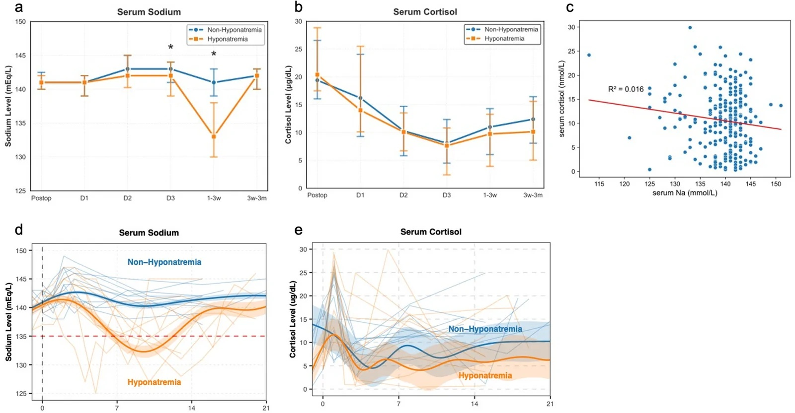
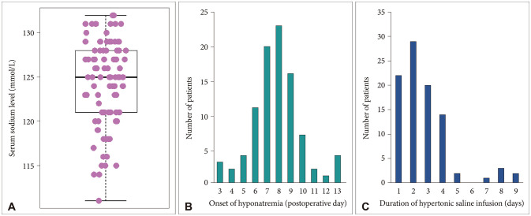
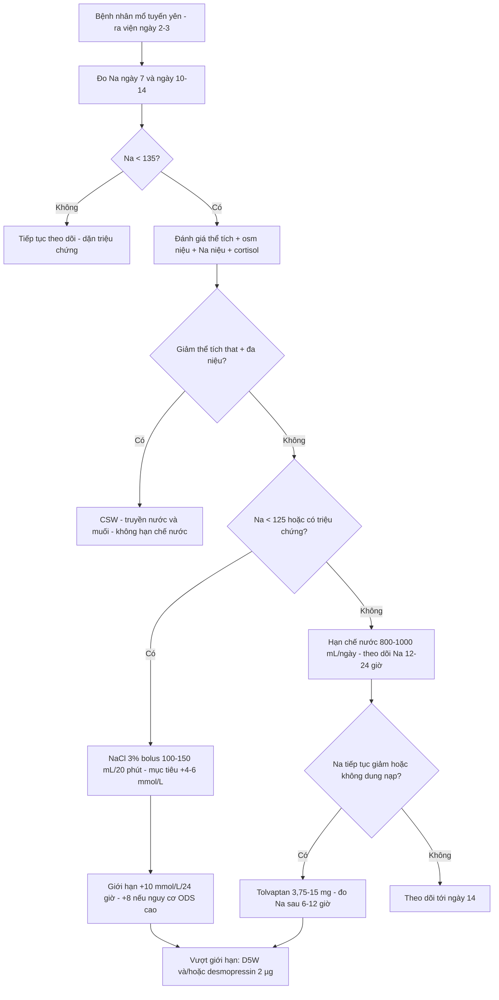
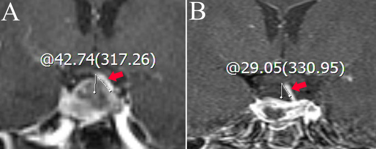

# 1722 — Hạ natri máu muộn sau mổ tuyến yên: SIADH ngày 5–10 và cửa sổ tái nhập viện / Delayed hyponatremia after pituitary surgery

**Tags:** `pattern:ha-natri` `pattern:ha-natri-muon` `pattern:siadh` `pattern:khong-du-bang` `pattern:phu-nao` `vung:tuyen-yen` `vung:ho-yen` `vung:cuong-tuyen-yen` `protocol:MRI-tuyen-yen` `protocol:xet-nghiem-nuoc-tieu` `protocol:theo-doi-natri` `score:Na-huyet-thanh` `score:toc-do-sua-natri`
**Mức chắc chắn (certainty):** tổng hợp y văn (literature synthesis) — nhóm tự biên từ các nguồn mở, đã đối chiếu `authorString`/PMCID: phân tích gộp 27 nghiên cứu (CC BY 4.0, PMC8055398), 261 bệnh nhân vai trò cortisol (CC BY 4.0, PMC13272243), 222 bệnh nhân hạn chế nước (CC BY 4.0, PMC13467755), 377 u không chức năng (CC BY 4.0, PMC12705356), 1.343 bệnh nhân một trung tâm (CC BY-NC 4.0, PMC8082282), 73 bệnh nhân copeptin (CC BY-NC 4.0, PMC10901654), nomogram MRI 5 biến (CC BY 4.0, PMC9273860), 308 ca tolvaptan (CC BY 4.0, PMC8181462), 39 ca SIADH – 7 ca tolvaptan (CC BY 4.0, PMC9563166), 126 ca tolvaptan liều thấp (CC BY-NC-ND 4.0, PMC7326480), tổng quan điều trị hạ natri 2025 (CC BY 4.0, PMC11893709), và 2 phân tích gộp ODS (CC BY 4.0, PMC11295268; CC BY-NC-ND 4.0, PMC11833618). Không có RCT nào so sánh trực tiếp các phác đồ theo dõi natri sau mổ tuyến yên; phần "lịch theo dõi" là tổng hợp có suy luận, đã ghi rõ.

> **Vì sao bài này quan trọng:** bài **1710** đã dạy **tam pha** sau mổ tuyến yên và đặt **SIADH là pha 2**, nhưng chỉ ở mức một mục xử trí; các bài **1755/1757** phủ thể **NHI** (SIADH vs CSW, hạ Na sau xuất viện ở trẻ). Bài này phủ **người lớn sau mổ tuyến yên**, nơi ba câu hỏi của **tuần thứ hai sau mổ** — khi bệnh nhân **đã ra viện** — chưa được trả lời đủ: **(1) ai cần đo natri ngoại trú và vào ngày nào? (2) Na 128 mmol/L nhưng bệnh nhân tỉnh, có cần nhập viện không? (3) hạn chế nước, tolvaptan hay nước muối ưu trương — và nếu chọn sai thì hỏng ở đâu?** Hạ natri muộn chiếm **10,5%** tổng số ca mổ xuyên bướm và **44,3%** các ca tái nhập viện không dự kiến trong 30 ngày (PMC8055398) — tức đây không phải biến chứng hiếm mà là **lý do nhập viện lại phổ biến nhất**. Bỏ sót không chỉ vì không đo natri, mà vì **natri ngày 1–2 thường bình thường**, tạo cảm giác an toàn giả.

## 1. Tổng quan bệnh học – cơ chế hình ảnh: vì sao hạ natri đến MUỘN và vì sao không phải do cortisol

- **Định nghĩa và phân độ:** hạ natri máu = **Na < 135 mmol/L**. Theo mức độ: **nhẹ 130–134**, **trung bình 125–129**, **nặng < 125 mmol/L**. "Muộn" (delayed) = xuất hiện **sau ngày hậu phẫu thứ 3** (định nghĩa dùng trong PMC13467755); trên thực tế đỉnh rơi vào **ngày 5–10**.
- **TẠI SAO muộn — cơ chế sợi trục (axonal):** thao tác trên cuống và thùy sau làm **thoái hóa sợi trục** chứ không chỉ "sốc" tức thời. Các sợi trục đang thoái hóa **phóng thích AVP không điều hòa** vào tuần hoàn trong nhiều ngày; đồng thời **kho dự trữ thùy sau cạn** nên không có pha "escape" bình thường. Kết quả: **SIADH thoáng qua** — nước được giữ lại, pha loãng natri, nhưng **thể tích ngoại bào không tăng đủ để gây phù** (bệnh nhân **đẳng thể tích**). Vì AVP phóng thích theo **chu kỳ thoái hóa sợi trục**, đỉnh natri thấp **không trùng ngày mổ** mà trễ **5–10 ngày**.
- **TẠI SAO cortisol KHÔNG phải thủ phạm chính (bằng chứng mới, dễ dạy sai):** ở **261 bệnh nhân** mổ nội soi hoàn toàn, DPH gặp **20,7%**, có triệu chứng **4,2%**; **thời gian tới nadir trung vị 8 ngày**, **nadir trung vị 129 mmol/L**. Cortisol **không khác** giữa nhóm có và không có DPH; sau ghép điểm xu hướng, nadir cortisol **6,10 vs 7,34 µg/dL (p = 0,29)**, tỷ lệ giảm cortisol trong cơn hạ natri **48,2% vs 40,7% (p = 0,52)** — **đều không có ý nghĩa**. **Bổ sung corticoid trước mổ không có tác dụng bảo vệ** (PMC13272243). Nghĩa là: **không được mặc định "hạ natri sau mổ tuyến yên = suy thượng thận"** rồi cho hydrocortisone mà bỏ qua hạn chế nước.
- **TẠI SAO có triệu chứng ở 129 nhưng có người 125 vẫn tỉnh:** não thích nghi bằng cách **mất các chất tan nội bào (osmolytes)** trong 24–48 giờ; não đã thích nghi thì **không còn phù**, nhưng **cũng mất luôn "bộ đệm"** — sửa natri quá nhanh lúc này làm tế bào co lại → **hội chứng hủy myelin thẩm thấu (osmotic demyelination syndrome, ODS)**. Vì vậy **triệu chứng và tốc độ sửa quan trọng hơn con số tuyệt đối**.
- **TẠI SAO tái nhập viện lại rơi đúng cửa sổ này:** bệnh nhân thường ra viện **ngày 2–3** khi natri còn bình thường; đỉnh hạ natri **ngày 5–10** nằm **ngoài** thời gian nằm viện. Trong loạt 222 bệnh nhân, **93,3%** ca DPH **phải nhập viện lại**; khởi phát trung bình **ngày 7,9** (PMC13467755). Trong 1.343 bệnh nhân, khởi phát **7,8 ngày (3–13)**, natri lúc bắt đầu điều trị **123,5 mmol/L (114–131)**, thời gian điều trị **2,7 ngày (1–9)** (PMC8082282).
- **Ngưỡng định lượng dùng trong bài:**
  - **Tần suất:** gộp 27 nghiên cứu — **10,5% (95% CI 7,4–14,7)** tổng số, **5,0% (3,6–6,9)** có triệu chứng; **44,3% (29,6–60,2)** ca tái nhập viện 30 ngày là do DPH (PMC8055398). Các đoàn hệ đơn lẻ: **6,9%** (1.343 ca), **13,5%** (222 ca), **20,7%** (261 ca), **29,7%** (377 u không chức năng), **31,5%** (73 ca có đo copeptin) — **khác nhau chủ yếu do tần suất đo natri**, không phải do bệnh nặng hơn.
  - **Yếu tố nguy cơ độc lập:** tuổi **> 60** **OR 2,09 (1,11–3,96)**; **tràn khí nội sọ sau mổ** **OR 3,28 (1,59–6,81)** (PMC13272243). Ở 377 u không chức năng: **rò dịch não tủy trong mổ OR 2,60 (1,40–4,81)**, **viêm màng não OR 3,75 (1,38–10,18)**, **TSH trước mổ OR 1,13 (1,01–1,26) mỗi mIU/L**, **Na ngày 1 OR 0,90 (0,84–0,97) mỗi mmol/L** (Na ngày 1 càng thấp càng nguy cơ), **tăng huyết áp bảo vệ OR 0,51 (0,31–0,86)** (PMC12705356). Ở 1.343 ca: **nữ 77,4% vs 61,4% (p = 0,02)** (PMC8082282).
  - **Dự báo bằng xét nghiệm:** tỷ lệ **copeptin/Na trước mổ** cắt **2,5 × 10⁻¹¹** cho **độ nhạy 91,3%**, **giá trị dự báo âm 92,0%** — nhưng **chỉ đúng ở bệnh nhân không có thiếu AVP thoáng qua** (PMC10901654). Đây là công cụ **loại trừ**, chưa phải xét nghiệm thường quy.
  - **Dự báo bằng MRI:** nomogram gồm **chiều dài "cuống tuyến yên đo được" sau mổ**, **chênh lệch góc lệch cuống**, **đái tháo nhạt sau mổ**, **độ sâu lún của hoành yên**, **Na ngày 2** — **AUC 0,806 (tập huấn luyện)** và **0,849 (tập kiểm chứng)** (PMC9273860).
- **Phản biện nguồn:** định nghĩa "muộn" không thống nhất (sau 48 giờ vs sau 72 giờ vs sau khi ra viện), nên **tỷ lệ không so sánh trực tiếp giữa các bài**. Các nghiên cứu đều **hồi cứu, một trung tâm**, và **tần suất đo natri quyết định tần suất phát hiện** — một bài về ảnh hưởng của cường độ theo dõi còn cho thấy tỷ lệ "quan sát được" thay đổi chỉ vì lịch đo (PMC13645545). Vì vậy đừng dùng "10,5%" như hằng số sinh học; hãy dùng nó để biết **cần đo natri**.

## 2. Mẫu hình + chẩn đoán phân biệt theo trục thời gian và thể tích (gamut)

- **Ba câu hỏi với mọi bệnh nhân mổ tuyến yên có Na thấp:** **(1) đang ở ngày thứ mấy sau mổ? (2) thể tích tuần hoàn thừa – đủ – thiếu? (3) nước tiểu đang pha loãng hay cô đặc?**
- **Mẫu hình theo thời gian:**
  - **< 72 giờ:** thường là **đái tháo nhạt thoáng qua** (đa niệu, Na cao) hoặc **hạ natri do truyền dịch nhược trương quá nhiều**; SIADH **ít gặp** ở cửa sổ này. Xem bài 1710.
  - **Ngày 3–14 (đỉnh 5–10):** **SIADH muộn** — Na giảm dần, **nước tiểu cô đặc (osm niệu > 100 mOsm/kg)**, **Na niệu > 30–40 mmol/L**, bệnh nhân **đẳng thể tích**, không khát nhiều, không đa niệu. Đây là mẫu hình của bài này.
  - **> 2 tuần:** **đái tháo nhạt vĩnh viễn** (Na cao, đa niệu) hoặc **suy thượng thận** (Na thấp kèm hạ đường huyết, tăng kali, mệt) hoặc **SIADH kéo dài** hiếm.
- **Mẫu hình theo thể tích:**
  - **Đẳng thể tích:** SIADH (thuốc, sau mổ, u tiết ADH), **suy giáp**, **suy thượng thận** (thực ra giảm thể tích nhẹ nhưng biểu hiện đẳng thể tích).
  - **Giảm thể tích:** **mất muối não (cerebral salt wasting, CSW)** sau mổ nội sọ, nôn/tiêu chảy, lợi tiểu; CSW có **đa niệu, cân nặng giảm, CVP thấp**, Na niệu **> 40 mmol/L**.
  - **Tăng thể tích:** suy tim, xơ gan, bệnh thận — không điển hình sau mổ tuyến yên nhưng phải loại trừ vì **hạn chế nước sẽ làm nặng thêm**.
- **Gamut theo "Na thấp mà không rõ nguyên nhân":** **giả hạ natri** (tăng protein/lipid máu — Na đo bằng phương pháp gián tiếp thấp giả), **tăng đường huyết** (mỗi **100 mg/dL glucose** làm Na giảm **~1,6–2,4 mmol/L**), **mannitol/glycine**, và **thuốc** (SSRI, carbamazepine, lợi tiểu thiazide, desmopressin).
- **Vì sao phải phân biệt SIADH với CSW trước khi điều trị:** cả hai đều **Na niệu cao, osm niệu cao**; nhưng **SIADH → hạn chế nước**, **CSW → truyền nước và muối**. Chọn sai ở CSW gây **tụt huyết áp, sốc**; chọn sai ở SIADH gây **hạ natri nặng hơn**.

*Đường natri (a) và cortisol (b) theo mốc sau mổ — nhóm hạ natri (cam) **tụt sâu ở mốc 1–3 tuần** trong khi cortisol **giảm ở cả hai nhóm** và không khác có ý nghĩa; (c) tương quan cortisol–Na rất yếu (R² = 0,016). Đây là hình ảnh trực tiếp của "muộn" và "không do cortisol". Nguồn: Hwang JH và cs., Pituitary 2026 (PMC13272243) Fig. 1, CC BY 4.0.*

## 3. Bảng so sánh phân biệt (ma trận đối chiếu)

| Thực thể (entity) | Hình ảnh/lab điển hình | Chốt vào (rule-in) | Chốt loại (rule-out) | Gợi ý xác nhận |
|---|---|---|---|---|
| **SIADH muộn sau mổ tuyến yên** | Na < 135 xuất hiện **sau ngày 3**, nadir **ngày 5–10**; bệnh nhân **đẳng thể tích**, nước tiểu **cô đặc** | **Osm niệu > 100 mOsm/kg + Na niệu > 30–40 + đẳng thể tích + không dùng lợi tiểu** | Đa niệu + cân nặng giảm + CVP thấp → CSW; cortisol thấp + hạ đường huyết → suy thượng thận | Na, osm máu/niệu, Na niệu, cân nặng, cortisol sáng, TSH |
| **Mất muối não (CSW)** | **Đa niệu**, cân nặng **giảm**, CVP thấp, Na niệu **> 40 mmol/L**, có thể kèm co giật | **Giảm thể tích thật + đa niệu + Na niệu cao** | Đẳng thể tích, không đa niệu → SIADH | Cân nặng hàng ngày, dịch vào–ra, CVP/siêu âm tĩnh mạch chủ |
| **Suy thượng thận** | Na thấp, **K cao**, hạ đường huyết, mệt, tăng sắc tố; cortisol sáng thấp | **Cortisol sáng < 5 µg/dL (hoặc < 15 mà không tăng sau ACTH)** | Cortisol bình thường, K bình thường → không phải | Cortisol sáng 8h, ACTH, test kích thích ACTH |
| **Suy giáp** | Na thấp nhẹ, TSH cao, T4 thấp, phù niêm | **TSH cao + FT4 thấp** | TSH bình thường → loại trừ | TSH, FT4 |
| **Giả hạ natri** | Na thấp "vô lý", osm máu bình thường | **Osm máu bình thường + protein/lipid rất cao** | Osm máu thấp thật → hạ natri thật | Osm máu đo trực tiếp, điện giải đồ |
| **Hạ natri do truyền dịch nhược trương** | Xảy ra **sớm < 72 giờ**, sau truyền nhiều dịch, Na niệu thấp | **Cân bằng dịch dương + Na niệu thấp** | Na niệu cao + đẳng thể tích → SIADH | Bảng cân bằng dịch, osm niệu |

*1.343 bệnh nhân: (A) Na lúc bắt đầu điều trị **124,3 ± 4,8 mmol/L**; (B) **khởi phát 7,8 ngày** sau mổ, đỉnh rõ ở **ngày 7–8**; (C) thời gian truyền nước muối ưu trương **2,7 ngày**. Đây là bằng chứng cho **cửa sổ ngoại trú ngày 5–10**. Nguồn: Hong YG và cs., Brain Tumor Res Treat 2021 (PMC8082282) Fig. 1, CC BY-NC 4.0.*

## 4. Protocol theo dõi + phân tầng xử trí

- **Lịch đo natri (phần quan trọng nhất, và là phần ít bằng chứng nhất):**
  - **Trong viện:** Na **ngày 1, 2, 3**, sau đó **cách ngày tới ngày 10–14** ở bệnh nhân có yếu tố nguy cơ (tuổi > 60, tràn khí nội sọ, rò dịch não tủy, viêm màng não, TSH cao, Na ngày 1 thấp).
  - **Ngoại trú:** đo Na **ngày 7** và **ngày 10–14** — đúng cửa sổ nadir. Bài 1710 đã nêu cửa sổ này; ở đây nhấn mạnh **không được ra viện ngày 2–3 mà không có lịch đo lại**.
  - **Dặn bệnh nhân:** quay lại ngay nếu **đau đầu, buồn nôn, nôn, lú lẫn, co giật, yếu** — triệu chứng của phù não do hạ natri cấp trên nền mạn.
- **Hạn chế nước để dự phòng (bằng chứng can thiệp duy nhất có đối chứng trong bài này):**
  - **1.000 mL/ngày trong 7 ngày đầu sau mổ** → DPH **6,9% vs 19,2%** ở nhóm không hạn chế (**p = 0,013**), 222 bệnh nhân (PMC13467755). Đây là **hạn chế nước nhẹ**, không phải "không cho uống".
  - **Không áp dụng** cho bệnh nhân đang **đái tháo nhạt/đang dùng desmopressin** (nhóm này bị loại khỏi nghiên cứu) — hạn chế nước ở pha đa niệu gây **tăng natri**.
- **Ngưỡng điều trị (theo mức Na và triệu chứng):**
  - **Na 130–134, không triệu chứng:** hạn chế nước **800–1.000 mL/ngày**, theo dõi Na mỗi 1–2 ngày; tìm thuốc gây hạ natri.
  - **Na 125–129, không triệu chứng:** hạn chế nước chặt hơn; **cân nhắc tolvaptan** nếu không dung nạp hạn chế nước hoặc Na tiếp tục giảm; theo dõi Na **mỗi 12–24 giờ**.
  - **Na < 125 hoặc có triệu chứng trung bình–nặng:** **NaCl 3% dạng bolus** — **100 mL** (khuyến cáo Hoa Kỳ) hoặc **150 mL** (hướng dẫn châu Âu) **truyền trong 20 phút**, mục tiêu nâng **4–6 mmol/L** để cắt triệu chứng (PMC11893709).
  - **Giới hạn sửa:** **+10 mmol/L/24 giờ** (châu Âu), **+10–12 mmol/L/24 giờ** (Hoa Kỳ); **+8 mmol/L/24 giờ nếu nguy cơ ODS cao** (nghiện rượu, suy dinh dưỡng, hạ kali, xơ gan, Na < 105); **+18 mmol/L/48 giờ** (PMC11893709, PMC12844543).
  - **Nếu vượt giới hạn:** truyền **D5W** để hạ lại và/hoặc **desmopressin 2 µg** TM/dưới da mỗi 6–8 giờ để chặn bài niệu (PMC11893709). Không chờ "tự hạ".
- **Tolvaptan — dùng đúng chỗ, đừng dùng rộng:**
  - Liều **3,75–15 mg**; trong 14 ca, liều trung vị **15 mg** cho tốc độ sửa **12,0 mmol/L/24 giờ** và **13,4 mmol/L/48 giờ**, so với **1,8** và **4,5** ở điều trị chuẩn (p < 0,001 và p = 0,004) — tức **nhanh hơn nhiều và dễ vượt ngưỡng 10/24 giờ** (PMC8181462).
  - Ở 7 ca, tolvaptan **3,75–7,5 mg** đưa Na **132,1 → 143,0 mmol/L**, osm máu **266,3 → 289,6 mOsm/kg**, osm niệu **607,1 → 262,7**, Na niệu **121,3 → 36,9**, thể tích nước tiểu **1.384 → 3.291 mL/ngày** (PMC9563166).
  - Liều **7,5 mg** tốt hơn **3,75 mg** trong loạt 126 ca (PMC7326480). Kết luận thực hành: **tolvaptan là thuốc của SIADH khó/không dung nạp hạn chế nước, không phải thuốc đầu tay**, và **phải đo Na 6–12 giờ sau liều đầu**.
- **MRI sau mổ — dùng để phân tầng, không để chẩn đoán hạ natri:**
  - Đo trên **MRI 3T có cản quang, lát mỏng qua hố yên**: **góc lệch cuống trước/sau mổ**, **chiều dài đoạn cuống còn thấy**, **độ lún của hoành yên**; kết hợp **Na ngày 2** và **có/không đái tháo nhạt** → nomogram **AUC 0,806–0,849** (PMC9273860).
  - Giá trị thực dụng: **chọn ai cần đo natri ngoại trú dày**; **không** dùng MRI để quyết định truyền hay không truyền natri.
- **Bậc thang xử trí (suy luận của nhóm từ các ngưỡng trên, không phải guideline chính thức):**

## 5. Biến thể bình thường và cạm bẫy

- **Cạm bẫy số 1 — "Na ngày 1–2 bình thường là an toàn":** sai. Nadir trung vị **ngày 8**; Na ngày 1 thấp là **yếu tố nguy cơ** (OR 0,90 mỗi mmol/L), nhưng Na ngày 1 **bình thường không loại trừ** DPH. Đây là lý do phải có **lịch đo ngoại trú**.
- **Cạm bẫy số 2 — ra viện ngày 2–3 mà không hẹn đo Na:** **93,3%** ca DPH phải nhập viện lại; **44,3%** ca tái nhập viện 30 ngày là do DPH. Ra viện không có kế hoạch đo lại là **lỗi hệ thống**, không phải lỗi bệnh nhân.
- **Cạm bẫy số 3 — quy hạ natri cho suy thượng thận rồi cho corticoid:** ở 261 bệnh nhân, cortisol **không khác** giữa hai nhóm, và **corticoid trước mổ không bảo vệ** (PMC13272243). Cho corticoid mà không hạn chế nước vừa **không sửa được SIADH**, vừa **bỏ mất can thiệp hiệu quả**.
- **Cạm bẫy số 4 — dùng desmopressin trong pha SIADH:** bệnh nhân có thể được chỉ định desmopressin từ pha đa niệu trước đó; nếu tiếp tục trong pha SIADH sẽ **giữ nước nặng hơn**, Na tụt nhanh. Phải **rà lại đơn desmopressin mỗi ngày** trong 2 tuần đầu.
- **Cạm bẫy số 5 — hạn chế nước ở bệnh nhân CSW:** CSW **mất thể tích thật**; hạn chế nước làm **tụt huyết áp và suy thận**. Chốt phân biệt là **cân nặng, dịch vào–ra, CVP**, không phải Na niệu (cả hai đều cao).
- **Cạm bẫy số 6 — sửa natri quá nhanh vì "muốn bệnh nhân tỉnh nhanh":** tolvaptan cho tốc độ **12 mmol/L/24 giờ** — vượt ngưỡng 10; phân tích gộp 26.710 bệnh nhân: ODS **0,23%** tổng, **0,73% vs 0,10%** khi sửa nhanh, **OR 3,16 (1,54–6,49)** (PMC11833618). Ở 6.032 bệnh nhân nặng, ODS **0,48%**, **RR 3,91 (1,17–13,04)** nhưng sửa nhanh **giảm tử vong trong viện ~50%** (RR 0,51) — nghĩa là **phải cân bằng**, không được cực đoan một phía.
- **Cạm bẫy số 7 — bỏ qua giả hạ natri:** Na thấp + **osm máu bình thường** + protein/lipid rất cao = **giả hạ natri**; điều trị như hạ natri thật có thể gây **tăng natri iatrogenic**.
- **Cạm bẫy số 8 — đọc tràn khí nội sọ trên CT sau mổ như "biến chứng vô hại":** tràn khí nội sọ là **yếu tố nguy cơ độc lập của DPH (OR 3,28)** — thấy khí trên CT sau mổ thì **đưa bệnh nhân vào nhóm cần đo Na ngoại trú dày** (PMC13272243).
- **Biến thể bình thường:** Na **131–134 mmol/L thoáng qua, không triệu chứng, tự về bình thường trong 48 giờ** sau khi giảm dịch — có thể chỉ theo dõi. Nhưng **không được giả định** "sẽ tự hết" nếu bệnh nhân có yếu tố nguy cơ.

## 6. Tự lượng giá — Blind Quiz

**Ca 1 — Nữ 58 tuổi, mổ nội soi u tuyến yên không chức năng, ra viện ngày 2 với Na 139. Ngày 8 đau đầu, buồn nôn.**

- Hỏi: hình (a) cho thấy đỉnh hạ natri ở đâu? Vì sao không phải ngày mổ? Cortisol có giải thích được không?

<b>Bấm để hiện đáp án</b>

- (a) Nhóm hạ natri **tụt sâu ở mốc 1–3 tuần**, nadir trung vị **ngày 8**, nadir **129 mmol/L**; (b) cortisol **giảm ở cả hai nhóm**, không khác có ý nghĩa (6,10 vs 7,34 µg/dL, p = 0,29); (c) R² = 0,016.
- Vì sao muộn: **thoái hóa sợi trục phóng thích AVP không điều hòa** trong nhiều ngày, không phải "sốc" tức thời.
- Kết luận: đây là **SIADH muộn**, không phải suy thượng thận; điều trị là **hạn chế nước**, không phải corticoid.
- Nguồn ảnh: Hwang JH và cs., Pituitary 2026 (PMC13272243) Fig. 1, CC BY 4.0.

**Ca 2 — Nam 44 tuổi, mổ u tuyến yên, không đo natri ngoại trú; ngày 9 vào cấp cứu lú lẫn, Na 121.**

- Hỏi: hình (B) nói gì về cửa sổ nguy hiểm? Na 121 có triệu chứng thì xử trí đầu tay? Giới hạn sửa?

<b>Bấm để hiện đáp án</b>

- (B) Khởi phát **7,8 ngày (3–13)**, đỉnh **ngày 7–8** → cửa sổ ngoại trú **ngày 5–10**; (A) Na lúc điều trị **124,3 ± 4,8**, tức đa số đến muộn và đã thấp sâu.
- Xử trí: **NaCl 3% bolus 100–150 mL/20 phút**, mục tiêu nâng **4–6 mmol/L** để cắt triệu chứng (PMC11893709).
- Giới hạn: **+10 mmol/L/24 giờ** (châu Âu), **+8 nếu nguy cơ ODS cao**, **+18/48 giờ**; vượt thì **D5W ± desmopressin 2 µg**.
- Cạm bẫy: không có lịch đo ngoại trú là nguyên nhân gốc — **93,3%** ca DPH phải nhập viện lại.
- Nguồn ảnh: Hong YG và cs., Brain Tumor Res Treat 2021 (PMC8082282) Fig. 1, CC BY-NC 4.0.

**Ca 3 — Bệnh nhân 62 tuổi, sau mổ có tràn khí nội sọ trên CT; MRI 3 tháng thấy cuống lệch 30°, hoành yên lún sâu.**

- Hỏi: các biến MRI này dùng để làm gì? Có quyết định truyền natri không? Giá trị của nomogram?

<b>Bấm để hiện đáp án</b>

- (A) góc lệch cuống **42,74°** trước mổ; (B) **29,05°** sau mổ — cùng **chiều dài cuống đo được**, **độ lún hoành yên**, **đái tháo nhạt sau mổ**, **Na ngày 2** tạo nomogram dự báo DPH.
- Dùng để **phân tầng ai cần đo Na ngoại trú dày**, **không** để quyết định truyền natri (quyết định dựa trên Na + triệu chứng + thể tích).
- Giá trị: **AUC 0,806 (huấn luyện) / 0,849 (kiểm chứng)** — tốt nhưng **chưa được kiểm chứng tiền cứu đa trung tâm**, nên chỉ hỗ trợ.
- Tràn khí nội sọ trên CT sau mổ là **yếu tố nguy cơ độc lập (OR 3,28)** — thấy khí thì theo dõi sát.
- Nguồn ảnh: Lin K và cs., Front Endocrinol 2022 (PMC9273860) Fig. 1, CC BY 4.0.

## Bài liên quan chéo
- [200 – Tổng quan hệ Thần kinh](../200-tong-quan-he-than-kinh/lesson.md)
- [1710 – Đái tháo nhạt trung ương sau mổ tuyến yên: tam pha, điểm sáng thùy sau trên T1](../1710-dai-thao-nhat-trung-uong-sau-mo-tuyen-yen/lesson.md)
- [1696 – Bệnh Cushing do u tuyến yên: MRI 3T động học, BIPSS](../1696-benh-cushing-u-tuyen-yen/lesson.md)
- [1755 – Hạ natri máu sau mổ u vùng trên yên ở TRẺ: SIADH hay mất muối não](../1755-csws/lesson.md)
- [1757 – Hạ natri máu muộn sau xuất viện ở TRẺ mổ vùng trên yên](../1757-ha-natri-mau-muon-sau-xuat-vien/lesson.md)
- [245 – U tuyến yên chảy máu/nhồi máu (pituitary apoplexy): hạ natri kháng trị là dấu hiệu](../245-u-tuyen-yen-chay-mau-nhoi-mau-pituitary-apoplexy/lesson.md)

## Ảnh
- Tên file: `1722_<slug>_<Modality>_<SourceID>.jpg`; nguồn + giấy phép từng ảnh ở `images/CREDITS.md`.
- Ảnh dùng trong bài **tải được** từ Europe PMC (CC BY / CC BY-NC); **không crop, không kéo giãn**; chỉ ảnh ghép có dải attribution.
- EyeWiki / Radiopaedia / AuntMinnie: **chỉ dẫn link, không tải** (xem `sources.md`).

> Không dùng để chẩn đoán độc lập khi chưa có người hướng dẫn.
