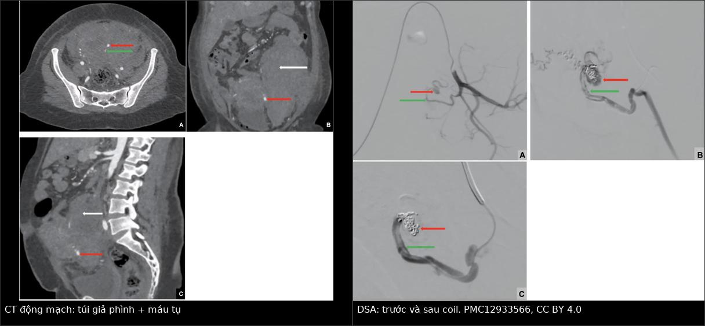
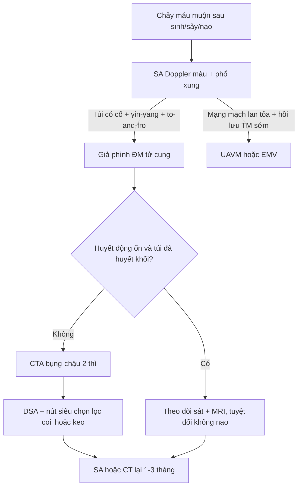
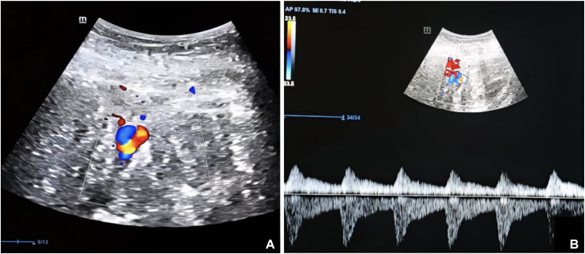
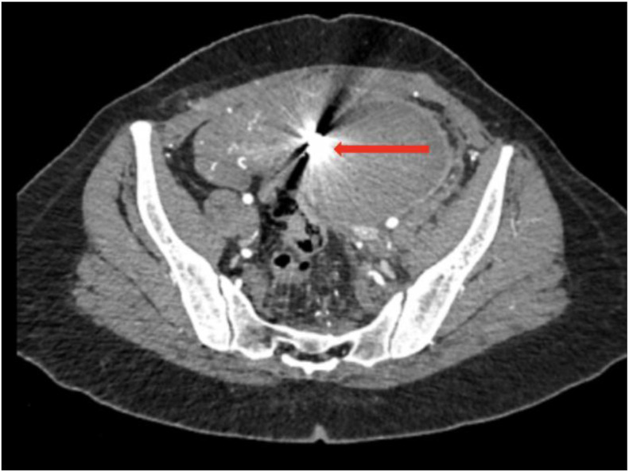
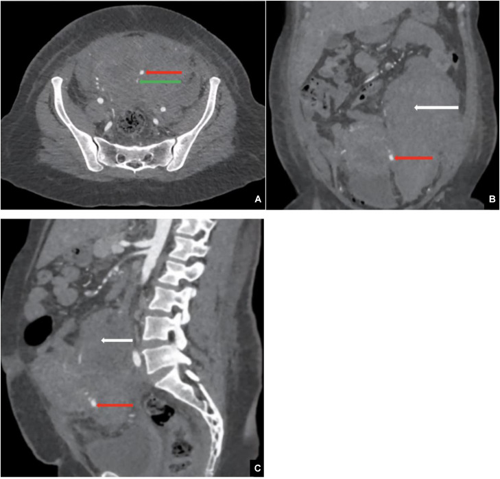
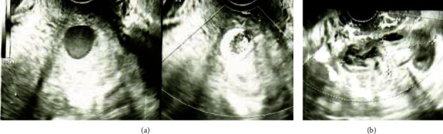

# 1723 — Giả phình động mạch tử cung sau mổ lấy thai/nạo / Uterine artery pseudoaneurysm

**Tags:** `pattern:gia-phinh` `pattern:yin-yang` `pattern:to-and-fro` `pattern:chay-mau-am-dao` `vung:tu-cung` `vung:tieu-khung` `vung:dong-mach-tu-cung` `protocol:SA-Doppler` `protocol:CTA` `protocol:DSA` `protocol:UAE` `incidentaloma:gia-phinh`
**Mức chắc chắn (certainty):** tổng hợp y văn (literature synthesis) — 1 tổng quan hệ thống **144 bệnh nhân** (PMC12433499), 1 loạt **2 ca** có đủ CT–DSA–coil (PMC13456665), 1 ca nguyên văn có **siêu âm Doppler + CT + DSA** (PMC12933566) và 1 ca **vỡ ra ngoài phúc mạc không chảy máu âm đạo** (PMC38046834). Câu nào là suy luận được ghi **[suy luận]**.

> **Vì sao bài này quan trọng:** đây là nguyên nhân **chảy máu ồ ạt sau mổ lấy thai/nạo** mà **siêu âm thường quy bỏ sót** nếu không bật Doppler màu; điều trị **khác hẳn** dị dạng động–tĩnh mạch (UAVM): **nút chọn lọc đúng một túi**, không nút cả hai động mạch tử cung. Bỏ sót hoặc **nạo lại vì "nghi sót nhau"** trên túi giả phình chưa chẩn đoán = **vỡ túi, mất máu ồ ạt**.

## 1. Tổng quan bệnh học – cơ chế hình ảnh

- **Bản chất:** giả phình (pseudoaneurysm, PA) là **khoang máu ngoài lòng mạch còn thông với động mạch qua một cổ (neck)**; thành khoang **không có 3 lớp mạch** mà chỉ là **adventitia/mô xơ/tụ máu tổ chức hóa**. Vì thành mỏng và chịu áp lực động mạch, túi **to dần và vỡ** — khác phình thật (aneurysm) có đủ 3 lớp.
- **Cơ chế sau sản khoa:** tổn thương thành nhánh động mạch tử cung trong **mổ lấy thai, nạo/hút thai, bóc u xơ, cắt cổ tử cung, thủ thuật nội soi buồng tử cung** → máu thoát ra nhưng còn thông với lòng mạch. **Ước tính 3–6/1.000 ca sinh**; chiếm **0,3–1% các ca chảy máu sau sinh (PPH)**; **~40% xuất hiện sau sinh thường hoặc sảy không do chấn thương** (PMC12433499).
- **TẠI SAO Doppler màu cho "yin–yang":** trong túi có **dòng xoáy (swirl)**: máu vào ở tâm và quay ra ở ngoại vi tạo **hai vùng đỏ–xanh đối nhau** trong cùng một túi — dấu **yin–yang sign**. Đây không phải "mạch máu giàu tưới" chung chung: **màu đổi chiều trong cùng một cấu trúc tròn** mới là chốt.
- **TẠI SAO phổ xung cho "to-and-fro":** đặt cửa sổ Doppler **ngay cổ túi**, dòng đi vào trong thì tâm thu và **quay ngược ra** trong thì tâm trương → phổ **hai chiều đối xứng qua đường đẳng điện**, đỉnh tâm thu thấp và rộng hơn động mạch bình thường. Đây là hệ quả trực tiếp của **khoang máu có cổ hẹp, đàn hồi kém**.
- **TẠI SAO CTA thấy rõ:** túi giả phình **đọng cản quang cùng thì động mạch và giữ hình** ở thì muộn (khác thoát mạch hoạt tính: **lan và đổi hình theo thì**). CTA lát mỏng **1 mm** + MPR cho thấy **cổ túi, động mạch nuôi và tương quan với niệu quản/bàng quang** trước khi nút.
- **TẠI SAO nguy hiểm:** túi nằm trong cơ tử cung hoặc **lồi ra ngoài thanh mạc (exophytic)**; khi vỡ có thể **chảy máu vào ổ bụng/sau phúc mạc mà KHÔNG có máu âm đạo** — bệnh nhân đến bằng **đau bụng, sốt, tụt huyết áp** (PMC38046834).
- **Số liệu định lượng cốt lõi:**
  - Tổng quan hệ thống **144 bệnh nhân** (124 không mang thai, 20 mang thai): **nút mạch là điều trị chính 99% (không thai) và 90% (có thai)**, **không có tử vong**; ở nhóm không mang thai **chảy máu âm đạo 81,5%**, và **chảy máu liên quan đến nhu cầu truyền máu** (p < 0,05).
  - **Túi nhỏ hơn lại dễ chảy máu hơn**: nhóm có chảy máu **24,5 mm** so với **32,3 mm** (p = 0,017) → **không dùng kích thước để quyết định theo dõi** (PMC12433499).
  - Ca nguyên văn (PMC12933566): nữ **35 tuổi**, mổ lấy thai lần 3, **ngày 5 sau mổ** đau bụng–nôn, **HA 90/70 mmHg, Hb 6 g/dL**, **không có máu âm đạo**; truyền **2 + 4 đơn vị hồng cầu** đưa Hb lên **11 g/dL**; CT thấy **máu tụ sau phúc mạc** + túi giả phình; nút coil thành công.
  - Ca loạt 2 bệnh nhân (PMC13456665): túi **1,8 cm** (ngày 6 sau sinh thường, ngất, Hb **10,6 → 8,8 g/dL**, có **tràn máu ổ bụng + ứ nước thận** do máu tụ chèn) và túi **2,7 cm** (chảy máu âm đạo nặng nhưng không đau); cả hai nút **4 coil Hilal 18 2/20 mm**.
  - Ca vỡ ngoài phúc mạc (PMC38046834): **31 tuổi, ngày 7 sau sinh thường**, **đau bụng + sốt, không chảy máu âm đạo**; nút **coil + n-butyl-2-cyanoacrylate**, ra viện **ngày 12**, túi biến mất trên siêu âm lúc **8 tháng**.

## 2. Mẫu hình + chẩn đoán phân biệt theo vị trí (gamut)

- **Túi tròn có cổ trong cơ tử cung/cạnh tử cung + chảy máu muộn** → gamut: **giả phình động mạch tử cung**, **UAVM/EMV**, **RPOC tăng sinh mạch**, **thai trứng/GTN**, **dị dạng mạch bẩm sinh**, **máu tụ tổ chức hóa có tưới máu**.
- **Theo vị trí:** thân tử cung → nhánh động mạch tử cung; **đoạn dưới/cạnh cổ tử cung** → nhánh xuống động mạch tử cung (hay sau mổ lấy thai); **cạnh âm đạo** → nhánh âm đạo; **sau phúc mạc** → nhánh tử cung bị vỡ ra ngoài.
- **Theo thời điểm:** sớm **vài giờ–vài ngày** sau mổ/nạo (chảy máu cấp) hoặc **muộn 2–6 tuần** (chảy máu tái diễn, "secondary PPH" đỉnh **ngày 8–14**).
- Gợi nhớ **"PSEUDO"**: **P**ost-partum/post-procedure, **S**ystolic bruit/to-and-fro, **E**xtravasation on CTA, **U**terine artery branch, **D**iscrete sac with neck, **O**bserve only if thrombosed.

## 3. Bảng so sánh phân biệt (ma trận đối chiếu)

| Thực thể (entity) | Hình ảnh điển hình | Chốt vào (rule-in) | Chốt loại (rule-out) | Gợi ý xác nhận |
|---|---|---|---|---|
| **Giả phình động mạch tử cung (UAP)** | Túi tròn **có cổ**, **yin–yang** trong túi, phổ **to-and-fro** ở cổ; CTA đọng cản quang thì động mạch, giữ hình thì muộn | **Túi khu trú + cổ + yin–yang/to-and-fro** | Mạng mạch lan tỏa không túi, hồi lưu tĩnh mạch sớm → UAVM | DSA + nút chọn lọc |
| **UAVM / EMV sau thai** | **Đám rối mạch lan tỏa** trong cơ tử cung, **PSV 25–110 cm/s, RI 0,27–0,75**, hồi lưu tĩnh mạch sớm; EMV **50,5% ngày 3 → 3,9% ở 6 tuần** | **Mạng mạch lan tỏa + tĩnh mạch cản quang sớm** | Túi có cổ đơn độc → giả phình | Theo dõi EMV; UAVM nút/keo |
| **RPOC tăng sinh mạch** | Khối trong **lòng buồng tử cung**, có mạch nuôi từ cơ; **hCG còn dương** | **Khối trong lòng + hCG (+)** | Túi ngoài lòng, hCG âm → giả phình | Hút nội soi **sau khi đã loại giả phình** |
| **Thai trứng / GTN** | Khối trong buồng tử cung, **"bão tuyết"**, mạch giãn, hCG rất cao | **hCG rất cao + khối trong lòng** | Túi có cổ + hCG âm → mạch máu | hCG chuỗi + siêu âm |
| **Máu tụ tổ chức hóa** | Khối hỗn hợp, **không có cổ**, không đọng cản quang thì muộn | **Không ngấm thuốc + không cổ** | Có cổ + đọng thuốc → giả phình | Theo dõi siêu âm |
| **Vỡ tử cung / nhau bong non** | Dịch ổ bụng, mất liên tục cơ tử cung, thai ngoài buồng | **Mất liên tục thành cơ + dịch ổ bụng** | Thành cơ liền + túi mạch → UAP | Mổ cấp nếu bệnh cảnh phù hợp |

*Trái: **CT động mạch** — túi giả phình (mũi tên đỏ) phát sinh từ động mạch tử cung trái (mũi tên xanh), kèm máu tụ sau phúc mạc (mũi tên trắng). Phải: **DSA** — túi trước nút và sau đặt coil. Nguồn: Maireche A et al., Radiol Case Rep 2026, PMC12933566, CC BY 4.0; ảnh ghép letterbox.*

### Ba dấu hiệu phải đọc đúng
- **Yin–yang sign:** hai vùng màu đối nhau **trong cùng một túi tròn**, đổi theo nhịp tim; không phải "nhiều mạch" rải rác.
- **To-and-fro:** phổ **hai chiều** ở **cổ túi**; nếu đặt sai vị trí (trong lòng tử cung) sẽ chỉ thấy phổ động mạch thấp hoặc nhiễu.
- **Cổ túi (neck):** thấy rõ nhất trên CTA lát mỏng hoặc DSA; **có cổ = còn thông với động mạch = còn nguy cơ vỡ**, kể cả khi túi nhỏ.

## 4. Protocol chụp + hệ phân độ/điểm chuẩn hóa

- **Bước 1 — siêu âm Doppler màu + phổ xung (đầu tay):** đầu dò âm đạo, khảo sát **toàn bộ cơ tử cung, đoạn dưới, cạnh cổ**; bật **Doppler màu** tìm túi yin–yang, đặt cổ túi ghi **to-and-fro**; đo **kích thước 3 chiều** và **PSV/RI**. Siêu âm **bình thường trên B-mode không loại trừ** — phải có Doppler.
- **Bước 2 — CTA bụng–chậu:** cản quang **100 mL, 350 mgI/mL, 4 mL/s**; thì **động mạch 25–30 giây**, thì **cổng 70 giây**; lát **1 mm**, MPR axial/coronal/sagittal + MIP/VR. Mục tiêu: **cổ túi, động mạch nuôi, máu tụ sau phúc mạc, tương quan niệu quản**.
- **Bước 3 — MRI khi có thai hoặc suy thận:** không ion hóa; **T2/flow void** thấy túi/tổn thương mạch; **MRI có cản quang** chỉ khi thật cần và sau khi cân nhắc thai. Trong thai, **MRI là phương thức ưu tiên** (70% ca mang thai dùng MRI; PMC12433499).
- **Bước 4 — DSA:** vừa chẩn đoán vừa điều trị; **siêu chọn lọc nhánh tử cung**, nút bằng **coil** hoặc **keo/NBCA**; chụp kiểm tra **còn tồn dư** trước khi kết thúc.
- **Không có hệ phân độ chính thức** cho UAP. Mô tả theo **4 trục:** *kích thước (mm) × vị trí (thân/đoạn dưới/cạnh cổ/sau phúc mạc) × có cổ còn thông hay đã huyết khối × huyết động*. Điều trị theo trục **còn thông + huyết động**, không theo mm.
- **Điều trị:** nút mạch chọn lọc là **chuẩn** — được dùng ở **90–99% ca**, **ít biến chứng và không có tử vong** trong tổng quan 144 bệnh nhân, giữ tử cung (PMC12433499); **mổ thắt động mạch chậu trong** khi không có IR (ca Tunisia, PMC39253026); **tiêm thrombin** chỉ với túi nông, tiếp cận được; **theo dõi** chỉ khi **túi đã huyết khối/không tưới** và bệnh nhân **ổn định** (ca 27 tuần thai, không can thiệp, sinh thường ở 38⁴⁄₇ tuần; PMC12433499).
- **Sau nút:** siêu âm/CT lại **1–3 tháng**; theo dõi **hồi phục kinh nguyệt, khả năng sinh sản**; không nạo buồng tử cung cho tới khi túi đã loại trừ.

## 5. Biến thể bình thường và cạm bẫy

- **Biến thể:** túi **nhỏ < 1 cm**, đã **huyết khối hoàn toàn**, không còn cổ trên CTA → có thể theo dõi nếu ổn định; nhưng **phải chứng minh không còn thông** bằng CTA/DSA, không suy từ siêu âm.
- **Cạm bẫy 1 — "siêu âm bình thường":** B-mode chỉ thấy khối echo hỗn hợp hoặc máu tụ; **không bật Doppler = bỏ sót**. Ở ca vỡ ngoài phúc mạc, **không có máu âm đạo** nên dễ chẩn đoán thành "nhiễm trùng hậu sản".
- **Cạm bẫy 2 — nạo vì "nghi sót nhau":** nạo trên túi giả phình chưa chẩn đoán gây **chảy máu ồ ạt**; ca 35 tuổi sau sinh ngày 27 đã nạo vì nghi RPOC → **mất 1,2 L máu, truyền 4 hồng cầu + 3 huyết tương** (PMC12723177). **Quy tắc: chảy máu muộn + khối trong cơ → Doppler trước, nạo sau.**
- **Cạm bẫy 3 — nhầm với UAVM:** UAVM là **mạng lan tỏa**, nút cả hai bên; UAP là **một túi có cổ**, chỉ nút nhánh nuôi. Nút nhầm "cả hai động mạch tử cung" làm **tăng nguy cơ suy buồng trứng/hoại tử tử cung**.
- **Cạm bẫy 4 — kích thước nhỏ:** túi **24,5 mm** chảy máu nhiều hơn túi **32,3 mm** (p = 0,017); **không yên tâm vì túi nhỏ**.
- **Cạm bẫy 5 — bỏ sót máu tụ sau phúc mạc:** đau lưng/hông + tụt Hb sau mổ lấy thai; CTA phải khảo sát **toàn bộ sau phúc mạc tới hố thận**, không chỉ tiểu khung.

## 6. Tự lượng giá — Blind Quiz

**Ca 1 — Ngày 5 sau mổ lấy thai, đau bụng, HA 90/70 mmHg, Hb 6 g/dL, không ra máu âm đạo.**

- Gợi ý: ba lần mổ lấy thai trước đó; bụng chướng nhẹ; không sốt.
- Hỏi: (1) Dấu hiệu trong túi là gì? (2) Phổ ở cổ túi nói gì? (3) Hai chẩn đoán phân biệt và bước tiếp theo?

<b>Bấm để hiện đáp án</b>

- **Dấu hiệu:** túi tròn có **hai vùng màu đỏ–xanh đối nhau (yin–yang)**; phổ xung **hai chiều to-and-fro** ở cổ túi.
- **Chẩn đoán:** **giả phình động mạch tử cung** — thành túi chỉ là mô xơ nên vỡ dễ; máu chảy vào **sau phúc mạc** nên **không có máu âm đạo**.
- **Bước tiếp:** CTA bụng–chậu 2 thì → DSA + **nút siêu chọn lọc**; không nạo, không chờ vì Hb đang tụt.
- Sau nút, CT kiểm tra: coil tại chỗ, **không còn túi**:

- Nguồn: Maireche A et al., Radiol Case Rep 2026, PMC12933566, CC BY 4.0.

**Ca 2 — Cùng bệnh nhân ca 1: sau hồi sức, chụp CT thì động mạch.**

- Gợi ý: Hb 6 g/dL, không có máu âm đạo; bụng chướng, đau lan ra sau lưng.
- Hỏi: mô tả túi và mô mềm quanh nó; vì sao máu tụ lớn mà **không thấy máu âm đạo**?

<b>Bấm để hiện đáp án</b>

- **Dấu hiệu:** túi ngấm cản quang thì động mạch, **có cổ** nối nhánh động mạch tử cung trái (mũi tên đỏ/xanh); **máu tụ lớn sau phúc mạc** (mũi tên trắng) đẩy tử cung sang phải.
- **Chẩn đoán:** giả phình động mạch tử cung **đã vỡ vào sau phúc mạc**; điều trị **coil** qua DSA, CT sau nút không còn túi.
- **Vì sao không có máu âm đạo:** túi vỡ ra **khoang sau phúc mạc**, không thông với buồng tử cung/âm đạo — đây là lý do bệnh cảnh bị chẩn đoán nhầm thành "nhiễm trùng hậu sản".
- Nguồn: Maireche A et al., Radiol Case Rep 2026, PMC12933566, CC BY 4.0 (Fig. 2).

**Ca 3 — Ngày 7 sau sinh thường, đau bụng + sốt, KHÔNG ra máu âm đạo.**

- Gợi ý: bụng chướng, Hb giảm nhẹ, không tiền sử mổ lấy thai.
- Hỏi: vì sao chẩn đoán muộn? Can thiệp nào vừa chẩn đoán vừa điều trị?

<b>Bấm để hiện đáp án</b>

- **Dấu hiệu:** khối **1,7 × 1,6 cm** cạnh tử cung, **dòng xoáy trong khối** trên Doppler màu; **máu tụ 8 cm** trong tiểu khung.
- **Chẩn đoán:** giả phình động mạch tử cung thể **exophytic đã vỡ** — túi nằm **ngoài buồng tử cung** nên **không có máu âm đạo**; có thể xảy ra **dù không có yếu tố nguy cơ** (không mổ lấy thai, không nạo).
- **Điều trị:** **DSA + coil/NBCA**; bệnh nhân ra viện ngày 12, túi không còn ở 8 tháng.
- Nguồn: Toshimitsu M et al., Case Rep Obstet Gynecol 2023, PMC10693466, CC BY 4.0 (Fig. 1).

## Bài liên quan chéo
- [500 – Tổng quan Vú & Sản Phụ khoa](../500-tong-quan-vu-san-phu-khoa/lesson.md)
- [1657 – Dị dạng động–tĩnh mạch tử cung & tăng sinh mạch cơ tử cung: ngưỡng PSV/RI, CẤM nạo khi chưa loại trừ](../1657-di-dang-dong-tinh-mach-tu-cung/lesson.md)
- [1624 – Polyp nhau & khối trong buồng tử cung sau sinh/sảy: hCG âm không loại trừ](../1624-polyp-nhau-khoi-buong-tu-cung-sau-sinh/lesson.md)
- [1717 – Vỡ tử cung trên sẹo mổ lấy thai](../1717-vo-tu-cung-tren-seo-mo-lay-thai/lesson.md)

> Không dùng để chẩn đoán độc lập khi chưa có người hướng dẫn.
