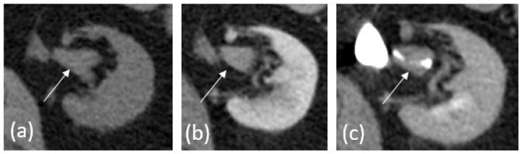
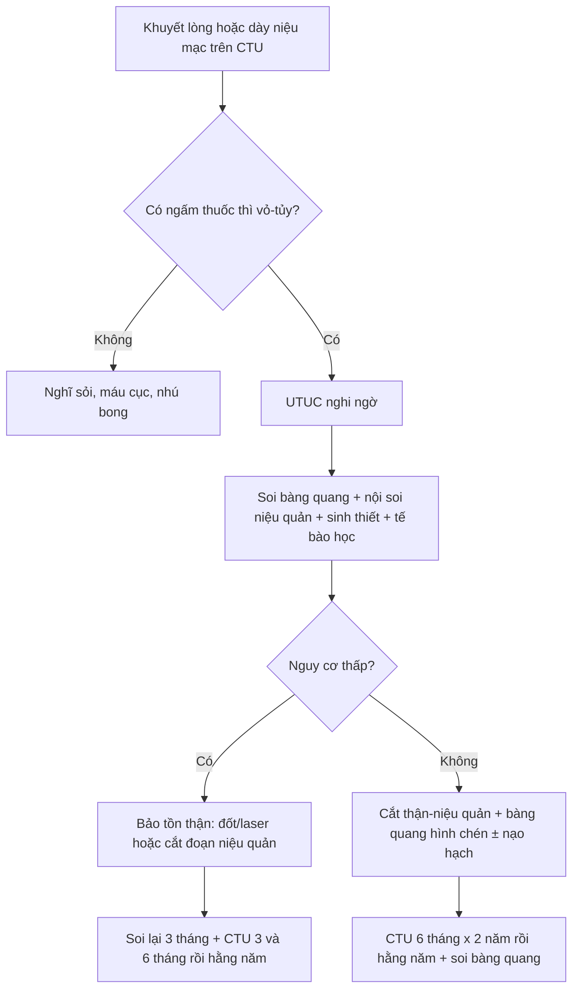
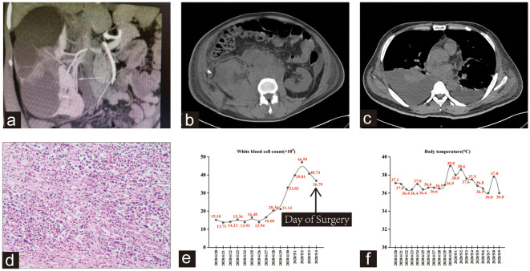
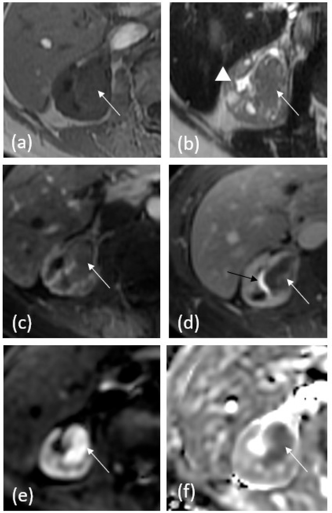
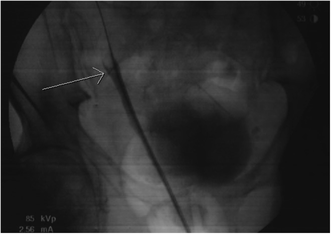

# 1724 — Ung thư biểu mô niệu mạc đường tiết niệu trên: dấu "goblet" & "stipple" / Upper tract urothelial carcinoma (UTUC)

**Tags:** `pattern:khuyet-long` `pattern:khong-che-long` `pattern:u-nieu-mac` `pattern:u-nuoc-than` `vung:nieu-quan` `vung:than` `vung:bang-quang` `score:EAU-risk` `score:TNM-UTUC` `protocol:CT-urography` `protocol:MR-urography` `protocol:noi-soi-nieu-quan` `incidentaloma:khuyet-long-nieu-quan`
**Mức chắc chắn (certainty):** tổng hợp y văn (literature synthesis) — dựa trên 1 tổng quan hình ảnh có số liệu gộp (PMC10605044), 1 tổng quan chẩn đoán–điều trị 2025 (PMC12346452), 1 nghiên cứu về độ chính xác sinh thiết niệu quản 86 ca (PMC12417869), 1 loạt 244 ca cắt thận–niệu quản (PMC4232409) và 2 bài ca có ảnh (PMC6033302, PMC10800997). Câu nào là suy luận từ bằng chứng gián tiếp được ghi **[suy luận]**.

## 1. Tổng quan bệnh học – cơ chế hình ảnh

- **Định nghĩa:** ung thư biểu mô niệu mạc đường tiết niệu trên (upper tract urothelial carcinoma, UTUC) xuất phát từ tế bào niệu mạc lót bể thận – đài thận và niệu quản. UTUC chiếm **5–7%** tổng số ung thư biểu mô niệu mạc (PMC10605044; tổng quan 2025 ghi **5–10%**, PMC12346452), tỷ lệ mới mắc **1–2/100.000 người/năm**.
- **Vị trí — đọc trước khi đo:** hay gặp nhất ở **bể thận**; trong niệu quản, tỷ lệ **đoạn xa 73% · đoạn giữa 24% · đoạn gần 3%** (PMC10605044). Đa ổ là đặc trưng của bệnh niệu mạc — **11–13%** bệnh nhân có UTUC thứ phát đồng thời/khác thời điểm, và **~40%** về sau phát triển ung thư biểu mô bàng quang; nguy cơ này giảm dần sau **4 năm** kể từ lúc cắt thận–niệu quản (PMC10605044).
- **TẠI SAO UTUC ngấm thuốc sớm:** u là mô tân sinh có mạng mao mạch, mất hàng rào niệu mạc bình thường → bắt iod ở **thì vỏ–tủy (corticomedullary, 25–30 giây)**. Ca minh họa dưới đây: tổn thương **30 HU trước tiêm → 75 HU thì vỏ–tủy** (PMC10605044, Fig. 1) — mức tăng **45 HU** đủ để tách khỏi máu cục (không ngấm) và sỏi (rất tăng đậm độ, không ngấm).
- **TẠI SAO có "goblet sign":** u niệu mạc nhú phát triển chậm, **làm giãn lòng niệu quản tại chỗ u** thay vì xâm lấn nhanh; khi cản quang chảy xuống gặp bờ u tạo **mặt khum (meniscus)** rồi dừng — đoạn trên giãn + đầu dưới khum trông như **cái ly (goblet)**. Cơ chế này được mô tả là do khối u phát triển chậm làm nở lòng niệu quản (PMC3857980). Hệ quả thực hành: goblet là dấu hiệu của **tổn thương trong lòng phát triển chậm**, **không** phải dấu hiệu đặc hiệu của ung thư — xem cạm bẫy ở mục 5.
- **TẠI SAO có "stipple sign":** cản quang len vào **khe giữa các nhú (interstices)** của u nhú rồi đọng lại thành các **chấm/đốm cản quang nhỏ** trong khuyết lòng, giống tranh chấm điểm (stipple). Dấu hiệu này chỉ thấy khi u có bề mặt nhú và cản quang đủ đặc — u phẳng/lan tỏa (flat/sessile) thường **không** có.
- **Ba hình thái cơ bản trên hình ảnh (PMC10605044):** (1) **khuyết lòng** trong đài/bể thận/niệu quản; (2) **dày khu trú niệu mạc** thành đoạn, ngấm thuốc mạnh; (3) **khối thâm nhiễm** — điểm chốt so với ung thư tế bào thận (RCC): UTUC thâm nhiễm **giữ nguyên đường viền thận**, RCC **làm biến dạng** đường viền.
- **Ngưỡng phát hiện theo kích thước (đọc để biết giới hạn của CT):** với tổn thương nhú, CT urography có **Se 96%/Sp 99%** khi **5–10 mm**, **Se 89%** khi **< 5 mm**, và chỉ **Se 40%** khi **< 3 mm** (PMC4232409 dẫn y văn). Nói cách khác: **một niệu quản "bình thường" trên CT không loại trừ u < 3 mm**.
- **Chẩn đoán mô học trước mổ không đáng tin như ta tưởng:** so với bệnh phẩm cắt thận–niệu quản ở **86 ca**, sinh thiết qua nội soi niệu quản đúng giai đoạn **54,69%** (κ = 0,311), đúng độ mô học **70,93%** (κ = 0,447); **nâng giai đoạn 39,06%**, **nâng độ 25,58%**, và **5,81%** mẫu không chẩn đoán được, tập trung ở u bể thận (p = 0,0064) (PMC12417869).
- **Dịch tễ của "dương tính giả":** trong **244** ca cắt thận–niệu quản vì nghi UTUC, **7 ca (2,9%)** là tổn thương lành tính — lao niệu, giả u viêm (2), polyp xơ–biểu mô, sỏi kèm tăng sản nhú, viêm niệu quản polypoid (PMC4232409). Đây là con số tối thiểu để tư vấn trước một phẫu thuật mất thận.

## 2. Mẫu hình + chẩn đoán phân biệt theo VỊ TRÍ (Gamut)

Mẫu hình chung: **khuyết lòng hoặc dày thành niệu mạc + ứ nước/giãn niệu quản phía trên**, có hoặc không có đái máu.

- **Bể thận – đài thận:**
  - **UTUC nhú:** khuyết lòng bờ không đều, **stipple sign**, đài thận cắt cụt (amputation) hoặc **đài ma (phantom calyx — đài bị tắc, không ngấm cản quang)**; nhu mô thận còn lại bình thường.
  - **UTUC thâm nhiễm:** dày niệu mạc lan tỏa, ngấm thuốc, **giữ đường viền thận**; có thể giả "viêm thận–bể thận" nếu kèm ứ mủ (PMC10800997: 3 ca không đái máu, sốt nhẹ, bạch cầu tăng, CT chỉ thấy ứ nước + viêm).
  - **RCC xâm lấn bể thận:** khối nhu mô **biến dạng đường viền**, hoại tử, xuất huyết; khuyết lòng chỉ là phần phụ.
  - **Sỏi san hô/ sỏi bể thận:** cản quang rất cao, **không ngấm thuốc**, có thể kèm UTUC (sỏi là yếu tố nguy cơ) — **không được dừng ở "sỏi"** nếu thành niệu mạc dày.
- **Niệu quản đoạn gần/giữa:**
  - **UTUC:** goblet sign, khuyết lòng, dày thành; đoạn trên giãn.
  - **Máu cục:** khuyết lòng **thay đổi giữa các thì**, không ngấm, di chuyển theo tư thế; thường tự tan trong **1–2 tuần** [suy luận từ cơ chế đông máu, không có ngưỡng thử nghiệm].
  - **Nhú thận bong (sloughed papilla):** khuyết lòng có **viền cản quang mảnh** (dấu "ring sign"), bối cảnh thiếu máu nhú, đái máu — không ngấm thuốc.
  - **Bóng mờ do mạch máu/mạch chéo (vascular impression):** bờ nhẵn, **thay đổi theo nhịp đập/peristalsis**, không có ứ nước phía trên.
- **Niệu quản đoạn xa:**
  - **UTUC:** vị trí hay bị bỏ sót vì bị bàng quang che; cần thì muộn + tư thế.
  - **Lạc nội mạc niệu quản:** nữ sinh sản, nốt **T2 rất tối, bờ gai** ± endometrioma cùng bên (bài 1661).
  - **Xơ hóa sau phúc mạc / hẹp do xạ:** hẹp **dài, nhẵn, đối xứng**, không có khuyết lòng khu trú; bối cảnh xạ trị/hậu phẫu.
  - **U niệu mạc di căn hoặc u khác (lymphoma, di căn đại tràng):** hiếm, bờ nhẵn hơn, bệnh sử quan trọng.
- **Mẹo nhớ nhanh:** khuyết lòng **ngấm thuốc + bờ không đều + ứ nước trên chỗ tắc** thiên về u; khuyết lòng **không ngấm + bờ nhẵn + thay đổi theo thì** thiên về cục máu/sỏi.

## 3. Bảng so sánh phân biệt (ma trận đối chiếu)

| Thực thể (entity) | Hình ảnh điển hình (CTU/MRU) | Chốt vào (rule-in) | Chốt loại (rule-out) | Gợi ý xác nhận |
|---|---|---|---|---|
| UTUC nhú điển hình | Khuyết lòng bờ không đều, **stipple sign** hoặc **goblet sign**, đài ma, giãn trên chỗ tắc | **Ngấm thuốc thì vỏ–tủy (tăng ≥ 20 HU) + bờ nhú + ứ nước trên** | Khuyết lòng không ngấm, bờ nhẵn, đổi hình giữa các thì → máu cục/sỏi | Nội soi niệu quản + sinh thiết; tế bào học nước tiểu |
| UTUC thâm nhiễm | Dày niệu mạc đoạn dài, **giữ đường viền thận**, ngấm thuốc, có thể ứ mủ | **Giữ contour thận + dày thành + ngấm** | Khối nhu mô làm biến dạng contour → RCC | MRI T2/DWI + sinh thiết; cắt thận–niệu quản chẩn đoán |
| Sỏi niệu quản | Cản quang **rất cao**, không ngấm, thường **< 10 mm**, có "đuôi sao" | **HU > 500–1.000, không đổi giữa các thì** | Khối ngấm thuốc, bờ nhú → u | CT không cản quang lát mỏng; KUB |
| Máu cục | Khuyết lòng **không ngấm**, bờ nhẵn, **đổi vị trí/hình dạng giữa các thì** | **Đổi hình + không ngấm + tan khi chụp lại** | Khối cố định, ngấm thuốc → u | Chụp lại sau 1–2 tuần [suy luận]; nội soi nếu còn |
| Nhú thận bong | Khuyết lòng có **viền cản quang mảnh**, bối cảnh đái máu/thiếu máu nhú | **Ring sign + không ngấm + bệnh cảnh** | Khối đặc ngấm thuốc → u | Theo dõi/niệu quản soi |
| U lành tính (u tuyến thận sinh — nephrogenic adenoma, polyp xơ–biểu mô) | Có thể tạo **goblet sign** y hệt UTUC; bờ nhẵn, kích thước nhỏ | **Bờ nhẵn + tiền sử viêm/mổ niệu quản + không xâm lấn** | Không có dấu hiệu nào trên hình ảnh loại trừ được ung thư | **Sinh thiết + mô bệnh** là chốt; đừng cắt thận vì goblet |
| RCC xâm lấn bể thận | Khối nhu mô **biến dạng đường viền**, hoại tử, xuất huyết, có thể khuyết lòng | **Contour thận biến dạng + khối nhu mô lớn** | Giữ contour + dày niệu mạc → UTUC | Cắt lớp 4 thì + MRI; mô bệnh sau mổ |
| Lạc nội mạc niệu quản | Nốt **T2 rất tối bờ gai** quanh niệu quản, giãn trên nốt, endometrioma cùng bên | **T2 tối + bờ gai + nữ sinh sản + endometrioma** | Khối trong lòng ngấm thuốc → u niệu mạc | MRI tiểu khung; nội soi + mô bệnh |

*Ba thì của cùng một tổn thương bể thận: (a) trước tiêm, (b) thì vỏ–tủy — ngấm rõ, (c) thì bài tiết — khuyết lòng được cản quang bao quanh. Nguồn: Tsikitas LA et al., Cancers 2023 (PMC10605044), CC BY 4.0.*

### Ba dấu hiệu phải đọc thành lời

- **Filling defect (khuyết lòng):** mô tả **vị trí, kích thước, bờ (nhẵn/không đều), có ngấm thuốc hay không, có ứ nước phía trên hay không** — bốn thuộc tính này quyết định DDx, không phải chỉ "có khuyết lòng".
- **Goblet sign:** đầu trên khuyết lòng **khum tròn** + niệu quản phía trên giãn; dấu hiệu của **tổn thương trong lòng phát triển chậm**, gặp cả ở u lành (mục 5).
- **Stipple sign:** **chấm cản quang** trong khuyết lòng do cản quang đọng giữa các nhú; chỉ gợi ý **u nhú**, không phân biệt lành/ác.
- **Phantom calyx (đài ma):** đài thận **không ngấm cản quang** dù các đài khác bình thường — dấu hiệu tắc nghẽn khu trú, phải tìm nguyên nhân tại cổ đài/bể thận.

## 4. Protocol chụp + phân độ/điểm chuẩn hóa

- **CT urography (CTU) — chuẩn đầu tay:** không cản quang + các thì sau tiêm. Thì **vỏ–tủy 25–30 giây** để bắt u ngấm sớm; thì **bài tiết 4–8 phút** để cản quang làm đầy – giãn bể thận/niệu quản, biến u thành khuyết lòng; dựng **MIP + 3D** để thấy đài cắt cụt/đài ma. Hydration uống/truyền tĩnh mạch và **furosemide tĩnh mạch** giúp giãn niệu quản xa; **tư thế sấp và đai ép không có bằng chứng** (PMC10605044).
- **Hai kỹ thuật:** **single bolus** (nhiều thì, nhạy nhất, liều xạ cao) vs **split bolus** (gộp thì thận–bài tiết, giảm liều nhưng dễ **kém đầy niệu quản xa** và mất thì vỏ–tủy). Người trẻ nguy cơ thấp → single bolus; theo dõi dài hạn/nguy cơ cao → split bolus hoặc **DECT** (ảnh đơn năng ảo + bản đồ iod) (PMC10605044).
- **Hiệu năng:** gộp **13 nghiên cứu/1.233 bệnh nhân**, CTU có **Se 92% (95% CI 0,85–0,96)** và **Sp 95% (0,88–0,98)** (PMC10605044). **MRU** có **Se 75%** sau tiêm, độ đặc hiệu tương đương CTU; dùng khi **chống chỉ định iod hoặc cần tránh xạ**.
- **MRU — chuỗi tối thiểu:** T2 thường + T2 echo rất dài (hydrography), T1 đối pha, **T1 fat-sat trước/sau gadolinium** (thì vỏ–tủy, thận, bài tiết), **DWI/ADC**. U ngấm thuốc và **hạn chế khuếch tán → ADC thấp**; máu cục/nhú bong không ngấm, ADC không hạn chế [suy luận từ vật lý DWI, phù hợp mô tả PMC10605044].
- **Quy trình chẩn đoán theo AUA 2023 (PMC12346452):** mọi ca nghi UTUC cần **CT có cản quang + thì muộn**, **soi bàng quang**, **nội soi niệu quản + sinh thiết + tế bào học**. Nếu không soi được niệu quản → **tế bào học chọn lọc đường niệu trên**. Đánh giá niệu quản đối bên chỉ khi có bất thường trên hình ảnh.
- **Phân tầng nguy cơ (AUA, bảng 1 của PMC12346452):**
  - **Nguy cơ thấp:** độ thấp, tế bào học **không có HGUC**, **không xâm lấn/không tắc/không hạch**, **một ổ**, **dạng nhú**, **không có u đường niệu dưới**.
  - **Nguy cơ cao:** độ cao **hoặc** tế bào học HGUC **hoặc** có xâm lấn/tắc/hạch **hoặc** nhiều ổ **hoặc** dạng phẳng/sessile **hoặc** có u đường niệu dưới.
- **Điều trị theo nguy cơ — con số để tư vấn:** nội soi bảo tồn thận (endoscopic management, EM) ở bệnh thấp nguy cơ: **sống 5 năm 8%**, **sống đặc hiệu ung thư 5 năm 82%**, **RFS 2 năm 55%**, **PFS 2 năm 75%** — nhưng **phải soi lại trong 3 tháng** và có thể cần nhiều lần gây mê (PMC12346452). Cắt thận–niệu quản (RNU) + lấy bàng quang hình chén là chuẩn cho nguy cơ cao/không kiểm soát được bằng nội soi.
- **Bảo tồn thận không thua kém ở nhóm chọn lọc:** đoàn hệ **> 21.000** ca UTUC khu trú cho thấy **không khác biệt 5 năm** về OS, CSS, RFS, IVRFS, MFS giữa bảo tồn thận và RNU; nhưng trong phân tích đa biến, **EM có OS xấu hơn và tái phát đường niệu trên nhiều hơn RNU** (PMC12346452).
- **Hóa trị:** **POUT** — hóa trị bạch kim bổ trợ sau RNU: **DFS 5 năm 66% vs 57%**, **OS 5 năm 66% vs 57%** (PMC12346452). Hóa trị tân bổ trợ bạch kim đang được ưu tiên vì sau RNU chức năng thận giảm, nhiều ca không còn đủ điều kiện dùng cisplatin.
- **Theo dõi sau điều trị (EAU, bằng chứng yếu):** nguy cơ thấp sau RNU — CTU **3 tháng, 6 tháng, rồi hằng năm đến 5 năm**; nguy cơ cao sau RNU — **mỗi 6 tháng × 2 năm, rồi hằng năm**; sau bảo tồn thận/cắt đoạn niệu quản — **3 tháng, 6 tháng, rồi hằng năm** (PMC10605044). Soi bàng quang định kỳ vì **~40%** sẽ có u bàng quang.

## 5. Biến thể bình thường và cạm bẫy

- **Goblet sign KHÔNG đặc hiệu cho ung thư.** Ca 79 tuổi có ứ nước–niệu quản phải + dày thành niệu quản; **retrograde pyelography cho "goblet sign" điển hình** nhưng mô bệnh là **u tuyến thận sinh dạng xơ–nhầy (fibromyxoid nephrogenic adenoma)** — tổn thương **lành tính**, xuất hiện sau viêm/mổ niệu quản (PMC6033302). Vì vậy: **goblet + bờ nhẵn ở người có tiền sử can thiệp niệu quản = phải sinh thiết, không được cắt thận ngay**.
- **Bẫy "viêm thận–bể thận":** 3 ca UTUC **không đái máu**, sốt nhẹ, bạch cầu tăng, CT chỉ có ứ nước + thâm nhiễm quanh thận; chẩn đoán chỉ sau cắt thận (PMC10800997). Ở người có sỏi/DJ lưu quên, **dày thành niệu mạc + ứ nước không giải thích hết bằng nhiễm trùng** phải nội soi.

*Panel (a): CTU 3D — thận phải đôi, nhóm đài trên ứ nước nặng, cản quang rất ít; hình ảnh ban đầu bị đọc là viêm/ứ mủ. Nguồn: Guo L et al., Front Oncol 2023 (PMC10800997), CC BY 4.0.*
- **U < 3 mm:** CTU chỉ nhạy **40%** — đái máu đại thể tái diễn với CTU âm vẫn cần nội soi niệu quản (PMC4232409).
- **Sinh thiết âm không loại trừ:** **5,81%** mẫu không chẩn đoán được, và **39,06%** bị nâng giai đoạn sau mổ (PMC12417869) — đừng dùng kết quả sinh thiết "độ thấp" để khẳng định an toàn.
- **Co thắt/peristalsis:** sóng nhu động có thể tạo khuyết lòng giả; đọc trên nhiều lát, dựng MIP, so sánh thì trước/sau — khuyết lòng thật **cố định** qua các thì.
- **Bơm cản quang kém/không đầy niệu quản:** nguyên nhân hàng đầu của "bỏ sót u" — lặp lại với hydration/furosemide trước khi kết luận bình thường (PMC10605044).
- **Không bỏ qua bàng quang:** UTUC đa ổ; **~40%** có u đường niệu dưới về sau — soi bàng quang cùng lúc, không chỉ đọc niệu quản.

## 6. Tự lượng giá — Blind Quiz

**Ca 1 — Nam 81 tuổi, tiền sử ung thư biểu mô bàng quang, đi theo dõi; CTU 3 thì bể thận phải.**

- Hỏi: tổn thương tăng bao nhiêu HU giữa trước và sau tiêm? Vì sao nó thành khuyết lòng ở thì muộn? Chẩn đoán và bước tiếp theo?

<b>Bấm để hiện đáp án (findings + chẩn đoán)</b>

- **Findings:** tổn thương bể thận phải **30 HU trước tiêm → 75 HU thì vỏ–tủy**; thì bài tiết cản quang bao quanh thành **khuyết lòng**. Không có sỏi cản quang, không khối nhu mô làm biến dạng thận.
- **Chẩn đoán:** **UTUC** — ngấm sớm do mạng mao mạch u, rồi lộ ra thành khuyết lòng khi cản quang đổ đầy hệ thống.
- **Bước tiếp:** soi bàng quang + nội soi niệu quản + sinh thiết + tế bào học; phân tầng nguy cơ trước khi chọn bảo tồn hay cắt thận–niệu quản.
- Nguồn ảnh: Tsikitas LA et al., Cancers 2023 (PMC10605044), Fig. 1, CC BY 4.0.

**Ca 2 — Nữ 64 tuổi, khối bể thận phải, cần đánh giá không dùng iod.**

- Hỏi: chuỗi nào cho thấy khối? Dấu hiệu nào giúp phân biệt với máu cục? Khi nào chọn MRU thay CTU?

<b>Bấm để hiện đáp án (findings + chẩn đoán)</b>

- **Findings:** T1 trước tiêm — khối đồng tín hiệu trong bể thận làm mất nhiều đài; T2 — khối đồng/giảm tín hiệu, giãn nhẹ; T1 fat-sat sau gadolinium — **ngấm thuốc không đồng nhất**; DWI — **hạn chế khuếch tán**.
- **Chẩn đoán:** UTUC. Máu cục **không ngấm** và không hạn chế khuếch tán; u ngấm + ADC thấp.
- **Chọn MRU khi:** chống chỉ định iod, cần tránh xạ (thai, trẻ), hoặc theo dõi dài hạn; lưu ý **Se 75%**, thấp hơn CTU.
- Nguồn ảnh: Tsikitas LA et al., Cancers 2023 (PMC10605044), Fig. 2, CC BY 4.0.

**Ca 3 — Nam 79 tuổi, ứ nước–niệu quản phải, không đái máu; retrograde pyelography có "goblet sign".**

- Hỏi: goblet sign chứng minh ung thư không? Ba chẩn đoán phân biệt? Cách xác nhận?

<b>Bấm để hiện đáp án (findings + chẩn đoán)</b>

- **Findings:** niệu quản phải giãn trên một khuyết lòng bờ khum; **goblet sign**.
- **Chẩn đoán:** ca này mô bệnh là **u tuyến thận sinh dạng xơ–nhầy (nephrogenic adenoma) — lành tính**, không phải UTUC (PMC6033302). DDx: UTUC nhú, máu cục, polyp xơ–biểu mô/u lành, sỏi.
- **Chốt:** **nội soi niệu quản + sinh thiết**; goblet chỉ nói "tổn thương trong lòng phát triển chậm", không nói lành/ác.
- Nguồn ảnh: Dropkin BM et al., J Endourol Case Rep 2018 (PMC6033302), Fig. 2, CC BY 4.0.

## Bài liên quan chéo
- [159 – Bàng quang & đường niệu trên: VI-RADS, xâm lấn cơ & UTUC](../159-bang-quang-virads-u-duong-nieu-tren/lesson.md)
- [151 – U thận đặc: phân biệt RCC – UTUC thâm nhiễm](../151-u-than-dac/lesson.md)
- [190 – Sỏi đường niệu trên & thận ghép: CT liều thấp, URS/PCNL](../190-soi-nieu-quan-than-ghep-bang-quang-than-kinh/lesson.md)
- [1620 – Ứ nước thận & urinoma do khối tiểu khung lành tính](../1620-u-nuoc-than-urinoma-khoi-tieu-khung-lanh-tinh/lesson.md)
- [1661 – Lạc nội mạc niệu quản: nốt T2 tối bờ gai](../1661-lac-noi-mac-tu-cung-nieu-quan/lesson.md)
- [1608 – Ung thư niệu mạc thứ phát sau xạ trị tiểu khung](../1608-ung-thu-nieu-mac-thu-phat-sau-xa-tri-tieu-khung/lesson.md)

> Không dùng để chẩn đoán độc lập khi chưa có người hướng dẫn.
