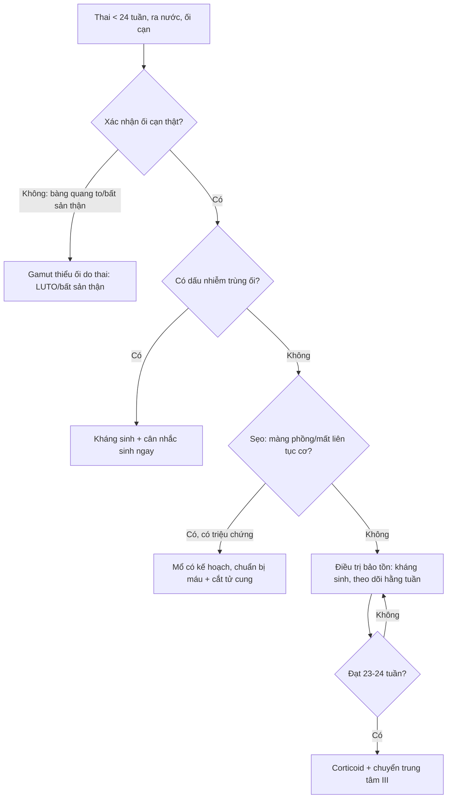
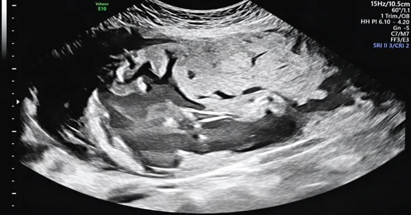
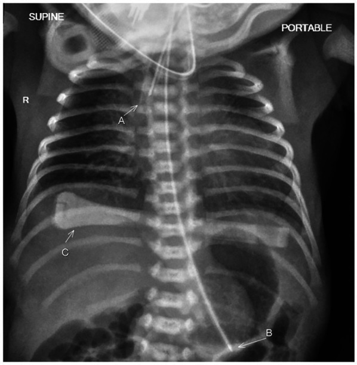
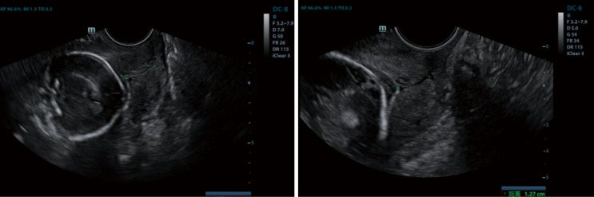

# 1725 — Vỡ ối non tháng trước 24 tuần trên sẹo mổ lấy thai / Previable PPROM on a prior cesarean scar

**Tags:** `pattern:vo-oi-non-thang` `pattern:thieu-oi` `pattern:seo-tu-cung-mong` `pattern:thai-ky` `vung:tu-cung-phan-phu` `vung:manh-oi` `protocol:SA-thai` `protocol:MRI-thai` `score:RMT`
**Mức chắc chắn (certainty):** tổng hợp y văn (literature synthesis) — đoàn hệ 130 thai vỡ ối < 24 tuần (Eur J Pediatr 2026, PMC12855349), đoàn hệ thuốc kháng sinh sau vỡ ối trước khả năng sống (Pregnancy 2026, PMC13344306), phân tích gộp 45 nghiên cứu/286 thai đôi (Int J Gynaecol Obstet 2026, PMC13173602), đoàn hệ 86 ca PPROM < 32 tuần (Arch Gynecol Obstet 2025, PMC12055622) và 1 ca nguyên văn PPROM 28 tuần trên sẹo mổ lấy thai (Case Rep Obstet Gynecol 2026, PMC13591125). **Không có thử nghiệm ngẫu nhiên riêng cho nhóm "vỡ ối trước 24 tuần TRÊN SẸO mổ lấy thai"** — phần sẹo là suy luận cơ học từ dữ liệu sẹo/đoạn dưới và được ghi rõ như vậy.

## 1. Tổng quan bệnh học – cơ chế hình ảnh

- **Định nghĩa và mẫu số (phải nói trước khi trích số):** **PPROM (preterm prelabor rupture of membranes)** = vỡ ối trước chuyển dạ, trước 37 tuần; **previable PPROM** = vỡ ối trước **23–24 tuần**, tức trước ngưỡng điều trị tích cực sơ sinh. Vỡ ối giữa thai kỳ gặp **0,4–0,7% thai kỳ** (Front Pediatr 2024, PMC11776091 — dẫn nguồn tổng quan). Vì mẫu số nhỏ và định nghĩa "previable" thay đổi theo từng khoa sơ sinh (23 hay 24 tuần), mọi tỷ lệ sống phải đọc kèm **tuổi thai lúc vỡ và lúc sinh**, không đọc trần con số.
- **Vì sao sẹo mổ lấy thai làm bệnh cảnh nặng hơn — 3 cơ chế:**
  1. **Màng ối không có mạch máu nuôi:** một khi đã vỡ, mép lỗ không liền; ối rò liên tục ra âm đạo nên **thiểu ối kéo dài** chứ không "tự hàn" như vết thương khác.
  2. **Nhiễm trùng đi lên gặp mô sẹo:** sẹo đoạn dưới là **collagen xơ, gần như không có màng rụng (decidua)**; vi khuẩn từ âm đạo lên gây **viêm màng ối – viêm cơ tử cung tại đúng vùng sẹo mỏng nhất**, làm mô sẹo mềm và mất liên tục sớm hơn. Cấy mô học nhau thai cho thấy **viêm màng ối (chorioamnionitis) ở 44%** các ca PPROM < 32 tuần (PMC12055622).
  3. **Laplace:** lực căng thành tử cung tỉ lệ **áp lực buồng ối × bán kính**; cơn co do viêm + tử cung to dần dồn toàn bộ lực vào vòng sẹo — nên nhóm này vừa **dọa vỡ sẹo**, vừa dễ **vỡ ối hoàn toàn** khi chuyển dạ.
- **TẠI SAO hình ảnh thấy được (vật lý):**
  - **Siêu âm:** nước ối là **dịch đồng nhất, echo trống (anechoic)** vì âm gần như không bị phản xạ; màng ối là **dải echo dày < 1 mm**. Lượng ối đo bằng **khoang ối lớn nhất (maximum vertical pocket, MVP)** và **chỉ số ối (amniotic fluid index, AFI)**: **thiểu ối nặng = MVP < 1 cm và/hoặc AFI < 5 cm**, **không ối (anhydramnios) = không còn khoang ối nào** (định nghĩa dùng trong PMC12855349).
  - **Vì sao thiểu ối gây giảm sản phổi:** phổi thai phát triển nhờ **dịch phổi tiết ra làm căng đường thở** và nhờ **khoang ối làm "khung" chống chèn ép**; mất ối trước **22–24 tuần** (giai đoạn tạo phế nang và nhánh phế quản) → **ít phế nang, giảm thể tích phổi**, trẻ sinh ra thở máy ngay. Trong đoàn hệ 130 thai: **28% trẻ có tăng áp lực động mạch phổi**, **16% loạn sản phế quản – phổi (BPD) nặng**, **7% biến dạng cơ – xương** (PMC12855349).
  - **MRI:** nước ối **T2 rất sáng**; cơ tử cung **T2 trung bình–thấp**; sẹo là **dải T2 tối**; chỗ **mất liên tục cơ** chỉ thấy khi mặt cắt **vuông góc với vòng sẹo** (đúng như bài 1717). MRI không dùng để "đo ối" thay siêu âm, mà để **định vị bánh nhau – sẹo – bàng quang** khi siêu âm không rõ hoặc nghi **nhau cài răng lược (placenta accreta spectrum, PAS)**.
- **Ngưỡng định lượng quan trọng nhất (kết cục thai):**
  - **Thời gian tiềm ẩn (latency = từ vỡ ối đến sinh):** trung vị **92 ngày (49–119)** trong 130 thai, **94% ca > 14 ngày** (PMC12855349). Càng vỡ sớm, latency càng dài — nhưng không có nghĩa kết cục tốt hơn.
  - **Thai chết lưu (IUFD) 27%**, **chấm dứt thai kỳ y khoa 8%**, **sinh sống 65% (85/130)**; trong số sinh sống **90% xuất viện**, **74% không di chứng nặng**, **9% tử vong trong viện** (PMC12855349).
  - **Hai yếu tố tiên lượng độc lập:** **sinh quá non RR 3,51 (1,82–6,76)** và **latency ngắn RR 8,47 (1,07–66,67)** cho "tử vong hoặc di chứng nặng" (PMC12855349).
  - **Kháng sinh kéo dài latency:** sau khi hiệu chỉnh tuổi thai lúc vỡ, nhóm dùng kháng sinh có latency **+14,7 ngày** (SE 6,86; p = 0,034), sinh **≥ 22 tuần 80,95% vs 15,62%**, **IUFD 20,63% vs 65,62%** (p < 0,001), **sống tới xuất viện 49,21% vs 6,25%** (p = 0,031) (PMC13344306). Đây là dữ liệu quan sát, không phải RCT — nhưng cùng hướng với gộp 22 thử nghiệm/6.872 ca: kháng sinh **giảm viêm màng ối RR 0,66**, **giảm nhiễm trùng sơ sinh RR 0,67** (PMC13603082).
  - **Biến chứng mẹ (thai đôi, gộp 286 thai):** **viêm màng ối lâm sàng 33,5%**, **nhiễm khuẩn huyết mẹ 7,8%**, **sốc nhiễm khuẩn 1,6%**, **cắt tử cung 0,8%**; **32,0%** thai kỳ không có trẻ nào xuất viện sống (PMC13173602).
  - **Sẹo và đoạn dưới:** đo **bề dày toàn bộ đoạn dưới (LUS)** và **bề dày cơ còn lại (RMT)** ở **36–38 tuần**, bàng quang nửa đầy, 3 lần lấy trung bình; trong 161 sản phụ chuyển dạ, **LUS 2,3 mm / RMT 1,9 mm** là điểm cắt tốt nhất cho khiếm khuyết thành tử cung nhưng **AUC chỉ 0,60–0,61** (BMC Pregnancy Childbirth 2022, PMC9107280 — chi tiết ở bài 1717). Nghĩa là **một mình độ dày sẹo không đủ quyết định**; phải cộng bối cảnh vỡ ối – nhiễm trùng – cơn co.
- **TẠI SAO nhóm sẹo + vỡ ối lại dễ bị bỏ sót PAS:** khi ối đã cạn, bánh nhau **áp sát cơ tử cung** và các **khoang (lacuna) trong bánh nhau** trông như "nang" — dễ đọc thành tổn thương khác. Ca nguyên văn: thai 28 tuần 4 ngày, tiền sử 1 mổ lấy thai, **ối vỡ**, siêu âm thấy thai ngôi mông nằm thấp ở đoạn dưới–eo; MRI xác nhận **đoạn dưới mỏng gần như mất cơ**, **kênh cổ tử cung còn nguyên**, mổ lấy thai **rạch thành sau** rồi **cắt tử cung ngay vì chảy máu ồ ạt** (PMC13591125). Bài học: **vỡ ối + thai nằm thấp + sẹo cũ = phải loại PAS trước khi mổ**, không chỉ lo "sinh non".

## 2. Mẫu hình + chẩn đoán phân biệt theo vị trí (Gamut)

Bốn câu hỏi theo đúng thứ tự khi cầm đầu dò:

1. **Có ối thật trong buồng tử cung không, hay chỉ còn "vệt ối" giả?**
2. **Màng ối đã vỡ chưa, và vỡ ở đâu** (cổ tử cung, eo, trên sẹo)?
3. **Bánh nhau nằm ở đâu** — mặt trước thấp/phủ sẹo (nguy cơ PAS) hay mặt sau/xa sẹo?
4. **Sẹo còn bao nhiêu cơ (RMT), có phồng/mất liên tục không?**

**Gamut theo mẫu hình "thiểu ối + sẹo mổ lấy thai":**

- **Vỡ ối thật trước 24 tuần (bài này):** bệnh nhân **ra nước**, MVP < 1 cm/AFI < 5 cm, **không sốt** giai đoạn đầu; đầu dò âm đạo thấy **mép màng ối cụp**, có thể **màng ối phồng qua lỗ cổ tử cung**.
- **Rò ối mạn không triệu chứng (occult leakage):** bệnh nhân chỉ thấy "ẩm ướt", AFI giảm dần; **không có cơn co**; phải phân biệt với **rò nước tiểu** (creatinin dịch âm đạo cao gấp nhiều lần huyết thanh) và **tiết dịch âm đạo**.
- **Thiểu ối do nguyên nhân thai (không vỡ ối):** **bất sản/hypoplasia thận hai bên**, **tắc nghẽn đường niệu dưới (LUTO)** — bàng quang to, **không có dấu vỡ ối**; đây là **gamut bắt buộc** vì xử trí hoàn toàn khác (đánh giá di truyền, can thiệp bào thai).
- **Thiểu ối do bánh nhau:** **suy bánh nhau/bệnh mạch máu nhau**, thai chậm tăng trưởng; **thai quá ngày**; **thuốc (ức chế men chuyển, NSAID)**.
- **Thai đôi: hội chứng truyền máu (TTTS) / "stuck twin"** — một thai thiểu ối, một thai đa ối; **không phải PPROM** dù cùng hình ảnh "một túi cạn".
- **Nứt sẹo/dehiscence có màng ối còn nguyên:** ối vẫn còn, nhưng **màng ối phồng vào chỗ khuyết cơ**, thành mỏng, **không có nước ối ra ngoài**. Ca 28 và 29 tuần được chẩn đoán **trên siêu âm trước sinh** rồi xác nhận khi mổ (Cureus 2023, PMC10366469).
- **Vỡ tử cung thật:** mất liên tục **cả 3 lớp**, thai/bộ phận thai ra ổ bụng, **dịch ổ bụng**, đau + bụng co cứng; đây là **biến cố cấp**, không phải "vỡ ối" (bài 1717).
- **PAS + vỡ ối:** bánh nhau mặt trước thấp, **mất dải cơ sáng giữa bánh nhau và bàng quang**, lacuna dày, **tăng sinh mạch**; nguy cơ chảy máu khi mổ (ca PMC13591125).

## 3. Bảng so sánh phân biệt (ma trận đối chiếu)

| Thực thể (entity) | Hình ảnh điển hình (US/MRI) | Chốt vào (rule-in) | Chốt loại (rule-out) | Gợi ý xác nhận |
|---|---|---|---|---|
| **Previable PPROM trên sẹo mổ lấy thai** | MVP < 1 cm/AFI < 5 cm; màng ối cụp ở eo; **sẹo mỏng (RMT nhỏ)**; bánh nhau có thể thấp | **Bệnh nhân ra nước + ối cạn thật + không có thận/bàng quang bất thường** | Có bàng quang to + thận hai bên bình thường → nghĩ LUTO, không phải vỡ ối | Soi âm đạo **không thăm khám ngón tay**; siêu âm lặp; CRP/bạch cầu |
| **Rò ối mạn (occult)** | ối giảm dần qua nhiều lần đo; **không cơn co**; màng ối nguyên | **AFI giảm tiến triển + tiền sử "ẩm ướt"** | AFI bình thường ổn định nhiều tuần → không phải rò | Đo creatinin dịch âm đạo; siêu âm 2 tuần/lần |
| **Thiểu ối do thai (bất sản thận/LUTO)** | **Không thấy bàng quang** (bất sản thận) hoặc **bàng quang rất to** (LUTO); thận hai bên bất thường | **Bất thường thận–đường niệu trên siêu âm** | Thận + bàng quang bình thường, ối cạn đột ngột → nghĩ vỡ ối | Siêu âm chi tiết, MRI thai, tư vấn di truyền |
| **TTTS/stuck twin** | Một thai **anhydramnios dính thành**, thai kia **đa ối**; màng ngăn | **Hai túi ối chênh lệch rõ + màng ngăn** | Một túi ối duy nhất, không màng ngăn → không phải TTTS | Doppler MCA/UV, siêu âm tim thai |
| **Nứt sẹo/dehiscence (màng còn)** | **Màng ối phồng vào chỗ khuyết cơ**, thành mỏng; ối còn | **Mất liên tục cơ + màng ối còn nguyên + thai sống** | Có nước ối ra ngoài + ối cạn → đã vỡ ối | MRI khi siêu âm không rõ; mổ có kế hoạch |
| **Vỡ tử cung** | Mất liên tục **cả 3 lớp**, thai ra ngoài, **dịch ổ bụng** | **Thai ngoài buồng tử cung + máu tự do** | Thai còn trong buồng, thành cơ liên tục → không vỡ | CT khi huyết động ổn; mổ cấp cứu |
| **PAS + vỡ ối** | Bánh nhau **mặt trước thấp**, lacuna, **mất dải cơ–bàng quang**, tăng sinh mạch | **Bánh nhau phủ sẹo + mất dải cơ + lacuna dày** | Bánh nhau mặt sau, dải cơ còn rõ → không PAS | MRI (định vị + độ xâm lấn), mổ có chuẩn bị máu |

## 4. Protocol chụp + hệ phân độ/điểm chuẩn hóa

**Siêu âm (modality chính, không bức xạ):**

- **Đầu dò âm đạo** để đo **chiều dài cổ tử cung** và xem **mép màng ối/cổ tử cung**; **đầu dò bụng** để đo **MVP, AFI** và **định vị bánh nhau**. Đo **RMT/LUS tại sẹo** khi bàng quang **nửa đầy**, mặt cắt **vuông góc vòng sẹo**, 3 lần lấy trung bình (bài 1717).
- **Tần suất:** **hằng tuần** đo lượng ối + xét nghiệm nhiễm trùng trong giai đoạn đầu (khuyến cáo CNGOF, dẫn trong PMC12855349); sau ổn định có thể **2 tuần/lần** nhưng **bất kỳ đợt sốt/đau/ra dịch hôi → siêu âm + xét nghiệm ngay**.
- **Không thăm khám ngón tay qua cổ tử cung** khi chưa loại trừ nhau tiền đạo; **soi âm đạo** chỉ khi cần xác nhận ối (thấy vũng ối) và **không làm sạch buồng tử cung**.

**MRI (khi cần, không thường quy):**

- Chỉ định: **bánh nhau mặt trước thấp/phủ sẹo**, siêu âm không phân biệt **dehiscence vs PAS**, cần **bản đồ mổ** (đường rạch, vị trí bánh nhau, bàng quang). Ca PMC13591125 dùng MRI để xác nhận **đoạn dưới mỏng gần mất cơ** và **kênh cổ tử cung còn nguyên** trước mổ.
- Trình tự: **T2 sagittal + axial** (giải phẫu), **T2 fat-sat** (phù/màng), **T1** (máu cũ). Không cần gadolinium cho mục tiêu này.

**Xử trí theo ngưỡng (protocol, không phải "chờ") — bảng quyết định:**

| Tình huống | Việc làm | Ngưỡng/Thời điểm |
|---|---|---|
| Ối cạn < 24 tuần, **không nhiễm trùng, thai sống, mẹ đồng ý** | Điều trị bảo tồn: kháng sinh kéo dài latency, theo dõi nhiễm trùng, siêu âm hằng tuần, **corticoid khi đạt 23–24 tuần** | Kháng sinh ngay sau vỡ ối; **corticoid từ 23 tuần**; **MgSO₄ nếu sinh < 32 tuần** |
| **Nghi/có viêm màng ối** (sốt, đau tử cung, CRP tăng, thai nhịp nhanh) | **Không trì hoãn**: kháng sinh phổ rộng + **quyết định sinh** | CRP > 20 mg/L ở thời điểm vỡ ối là yếu tố tiên lượng xấu trong đoàn hệ PMC12855349 |
| **Nứt sẹo/dehiscence có triệu chứng** hoặc **PAS nghi ngờ** | **Mổ lấy thai có kế hoạch tại trung tâm có máu/hồi sức**, cân nhắc **rạch thành sau** và **sẵn sàng cắt tử cung** | Không chờ đủ tuần nếu đau tăng/máu/ối cạn thêm; ca PMC13591125 mổ ngay khi nhập viện |
| **Thai chết lưu** hoặc **nhiễm trùng mẹ nặng** | **Chấm dứt thai kỳ** (khởi phát hoặc mổ) | Không có ngưỡng tuổi thai — theo tình trạng mẹ |
| **≥ 24 tuần** | Chuyển sang phác đồ PPROM "khả năng sống": corticoid, MgSO₄, kháng sinh, theo dõi sản khoa | Sinh tại trung tâm sơ sinh ≥ III |

**Kháng sinh — chọn thuốc và cái cần tránh:**

- Hiệu quả: **giảm viêm màng ối RR 0,66, giảm nhiễm trùng sơ sinh RR 0,67** (gộp 22 thử nghiệm/6.872 ca, PMC13603082); trong nhóm previable, **latency +14,7 ngày** (PMC13344306).
- **Tránh amoxicillin–clavulanate (co-amoxiclav)** trong phác đồ latency vì gắn với **tăng viêm ruột hoại tử (NEC) ở trẻ non tháng** (CNGOF/Cochrane, PMC11297390).
- **Không dùng kháng sinh để "kéo dài" khi đã có nhiễm trùng ối rõ** — lúc đó kháng sinh là điều trị, và **cân nhắc sinh**.
- **GBS:** nếu cấy âm đạo dương và **đang chuyển dạ/sắp sinh** → kháng sinh dự phòng theo phác đồ; **không** dùng để kéo dài latency.

## 5. Biến thể bình thường và cạm bẫy

- **"Khô ối giả" do đo sai:** AFI thay đổi theo tư thế, theo lượng nước tiểu mẹ và **theo người đo**; một lần AFI thấp **không chẩn đoán vỡ ối** — phải lặp sau 24–48 giờ và đo **MVP** (ổ ối lớn nhất) vì MVP ít bị ảnh hưởng bởi thai nhỏ.
- **Thai nhỏ làm AFI thấp giả:** ở thai chậm tăng trưởng, **ít nước tiểu thai** sinh lý; đừng gắn nhãn "vỡ ối" nếu không có bệnh sử ra nước và **không có mép màng ối cụp**.
- **Siêu âm thấy "màng ối phồng" KHÔNG đồng nghĩa đã vỡ:** đó là **dehiscence** (màng còn, cơ mất liên tục) — xử trí khác hẳn vỡ ối; ca 28–29 tuần trong PMC10366469 được chẩn đoán **trước sinh** nhờ siêu âm.
- **Đo sẹo khi bàng quang căng:** bàng quang đầy **ép đoạn dưới** làm RMT **mỏng giả**; luôn đo khi bàng quang **nửa đầy** và ghi rõ tư thế.
- **MRI T2: "dải tối" ở đoạn dưới có thể là sẹo, có thể là bánh nhau** — phải đọc cùng **T1/T2 từng lớp** và **định vị bánh nhau**, không lấy một dải tối làm chẩn đoán.
- **Sai lầm "không sốt = không nhiễm":** viêm màng ối **âm thầm** rất thường gặp; CRP có thể **bình thường 24–48 giờ đầu**. Trong đoàn hệ 130 thai, **CRP > 20 mg/L tại thời điểm vỡ ối** liên quan kết cục xấu — nhưng **CRP bình thường không loại trừ**.
- **Bỏ sót PAS vì "chỉ là vỡ ối non tháng":** ca PMC13591125 cho thấy **thai nằm thấp + sẹo cũ + ối vỡ** có thể là **CIP/PAS**, mổ thường quy sẽ chảy máu không cầm; phải **định vị bánh nhau trước mổ**.
- **Cạm bẫy "satisfaction of search":** thấy ối cạn là dừng, bỏ qua **bất sản thận hai bên** hoặc **bàng quang to** — hai chẩn đoán này đổi hoàn toàn tư vấn.

## 6. Tự lượng giá — Blind Quiz

**Ca 1 — Thai 28 tuần 4 ngày, tiền sử 1 mổ lấy thai, ra nước ối 2 ngày. Nhìn siêu âm trước, mô tả trước.**

- Gợi ý lâm sàng: thai phụ 30 tuổi, 1 mổ lấy thai 5 năm trước, **ối vỡ**, thai ngôi mông nằm thấp.
- Câu hỏi: (1) Lượng ối và vị trí bánh nhau? (2) Ba chẩn đoán phân biệt? (3) Dấu hiệu nào buộc phải mổ có chuẩn bị máu?

<b>Bấm để hiện đáp án (findings + chẩn đoán)</b>

- Dấu hiệu: bánh nhau **mặt trước thấp và dày**, **nhiều lacuna**, **máu tụ trong bánh nhau**, đoạn dưới mỏng; thai nằm thấp trong eo–cổ tử cung.
- Chẩn đoán: **PPROM trên nền bánh nhau cài răng lược nghi ngờ (PAS)** — vì ối cạn làm bánh nhau áp sát cơ, lacuna nổi rõ; mất dải cơ là dấu chốt.
- Xử trí trong ca gốc: MRI xác nhận đoạn dưới mỏng, kênh cổ tử cung còn; mổ **rạch thành sau**, cắt tử cung ngay vì chảy máu ồ ạt.
- Nguồn ảnh: Case Rep Obstet Gynecol 2026, Fig. 7 (PMC13591125), CC BY 4.0.

**Ca 2 — Sơ sinh 32 tuần sau vỡ ối từ 16 tuần, thở máy ngay sau sinh. Đọc phim ngực.**

- Gợi ý lâm sàng: mẹ vỡ ối 16 tuần, AFI 1,8 cm ở 20 tuần, sinh 32 tuần.
- Câu hỏi: Dấu hiệu chính? Vì sao phổi nhỏ? Hai nguyên nhân khác gây phổi nhỏ?

<b>Bấm để hiện đáp án (findings + chẩn đoán)</b>

- Dấu hiệu: **lồng ngực hẹp, phổi hai bên giảm thể tích, độ căng phổi kém**, ống nội khí quản đúng vị trí; không có tràn khí lớn.
- Chẩn đoán: **giảm sản phổi (pulmonary hypoplasia) sau thiểu ối kéo dài** — vì mất "khung" dịch ối ở giai đoạn tạo phế nang; trẻ cần HFOV + NO, xuất viện sau 108 ngày và còn hỗ trợ thở không xâm lấn tới 8 tháng.
- Phân biệt: **bất sản thận hai bên** và **LUTO** cũng gây phổi nhỏ nhưng có bất thường thận/bàng quang trên siêu âm thai.
- Nguồn ảnh: Front Pediatr 2024, Fig. 1 (PMC11776091), CC BY 4.0.

**Ca 3 — Thai đôi 19 tuần, một thai cạn ối. Đọc hình và trả lời.**

- Gợi ý lâm sàng: thai đôi, thai A vỡ ối non tháng, theo dõi 2 tuần.
- Câu hỏi: (1) Cổ tử cung bao nhiêu? (2) Thai A còn ối không? (3) Nguy cơ mẹ chính của tình trạng này là gì?

<b>Bấm để hiện đáp án (findings + chẩn đoán)</b>

- Dấu hiệu: **cổ tử cung ngắn (13–16 mm)** ở 19 tuần; túi ối thai A **cạn dần** trong khi thai B còn ối.
- Chẩn đoán: **previable PPROM một thai trong thai đôi** — nguy cơ mẹ: **viêm màng ối lâm sàng 33,5%, nhiễm khuẩn huyết 7,8%, sốc nhiễm khuẩn 1,6%, cắt tử cung 0,8%** (gộp 286 thai, PMC13173602).
- Điểm cần nhớ: **32,0% thai kỳ không có trẻ nào xuất viện sống** — tư vấn phải nói cả khả năng "không cứu được thai nào", không chỉ "sinh non".
- Nguồn ảnh: AME Case Rep 2026, Fig. 2 (PMC13466744), **CC BY-NC-ND 4.0** — dùng nguyên bản, không crop/ghép.

## Bài liên quan chéo
- [1717 – Vỡ tử cung trên sẹo mổ lấy thai: dấu tiền triệu, ngưỡng đo sẹo & chọn TOLAC](../1717-vo-tu-cung-tren-seo-mo-lay-thai/lesson.md)
- [1604 – Thai kỳ sau điều trị chửa ở sẹo mổ lấy thai: tái phát, nhau cài răng lược](../1604-thai-ky-sau-chua-seo-mo-lay-thai/lesson.md)
- [1635 – Vỡ ối non tháng sau can thiệp bào thai: lỗ trocar, ống rò thành tử cung](../1635-ro-oi-non-thang-sau-can-thiep-bao-thai/lesson.md)
- [1603 – Vasa previa type II–III: chẩn đoán Doppler & đốt laser qua nội soi thai](../1603-vasa-previa-laser-noi-soi-thai/lesson.md)
- [500 – Tổng quan hệ Vú & Sản Phụ khoa](../500-tong-quan-vu-san-phu-khoa/lesson.md)
- [1726 – Thai kỳ sau một ca vỡ tử cung: đánh giá sẹo & thời điểm mổ chủ động](../1726-thai-ky-sau-vo-tu-cung-danh-gia-seo/lesson.md)

## Ảnh

- `1725_vo-oi-non-thang_US_PMC13591125.jpg` — Case Rep Obstet Gynecol 2026, Fig. 7 (PMC13591125), CC BY 4.0.
- `1725_giam-san-phoi_XR_PMC11776091.jpg` — Front Pediatr 2024, Fig. 1 (PMC11776091), CC BY 4.0.
- `1725_co-tu-cung-ngan_US_PMC13466744.jpg` — AME Case Rep 2026, Fig. 3 (PMC13466744), CC BY-NC-ND 4.0 (nguyên bản).
- Nguồn + giấy phép từng ảnh: `images/CREDITS.md`; link gốc: `sources.md`.

> Không dùng để chẩn đoán độc lập khi chưa có người hướng dẫn.
