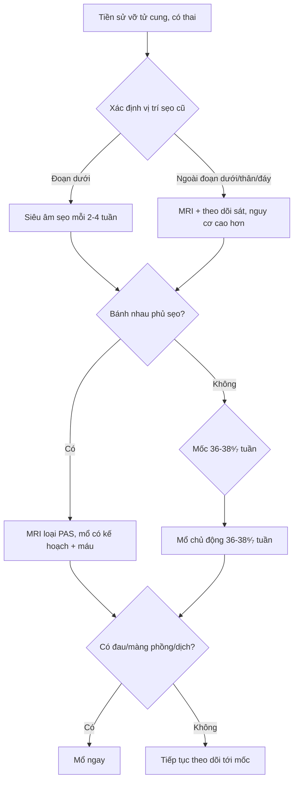
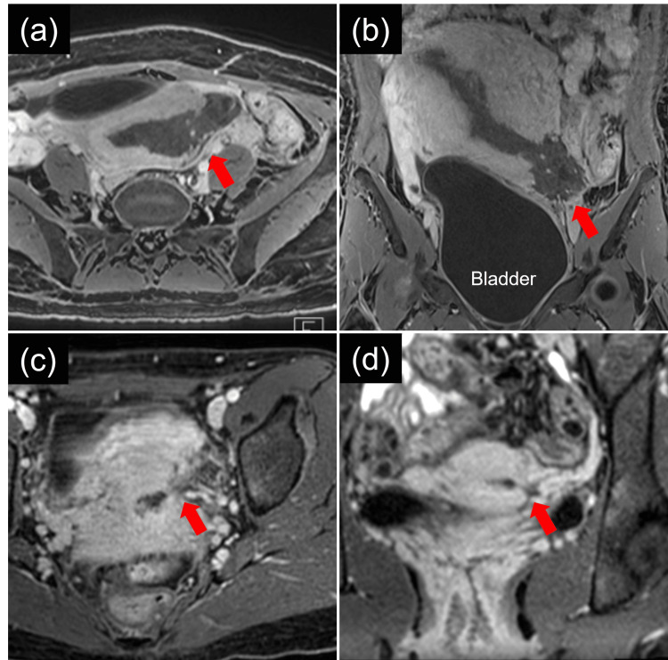
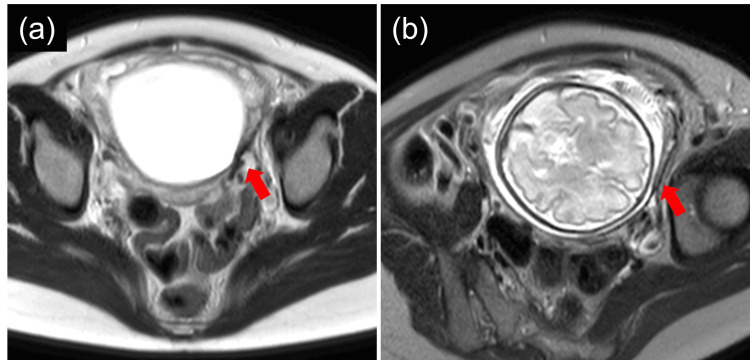
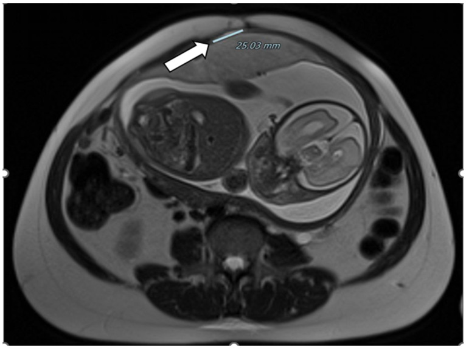

# 1726 — Thai kỳ sau một ca vỡ tử cung: đánh giá sẹo & thời điểm mổ chủ động / Pregnancy after uterine rupture: scar assessment and timing of elective delivery

**Tags:** `pattern:seo-tu-cung` `pattern:nguy-co-tai-phat` `pattern:thai-ky` `vung:tu-cung-phan-phu` `vung:seo-tu-cung` `protocol:MRI-thai` `protocol:SA-thai` `score:ACOG-36-37`
**Mức chắc chắn (certainty):** tổng hợp y văn (literature synthesis) — phân tích gộp 13 nghiên cứu về vỡ tử cung tái phát (Obstet Gynecol 2023, PMC10642701), đoàn hệ dân số Na Uy 72 thai kỳ sau vỡ hoàn toàn (Obstet Gynecol Int 2023, PMC9935781), tổng quan hệ thống vỡ giữa thai kỳ (Medicina 2021, PMC8704285), 1 ca nguyên văn có MRI trước – trong thai (Cureus 2024, PMC11512758) và 1 ca MRI dehiscence (Healthcare 2024, PMC11121481). Có **khuyến cáo ACOG 2017** về thời điểm mổ; **không có RCT** so sánh các chiến lược theo dõi sẹo.

## 1. Tổng quan bệnh học – cơ chế hình ảnh

- **Câu hỏi lâm sàng không phải "có thai được không" mà là "thai kỳ này sẽ vỡ lại ở đâu, khi nào, và mổ lúc nào".** Sau một ca vỡ tử cung, tử cung còn lại **vùng cơ đã rách – liền bằng sẹo xơ**, có thể **mỏng, dính, hoặc mất liên tục**; nguy cơ tái phát phụ thuộc **vị trí vỡ cũ** nhiều hơn mọi yếu tố khác.
- **Tần suất tái phát (con số trung tâm):** phân tích gộp 13 nghiên cứu (2000–2023) cho **tái phát vỡ hoàn toàn 10% (KTC 95% 6–17%)**; **nước phát triển 6% vs kém phát triển 15%** (p = 0,04) (PMC10642701). Đây là con số để tư vấn, **không phải 1–2% như sau mổ lấy thai thường**.
- **Vị trí sẹo quyết định nguy cơ (dữ liệu Na Uy):** trong 72 thai kỳ sau vỡ hoàn toàn, **vỡ hoàn toàn mới 4,2% (3/72)**, **nứt sẹo một phần 8,3%**; **0% nếu vỡ cũ ở đoạn dưới (lower segment, LS)** nhưng **8,6% nếu vỡ cũ NGOÀI đoạn dưới**; **cả 3 ca vỡ lại đều sinh non 29, 31 và 32 tuần** (PMC9935781). Đây là lý do **phải đọc biên bản mổ cũ**, không chỉ hỏi "đã mổ đẻ chưa".
- **Tuổi thai lúc tái phát và lúc sinh không tái phát:** vỡ lại trung bình **32,49 tuần (29,90–35,08)**; sinh mà không vỡ trung bình **35,77 tuần (34,95–36,60)**; **tử vong mẹ 5% (2–11%)**, **tử vong sơ sinh 5% (3–10%)** (PMC10642701).
- **Vỡ giữa thai kỳ để lại hậu quả khác:** tổng quan 5 sản phụ/8 thai kỳ sau vỡ giữa thai kỳ (15–26 tuần) cho thấy **nhau cài răng lược (PAS) 37,5% (3/8)**, **vỡ tái phát 12,5% (1/8) tại 23 tuần**, tuổi thai sinh 23–38 tuần, **không có tử vong mẹ** (PMC8704285). Nghĩa là **nhóm vỡ giữa thai kỳ vừa có nguy cơ vỡ lại sớm, vừa có nguy cơ bánh nhau bám bất thường**.
- **TẠI SAO sẹo yếu (cơ học + mô bệnh):** sẹo là **collagen xơ**, gần như **không có sợi cơ trơn co rút** và **không có màng rụng**; lực căng thành tử cung theo **Laplace** tỉ lệ **áp lực buồng ối × bán kính** → tử cung càng to, lực lên sẹo càng lớn. Vì vậy **vỡ lại thường xảy ra ở tam cá nguyệt 2–3**, đúng lúc tử cung căng nhất, và **không cần chuyển dạ** — ca trong PMC9935781 vỡ lại lúc **29–32 tuần** khi chưa chuyển dạ rõ.
- **TẠI SAO hình ảnh thấy được (vật lý):**
  - **Siêu âm:** cơ tử cung **đồng âm trung bình**, sẹo là **dải giảm âm**; đo **RMT** (bề dày cơ còn lại) và **LUS** (toàn bộ đoạn dưới) theo **mặt cắt vuông góc vòng sẹo**, bàng quang **nửa đầy**. Siêu âm **bị hạn chế** khi sẹo **cao/ra sau**, thai nằm thấp, mẹ béo, hoặc có **bóng cản của xương thai** — đây là lý do thật để dùng MRI.
  - **MRI:** nước ối **T2 rất sáng**, cơ tử cung **T2 trung bình–thấp**, sẹo là **dải T2 tối**, bánh nhau **T2 trung gian**; mô xơ **không ngấm thuốc**. **T1** giúp thấy **máu cũ (methemoglobin sáng)** ở vết rách cũ. MRI cho **bản đồ 3 chiều**: vị trí sẹo, độ dày cơ còn lại, khoảng cách tới bàng quang, vị trí bánh nhau — đúng những gì ca PMC11512758 dùng để lên kế hoạch mổ.
  - **CT:** **không dùng để theo dõi thai** (liều bức xạ); chỉ trong chấn thương/huyết động không ổn và khi cần loại trừ biến chứng cấp.
- **Ngưỡng định lượng:** đo **RMT** ở mỗi lần siêu âm và ghi **mm**; với sẹo mổ lấy thai thường, **LUS 2,3 mm / RMT 1,9 mm** là điểm cắt cho khiếm khuyết thành nhưng **AUC 0,60–0,61** (bài 1717) — tức **độ dày một mình không đủ**. Với **sẹo vỡ cũ**, **không có ngưỡng RMT nào được chứng minh** để cho phép chờ sinh; ca PMC11121481 có **dehiscence 25,03 mm** đo trên MRI mà bệnh nhân **không triệu chứng** — cho thấy **kích thước khuyết không tỉ lệ với triệu chứng**.
- **Vì sao "mổ chủ động sớm" lại là con dao hai lưỡi:** trong 72 thai kỳ sau vỡ, **36,1% sinh < 37 tuần** và phần lớn là **do thầy thuốc chủ động** (iatrogenic), không do vỡ lại; **61,1% sinh 37–38 tuần** (PMC9935781). Tức **lo lắng quá mức cũng gây hại** (sinh non iatrogenic), nên cần một **mốc thời gian có bằng chứng** thay vì mổ càng sớm càng tốt.

## 2. Mẫu hình + chẩn đoán phân biệt theo vị trí (Gamut)

Ba câu hỏi trước khi lên kế hoạch sinh:

1. **Vỡ cũ ở đâu** — đoạn dưới, thân/thân trên, đáy, hay sau myomectomy? (đoạn dưới: tái phát thấp; ngoài đoạn dưới: cao hơn)
2. **Sẹo hiện tại trông thế nào** — cơ còn đều, mỏng khu trú, phồng (bulging), hay mất liên tục?
3. **Bánh nhau nằm ở đâu** — phủ sẹo (PAS) hay xa sẹo?

**Gamut theo mẫu hình "sẹo tử cung bất thường trong thai kỳ":**

- **Sẹo mỏng khu trú, cơ còn liên tục:** hình ảnh hay gặp nhất, **không triệu chứng**; theo dõi siêu âm/MRI, mổ chủ động theo lịch.
- **Dehiscence (nứt sẹo):** **mất liên tục cơ nhưng thanh mạc còn**, màng ối/thai có thể **phồng vào chỗ khuyết**; có thể **không đau** (phát hiện tình cờ khi mổ) hoặc đau khu trú.
- **Vỡ hoàn toàn (rupture):** mất liên tục **cả 3 lớp**, thai/bộ phận thai ra ổ bụng, **dịch ổ bụng**, đau + bụng co; cấp cứu.
- **PAS trên sẹo vỡ cũ:** bánh nhau mặt trước thấp, **mất dải cơ giữa bánh nhau – bàng quang**, lacuna, tăng sinh mạch; nguy cơ chảy máu khi mổ, cân nhắc **cắt tử cung**.
- **Nhau tiền đạo không cài răng lược:** bánh nhau che lỗ trong cổ tử cung nhưng **dải cơ còn**; xử trí khác (mổ lấy thai theo lịch, không cắt tử cung).
- **Sẹo sau myomectomy / sau thủng khi nạo:** vị trí có thể **cao (thân/đáy)** — **nguy cơ tái phát cao hơn sẹo đoạn dưới**, và **dễ bị bỏ qua** vì không nằm ở đoạn dưới.
- **Vỡ tử cung "im lặng" (silent):** không đau, chỉ thấy **sẹo mỏng đi** hoặc **màng ối phồng**; đây là lý do phải **chụp lại theo lịch**, không chỉ chụp khi có triệu chứng.

## 3. Bảng so sánh phân biệt (ma trận đối chiếu)

| Thực thể (entity) | Hình ảnh điển hình (US/MRI) | Chốt vào (rule-in) | Chốt loại (rule-out) | Gợi ý xác nhận |
|---|---|---|---|---|
| **Sẹo mỏng khu trú, cơ liên tục** | Dải **T2 tối** tại sẹo; cơ hai bên **còn liên tục**; RMT đo được bằng mm | **Cơ còn liên tục trên mọi mặt cắt** | Mất liên tục cơ → không phải chỉ mỏng | Siêu âm 2–4 tuần/lần; MRI nếu siêu âm khó |
| **Dehiscence** | **Mất liên tục cơ**, thanh mạc còn; màng ối/thai **phồng** vào chỗ khuyết; có thể có **dịch/máu ít** | **Khuyết cơ + màng ối/thai còn trong tử cung** | Thai ra ngoài + dịch ổ bụng → đã vỡ | MRI (đo khuyết, quan hệ bàng quang); mổ có kế hoạch |
| **Vỡ hoàn toàn** | Mất liên tục **cả 3 lớp**, thai ngoài buồng, **máu tự do** | **Thai/bộ phận thai ngoài tử cung + máu ổ bụng** | Thai còn trong buồng, cơ liên tục → không vỡ | Mổ cấp cứu; CT chỉ khi huyết động ổn |
| **PAS trên sẹo cũ** | Bánh nhau **mặt trước thấp**, lacuna, **mất dải cơ–bàng quang**, tăng sinh mạch | **Bánh nhau phủ sẹo + mất dải cơ + lacuna** | Bánh nhau mặt sau, dải cơ rõ → không PAS | MRI; mổ có máu + kế hoạch cắt tử cung |
| **Nhau tiền đạo** | Bánh nhau che lỗ trong cổ tử cung; **dải cơ còn** | **Bánh nhau che cổ tử cung** | Bánh nhau cách lỗ trong > 20 mm → không tiền đạo | Siêu âm đầu dò âm đạo (an toàn), MRI |
| **Sẹo sau myomectomy/thủng** | Sẹo ở **thân/đáy**; có thể không thấy trên mặt cắt đoạn dưới thường quy | **Tiền sử mổ bóc u xơ/thủng + sẹo ngoài đoạn dưới** | Chỉ có tiền sử mổ lấy thai đoạn dưới → không thuộc nhóm này | Đọc biên bản mổ; MRI toàn tử cung |

## 4. Protocol chụp + hệ phân độ/điểm chuẩn hóa

**Trước khi mang thai (tư vấn):**

- **Lấy biên bản mổ cũ**: vị trí vỡ (đoạn dưới vs ngoài đoạn dưới), cách xử trí (khâu hay cắt tử cung bán phần), mô tả sẹo. Đây là **yếu tố tiên lượng mạnh nhất** (0% vs 8,6%, PMC9935781).
- Tư vấn **tái phát 10% (6–17%)**, **tử vong mẹ 5%**, **tử vong sơ sinh 5%**, và **nguy cơ sinh non iatrogenic** (36,1% < 37 tuần trong đoàn hệ Na Uy).
- **Khoảng cách mang thai:** dữ liệu sau mổ lấy thai thường cho thấy **mỗi 3 tháng tăng thêm giảm nguy cơ vỡ (OR 0,91; 0,88–0,94)**, chững lại sau **21 tháng** (EClinicalMedicine 2025, PMC11788787) — đây là dữ liệu **TOLAC sau mổ lấy thai**, không phải sau vỡ; dùng để **khuyến khích khoảng cách ≥ 18–24 tháng**, không phải để hứa "an toàn".
- **Không khuyến khích TOLAC** sau vỡ hoàn toàn; kế hoạch là **mổ lấy thai chủ động trước chuyển dạ**.

**Trong thai kỳ:**

- **Siêu âm sớm 6–8 tuần:** xác định vị trí túi thai (loại trừ thai ở sẹo/eo).
- **18–22 tuần:** **định vị bánh nhau** (mặt trước/sau, cách lỗ trong cổ tử cung bao nhiêu mm) — nếu bánh nhau mặt trước thấp/phủ sẹo → **MRI** để loại PAS.
- **Từ 20–24 tuần:** đo **RMT/LUS tại sẹo mỗi 2–4 tuần**; đo 3 lần, bàng quang nửa đầy, ghi mm và **so sánh với lần trước** (xu hướng quan trọng hơn một trị số).
- **MRI theo lịch khi sẹo ngoài đoạn dưới/khó thấy:** ca PMC11512758 chụp **MRI ở 24 và 31 tuần** để tìm **vỡ im lặng**; MRI xác nhận **mỏng khu trú bên trái đoạn dưới nhưng cơ còn liên tục**, nhờ đó quyết định **mổ chủ động 35 tuần 5 ngày** thay vì mổ sớm hơn.
- **Corticoid:** nếu dự kiến sinh < 34 tuần (theo dõi sát hoặc có dấu hiệu) — **betamethasone 12 mg × 2 liều cách 24 giờ**; **MgSO₄** nếu sinh < 32 tuần để bảo vệ não thai.

**Thời điểm sinh (ngưỡng có khuyến cáo):**

| Tình huống | Thời điểm | Căn cứ |
|---|---|---|
| **Vỡ cũ, thai kỳ ổn, không triệu chứng** | **Mổ lấy thai chủ động trong khoảng 36–38⁶⁄₇ tuần** | **ACOG 2017** (dẫn trong PMC9935781); trung bình sinh không tái phát **35,8 tuần** trong phân tích gộp |
| **Sẹo ngoài đoạn dưới (thân/đáy) hoặc vỡ giữa thai kỳ cũ** | **Cân nhắc sớm hơn (34–36 tuần)**, cá thể hóa | Vỡ lại 8,6% và cả 3 ca vỡ lại ở 29–32 tuần (PMC9935781); PAS 37,5% (PMC8704285) |
| **Đau khu trú tăng, màng ối phồng, dịch ổ bụng, thai suy** | **Mổ ngay**, không chờ mốc | Dehiscence có triệu chứng/nguy cơ vỡ |
| **PAS nghi ngờ** | Mổ **có kế hoạch tại trung tâm đa chuyên khoa**, sẵn máu, **bàn cắt tử cung** | Nguy cơ chảy máu; ca PMC13591125 phải cắt tử cung |

**Chuẩn bị mổ (không phải chi tiết nhỏ):** đặt **2 đường truyền lớn**, sẵn **hồng cầu khối**, **đội mổ có kinh nghiệm**, **đồng thuận cắt tử cung** đã ký, **bàng quang được đánh dấu** (nếu sẹo dính bàng quang), cân nhắc **rạch thành sau** khi đoạn dưới mỏng/dính (như ca PMC13591125).

## 5. Biến thể bình thường và cạm bẫy

- **Sẹo "dày" không đồng nghĩa an toàn:** độ dày chỉ là một điểm trên một mặt cắt; **sẹo ngoài đoạn dưới có thể dày ở đoạn dưới** mà vẫn yếu ở vị trí thật. Luôn **đọc biên bản mổ** và **đo đúng vị trí sẹo**.
- **Bàng quang căng làm RMT mỏng giả:** đo khi bàng quang **nửa đầy**, và **ghi rõ** điều kiện đo để so sánh giữa các lần.
- **Nhầm "màng ối phồng" với "ối vỡ":** dehiscence còn màng → **không được bấm ối/chọc ối**; xử trí là mổ có kế hoạch, không phải "chờ chuyển dạ".
- **Nhầm sẹo vỡ cũ với sẹo mổ lấy thai thường:** nếu chỉ hỏi "mổ đẻ chưa" mà không hỏi "có vỡ tử cung không", bệnh nhân có thể bị **đề nghị TOLAC** — sai nghiêm trọng. Trong đoàn hệ Na Uy, **vỡ cũ ngoài đoạn dưới tái phát 8,6%**, và vỡ lại **có thể xảy ra trước chuyển dạ**.
- **MRI: dải T2 tối ở đoạn dưới có thể là sẹo, có thể là bánh nhau** — phải đọc **cả T1/T2 và hình thái bánh nhau**, không lấy một dải tối làm chẩn đoán.
- **"Không đau = không nứt":** ca PMC11121481 có **dehiscence 25,03 mm** trên MRI ở bệnh nhân **không triệu chứng**; dấu hiệu lâm sàng **không đủ** để loại trừ.
- **Cạm bẫy "satisfaction of search":** thấy sẹo mỏng là dừng, bỏ **bánh nhau mặt trước thấp** (PAS) — hai vấn đề thường đi cùng và **quyết định mổ khác nhau**.
- **Sinh non do lo lắng:** **36,1%** thai kỳ sau vỡ sinh < 37 tuần, phần lớn **do chủ động** — mổ quá sớm vì "sợ vỡ" cũng là một biến chứng.

## 6. Tự lượng giá — Blind Quiz

**Ca 1 — MRI sau một ca vỡ tử cung. Nhìn hình trước, mô tả trước.**

- Gợi ý lâm sàng: bệnh nhân 27 tuổi, đã vỡ tử cung kèm băng huyết sau sinh, **điều trị bảo tồn, sẹo tự liền**; nay có thai lại 7 tuần.
- Câu hỏi: (1) Mũi tên chỉ gì? (2) Vì sao phải chụp MRI chứ không chỉ siêu âm? (3) Nguy cơ chính của thai kỳ này?

<b>Bấm để hiện đáp án (findings + chẩn đoán)</b>

- Dấu hiệu: **mất liên tục cơ tử cung thành bên trái đoạn dưới**, **thanh mạc còn** (dehiscence/vết rách cũ), không có thai ngoài tử cung; các lát (a) ngang, (b) tràng, (c) – (d) thì khác nhau xác nhận vị trí.
- Chẩn đoán: **sẹo vỡ tử cung cũ đã liền tự nhiên**, còn khuyết cơ — nguy cơ **tái phát (10%, 6–17%**; **8,6% nếu sẹo ngoài đoạn dưới**).
- Vì sao MRI: siêu âm khó thấy sẹo thành bên khi thai còn nhỏ/tử cung sau; MRI cho **bản đồ vị trí sẹo – bánh nhau – bàng quang** để lên kế hoạch mổ.
- Nguồn ảnh: Cureus 2024, Fig. 1 (PMC11512758), CC BY 4.0.

**Ca 2 — Cùng bệnh nhân, MRI ở 24 và 31 tuần. Đọc và quyết định mổ lúc nào.**

- Gợi ý lâm sàng: thai phát triển bình thường, không đau, không ra máu.
- Câu hỏi: (1) Cơ còn liên tục không? (2) Có dấu vỡ im lặng? (3) Mốc sinh hợp lý?

<b>Bấm để hiện đáp án (findings + chẩn đoán)</b>

- Dấu hiệu: **mỏng cơ khu trú thành bên trái đoạn dưới**, **cơ vẫn liên tục**, không có màng ối/thai phồng ra ngoài, không dịch ổ bụng.
- Chẩn đoán: **sẹo mỏng không biến chứng** — tiếp tục theo dõi, **không mổ ngay**.
- Quyết định trong ca gốc: **mổ lấy thai chủ động 35 tuần 5 ngày**, sau khi cân nhắc giữa nguy cơ vỡ lại và nguy cơ sinh non; đây là **cá thể hóa**, không phải mốc chung.
- Mốc chung theo **ACOG 2017: 36–38⁶⁄₇ tuần** cho vỡ tử cung cũ; sớm hơn nếu sẹo ngoài đoạn dưới hoặc có triệu chứng.
- Nguồn ảnh: Cureus 2024, Fig. 2 (PMC11512758), CC BY 4.0.

**Ca 3 — Thai 30 tuần, tiền sử vỡ tử cung + nhiều lần mổ, không đau. MRI đo được gì?**

- Gợi ý lâm sàng: không đau, không ra máu, siêu âm không kết luận.
- Câu hỏi: (1) Số đo 25,03 mm là gì? (2) Vì sao bệnh nhân không có triệu chứng? (3) Xử trí?

<b>Bấm để hiện đáp án (findings + chẩn đoán)</b>

- Dấu hiệu: **khuyết/dehiscence thành tử cung đo 25,03 mm**, bờ khuyết rõ, **không thấy thai/màng ối ra ngoài**, bàng quang phía trước còn nguyên.
- Chẩn đoán: **dehiscence — nứt sẹo**, thanh mạc còn nên **không đau, không có máu ổ bụng**; đây là lý do **triệu chứng không loại trừ**.
- Xử trí: **mổ lấy thai có kế hoạch tại trung tâm có máu**, không chờ chuyển dạ; nếu có đau tăng/dịch ổ bụng → mổ ngay.
- Nguồn ảnh: Healthcare 2024, Fig. 6 (PMC11121481), CC BY 4.0.

## Bài liên quan chéo
- [1717 – Vỡ tử cung trên sẹo mổ lấy thai: dấu tiền triệu, ngưỡng đo sẹo & chọn TOLAC](../1717-vo-tu-cung-tren-seo-mo-lay-thai/lesson.md)
- [1725 – Vỡ ối non tháng trước 24 tuần trên sẹo mổ lấy thai](../1725-vo-oi-non-thang-truoc-24-tuan-tren-seo-mo-lay-thai/lesson.md)
- [1604 – Thai kỳ sau điều trị chửa ở sẹo mổ lấy thai: tái phát, nhau cài răng lược](../1604-thai-ky-sau-chua-seo-mo-lay-thai/lesson.md)
- [1640 – Xoắn tử cung trong thai kỳ: ngưỡng > 45°, dấu "whirlpool"](../1640-xoan-tu-cung-trong-thai-ky/lesson.md)
- [500 – Tổng quan hệ Vú & Sản Phụ khoa](../500-tong-quan-vu-san-phu-khoa/lesson.md)

## Ảnh

- `1726_seo-tu-cung_MRI-truoc-vo_PMC11512758.jpg` — Cureus 2024, Fig. 1 (PMC11512758), CC BY 4.0.
- `1726_seo-tu-cung_MRI-trong-thai_PMC11512758.jpg` — Cureus 2024, Fig. 2 (PMC11512758), CC BY 4.0.
- `1726_seo-tu-cung_MRI-dehiscence_PMC11121481.jpg` — Healthcare 2024, Fig. 6 (PMC11121481), CC BY 4.0.
- Nguồn + giấy phép từng ảnh: `images/CREDITS.md`; link gốc: `sources.md`.

> Không dùng để chẩn đoán độc lập khi chưa có người hướng dẫn.
