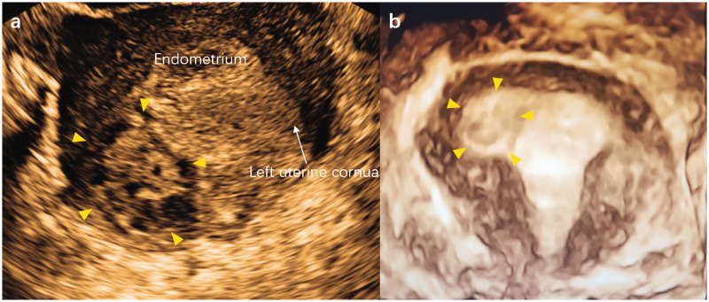
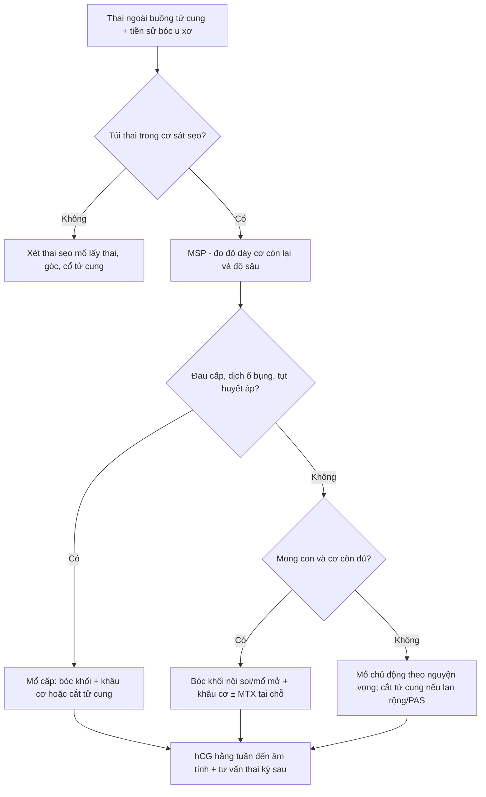
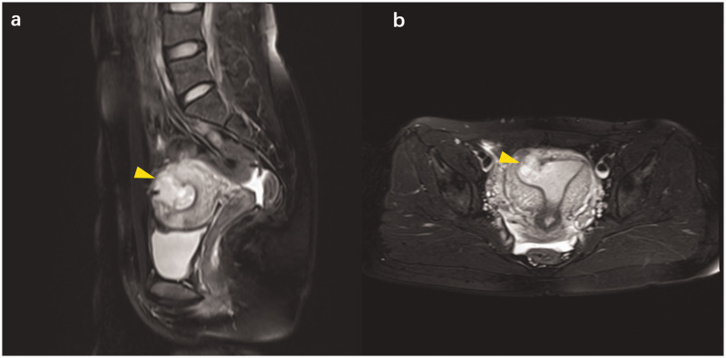
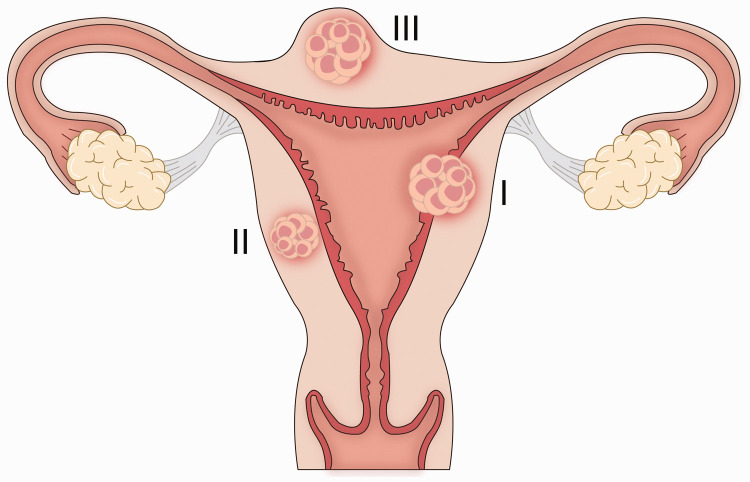

# 1727 — Thai trên sẹo bóc u xơ tử cung / Myomectomy scar pregnancy (MSP)

**Tags:** `pattern:thai-ngoai-tu-cung` `pattern:tui-thai-trong-co` `pattern:khuyet-seo-tu-cung` `pattern:do-ngam-mach` `pattern:chay-mau` `vung:tu-cung` `vung:seo-tu-cung` `vung:tieu-khung` `score:beta-hCG` `protocol:SA-dau-do` `protocol:MRI-tieu-khung` `protocol:noi-soi-tieu-khung` `incidentaloma:seo-tu-cung`
**Mức chắc chắn (certainty):** tổng hợp y văn (literature synthesis) — dựa trên 1 tổng quan phạm vi 28 bài/**44 ca** (PMC12113065), 1 loạt 8 ca có ảnh và đề xuất phân 3 thể (PMC7388108), và các ca vỡ tử cung/sẹo có ảnh (PMC12696507, PMC13379553). Bằng chứng là **ca báo cáo và hồi cứu**, không có thử nghiệm; câu nào là suy luận được ghi **[suy luận]**.

## 1. Tổng quan bệnh học – cơ chế hình ảnh

- **Định nghĩa:** thai trên sẹo bóc u xơ (myomectomy scar pregnancy, MSP) là túi thai làm tổ **trong mô sẹo của lần bóc u xơ trước**, một thể thai ngoài tử cung hiếm nhưng có thể gây **vỡ tử cung và chảy máu ồ ạt ngay trong 3 tháng đầu** (PMC12113065).
- **Vì sao sẹo là "cửa vào":** phẫu thuật bóc u xơ phá vỡ **mặt tiếp giáp nội mạc–cơ tử cung**; mô sẹo xơ thay thế cơ tử cung, không tham gia được vào quá trình giãn–phì đại của thai kỳ. Tổng quan nêu giả thuyết thiếu/không hoàn chỉnh **lớp fibrinoid Nitabuch** sau can thiệp tử cung → phôi làm tổ sâu, bánh nhau bám bất thường (PMC12113065). Ca nguyên văn có **nội mạc bị thủng trong lần mổ bóc u xơ** và một **đường hầm nhỏ (microfistula)** nối buồng tử cung với ổ sẹo (PMC7388108).
- **TẠI SAO MRI nhìn rõ:** sẹo xơ (collagen, ít proton linh động) → **T2 thấp**; túi thai/dịch ối → **T2 rất cao**; máu cũ (methemoglobin) → **T1 cao**; nguyên bào nuôi là mô mạch → **ngấm thuốc sau gadolinium**. Vì vậy MRI trả lời được hai câu mà siêu âm hay mơ hồ: **túi thai nằm ở độ sâu nào trong cơ** và **có thông với buồng tử cung không** (PMC7388108).
- **Dịch tễ — con số từ 44 ca (PMC12113065):**
  - Tuổi trung bình **36 ± 6,7** (19–48).
  - **61,5%** (24/39) thụ thai tự nhiên, **38,5%** (15/39) nhờ hỗ trợ sinh sản; **> 1/3** có tiền sử vô sinh nguyên phát.
  - Đường mổ bóc u xơ trước đó: **nội soi buồng tử cung 51,3%** (19/37), **nội soi ổ bụng 37,9%** (14/37), **mổ mở 10,8%** (4/37).
  - Vị trí u xơ đã bóc: **dưới niêm mạc 47%** (21/44), **trong cơ 18%** (8/44), **cổ tử cung 4,5%** (2/44); kích thước trung bình **6 cm**, trung vị **6,6 cm**.
- **Biến chứng khi đã có MSP (cùng 44 ca):** **sảy thai tự nhiên 9,1%** (4) · **vỡ tử cung 11,4%** (5; **2 ca < 24 tuần**, **3 ca > 24 tuần**) · **chảy máu trong thai 31,8%** (14) · **phổ nhau cài răng lược (PAS) 29,5%** (13, trong đó **3 ca percreta**) · **thai kỳ không biến chứng 18,2%** (8). **Cắt tử cung 22,7%** (10/44) (PMC12113065).
- **Nguy cơ nền của tử cung có sẹo bóc u xơ:** tổng quan dẫn y văn **vỡ tử cung 0,6%** sau bóc u xơ, so với **0,3%** sau mổ lấy thai và **0,02%** sau tạo hình vách (PMC12113065). Đây là nguy cơ của **mọi thai kỳ sau bóc u xơ**, không riêng MSP.
- **Ca nguyên văn dùng cho quiz (PMC7388108):** nữ **28 tuổi**, thai **6 tuần**, ra máu âm đạo không đau; **β-hCG 52.104 IU/L → 64.080 IU/L sau 48 giờ (+23%)**; siêu âm: khối hỗn hợp echo **3,7 × 2,8 × 2,7 cm** ở sừng phải; MRI: khối **2,2 × 2,5 × 3,2 cm** trong cơ, **thông với buồng tử cung**; tiền sử **bóc u xơ dưới niêm mạc 7 cm bằng nội soi ổ bụng**, **nội mạc bị thủng**, khâu 2 lớp. Mổ mở bóc khối + **methotrexate tại chỗ 50 mg**; mất máu **50 mL**; β-hCG ngày 1 sau mổ **22.946 IU/L**, về bình thường sau **4 tuần**.

## 2. Mẫu hình + chẩn đoán phân biệt theo VỊ TRÍ (Gamut)

Mẫu hình: **túi thai/khối hỗn hợp nằm trong cơ tử cung, sát một vùng sẹo, ± thông với buồng tử cung, ± vòng mạch nuôi**.

- **Theo độ sâu so với nội mạc–thanh mạc (phân 3 thể của PMC7388108, 8 ca):**
  - **Thể I:** túi thai **xuyên một phần** mặt tiếp giáp nội mạc–cơ, **có thông với buồng tử cung**.
  - **Thể II:** túi thai **xuyên hoàn toàn** mặt tiếp giáp nhưng **được cơ tử cung bao quanh**, không lộ ra thanh mạc; **thể hay gặp nhất** trong loạt 8 ca.
  - **Thể III:** khối **lồi ra ngoài thanh mạc**, chỉ còn cơ + thanh mạc che phủ — nguy cơ vỡ cao nhất [suy luận từ độ mỏng thành].
- **Theo vị trí sẹo — đây là điểm hay bị bỏ sót:**
  - **Thân/đáy tử cung (hay gặp):** sẹo sau bóc u xơ **dưới niêm mạc/trong cơ**; mặt cắt ngang đoạn dưới thường quy **không thấy**.
  - **Sừng tử cung/gần sừng:** dễ nhầm **thai góc (interstitial/cornual)** — khác biệt nằm ở **vị trí sẹo cũ và mối liên hệ với buồng tử cung**.
  - **Cổ tử cung:** hiếm (4,5% u xơ đã bóc là u cổ), dễ nhầm **thai cổ tử cung**.
- **DDx theo bệnh cảnh "túi thai ngoài buồng tử cung":**
  - **Thai trên sẹo mổ lấy thai (CSP):** vị trí **đoạn dưới**, tiền sử mổ lấy thai, **RMT ≤ 3 mm**, **sliding sign âm**, **interstitial line** — xem bài 552.
  - **Thai góc/sừng (interstitial):** lệch một bên so với buồng tử cung, **lớp cơ bao quanh < 5 mm**, dấu **interstitial line sign**.
  - **Thai cổ tử cung:** túi thai trong kênh cổ, **eo tử cung phình (hourglass)**, Doppler mạch nuôi từ động mạch tử cung.
  - **Thai trong cơ không sẹo (intramural):** rất hiếm, không tiền sử mổ; phải loại trừ ác tính nguyên bào nuôi.
  - **Bệnh nguyên bào nuôi thai nghén (GTN):** khối tăng sinh mạch, hCG rất cao, **không có túi thai có phôi**.
  - **U xơ thoái triển/thai lưu:** khối trong cơ **không có vòng mạch nuôi**, hCG thấp hoặc giảm; MRI giúp phân biệt máu/nhầy với túi thai.

## 3. Bảng so sánh phân biệt (ma trận đối chiếu)

| Thực thể (entity) | Hình ảnh điển hình (US/MRI) | Chốt vào (rule-in) | Chốt loại (rule-out) | Gợi ý xác nhận |
|---|---|---|---|---|
| MSP thể I | Túi thai trong cơ, **thông với buồng tử cung**, sẹo xơ T2 thấp quanh | **Tiền sử bóc u xơ + túi thai trong cơ + đường thông buồng tử cung** | Túi thai hoàn toàn trong buồng tử cung → thai bình thường | MRI T2 sagittal + β-hCG; nội soi/mổ bóc |
| MSP thể II | Túi thai **được cơ bao quanh hoàn toàn**, sát sẹo, không thông buồng tử cung | **Cơ bao quanh + tiền sử bóc u xơ + không thấy túi trong buồng** | Có thông rộng với buồng tử cung → thể I/thai trong buồng | MRI; đo độ dày cơ còn lại |
| MSP thể III | Khối **lồi ra thanh mạc**, vỏ cơ–thanh mạc mỏng | **Lồi thanh mạc + nguy cơ vỡ** | Không lồi, cơ dày → thể I/II | MRI + theo dõi sát; mổ chủ động |
| Thai sẹo mổ lấy thai (CSP) | Túi thai **đoạn dưới**, tam giác, **RMT ≤ 3 mm** | **Tiền sử mổ lấy thai + vị trí đoạn dưới + RMT ≤ 3 mm** | Sẹo ở thân/đáy + tiền sử bóc u xơ → MSP | TVUS + Doppler; MRI nếu mơ hồ |
| Thai góc/sừng | Túi thai lệch bên, **cơ bao quanh < 5 mm**, interstitial line | **Interstitial line + < 5 mm cơ quanh** | Túi thai trong buồng tử cung, cơ dày → không phải góc | MRI; β-hCG; nội soi |
| U xơ thoái triển/thai lưu | Khối trong cơ, **không vòng mạch**, có thể T1 cao do xuất huyết | **Không có phôi/tim thai + hCG thấp/giảm** | Có phôi, vòng mạch nuôi, hCG tăng → thai sống | Siêu âm lặp + hCG; MRI |

*Siêu âm cắt ngang tử cung và ảnh 3D: khối hỗn hợp echo (mũi tên vàng) trong cơ, tiếp giáp nội mạc — thai trên sẹo bóc u xơ. Nguồn: Zhu L et al., J Int Med Res 2020 (PMC7388108), Fig. 1, CC BY-NC 4.0.*

### Ba câu hỏi phải trả lời trước khi can thiệp

- **Có thai thật trong tử cung không?** (loại thai lưu/GTN; kiểm tra túi thai thứ hai — thai đôi khác buồng có thể đồng thời).
- **Túi thai ở độ sâu nào và còn bao nhiêu cơ?** (thể I/II/III; thành cơ càng mỏng càng dễ vỡ).
- **Có bằng chứng vỡ hoặc chảy máu trong ổ bụng không?** (dịch ổ bụng, đau, tụt huyết áp → mổ cấp, không chờ hCG).

## 4. Protocol chụp + phân độ/điểm chuẩn hóa

- **Siêu âm đầu dò âm đạo (TVUS) — bước 1:** bàng quang rỗng; khảo sát **toàn bộ tử cung theo mặt cắt dọc/ngang từ cổ đến đáy**, không chỉ đoạn dưới. Đặc điểm: khối hỗn hợp echo trong cơ, **vòng mạch nuôi (ring of fire)**, túi thai có thể thấy **phôi/tim thai**; đo **độ dày cơ tối thiểu** giữa túi thai và thanh mạc/buồng tử cung bằng mm. Trong 44 ca, **67,5%** chẩn đoán bằng siêu âm (PMC12113065).
- **MRI tiểu khung — khi siêu âm mơ hồ hoặc trước mổ:** **T2 sagittal + coronal** (vị trí sẹo, độ sâu, đường thông buồng tử cung), **T1** (máu), **T1 fat-sat sau gadolinium** (ngấm của nguyên bào nuôi), **DWI** nếu cần phân biệt khối đặc. MRI được dùng ở **27,5%** ca, thường để đánh giá chính xác vị trí và liên quan cơ quan lân cận (PMC12113065).
- **Xét nghiệm:** **β-hCG định lượng + lặp sau 48 giờ**; siêu âm có túi thai nhưng **hCG tăng không đủ** hoặc **không thấy phôi** vẫn không loại trừ. Không có ngưỡng hCG nào được chứng minh để chọn methotrexate trong MSP — **khác với CSP** (PMC12113065).
- **Phân thể (PMC7388108) — dùng để mô tả, chưa được xác nhận tiên lượng:** thể I (thông buồng tử cung) · thể II (cơ bao quanh) · thể III (lồi thanh mạc). Loạt 8 ca quá nhỏ để coi là phân độ chuẩn; **hiện chưa có hệ phân độ được kiểm chứng cho MSP** [suy luận].
- **Điều trị — nguyên tắc từ 44 ca:** **phẫu thuật là lựa chọn chính** (mổ mở/nội soi bóc khối + khâu cơ); **methotrexate đơn thuần chỉ ở 9,1%** (4/44) và **6,8%** (3/44) phải phối hợp mổ; **cắt tử cung 22,7%** (10/44) — thường vì vỡ/chảy máu/PAS (PMC12113065).
- **Quyết định theo tình trạng:** **vỡ/chảy máu ổ bụng** → mổ cấp, không chờ; **ổn định, còn cơ bao quanh, mong con** → bóc khối qua nội soi ± MTX tại chỗ, khâu phục hồi cơ; **không còn nhu cầu sinh sản, tổn thương lan rộng/PAS nặng** → có thể phải cắt tử cung.
- **Theo dõi sau điều trị:** β-hCG hằng tuần đến âm tính; siêu âm kiểm tra vết mổ; **tư vấn nguy cơ tái phát và vỡ ở thai kỳ sau** (xem bài 1726 cho thai kỳ sau vỡ tử cung).

## 5. Biến thể bình thường và cạm bẫy

- **Sẹo ở thân/đáy tử cung không nằm trên mặt cắt đoạn dưới thường quy** — siêu âm "đoạn dưới bình thường" không loại trừ MSP; phải quét **toàn bộ tử cung** và hỏi **vị trí u xơ đã bóc**.
- **Bóc u xơ bằng nội soi buồng tử cung** (51,3% ca) **không để lại sẹo thanh mạc** — thai có thể nằm **hoàn toàn trong cơ**, dễ bị gọi là "thai trong cơ vô căn" hoặc "u xơ thoái triển".
- **Doppler bình thường không loại trừ:** vòng mạch có thể thưa ở thai sớm/sắp lưu; ngược lại, khối u xơ viêm có thể tăng mạch giả.
- **Nhầm với u xơ, thai lưu, bệnh nguyên bào nuôi, thai góc** — cả 4 đều được nêu là chẩn đoán nhầm trong y văn (PMC7388108). Chốt bằng **tiền sử mổ + vị trí sẹo + MRI + hCG**.
- **Nạo buồng tử cung (D&C) là nguy hiểm** khi túi thai nằm trong cơ/sẹo: không tiếp cận được tổn thương, nguy cơ **thủng tử cung và chảy máu ồ ạt** [suy luận cơ học, phù hợp khuyến cáo phẫu thuật bóc khối].
- **Thai đôi khác buồng (heterotopic):** có thể có một thai trong buồng tử cung bình thường **kèm** MSP; đừng dừng siêu âm khi thấy túi thai đầu tiên.
- **Đo "độ dày cơ còn lại" chưa có ngưỡng chuẩn cho MSP:** với CSP, **RMT ≤ 3 mm** là ngưỡng nguy cơ cao; **không được bê nguyên ngưỡng này sang sẹo bóc u xơ** vì giải phẫu và bằng chứng khác — dùng để mô tả nguy cơ, không phải để quyết định một mình [suy luận].
- **Không chọc hút/đốt mù khối trong cơ** khi chưa loại trừ thai sống và chưa xác định vị trí sẹo — nguy cơ chảy máu không kiểm soát.

## 6. Tự lượng giá — Blind Quiz

**Ca 1 — Nữ 28 tuổi, thai 6 tuần, ra máu âm đạo không đau, tiền sử bóc u xơ 2 năm trước.**

- Hỏi: khối nằm ở đâu so với nội mạc? Cần hỏi thêm tiền sử gì? Ba chẩn đoán phân biệt và bước xác nhận?

<b>Bấm để hiện đáp án (findings + chẩn đoán)</b>

- **Findings:** khối hỗn hợp echo trong cơ, sát nội mạc, có vòng mạch; **không có túi thai trong buồng tử cung**.
- **Chẩn đoán:** **MSP** — tiền sử bóc u xơ dưới niêm mạc 7 cm, **nội mạc bị thủng** lúc mổ; β-hCG **52.104 → 64.080 IU/L** sau 48 giờ.
- **Xác nhận:** MRI (khối trong cơ **thông với buồng tử cung** = thể I); mổ bóc khối + MTX tại chỗ 50 mg, mất máu 50 mL.
- Nguồn ảnh: Zhu L et al., J Int Med Res 2020 (PMC7388108), Fig. 1, CC BY-NC 4.0.

**Ca 2 — Cùng bệnh nhân, MRI trước mổ.**

- Hỏi: dấu hiệu nào trên MRI cho biết khối **thông với buồng tử cung**? Vì sao MRI cần thiết trước khi chọn đường mổ?

<b>Bấm để hiện đáp án (findings + chẩn đoán)</b>

- **Findings:** T2 sagittal — khối tín hiệu hỗn hợp **2,2 × 2,5 × 3,2 cm** trong cơ vùng đáy/sừng, **đường thông với buồng tử cung**; T2 axial — khối lệch một bên, cơ bao quanh mỏng.
- **Ý nghĩa:** xác định **độ sâu (thể I)**, vị trí sẹo và liên quan buồng tử cung → chọn **bóc khối + khâu cơ**, tránh nạo mù.
- Nguồn ảnh: Zhu L et al., J Int Med Res 2020 (PMC7388108), Fig. 2, CC BY-NC 4.0.

**Ca 3 — Phân thể trên sơ đồ: khối I, II, III nằm ở đâu?**

- Hỏi: mô tả thể I, II, III; thể nào nguy cơ vỡ cao nhất và vì sao? Phân thể này có thay đổi thái độ xử trí không?

<b>Bấm để hiện đáp án (findings + chẩn đoán)</b>

- **Thể I:** xuyên một phần nội mạc–cơ, **thông buồng tử cung**. **Thể II:** xuyên hoàn toàn nhưng **cơ bao quanh**, hay gặp nhất. **Thể III:** **lồi ra thanh mạc**, vỏ cơ–thanh mạc mỏng.
- **Nguy cơ vỡ:** thể III cao nhất vì thành cơ còn lại ít nhất [suy luận từ độ dày thành].
- **Hạn chế:** phân thể dựa trên **8 ca**, chưa được kiểm chứng tiên lượng; dùng để mô tả và cân nhắc mổ chủ động, **không thay thế đánh giá tình trạng cấp**.
- Nguồn ảnh: Zhu L et al., J Int Med Res 2020 (PMC7388108), Fig. 4, CC BY-NC 4.0.

## Bài liên quan chéo
- [552 – Chửa ở sẹo mổ lấy thai & chửa góc: Vial I/II, RMT ≤ 3 mm, sliding sign](../552-chua-ngoai-tu-cung-seo-mo-lay-thai-va-chua-goc/lesson.md)
- [1717 – Vỡ tử cung trên sẹo mổ lấy thai: 22,7% không đau](../1717-vo-tu-cung-tren-seo-mo-lay-thai/lesson.md)
- [1726 – Thai kỳ sau một ca vỡ tử cung: tái phát 10%](../1726-thai-ky-sau-vo-tu-cung-danh-gia-seo/lesson.md)
- [520 – U xơ tử cung FIGO & adenomyosis](../520-tu-cung-u-xo-FIGO-adenomyosis-noi-mac/lesson.md)
- [532 – U xơ trong thai kỳ & thoái triển đỏ](../532-u-xo-trong-thai-ky-thoai-trien-do/lesson.md)
- [1624 – Polyp nhau/khối trong buồng tử cung sau sinh](../1624-polyp-nhau-khoi-buong-tu-cung-sau-sinh/lesson.md)

> Không dùng để chẩn đoán độc lập khi chưa có người hướng dẫn.
