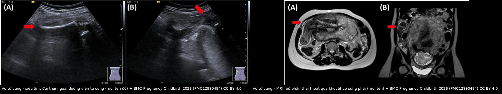
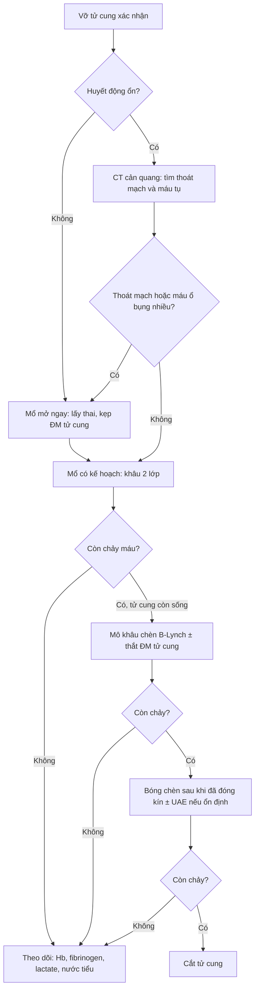
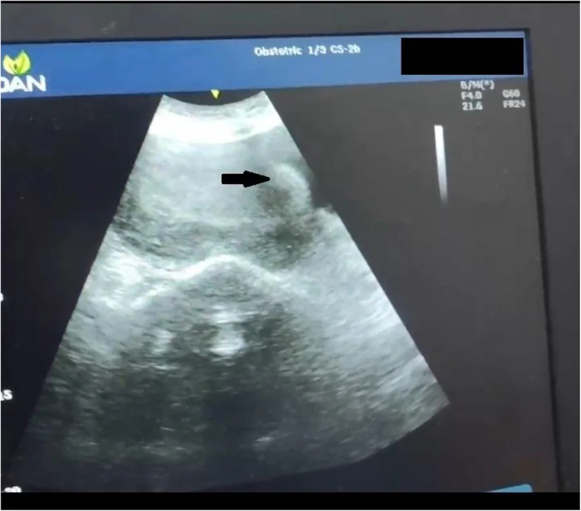
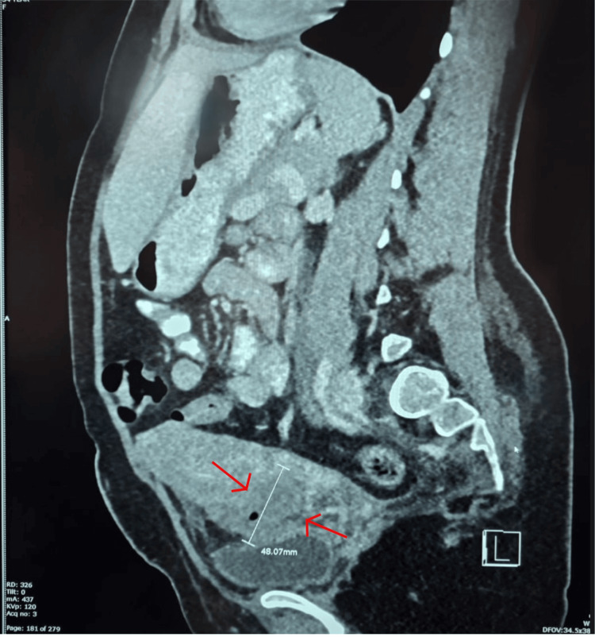
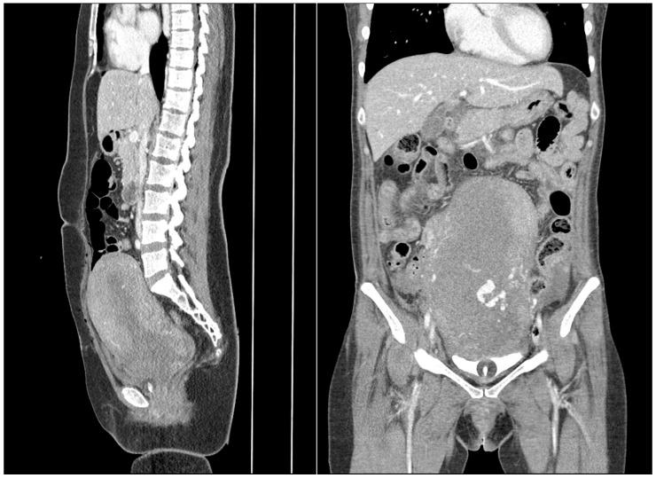

# 1728 — Chảy máu sau vỡ tử cung: khâu bảo tồn, bóng chèn, thuyên tắc động mạch tử cung và khi nào cắt tử cung / Hemorrhage after uterine rupture: conservative repair, balloon tamponade, uterine artery embolization, and when to hysterectomize

**Tags:** `pattern:vo-tu-cung` `pattern:dich-o-bung` `pattern:chay-mau` `vung:tu-cung-phan-phu` `protocol:SA-cap-cuu` `protocol:CT-bung` `score:shock-index` `score:4T`
**Mức chắc chắn (certainty):** tổng hợp y văn (literature synthesis) — ghép 1 đoàn hệ 74 ca vỡ tử cung/115.121 ca sinh (Front Glob Womens Health 2026, PMC13438401), 1 đoàn hệ 51 ca chảy máu sau sinh (PPH) có CT cản quang (J Clin Med 2026, PMC13413381), 1 đoàn hệ 162 ca PPH trước/sau khi đưa bóng chèn vào thực hành (J Clin Med 2026, PMC12842071), 1 tổng quan hệ thống 31 bài về mô khâu chèn (Med Sci 2026, PMC13706869), 1 đoàn hệ 230 ca PPH (World J Emerg Surg 2024, PMC11293252) và 4 ca nguyên văn có ảnh (PMC12990484, PMC13544788, PMC12917422, PMC12680439). **Không có RCT riêng cho vỡ tử cung**; các tỷ lệ thành công của bóng chèn/thuyên tắc dưới đây lấy từ **PPH nói chung**, không phải riêng vỡ tử cung — đây là giới hạn thật của bằng chứng, không được đọc như số liệu của vỡ tử cung.

## 1. Tổng quan bệnh học – cơ chế hình ảnh

- **Vỡ tử cung (uterine rupture)** là rách **toàn bộ 3 lớp** thành tử cung (nội mạc – cơ – thanh mạc), khác **nứt sẹo/dehiscence** chỉ mất liên tục cơ nhưng thanh mạc còn. Chảy máu sau vỡ đến từ **3 nguồn cùng lúc**: (1) **động mạch tử cung và các nhánh cung (arcuate)/xoắn (spiral)** ở bờ rách, (2) **giường bánh nhau** nếu vỡ ngang vùng bám, (3) **đờ tử cung** do mất cơ co và do máu thấm cơ — vì vậy **khâu kín lỗ rách không đủ** nếu tử cung vẫn đờ và rối loạn đông máu chưa được xử lý.
- **Tần suất và bối cảnh (số liệu trung tâm):** 74/115.121 ca sinh = **0,06%**; **43% trên tử cung có sẹo, 57% trên tử cung KHÔNG sẹo** ở một trung tâm tiếp nhận tuyến cuối (PMC13438401). Ở nước thu nhập cao, vỡ chủ yếu gặp khi **thử sinh sau mổ lấy thai (TOLAC)** với tần suất **0,3–0,7%** (bài 1717); ở nơi thiếu chăm sóc tiền sản, **đờ tử cung – chuyển dạ tắc nghẽn – ấn đáy tử cung** là yếu tố chính.
- **Biểu hiện lâm sàng rất dễ bỏ sót:** đau bụng **82%**, suy thai/thai chết trong tử cung **65%**, ra máu âm đạo **47%**, huyết động không ổn **24%** (PMC13438401). Nghĩa là **hơn một nửa ca KHÔNG ra máu âm đạo** và **76% ca còn huyết áp ổn** lúc vào — không được dùng "không ra máu, huyết áp bình thường" để loại vỡ.
- **Hậu quả khi chẩn đoán muộn (con số để quyết định):** cắt tử cung **23%**, truyền > 2 đơn vị máu **71%**, tử vong mẹ **1,4%**, tử vong chu sinh **35,1%**; ở nhóm **vỡ không sẹo bị bỏ sót**: cắt tử cung **50%**, tử vong sơ sinh **87,5%**, tử vong mẹ **12,5%** (PMC13438401). Thời gian từ khởi phát đến chẩn đoán **5,6 giờ** ở ca xử lý sớm so với **> 24 giờ** ở ca bỏ sót.
- **Chỉ số sinh tồn quan trọng hơn huyết áp:** **shock index (SI = nhịp tim/huyết áp tâm thu)** — SI **0,6–1 = sốc nhẹ**, **1–1,4 = sốc vừa**, **≥ 1,4 = sốc nặng** (PMC11293252). Ca vỡ tử cung 28 tuần có **mạch 107, huyết áp 100/60 → SI 1,07** trong khi **hemoglobin vẫn 12,6 g/dL** (PMC13544788): **Hb bình thường không loại trừ mất máu cấp**, vì Hb chỉ giảm sau khi pha loãng.
- **TẠI SAO hình ảnh thấy được (vật lý):**
  - **Siêu âm (US):** máu loãng và nước ối **trống âm** vì âm truyền qua dịch gần như không phản xạ; **cục máu đông** có nhiều giao diện mô – dịch nên **tăng âm**; cơ tử cung **trung âm**, mỡ quanh tử cung **tăng âm** → chỗ **mất liên tục cơ** hiện thành "khe" giữa hai bờ cơ, và **bộ phận thai nằm ngoài đường viền tử cung** là dấu hiệu quyết định.
  - **CT:** độ suy giảm tia X tỷ lệ với mật độ điện tử. **Máu tụ cấp ~ 40–60 HU** (đậm hơn nước 0–15 HU, ngang cơ); **thoát mạch hoạt động (contrast extravasation, EV)** chứa iod (Z = 53) nên **≥ 100 HU, gần bằng đậm độ động mạch kế cận**. Nếu chụp **không cản quang**, máu tụ và EV **cùng đậm độ** → không phân biệt được, đây là lý do bắt buộc **CT có cản quang** khi tìm nguồn chảy.
  - **MRI:** tín hiệu T2 giảm khi mô mất nước tự do → **cơ tử cung T2 thấp**, **nước ối T2 rất cao**, **sẹo xơ T2 thấp**; **methemoglobin trong hồng cầu vỡ** làm **T1 sáng** ở máu bán cấp. Vì vậy MRI vừa thấy **khuyết cơ**, vừa thấy **máu tụ cũ**, vừa thấy **bộ phận thai thoát qua khuyết** (PMC12990484).
- **TẠI SAO bóng chèn đơn thuần thất bại trong vỡ tử cung:** bóng tạo áp lực chỉ khi **buồng tử cung kín**. Khi có khuyết thành, bóng **thoát ra ổ bụng/âm đạo**, không tạo được áp lực, thậm chí **làm rộng vết rách**; đã có ca **thủng tử cung do bóng chèn** trong PPH thứ phát (Cureus 2025, PMC12680439). Vì vậy **bóng chèn là bước SAU khi đã khâu kín**, không phải bước thay thế khâu.

## 2. Mẫu hình + chẩn đoán phân biệt theo vị trí (Gamut)

Hai câu hỏi định vị quyết định xử trí: **máu chảy vào đâu** và **tử cung còn khả năng co không**.

**Gamut theo đường máu đi:**

- **Vỡ hoàn toàn vào ổ phúc mạc:** máu tự do + thai/bộ phận thai ngoài tử cung → **mổ ngay**, không chờ CT.
- **Vỡ ra dây chằng rộng/ngoài phúc mạc:** máu tụ **cạnh tử cung**, **có thể KHÔNG ra máu âm đạo**, đau một bên, thiếu máu không rõ nguồn → dễ bỏ sót; US/CT thấy khối cạnh tử cung, đẩy tử cung sang bên.
- **Vỡ ở đoạn dưới/sẹo mổ lấy thai:** máu qua cổ tử cung ra âm đạo, dễ nhầm "sót nhau/đờ tử cung"; **khuyết sẹo** thấy rõ trên US/CT (PMC12917422).
- **Vỡ trên bánh nhau cài răng lược (PAS):** chảy máu dữ dội từ giường bánh nhau, **không cầm được bằng khâu đơn thuần**, nguy cơ cắt tử cung cao.
- **Vỡ do chấn thương (tử cung không sẹo):** máu ổ bụng + thai ngoài tử cung trên FAST; **gãy xương chậu** có thể che lấp (PMC13644821).
- **Vỡ muộn/sau sinh (delayed):** 1 tuần sau sinh đường âm đạo, đau lưng – ra máu ít, **máu tụ có khí** trong khuyết sẹo (PMC12917422).
- **Không vỡ nhưng chảy máu:** đờ tử cung đơn thuần, sót nhau, giả phình động mạch tử cung, rối loạn đông máu — **bắt buộc loại trừ vỡ trước khi dùng bóng/UAE**.

**Gamut theo mẫu hình "khuyết thành cơ tử cung":**

- **Vỡ toàn bộ 3 lớp**, bờ rách nham nhở, **máu tụ ± bộ phận thai ngoài**.
- **Nứt sẹo/dehiscence:** cơ mất liên tục nhưng **thanh mạc còn**, thai còn trong buồng, màng ối **phồng** vào chỗ khuyết.
- **Sẹo mỏng đơn thuần:** cơ còn liên tục, **không có máu tự do**.
- **Thủng tử cung do can thiệp (nạo, đặt dụng cụ, bóng chèn):** khuyết khu trú + khí trong ổ bụng/âm đạo, tiền sử thủ thuật.
- **Giả phình động mạch tử cung:** ổ tăng quang thì động mạch, **"yin–yang" + to-and-fro** trên Doppler, thường PPH muộn (bài 1723).
- **Rách cổ tử cung/âm đạo:** máu âm đạo nhiều nhưng **tử cung nguyên vẹn** — soi âm đạo là chốt.

## 3. Bảng so sánh phân biệt (ma trận đối chiếu)

| Thực thể (entity) | Hình ảnh điển hình (US/CT/MRI) | Chốt vào (rule-in) | Chốt loại (rule-out) | Gợi ý xác nhận |
|---|---|---|---|---|
| **Vỡ tử cung hoàn toàn** | Mất liên tục **cả 3 lớp**, bộ phận thai/thai ngoài đường viền tử cung, **dịch ổ bụng**; CT có máu tụ ± EV | **Thai/bộ phận thai NGOÀI tử cung + mất liên tục cơ + dịch ổ bụng** | Thai còn trong buồng, cơ liên tục, không dịch → không vỡ | Mổ ngay; US tại giường là đủ, **không chờ CT** nếu huyết động không ổn |
| **Nứt sẹo/dehiscence** | Khuyết cơ khu trú tại sẹo, **thanh mạc/màng ối còn**, thai trong buồng; có thể ít dịch | **Khuyết cơ + thai còn trong buồng + không máu tự do nhiều** | Thai ra ổ bụng + máu tự do → đã vỡ hoàn toàn | MRI/CT nếu siêu âm khó; mổ có kế hoạch |
| **Đờ tử cung đơn thuần** | Tử cung to, cơ dày đều, **không khuyết cơ**, buồng trống, ít dịch | **Không có khuyết thành cơ + tử cung mềm, to** | Có khuyết cơ/bộ phận thai ngoài → không phải đờ đơn thuần | Xử lý theo 4T; bóng chèn/uterotonic |
| **Sót nhau (tissue)** | Khối tăng âm trong buồng, **mạch máu nuôi trong khối** trên Doppler, buồng giãn | **Khối trong buồng + mạch nuôi + tiền sử chưa sạch** | Không khối trong buồng → không phải sót | US; nong gắp/nội soi buồng; **UAE kém hiệu quả ở nhóm tissue** |
| **Giả phình động mạch tử cung** | Ổ tăng quang **thì động mạch**, giữ hình thì muộn; Doppler **to-and-fro** | **Ổ tăng quang giữ hình + mạch nuôi rõ** | Không có ổ mạch, chỉ máu tụ → không phải giả phình | CTA/DSA; nút mạch (bài 1723) |
| **Vỡ trên PAS** | Bánh nhau **mất dải cơ với bàng quang**, lacuna, tăng sinh mạch, **vỡ thành ± thai ngoài** | **PAS + mất liên tục cơ tại vị trí bánh nhau** | Bánh nhau mặt sau, dải cơ còn → không PAS | MRI; mổ có kế hoạch + chuẩn bị cắt tử cung |
| **Vỡ ngoài phúc mạc (dây chằng rộng)** | Khối máu tụ **cạnh tử cung**, đẩy tử cung sang bên; **có thể không dịch ổ bụng** | **Máu tụ cạnh tử cung + thiếu máu không tương xứng máu ra ngoài** | Máu tự do khắp ổ bụng → vỡ vào phúc mạc | CT có cản quang; mổ |

*Trái: siêu âm bụng phải — đùi thai nằm ngoài đường viền tử cung (mũi tên đỏ); phải: MRI — bộ phận thai thoát qua khuyết cơ ở sừng phải (mũi tên). Nguồn: BMC Pregnancy Childbirth 2026 (PMC12990484), CC BY 4.0; ảnh ghép letterbox, không crop/kéo giãn.*

### Ba dấu hiệu quyết định trên mặt cắt

- **Mất liên tục thành cơ tại đúng vị trí sẹo** — đo **chiều dài khuyết** (mm) và mô tả **bờ cơ** (nham nhở = cấp; nhẵn = mạn).
- **Bộ phận thai ngoài tử cung** — dấu hiệu **chốt vỡ hoàn toàn**, không cần chờ xét nghiệm.
- **Máu tụ + khí trong khuyết sẹo** — khí có thể từ âm đạo sau sinh, nhưng **khí + sốt + khuyết rộng** gợi **hoại tử/nhiễm** và là lý do mổ sớm (PMC12917422: khuyết **28 mm**, máu tụ **61 × 61 × 56 mm = 109 mL**, vỡ **3 cm** ở góc trái tử cung).

## 4. Protocol chụp + hệ phân độ/điểm chuẩn hóa

### 4.1. Hồi sức song song với chẩn đoán (không chờ hình ảnh)

- **Hai đường truyền lớn**, máu **1:1:1** (hồng cầu:tươi:tiểu cầu) khi mất máu ồ ạt; **calci** bù theo từng đơn vị máu.
- **Tranexamic acid 1 g IV trong 3 giờ đầu** (WOMAN 2017), nhắc lại **1 g** nếu còn chảy; **fibrinogen < 2 g/L** là ngưỡng hành động; theo dõi **lactate** (nhóm phải mổ: **4,54 vs 2,85 mmol/L**, PMC11293252).
- **Shock index** thay cho "huyết áp còn ổn": **SI ≥ 1** là dấu hiệu sớm; **SI ≥ 1,4** là sốc nặng.
- **Quyết định mổ không phụ thuộc CT**: huyết động không ổn + thai ngoài tử cung trên US → **mổ ngay**.

### 4.2. Chọn hình ảnh

| Tình huống | Ưu tiên | Lý do |
|---|---|---|
| Huyết động không ổn, nghi vỡ | **US tại giường (FAST)** → mổ | CT làm chậm cầm máu; US thấy dịch ổ bụng + thai ngoài tử cung |
| Huyết động ổn, chưa rõ nguồn | **CT bụng–chậu có cản quang (thì động mạch + tĩnh mạch cửa)** | EV **≥ 100 HU**; EV làm **tăng 7,4 lần** khả năng phải can thiệp (aOR 7,44; 1,58–35,03) |
| Thai còn trong buồng, nghi nứt sẹo | **MRI bụng–chậu không cản quang** | T2 thấy khuyết cơ + máu tụ cũ; không bức xạ |
| Sau mổ, sốt/thiếu máu tiếp diễn | **CT có cản quang** | Máu tụ, hoại tử, rò, EV còn sót |

### 4.3. Thang can thiệp cầm máu (từ ít xâm lấn đến triệt để)

| Bước | Chỉ định | Hiệu quả đã báo cáo | Ghi chú |
|---|---|---|---|
| **Khâu tử cung 2 lớp** | Mọi vỡ có thể bảo tồn | Nền tảng; không có RCT | Cắt bờ hoại tử, tránh nạo buồng tử cung |
| **Mô khâu chèn (B-Lynch, Hayman, Cho)** | Đờ tử cung sau khi đã khâu kín | **73,9–100%** (31 bài); **B-Lynch 79,1%**; **+ thắt ĐM tử cung hai bên > 90%** | Không dùng khi còn khuyết thành hở |
| **Bóng chèn trong tử cung (UBT)** | Đờ tử cung, buồng kín | **Bakri 66,7–80%**; thể tích bơm trung vị **150 mL** (60–500) | Bóng **không** thay thế khâu; nguy cơ **thủng/làm rộng vết rách** |
| **Thuyên tắc động mạch tử cung (UAE)** | BN ổn định, không chảy máu ồ ạt vào ổ bụng | Lần đầu **72,4–81,3%**, cuối cùng **82,8–87,5%** | **Tone 87–95,7%** nhưng **tissue chỉ 16,7–75%**; biến chứng: thiếu máu cơ, **hoại tử tử cung** |
| **Cắt tử cung** | Không cầm được máu, tử cung hoại tử, PAS xâm lấn | **23%** ca vỡ tử cung; **50%** ở vỡ không sẹo bỏ sót | Quyết định **không chậm** khi đã thất bại 2 bước |

- **Con số đối chiếu để không hứa hẹn quá mức:** trong 39.327 ca sinh, phẫu thuật bảo tồn đạt **73,9–80,4%**, **cắt tử cung 19,6%**, biến chứng sớm **27,2%** (chủ yếu DIC/suy tạng); trong 30.271 ca sinh, PPH **2,3%**, B-Lynch **75%**, Bakri **66,7%**, thắt ĐM tử cung **66,7%** (dẫn trong PMC13706869).
- **Thứ tự ưu tiên khi vỡ + đờ tử cung:** **khâu kín → mô khâu chèn ± thắt ĐM tử cung → bóng chèn (sau khi kín) → UAE nếu ổn định → cắt tử cung**. Làm **bóng trước khi khâu** là sai về cơ học, không phải chỉ sai về thứ tự.

### 4.4. Sau mổ

- **Theo dõi 24–48 giờ:** SI, Hb, fibrinogen, lactate, nước tiểu; **CT/US lại** nếu Hb tiếp tục giảm hoặc sốt (máu tụ, hoại tử, rò).
- **Kháng sinh** khi có khí trong máu tụ/hoại tử; **không nạo buồng tử cung** sau vỡ vì nguy cơ làm rộng khuyết.
- **Tư vấn sinh lần sau:** vỡ tử cung tái phát **10% (6–17%)**, **0% nếu sẹo cũ ở đoạn dưới** so với **8,6% nếu ngoài đoạn dưới**; mổ chủ động **36–38⁶⁄₇ tuần** (bài 1726).

## 5. Biến thể bình thường và cạm bẫy

- **"Không ra máu âm đạo" không loại trừ vỡ:** 53% ca vỡ không có máu âm đạo (PMC13438401); máu có thể chảy vào **dây chằng rộng** hoặc ổ bụng.
- **Hb bình thường trong giờ đầu:** ca 28 tuần có **Hb 12,6 g/dL** nhưng **SI 1,07** và thai đã ngoài tử cung (PMC13544788) — **dùng SI, lactate, dịch ổ bụng**, không dựa Hb.
- **"Tử cung rỗng" sau chấn thương:** nghĩ **vỡ tử cung**, không phải sảy thai hoàn toàn; hỏi **thai kỳ** ở mọi phụ nữ tuổi sinh sản bị chấn thương (PMC13644821).
- **Bóng chèn không phải "van an toàn":** bóng trong buồng tử cung có khuyết thành sẽ **thoát ra ngoài**, không cầm máu và có thể **làm rộng vết rách** (PMC12680439).
- **CT không cản quang bỏ sót EV:** EV **≥ 100 HU**, gần bằng đậm độ động mạch; không có thuốc cản quang thì **không thể** phân biệt với máu tụ 40–60 HU.
- **Khí trong máu tụ:** có thể do **không khí âm đạo** sau sinh; nhưng **khí + sốt + khuyết sẹo rộng** phải nghĩ **hoại tử/nhiễm** và mổ sớm, không chờ kháng sinh.
- **Thỏa mãn tìm kiếm (satisfaction of search):** gãy xương chậu/xương đùi trên phim chấn thương làm bỏ qua **dịch ổ bụng**; FAST phải đọc **cả dịch ở túi cùng**.
- **Đo độ dày sẹo không đủ:** LUS/RMT có **AUC 0,60–0,61** (bài 1717/1726) — không dùng một trị số mm để quyết định mổ hay chờ.

## 6. Tự lượng giá — Blind Quiz

**Ca 1 — Thai 30 tuần 2 ngày, đau hông phải đột ngột, tiền sử cắt sừng tử cung phải do thai kẽ 5 tháng trước khi mang thai.**

- Câu hỏi: Cấu trúc nằm ngoài đường viền tử cung là gì? Vì sao đau khu trú bên phải? Chẩn đoán và bước tiếp theo?

<b>Bấm để hiện đáp án (findings + chẩn đoán)</b>

- **Findings:** (A) đùi thai **ngoài đường viền tử cung** ở bụng phải; (B) **khuyết cơ** ở sừng phải, bộ phận thai thoát qua; MRI xác nhận **vỡ tại sừng phải** — đúng vị trí đã cắt sừng tử cung.
- **Chẩn đoán:** vỡ tử cung tại sẹo can thiệp sừng tử cung (interstitial) — mô sẹo cơ mỏng, thai lớn dần làm rách.
- **Xử trí:** mổ ngay lấy thai + khâu 2 lớp; không chờ CT vì đã thấy thai ngoài tử cung.
- Nguồn ảnh: BMC Pregnancy Childbirth 2025 (PMC12990484), CC BY 4.0.

**Ca 2 — Thai 28 tuần, đau bụng 14 giờ, ra máu 15 mL, thai máy giảm; mạch 107, huyết áp 100/60, Hb 12,6 g/dL.**

- Câu hỏi: Mũi tên chỉ gì? Vì sao Hb bình thường mà vẫn phải mổ? 3 chẩn đoán phân biệt?

<b>Bấm để hiện đáp án (findings + chẩn đoán)</b>

- **Findings:** **mất liên tục thành cơ đoạn dưới** (mũi tên đen); thai không còn trong buồng, thai chết nằm trong ổ bụng, dịch ở túi cùng Morrison/Douglas.
- **Chẩn đoán:** vỡ tử cung hoàn toàn trên sẹo mổ lấy thai; **SI = 107/100 = 1,07** → sốc vừa dù Hb 12,6 g/dL (Hb chưa pha loãng).
- **Phân biệt:** đờ tử cung + sót nhau, nhau bong non, vỡ tử cung do chấn thương.
- Nguồn ảnh: Int J Surg Case Rep 2026 (PMC13544788), CC BY-NC 4.0.

**Ca 3 — 1 tuần sau sinh đường âm đạo (VBAC), đau lưng – bụng dưới, ra máu ít, Hb giảm từ 12,0 xuống 10,3 g/dL.**

- Câu hỏi: Đo gì trên ảnh? Vì sao có khí trong khối? Chọn mổ hay theo dõi?

<b>Bấm để hiện đáp án (findings + chẩn đoán)</b>

- **Findings:** khuyết sẹo **28 mm**, máu tụ **61 × 61 × 56 mm (109 mL)** từ buồng tử cung qua sẹo ra giữa tử cung – bàng quang, **có khí**; vỡ **3 cm** ở góc trái tử cung, máu ổ bụng 50 mL.
- **Chẩn đoán:** vỡ sẹo mổ lấy thai muộn sau VBAC; khí có thể do âm đạo, nhưng khuyết rộng + máu tụ lớn → **mổ** (khâu 2 lớp).
- **Bài học:** Hb giảm 1,7 g/dL + đau sau sinh là **cửa vào** của vỡ muộn, không phải "đau tử cung co hồi".
- Nguồn ảnh: Cureus 2026 (PMC12917422), CC BY 4.0.

**Ca 4 — PPH sau sinh, chụp CT có cản quang; hai bệnh nhân (trái: không thoát mạch; phải: có thoát mạch).**

- Câu hỏi: Dấu hiệu nào quyết định can thiệp? Nếu ảnh phải là vỡ tử cung đã khâu, bước tiếp theo là gì?

<b>Bấm để hiện đáp án (findings + chẩn đoán)</b>

- **Findings:** ảnh phải có **ổ tăng quang trong buồng tử cung, đậm độ gần động mạch** = **thoát mạch hoạt động**; ảnh trái không có.
- **Ý nghĩa:** EV làm tăng **7,4 lần** khả năng phải can thiệp (aOR 7,44); nhóm EV+ có cắt tử cung **30,4% vs 7,1%**, mất máu > 2.000 mL **34,8% vs 3,6%**, DIC **30,4% vs 7,1%**.
- **Xử trí:** huyết động ổn → **UAE**; nếu đã vỡ và đang chảy trong ổ bụng → **mổ** thay vì UAE.
- Nguồn ảnh: J Clin Med 2026 (PMC13413381), CC BY 4.0.

## Bài liên quan chéo
- [1717 – Vỡ tử cung trên sẹo mổ lấy thai: 0,3–0,7%, prostaglandin aOR 2,58, AUC đo sẹo 0,60](../1717-vo-tu-cung-tren-seo-mo-lay-thai/lesson.md)
- [1726 – Thai kỳ sau một ca vỡ tử cung: tái phát 10%, mổ chủ động 36–38⁶⁄₇ tuần](../1726-thai-ky-sau-vo-tu-cung-danh-gia-seo/lesson.md)
- [1723 – Giả phình động mạch tử cung: yin–yang, to-and-fro, nút mạch](../1723-gia-phinh-dong-mach-tu-cung/lesson.md)
- [1725 – Vỡ ối non tháng trước 24 tuần trên sẹo mổ lấy thai](../1725-vo-oi-non-thang-truoc-24-tuan-tren-seo-mo-lay-thai/lesson.md)
- [1816 – REBOA: chọn bóng, chiều dài chèn, ngưỡng thời gian](../1816-reboa-bong-chen-noi-mach-chu/lesson.md)
- [040 – Tràn dịch màng phổi: nguyên lý dịch – đậm độ trên CT](../040-tran-dich-mang-phoi/lesson.md)

## Ảnh
- `images/composite_vo-tu-cung.jpg` — ghép US + MRI (PMC12990484), CC BY 4.0.
- `images/1728_vo-tu-cung_SA_PMC13544788-F1.jpg` — US khuyết cơ (PMC13544788), CC BY-NC 4.0.
- `images/1728_vo-seo-cu_CT_PMC12917422-F2.jpg` — CT máu tụ có khí (PMC12917422), CC BY 4.0.
- `images/1728_thoat-mach_CT_PMC13413381-F2.jpg` — CT có/không thoát mạch (PMC13413381), CC BY 4.0.
- Nguồn, giấy phép và ghi chú phái sinh từng ảnh: `images/CREDITS.md`.

> Không dùng để chẩn đoán độc lập khi chưa có người hướng dẫn.
