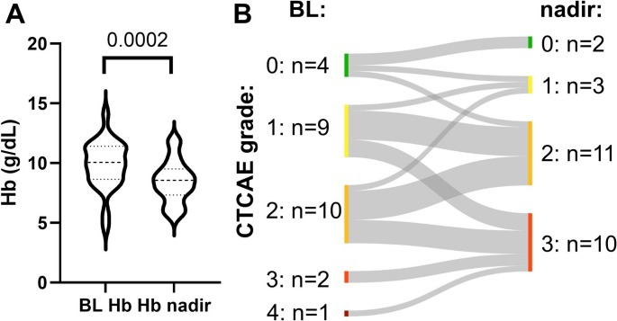
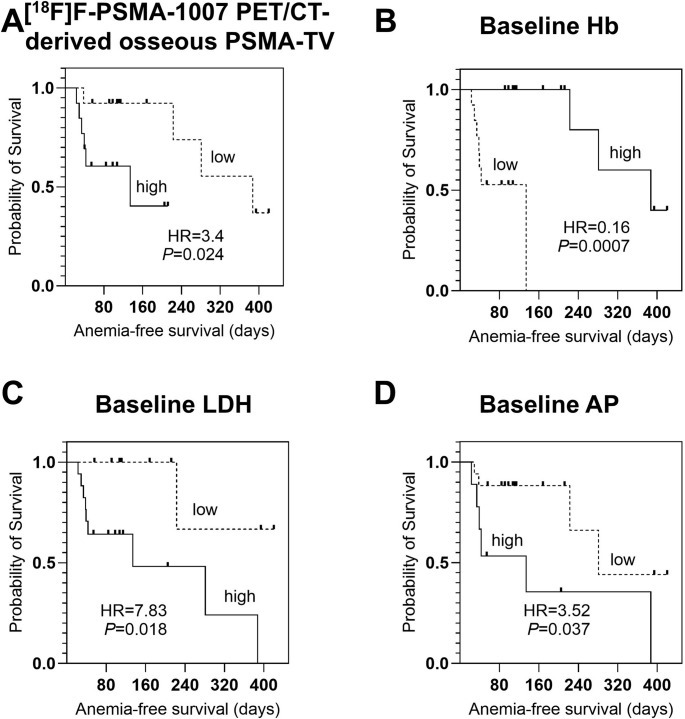
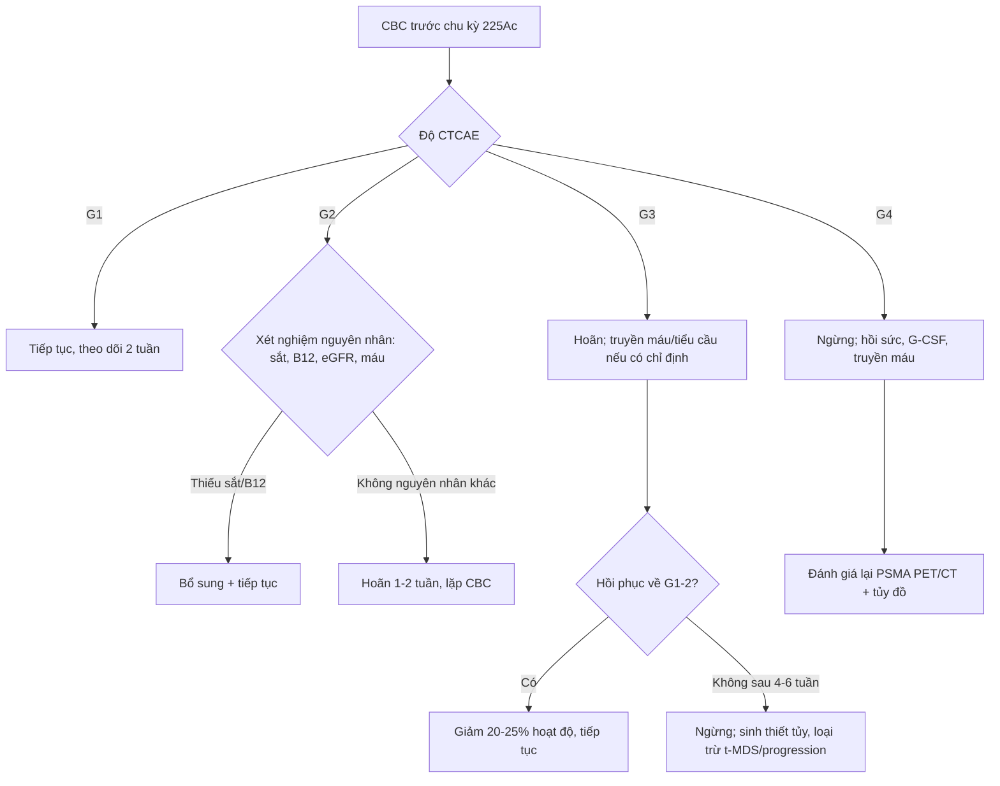
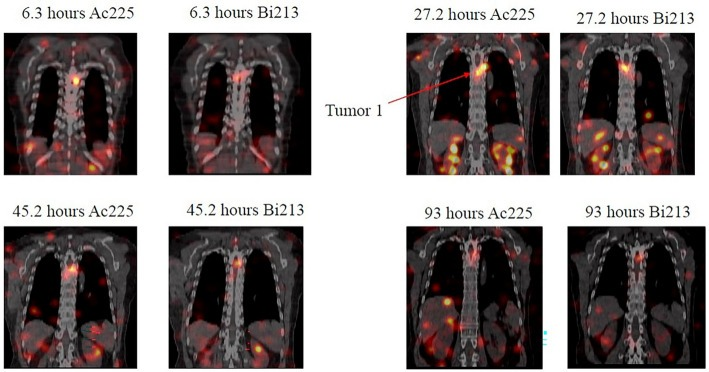

# 1729 — Suy tủy do xạ trị hạt alpha ²²⁵Ac-PSMA: phân độ CTCAE, liều tủy RBE = 5 và ngưỡng dừng / Hematologic toxicity of ²²⁵Ac-PSMA alpha therapy

**Tags:** `pattern:suy-tuy` `pattern:thieu-mau` `pattern:giam-tieu-cau` `pattern:giam-bach-cau` `pattern:giam-ba-dong` `pattern:di-can-tuy-xuong` `vung:tuy-xuong` `vung:toan-than` `score:CTCAE` `score:RBE` `protocol:PSMA-PET-CT` `protocol:SPECT-CT` `protocol:dosimetry` `protocol:CBC` `incidentaloma:di-can-tuy-xuong`

**Mức chắc chắn (certainty):** tổng hợp y văn (literature synthesis) — số liệu từ 1 phân tích gộp **16 nghiên cứu/1.102 bệnh nhân**, 1 đoàn hệ hồi cứu **488 bệnh nhân** (WARMTH Act), 1 đoàn hệ **89 bệnh nhân/151 chu kỳ** theo dõi độc tính dài hạn, 1 nghiên cứu **26 bệnh nhân** định lượng nguy cơ bằng PSMA PET/CT, 1 thử nghiệm pha I **16 bệnh nhân** với ²²⁵Ac-PSMA-CY313, 1 nghiên cứu **43 vs 116 bệnh nhân** so sánh ²²⁵Ac với ¹⁷⁷Lu, và 1 nghiên cứu **định liều SPECT/CT 4 bệnh nhân** (RBE = 5). **Không có RCT** về ngưỡng dừng/giảm liều của ²²⁵Ac; phần “khi nào dừng, khi nào truyền máu/G-CSF” là **thực hành chuẩn suy ra từ CTCAE + huyết học**, đã ghi rõ.

> **Vì sao bài này quan trọng:** ²²⁵Ac-PSMA là xạ trị hạt alpha đang được dùng trong nghiên cứu/compassionate use cho ung thư tuyến tiền liệt kháng cắt tinh hoàn (mCRPC). Bác sĩ CĐHA nhìn **PSMA PET/CT trước trị liệu** và **SPECT/CT sau trị liệu**, nhưng câu hỏi quyết định lại nằm ở **công thức máu**: bệnh nhân này có đủ tủy để nhận chu kỳ tiếp theo không? **Suy tủy là lý do bỏ chu kỳ phổ biến**, trong khi **suy tủy do di căn tủy xương** lại là bệnh tiến triển — hai thứ trông giống nhau trên hình ảnh nhưng xử trí ngược nhau. Bài này nối **liều tủy RBE = 5** với **phân độ CTCAE** và **quyết định dừng/truyền máu/G-CSF**.

## 1. Tổng quan bệnh học – cơ chế hình ảnh – vì sao hạt alpha vẫn đánh vào tủy

- **Vật lý ²²⁵Ac:** chu kỳ bán rã **9,9 ngày**, phân rã qua **²²¹Fr → ²¹⁷At → ²¹³Bi → ²¹³Po → ²⁰⁹Pb → ²⁰⁹Tl**, phát **4 hạt alpha** với tổng năng lượng **~28 MeV**. Hạt alpha có **quãng chạy 50–100 µm**, **LET ~80 keV/µm** — giết tế bào rất mạnh nhưng **chỉ trong vài lớp tế bào**. So sánh: hạt beta của ¹⁷⁷Lu có quãng chạy **tới ~2 mm** và tạo **hiệu ứng crossfire** sang tế bào bên cạnh.
- **Vì sao tủy vẫn bị:** tủy xương **không biểu hiện PSMA** đáng kể, nên liều tủy chủ yếu đến từ **(1) hoạt độ còn trong máu**, **(2) hạt alpha/đồng vị con phân bố lại** (²²¹Fr, ²¹³Bi), và **(3) tổn thương di căn trong tủy**. Vì quãng chạy cực ngắn, **liều trung bình của tủy thấp** nhưng **phân bố liều không đồng nhất**: ổ di căn trong tủy nhận liều rất cao, vùng tủy lành gần như không — đây là lý do **liều trung bình không dự báo hết suy tủy**.
- **Định lượng liều (RBE = 5):** trong nghiên cứu SPECT/CT với **200 µCi (≈ 7,4 MBq) ²²⁵Ac-PSMA-CY313 mỗi 8 tuần**, liều **tủy đỏ 0,16 ± 0,09 Gy** (hệ số **0,02 ± 0,01 Gy/MBq**) theo **RBE = 5**; liều **vật lý** tương ứng chỉ **~0,032 Gy**. Cùng lần đó, **thận 1,55 ± 0,38 Gy** (hệ số **0,23 Gy/MBq**), **gan 1,07 ± 0,19 Gy**; **tỷ số u/tủy = 14,84** — cao nhất trong các cơ quan nguy cấp. Giới hạn thận theo EANM cho trị liệu chia liều là **23–27 Gy**.
- **Ngưỡng tủy để so sánh:** với ¹⁷⁷Lu-DOTATATE, một phác đồ định liều dừng khi **liều tủy > 2 Gy** (hoặc thận > 23 Gy) — mốc này lấy từ nghiên cứu định liều Garske-Román, **chưa được xác nhận cho ²²⁵Ac**; “2 Gy” chỉ là **mốc tham chiếu**, không phải luật.
- **Vì sao thiếu máu nổi bật hơn giảm bạch cầu:** hồng cầu sống **~120 ngày**, tiểu cầu **7–10 ngày**, bạch cầu trung tính **6–8 giờ**. Tủy bị ức chế từ từ → **Hb tụt dần qua nhiều chu kỳ**, tiểu cầu tụt nhanh hơn nhưng hồi phục nhanh hơn, bạch cầu ít bị nhất. Vì vậy **thiếu máu là độc tính tích lũy**, còn **giảm bạch cầu** thường thoáng qua.
- **Tần suất (định lượng):**
  - **Phân tích gộp 16 nghiên cứu/1.102 bệnh nhân:** độ ≥ 3 **thiếu máu 9%**, **giảm tiểu cầu 5%**, **giảm bạch cầu 4%**, **độc thận 4%**; khô miệng **84%**; PSA giảm ≥ 50% **63%**; sống trung vị **12,72 tháng**.
  - **WARMTH Act (488 bệnh nhân, trung vị 2 chu kỳ):** độ ≥ 3 **thiếu máu 13%**, **giảm bạch cầu 4%**, **giảm tiểu cầu 7%**, **độc thận 5%**; không có tử vong do điều trị.
  - **Đoàn hệ dài hạn 89 bệnh nhân/151 chu kỳ (71 có theo dõi; một phần là TANDEM ²²⁵Ac + ¹⁷⁷Lu):** **thiếu máu G3 21,1% (15/71)**, **giảm bạch cầu G3 8,4% (6/71)**, **giảm tiểu cầu G3/G4 19,7% (14/71)**, độc thận G3 **1,4%**, độc gan G3 **8,4%**. Độc tính huyết học gắn với **di căn tủy xương nặng** hoặc **đã hóa trị trước**.
  - **26 bệnh nhân ²²⁵Ac-PSMA-I&T (trung bình 3 chu kỳ):** **38% (10/26)** đạt **thiếu máu G3**; **Hb giảm có ý nghĩa** (p = 0,0002); **Hb nền là yếu tố dự báo mạnh nhất** (p = 0,002); **thể tích u PSMA trong xương (osseous PSMA-TV)** cũng dự báo (mỗi p ≤ 0,037).
  - **16 bệnh nhân ²²⁵Ac-PSMA-CY313 (200 µCi mỗi 8 tuần):** **thiếu máu 68,8%** (G3 **6,3%**), **giảm bạch cầu 25%** (toàn bộ G1–G2), **không G4**; Hb **117,7 ± 19,2 → 105,0 ± 19,7 g/L** (p = 0,012).
  - **So sánh ²²⁵Ac (43) vs ¹⁷⁷Lu (116):** thiếu máu **58% vs 66%**, giảm bạch cầu **57% vs 59%**, giảm tiểu cầu **48% vs 47%** — chủ yếu **G1–G2**, không tử vong do điều trị.
  - **So với ¹⁷⁷Lu trong VISION:** độ ≥ 3 **thiếu máu 12,9%**, **giảm tiểu cầu 7,9%**, **giảm bạch cầu 7,8%**.

## 2. Mẫu hình + chẩn đoán phân biệt theo thời điểm và dòng tế bào (Gamut)

Ba câu hỏi trước khi kết luận “do xạ trị”: **(1) giảm dòng nào, mức nào? (2) xuất hiện sau chu kỳ thứ mấy? (3) có bằng chứng di căn tủy/progression không?**

- **Nhóm A — suy tủy do xạ trị, sớm (sau 1–2 chu kỳ):** giảm **tiểu cầu ± bạch cầu**, đáy sau **2–4 tuần**, hồi phục **4–6 tuần**; thiếu máu nhẹ, đáp ứng với thời gian. Trên thực nghiệm, các dòng tế bào **bình thường hóa trong 35–42 ngày**.
- **Nhóm B — suy tủy tích lũy (sau 3–6 chu kỳ):** **thiếu máu tiến triển, MCV tăng nhẹ**, tiểu cầu giảm dần; gắn với **tổng liều tủy**, **hóa trị trước**, **tuổi**, **di căn tủy**.
- **Nhóm C — di căn tủy xương tiến triển:** **giảm ba dòng**, đau xương, **LDH/ALP tăng**, **PSMA PET/CT có ổ tủy mới hoặc tăng thể tích**, có thể **superscan** (xương ngấm lan tỏa, mô mềm mờ). Đây là **progression**, không phải độc tính — **không giảm liều, không dừng** vì “suy tủy”, mà đánh giá lại trị liệu.
- **Nhóm D — thiếu máu do thiếu sắt:** **MCV nhỏ, ferritin thấp, TSAT thấp**, không liên quan chu kỳ; gặp ở bệnh nhân **xuất huyết tiêu hóa, lấy máu nhiều lần**.
- **Nhóm E — thiếu B12/folate:** **MCV lớn, LDH tăng, giảm tiểu cầu ± thần kinh**; hay bị bỏ qua ở người lớn tuổi.
- **Nhóm F — thiếu máu do bệnh thận mạn:** **eGFR giảm, erythropoietin thấp**, hồng cầu bình thường hoặc nhược sắc; ²²⁵Ac có thể gây **giảm eGFR ≥ 20% ở 31%** bệnh nhân.
- **Nhóm G — mất máu/DIC:** **giảm Hb cấp, tiểu cầu giảm, INR/aPTT rối loạn, schistocyte**; tìm **chảy máu tiêu hóa, ổ loét, can thiệp**.
- **Nhóm H — thuốc khác:** **docetaxel/cabazitaxel** (giảm bạch cầu, thiếu máu), **kháng sinh dài ngày**, **thuốc giảm đau/NSAID** (xuất huyết), **thuốc chống đông**.
- **Nhóm I — nhiễm trùng/huyết khối nhiễm:** **sốt, CRP tăng, cấy dương**; giảm bạch cầu do nhiễm hoặc do thuốc, không phải chỉ xạ trị.
- **Nhóm J — t-MDS/AML (muộn):** **giảm ba dòng kéo dài > 3–6 tháng sau khi ngừng**, **loạn sản trên tủy đồ**, **cytopenia không hồi phục**; cần sinh thiết tủy.
- **Nhóm K — bắt chước xét nghiệm:** **pseudothrombocytopenia do EDTA** (tiểu cầu kết cụm), **hemodilution** (Hb giảm sau truyền dịch), **mẫu máu tan**; kiểm tra bằng **ống citrate/soi phết**.

*(A) Hb nền so với Hb đáy (p = 0,0002). (B) Biểu đồ Sankey: **10/26 bệnh nhân chuyển sang thiếu máu G3** ở đáy; phần lớn bệnh nhân G2 nền chuyển thành G3; một ca G4 nền được xử trí. Đây là lý do phải **đo Hb trước mỗi chu kỳ**, không chỉ dựa vào “bệnh nhân trông ổn”. Nguồn: Widjaja L et al., Eur J Nucl Med Mol Imaging 2026 (PMC13197253) Fig. 4, **CC BY 4.0**.*

## 3. Bảng so sánh phân biệt (ma trận đối chiếu)

| Thực thể (entity) | Hình ảnh/xét nghiệm điển hình | Chốt vào (rule-in) | Chốt loại (rule-out) | Gợi ý xác nhận |
|---|---|---|---|---|
| **Suy tủy do ²²⁵Ac-PSMA** | Giảm dòng sau **2–4 tuần** mỗi chu kỳ; **tiểu cầu ± bạch cầu** trước, **Hb tích lũy** sau 3–6 chu kỳ; tủy trên MRI/CT **không có ổ mới** | **Thời gian khớp chu kỳ + hồi phục 4–6 tuần + không có ổ tủy mới trên PSMA PET** | **Có ổ tủy mới/tăng PSMA-TV + LDH/ALP tăng** → progression; **MCV nhỏ/ferritin thấp** → thiếu sắt | CBC + reticulocyte mỗi 1–2 tuần; PSMA PET/CT trước chu kỳ |
| **Di căn tủy tiến triển** | **Giảm ba dòng**, đau xương, **PSMA PET: ổ tủy mới, lan tỏa (“superscan”)**, **LDH/ALP tăng** | **Tổn thương tủy mới/tăng thể tích trên PSMA PET + LDH/ALP tăng + đau xương** | **CBC hồi phục giữa các chu kỳ, không ổ mới** → độc tính | PSMA PET/CT; MRI tủy (T1 + STIR/DWI); sinh thiết nếu cần |
| **Thiếu sắt** | **MCV nhỏ, Hb thấp, ferritin thấp, TSAT < 20%**, tiểu cầu bình thường | **Ferritin thấp + TSAT thấp + đáp ứng sắt** | **Ferritin bình thường/cao, TSAT bình thường** → không thiếu sắt | Ferritin, TSAT, nội soi tiêu hóa nếu mất máu |
| **Thiếu B12/folate** | **MCV lớn, LDH tăng, giảm tiểu cầu**, có thể thần kinh ngoại biên | **B12/folate thấp + MCV lớn + đáp ứng bổ sung** | **B12/folate bình thường** → loại | B12, folate, homocysteine/MMA |
| **Thiếu máu bệnh thận** | **eGFR giảm**, Hb thấp, hồng cầu bình thường, **không giảm tiểu cầu** | **eGFR < 60 + Hb thấp + EPO thấp** | **eGFR bình thường, có giảm tiểu cầu** → do tủy | Creatinin/eGFR, erythropoietin, sắt |
| **Mất máu/DIC** | **Hb tụt cấp, tiểu cầu giảm, INR/aPTT rối loạn, schistocyte** | **Schistocyte + INR/aPTT rối loạn + fibrinogen thấp** | **INR/aPTT bình thường, không schistocyte** | INR, aPTT, fibrinogen, haptoglobin, nội soi |
| **Thuốc (taxane, kháng sinh, chống đông)** | Giảm bạch cầu/tiểu cầu theo thuốc; **sốt** nếu giảm bạch cầu | **Khớp thời điểm dùng thuốc + cải thiện khi ngừng** | **Không dùng thuốc liên quan** | Bệnh sử thuốc, CBC trước/sau |
| **Nhiễm trùng huyết** | **Sốt, CRP/PCT tăng, cấy dương**, giảm bạch cầu hoặc tăng | **Cấy dương + ổ nhiễm + đáp ứng kháng sinh** | **Không sốt, cấy âm, CRP bình thường** | Cấy máu/nước tiểu, CRP, PCT, CT ổ nhiễm |
| **t-MDS/AML** | **Giảm ba dòng kéo dài**, **loạn sản**, **blast** trên tủy đồ; không hồi phục sau 3–6 tháng | **Cytopenia kéo dài + loạn sản/blast + bất thường di truyền** | **Hồi phục sau 4–6 tuần, không loạn sản** | Tủy đồ + sinh thiết + NGS/FISH |
| **Pseudothrombocytopenia** | Tiểu cầu thấp **không chảy máu**, **kết cụm tiểu cầu** trên phết | **Tiểu cầu bình thường khi lấy ống citrate/soi phết** | **Tiểu cầu thấp thật + chảy máu** | Lặp CBC ống citrate, soi phết |

*Bốn yếu tố dự báo **sống không thiếu máu**: (A) **osseous PSMA-TV cao** → HR **3,4** (P = 0,024); (B) **Hb nền thấp** → HR **0,16** (P = 0,0007, Hb cao bảo vệ); (C) **LDH nền cao** → HR **7,83** (P = 0,018); (D) **ALP nền cao** → HR **3,52** (P = 0,037). Đây là các biến lấy được **ngay trên PSMA PET/CT và xét nghiệm máu trước chu kỳ 1**. Nguồn: Widjaja L et al., Eur J Nucl Med Mol Imaging 2026 (PMC13197253) Fig. 5, **CC BY 4.0**.*

## 4. Protocol: phân độ CTCAE, theo dõi và ngưỡng dừng

**Trước chu kỳ 1 (bắt buộc):**
- **CBC + reticulocyte**, **ferritin/TSAT**, **B12/folate**, **LDH**, **ALP**, **creatinin/eGFR**, **điện giải**, **đông máu** nếu nghi chảy máu.
- **PSMA PET/CT**: đo **thể tích u toàn thân (total tumor volume, TTV)** và **osseous PSMA-TV**; ghi nhận **superscan** (xương ngấm lan tỏa, mô mềm mờ) — vừa là dấu hiệu bệnh nặng, vừa là **yếu tố nguy cơ suy tủy**.
- **MRI tủy** (T1 + STIR/DWI) nếu nghi **di căn tủy lan tỏa** hoặc **chèn ép tủy**; **CT** nếu cần đánh giá xương.
- **Đánh giá tủy dự trữ:** nếu **Hb < 9 g/dL, PLT < 100.000, ANC < 1.500** trước chu kỳ → cân nhắc **hoãn/giảm liều** (quyết định cá thể hóa; chưa có ngưỡng RCT cho ²²⁵Ac).

**Phân độ CTCAE v5.0 (dùng đúng ngưỡng):**

| Dòng tế bào | Độ 1 | Độ 2 | Độ 3 | Độ 4 |
|---|---|---|---|---|
| **Hb** | < LLN – 10,0 g/dL | 8,0 – < 10,0 g/dL | **< 8,0 g/dL** | đe dọa tính mạng |
| **Tiểu cầu** | 75.000 – < 100.000/µL | 50.000 – < 75.000/µL | **25.000 – < 50.000/µL** | **< 25.000/µL** |
| **Bạch cầu trung tính** | 1.500 – < 2.000/µL | 1.000 – < 1.500/µL | **500 – < 1.000/µL** | **< 500/µL** |
| **Bạch cầu** | < LLN – 3.000/µL | < 3.000 – 2.000/µL | **< 2.000 – 1.000/µL** | **< 1.000/µL** |

**Theo dõi trong chu kỳ:**
- **CBC mỗi 2 tuần** trong chu kỳ đầu; **mỗi 4 tuần** các chu kỳ sau; **ngay khi sốt/chảy máu/mệt mới**.
- **Đáy** thường **2–4 tuần**; **hồi phục 4–6 tuần** (thực nghiệm: **35–42 ngày**). Chu kỳ cách **8 tuần** là khoảng đủ để tủy hồi phục ở đa số.
- **Trước mỗi chu kỳ:** chỉ tiếp tục khi **Hb ≥ 8 g/dL**, **PLT ≥ 50.000/µL**, **ANC ≥ 1.000/µL** (ngưỡng thực hành; cá thể hóa nếu bệnh tiến triển nhanh).

**Xử trí (thực hành chuẩn):**
- **Thiếu máu:** truyền hồng cầu khi **Hb < 7 g/dL** hoặc **< 8 g/dL có triệu chứng**; **sắt IV** nếu thiếu sắt; **EPO** chỉ cân nhắc cá thể (nguy cơ huyết khối/u).
- **Giảm tiểu cầu:** truyền khi **PLT < 10.000/µL**, hoặc **< 20.000/µL** nếu sốt/chảy máu; tránh NSAID/tiêm bắp.
- **Giảm bạch cầu:** **G-CSF** khi **sốt giảm bạch cầu** hoặc **ANC < 500/µL**; không dùng dự phòng thường quy nếu không có chỉ định.
- **Nhiễm trùng:** cấy + kháng sinh phổ rộng sớm; **không chờ** kết quả nếu sốt + ANC thấp.
- **Dừng/giảm liều:** **G3 kéo dài hoặc G4** → **hoãn**, chờ hồi phục; **giảm 20–25% hoạt độ** chu kỳ sau; **G4 tái diễn hoặc giảm ba dòng không hồi phục** → **ngừng**. **Di căn tủy tiến triển** không phải lý do giảm liều — đánh giá lại đáp ứng.
- **Ngưỡng liều:** theo dõi **liều tủy tích lũy** nếu có định liều; **> 2 Gy** là mốc tham chiếu từ ¹⁷⁷Lu-DOTATATE, **chưa được xác nhận cho ²²⁵Ac**; **thận 23–27 Gy** là giới hạn EANM.

*Hình ảnh SPECT/CT của một bệnh nhân sau **200 µCi ²²⁵Ac-PSMA-CY313**, tại **6,3 – 27,2 – 45,2 – 93 giờ**: mỗi cặp là **²²⁵Ac (trái)** và **²¹³Bi (phải)**. **Tumor 1** ngấm rõ và giữ lâu; **thận** là cơ quan ngấm cao nhất; **tủy đỏ** nhận liều trung bình thấp (**0,16 Gy RBE = 5**) nhưng **không đồng nhất**. Đây là lý do “liều trung bình thấp” không loại trừ suy tủy. Nguồn: Zhang H et al., EJNMMI Phys 2025 (PMC12858698) Fig. 3, **CC BY-NC-ND 4.0 — nguyên bản**.*

## 5. Biến thể bình thường và cạm bẫy

- **Tủy đỏ tái chuyển (red marrow reconversion) trên MRI:** sau hóa trị/G-CSF, tủy đỏ lan ra xương dài; **T1 giảm tín hiệu, STIR tăng** — trông như **di căn lan tỏa**. Phân biệt: tủy đỏ **đối xứng, theo trục xương, không phá vỡ vỏ, không có khối mô mềm**; di căn **không đối xứng, phá hủy xương, có thành phần mô mềm**. Dùng **DWI/ADC** và **so sánh với PSMA PET**.
- **PSMA PET sau G-CSF:** tủy tăng ngấm lan tỏa do **tăng sinh tủy**, không phải progression; **chụp lại sau 2–4 tuần** hoặc đối chiếu **PSMA-TV** thay vì đọc “xương sáng hơn”.
- **Superscan:** xương ngấm **lan tỏa, mô mềm mờ, thận mờ** — dấu hiệu **di căn tủy lan rộng**; nhưng cũng làm **giảm độ nhạy phát hiện ổ mới**, dễ đọc nhầm là “ổn định”.
- **“Suy tủy” do hemodilution:** Hb giảm **1–2 g/dL** sau truyền dịch/cản quang, không kèm giảm tiểu cầu; đo lại sau 24 giờ.
- **Pseudothrombocytopenia:** tiểu cầu thấp giả do **EDTA**; bệnh nhân **không chảy máu**, phết có **cụm tiểu cầu**; lặp bằng ống citrate.
- **Thiếu máu do bệnh nền:** **ferritin/TSAT** thấp hoặc **B12** thấp rất hay gặp ở người lớn tuổi/đã hóa trị; đừng quy hết cho ²²⁵Ac.
- **Đừng nhầm “Hb ổn định” với “tủy ổn định”:** Hb có thể còn bình thường trong khi **tiểu cầu đã tụt**; luôn đọc **cả 3 dòng**.
- **Trẻ/người trẻ:** ²²⁵Ac chủ yếu dùng ở mCRPC người lớn; nếu dùng trong nghiên cứu khác, **dự trữ tủy** và **liều tủy** phải tính lại theo cân nặng/diện tích — không áp dụng nguyên số người lớn.

## 6. Tự lượng giá — Blind Quiz

**Ca 1 — 26 bệnh nhân mCRPC nhận ²²⁵Ac-PSMA-I&T, trung bình 3 chu kỳ. Nhìn biểu đồ, mô tả dịch chuyển độ thiếu máu trước khi mở đáp án.**

- Hỏi: (1) Hb đáy khác Hb nền thế nào? (2) Bao nhiêu bệnh nhân chuyển sang G3? (3) Vì sao phải đo Hb trước mỗi chu kỳ?

<b>Bấm để hiện đáp án</b>

- **Findings:** (A) Hb nền **cao hơn** Hb đáy có ý nghĩa (p = 0,0002); (B) Sankey: nhóm G2 nền **10 người** chuyển thành **G3 10 người** ở đáy; tổng **10/26 (38%)** thiếu máu G3; một ca G4 nền được xử trí.
- **Chẩn đoán:** suy tủy do ²²⁵Ac-PSMA, chủ yếu **thiếu máu tích lũy**.
- **Vì sao đo trước mỗi chu kỳ:** Hb có thể **giảm âm thầm** giữa các lần khám; quyết định tiếp tục/hoãn dựa trên **giá trị trước chu kỳ**, không dựa vào triệu chứng.
- **Nguồn ảnh:** Widjaja L et al., Eur J Nucl Med Mol Imaging 2026 (PMC13197253) Fig. 4, CC BY 4.0.

**Ca 2 — Cùng đoàn hệ, nhìn bốn đường Kaplan–Meier. Yếu tố nào dự báo mạnh nhất?**

- Hỏi: (1) Biến nào có HR lớn nhất? (2) Hb nền cao bảo vệ hay là yếu tố nguy cơ? (3) Dùng các biến này thế nào trước chu kỳ 1?

<b>Bấm để hiện đáp án</b>

- **Findings:** (A) **osseous PSMA-TV cao** → HR **3,4** (P = 0,024); (B) **Hb nền cao** → HR **0,16** (P = 0,0007) — **bảo vệ**; (C) **LDH cao** → HR **7,83** (P = 0,018); (D) **ALP cao** → HR **3,52** (P = 0,037).
- **Chẩn đoán:** nguy cơ thiếu máu tăng khi **tủy đã bị thay thế nhiều (PSMA-TV cao)**, **Hb nền thấp**, **LDH/ALP cao** (bệnh nặng, tủy xương bị xâm lấn).
- **Ứng dụng:** trước chu kỳ 1, ghi **Hb, LDH, ALP, osseous PSMA-TV**; nếu **Hb thấp + PSMA-TV cao** → tư vấn nguy cơ, cân nhắc **giảm hoạt độ/hoãn**, theo dõi CBC sát.
- **Nguồn ảnh:** Widjaja L et al., Eur J Nucl Med Mol Imaging 2026 (PMC13197253) Fig. 5, CC BY 4.0.

**Ca 3 — Hình SPECT/CT sau ²²⁵Ac-PSMA-CY313. Hai cột ảnh khác nhau ở đâu, và điều đó nói gì về liều tủy?**

- Hỏi: (1) Hai cột là hai đồng vị nào? (2) Cơ quan nào ngấm cao nhất? (3) Vì sao tủy nhận liều trung bình thấp mà vẫn suy?

<b>Bấm để hiện đáp án</b>

- **Findings:** mỗi cặp thời điểm (6,3 – 27,2 – 45,2 – 93 giờ) có **²²⁵Ac (trái)** và **²¹³Bi (phải)**; **Tumor 1** ngấm rõ và giữ lâu; **thận** ngấm cao nhất; **tủy** không thấy rõ trên ảnh.
- **Chẩn đoán/ý nghĩa:** liều **tủy đỏ 0,16 ± 0,09 Gy** (RBE = 5) mỗi **200 µCi**, thấp hơn **thận 1,55 Gy**; nhưng **phân bố liều không đồng nhất** và **tủy đã bị hóa trị/di căn làm giảm dự trữ** → suy tủy vẫn xảy ra.
- **Bài học:** **liều trung bình thấp không loại trừ độc tính**; phải theo dõi **CBC** và **PSMA-TV**, không chỉ dựa vào định liều.
- **Nguồn ảnh:** Zhang H et al., EJNMMI Phys 2025 (PMC12858698) Fig. 3, CC BY-NC-ND 4.0.

## Bài liên quan chéo
- [1711 – Dosimetry cá thể hóa cho ²²⁵Ac: liều u – thận – tủy và ngưỡng dừng](../1711-dosimetry-ca-the-hoa-ac225/lesson.md)
- [1695 – ²²⁵Ac-DOTATATE sau thất bại ¹⁷⁷Lu ở PPGL: chọn bệnh nhân và độc thận–tủy](../1695-ac225-dotatate-ppgl-sau-lu177/lesson.md)
- [185 – Độc tính & theo dõi sau PRRT/¹³¹I-MIBG ở PPGL: suy tủy, độc thận](../185-doc-tinh-va-theo-doi-sau-prrt-mibg-ppgl/lesson.md)
- [1718 – Gãy xương cùng sau xạ trị](../1718-gay-xuong-cung-sau-xa-tri/lesson.md) (MRI tủy, phân biệt di căn)

> Không dùng để chẩn đoán độc lập khi chưa có người hướng dẫn.
