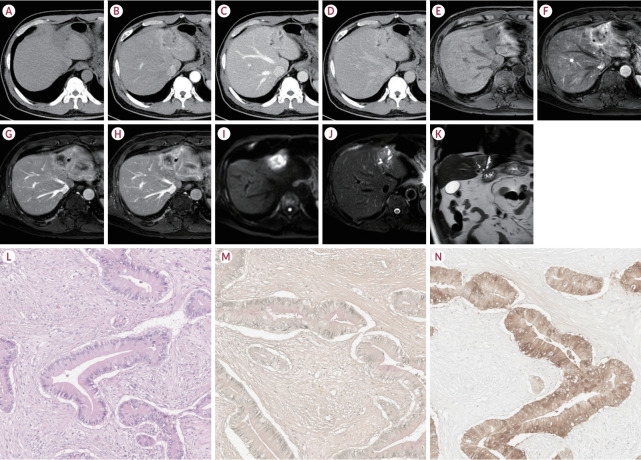
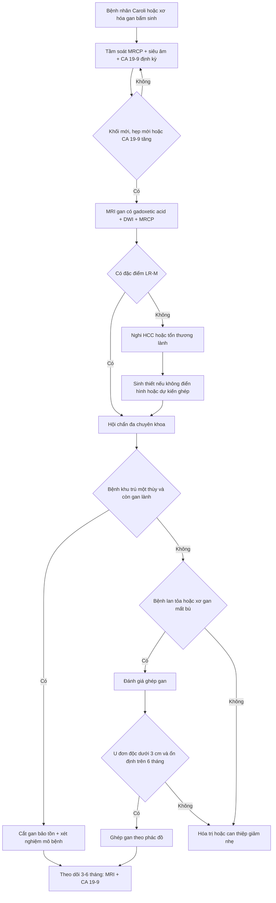
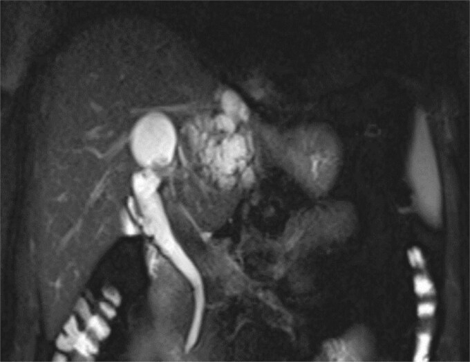
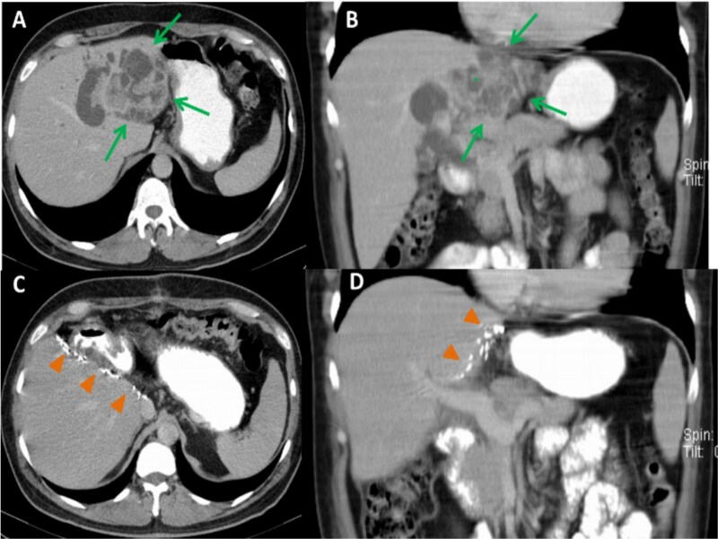
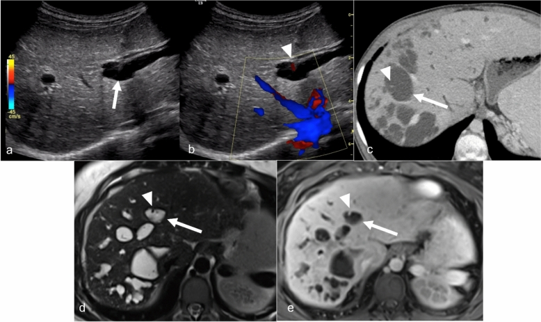
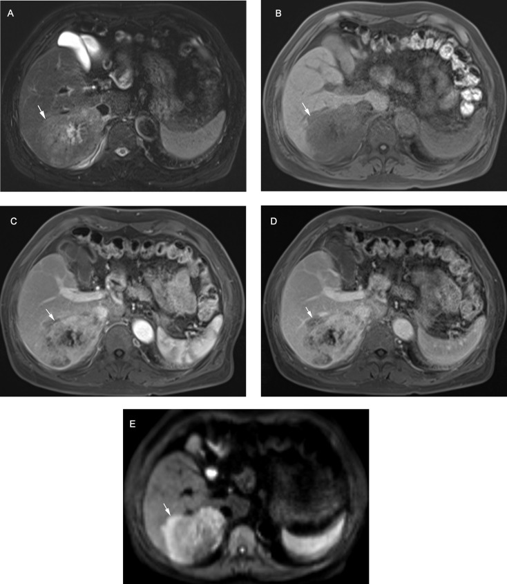
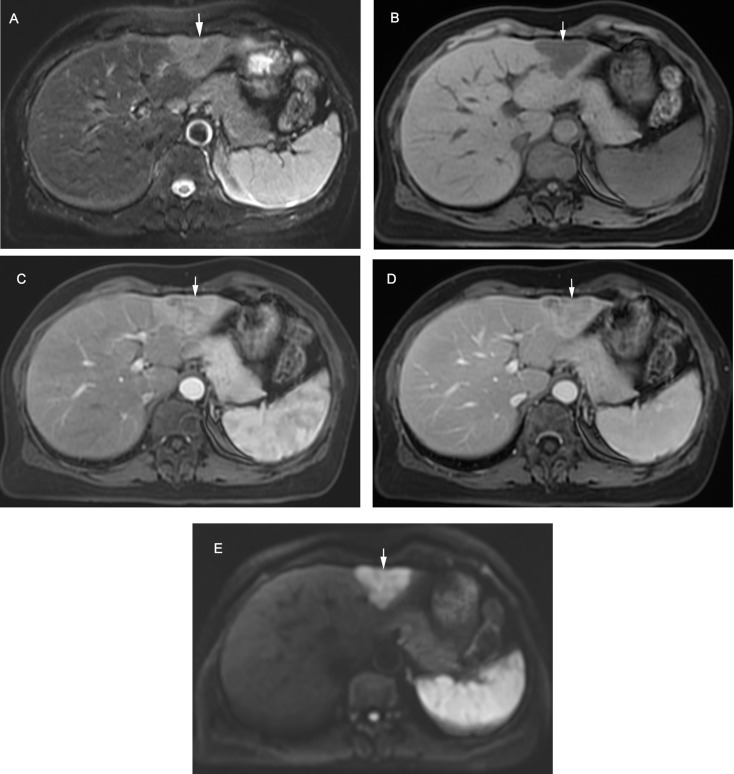

# 173 — Ung thư đường mật trong gan trên nền Caroli/CHF: tầm soát, LR-M, CA 19-9, sinh thiết & ghép gan / Intrahepatic cholangiocarcinoma in Caroli disease & congenital hepatic fibrosis

**Tags:** `pattern:khoi-gan` `pattern:hep-duong-mat` `pattern:hoai-tu` `vung:gan` `score:LI-RADS-LR-M` `protocol:MRI-Gd-EOB-DTPA` `protocol:MRCP`
**Mức chắc chắn (certainty):** tổng hợp y văn (literature synthesis) — gom đoàn hệ 19 ca Caroli/Caroli syndrome (Hanafy AS et al., *Sci Rep* 2026, PMC13031803), 214 ca iCCA/HCC đối chiếu LI-RADS (Sheng R et al., *Cancer Imaging* 2025, PMC11938583), tổng quan hình ảnh HCC–cHCC-CCA–iCCA (Shin J et al., *J Liver Cancer* 2026, PMC13062603), phân tích gộp 60 nghiên cứu CA 19-9 (Wang Z et al., *Discov Oncol* 2024, PMC11655830), 20 ca ghép gan do Caroli syndrome (Hou F et al., *Orphanet J Rare Dis* 2025, PMC12492817), tổng quan ghép gan cho iCCA (Lee HW, *J Liver Cancer* 2026, PMC13062628) và ca iCCA trên Caroli (Abouelwafa O et al., *J Surg Case Rep* 2025, PMC12380465).

## 1. Tổng quan bệnh học – cơ chế hình ảnh: ứ mật mạn → viêm → loạn sản → ung thư

- **Bối cảnh:** **bệnh Caroli (Caroli disease — CD)** là giãn dạng túi, từng đoạn, không do tắc nghẽn của đường mật trong gan, **thông với cây đường mật**; **hội chứng Caroli (Caroli syndrome — CS)** = CD + **xơ hóa gan bẩm sinh (congenital hepatic fibrosis — CHF)** và thường kèm nang thận. Cả hai thuộc phổ **bệnh gan–mật dạng nang–xơ (fibropolycystic liver disease)**, liên quan đột biến **PKHD1** (fibrocystin/polyductin).
- **Cơ chế sinh ung:** ứ mật trong các túi giãn → **viêm đường mật tái diễn + sỏi trong gan** → tổn thương lặp lại biểu mô đường mật → loạn sản → **ung thư đường mật trong gan (intrahepatic cholangiocarcinoma — iCCA)**. Đột biến **KRAS/TP53** được báo cáo trong iCCA trên nền bệnh nang–xơ.
- **Nguy cơ định lượng (đây là lý do phải tầm soát):**
  - **7–16%** bệnh nhân Caroli tiến triển thành iCCA (Abouelwafa 2025, PMC12380465); các loạt khác báo **2,7–37,5%**, và tỷ lệ **tới 14%** thường được trích.
  - Trong đoàn hệ 19 ca: **3/12 ca CS (25%)** có iCCA, **0/7 ca CD đơn thuần**; cả 3 ca iCCA đều **tử vong sau 3,3 ± 2,3 tháng** kể từ lúc chẩn đoán (PMC13031803).
  - Nguy cơ ở Caroli được báo cáo **tăng tới ~100 lần** so với dân số chung (dẫn trong bài 166).
- **TẠI SAO hình ảnh iCCA trên nền Caroli khó:** nhu mô gan bị **túi dịch, sỏi, xơ, viêm** làm biến dạng giải phẫu; khối u có thể **nằm trong lòng túi giãn** hoặc **dạng thâm nhiễm dọc ống mật**, không có "khối tròn" điển hình. Vì vậy **mọi thay đổi mô đặc/ngấm thuốc trong túi dịch, hoặc hẹp mới gây giãn đường mật thượng nguồn, phải coi là nghi ung thư** cho tới khi loại trừ.
- **Vật lý hình ảnh – vì sao iCCA "bắt thuốc chậm":**
  - iCCA có **mô đệm xơ (fibrous stroma)** dày → chất cản quang khuếch tán chậm vào khoảng kẽ → **ngấm thuốc viền ở thì động mạch, ngấm trung tâm tiến triển ở thì tĩnh mạch cửa/muộn (delayed central enhancement)**.
  - Phần **hoại tử/niêm dịch (mucin)** → **T2 rất sáng**, T1 tối, không ngấm thuốc; mô u sống ở viền ngấm thuốc.
  - **Hạn chế khuếch tán** ở phần đặc (ADC thấp) do tế bào u dày đặc; mô xơ/hoại tử có thể không hạn chế.
  - Trên **MRI với gadoxetic acid (Gd-EOB-DTPA)**: iCCA **giảm tín hiệu ở thì gan mật (hepatobiliary phase — HBP)** vì không có hepatocyte, thường có **dạng bia (targetoid)**.
- **Ngưỡng định lượng trụ cột khác:**
  - **CA 19-9:** trung vị **40,5 U/mL** ở CS so với **15 U/mL** ở CD (p = 0,009); **≥ 103 U/L** được đề xuất là mốc nghi ác tính/tiên lượng xấu (PMC13031803 dẫn y văn).
  - **CA 19-9 tiên lượng:** CA 19-9 cao trước mổ làm **tăng nguy cơ tử vong HR 1,90** (95% CI 1,74–2,07) ở ung thư đường mật nói chung; riêng **iCCA HR 2,00** (1,79–2,23) (60 nghiên cứu, 15.031 bệnh nhân — PMC11655830).
  - **LR-M trên MRI:** phân loại đúng **89/107 iCCA (83,2%)**, **độ nhạy 83,2%, độ đặc hiệu 85,1%, độ chính xác 84,1%**; **26,2%** iCCA có ít nhất một đặc điểm chính của HCC và **15,0%** bị xếp nhầm LR-4/5, chỉ **1 ca** vào LR-5 (PMC11938583).

## 2. Mẫu hình + chẩn đoán phân biệt theo hình thái & nền bệnh (Gamut)

- **Theo hình thái iCCA:**
  - **Thể khối (mass-forming):** khối đặc, bờ không đều, **co kéo vỏ gan (capsular retraction)**, ngấm viền thì động mạch + trung tâm muộn; hay gặp ở nhu mô không xơ.
  - **Thể quanh ống mật/thâm nhiễm (periductal/infiltrative):** dày thành ống mật, **hẹp gây giãn đường mật thượng nguồn**, khó thấy khối — **dạng hay gặp và dễ bỏ sót nhất trên nền Caroli**.
  - **Thể trong lòng ống (intraductal):** khối trong lòng đường mật giãn, phân biệt với **sỏi/sản phẩm máu**; có thể là tiền thân **IPNB**.
- **Theo nền bệnh:**
  - **Caroli/CS:** khối trong túi giãn, dày vách, nốt ngấm thuốc; kèm sỏi.
  - **CHF:** gan xơ, tăng áp lực cửa; iCCA có thể **ẩn trong nhu mô xơ**.
  - **PSC/viêm đường mật mạn/sỏi trong gan:** hẹp–giãn xen kẽ, khối dọc ống mật.
  - **Nang gan đơn thuần/đa nang (PLD):** nang **không thông** với đường mật, vách mỏng, không ngấm thuốc — khác Caroli.
- **Gamut "nang/túi dịch có thành phần đặc hoặc vách dày":** iCCA trong Caroli · **u nhầy đường mật (mucinous cystic neoplasm — MCN)** · **u nhú đường mật trong ống (IPNB)** · **áp-xe gan/đường mật** · **nang bội nhiễm/xuất huyết** · **di căn dạng nang** · **HCC hoại tử**.
- **Mnemonic "CAROLI-CA":** **C**holestasis mạn (ứ mật) — **A**trophy (teo thùy) — **R**etraction (co kéo vỏ) — **O**bstruction (hẹp/tắc mới) — **L**ewis antigen (CA 19-9 âm giả) — **I**ntraductal mass — **CA**rcoli background.

## 3. Bảng so sánh phân biệt (ma trận đối chiếu)

| Thực thể (entity) | Hình ảnh điển hình | Chốt vào (rule-in) | Chốt loại (rule-out) | Gợi ý xác nhận |
|---|---|---|---|---|
| **iCCA thể ống lớn (large-duct)** | MRI: **viền ngấm thuốc thì động mạch (rim APHE)**, **thải thuốc ngoại vi**, **ngấm trung tâm muộn**; DWI/HBP dạng bia; CT: khối + co kéo vỏ + giãn đường mật | **Dạng bia (targetoid) + ngấm trung tâm muộn + giãn đường mật thượng nguồn** | Ngấm đồng nhất thì động mạch + thải thuốc không viền → nghĩ HCC | MRI EOB đa thì + DWI + MRCP; sinh thiết nếu cần |
| **iCCA thể ống nhỏ (small-duct)** | MRI: **ngấm thuốc không viền thì động mạch**, **thải thuốc không ngoại vi** — giống HCC; T2 trung bình, HBP giảm | **Khối nhỏ trong gan xơ + HBP giảm + không có vỏ/xơ bao** | **HBP đồng tín hiệu** + vỏ bao + thải thuốc điển hình → HCC | Sinh thiết/mô bệnh; theo dõi sát |
| **HCC** | Ngấm **toàn bộ/không viền** thì động mạch, **thải thuốc**, vỏ bao, **HBP giảm nhẹ**; thường trong gan xơ | **APHE không viền + washout không ngoại vi + vỏ bao** | **Rim APHE + ngấm trung tâm muộn** → LR-M/iCCA | LI-RADS; AFP không đủ |
| **cHCC-CCA** | Phổ trung gian: phần HCC + phần CCA; có thể **dạng bia không điển hình** | **Hai thành phần mô học trên mô bệnh** | Không thể loại trừ bằng hình ảnh đơn thuần | Sinh thiết đủ mảnh/mô bệnh sau mổ |
| **IPNB** | Khối trong lòng ống mật giãn, **"dấu hiệu ngón tay"**, tăng dần thì muộn; có thể lan dọc ống | **Khối trong lòng ống + ống mật giãn như túi** | Không thấy khối trong lòng, chỉ sỏi → sỏi đường mật | MRCP + cholangioscopy |
| **MCN (u nhầy)** | Nang **một ổ/vài ổ, vách dày**, vôi hóa vách, **không thông** với đường mật; thường ở nữ | **Nang không thông + vách dày + vôi hóa** | **Thông với cây đường mật** + nhiều túi nhỏ → Caroli | MRCP; mô bệnh sau cắt |
| **Áp-xe/viêm đường mật** | Khối dịch có vách, **khí trong**, ngấm viền; bệnh nhân sốt, CRP cao | **Sốt + đau + CRP/bạch cầu cao + khí trong ổ** | **Không sốt, CA 19-9 tăng dần, khối đặc ngấm thuốc** → nghi u | Kháng sinh + chụp lại 4–6 tuần |
| **Nang gan đơn thuần** | Nang **không thông** với đường mật, vách mỏng, dịch đồng nhất | **Không ngấm thuốc, không vách/nốt** | **Nốt/vách ngấm thuốc hoặc thông đường mật** → không phải nang đơn thuần | MRI; theo dõi |

## 4. Protocol chụp + tầm soát, chẩn đoán mô học & chỉ định ghép

- **MRI gan–mật (phương thức chốt):** **1,5 hoặc 3 T**, gồm **T1 in/out-phase**, **T2 fat-sat**, **DWI/ADC**, **MRCP 3D**, và **động học T1 sau gadoxetic acid** (động mạch 20–35 giây, tĩnh mạch cửa 60–80 giây, chuyển tiếp 3 phút, **HBP 20 phút**). Đọc **5 đặc điểm LR-M**: **rim APHE**, **thải thuốc ngoại vi**, **ngấm trung tâm muộn**, **hạn chế khuếch tán dạng bia**, **bất thường thì chuyển tiếp/HBP dạng bia**. Độ đồng thuận giữa người đọc (gộp 24 nghiên cứu, 5.163 tổn thương): **rim APHE κ = 0,72**, **targetoid TP/HBP κ = 0,74**, **thải thuốc ngoại vi κ = 0,52**, **hạn chế khuếch tán rõ κ = 0,49** (PMC11449583) — **đừng chỉ dựa một dấu hiệu**.
- **CT:** **3 thì** (động mạch/tĩnh mạch cửa/muộn) lát mỏng; dùng khi không có MRI hoặc cần đánh giá canxi hóa/sỏi, xâm lấn mạch. **CT không thay MRCP** để chứng minh thông thương với đường mật.
- **Siêu âm:** bước đầu tìm **dấu chấm trung tâm (central dot sign)** — nhánh tĩnh mạch cửa bị túi mật giãn bao quanh; Doppler xác nhận tín hiệu mạch; đánh giá sỏi, giãn đường mật, cổ trướng.

*Nam 72 tuổi: khối iCCA thể ống lớn — so sánh trực tiếp CT đa thì và MRI (gadoteric acid), kèm mô bệnh học. Nguồn: Shin J et al., J Liver Cancer 2026, PMC13062603 Fig. 1, CC BY-NC 4.0.*
- **Tầm soát (chưa có lịch chuẩn hóa):** các đoàn hệ chỉ khuyến cáo **theo dõi hình ảnh định kỳ** và **CA 19-9** vì phát hiện sớm quyết định mổ/ghép. **Đề xuất thực hành (suy luận, không có RCT):** **MRCP + siêu âm + CA 19-9 mỗi 6–12 tháng** ở CS/CHF, **mỗi 6 tháng** nếu có sỏi/viêm đường mật tái diễn; chụp MRI đa thì ngay khi có **khối mới, hẹp mới hoặc CA 19-9 tăng xu hướng**.
- **CA 19-9 — đọc đúng:** không dùng một mình để chẩn đoán; **tăng trong viêm đường mật/tắc mật** (giả dương) và **không tăng ở người Lewis antigen âm (khoảng 5–10%)** (giả âm). Giá trị lớn nhất là **theo dõi xu hướng** trên nền CA 19-9 đã biết.
- **Sinh thiết:** chỉ định khi **hình ảnh không điển hình**, khi **kết quả sẽ đổi điều trị** (hóa trị trước mổ, cân nhắc ghép) và theo khuyến cáo **ILTS: sinh thiết nốt không điển hình khi nghi iCCA và dự kiến ghép** (PMC13062628). Cần đủ mảnh để phân biệt **iCCA ống nhỏ vs HCC vs cHCC-CCA**; tránh sinh thiết mù vào vùng viêm/áp-xe.
- **Điều trị – định lượng:**
  - **Cắt gan** là lựa chọn đầu tay cho bệnh **khu trú một thùy**; sau cắt vì Caroli, tỷ lệ phát hiện ung thư trên mẫu cắt **~7%** (PMC13031803). Sống 5 năm sau mổ ung thư đường mật nói chung **20–40%** (PMC11655830).
  - **Ghép gan cho Caroli/CS:** 20 ca, **sống 1/3/5 năm = 90%/85%/78,5%**, theo dõi trung vị **74,6 tháng**; chỉ định khi bệnh lan tỏa, tăng áp lực cửa, viêm đường mật kháng trị (PMC12492817).
  - **Ghép gan cho iCCA (chọn lọc rất chặt):** **ILTS 2020** — u đơn độc **≤ 2 cm** trên gan xơ; **EASL-ILCA 2023 / ILTS-ILCA 2024** — **≤ 3 cm**, sau **≥ 6 tháng ổn định**, không di căn ngoài gan; sống 5 năm **62%** (≤ 2 cm), **65%** (nhóm "very early" quốc tế) so với **45%** và tái phát **61%** ở nhóm tiến triển; phác đồ hóa trị tân hỗ trợ + ổn định ≥ 6 tháng đạt **sống 5 năm 83%, RFS 50%** (PMC13062628).
  - **cHCC-CCA:** chưa là chỉ định ghép; sống 5 năm sau mổ **< 30%**.

## 5. Biến thể bình thường và cạm bẫy

- **Giải phẫu biến dạng "che" u:** túi giãn, sỏi và xơ làm khối u **không có hình cầu điển hình**; phải tìm **dày vách khu trú, nốt ngấm thuốc trong túi, hẹp mới** — không chỉ tìm "khối".
- **Viêm đường mật/áp-xe giả ung thư:** sốt, đau, CRP tăng, khí trong ổ → **điều trị kháng sinh rồi chụp lại 4–6 tuần**; đừng sinh thiết ngay vào ổ viêm (nguy cơ nhiễm trùng lan và kết quả âm giả).
- **CA 19-9 tăng do viêm đường mật**, không phải ung thư; ngược lại **người Lewis âm không tăng dù có u**. Luôn so **xu hướng** và kết hợp hình ảnh.
- **iCCA ống nhỏ giả HCC:** **26,2%** iCCA có ít nhất một đặc điểm chính của HCC; **15,0%** bị xếp LR-4/5 — **chỉ 1 ca LR-5** trong loạt 214 (PMC11938583). Nốt mới ở gan xơ **không được mặc định là HCC**.
- **LR-M không đặc hiệu 100%:** độ đặc hiệu **85,1%**, và độ đồng thuận của một số dấu hiệu chỉ **κ 0,49–0,52** — dễ xếp nhầm; cần **đọc đa thì + DWI + HBP**, không dựa một chuỗi xung.
- **Sau đặt stent/dẫn lưu:** khí, máu, phản ứng viêm quanh stent tạo **giả khối/giả ngấm thuốc**; chụp lại sau khi ổn định, đọc trên MRI có DWI.
- **Bỏ sót u thứ hai:** Caroli là bệnh **lan tỏa**; cắt một thùy không loại trừ ổ khác — **MRI toàn gan trước mổ** là bắt buộc.
- **Di căn phổi/ổ bụng:** giai đoạn iCCA hay di căn phổi; **CT ngực** trước khi quyết định ghép.

## 6. Tự lượng giá — Blind Quiz

**Ca 1 — Nam 56 tuổi, đau bụng tái diễn, mệt, sốt về đêm; tiền sử nhiều đợt viêm đường mật. MRCP.**

- Câu hỏi: (1) Mô tả bất thường đường mật? (2) Có thông với cây đường mật không? (3) Chẩn đoán nền và nguy cơ cần tầm soát?

<b>Bấm để hiện đáp án (findings + chẩn đoán)</b>

- **Dấu hiệu:** **nhiều túi tăng tín hiệu T2 trong gan trái**, kích thước khác nhau, **thông với đường mật trong gan** — hình "chùm nho/chuỗi ngọc".
- **Chẩn đoán nền:** **bệnh Caroli** (giãn dạng túi từng đoạn, không tắc nghẽn); cần loại trừ **nang gan không thông** và **MCN**.
- **Nguy cơ:** iCCA **7–16%** (tới 14% thường trích) → **tầm soát MRCP + CA 19-9 định kỳ**; mọi khối đặc/vách dày mới phải chụp MRI đa thì.
- **Nguồn ảnh:** Abouelwafa O et al., *J Surg Case Rep* 2025, PMC12380465 Fig. 1, CC BY 4.0.

**Ca 2 — Cùng bệnh nhân. CT bụng có cản quang (A–B trước mổ; C–D sau cắt gan trái).**

- Câu hỏi: (1) Dấu hiệu đặc trưng trong ảnh A/B? (2) Thành phần nào gợi ung thư? (3) Bước tiếp theo?

<b>Bấm để hiện đáp án (findings + chẩn đoán)</b>

- **Dấu hiệu:** **khối dạng nang nhiều vách lớn ở thùy trái** (mũi tên xanh); **dấu chấm trung tâm (*)** — nhánh tĩnh mạch cửa bị túi dịch bao quanh; sau mổ (C–D) còn **kẹp phẫu thuật**, không còn khối.
- **Gợi ung thư:** **vách dày không đều, phần đặc ngấm thuốc**, kèm giãn đường mật thượng nguồn; mô bệnh sau mổ là **cholangiocarcinoma nhầy–nhú 12 cm**.
- **Bước tiếp:** **MRI gan có gadoxetic acid + DWI + MRCP** để đánh giá toàn gan, hạch, xâm lấn mạch; **CT ngực**; hội chẩn → **cắt gan trái** (bệnh khu trú).
- **Nguồn ảnh:** Abouelwafa O et al., *J Surg Case Rep* 2025, PMC12380465 Fig. 2, CC BY 4.0.

**Ca 3 — Nữ 39 tuổi, đau hạ sườn phải. Siêu âm và MRI gan.**

- Câu hỏi: (1) Dấu hiệu trên siêu âm/Doppler? (2) Xác nhận bằng chuỗi xung nào? (3) Phân biệt với nang gan đơn thuần?

<b>Bấm để hiện đáp án (findings + chẩn đoán)</b>

- **Dấu hiệu:** túi dịch thông với đường mật (mũi tên trắng); **chấm trung tâm có tín hiệu Doppler** = nhánh tĩnh mạch cửa; CT/MRI cho thấy **nhiều túi giãn quanh mạch máu**, không ngấm thuốc ở phần dịch.
- **Xác nhận:** **MRCP** chứng minh **thông với cây đường mật**; MRI T2 "chuỗi ngọc" + dấu chấm trung tâm.
- **Phân biệt nang đơn thuần:** nang **không thông**, vách mỏng, không có mạch máu trong lòng; Caroli có **mạch cửa bị bao quanh** và **nhiều túi từng đoạn**.
- **Nguồn ảnh:** Khot R et al., *Abdom Radiol* 2025, PMC12181213 Fig. 5, CC BY 4.0.

**Ca 4 — Nam 74 tuổi, khối gan. MRI đa thì (A T2, B T1, C động mạch, D muộn, E DWI).**

- Câu hỏi: (1) Mô tả tín hiệu và ngấm thuốc? (2) Thuộc nhóm LI-RADS nào? (3) Vì sao không phải HCC?

<b>Bấm để hiện đáp án (findings + chẩn đoán)</b>

- **Dấu hiệu:** T2 **tăng nhẹ không đồng nhất, có hoại tử trung tâm**; T1 giảm; thì động mạch **ngấm thuốc KHÔNG viền (non-rim APHE)**; thì muộn **ngấm thuốc duy trì, không thải thuốc (persistent enhancement)**; DWI **hạn chế dạng bia (targetoid restriction)**.
- **LI-RADS:** **LR-M** (malignant, not specific for HCC) nhờ **hạn chế khuếch tán dạng bia + ngấm duy trì**; iCCA.
- **Vì sao không HCC:** HCC điển hình có **thải thuốc (washout)**; ở đây **ngấm duy trì thì muộn** + **DWI dạng bia** — hai dấu hiệu đẩy sang LR-M.
- **Nguồn ảnh:** Sheng R et al., *Cancer Imaging* 2025, PMC11938583 Fig. 2, CC BY 4.0.

**Ca 5 — Nữ 59 tuổi, khối gan, không triệu chứng. MRI: thì động mạch ngấm thuốc KHÔNG viền, thì muộn thải thuốc kèm vỏ bao.**

- Câu hỏi: (1) Vì sao ca này bị xếp LR-5? (2) Vì sao vẫn có thể là iCCA? (3) Khi nào cần sinh thiết?

<b>Bấm để hiện đáp án (findings + chẩn đoán)</b>

- **Vì sao LR-5:** **non-rim APHE + thải thuốc + vỏ bao ngấm thuốc** — đúng bộ tiêu chuẩn HCC; DWI **không dạng bia**. Đây là **1/107 iCCA** trong loạt bị xếp LR-5 (15,0% xếp nhầm LR-4/5).
- **Vì sao vẫn là iCCA:** mô bệnh xác nhận iCCA; **LR-5 không loại trừ iCCA**, đặc biệt thể **ống nhỏ** — hình ảnh có thể trùng hoàn toàn với HCC.
- **Sinh thiết:** khi **hình ảnh không điển hình**, bệnh nhân **không mổ được** hoặc **đang xét ghép** (ILTS khuyến cáo) — vì điều trị iCCA khác HCC.
- **Nguồn ảnh:** Sheng R et al., *Cancer Imaging* 2025, PMC11938583 Fig. 3, CC BY 4.0.

## Bài liên quan chéo
- [166 – Tăng áp lực cửa trong xơ hóa gan bẩm sinh & bệnh Caroli: phân độ CSLD/CiSLD, tầm soát giãn tĩnh mạch, ghép gan](../166-tang-ap-luc-cua-xo-gan-bam-sinh-caroli/lesson.md) (nền bệnh, chẩn đoán Caroli/CHF)
- [121 – Khối gan & LI-RADS](../121-khoi-gan-LIRADS/lesson.md) (LR-5 vs LR-M, đọc đa thì)
- [129 – IPNB & u nhầy đường mật](../129-IPNB-va-u-nhay-duong-mat/lesson.md) (khối trong lòng ống, MCN)
- [132 – Hẹp đường mật không xác định](../132-hop-duong-mat-khong-xac-dinh/lesson.md) (hẹp lành/ác, MRCP)
- [128 – Ký sinh trùng đường mật](../128-ky-sinh-trung-duong-mat/lesson.md) (giãn đường mật do sán — bắt chước Caroli)
- [123 – Nang gan & bệnh gan đa nang](../123-nang-gan-va-benh-gan-da-nang/lesson.md) (nang không thông)
- [100 – Tổng quan hệ Bụng](../100-tong-quan-he-bung/lesson.md)

## Ảnh
- `images/173_caroli_MRCP_JSCR-PMC12380465-Fig1.jpg`, `173_caroli_CT_JSCR-PMC12380465-Fig2.jpg` — Abouelwafa O et al., *J Surg Case Rep* 2025, PMC12380465, **CC BY 4.0**.
- `images/173_caroli_US-Doppler_AbdomRadiol-PMC12181213-Fig5.jpg` — Khot R et al., *Abdom Radiol* 2025, PMC12181213, **CC BY 4.0**.
- `images/173_icca-targetoid_MRI_CancerImaging-PMC11938583-Fig2.jpg`, `173_icca_MRI_CancerImaging-PMC11938583-Fig3.jpg` — Sheng R et al., *Cancer Imaging* 2025, PMC11938583, **CC BY 4.0**.
- `images/173_icca-large-duct_CT-MRI_JLC-PMC13062603-Fig1.jpg` — Shin J et al., *J Liver Cancer* 2026, PMC13062603, **CC BY-NC 4.0** (giữ nguyên, không crop/ghép).
- Chi tiết giấy phép từng file: `images/CREDITS.md`.

> Không dùng để chẩn đoán độc lập khi chưa có người hướng dẫn.
