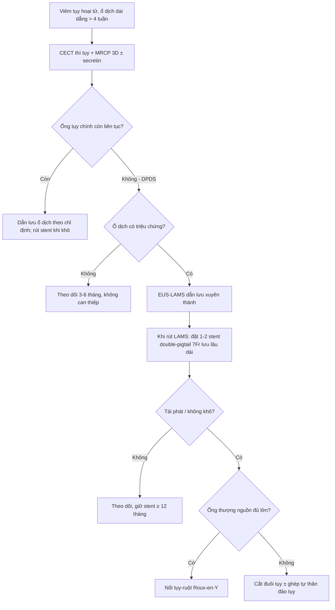
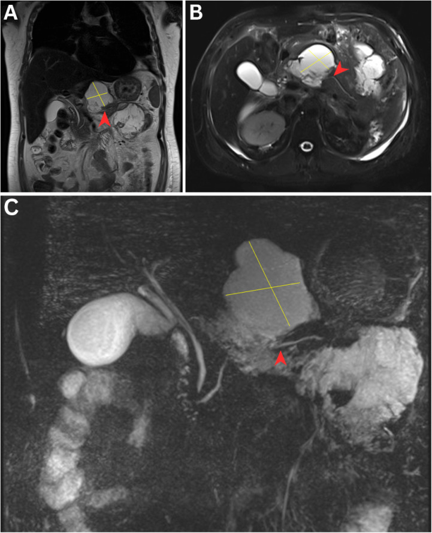
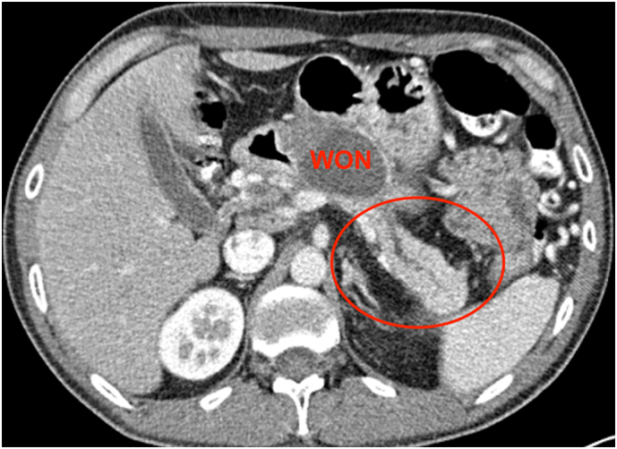
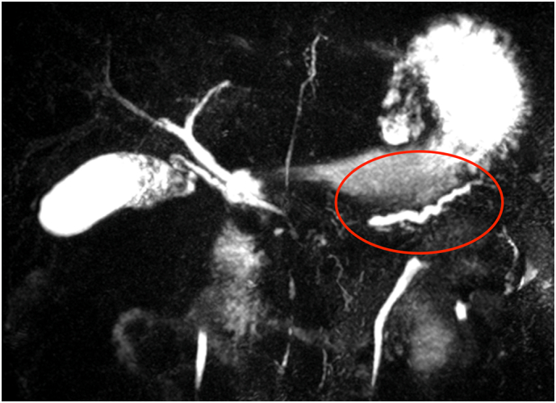

# 1730 — Hội chứng ống tụy đứt sau hoại tử tụy / Disconnected pancreatic duct syndrome (DPDS)

**Tags:** `pattern:ong-tuy-dut` `pattern:hoai-tu-tuy` `pattern:tu-dich-tuy` `pattern:ro-tuy` `pattern:ong-tuy-gian` `vung:tuy` `vung:sau-phuc-mac` `protocol:MRCP` `protocol:secretin-MRCP` `protocol:CT-bung-co-can-quang` `protocol:EUS` `protocol:EUS-LAMS` `incidentaloma:khong`

**Mức chắc chắn (certainty):** tổng hợp y văn (literature synthesis) — đọc toàn văn 5 bài mở 2023–2025 qua Europe PMC/PMC, có **3 ảnh nguyên văn** cho Blind Quiz. Phần **so sánh "để stent vĩnh viễn hay cắt tụy"** là **suy luận (inference)** từ các đoàn hệ quan sát và **một RCT âm tính**, ghi rõ tại chỗ.

## 1. Tổng quan bệnh học – cơ chế hình ảnh

### 1.1. Vì sao ống tụy "đứt" và vì sao ổ dịch không bao giờ khô

- **Bệnh học:** trong viêm tụy hoại tử, vùng **thân tụy** (nơi ống tụy chính đi qua) bị hoại tử **≥ 2 cm** và **cắt ngang ống**; trong khi **đuôi tụy thượng nguồn vẫn sống và còn tiết dịch**. Dịch tụy không có đường ra tá tràng → **thoát vào khoang hoại tử**, tạo **ổ dịch dai dẳng/tái phát**, **rò tụy ngoài**, **cổ trướng tụy**, tràn dịch màng phổi, hoặc **viêm tụy tái phát ở phần tụy bị cô lập**.
- **Phân biệt thuật ngữ:** **đứt ống (disconnection)** = **gián đoạn chu vi hoàn toàn**; **rò ống (leak)** = **gián đoạn một phần**. Chỉ **đứt hoàn toàn** mới gây hội chứng; rò một phần thường tự liền hoặc đáp ứng dẫn lưu.
- **Vì sao ổ dịch "đã dẫn lưu xong" vẫn tái phát:** ổ dịch chỉ là **ngõ ra** của một **nguồn tiết dịch liên tục** phía thượng nguồn. Rút stent/ống dẫn lưu khi chưa tạo **đường thông nội bộ vĩnh viễn** → dịch tích lại trong **vài tuần**. Đây là lý do **không được rút hết dẫn lưu** ở bệnh nhân DPDS.
- **Vì sao chẩn đoán hay muộn:** triệu chứng **nghèo nàn** (đau bụng âm ỉ, ăn kém, tăng amylase nhẹ) và **diễn ra sau khi đợt viêm tụy cấp đã "ổn"** — trung vị **nhiều tuần đến nhiều tháng**, có ca **5,5 năm** sau đợt viêm tụy đầu.

### 1.2. Vì sao MRI/MRCP nhìn được ống đứt còn CT thì không

| Phương thức | Cơ chế vật lý | Vì sao hữu ích / hạn chế |
|---|---|---|
| **MRCP 3D (T2 nặng)** | Dịch tụy **T2 rất dài** → tín hiệu trắng trên nền mô đặc tối; chiếu khối 3D cho hình ảnh **"đường ống"** | Thấy **đoạn ống mất tín hiệu** giữa hai đoạn còn lại; **không cần cản quang**; **không thấy ống < 1 mm** và dễ nhầm với ống bị chèn ép |
| **Secretin-MRCP** | Secretin làm **tăng tiết dịch tụy** trong 5–10 phút → **giãn ống thượng nguồn**, tăng tương phản | Tăng khả năng thấy **đoạn đứt** và **rò**; **không phổ biến**, cần thuốc và thời gian chụp động |
| **CECT thì tụy (40–50 giây)** | Mô tụy sống **ngấm cản quang**, vùng hoại tử **không ngấm** | Thấy **vùng hoại tử ≥ 2 cm cắt ngang ống**, **tụy đuôi ngấm thuốc nằm trong ổ dịch**; **không thấy ống** nếu ống không giãn |
| **EUS** | Đầu dò **sát tụy 2–5 mm**, không bị khí ruột che | Đánh giá **tụy thượng nguồn**, **chọc hút/pancreatography**, đặt stent; **phụ thuộc người làm** |
| **ERCP** | Bơm cản quang **trực tiếp vào ống** | Chẩn đoán xác định nếu **thấy thoát cản quang**; nhưng **không qua được chỗ đứt** nên **không điều trị được** DPDS |

- **Ngưỡng/tiêu chuẩn hình ảnh (kinh điển):** đủ cả 3 — (a) **hoại tử tụy ≥ 2 cm**; (b) **mô tụy sống ở phía thượng nguồn (về phía đuôi)**; (c) **thoát dịch/cản quang ra ngoài ống** trên pancreatography.
- **Số liệu định lượng:**
  - Tổn thương ống tụy chính gặp ở **44%** ca viêm tụy cấp nặng (ERCP, Neoptolemos) nhưng **0%** ở viêm tụy nhẹ.
  - **Đứt ống (có/không triệu chứng) 77,1% (138/179)** ở bệnh nhân được dẫn lưu WON qua EUS (Rana).
  - **DPDS 46,2%** ca viêm tụy hoại tử trong một đoàn hệ; **56% (78/139)** ca dẫn lưu ổ dịch nội soi có DPDS.
  - **sMRCP: độ nhạy 83,3%** so với xác nhận phẫu thuật.
  - **WON > 6 cm: đứt ống 95% (20 ca)** — ổ càng lớn càng phải tìm DPDS.

### 1.3. Vì sao "cắt đuôi tụy" chữa khỏi còn "dẫn lưu" chỉ chữa triệu chứng

- **Dẫn lưu** lấy dịch ra khỏi ổ nhưng **không chặn nguồn tiết**; nếu rút stent sớm, **dịch tích lại** — tái phát **7–42%** sau dẫn lưu xuyên thành.
- **Cắt đuôi tụy** loại bỏ **phần tụy còn tiết dịch** → hết nguồn; đổi lại **mất nhu mô tụy** (nguy cơ đái tháo đường), nên có nơi kèm **ghép tự thân tế bào đảo tụy**.
- **Nối tụy–ruột (Roux-en-Y pancreaticojejunostomy)** giữ nhu mô và dẫn lưu sinh lý — chỉ làm được khi **ống thượng nguồn đủ lớn** và mô tụy còn tốt.

## 2. Mẫu hình + chẩn đoán phân biệt theo hình thái (gamut)

Mẫu hình chốt: **ổ dịch quanh tụy dai dẳng/tái phát sau viêm tụy hoại tử, kèm ống tụy chính không liên tục và tụy đuôi còn sống**.

- **Ổ dịch đơn thuần tái phát:** DPDS, **WON chưa lành**, **nang giả tụy** (không có hoại tử), **rò tụy nội bộ**.
- **Theo biểu hiện lâm sàng (Maatman, 190 ca mổ):** **nang giả tái phát 40,9%**, **rò tụy 21,9%**, **hoại tử tụy 21,9%**, **viêm tụy tái phát 12,7%**.
- **Theo vị trí mất liên tục:** **cổ tụy** (hay gặp nhất, đuôi còn sống), **thân tụy**, **đuôi tụy** (phần cô lập nhỏ, ít triệu chứng).
- **Theo biến chứng của phần tụy cô lập:** **viêm tụy ở đuôi cô lập 16%** — nhóm này có **tỷ lệ đái tháo đường mới cao hơn**.
- **Bẫy "không phải DPDS":** **nang giả sau viêm tụy thể nhẹ** (ống còn liên tục), **u nang tụy** (IPMN, u nhầy), **WON không đứt ống** (đáp ứng dẫn lưu và khô sau 1 lần).

## 3. Bảng so sánh phân biệt (ma trận đối chiếu)

| Thực thể (entity) | Hình ảnh điển hình | Chốt vào (rule-in) | Chốt loại (rule-out) | Gợi ý xác nhận |
|---|---|---|---|---|
| **DPDS** | **Đoạn ống mất tín hiệu ≥ 2 cm** giữa tụy đầu và đuôi giãn; **đuôi ngấm thuốc nằm trong/ cạnh ổ dịch** | **Ổ dịch dai dẳng + đuôi tụy sống + ống không liên tục** | **Ống liên tục từ đầu đến đuôi** trên MRCP/ERCP → không phải DPDS | MRCP 3D ± secretin; EUS; phẫu thuật đối chiếu |
| **WON không đứt ống** | Ổ dịch hỗn hợp đặc/dịch, **vỏ dày**, tụy thượng nguồn bình thường | **Hoại tử nhưng ống còn thông**; khô sau **1 lần** dẫn lưu | **Tái phát sau rút stent** + ống đứt → DPDS | CECT + MRCP sau 4 tuần |
| **Nang giả tụy** | Nang **thành mỏng, đồng nhất**, không có mảnh hoại tử | **≥ 4 tuần sau viêm tụy**, ống **còn liên tục** | **Mảnh rắn trong nang + đứt ống** → WON/DPDS | MRCP; amylase dịch rất cao |
| **Rò tụy ngoài** | Ống dẫn lưu ra **dịch trong, amylase cao**, lưu lượng **không giảm** | **Lưu lượng > 50–100 mL/ngày kéo dài** + ống đứt | Dịch đục, amylase thấp → không phải dịch tụy | Amylase dịch; MRCP; fistulography |
| **U nang tụy (IPMN/SPN)** | Nang **nhiều vách, nhú trong lòng**, ống giãn **lan tỏa** hoặc nang đơn độc | **Nhú trong nang + ống giãn kiểu "con cá"**; có tiền sử không viêm tụy | **Bờ nang đều + hoại tử + bệnh cảnh viêm tụy cấp** → không phải u | EUS + FNA; MRCP; theo dõi 3–6 tháng |
| **Viêm tụy rãnh (groove pancreatitis)** | Dày **nghịch đảo** thành tá tràng, nang trong thành, **hẹp ống mật chủ** | **Dày thành tá tràng + nang nhỏ trong thành** | **Đứt ống tụy giữa thân** → không phải groove | CECT + EUS; MRCP |

## 4. Protocol chụp + phân tầng xử trí

### 4.1. Protocol hình ảnh

- **CECT bụng thì tụy (40–50 giây), lát 1 mm**: đánh giá **vùng hoại tử**, **tụy đuôi ngấm thuốc**, mạch máu (giả phình), ổ dịch.
- **MRCP 3D T2 nặng ± secretin** (nếu có): xác định **đoạn ống mất liên tục**, **chiều dài đoạn đứt**, **ống thượng nguồn giãn**, rò.
- **EUS** khi MRCP không kết luận hoặc để **dẫn lưu/chọc hút**: đánh giá tụy thượng nguồn, đo ống, loại trừ u.
- **Theo dõi sau dẫn lưu:** CECT/MRI **4–6 tuần** và **mỗi 3 tháng** trong năm đầu; **ghi rõ stent** (số lượng, cỡ, vị trí) trên mọi lần chụp.

### 4.2. Phân tầng xử trí

- **Dẫn lưu xuyên thành qua EUS-LAMS** là bước đầu cho ổ dịch có triệu chứng; **khi rút LAMS phải thay bằng stent nhựa double-pigtail (DPS)** để giữ **đường thông nội bộ vĩnh viễn**.
- **Stent DPS lưu dài hạn:** đoàn hệ 44 ca, **thời gian lưu trung vị 394 ngày** (IQR 245–853): **tái phát 5%**, **stent tự di trú 16%**, **viêm tụy mạn phần cô lập 23%** (10/44), **tử vong 7%** (không liên quan stent).
- **So sánh có/không DPS (78 ca):** tái phát trong 1 năm **23,3% vs 70,8%**; **OR 0,11 (0,03–0,37)**; **stent 7Fr tốt hơn 10Fr** (tái phát 1 năm **5,88% vs 46,15%**).
- **Phản biện quan trọng:** **RCT của Chavan** cho thấy đặt stent nhựa sau khi rút LAMS **KHÔNG giảm tái phát** ở bệnh nhân WON có đứt ống — bằng chứng **xung đột**; vì vậy **không có "chuẩn" tuyệt đối**, quyết định theo **ổ dịch có triệu chứng + khả năng theo dõi**.
- **Đặt stent qua nhú (transpapillary) KHÔNG hiệu quả cho DPDS: thành công chỉ 20%** — vì đầu ống bị cụt, không qua được chỗ đứt.
- **Chỉ định mổ:** thất bại dẫn lưu nội soi, **rò tụy ngoài lưu lượng cao kéo dài**, **viêm tụy tái phát ở phần cô lập**, **nghi u**. Chọn **nối tụy–ruột** nếu ống đủ lớn; **cắt đuôi tụy ± ghép đảo tụy** nếu không.

## 5. Biến thể bình thường và cạm bẫy

- **"Đứt ống" không đồng nghĩa "DPDS":** nhiều ca **đứt ống không triệu chứng** (77,1% khi tìm kỹ) — **không can thiệp** nếu không có ổ dịch/rò/viêm tụy tái phát.
- **Rút stent quá sớm:** tái phát **7–42%**; đây là lỗi hay gặp nhất — **để DPS ≥ 12 tháng**, thay stent định kỳ nếu bít/tắc.
- **Nhầm nang giả với WON:** **< 4 tuần = ổ dịch cấp**, **> 4 tuần + vỏ = WON**; **mảnh hoại tử trong nang** loại nang giả đơn thuần.
- **Khí/hoại tử che ống:** CECT có khí trong ổ làm **mất tín hiệu ống**; phải **MRCP/EUS**.
- **Ống thượng nguồn giãn giả u:** ống giãn **ngoằn ngoèo, đều** theo trục tụy = giãn do tắc, **không phải khối**; đừng sinh thiết mù.
- **Teo tụy thượng nguồn:** đuôi tụy teo nhỏ có thể **không thấy trên CT** — **không kết luận "không còn tụy sống"** nếu MRCP còn thấy ống.
- **Di trú stent DPS:** **16%**; stent di trú vào ổ dịch/ruột có thể gây **thủng** — kiểm tra vị trí trên phim/CT mỗi lần khám.

## 6. Tự lượng giá — Blind Quiz

**Ca 1 — Bệnh nhân viêm tụy hoại tử tuần thứ 3, ổ dịch lan dọc bụng trên và rãnh đại tràng trái.**

- Gợi ý: (A) T2 vành; (B) T2 trục; (C) MRCP.
- Câu hỏi: mũi tên đầu chỉ gì? Vì sao **MRCP** là phương thức chốt? Ba tiêu chuẩn hình ảnh để gọi "đứt ống"?

<b>Bấm để hiện đáp án (findings + chẩn đoán)</b>

- **Dấu hiệu:** (A–B) ổ dịch hỗn hợp **T2 rất sáng** ở **cổ/thân tụy**, nhu mô tụy còn lại **ngấm thuốc**; (C) MRCP: **mất hoàn toàn tín hiệu ống tụy chính ở cổ–thân** (mũi tên đầu), **đoạn ống phía đuôi không thông với tá tràng**.
- **Chẩn đoán:** **hội chứng ống tụy đứt** sau viêm tụy hoại tử — đủ 3 tiêu chuẩn: **hoại tử ≥ 2 cm**, **tụy thượng nguồn sống**, **không có đường thông ống**.
- **Vì sao MRCP:** dịch tụy **T2 rất dài** → ống sáng trên nền tối, thấy **đoạn mất liên tục** mà CT không thấy khi ống không giãn; **secretin** làm giãn ống thượng nguồn, tăng độ nhạy.
- **Nguồn ảnh:** *Sultan Qaboos University Medical Journal* 2025; Fig. 1 — PMC12240234, **CC BY-ND 4.0** (nguyên bản, không chỉnh sửa).

**Ca 2 — CECT sau viêm tụy hoại tử: ổ dịch lớn, trong đó có mô tụy ngấm thuốc.**

- Gợi ý: chữ WON và vòng tròn đỏ.
- Câu hỏi: mô trong vòng tròn là gì? Vì sao nó **ngấm thuốc** dù nằm trong ổ hoại tử?

<b>Bấm để hiện đáp án (findings + chẩn đoán)</b>

- **Dấu hiệu:** **WON** lớn ở thân tụy; **vòng tròn đỏ: tụy đuôi còn sống, ngấm thuốc**, nằm trong/ven ổ hoại tử; **không thấy ống nối với đầu tụy**.
- **Chẩn đoán:** **DPDS** — phần **đuôi tụy bị cô lập** vẫn tưới máu và tiết dịch, nuôi ổ dịch.
- **Vì sao ngấm thuốc:** mô còn sống có **mao mạch nguyên vẹn** → bắt cản quang thì tụy; vùng hoại tử **không có mạch** → giảm/tối tín hiệu. Đây là dấu hiệu **"phần tụy còn sống nằm trong ổ dịch"**.
- **Nguồn ảnh:** *Surgery Open Science* 2023; Fig. 4 — PMC9692037, **CC BY-NC-ND 4.0** (nguyên bản).

**Ca 3 — Bệnh nhân được chẩn đoán DPDS 5,5 năm sau đợt viêm tụy hoại tử; sMRCP dưới đây.**

- Gợi ý: vòng tròn đỏ đánh dấu **đoạn ống** không nối với ống chính.
- Câu hỏi: vì sao **chẩn đoán muộn 5,5 năm**? Đoạn ống trong vòng tròn thuộc phần nào của tụy? Hướng xử trí nếu bệnh nhân **không triệu chứng**?

<b>Bấm để hiện đáp án (findings + chẩn đoán)</b>

- **Dấu hiệu:** **ống tụy thượng nguồn (đuôi) giãn, ngoằn ngoèo**, **không thông** với ống tụy đầu; nhu mô quanh ống còn tín hiệu.
- **Chẩn đoán:** **DPDS thể muộn** — phần **đuôi tụy cô lập** tiếp tục tiết dịch; triệu chứng nghèo nàn nên **chẩn đoán trễ hàng năm**.
- **Xử trí:** **không triệu chứng → theo dõi** (không can thiệp); **có ổ dịch/rò/viêm tụy tái phát → dẫn lưu EUS + DPS lưu lâu dài**, thất bại thì **nối tụy–ruột hoặc cắt đuôi tụy**.
- **Nguồn ảnh:** *Surgery Open Science* 2023; Fig. 7 — PMC9692037, **CC BY-NC-ND 4.0** (nguyên bản).

## Bài liên quan chéo
- [1683 – Hoại tử tụy nhiễm khuẩn & bóc hoại tử tối thiểu xâm lấn (step-up)](../1683-hoai-tu-tuy-nhiem-khuan-step-up/lesson.md)
- [1680 – Viêm tụy cấp do tăng triglyceride ở người lớn](../1680-viem-tuy-tang-triglyceride-nguoi-lon/lesson.md)
- [146 – Huyết khối tĩnh mạch lách và nhồi máu lách](../146-huyet-khoi-tm-lach-va-nhoi-mau-lach/lesson.md)
- [100 – Tổng quan hệ Bụng](../100-tong-quan-he-bung/lesson.md)

## Ảnh
- `1730_ong-tuy-dut_MRI-MRCP_PMC12240234.jpg` — *Sultan Qaboos University Medical Journal* 2025, Fig. 1, **CC BY-ND 4.0**.
- `1730_ong-tuy-dut_CECT_PMC9692037.jpg` — *Surgery Open Science* 2023, Fig. 4, **CC BY-NC-ND 4.0**.
- `1730_ong-tuy-dut_sMRCP_PMC9692037.jpg` — *Surgery Open Science* 2023, Fig. 7, **CC BY-NC-ND 4.0**.
- Nguồn + giấy phép từng ảnh: `images/CREDITS.md`; link bài gốc: `sources.md`.

> Không dùng để chẩn đoán độc lập khi chưa có người hướng dẫn.
