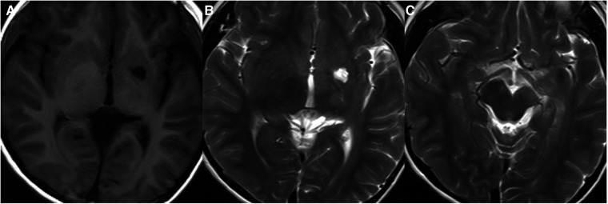
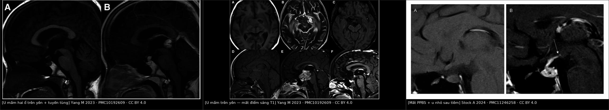
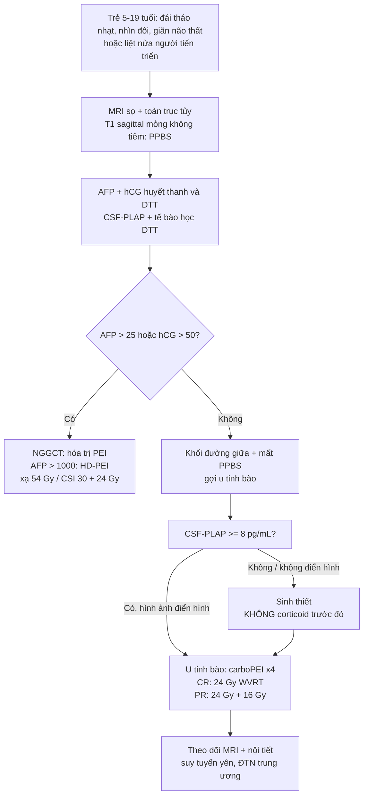
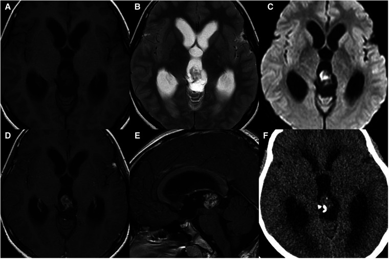
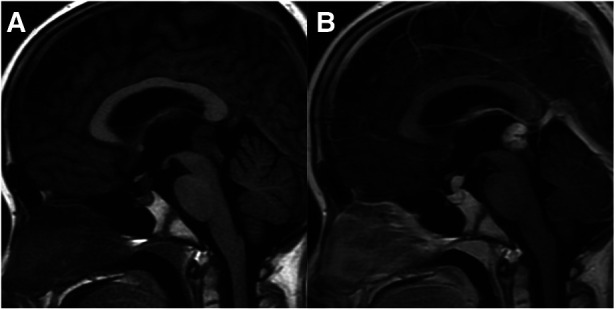
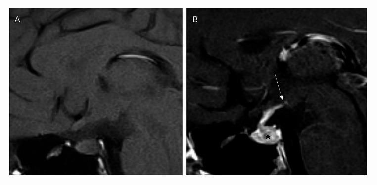

# 1731 — U mầm nội sọ vùng trên yên ở trẻ / Pediatric intracranial germ cell tumor (suprasellar & midline)

**Tags:** `pattern:khong-duong-giua` `pattern:ngam-thuoc` `pattern:mat-diem-sang-T1` `pattern:han-che-khuech-tan` `vung:tuyen-yen` `vung:so-yen` `vung:tuyen-tung` `vung:nao` `protocol:MRI-nao-tuy` `protocol:marker-u` `protocol:sinh-thiet` `incidentaloma:khong`

**Mức chắc chắn (certainty):** tổng hợp y văn (literature synthesis) — 1 tổng quan hình ảnh 2023 (Front Pediatr, PMC10192609), 1 nghiên cứu 102 bệnh nhân về **mất điểm sáng thùy sau tuyến yên** (Neuroradiology 2024, PMC11246258), 1 báo cáo cuối của **SIOP-CNS-GCT II** (Neuro-Oncology 2026, PMC13550669), 1 nghiên cứu về **CSF-PLAP** (Neuro-Oncology Advances 2026, PMC13265377) và 1 abstract SIOP về **u mầm không tinh bào hai ổ** (Neuro-Oncology 2024, PMC11183728). Không có ca nguyên văn đơn lẻ nào của nhóm tự viết; mọi ca trong quiz là ca có ảnh từ bài gốc, ghi rõ PMCID.

> **Câu chốt:** u mầm nội sọ là **khối đường giữa của trẻ lớn (10–19 tuổi)** và là **loại u não duy nhất có thể chẩn đoán mà KHÔNG cần sinh thiết** — bằng **AFP/hCG** (và **CSF-PLAP**). Hai câu hỏi quyết định: **(1) có marker chẩn đoán không?** (nếu có → điều trị luôn, không mổ); **(2) còn điểm sáng T1 thùy sau tuyến yên không?** (mất sớm, trước khi khối to → đây là dấu hiệu bắt được u **khi còn rất nhỏ**). Sai lầm chết người: **cho corticoid trước khi lấy marker** (u tinh bào teo nhanh, mất bằng chứng, không còn mô để chẩn đoán) và **bỏ sót đái tháo nhạt** ở trẻ "đái nhiều" với MRI ban đầu bình thường.

## 1. Tổng quan bệnh học – cơ chế hình ảnh

### 1.1 Nguồn gốc và phân loại

- **Định nghĩa:** u mầm nội sọ (intracranial germ cell tumor, iGCT) phát sinh từ **tế bào mầm nguyên thủy di cư lạc** (hoặc từ tế bào tiền thân nội sinh) dọc **đường giữa cơ thể** — vì vậy hầu hết nằm ở **tuyến tùng (50%)**, **vùng trên yên (20–30%)**, **hạch nền–đồi thị (5–10%)**; **6–13%** có **hai ổ đồng thời** ở tùng + trên yên (**bifocal**) (PMC10192609).
- **Dịch tễ:** **0,9%** tổng số u ở trẻ, **3,7%** u não trẻ, **28,7%** tổng số u mầm của cơ thể; đỉnh **10–19 tuổi**, **71%** chẩn đoán trước 20 tuổi; **Nhật Bản/Đông Á** cao hơn phương Tây (PMC10192609).
- **Phân loại WHO 2021:** **u tinh bào (germinoma)** — 50–70% — và **u mầm không tinh bào (non-germinomatous germ cell tumor, NGGCT)** gồm u túi noãn hoàng, ung thư phôi, choriocarcinoma, u quái (trưởng thành/chưa trưởng thành), u mầm hỗn hợp. **Phân biệt germinoma vs NGGCT không dựa vào hình ảnh đơn thuần** mà dựa vào **marker ± mô bệnh**.

### 1.2 TẠI SAO hình ảnh lại như vậy

- **T2 iso/hyper + ngấm thuốc mạnh + hạn chế khuếch tán (ADC thấp):** u tinh bào là khối **tế bào dày đặc, tỉ lệ nhân/bào tương cao**, ít mô đệm → nước nội bào ít, khuếch tán bị cản; mạch máu u chưa trưởng thành nhưng **hàng rào máu–não bị phá vỡ** → ngấm thuốc **đồng nhất, mạnh**. Đây là lý do **DWI/ADC** hữu ích: **ADC thấp** gợi u tinh bào hơn NGGCT, nhưng **không đủ** để chẩn đoán.
- **Vôi hóa "bị nuốt" (engulfed) ở u tinh bào tùng:** u phát triển **bao quanh vôi hóa tuyến tùng có sẵn** → vôi hóa nằm **trong** khối, bờ vôi hóa không đều. Ngược lại **u nguyên bào tùng (pineoblastoma)** có vôi hóa **"nổ" (exploded)** ở ngoại vi khối, và **chỉ thấy vôi hóa tuyến tùng sau 4 tuổi** (trước 4 tuổi không có vôi hóa sinh lý để "nuốt") (PMC10192609).
- **Mất điểm sáng T1 thùy sau tuyến yên (posterior pituitary bright spot, PPBS):** thùy sau tuyến yên chứa **hạt bài tiết vasopressin/oxytocin** — bản chất là **phức hợp neurophysin–hormone** giữ nước, cho tín hiệu **T1 cao tự nhiên**. Khi u mầm **xâm nhập thùy sau/cuống yên**, mất các hạt này → **mất điểm sáng**, đồng thời mất khả năng cô đặc nước → **đái tháo nhạt (diabetes insipidus, DI)**. Đây là **dấu hiệu sớm nhất**, có thể xuất hiện khi khối **chỉ vài mm** và **chưa thấy trên T1 sau tiêm** (PMC11246258).
- **TẠI SAO u trên yên hay chẩn đoán muộn:** triệu chứng ban đầu chỉ là **đái nhiều – uống nhiều**, dễ bị coi là thói quen; **thời gian từ MRI đầu tiên đến điều trị ở u tinh bào trên yên khu trú có trung vị 312 ngày** — dài hơn NGGCT (p = 0,002) (PMC11246258). Khối nhỏ, không gây chèn ép, **không tăng áp lực nội sọ** → không có "đèn đỏ" lâm sàng.
- **Hạch nền – đồi thị:** u mầm ở đây **thường không ngấm thuốc hoặc chỉ ngấm vá** ở giai đoạn sớm, nhưng có **T2 hơi cao, nang nhỏ**, và đặc biệt **tín hiệu thấp trên SWI** (vi chảy máu/hemosiderin) + **teo bán cầu/trụ não cùng bên do thoái hóa Waller** — hai dấu hiệu giúp phân biệt với **nhồi máu hạch nền** ở trẻ (PMC10192609).

### 1.3 Ngưỡng định lượng trụ cột

| Đại lượng | Con số | Nguồn |
|---|---|---|
| Tỉ lệ trong u não trẻ / tổng u mầm cơ thể | **3,7% / 28,7%**; đỉnh **10–19 tuổi**, **71% < 20 tuổi** | PMC10192609 |
| Vị trí: tuyến tùng / trên yên / hạch nền / ngoài đường giữa / hai ổ | **50% / 20–30% / 5–10% / 6–10% / 6–13%** | PMC10192609 |
| U tinh bào trong tổng số u mầm nội sọ | **50–70%** | PMC10192609 |
| **Mất PPBS** ở u mầm vùng dưới đồi–thùy sau yên (102 bệnh nhân) | **> 90%** ở mọi vị trí/thể, liên quan **đái tháo nhạt** | PMC11246258 |
| Độ dày cuống yên bất thường ở trẻ (ngưỡng đồng thuận) | **> 3 mm** | PMC11246258 |
| Trung vị thời gian từ MRI đầu → điều trị (u tinh bào trên yên khu trú) | **312 ngày** (chậm hơn NGGCT, p = 0,002) | PMC11246258 |
| Marker chẩn đoán NGGCT (SIOP) | **AFP > 25 ng/mL** và/hoặc **hCG > 50 IU/L** (huyết thanh hoặc dịch não tủy) | PMC11246258 |
| Nguy cơ cao trong NGGCT (chỉ định tăng liều hóa trị) | **AFP > 1.000 ng/mL** | PMC11183728 |
| **CSF-PLAP** cắt **8 pg/mL** cho u tinh bào | **Se 100% · Sp 95,2%** (134 ca có mô bệnh) | PMC13265377 |
| SIOP-CNS-GCT II: u tinh bào khu trú (166 ca) | **EFS 5 năm 94 ± 2% · OS 98 ± 1%** | PMC13550669 |
| SIOP-CNS-GCT II: u tinh bào di căn (61 ca) | **EFS 5 năm 98 ± 2% · OS 100%** | PMC13550669 |
| U tinh bào khu trú **CR sau hóa trị** → 24 Gy WVRT, không boost | **64/65 ca**, tái phát **3,1%** (2/64) | PMC13550669 |
| U tinh bào khu trú **PR** → 24 Gy + 16 Gy boost | **2/88 tái phát (2,3%)** | PMC13550669 |
| NGGCT **hai ổ khu trú** xạ khu trú 54 Gy | **8/12 tái phát**, chỉ 3/12 CR | PMC11183728 |

## 2. Mẫu hình + chẩn đoán phân biệt theo vị trí (Gamut)

- **Vùng trên yên:** khối/cuống yên dày, **mất PPBS**, đái tháo nhạt, thị trường thu hẹp, suy tuyến yên.
  - Gamut: **u mầm (germinoma/NGGCT)** · **u sọ hầu (craniopharyngioma)** · **mô bào Langerhans (LCH)** · **u thần kinh đệm vùng dưới đồi/đường thị** · **u tuyến yên** · **Rathke cleft cyst** · **viêm tuyến yên** · **di căn**.
- **Tuyến tùng:** khối + giãn não thất + **hội chứng Parinaud** (liệt nhìn lên, rối loạn đồng tử, hội tụ).
  - Gamut: **u mầm** · **u nguyên bào tùng (pineoblastoma)** · **u tế bào tùng (pineocytoma)** · **u quái** · **u thần kinh đệm mái trung não** · **nang tuyến tùng** · **giãn tĩnh mạch Galen**.
- **Hạch nền – đồi thị:** liệt nửa người tiến triển chậm, giảm nhận thức, rối loạn vận động.
  - Gamut: **u mầm hạch nền** · **nhồi máu hạch nền** · **u thần kinh đệm** · **ổ tăng tín hiệu không xác định (UNO) của NF1** · **viêm não**.
- **Hai ổ (bifocal):** **tùng + trên yên đồng thời** — gần như **đặc hiệu cho u tinh bào** (không phải di căn), nhưng **không loại trừ NGGCT** (PMC10192609).

*U mầm hạch nền ở bé trai 10 tuổi: T1W (A) và T2W (B, C) cho thấy **nang nhỏ** trong khối và **teo trụ não cùng bên** do thoái hóa Waller — dấu hiệu phân biệt với nhồi máu hạch nền (Front Pediatr 2023, PMC10192609 Fig. 7, CC BY 4.0).*

## 3. Bảng so sánh phân biệt (ma trận đối chiếu)

| Thực thể (entity) | Hình ảnh điển hình | Chốt vào (rule-in) | Chốt loại (rule-out) | Gợi ý xác nhận |
|---|---|---|---|---|
| **U tinh bào (germinoma)** | Khối đường giữa **đồng nhất**, ngấm **mạnh–đồng nhất**, T2 iso/hyper, **ADC thấp**; vôi hóa **"nuốt"** ở tùng; trên yên: **mất PPBS** | **Trẻ 10–19 tuổi + khối đường giữa + mất PPBS + AFP/hCG âm tính + CSF-PLAP ≥ 8 pg/mL** | Khối **dị thể mạnh** (máu/hoại tử/nang/fat) → nghĩ NGGCT/u quái | **Marker (AFP/hCG) + CSF-PLAP**; sinh thiết nếu marker âm |
| **NGGCT** | Khối **không đồng nhất**, nang/máu/hoại tử, ngấm không đều; có thể vôi hóa | **AFP > 25 ng/mL hoặc hCG > 50 IU/L** (huyết thanh/DNT) | Marker âm hoàn toàn + khối đồng nhất → u tinh bào | Marker + mô bệnh; **AFP > 1.000** = nguy cơ cao |
| **U nguyên bào tùng (pineoblastoma)** | Khối tùng lớn, **vôi hóa "nổ" ngoại vi**, hạn chế khuếch tán, giãn não thất; tuổi nhỏ hơn | **Tuổi trung vị ~4,9 + vôi hóa nổ + khối xâm lấn** | Vôi hóa **"nuốt"** trong khối + tuổi lớn → u tinh bào | Mô bệnh; **không có marker u mầm** |
| **U sọ hầu (craniopharyngioma)** | Khối **hỗn hợp đặc–nang**, **vôi hóa vỏ trứng**, ở trên/dưới yên | **Nang + vôi hóa vỏ trứng + trẻ 5–15 tuổi** | Khối đặc đồng nhất, không vôi hóa, **mất PPBS** → u mầm | **PPBS còn** ở đa số; mô bệnh |
| **LCH vùng dưới đồi** | **Cuống yên dày > 3 mm**, ngấm mạnh, có thể mất PPBS | **Đái tháo nhạt + cuống yên dày + tổn thương xương da** | Khối lớn trên yên, không tổn thương ngoài sọ → u mầm | Sinh thiết; **CD1a/Langerin** |
| **U thần kinh đệm đường thị/dưới đồi** | Phì đại dưới đồi/đường thị, **ngấm thuốc ít**, T2 cao | **NF1 + đường thị to + không mất PPBS** | Ngấm mạnh đồng nhất + mất PPBS → u mầm | MRI; sinh thiết khi cần |
| **U tuyến yên** | Giãn hố yên, hình "người tuyết", ngấm thuốc; rất hiếm ở trẻ | **Hình "8"/"người tuyết" + hormone tăng** | Mất PPBS + cuống yên dày → không phải adenoma | MRI; xét nghiệm hormone |
| **UNO của NF1 (hạch nền)** | T2/FLAIR **tăng**, **không choán chỗ, không ngấm**, thường đối xứng | **NF1 + nhiều ổ + không hiệu ứng khối** | **SWI thấp + teo trụ não cùng bên** → u mầm hạch nền | Theo dõi; **không sinh thiết UNO** |

*Trái: **u mầm hai ổ** — khối đồng thời vùng trên yên và tuyến tùng trên T1W (A) và T1W sau tiêm (B) (Front Pediatr 2023, PMC10192609 Fig. 2, CC BY 4.0). Giữa: **u mầm trên yên** — khối không đều, có nang/hoại tử/xuất huyết, **mất điểm sáng thùy sau tuyến yên** (PMC10192609 Fig. 4, CC BY 4.0). Phải: **mất PPBS** trên T1W sagittal không tiêm — (A) không thấy điểm sáng; (B) sau tiêm thấy u nhỏ ở thùy sau tuyến yên (PMC11246258 Fig. 3, CC BY 4.0). Ảnh ghép letterbox, không crop/kéo giãn.*

## 4. Protocol chụp + hệ phân độ/điểm chuẩn hóa

### 4.1 MRI — bắt buộc trước mọi can thiệp

- **MRI sọ + toàn trục tủy** (gadolinium), gồm:
  - **T1W sagittal không tiêm, lát mỏng 2–3 mm qua vùng yên** — để đánh giá **PPBS** (đây là chuỗi xương sống của chẩn đoán sớm);
  - T2W, FLAIR, **DWI/ADC**, **SWI** (vi chảy máu, vôi hóa), T1W sau tiêm 3 mặt phẳng;
  - **MRI toàn trục tủy** tìm gieo rắc dịch não tủy (bắt buộc khi nghi u mầm).
- **TẠI SAO không dùng CT làm chuẩn:** CT chỉ giúp thấy **vôi hóa** và **giãn não thất**; không đánh giá được PPBS, thành phần mô, gieo rắc. Nhưng **CT có giá trị phân biệt vôi hóa "nuốt" (u tinh bào) vs "nổ" (pineoblastoma)**.
- **Trước khi sinh thiết/mổ:** lấy **AFP, hCG (huyết thanh + DTT)**, **CSF-PLAP** nếu có; **tế bào học DTT**. **Không cho corticoid** trước khi lấy marker và trước khi có chẩn đoán mô học (u tinh bào rất nhạy corticoid → teo nhanh, mất mô và marker).

### 4.2 Chẩn đoán không cần sinh thiết

- **Có marker chẩn đoán** (AFP > 25 ng/mL và/hoặc hCG > 50 IU/L) + khối đường giữa điển hình → **NGGCT, điều trị luôn, không sinh thiết** (trừ khi cần mô cho thử nghiệm).
- **Không có marker** + khối điển hình → **sinh thiết** (mở/qua nội soi) hoặc **nội soi não thất sinh thiết**; nếu **chỉ có PLAP tăng** và hình ảnh điển hình, một số trung tâm vẫn sinh thiết để loại NGGCT.
- **Bifocal tùng + trên yên** gợi u tinh bào nhưng **vẫn phải có marker/mô** để loại NGGCT.

### 4.3 Điều trị (khung SIOP-CNS-GCT II 2026)

- **U tinh bào khu trú:** 4 đợt hóa trị **carboPEI** → nếu **CR**: **24 Gy xạ toàn não thất (WVRT), KHÔNG boost** (tái phát 3,1%); nếu **PR**: **24 Gy WVRT + 16 Gy boost** (tái phát 2,3%). **Bỏ boost là an toàn ở CR** — đây là kết luận chính của SIOP II.
- **U tinh bào di căn:** **24 Gy xạ toàn trục (CSRT) + 16 Gy boost**; EFS 98%, OS 100%.
- **NGGCT:** hóa trị **PEI** (cisplatin/etoposide/ifosfamide), **tăng liều (HD-PEI)** nếu **AFP > 1.000 ng/mL**; xạ **54 Gy** vào ổ u (khu trú) hoặc **30 Gy CSI + 24 Gy boost** (di căn). **NGGCT hai ổ khu trú: xạ khu trú 54 Gy KHÔNG đủ** — 8/12 tái phát, cần xạ toàn não thất/di căn (PMC11183728).

### 4.4 Theo dõi sau điều trị

- **MRI sọ + tủy** theo lịch (3–6 tháng trong 2 năm đầu, sau đó thưa dần); **đái tháo nhạt có thể tồn tại vĩnh viễn** dù u biến mất — không dùng MRI để đánh giá DI.
- **Nội tiết:** đánh giá **GH, TSH, ACTH, gonadotropin, cortisol, osmolality** định kỳ; **suy tuyến yên sau xạ** ảnh hưởng tăng trưởng và dậy thì — cần theo dõi tới tuổi trưởng thành.
- **Di chứng nhận thức** sau xạ toàn não thất/CSI: đánh giá tâm lý–nhận thức, đặc biệt ở trẻ < 5 tuổi.

## 5. Biến thể bình thường và cạm bẫy

- **Mất PPBS có thể là dấu hiệu DUY NHẤT** ở u mầm thùy sau yên nhỏ; **T1 sau tiêm có thể bình thường** → nếu trẻ đái nhiều + mất PPBS, **theo dõi MRI 3–6 tháng**, không kết luận "vô căn" (xem bài 1644).
- **Cuống yên dày < 3 mm** có thể bình thường ở trẻ; **> 3 mm** mới là ngưỡng đồng thuận — nhưng **u mầm có thể chỉ dày 2–3 mm**; kết hợp **mất PPBS + ĐTN** quan trọng hơn số đo.
- **Nang tuyến tùng** (pineal cyst): **< 10–12 mm**, thành mỏng, **không ngấm/thấm thuốc**, không giãn não thất; **không phải u mầm**. Đừng chọc/sinh thiết nang điển hình.
- **Vôi hóa tuyến tùng sinh lý** xuất hiện **sau 4 tuổi**; ở trẻ < 4 tuổi **không có vôi hóa** — nếu thấy vôi hóa "nổ" ở trẻ nhỏ, nghĩ **pineoblastoma**, không phải u mầm.
- **U mầm hạch nền bị gọi là "nhồi máu"**: nhồi máu **không có tín hiệu thấp SWI**, không teo trụ não cùng bên; u mầm **có thể không ngấm thuốc** ở giai đoạn sớm → **SWI + teo Waller** là chìa khóa.
- **UNO của NF1** (ổ tăng tín hiệu T2 ở hạch nền) **không ngấm, không choán chỗ**; **không sinh thiết**, chỉ theo dõi — sinh thiết UNO là sai lầm.
- **"Hai ổ = di căn"** là hiểu sai: **bifocal là đồng thời nguyên phát**, nhưng vẫn phải **loại NGGCT bằng marker**; xạ khu trú cho NGGCT hai ổ **thất bại 8/12**.
- **Corticoid trước marker**: làm teo u tinh bào, **âm tính giả marker/PLAP**, mất mô → không chẩn đoán được; chỉ dùng corticoid khi có **tăng áp lực nội sọ nguy hiểm** và đã lấy máu/DNT.
- **Shunt não thất trước khi chụp toàn trục tủy**: có thể gây **gieo rắc theo đường shunt**; nếu cần cấp cứu giãn não thất, **chụp tủy sớm sau đó** và ghi nhận.

## 6. Tự lượng giá — Blind Quiz ngay trên trang tĩnh

**Ca 1 — Bé trai 11 tuổi, đau đầu 2 tháng, nhìn mờ, giãn não thất. MRI sọ được chụp.**

- Gợi ý lâm sàng: trẻ lớn, đau đầu + giãn não thất, không đái tháo nhạt.
- Câu hỏi: Khối ở đâu? Dấu hiệu vôi hóa nói gì? Ba phân biệt và marker cần lấy?

<b>Bấm để hiện đáp án (findings + chẩn đoán)</b>

- Khối **tuyến tùng**, **T1 iso, T2 iso/hyper, ngấm thuốc mạnh, có nang nhỏ**; CT cho thấy **vôi hóa bị "nuốt"** trong khối (mũi tên).
- Chẩn đoán: **u tinh bào tuyến tùng (pineal germinoma)**. Vôi hóa "nuốt" = u bao quanh vôi hóa tuyến tùng có sẵn; khác **pineoblastoma** (vôi hóa "nổ", tuổi nhỏ hơn, xâm lấn).
- Phân biệt: pineoblastoma, pineocytoma, u quái, u thần kinh đệm mái trung não.
- Cần: **AFP/hCG huyết thanh + DTT, CSF-PLAP, MRI toàn trục tủy**; nếu marker âm → sinh thiết.
- Nguồn ảnh: Yang M et al., *Front Pediatr* 2023, Fig. 1 — PMC10192609, CC BY 4.0.

**Ca 2 — Bé trai 10 tuổi, đái nhiều – uống nhiều 8 tháng, chậm tăng trưởng. MRI sọ.**

- Câu hỏi: Có mấy ổ? Đây là di căn hay đồng thời? Chẩn đoán khả năng nhất và xác nhận?

<b>Bấm để hiện đáp án (findings + chẩn đoán)</b>

- **Hai ổ: vùng trên yên + tuyến tùng** trên T1W (A) và T1W sau tiêm (B).
- Đây là **u mầm hai ổ đồng thời (bifocal)** — gần như đặc hiệu cho **u tinh bào**, **không phải di căn**; vẫn phải loại NGGCT bằng marker.
- Xác nhận: **AFP/hCG + CSF-PLAP**; nếu âm và hình ảnh điển hình → u tinh bào; điều trị **carboPEI + WVRT 24 Gy** (CR) hoặc **+16 Gy** (PR).
- Nguồn ảnh: Yang M et al., *Front Pediatr* 2023, Fig. 2 — PMC10192609, CC BY 4.0.

**Ca 3 — Bé gái 11 tuổi, đái tháo nhạt 1 năm, MRI ban đầu "bình thường". T1W sagittal không tiêm và sau tiêm.**

- Câu hỏi: Điểm sáng T1 thùy sau tuyến yên còn không? Nếu mất, chẩn đoán sớm nhất là gì? Tại sao MRI ban đầu có thể bỏ sót?

<b>Bấm để hiện đáp án (findings + chẩn đoán)</b>

- (A) **Không thấy điểm sáng T1 thùy sau tuyến yên**; (B) sau tiêm thấy **u nhỏ ở thùy sau tuyến yên** (dấu hoa thị), đường mũi tên chỉ cuống yên.
- Chẩn đoán: **u mầm trên yên giai đoạn rất sớm**, biểu hiện **đái tháo nhạt** trước khi có khối lớn.
- Vì sao bỏ sót: khối chỉ vài mm, không chèn ép, **không giãn não thất**; nếu không đo PPBS trên T1 không tiêm lát mỏng → dễ đọc "bình thường". Trung vị chẩn đoán muộn **312 ngày**.
- Nguồn ảnh: Stock A et al., *Neuroradiology* 2024, Fig. 3 — PMC11246258, CC BY 4.0.

## Bài liên quan chéo
- [600 – Tổng quan Hệ Nhi khoa](../600-tong-quan-nhi-khoa/lesson.md)
- [1644 – Đái tháo nhạt trung ương ở trẻ](../1644-dai-thao-nhat-trung-uong-o-tre/lesson.md)
- [432 – Vùng yên–giao thoa: adenoma vs đột quỵ tuyến yên](../432-vung-yen/lesson.md)
- [3007 – Mở thông não thất III qua nội soi ở trẻ (ETV/ETV-CPC)](../3007-etv-etv-cpc-o-tre/lesson.md)
- [234 – Tăng áp lực nội sọ & theo dõi đa phương thức ở trẻ](../234-tang-ap-luc-noi-so-theo-doi-da-phuong-thuc-nhi/lesson.md)
- [262 – Bệnh mạch máu LỚN do xạ trị não](../262-benh-mach-mau-lon-do-xa-tri-moyamoya/lesson.md)

## Ảnh
- `1731_u-mam-tuyen-tung_MRI-CT_PMC10192609-F1.jpg` — u tinh bào tuyến tùng: T1/T2/DWI/T1 sau tiêm + CT vôi hóa "nuốt".
- `1731_u-mam-hai-o_MRI_PMC10192609-F2.jpg` — u mầm hai ổ trên yên + tuyến tùng.
- `1731_u-mam-tren-yen_MRI_PMC10192609-F4.jpg` — u mầm trên yên: nang/hoại tử/xuất huyết, mất PPBS, giảm sau xạ.
- `1731_u-mam-hach-nen_MRI_PMC10192609-F7.jpg` — u mầm hạch nền: nang nhỏ + teo trụ não cùng bên.
- `1731_ppbs-mat_MRI_PMC11246258-F3.jpg` — mất điểm sáng T1 thùy sau tuyến yên + u nhỏ sau tiêm.
- `composite_germinoma_midline.jpg` — ảnh ghép 3 ô từ nguồn CC BY 4.0, tạo bằng `tools/make_composite.py`.
- Nguồn + giấy phép từng ảnh: xem `images/CREDITS.md` và `sources.md`.

> Không dùng để chẩn đoán độc lập khi chưa có người hướng dẫn.
