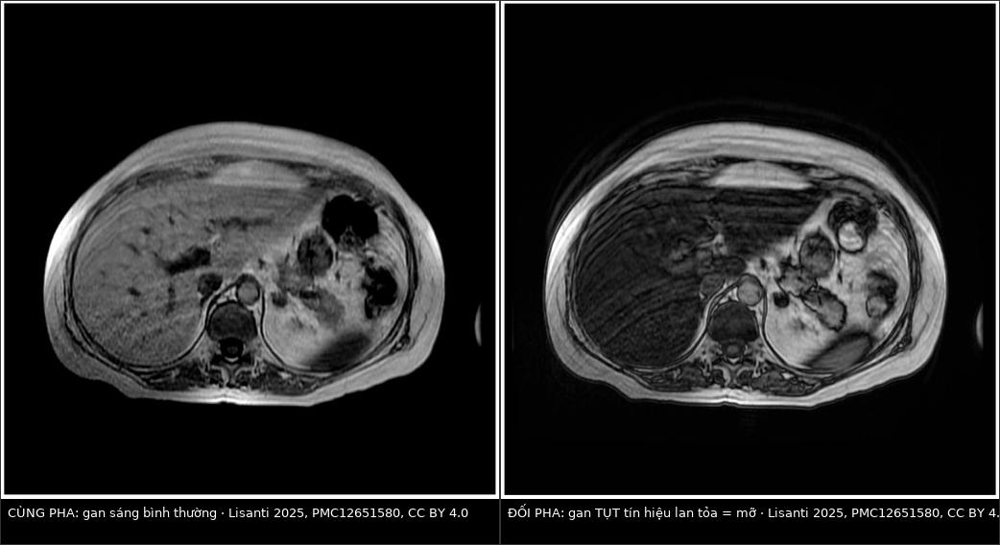
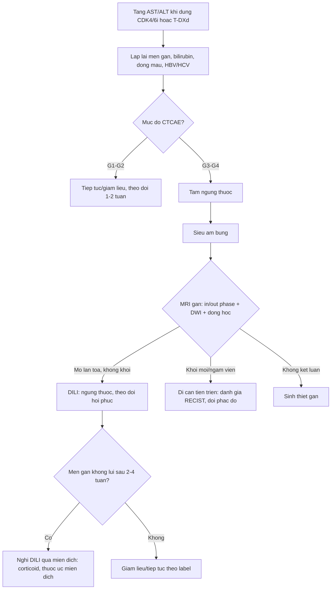
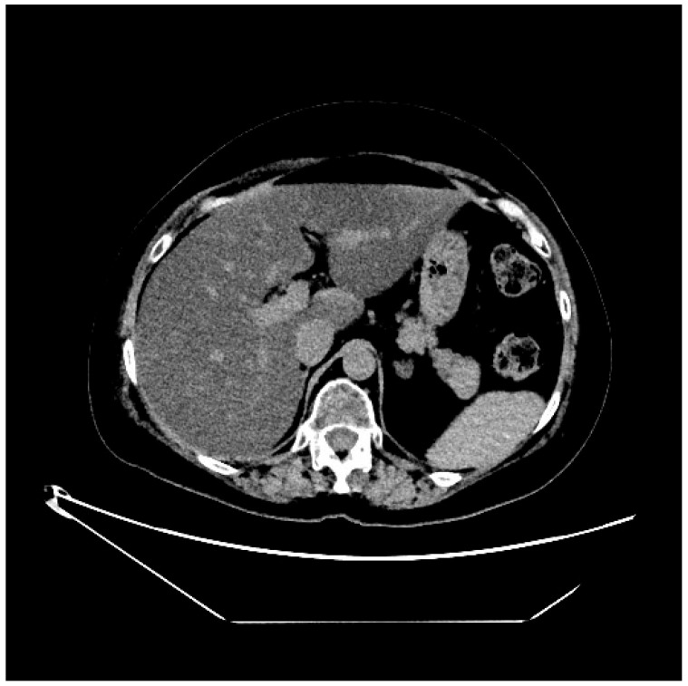

# 1732 — Tổn thương gan do thuốc ức chế CDK4/6 và ADC trastuzumab deruxtecan / Liver injury from CDK4/6 inhibitors and trastuzumab deruxtecan (T-DXd)

**Tags:** `pattern:gan-lan-toa` `pattern:gan-nhieu-mo` `pattern:ton-thuong-gan-do-thuoc` `pattern:khong-o-khu-tru` `vung:gan` `protocol:CT-bung-khong-can-quang` `protocol:MRI-gan-in-out-phase` `protocol:MRI-gan-DWI` `score:RECIST-1.1` `score:CTCAE`
**Mức chắc chắn (certainty):** tổng hợp y văn (literature synthesis) — số liệu đọc trực tiếp từ toàn văn: ca DILI do T-DXd có MRI + mô bệnh (*Curr Oncol* 2025, PMC12651580, CC BY 4.0), đoàn hệ thực hành ribociclib (*BMC Cancer* 2025, PMC12661689), so sánh ribociclib–palbociclib (*J Chin Med Assoc* 2026, PMC13596929), loạt ca DILI do miễn dịch (*Case Rep Oncol Med* 2026, PMC13430969), tổng quan an toàn CDK4/6 (*Biomolecules* 2023, PMC10526227) và dược cảnh giác FAERS (*Sci Rep* 2025, PMC12328589).

## 1. Tổng quan bệnh học – cơ chế hình ảnh

- **Bối cảnh:** thuốc ức chế **CDK4/6** (palbociclib, ribociclib, abemaciclib) và **ADC kháng HER2** (T-DM1, **trastuzumab deruxtecan — T-DXd**) là nền điều trị của ung thư vú HR+/HER2− và HER2 thấp/dương. Cả hai nhóm đều gây **tăng transaminase** và **tổn thương gan do thuốc (drug-induced liver injury, DILI)**; vấn đề thực hành không phải "có tăng enzym hay không" mà là **tăng do thuốc hay do di căn gan tiến triển** — vì một bên là **giảm liều/ngừng thuốc**, bên kia là **đổi phác đồ**.
- **Cơ chế và vì sao hình ảnh là "lan tỏa" chứ không phải "khối":**
  - **CDK4/6i** ức chế phức hợp CDK4/6–cyclin D → ngừng chu kỳ ở G1. Cơ chế độc gan **chưa rõ hoàn toàn**, nhưng một phần là **qua miễn dịch**: loạt 5 ca DILI do ribociclib **không lui sau khi ngừng thuốc** nhưng **đáp ứng corticoid**, 3 ca tái tăng men khi giảm liều và 2 ca cần **tacrolimus** — tức tổn thương nhu mô **lan tỏa**, không tạo khối.
  - **T-DXd** gồm kháng thể kháng HER2 gắn **payload ức chế topoisomerase I (DXd)** qua linker cắt được, có **hiệu ứng bystander**. Ca nguyên văn cho thấy mô bệnh là **thoái hóa mỡ vi nang (microvesicular steatosis) + thoái hóa "đục" tế bào gan** — kiểu tổn thương **ty thể/ôxy hóa acid béo**, làm **triglycerid tích trong các nang nhỏ**.
- **TẠI SAO mỡ nội bào làm tín hiệu tụt trên MRI (vật lý):** proton của **nước** và của **nhóm −CH₂− của mỡ** có tần số cộng hưởng lệch nhau; ở **thời điểm đối pha (opposed-phase)** hai tín hiệu **triệt tiêu nhau**, nên mô càng nhiều mỡ càng **mất tín hiệu** so với **ảnh cùng pha (in-phase)**. Đây là lý do **cặp ảnh in/out phase** là phép thử rẻ nhất cho gan nhiễm mỡ **lan tỏa**, và cũng là lý do nó **không bao giờ tạo "khối"** — khác hoàn toàn với di căn.
- **Ngưỡng định lượng của gan nhiễm mỡ** (đã trình bày ở bài 125): **CT không cản quang gan < 40 HU** hoặc **gan − lách ≥ 10 HU**; **MRI-PDFF ≥ 5%** = nhiễm mỡ, **≥ 33%** = mỡ nặng. Trên **CT có cản quang** không dùng ngưỡng HU tuyệt đối — phải so **gan với lách cùng thì**.
- **Vì sao phân biệt được với di căn về mặt vật lý:**
  - **Di căn** là **mô đặc tăng sinh mạch** → **khối khu trú**, **ngấm thuốc** (thì động mạch/cửa), **hạn chế khuếch tán** (ADC thấp) do tăng mật độ tế bào, và **co kéo vỏ gan** khi xơ hóa.
  - **DILI/thoái hóa mỡ** là **thay đổi nội bào lan tỏa** → **không có bờ khối**, **không ngấm thuốc**, **không hạn chế khuếch tán**, mật độ/tín hiệu **thay đổi đều toàn gan** (hoặc theo vùng tưới máu), và **hồi phục khi ngừng thuốc**.
- **Dịch tễ – tần suất (số thực):**
  - **Ribociclib, thực hành thật:** **78/845 (9,2%)** có độc gan; **G1–2 69,2%**, **G3 24,4%**, **G4 6,4%**; **thời điểm khởi phát trung vị 13 tuần (IQR 7–27)**; **11,5%** ngừng thuốc vĩnh viễn; **không có ca tử vong**; sống 1 năm **90%** (G1–2) so với **76%** (G3–4), p = 0,044.
  - **So sánh ribociclib với palbociclib** (145 và 153 bệnh nhân): **28** và **19** ca độc gan ≥ G2; **thời gian tới độc gan trung vị 42 ngày ở cả hai**; sau hiệu chỉnh, **palbociclib HR 0,467 (0,233–0,936), p = 0,032**; **di căn gan HR 2,159 (1,175–3,966)**, **tiền sử HBV HR 2,216 (1,102–4,458)**, **gan nhiễm mỡ HR 3,536 (1,840–6,794)**.
  - **Ribociclib gộp:** độc gan **mọi độ ~20%**, **G3–4 11–15%**; MONALEESA-3: **ALT G3/4 6,6% vs 1,9%**, **AST 4,8% vs 1,2%** (so với placebo).
  - **Abemaciclib** (MONARCH-3): **ALT tăng 47,6% vs 25,2%**, **AST 36,7% vs 23,2%** — chủ yếu độ 1–2, nhưng **không được bỏ qua**.
  - **T-DXd:** trong DB-03, **AST tăng 28% vs 41%** và **ALT 23% vs 32%** (so với T-DM1) — tức **không cao hơn** T-DM1; nhưng theo dõi dược cảnh giác, **T-DXd có tín hiệu độc gan ROR 2,51 (2,25–2,80)**, **thời gian khởi phát trung vị 63 ngày (6–329)**, và **có thể gây suy gan, vàng da**; **33 báo cáo DILI** trong 2020–Q3/2022, **60,6% từ Nhật Bản**.

## 2. Mẫu hình + chẩn đoán phân biệt theo vị trí (Gamut)

- **Khuôn 1 — Gan giảm đậm độ LAN TỎA, không khối, trên CT.** Gamut: **DILI/thoái hóa mỡ do thuốc (T-DXd, T-DM1, corticoid, hóa trị)** vs **gan nhiễm mỡ nền (béo phì, rượu, chuyển hóa)** vs **thoái hóa mỡ do suy dinh dưỡng** vs **viêm gan cấp (phù nhu mô)**. Chốt: **gan − lách ≥ 10 HU** và **không có tổn thương khu trú**.
- **Khuôn 2 — Nhiều nốt giảm tỷ trọng MỚI, bờ không đều, ngấm viền.** Gamut: **di căn gan tiến triển** vs **áp-xe** vs **giả xơ gan (pseudocirrhosis)** vs **nốt tái tạo lành tính FNH-like** (bài 1648). Chốt: **ngấm viền + hạn chế khuếch tán + tăng kích thước theo RECIST**.
- **Khuôn 3 — Gan to, ứ dịch, ngấm thuốc loang lổ, không khối.** Gamut: **hội chứng tắc xoang gan (SOS/VOD)** do oxaliplatin/hóa trị vs **viêm gan do thuốc** vs **bệnh gan nền mất bù**. Chốt: **gan to + cổ trướng + tăng bilirubin** (bài 1910).
- **Khuôn 4 — Tăng enzym gan đơn thuần, hình ảnh gan BÌNH THƯỜNG.** Gamut: **DILI giai đoạn sớm** vs **viêm gan virus bùng phát** vs **viêm gan tự miễn** vs **tắc mật do hạch rốn gan**. Chốt: **không có tổn thương trên hình ảnh không loại trừ DILI**; phải xét nghiệm virus/tự miễn.
- **Khuôn 5 — Vàng da + giãn đường mật trong gan.** Gamut: **di căn hạch rốn gan gây tắc** vs **DILI thể ứ mật** vs **sỏi/viêm đường mật**. Chốt: **giãn đường mật là do tắc**, không phải DILI đơn thuần.
- **Gợi nhớ "DILI":** **D**i căn phải loại trước · **I**n/out phase cho mỡ · **L**iver enzymes theo CTCAE · **I**mmune-mediated nếu không lui khi ngừng thuốc.

## 3. Bảng so sánh phân biệt (ma trận đối chiếu)

| Thực thể (entity) | Hình ảnh điển hình (CT / MRI / DWI) | Chốt vào (rule-in) | Chốt loại (rule-out) | Gợi ý xác nhận |
|---|---|---|---|---|
| **DILI — thoái hóa mỡ (T-DXd, T-DM1, corticoid)** | CT: **gan giảm đậm độ lan tỏa**, gan − lách **≥ 10 HU** (không cản quang); MRI: **tụt tín hiệu đối pha** so với cùng pha, **không khối**, **không hạn chế khuếch tán**, không ngấm | **Giảm đậm độ/tín hiệu LAN TỎA + enzym gan tăng sau thuốc + hồi phục khi ngừng** | **Có khối ngấm thuốc hoặc hạn chế khuếch tán** → không phải DILI đơn thuần | MRI in/out phase + PDFF; ngừng thuốc theo dõi 2–4 tuần |
| **Tiến triển di căn gan** | **Nốt/khối mới**, giảm tỷ trọng, **ngấm viền**, có thể **hoại tử trung tâm**; DWI **hạn chế khuếch tán** (ADC thấp) | **Tổn thương MỚI + tăng ≥ 20% và ≥ 5 mm theo RECIST 1.1** | **Không có tổn thương khu trú, chỉ thay đổi lan tỏa** → không phải tiến triển | So ảnh cũ cùng thì + RECIST; PET/CT nếu còn nghi |
| **Giả xơ gan (pseudocirrhosis)** | **Co kéo vỏ gan, teo thùy, nhiều nốt bờ gan**, có thể **cổ trướng**; thường sau hóa trị lâu | **Biến dạng vỏ + teo nhu mô + nốt bờ gan** ở bệnh nhân đáp ứng điều trị | **Gan to, bờ nhẵn, không co kéo** → không phải giả xơ | CT/MRI + đối chiếu diễn tiến (bài 1648) |
| **SOS / bệnh tắc xoang gan** | **Gan to, ngấm thuốc loang lổ kiểu "pho mát", ứ dịch quanh gan, cổ trướng**, tĩnh mạch cửa giảm ngấm | **Tam chứng gan to + tăng cân/ứ dịch + tăng bilirubin** sau hóa trị | **Không ứ dịch, không gan to, bilirubin bình thường** → ít nghĩ SOS | Doppler tĩnh mạch cửa + MRI (bài 1910) |
| **Nốt tái tạo FNH-like sau hóa trị** | Nốt **ngấm mạnh thì động mạch, đồng tín hiệu thì gan mật**, **không thải thuốc**; thường nhiều nốt nhỏ | **Ngấm thì động mạch + không washout + không hạn chế khuếch tán** | **Washout + hạn chế khuếch tán** → nghĩ di căn/HCC | MRI gan mật (bài 1648) |
| **Viêm gan virus bùng phát / tự miễn** | Hình ảnh **thường bình thường** hoặc **phù nhu mô lan tỏa**; không khối | **HBV DNA/ACTH/AMA dương, men gan tăng sau khi giảm miễn dịch** | **Có khối hoặc giãn đường mật** → không giải thích hết bằng viêm gan | Xét nghiệm virus + tự miễn (trước khi kết luận DILI) |
| **Tắc mật do hạch rốn gan** | **Giãn đường mật trong gan**, hạch rốn gan, **thành ống mật dày** | **Giãn đường mật + hạch/khối rốn gan** | **Không giãn đường mật** → không phải tắc mật | MRCP/CT thì muộn |
| **Áp-xe gan** | Ổ **dịch hóa lỏng**, **ngấm viền**, có thể **khí trong ổ**, sốt cao | **Ổ dịch + viền ngấm + khí + sốt** | **Không ổ dịch, không khí, không viền** → không phải áp-xe | Siêu âm/CT + cấy; dẫn lưu khi > 5 cm |

*Bên trái: **ảnh cùng pha (in-phase)** — gan sáng bình thường. Bên phải: **ảnh đối pha (out-of-phase)** — gan **tụt tín hiệu lan tỏa**, không có khối, không có bờ tổn thương: mỡ nội bào lan tỏa. Đây là ca nữ 49 tuổi, HER2 dương, sau **2 chu kỳ T-DXd** tăng **G3 AST/ALT** kéo dài. Nguồn: Lisanti C và cs., *Curr Oncol* 2025, Fig. 1–2 (CC BY 4.0).*

### Ba dấu hiệu quyết định "thuốc hay di căn"
- **Không có bờ:** DILI/thoái hóa mỡ **không có ranh giới**; mọi tổn thương có **bờ rõ** phải được coi là khối cho đến khi loại trừ.
- **Không hạn chế khuếch tán:** mỡ và phù **không** làm ADC tụt như mô tế bào đặc; **ADC thấp khu trú** là dấu của di căn/áp-xe.
- **Diễn tiến theo thời gian:** **ngừng thuốc → men gan và tín hiệu gan hồi phục trong vài tuần đến 3 tháng** (ca nguyên văn: về **G1 sau ~3 tháng**); **di căn thì không hồi phục** mà **tăng kích thước**.

## 4. Protocol chụp + phân độ CTCAE + ngưỡng xử trí

**Theo dõi trước và trong điều trị (bắt buộc):**
- **Baseline:** AST, ALT, ALP, bilirubin, albumin, đông máu **+ HBV/HCV**; **siêu âm hoặc CT gan** để có mốc so sánh (đặc biệt nếu có **di căn gan, gan nhiễm mỡ, HBV** — ba yếu tố làm tăng nguy cơ).
- **Trong 6 tháng đầu:** men gan **trước mỗi chu kỳ** và **sớm hơn nếu có triệu chứng**; dữ liệu thực hành cho thấy **khởi phát trung vị 42 ngày (ribociclib/palbociclib)** và **13 tuần (ribociclib)**, nên **2–3 tháng đầu là cửa sổ nguy cơ cao nhất**.
- **T-DXd:** theo dõi **trước mỗi chu kỳ**; thời gian khởi phát DILI trong FAERS **trung vị 63 ngày**, nhưng **khoảng 6–329 ngày** — tức **không được dừng theo dõi sau 3 tháng**.

**Phân độ CTCAE v5.0 (dùng để quyết định):**

| Độ | ALT/AST | Xử trí thực hành (theo dữ liệu đoàn hệ) |
|---|---|---|
| **G1** | **> ULN – 3,0 × ULN** | Tiếp tục thuốc, theo dõi sát mỗi 1–2 tuần |
| **G2** | **> 3,0 – 5,0 × ULN** | Tiếp tục hoặc giảm liều; loại trừ virus/tự miễn/thuốc khác; chụp gan nếu chưa có |
| **G3** | **> 5,0 – 20,0 × ULN** | **Tạm ngừng**, chụp gan, cân nhắc sinh thiết; trong đoàn hệ: **12 ca giảm liều, 5 ca ngừng** (ribociclib) |
| **G4** | **> 20,0 × ULN** | **Ngừng thuốc** (5/5 ca G4 ngừng trong đoàn hệ; 1 ca thử lại thành công) |

- **Định nghĩa DILI/Hy's law:** **ALT > 5 × ULN**, hoặc **ALP > 2 × ULN**, hoặc **ALT > 3 × ULN kèm bilirubin > 2 × ULN**, khởi phát **trong 90 ngày** dùng thuốc và **lui trong 1 tháng** sau ngừng. **Hy's law dương là dấu tiên lượng nặng**, không phải tiêu chuẩn duy nhất.
- **Không có ngưỡng thống nhất giữa các phác đồ** cho CDK4/6i và T-DXd — mỗi thử nghiệm/label có bảng giảm liều riêng; vì vậy **đối chiếu label của thuốc đang dùng** trước khi quyết định, và **ghi rõ độ CTCAE + ngày** trong hồ sơ.

**Khi enzym gan tăng không giải thích (workup hình ảnh):**
1. **Siêu âm bụng** (rẻ, loại trừ giãn đường mật, ổ dịch, huyết khối tĩnh mạch cửa).
2. **MRI gan có cản quang từ** — tối thiểu: **T1 in/out phase**, **T2 fat-sat**, **DWI/ADC**, **động học sau tiêm** (động mạch–cửa–muộn), **± thì gan mật (EOB)** nếu nghi nốt tái tạo/FNH-like. Đây là bộ duy nhất trả lời cùng lúc **"có mỡ không?"** và **"có khối mới không?"**.
3. **CT bụng có cản quang** nếu MRI không thuận lợi — nhưng **không dùng ngưỡng HU tuyệt đối** để chẩn đoán mỡ khi đã tiêm thuốc.
4. **Sinh thiết gan** khi: hình ảnh **không kết luận**, men gan **tăng kéo dài dù đã ngừng thuốc**, hoặc **kết quả sẽ đổi phác đồ**. Ca nguyên văn được sinh thiết vì men gan **G3 kéo dài, không đáp ứng corticoid**, và mô bệnh là **thoái hóa mỡ vi nang + thoái hóa đục**.
5. **Theo dõi tiến triển:** dùng **RECIST 1.1** — **tiến triển = tổng đường kính đích tăng ≥ 20% VÀ ≥ 5 mm** so với nadir, hoặc **tổn thương mới**.

## 5. Biến thể bình thường và cạm bẫy

- **Gan nhiễm mỡ nền từ trước** (béo phì, chuyển hóa, rượu) làm **HR 3,536** cho độc gan — **không được dùng "đã có mỡ từ trước" để miễn trừ** khi men gan tăng; phải so **ảnh cũ** để biết mỡ **mới hay cũ**.
- **Di căn gan có từ trước** làm **HR 2,159**; gan có di căn **dễ bị DILI hơn** và **khó đọc hơn** — cần **so sánh từng tổn thương với ảnh nền**, không chỉ đọc "gan có nốt".
- **Cạm bẫy 1 — quy mọi tăng men gan cho "tiến triển":** nếu **không có tổn thương mới** và men gan tăng **sau 2 chu kỳ thuốc**, DILI là giả thuyết hàng đầu; đổi phác đồ sớm có thể **bỏ mất thuốc còn hiệu quả**.
- **Cạm bẫy 2 — quy mọi tăng men gan cho "thuốc":** **di căn gan tiến triển** và **tắc mật do hạch** cũng tăng men gan; **không chụp gan** là bỏ sót nguyên nhân chữa được (stent, đổi phác đồ).
- **Cạm bẫy 3 — bilirubin bình thường tưởng là nhẹ:** ca nguyên văn có **G3 AST/ALT nhưng bilirubin bình thường** và **đông máu bình thường** — tổn thương vẫn đủ nặng để **ngừng thuốc vĩnh viễn**. Ngược lại, **Hy's law dương** (ALT > 3 × ULN + bilirubin > 2 × ULN) là **dấu nặng**, phải xử lý như cấp cứu.
- **Cạm bẫy 4 — "hết thuốc là hết độc":** DILI do ribociclib có thể **qua miễn dịch và không lui khi ngừng thuốc**; loạt 5 ca cần **corticoid**, 3 ca **tái tăng khi giảm liều**, 2 ca cần **tacrolimus**, và **3 ca chuyển sang palbociclib an toàn > 2 năm** — đây là lựa chọn thay thế **trong cùng nhóm thuốc**.
- **Cạm bẫy 5 — nhiễu do thuốc trước đó:** bệnh nhân đã dùng **T-DM1 ± atezolizumab** (như ca nguyên văn, từng **tăng bilirubin G2 + gan nhiễm mỡ**) hoặc corticoid liều cao — **thuốc cũ và corticoid đều gây mỡ gan**, nên "gan nhiễm mỡ" trên MRI **không tự động là do T-DXd**.
- **Cạm bẫy 6 — sinh thiết mù trong gan không đồng nhất:** mảnh sinh thiết nhỏ có thể **bỏ sót ổ di căn** hoặc **bỏ sót ổ DILI**; nên **lấy nhiều mảnh dưới hướng siêu âm**, và **luôn đối chiếu ảnh**.

## 6. Tự lượng giá — Blind Quiz

**Ca 1 — Nữ 49 tuổi, ung thư vú HER2 dương, sau 2 chu kỳ T-DXd: AST/ALT độ 3 kéo dài, bilirubin bình thường.**

- Gợi ý: không đau bụng, không vàng da; trước đó đã dùng T-DM1 và corticoid.
- Câu hỏi: (1) So sánh đậm độ gan với lách? (2) Có tổn thương khu trú nào không? (3) Ba chẩn đoán phân biệt và bước tiếp theo?

<b>Bấm để hiện đáp án (findings + chẩn đoán)</b>

- Dấu hiệu: **gan giảm đậm độ lan tỏa, tối hơn lách**, **không thấy ổ khu trú**, không giãn đường mật, không dịch tự do.
- Chẩn đoán: **gan nhiễm mỡ lan tỏa do thuốc (DILI)** — MRI xác nhận **tụt tín hiệu đối pha**, sinh thiết: **thoái hóa mỡ vi nang + thoái hóa đục tế bào gan**; ngừng T-DXd, men gan về **G1 sau ~3 tháng**.
- Phân biệt: **di căn gan** (sẽ có nốt ngấm viền), **viêm gan virus/tự miễn** (hình ảnh thường bình thường, cần xét nghiệm), **tắc mật** (sẽ giãn đường mật).
- Vì sao: mỡ nội bào **giảm suy giảm tia X** → gan tối hơn lách; tổn thương **nội bào lan tỏa** nên **không tạo khối**.
- Nguồn ảnh: Lisanti C và cs., *Curr Oncol* 2025, Fig. 5 (CC BY 4.0).

**Ca 2 — Cùng bệnh nhân: hai ảnh MRI gan ở hai chuỗi xung khác nhau.**

- Gợi ý: cùng mặt cắt, cùng thời điểm; chỉ khác **thời điểm lấy tín hiệu**.
- Câu hỏi: (1) Ảnh nào là **cùng pha**, ảnh nào là **đối pha**? (2) Vì sao gan tối đi? (3) Nếu thay bằng **khối di căn**, hai ảnh này sẽ khác thế nào?

<b>Bấm để hiện đáp án (findings + chẩn đoán)</b>

- Trả lời: **trái = cùng pha** (gan sáng), **phải = đối pha** (gan tụt tín hiệu lan tỏa). Tín hiệu **tụt đồng đều toàn gan**, không có bờ.
- Vì sao: proton **mỡ và nước lệch tần số**; ở đối pha hai tín hiệu **triệt tiêu**, mức mất tín hiệu **tỷ lệ lượng mỡ**.
- Nếu là **di căn**: sẽ thấy **ổ khu trú mất tín hiệu/ngấm thuốc**, **bờ rõ**, **hạn chế khuếch tán**, và **không đối xứng toàn gan**; cặp in/out phase **không dùng để chẩn đoán khối** mà để **phát hiện mỡ**.
- Cạm bẫy: mỡ **không đều** (do thuốc, do tưới máu) có thể tạo **vùng giả tổn thương** — luôn đọc kèm **T2, DWI và ảnh sau tiêm**.
- Nguồn ảnh: Lisanti C và cs., *Curr Oncol* 2025, Fig. 1–2 (CC BY 4.0); ảnh ghép letterbox.

## Bài liên quan chéo

- [1648 — Di căn gan ở ung thư vú](../1648-di-can-gan-ung-thu-vu/lesson.md) (phân biệt di căn, u máu, mỡ do điều trị, giả xơ)
- [125 — Gan nhiễm mỡ, xơ gan & tăng áp cửa](../125-gan-mo-xo/lesson.md) (ngưỡng HU, PDFF)
- [516 — Hình ảnh vú sau điều trị](../516-hinh-anh-vu-sau-dieu-tri/lesson.md)
- [154 — RCC di căn và theo dõi sau cắt thận](../154-rcc-di-can-va-theo-doi-sau-cat-than/lesson.md) (RECIST 1.1)
- [500 — Tổng quan Vú & Sản phụ khoa](../500-tong-quan-vu-san-phu-khoa/lesson.md)

> Không dùng để chẩn đoán độc lập khi chưa có người hướng dẫn.
