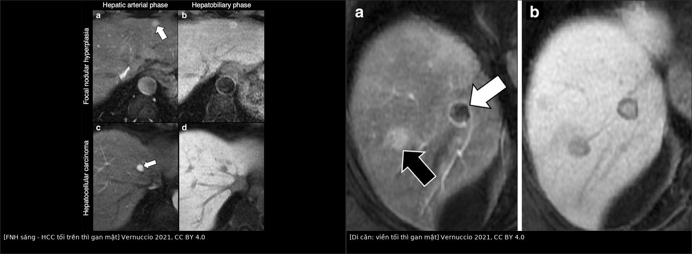
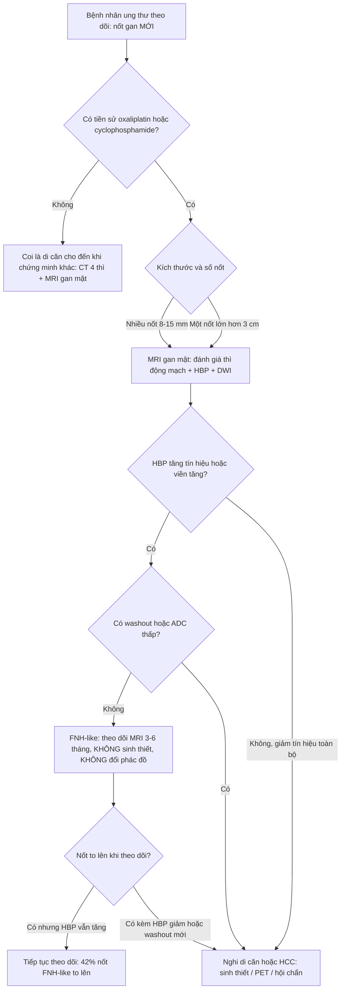
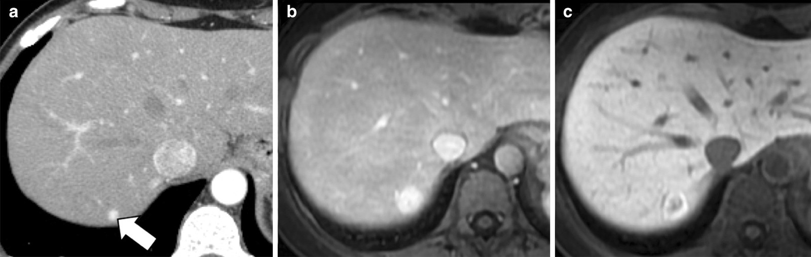
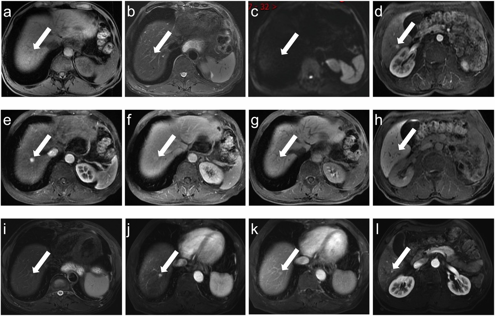
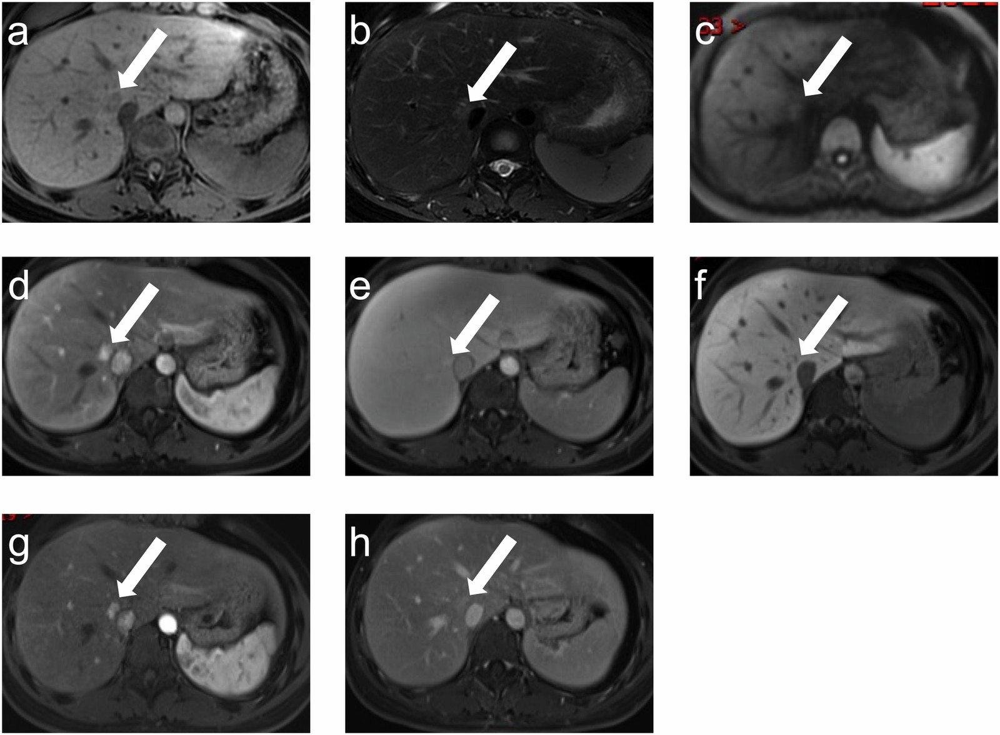
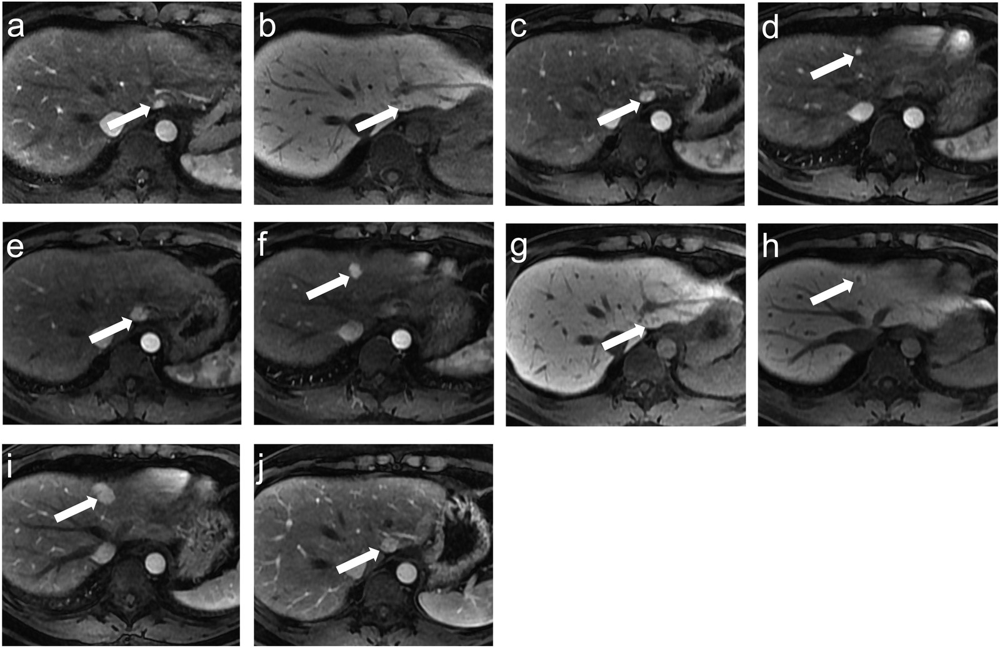

# 1733 — Nốt tái tạo lành tính FNH-like sau hóa trị: "di căn giả" trên MRI gan mật / Chemotherapy-induced FNH-like nodules: the pseudometastasis on hepatobiliary MRI

**Tags:** `pattern:not-gan` `pattern:nhieu-o` `pattern:ngam-dong-mach` `pattern:gia-di-can` `pattern:gan-lanh-tinh` `vung:gan` `vung:gan-mat` `protocol:MRI-gan` `protocol:MRI-gan-DWI` `protocol:CT-bung-co-can-quang` `protocol:sieu-am-bung` `score:RECIST-1.1` `incidentaloma:not-gan`
**Mức chắc chắn (certainty):** tổng hợp y văn (literature synthesis) — số liệu đọc trực tiếp từ toàn văn, không lấy từ abstract: đoàn hệ 38 bệnh nhân/63 nốt FNH sau hóa trị (*Insights into Imaging* 2024, PMC11347512, CC BY 4.0), bài tổng quan phổ tổn thương tăng tín hiệu thì gan mật (*Insights into Imaging* 2021, PMC7801550, CC BY 4.0), tổng quan tổn thương gan do hóa trị trên MRI (*Diagnostics* 2022, PMC9029929, CC BY) và bài SOS do oxaliplatin của repo (bài 1910). Các ca nguyên văn giữ đúng chú thích gốc (Fig/ID); chỗ nguồn tự mâu thuẫn được ghi rõ ngay dưới số liệu.

## 1. Tổng quan bệnh học – cơ chế hình ảnh

- **Vấn đề thực hành:** bệnh nhân ung thư (vú, đại trực tràng, dạ dày) đang theo dõi sau hóa trị, lần chụp này xuất hiện **nốt gan MỚI**. Theo phản xạ, "nốt mới = di căn tiến triển" → đổi phác đồ, xạ trị, mổ. Nhưng sau **oxaliplatin** hoặc **cyclophosphamide**, một phần các nốt này là **tăng sản tái tạo lành tính kiểu FNH (FNH-like lesion / multiacinar regenerative nodule)** — **không cần điều trị gì**. Đây là chỗ mà **một thì chụp MRI gan mật đổi hoàn toàn quyết định điều trị**.
- **Cơ chế bệnh sinh (vì sao lại là gan, vì sao lại sau hóa trị):**
  - **Oxaliplatin** gây tổn thương **tế bào nội mô xoang gan** → **hội chứng tắc xoang gan (sinusoidal obstruction syndrome, SOS)** với giãn xoang, xuất huyết vi thể, xơ hóa quanh xoang; mô bệnh thấy tổn thương xoang ở **19–52%** bệnh nhân, tới **51%** trong loạt 154 ca cắt gan (bài 1910).
  - Hậu quả là **tưới máu gan không đều**: vùng **giảm tưới máu teo lại**, xen kẽ vùng **tăng tưới máu**; vùng tăng tưới máu bị **tăng sản tế bào gan** → nốt tái tạo. Nốt **một tiểu thùy (monoacinar) = tăng sản nốt tái tạo (nodular regenerative hyperplasia, NRH)**; nốt **nhiều tiểu thùy (multiacinar) = FNH-like**.
  - **Cyclophosphamide** (nhóm alkyl hóa) làm **cạn glutathione** trong tế bào nội mô xoang → cùng con đường tổn thương xoang; trên lâm sàng nhóm này xuất hiện **sớm hơn** và ở **nữ trẻ** nhiều hơn.
  - Vì thế FNH-like sau hóa trị được xem là **biểu hiện MUỘN của SOS**, không phải u thật: tế bào gan **bình thường, không loạn sản**, mô đệm có **ống mật phản ứng** và **động mạch bất thường** — không có đột biến sinh ung.
- **TẠI SAO nốt này sáng trên thì gan mật (vật lý + mô học):** thuốc cản quang gan mật (**gadoxetate disodium** — Primovist/Eovist; **gadobenate dimeglumine** — Multihance) bị **tế bào gan bắt qua chất vận chuyển OATP1B1/OATP1B3** ở mặt xoang rồi **thải vào đường mật qua MRP2**. Ở **thì gan mật (hepatobiliary phase, HBP)** — **10–20 phút** với gadoxetate, **60–120 phút** với gadobenate — nhu mô gan bình thường **sáng lên**, còn **mô không có tế bào gan (di căn, cholangiocarcinoma) tối đi**. Nốt FNH/FNH-like **vẫn có tế bào gan và giữ (hoặc tăng) biểu hiện OATP** → **đồng tín hiệu hoặc tăng tín hiệu** so với gan. Đây là **lý do vật lý** khiến HBP là "cửa ải" phân biệt, không phải một mẹo hình ảnh.
- **Vì sao có "viền tăng tín hiệu" (ring hyperintensity):** trong FNH-like, **OATP8 phân bố ở tế bào gan NGOẠI VI** mạnh hơn trung tâm (trung tâm là mô đệm/xơ, ít tế bào gan) → HBP thấy **viền sáng + trung tâm tương đối tối**, kiểu "bánh vòng". Dấu này có **độ đặc hiệu 100%** cho FNH trong một nghiên cứu (Bilreiro), và gặp ở **57,6% (19/33)** nốt FNH-like sau hóa trị có ảnh HBP.
- **Vì sao ngấm mạnh thì động mạch mà KHÔNG washout:** FNH-like có **động mạch nuôi bất thường, dày, xoắn** và **thiếu nhánh tĩnh mạch cửa** trong nốt → thì động mạch (20–35 giây) **ngấm mạnh, đồng nhất**; nhưng mô là **tế bào gan bình thường** nên thì cửa/muộn **không thải thuốc** (không washout). Di căn/HCC thì ngược lại: **ngấm rồi thoát**.
- **Vì sao không hạn chế khuếch tán:** DWI/ADC phản ánh **mật độ tế bào và độ nhớt mô**; FNH-like là **tế bào gan xếp bình thường, không hoại tử, không phù keo**, nên **đồng tín hiệu trên DWI** (31/63) hoặc **tăng nhẹ** (32/63, do hiệu ứng T2 shine-through) và **không tụt ADC**; di căn đặc thì **ADC thấp**.
- **Dịch tễ – số liệu thực:**
  - **Đoàn hệ 38 bệnh nhân / 63 nốt** (2010–2022, ung thư vú 18, đại trực tràng 17, dạ dày 2, lymphoma 1): **khoảng cách trung vị từ lúc kết thúc hóa trị đến khi phát hiện nốt = 30,4 tháng (12,9–49,4)**: **36,0 tháng** với oxaliplatin, **12,9 tháng** với cyclophosphamide (**p = 0,002**).
  - **55,3% (21/38)** có **nhiều nốt** ngay lần đầu (bài gốc phần Tóm tắt ghi **60,5% (23/38)** — chênh lệch nội tại của nguồn, giữ nguyên cả hai và không dùng để kết luận); **kích thước trung vị 11,5 mm (8,4–15,1)** — nhỏ hơn nhiều so với FNH kinh điển (trung bình **43,0 mm**).
  - **Theo dõi trung vị 32,5 tháng:** **13,5%** nốt **nhỏ lại**, **10,8%** **to lên**, **8,1%** **tăng số nốt**, thêm **10,8%** vừa to vừa tăng số — tức **15/37 (40,5%)** có thay đổi, **không ca nào tiến triển bệnh**.
  - **Loạt 14 bệnh nhân của Furlan:** FNH-like xuất hiện de novo sau oxaliplatin, tới **42%** nốt **to lên** khi theo dõi, khoảng cách trung bình **47,6 tháng** (trung vị 42,5; 10–120).
  - **Mốc thời gian phản biện:** di căn đại trực tràng **hiếm khi xuất hiện mới sau 3,5 năm** kể từ lúc mổ (Walter) — nên nốt mới ở **năm thứ 4–10** sau hóa trị oxaliplatin **không mặc định là di căn**, còn nốt mới trong **6–18 tháng đầu** thì ngược lại, phải coi là di căn cho đến khi chứng minh khác.
- **Hình ảnh đặc trưng (63 nốt, đoàn hệ trên):** T1 **đồng tín hiệu** 36 / **giảm nhẹ** 27; T2 **đồng** 23 / **tăng nhẹ** 40; DWI **đồng** 31 / **tăng nhẹ** 32; **ngấm mạnh đồng nhất thì động mạch 63/63 (100%)**; **washout 0/63 (0%)**; **sẹo trung tâm 9/63 (14,3%)**; **không nốt nào có nang/hoại tử**; trong 33 nốt có HBP: **tăng tín hiệu bền 26/33 (78,8%)**, **viền tăng tín hiệu 19/33 (57,6%)**.

## 2. Mẫu hình + chẩn đoán phân biệt theo vị trí & bối cảnh (Gamut)

- **Khuôn 1 — Nốt MỚI, nhỏ (8–15 mm), NHIỀU ổ, ở bệnh nhân đã hóa trị oxaliplatin/cyclophosphamide ≥ 12 tháng.** Gamut: **FNH-like sau hóa trị** vs **di căn gan** vs **NRH** vs **u máu nhỏ**. Chốt: **thì gan mật** (tăng tín hiệu/viền tăng = FNH-like; giảm tín hiệu = di căn).
- **Khuôn 2 — Nốt đơn độc, to dần, không có sẹo trung tâm.** Gamut: **FNH-like đang tăng sản** vs **di căn** vs **HCC** vs **adenoma**. Chốt: **washout + ADC + HBP**; **tăng kích thước một mình KHÔNG phải tiêu chuẩn ác tính** (42% FNH-like to lên).
- **Khuôn 3 — Nhiều nốt ≤ 3 mm + lách to + giảm tiểu cầu, sau oxaliplatin.** Gamut: **NRH/SOS** vs **di căn kê (miliary)** vs **xơ gan**. Chốt: **lưới giảm tín hiệu trên HBP + nốt đồng tín hiệu + không hạn chế khuếch tán**; NRH **thoái triển trong ≤ 9 tháng** sau chu kỳ oxaliplatin cuối.
- **Khuôn 4 — Nốt ngấm mạnh thì động mạch ở bệnh nhân XƠ GAN.** Gamut: **HCC** vs **nốt tái tạo** vs **FNH-like**. Chốt: **washout + vỏ bao + HBP giảm tín hiệu = HCC**; nốt tái tạo xơ gan **đồng/tăng tín hiệu HBP**.
- **Khuôn 5 — Gan biến dạng, vỏ co kéo, nhiều nốt bờ gan sau hóa trị.** Gamut: **giả xơ gan (pseudocirrhosis)** vs **xơ gan thật** vs **di căn đa ổ**. Chốt: **không có dấu hiệu tăng áp cửa thực sự + bệnh cảnh đáp ứng điều trị** (bài 1648).
- **Gợi nhớ "FNH-like":** **F** — **F**ollow-up dài (30–48 tháng sau hóa trị) · **N** — **N**hiều nốt, **N**hỏ · **H** — **H**BP tăng tín hiệu/viền tăng · **L** — **L**ành, không washout, **L**ui/nhỏ lại khi theo dõi.

## 3. Bảng so sánh phân biệt (ma trận đối chiếu)

| Thực thể (entity) | Hình ảnh điển hình (CT / MRI / DWI) | Chốt vào (rule-in) | Chốt loại (rule-out) | Gợi ý xác nhận |
|---|---|---|---|---|
| **FNH-like sau hóa trị (bài này)** | Nốt **8–15 mm**, nhiều ổ; T1 đồng/giảm nhẹ, T2 đồng/tăng nhẹ; **ngấm mạnh đồng nhất thì động mạch 100%**; **không washout**; DWI **không hạn chế**; **HBP tăng tín hiệu 78,8%** hoặc **viền tăng 57,6%**; sẹo trung tâm chỉ **14,3%** | **Tiền sử oxaliplatin/cyclophosphamide + nốt mới + ngấm động mạch đồng nhất + HBP tăng tín hiệu/viền tăng + không washout** | **HBP giảm tín hiệu toàn bộ + washout + ADC thấp** → không phải FNH-like | MRI gan mật (HBP 15–20 phút); theo dõi 3–6 tháng; chỉ sinh thiết khi không điển hình |
| **Di căn gan** | Nốt giảm tỷ trọng, **ngấm viền**, **washout** thì cửa/muộn; DWI **hạn chế khuếch tán**; **HBP giảm tín hiệu** (viền giảm + trung tâm "mây" ở một số ca) | **HBP giảm tín hiệu + washout + ADC thấp + tăng ≥ 20% và ≥ 5 mm theo RECIST 1.1** | **HBP tăng tín hiệu đồng nhất hoặc viền tăng** → không phải di căn | So ảnh cũ cùng thì; PET-FDG; sinh thiết nếu còn nghi và đổi điều trị |
| **NRH (tăng sản nốt tái tạo)** | Nốt **≤ 3 mm**, rất nhiều, **không viền**; **lưới giảm tín hiệu nền trên HBP**; lách to, giảm tiểu cầu | **Nốt nhỏ + lưới HBP + bệnh cảnh tăng áp cửa sau oxaliplatin** | **Nốt > 5 mm có viền và washout** → không phải NRH đơn thuần | MRI HBP + đếm tiểu cầu; NRH **thoái triển ≤ 9 tháng** sau ngừng oxaliplatin |
| **FNH kinh điển (không hóa trị)** | Khối **lớn (trung bình 43 mm)**, **sẹo trung tâm** (35% nếu < 3 cm), HBP tăng tín hiệu | **Sẹo trung tâm + HBP tăng + không tiền sử hóa trị** | **Nhiều nốt nhỏ < 15 mm sau hóa trị** → nghĩ FNH-like hơn FNH kinh điển | MRI gan mật; không cần can thiệp |
| **HCC** | Xơ gan/HBV; **ngấm mạnh thì động mạch + washout không ngoại vi**; **vỏ bao**; **HBP giảm tín hiệu** | **LI-RADS 5: ngấm + washout + vỏ bao/tăng kích thước** trong gan xơ | **Không washout, HBP tăng tín hiệu** → không phải HCC | AFP + CEUS/CT 4 thì; sinh thiết nếu không đủ tiêu chuẩn (bài 121) |
| **Giả xơ gan (pseudocirrhosis)** | **Vỏ gan co kéo, teo thùy, nốt bờ gan**, có thể cổ trướng; thường sau hóa trị đáp ứng | **Biến dạng vỏ + teo nhu mô + bệnh cảnh đáp ứng** | **Gan to, bờ nhẵn, không co kéo** → không phải giả xơ | CT/MRI + đối chiếu diễn tiến (bài 1648) |
| **U máu (hemangioma)** | **T2 rất sáng "bóng đèn"**, ngấm **viền ngoại vi từng đợt** rồi đầy dần; **HBP giảm tín hiệu** | **T2 rất sáng + ngấm ngoại vi – trung tâm theo thì** | **Ngấm đồng nhất ngay thì động mạch + HBP tăng** → không phải u máu | Siêu âm + MRI; không sinh thiết |

*Trái (hai hàng): **hàng trên — FNH** tăng tín hiệu trên thì gan mật; **hàng dưới — HCC** giảm tín hiệu (nam 58 tuổi, ung thư vòm họng). Phải: **hai di căn đại tràng** đều có **viền giảm tín hiệu** trên thì gan mật, một tổn thương còn "mây" tăng tín hiệu trung tâm. Nguyên tắc: **có tế bào gan → sáng; không có tế bào gan → tối**. Nguồn: Vernuccio F và cs., *Insights Imaging* 2021, Fig. 9–10 (CC BY 4.0); ảnh ghép letterbox.*

### Ba dấu hiệu quyết định "lành hay di căn"
- **Thì gan mật là trọng tài:** **26/33 (78,8%)** nốt FNH-like **tăng tín hiệu bền**; **19/33 (57,6%)** có **viền tăng tín hiệu** — dấu viền này có **độ đặc hiệu 100%** cho FNH trong nghiên cứu của Bilreiro. Ngược lại, di căn **giảm tín hiệu** vì không có tế bào gan bắt OATP.
- **Không washout:** **0/63** nốt FNH-like có washout; **63/63** ngấm mạnh thì động mạch. Cặp "ngấm mạnh – không thoát" là chữ ký của mô gan lành.
- **Không hạn chế khuếch tán:** DWI **đồng tín hiệu 31/63**, **tăng nhẹ 32/63** (T2 shine-through), **không nốt nào tụt ADC**; di căn đặc thì ngược lại.

## 4. Protocol chụp + cách theo dõi

- **Cộng hưởng từ gan có cản quang gan mật là tiêu chuẩn** (không phải CT): **gadoxetate disodium 0,025 mmol/kg** — thì gan mật chụp **15–20 phút** sau tiêm; **gadobenate dimeglumine 0,1 mmol/kg** — thì gan mật **60–120 phút**. Lát cắt **4 mm**, FOV 360–420 mm, ma trận 240–320 (đoàn hệ trên dùng đúng thông số này).
- **Chuỗi xung tối thiểu:** T1 in/out phase (phát hiện mỡ), **T2 fat-sat**, **DWI b = 0 và 800 s/mm²** kèm **bản đồ ADC**, động mạch – tĩnh mạch cửa – chuyển tiếp/muộn, **HBP**.
- **CT chỉ để phát hiện, không để khẳng định:** nốt **ngấm mạnh thì động mạch** trên CT ở bệnh nhân ung thư **không loại trừ và cũng không khẳng định** FNH-like — phải chuyển MRI gan mật.
- **Siêu âm:** nốt thường **giảm âm**, không có dấu hiệu đặc hiệu; CEUS có thể thấy ngấm mạnh thì động mạch nhưng **không thay HBP**.
- **Theo dõi (đề xuất thực hành, không có guideline riêng):**
  - Nốt **điển hình** (ngấm động mạch đồng nhất + HBP tăng/viền tăng + không washout): **MRI gan mật lặp 3–6 tháng**, sau đó **6–12 tháng**; **không sinh thiết**, **không áp RECIST** cho tổn thương lành.
  - Nốt **to lên** vẫn giữ HBP tăng → tiếp tục theo dõi (tới **42%** nốt to lên, thời gian theo dõi tới **79,8 tháng** trong ca nguyên văn).
  - **Sinh thiết/kim lớn** chỉ khi: **HBP giảm tín hiệu toàn bộ**, **có washout**, **ADC thấp**, **marker tăng**, hoặc bệnh nhân cần bằng chứng mô học trước mổ — nhớ **nguy cơ gieo mầm theo đường kim** và chọn đường kim qua phần gan sẽ cắt.
- **Mốc thời gian dùng để phản biện:** nốt mới **sau 3,5 năm** kể từ mổ đại trực tràng **hiếm khi là di căn** (Walter), trong khi FNH-like xuất hiện **trung vị 30–48 tháng** sau hóa trị — trùng đúng cửa sổ "dễ đọc nhầm nhất".

## 5. Biến thể bình thường và cạm bẫy

- **Cạm bẫy 1 — "To lên = ác tính".** Tới **42%** nốt FNH-like **to lên** (Furlan) và trong ca nguyên văn nốt **tăng kích thước liên tục tới 79,8 tháng** mà vẫn lành. Kích thước **một mình không đủ**; phải đọc lại **HBP** ở lần chụp mới.
- **Cạm bẫy 2 — HBP giảm tín hiệu vẫn có thể là FNH-like.** **7/33 (21,2%)** nốt không tăng tín hiệu bền; ca Fig. 4 dưới đây **giảm nhẹ tín hiệu HBP** mà vẫn là FNH-like và **nhỏ lại** sau 28,4 tháng. Vì vậy **một dấu âm không loại trừ** — cần tổng hợp động mạch + DWI + diễn tiến.
- **Cạm bẫy 3 — "Nhiều nốt = di căn".** **55–60%** bệnh nhân có **nhiều nốt** ngay lần đầu; số lượng nhiều **ủng hộ** FNH-like sau hóa trị, không ủng hộ di căn đơn độc.
- **Cạm bẫy 4 — Sẹo trung tâm vắng mặt.** Chỉ **14,3% (9/63)** nốt có sẹo trung tâm vì nốt **quá nhỏ** (trung vị 11,5 mm); sẹo trung tâm chỉ thấy ở **35%** FNH < 3 cm. **Thiếu sẹo không loại trừ FNH**.
- **Cạm bẫy 5 — Nhầm thì.** Viền tăng tín hiệu HBP của FNH-like rất giống **viền giảm tín hiệu** của di căn nếu đặt cửa sổ sai hoặc so sánh nhầm thì (chuyển tiếp vs gan mật). Luôn ghi rõ **thời điểm chụp tính bằng phút sau tiêm**.
- **Cạm bẫy 6 — Bỏ sót SOS nền.** Nốt FNH-like thường đi kèm **lưới giảm tín hiệu HBP, lách to, giảm tiểu cầu** — đọc các dấu này để không bỏ **tăng áp cửa do oxaliplatin** (bài 1910), vì nó ảnh hưởng **quyết định cắt gan**.
- **Cạm bẫy 7 — Nhóm cyclophosphamide trẻ, nữ, xuất hiện SỚM (12,9 tháng).** Ở bệnh nhân ung thư vú trẻ đang theo dõi, nốt mới **trong năm đầu** dễ bị mặc định là di căn — nhưng nhóm này lại đúng là nhóm FNH-like sớm nhất.

## 6. Tự lượng giá — Blind Quiz

**Ca 1 — Nữ 40 tuổi, ung thư đại tràng xích ma đã mổ, hóa trị XELOX. Theo dõi 2 năm: CT thấy nốt tăng đậm độ thì động mạch ở gan phải; MRI 2 năm sau nốt TO LÊN. Di căn hay lành?**

- Hỏi: (1) Vì sao nốt to lên lại **không** chứng minh di căn? (2) Thì nào quyết định? (3) Xử trí tiếp theo?

<b>Bấm để hiện đáp án</b>

- **(a)** CT thì động mạch: nốt **tăng đậm độ** (mũi tên) — không đặc hiệu. **(b)** MRI thì động mạch 2 năm sau: nốt vẫn **ngấm mạnh** và **đã to hơn** → đúng là tình huống dễ kết luận sai là di căn. **(c)** Thì **gan mật**: nốt có **viền tăng tín hiệu** → **FNH-like**, không phải di căn.
- Trả lời: (1) **42%** nốt FNH-like to lên khi theo dõi; (2) **thì gan mật**; (3) **theo dõi MRI 3–6 tháng**, không sinh thiết, không đổi phác đồ.
- Nguồn: Vernuccio F và cs., *Insights Imaging* 2021, Fig. 8 (CC BY 4.0) — nữ 40 tuổi, ung thư đại tràng xích ma, XELOX.
- *Phản biện:* ca này **không có mô bệnh**; chẩn đoán dựa trên hình ảnh + theo dõi, đúng như thực hành nhưng là mức chắc chắn thấp hơn mô học.

**Ca 2 — Nam 63 tuổi, ung thư dạ dày sau FOLFOX 10 chu kỳ. 29,7 tháng sau kết thúc: nốt 1 cm gan phải. Đọc từng thì rồi kết luận.**

- Hỏi: (1) Nốt có washout không? (2) Dấu nào trên HBP? (3) Sau 49 tháng điều gì xảy ra và nó nói lên điều gì?

<b>Bấm để hiện đáp án</b>

- **(a)** T1 **giảm nhẹ**, **(b)** T2 **tăng nhẹ**, **(c)** DWI **đồng tín hiệu** (không hạn chế khuếch tán), **(e)** thì động mạch **ngấm mạnh đồng nhất**, **(f)** thì muộn **KHÔNG washout**, **(g)** HBP **viền tăng tín hiệu**. **(d)** và **(h)** cho thấy **một nốt FNH thứ hai** ở thùy trái — đúng kiểu **nhiều ổ**.
- Sau **49 tháng** (i–l): **cả hai nốt NHỎ LẠI** → diễn tiến lành tính, khẳng định **FNH-like**.
- Trả lời: (1) **Không**; (2) **viền tăng tín hiệu**; (3) **nhỏ lại** — bằng chứng theo thời gian ủng hộ lành tính.
- Nguồn: Yang F và cs., *Insights Imaging* 2024, Fig. 3 (PMC11347512, CC BY 4.0).

**Ca 3 — Nữ 28 tuổi, ung thư vú phải sau EC-T, 42,5 tháng sau hóa trị: nốt cạnh tĩnh mạch chủ dưới. Thì gan mật GIẢM nhẹ tín hiệu. Có phải di căn?**

- Hỏi: (1) Vì sao đây là ca **khó**? (2) Theo dõi 28,4 tháng thấy gì? (3) Bài học?

<b>Bấm để hiện đáp án</b>

- **(a)** T1 **giảm nhẹ**, **(b)** T2 **tăng nhẹ**, **(c)** DWI **đồng tín hiệu**, **(d)** động mạch **tăng tín hiệu**, **(e)** thì muộn **không washout**, **(f)** HBP **giảm nhẹ tín hiệu** — tức **không có viền tăng**, đây là **21,2%** nốt FNH-like "không điển hình".
- Sau **28,4 tháng** (g–h): nốt **nhỏ lại** → lành tính.
- Bài học: **một dấu HBP âm không đủ loại trừ**; phải cộng **không washout + không hạn chế khuếch tán + diễn tiến**.
- Nguồn: Yang F và cs., *Insights Imaging* 2024, Fig. 4 (PMC11347512, CC BY 4.0).

**Ca 4 (mở rộng) — Cùng bệnh nhân ung thư đại tràng, nốt mới ở phân thùy IV. Hai năm sau nốt to lên và xuất hiện nốt thứ hai.**

<b>Bấm để hiện đáp án</b>

- Nốt 1 (mũi tên trắng) **tăng tín hiệu cả thì động mạch và HBP** ngay lần đầu; sau 1 năm **to lên** và **xuất hiện nốt 2**; sau **79,8 tháng** cả hai **tiếp tục to** nhưng **vẫn tăng tín hiệu thì động mạch và có viền tăng trên HBP**.
- Kết luận: **FNH-like đa ổ, tăng sản tiến triển theo thời gian** — không phải di căn; đây là bằng chứng mạnh nhất rằng **kích thước không phải tiêu chuẩn ác tính**.
- Nguồn: Yang F và cs., *Insights Imaging* 2024, Fig. 2 (PMC11347512, CC BY 4.0) — nam 29 tuổi, ung thư đại tràng, XELOX 8 chu kỳ.

## Bài liên quan chéo
- [1648 – Di căn gan ở ung thư vú](../1648-di-can-gan-ung-thu-vu/lesson.md) (FNH-like là một hàng trong ma trận; bài này là bản chuyên sâu)
- [1910 – Hội chứng tắc xoang gan (SOS)](../1910-hoi-chung-tac-xoang-gan-sos/lesson.md) (cơ chế nền: tổn thương xoang do oxaliplatin, lưới giảm tín hiệu HBP)
- [122 – U lành gan](../122-u-lanh-gan/lesson.md) (FNH kinh điển, adenoma, u máu)
- [121 – Khối gan và LI-RADS](../121-khoi-gan-LIRADS/lesson.md) (khi nốt nằm trong gan xơ: HCC)
- [1732 – Tổn thương gan do thuốc CDK4/6 và T-DXd](../1732-doc-gan-cdk46-tdxd/lesson.md) (cùng bối cảnh "bất thường gan do điều trị ung thư")

> Không dùng để chẩn đoán độc lập khi chưa có người hướng dẫn.
