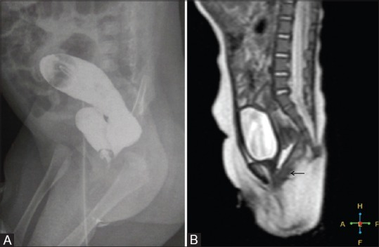
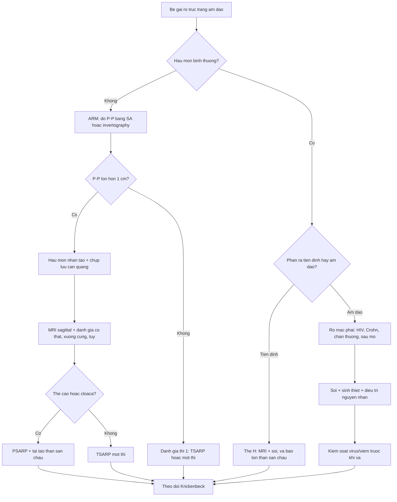
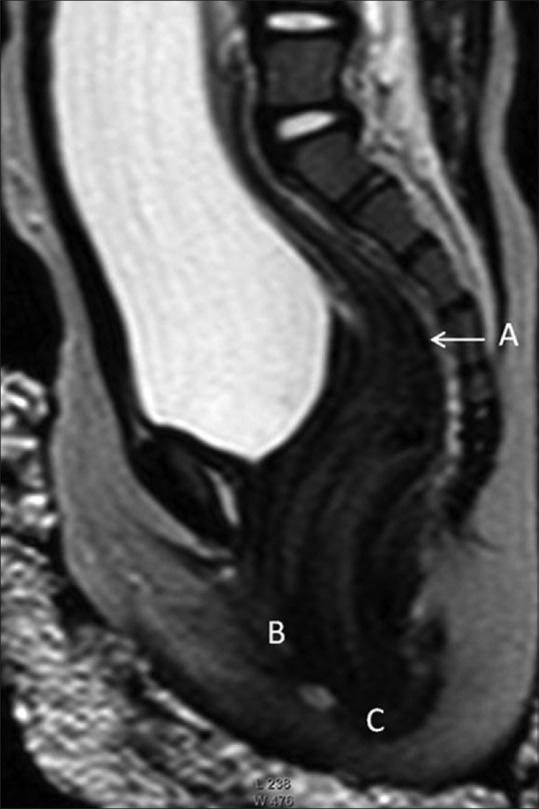
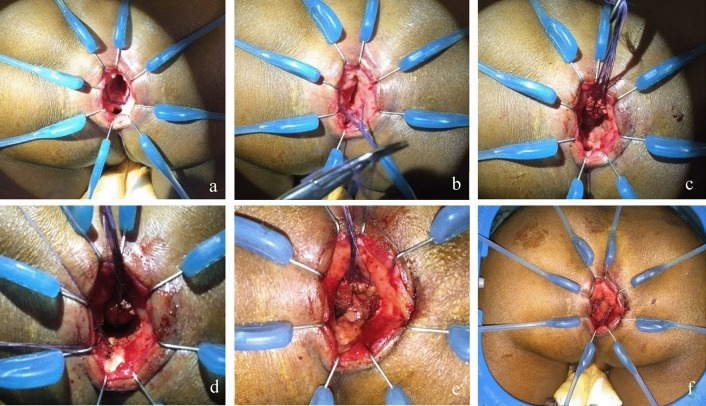

# 1734 — Rò trực tràng–âm đạo ở trẻ em / Rectovaginal fistula in children

**Tags:** `pattern:ro` `pattern:mat-lien-tuc-thanh` `pattern:khong-thay-hau-mon` `pattern:u-dich` `vung:truc-trang` `vung:am-dao` `vung:khung-chau` `vung:sinh-duc-nhi` `protocol:MRI-chau` `protocol:chup-ro-can-quang` `protocol:SA-transperineal` `protocol:noi-soi` `score:Krickenbeck`
**Mức chắc chắn (certainty):** tổng hợp y văn (literature synthesis) — dựa trên 1 nghiên cứu MRI – chụp lưu can quang ở 30 trẻ dị tật hậu môn–trực tràng (PMC6038223), 1 đoàn hệ 10 trẻ rò trực tràng–âm đạo do HIV (PMC11230961), 1 đoàn hệ phẫu thuật bảo tồn thân sàn chậu 26 trẻ (PMC13269148), và 1 nghiên cứu về chỉ định hậu môn nhân tạo ở thể rò thấp (PMC13182093).

## 1. Tổng quan — vì sao rò hình thành và vì sao phải chụp theo mặt phẳng dọc

- **Dị tật hậu môn–trực tràng (anorectal malformation, ARM):** ống hậu môn không thông ra da; trực tràng tận cùng bằng **túi cùng (rectal pouch)** và thường có **đường rò** ra niệu đạo (nam) hoặc **tiền đình âm đạo/âm đạo** (nữ). Tỉ lệ **1/4.000–1/5.000 trẻ sinh sống**; là dị tật tiêu hóa hay gặp nhất ở trẻ.
- **Vì sao nữ hay rò ra tiền đình:** ống hậu môn và xoang niệu–sinh dục cùng phôi sinh từ **vách ngăn hậu môn–trực tràng (urorectal septum)**; vách xuống không hết → trực tràng thông vào **tiền đình âm đạo (rectovestibular fistula)** — thể hay gặp nhất ở nữ; thể **rò trực tràng–âm đạo thật** nằm cao hơn, qua thành âm đạo.
- **Vì sao thể H-type khó:** trực tràng và hậu môn **bình thường**, đường rò đi từ trực tràng ra tiền đình như một **kênh ngang chữ H** — trẻ vẫn đi cầu qua hậu môn nên rò **không gây tắc**, dễ bỏ sót; có thể có **4 lỗ** (hậu môn, âm đạo, lỗ rò, niệu đạo).
- **Vì sao MRI mặt phẳng dọc (sagittal) là chốt:** **niêm mạc trực tràng tăng tín hiệu T2** đánh dấu chính xác đáy túi cùng; **phức hợp cơ thắt (sphincter muscle complex) giảm tín hiệu** trên T2 cho biết túi nằm trên/dưới sàn chậu; mặt phẳng dọc giữa cho thấy **quan hệ trực tràng – âm đạo – niệu đạo – xương cùng** trong một lát cắt.
- **Vì sao chụp lưu can quang (distal colostogram) vẫn cần:** bơm thuốc **áp lực cao** qua **lỗ rò của hậu môn nhân tạo (mucus fistula)** cho thấy **đường rò và độ cao túi** rõ nhất; nhưng **không** cho biết cơ thắt, và dễ sai khi **bơm quá căng hoặc quá ít**.
- **Rò mắc phải (acquired RVF):** ở trẻ, ngoài ARM còn do **HIV** (áp-xe tuyến hậu môn → đường rò chạy ra trước ở **đường răng lược**), **chấn thương/xâm hại**, **bệnh Crohn**, hoặc **biến chứng sau mổ kéo trực tràng (Hirschsprung)**. Đây là nhóm **không có bất thường giải phẫu bẩm sinh** nhưng tổn thương cơ thắt và thân sàn chậu, tiên lượng khác.
- **Số liệu nằm lòng:**
  - **Không thấy lỗ rò khi khám:** **10–20%** trẻ nam và **10%** trẻ nữ; phân su có thể chỉ xuất hiện **12–24 giờ** sau sinh (PMC13182093).
  - **Khoảng cách túi cùng – da tầng sinh môn (pouch–perineum, P–P) > 1 cm** → **hậu môn nhân tạo** là chuẩn; tỉ lệ mở hậu môn nhân tạo ở thể rò tầng sinh môn chỉ **2,1% (16/761)** (PMC13182093).
  - **Độ chính xác xác định độ cao túi:** **MRI 93,33%** so với **chụp lưu can quang 76,9%** (30 trẻ; PMC6038223).
  - **Tỉ lệ có đường rò** trong loạt 30 trẻ ARM: **70% (21/30)**; **rò thể H** có thể có 4 lỗ (PMC6038223).
  - **Rò mắc phải do HIV:** loạt **10 trẻ** trong 12 năm, **9/10 đã AIDS** lúc vào; vá rò **tái phát 44% (4/9)**; trước kỷ nguyên kháng virus, tỉ lệ đóng rò chỉ **20%** (PMC11230961).
  - **Kết quả vá rò thể tiền đình bằng TSARP (bảo tồn thân sàn chậu):** **26 trẻ**, **61,5%** mổ một thì, tuổi trung vị **40 ngày**; **83,3% (15/18) trẻ > 3 tuổi** kiểm soát được đại tiện, **không ca nào rỉ phân**; **tổn thương thành âm đạo 7,6%** (2/26), nhiễm vết mổ 2 ca; **táo bón 7 ca** (PMC13269148).
  - **ASARP (mổ qua đường trước) — biến chứng âm đạo 5–15%** theo y văn (PMC13269148).

## 2. Mẫu hình + chẩn đoán phân biệt theo thời điểm xuất hiện và theo giải phẫu (Gamut)

- **Mẫu hình cốt lõi — 4 câu hỏi tại giường:**
  1. **Có hậu môn bình thường không?** Có → nghĩ **thể H** hoặc **rò mắc phải**; không → ARM.
  2. **Phân/thuốc có ra từ đâu?** Ra tiền đình (ngay sau môi lớn) = **rò tiền đình**; ra trong âm đạo = **rò âm đạo**; ra niệu đạo = **rò niệu đạo**.
  3. **Bao nhiêu lỗ đếm được?** 3 lỗ bình thường; 4 lỗ = thể H.
  4. **Khởi phát sau sinh hay sau một biến cố?** Sau sinh = bẩm sinh; sau tiêu chảy/nhiễm trùng/chấn thương/mổ = mắc phải.
- **Gamut theo thời điểm:**
  - **Sơ sinh:** ARM thể thấp (rò tiền đình/tầng sinh môn), thể trung gian/cao (rò âm đạo, niệu đạo), **cloaca** (một lỗ chung), thể H.
  - **Nhũ nhi – trẻ nhỏ:** rò **mắc phải sau HIV/áp-xe**, rò **sau mổ Hirschsprung**, rò do **dị vật âm đạo** (không có phân, chỉ dịch hôi).
  - **Trẻ lớn:** **Crohn** quanh hậu môn, rò sau **chấn thương/xâm hại**, hẹp miệng nối sau mổ.
- **Gamut theo giải phẫu (quyết định tiên lượng):**
  - **Thấp (dưới sàn chậu):** rò tầng sinh môn, rò tiền đình — cơ thắt còn, tiên lượng kiểm soát đại tiện tốt.
  - **Trung gian/cao (trên sàn chậu):** rò âm đạo/niệu đạo, cloaca — thiểu sản cơ thắt, nguy cơ **không kiểm soát đại tiện** cao hơn.
  - **Thể H:** cơ thắt bình thường nhưng **đường rò xuyên qua thân sàn chậu** — vá cần bảo tồn thân sàn chậu.

## 3. Bảng so sánh phân biệt (ma trận đối chiếu)

| Thực thể (entity) | Hình ảnh điển hình (MRI/colostogram/US) | Chốt vào (rule-in) | Chốt loại (rule-out) | Gợi ý xác nhận |
|---|---|---|---|---|
| **ARM rò tiền đình (rectovestibular)** | MRI sagittal: túi cùng **dưới sàn chậu**, **niêm mạc T2 sáng**, đường rò ra tiền đình; colostogram thấy rò | **Hậu môn không thấy + phân ra tiền đình + túi dưới cơ nâng** | **Túi trên cơ nâng, rò vào thành âm đạo** → thể cao/âm đạo | Khám dưới gây mê + colostogram + MRI |
| **ARM rò âm đạo (rectovaginal)** | MRI: đường rò **vào thành sau âm đạo**, túi **trung gian/cao**; colostogram thấy thuốc trong âm đạo | **Phân/thuốc trong âm đạo + túi trên sàn chậu** | **Rò ra tiền đình, túi thấp** → thể tiền đình | MRI + colostogram; đo P–P |
| **Thể H (H-type)** | MRI sagittal: **trực tràng và hậu môn bình thường**, kênh rò **ngang** từ trực tràng ra tiền đình; có thể **4 lỗ** | **Hậu môn bình thường + rò tiền đình + phân vẫn qua hậu môn** | **Không có hậu môn** → không phải thể H | Soi hậu môn–âm đạo; MRI; thử bơm xanh methylene |
| **Cloaca** | MRI: **một lỗ chung**, niệu đạo + âm đạo + trực tràng hội tụ; thường kèm **hydrocolpos** | **Một lỗ sinh dục duy nhất + ứ dịch âm đạo** | **Ba lỗ riêng biệt** → không phải cloaca | MRI + VCUG + siêu âm thận |
| **Rò mắc phải do HIV** | MRI/colostogram: rò **ngang đường răng lược**, trực tràng–âm đạo; không có bất thường bẩm sinh | **Trẻ HIV + tiêu chảy/áp-xe hậu môn + rò mới + hậu môn bình thường** | **Rò từ lúc sinh, không có tiền sử nhiễm** → bẩm sinh | PCR HIV; soi + sinh thiết; kiểm soát virus trước mổ |
| **Rò do chấn thương/xâm hại** | MRI: tổn thương **thành sau âm đạo**, có thể kèm máu tụ; không thấy đường rò bẩm sinh | **Tiền sử chấn thương/dị vật + rò mới + hậu môn bình thường** | **Rò bẩm sinh có từ sơ sinh** | Khám pháp y theo quy trình bảo vệ trẻ; MRI |
| **Rò do Crohn** | MRI: **dày thành trực tràng**, đường rò + **áp-xe/đường rò phức tạp**, viêm quanh hậu môn | **Bệnh Crohn đã biết + đau/áp-xe tái diễn + rò phức tạp** | **Rò đơn độc, không viêm ruột** → ít khả năng Crohn | MRI ruột non; nội soi + mô bệnh |
| **Rò/hẹp sau mổ Hirschsprung** | MRI/colostogram: hẹp miệng nối, rò **từ miệng nối** ra âm đạo; trực tràng kéo xuống | **Tiền sử kéo trực tràng + hẹp miệng nối + rò** | **Rò bẩm sinh chưa mổ** → không phải biến chứng | Nội soi + colostogram; đo áp lực |
| **Dị vật âm đạo / vaginolith** | US transperineal: **khối tăng âm có bóng cản** trong âm đạo; CT: cấu trúc cản quang; MRI: khối tín hiệu thấp | **Dịch âm đạo hôi tái diễn, KHÔNG có phân trong âm đạo, hậu môn bình thường** | **Có phân/thuốc từ trực tràng** → rò thật | Soi âm đạo lấy dị vật; siêu âm |

*Trái (A): chụp lưu can quang qua hậu môn nhân tạo — thuốc vào trực tràng và **rò sang âm đạo**. Phải (B): MRI T2 sagittal cùng ca — **trực tràng, âm đạo và niệu đạo hội tụ**, đường rò thấy rõ. Nguồn: Madhusmita và cs, *Indian J Radiol Imaging* 2018, PMC6038223 Fig. 6A–B, CC BY-NC-SA 4.0.*

### Ba dấu hiệu định vị trên MRI sagittal
1. **Đáy túi cùng** so với **bờ trên cơ nâng hậu môn (levator ani)** → phân độ cao/trung gian/thấp.
2. **Đường rò** so với **thân sàn chậu (perineal body)** → rò tiền đình (dưới) hay rò âm đạo (xuyên thân sàn chậu).
3. **Xương cùng và tủy sống** → thiểu sản xương cùng, tủy treo làm tiên lượng kiểm soát đại tiện xấu hơn.

## 4. Protocol chụp + phân độ và thuật toán xử trí

- **Bước 1 — khám và đếm lỗ:** tư thế sản khoa, đếm lỗ, xem phân su; **không thăm trực tràng bằng dụng cụ** khi chưa loại trừ cloaca.
- **Siêu âm transperineal / chụp ngược dòng (invertography):** đo **khoảng cách túi cùng – da (P–P)**; **> 1 cm** → mở hậu môn nhân tạo. Siêu âm cũng sàng lọc **thận – niệu quản – tủy sống**.
- **Chụp lưu can quang áp lực cao (high-pressure distal colostogram):** qua lỗ rò của hậu môn nhân tạo, tư thế **nghiêng (lateral)**, bơm đủ căng; đây là cách **thấy đường rò rõ nhất**. Tránh bơm quá căng (giả tắc) hoặc quá ít (không thấy rò); ở trẻ **thiểu sản xương cùng/tiêu xương cùng**, mốc xương mất nên **không ước lượng được độ cao**.
- **MRI khung chậu:** **T2 sagittal lát 3 mm** qua trực tràng – âm đạo – niệu đạo, **T2 axial** qua sàn chậu, ± T1; trẻ < 3 tuổi cần **an thần** và theo dõi. Chỉ định: **trước mổ**, khi siêu âm/colostogram không kết luận, nghi **cloaca**, **H-type**, hoặc cần đánh giá **cơ thắt – xương cùng – tủy**.
- **VCUG** khi nghi rò niệu đạo hoặc có bất thường thận trên siêu âm; **siêu âm thận** sàng lọc dị tật niệu quản.
- **Rò mắc phải:** soi hậu môn–âm đạo dưới gây mê, **sinh thiết** nếu nghi Crohn/lao/u; **xét nghiệm HIV** khi không có nguyên nhân rõ (đặc biệt nếu mẹ chưa rõ tình trạng).
- **Chỉ định hậu môn nhân tạo:** P–P **> 1 cm**, thể cao/cloaca, **nhiễm trùng sàn chậu**, trẻ **suy kiệt**, hoặc **rò gần mép sau âm hộ** cần tái tạo thân sàn chậu (nguy cơ nhiễm vết mổ cao).
- **Kỹ thuật vá:** thể thấp – **một thì** nếu đủ điều kiện; **TSARP** (bảo tồn thân sàn chậu, đường xuyên cơ thắt có kiểm soát) cho rò tiền đình; **PSARP** cho thể cao/cloaca; **ASARP** có nguy cơ **tổn thương âm đạo 5–15%**. Rò **mắc phải/HIV**: ưu tiên **đường qua hậu môn bảo tồn thân sàn chậu**, đặt **mỡ khoang ngồi–trực tràng** làm giá đỡ nếu mô xấu; rò tái phát/có xạ → cân nhắc **vạt cơ thon (gracilis)** hoặc vạt Martius.
- **Phân độ Krickenbeck:** mô tả **loại dị tật** + **kết quả chức năng** (kiểm soát đại tiện, táo bón, rỉ phân) — dùng thống nhất khi theo dõi.

## 5. Biến thể bình thường và cạm bẫy

- **Thể H bị bỏ sót vì trẻ vẫn đi cầu bình thường:** chỉ hỏi "có hậu môn không" là không đủ — phải hỏi **"phân có ra tiền đình/âm đạo không"**; đếm đủ **4 lỗ** và soi khi nghi.
- **Chụp lưu can quang báo sai độ cao:** trong **thiểu sản xương cùng, tiêu xương cùng, di lệch khớp mu**, mốc xương mất → **không đo được P–P**; đừng dựa vào phim để quyết định đường mổ, hãy **MRI**.
- **Bơm quá căng làm giả "tắc"** và bơm quá ít làm **mất đường rò**; luôn chụp **nghiêng** và bơm đến khi túi căng vừa.
- **Rò tiền đình ≠ rò âm đạo:** cùng "phân ra ngoài âm hộ" nhưng **vị trí lỗ** quyết định độ cao, tiên lượng kiểm soát đại tiện và kỹ thuật mổ; khám dưới gây mê nếu không chắc.
- **Vá rò khi còn nhiễm trùng/HIV chưa kiểm soát:** tái phát **44%** trong loạt HIV, chủ yếu ở trẻ **không duy trì được ức chế virus** sau mổ; phải **điều trị nhiễm trùng và ổn định virus trước**.
- **Dị vật âm đạo** cho **dịch hôi tái diễn** nhưng **không có phân** trong âm đạo và **hậu môn bình thường** — đừng gọi là rò; soi âm đạo lấy dị vật (bài 1682).
- **Sau mổ: hẹp miệng nối vs rò tái phát** — hẹp gây **táo bón, phân dẹt**, không có phân trong âm đạo; rò có **phân/thuốc từ âm đạo**.
- **Hậu môn nhân tạo không phải "điều trị khỏi":** nó bảo vệ miệng nối và giảm nhiễm trùng, nhưng **không đóng rò** — trong loạt HIV, **không ca nào tự liền** sau khi chuyển lưu và kiểm soát virus.

## 6. Tự lượng giá — Blind Quiz

**Ca 1 — Bé gái 8 tháng, hậu môn bình thường, đi cầu qua hậu môn, nhưng mẹ thấy phân ra tiền đình. Khám thấy 3 lỗ.**

- Gợi ý: A = trực tràng, B = tiền đình, C = hậu môn.
- Câu hỏi: Chẩn đoán? Vì sao trẻ không bị tắc ruột? Cần thêm thông tin gì trước mổ?

<b>Bấm để hiện đáp án (findings + chẩn đoán)</b>

- Findings: **kênh rò đi từ trực tràng (A) ra tiền đình (B)**, trong khi **hậu môn (C) vẫn thông** → **rò thể H (H-type rectovestibular fistula)**.
- Vì sao không tắc: trực tràng vẫn thông ra hậu môn; đường rò chỉ là **kênh phụ**.
- Trước mổ: **soi hậu môn–âm đạo** xác định số lỗ, **MRI** đánh giá quan hệ với cơ thắt và thân sàn chậu; chuẩn bị **vá bảo tồn thân sàn chậu**.
- Nguồn ảnh: Madhusmita và cs, *Indian J Radiol Imaging* 2018, PMC6038223 Fig. 3, CC BY-NC-SA 4.0.

**Ca 2 — Bé gái 2 tháng, không thấy hậu môn, phân su ra tiền đình. Siêu âm: P–P 1,4 cm.**

- Câu hỏi: Thể dị tật? Vì sao cần hậu môn nhân tạo? Hai hình bổ sung nhau thế nào?

<b>Bấm để hiện đáp án</b>

- Findings: **không có hậu môn**, túi cùng thấp nhưng **P–P 1,4 cm (> 1 cm)** → **ARM thể trung gian/cao có rò**, chỉ định **hậu môn nhân tạo** trước khi vá.
- Hình A: **chụp lưu can quang** qua lỗ rò của hậu môn nhân tạo — thấy thuốc vào trực tràng và **rò sang âm đạo**. Hình B: **MRI T2 sagittal** cùng ca — thấy **trực tràng, âm đạo, niệu đạo hội tụ** và đường rò; MRI cho thêm **cơ thắt, xương cùng** mà colostogram không có.
- Vì sao colostomy: bảo vệ miệng nối, giảm nhiễm trùng vùng mổ, và cho phép chụp lưu can quang chính xác.
- Nguồn ảnh: Madhusmita và cs, *Indian J Radiol Imaging* 2018, PMC6038223 Fig. 6A–B, CC BY-NC-SA 4.0.

**Ca 3 — Bé gái 3 tuổi, rò trực tràng–âm đạo mắc phải sau HIV, đã kiểm soát virus. Ảnh mổ: 6 thì vá qua đường hậu môn.**

- Câu hỏi: Vì sao chọn đường qua hậu môn thay vì đường âm đạo? Vì sao đặt mỡ khoang ngồi–trực tràng? Nguy cơ chính sau mổ?

<b>Bấm để hiện đáp án</b>

- Findings/kt: **(a)** đặt van Lone Star, thấy lỗ rò; **(b)** chỉ giữ thành trước trực tràng; **(c)** bóc thành trước trực tràng; **(d)** đóng đường rò; **(e)** **đặt mỡ khoang ngồi–trực tràng** làm giá đỡ; **(f)** kéo vạt niêm mạc và khâu.
- Vì sao đường hậu môn: **bảo tồn da và thân sàn chậu**, giảm nhiễm vết mổ ở trẻ suy giảm miễn dịch; đánh đổi là **một phần đường răng lược** (vốn đã tổn thương vì rò ở đúng mức này).
- Nguy cơ: **tái phát 44%** trong loạt này, chủ yếu khi **không duy trì ức chế virus**; hẹp miệng nối, nhiễm trùng vùng mổ.
- Nguồn ảnh: Alberti P và cs, *Pediatr Surg Int* 2024, PMC11230961 Fig. 2a–f, CC BY 4.0.

## Bài liên quan chéo
- [1682 – Rò bàng quang–âm đạo ở trẻ em](../1682-ro-bang-quang-am-dao-o-tre/lesson.md) (dị vật, vaginolith, tiếp cận rò niệu–sinh dục)
- [1681 – Di chứng muộn niệu–sinh dục ở bé gái sau chấn thương khung chậu](../1681-di-chung-muon-nieu-sinh-duc-be-gai-sau-chan-thuong-khung-chau/lesson.md)
- [643 – Chấn thương dây chậu–sinh dục nhi](../643-chan-thuong-day-chau-sinh-duc-nhi/lesson.md)
- [642 – Biến chứng muộn chấn thương niệu đạo nhi](../642-bien-chung-muon-chan-thuong-nieu-dao-nhi/lesson.md)
- [1665 – Rò trực tràng–âm đạo sau xạ trị và sau mổ](../1665-ro-truc-trang-am-dao-sau-xa-tri/lesson.md) (người lớn, sau xạ)
- [1625 – Rò ruột–khí quản ở trẻ](../1625-ro-ruot-khi-quen-o-tre/lesson.md)
- [691 – Soi bàng quang và soi quanh catheter ở trẻ](../691-soi-bang-quang-va-soi-quanh-catheter-o-tre/lesson.md)

> Không dùng để chẩn đoán độc lập khi chưa có người hướng dẫn.
