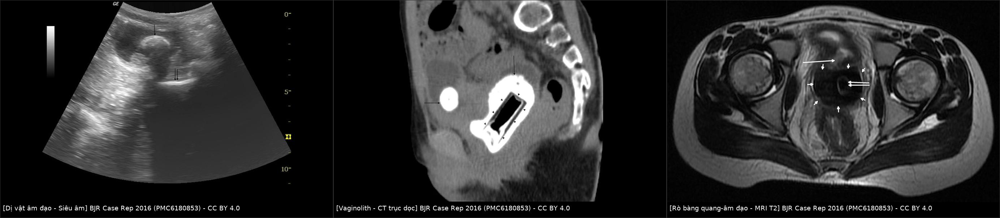
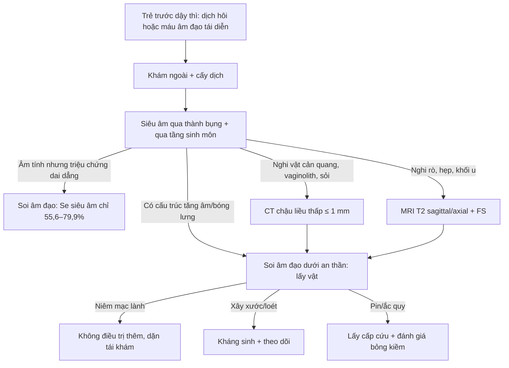
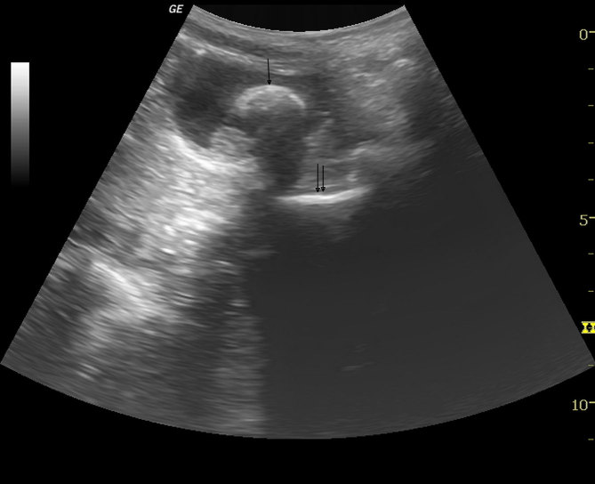
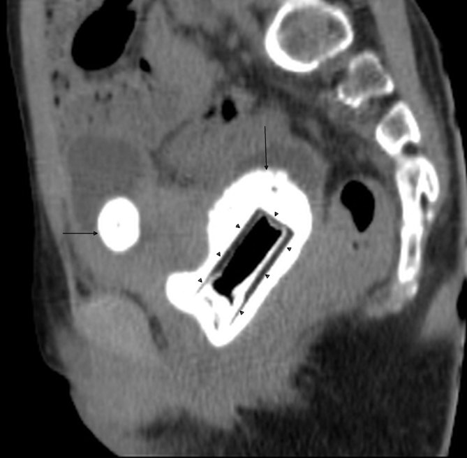
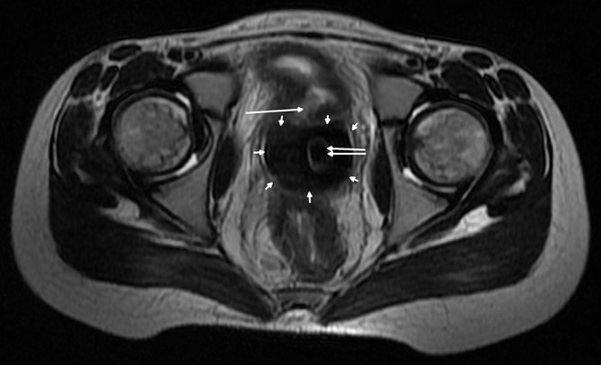
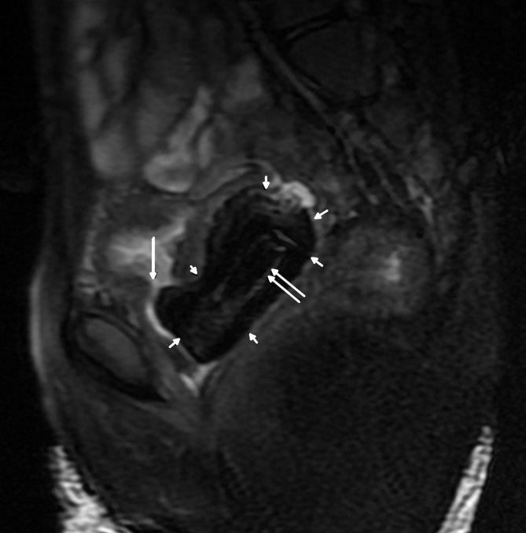

# 1735 — Dị vật âm đạo ở trẻ (chưa rò): dịch hôi tái diễn, siêu âm đầu tay, vaginolith và khi nào soi âm đạo

**Tags:** `pattern:di-vat` `pattern:bot-sang` `pattern:voi-hoa` `vung:am-dao` `vung:sinh-duc-nu` `vung:chau` `protocol:sieung-am` `protocol:CT-lieu-thap` `protocol:MRI` `protocol:noi-soi`
**Mức chắc chắn (certainty):** tổng hợp y văn (literature synthesis) — gộp **tổng quan hệ thống 75 bài/522 bệnh nhi** (PMID 38643730), **loạt 97 trẻ** (PMID 35129659), **73 trẻ đối chiếu siêu âm với soi âm đạo** (PMID 42057605), **104 trẻ/120 lần soi âm đạo** (PMID 39234926) và một **ca nguyên văn 12 tuổi có vaginolith + rò bàng quang–âm đạo** (PMC6180853). Chỗ nguồn không đưa số thì ghi "chưa rõ", không suy diễn.

> **Câu chốt:** dị vật âm đạo ở trẻ **không phải bệnh cảnh hiếm gặp trên phim** mà là bệnh cảnh **bị bỏ qua vì quá thường gặp trên lâm sàng**: trẻ ra **dịch hôi hoặc máu âm đạo tái diễn nhiều tháng**, được điều trị lặp lại như "viêm âm đạo", trong khi **siêu âm chỉ bắt được ~56–80%** và **phim bụng chỉ ~33%**. Chẩn đoán đúng nằm ở **nghi ngờ + siêu âm + soi âm đạo dưới an thần**, không nằm ở phim.
> Nối [1682 – Rò bàng quang–âm đạo ở trẻ](../1682-ro-bang-quang-am-dao-o-tre/lesson.md) (khi đã có rò), [1681 – Di chứng muộn niệu sinh dục](../1681-di-chung-muon-nieu-sinh-duc-be-gai-sau-chan-thuong-khung-chau/lesson.md) và [691 – Sỏi bàng quang ở trẻ](../691-soi-bang-quang-va-soi-quanh-catheter-o-tre/lesson.md).

## 1. Tổng quan bệnh học – cơ chế hình ảnh

### 1.1 Vì sao trẻ trước dậy thì dễ bị dị vật và vì sao nó "im lặng"

- **Niêm mạc mỏng, thiếu estrogen:** âm đạo trước dậy thì là **biểu mô trụ–lát mỏng, ít glycogen, pH trung tính**, không có lớp bảo vệ của lactobacillus → **dễ xây xước, dễ bội nhiễm** khi có vật lạ. Dị vật gây **loét do chèn ép (pressure necrosis)**, mô hạt (granulation tissue) và **tiết dịch mủ–máu**; vì vậy triệu chứng **không đặc hiệu** và giống viêm âm đạo.
- **Tại sao trẻ tự đưa vật vào:** giai đoạn 3–10 tuổi là lúc trẻ **khám phá cơ thể**, vật trong tầm tay là **giấy vệ sinh, khăn giấy, bông, nắp chai nhỏ, đồ chơi nhỏ**; đây cũng là lý do **vật thường mềm, không cản quang** → phim bụng âm tính.
- **Tại sao thành vaginolith (sỏi âm đạo):** dịch tiết giàu calci/phosphate + pH kiềm do nhiễm khuẩn + vật lạ làm **khuôn kết tủa** → muối calci lắng quanh vật theo thời gian. Trên CT, **vỏ calci dày, đậm độ cao (> 100 HU)** bao quanh **lõi giảm đậm độ (nhựa/khí)** của dị vật — đúng hình ảnh "vật trong vỏ trứng" của ca dưới đây. Thời gian tạo sỏi tính bằng **tháng đến năm**: ca nguyên văn giữ vật **1 năm** đã có vaginolith **53 × 29 × 33 mm**.
- **Tại sao biến chứng muộn là rò:** sỏi/vật lạ chèn ép thành âm đạo và thành sau bàng quang liên tục → **hoại tử thành → rò bàng quang–âm đạo (vesicovaginal fistula)**; sỏi âm đạo cũng là **nhân của sỏi bàng quang** khi cọ sát niêm mạc bàng quang. Hệ quả: **rỉ nước tiểu liên tục**, viêm thận–bể thận, và mổ vá rò trong mô viêm là ca khó.
- **Tại sao đa số không có rò:** rò cần **thời gian và chèn ép đủ lâu**; phần lớn ca được chẩn đoán khi còn **dị vật đơn thuần** — đây chính là cửa sổ để can thiệp trước khi thành rò.

### 1.2 Ngưỡng định lượng nằm lòng (bắt buộc nhớ)

| Chỉ số | Con số | Nguồn |
|---|---|---|
| Tuổi | **6 tháng – 16 tuổi**, trung bình **6 tuổi 3 tháng**; **88% trong 3–10 tuổi** (loạt 97 trẻ: 1,5–14,8 tuổi) | PMID 38643730; PMID 35129659 |
| Triệu chứng dẫn đầu | **ra máu âm đạo 172/340 (50,6%)** và **dịch âm đạo 134/340 (39,4%)**; loạt 97 trẻ: dịch lẫn máu/ra máu **48%** | PMID 38643730; PMID 35129659 |
| Vật thường gặp | **giấy vệ sinh/khăn giấy 155/447 (34,7%)**; loạt 97 trẻ: **vật cứng nhỏ 57%**, **vải/giấy 22%** | PMID 38643730; PMID 35129659 |
| Siêu âm (gộp) | **độ nhạy 79,9%** | PMID 38643730 |
| X-quang bụng | **độ nhạy 33,3%**, **âm tính giả nhiều hơn dương tính thật** | PMID 38643730 |
| Siêu âm qua thành bụng (TAUS) | **Se 55,6% · Sp 41,2% · độ chính xác 52,1%** (73 trẻ, chuẩn = soi âm đạo) | PMID 42057605 |
| Siêu âm qua tầng sinh môn (TPUS) | **Se 70,4% · Sp 29,4% · độ chính xác 60,6%** | PMID 42057605 |
| Biến chứng | **35/522 (6,7%)** — loét, nhiễm, vaginolith, rò, hẹp âm đạo | PMID 38643730 |
| Dấu hiệu xâm hại tình dục | **16/522 (3,1%)** — thiểu số, **không được quy kết mặc định** | PMID 38643730 |
| Soi âm đạo (104 trẻ, 120 lần) | **52/120 (43,3%)** có chẩn đoán dương; ra máu: **dị vật 12,7%**, viêm âm hộ–âm đạo 6,9%, **papilloma Müllerian 5,8%**, chấn thương 4,6%, **ung thư 2,3%**; dịch: **dị vật 20,6%**, viêm 20,6% | PMID 39234926 |
| Số lần soi để có chẩn đoán (NNI) | **2,4** khi ra máu, **2,1** khi ra dịch; để phát hiện ung thư **43,0** | PMID 39234926 |
| Ca nguyên văn | 12 tuổi, giữ **nắp sơn móng tay 1 năm**; vaginolith **53 × 29 × 33 mm**; sỏi bàng quang **28 × 25 × 18 mm**; **rò bàng quang–âm đạo** | PMC6180853 |

### 1.3 Vì sao hình ảnh thấy được (vật lý, không chỉ liệt kê dấu hiệu)

- **Siêu âm:** dị vật tạo **mặt phân cách âm trở kháng lớn** với mô mềm/dịch → **dải tăng âm (echogenic) kèm bóng lưng (posterior acoustic shadowing)**. Giấy vệ sinh mềm, thấm dịch, **không đủ chênh âm trở kháng** → có thể chỉ thấy "dịch trong âm đạo" và một dải tăng âm mờ; đây là lý do **Se 55,6–79,9%** chứ không phải 100%.
- **CT:** đậm độ phụ thuộc vật liệu — **nhựa/kim loại/pin → cản quang mạnh**, **giấy/gỗ → gần mô mềm**, **khí trong vật → giảm đậm độ**. Vỏ calci của vaginolith **> 100 HU** và thường **dày, đều, bao quanh lõi giảm đậm độ**. CT **không cần cản quang**, lát **≤ 1 mm**, liều thấp ở trẻ.
- **MRI:** calci **mất tín hiệu trên mọi chuỗi (tối đen)**, vật nhựa **tín hiệu trung bình–thấp**, dịch ứ **T2 sáng**. Vì vậy MRI không dùng để "tìm vật" mà để **đánh giá biến chứng**: khuyết thành sau bàng quang (rò), hẹp âm đạo xơ, dịch ứ buồng tử cung (pyocolpos). Trên T2 **xung dày ≤ 3 mm** mới thấy được khuyết thành nhỏ.

## 2. Mẫu hình + chẩn đoán phân biệt theo vị trí (gamut)

**Mẫu hình khởi đầu:** trẻ **trước dậy thì**, **dịch âm đạo hôi và/hoặc máu âm đạo tái diễn > 2–4 tuần**, khám ngoài **bình thường hoặc chỉ viêm đỏ tiền đình**.

- **Trong lòng âm đạo:** dị vật (giấy, vải, nắp nhựa, pin), **vaginolith**, viêm âm đạo do tụ cầu/liên cầu/vi khuẩn kỵ khí, **papilloma Müllerian**, **rhabdomyosarcoma thể chùm nho (botryoid RMS)** — u ác hay gặp nhất ở âm đạo trẻ nhỏ, **sa ra ngoài như chùm nho**.
- **Cổ tử cung/buồng tử cung:** polyp cổ tử cung, **pyocolpos** do tắc màng trinh, dị vật đẩy sâu, u cơ trơn (rất hiếm).
- **Ngoài âm đạo nhưng gây triệu chứng âm đạo:** **dị vật bàng quang** (sỏi, rỉ tiểu), **rò niệu quản lạc chỗ**, **dị vật hậu môn/trực tràng**, **lichen sclerosus** (ngứa, trắng da, không mùi hôi).
- **Toàn thân:** **dậy thì sớm** (ra máu đều chu kỳ, tuyến vú phát triển), **rối loạn đông máu** (chảy máu kèm vết bầm, tiền sử gia đình), **suy giáp** (ra máu kèm chậm phát triển).
- **Do can thiệp/người lớn:** **xâm hại tình dục** (3,1%), **chấn thương khung chậu** (thường kèm di chứng niệu dục muộn — bài 1681).

**Mnemonic theo vị trí — "V-A-G-I-N-A":** **V**ật lạ, **A**m đạo viêm, **G**iấy/vải (vật mềm), **I** nhiễm khuẩn, **N**ang/papilloma, **A**c (ung thư: RMS).

## 3. Bảng so sánh phân biệt (ma trận đối chiếu)

| Thực thể (entity) | Hình ảnh điển hình | Chốt vào (rule-in) | Chốt loại (rule-out) | Gợi ý xác nhận |
|---|---|---|---|---|
| **Dị vật âm đạo đơn thuần** | US: **dải tăng âm + bóng lưng** trong lòng âm đạo, dịch ít; CT: cấu trúc đậm độ khác mô mềm, có thể có khí | **Dải tăng âm có bóng lưng + lệch trục âm đạo trên US** | Âm đạo rỗng, không bóng lưng, chỉ dịch → nghi viêm đơn thuần | Soi âm đạo dưới an thần (chuẩn vàng), lấy vật |
| **Vaginolith** | **Vỏ calci dày > 100 HU** bao lõi giảm đậm độ; trên T2 **viền tối đen**; thường kèm sỏi bàng quang | **Vỏ calci bao quanh lõi khác đậm độ** = vật lạ hóa sỏi | Chỉ có sỏi bàng quang, âm đạo trống → không phải vaginolith | CT ≤ 1 mm; soi âm đạo lấy cả vật + sỏi |
| **Viêm âm hộ–âm đạo** | Không có cấu trúc trong lòng; niêm mạc dày, dịch; **không bóng lưng** | **Dịch + niêm mạc viêm, không có cấu trúc chiếm chỗ** | Có dải tăng âm/bóng lưng → phải loại dị vật | Cấy dịch; soi âm đạo nếu tái diễn |
| **Papilloma Müllerian** | Nốt nhỏ **sa ra tiền đình**, US thấy nốt đặc nhỏ ở cùng đồ; **lành tính** | **Nốt nhỏ, mềm, không calci, không phá hủy** | Nốt lớn, hoại tử, chảy máu nhiều → nghĩ RMS | Sinh thiết/cắt bỏ qua soi |
| **Rhabdomyosarcoma thể chùm nho** | Khối **sa ra ngoài như chùm nho**, **T2 trung bình–cao**, ngấm thuốc mạnh, **không calci** | **Khối thịt sa ra tiền đình ở trẻ < 5 tuổi** | Tổn thương chỉ trong lòng, có vỏ calci → dị vật/vaginolith | MRI + sinh thiết (không nạo mù) |
| **Dậy thì sớm** | Tử cung to, **nội mạc dày**, buồng trứng có nang; **không có cấu trúc trong âm đạo** | **Tuyến vú + tử cung to + nang buồng trứng** | Không có dấu hiệu dậy thì → loại | X-quang tuổi xương, hormon |
| **Xâm hại/chấn thương** | Rách màng trinh, bầm tím, có thể có vật lạ; **không có vỏ calci** | **Tổn thương cấp + bối cảnh** | Tổn thương mạn, không đau → nghĩ dị vật bỏ quên | Khám pháp y, soi âm đạo, chụp theo quy trình |

*Trái: siêu âm — sỏi bàng quang (mũi tên) và bóng tăng âm trong âm đạo (mũi tên đôi). Giữa: CT trục dọc — vaginolith vỏ calci bao quanh lõi giảm đậm độ của nắp nhựa (đầu mũi tên). Phải: MRI T2 trục ngang — viền tối đen của calci, khuyết thành sau bàng quang (rò). BJR Case Rep 2016 (PMC6180853), CC BY 4.0; ảnh ghép letterbox.*

### Ba dấu hiệu quyết định trên mặt cắt

- **"Vật trong vỏ trứng" (calcified rim + lucent core):** đây là **chốt vào của vaginolith**, không phải sỏi bàng quang di chuyển — sỏi bàng quang **đặc hoặc có nhân**, nằm trong lòng bàng quang, **không có lõi khí/nhựa**.
- **Bóng lưng (posterior shadowing) định vị theo trục âm đạo:** trên siêu âm **trục dọc qua tầng sinh môn**, bóng lưng nằm **sau bàng quang và trước trực tràng**; nếu bóng lưng nằm trong bàng quang thì đó là sỏi tiết niệu, không phải dị vật âm đạo.
- **Mất liên tục thành sau bàng quang trên T2:** khuyết thành **kèm dịch/khí trong bàng quang** = rò; cần **thì đi tiểu** (VCUG/CT cystography) để thấy rò mà thì nghỉ không thấy (nguyên lý "van một chiều" của VVF — bài 1682).

## 4. Protocol chụp + hệ phân độ/điểm chuẩn hóa

### 4.1 Thứ tự đúng (không chụp ngược)

1. **Khám ngoài + hỏi bệnh kín đáo** (không thăm khám bằng ngón tay/mỏ vịt ở trẻ chưa dậy thì), lấy mẫu dịch nếu có.
2. **Siêu âm bụng–chậu:**
   - **Qua thành bụng với bàng quang đầy** (bơm nước tiểu hoặc chờ): đánh giá tử cung, buồng trứng, dịch ứ, sỏi bàng quang.
   - **Qua tầng sinh môn (transperineal) trục dọc + ngang:** đây là cửa sổ tốt nhất để thấy **dị vật trong âm đạo** (Se 70,4% so với 55,6% của TAUS) — nhưng **Sp chỉ 29,4%**, nên **dương tính giả vẫn phải soi xác nhận**.
3. **X-quang bụng: KHÔNG dùng để loại trừ** (Se 33,3%). Chỉ dùng khi nghi **pin/ắc quy hoặc vật kim loại**.
4. **CT chậu liều thấp, không cản quang, lát ≤ 1 mm** khi: nghi vật cản quang/vaginolith, cần mô tả **vị trí tương quan với bàng quang–trực tràng**, hoặc có sỏi bàng quang mà chưa rõ nguồn.
5. **MRI 1,5 T (T2 sagittal + axial, T2 FS, ± DWI)** khi nghi **rò, hẹp âm đạo, hoặc khối u** — không phải để "tìm vật".
6. **Soi âm đạo dưới an thần = tiêu chuẩn vàng** (chẩn đoán + điều trị một thì): dùng **ống soi mềm/ hysteroscope cỡ nhỏ**, bơm dịch ấm để mở lòng, **lấy toàn bộ vật**, kiểm tra **toàn bộ niêm mạc**, cấy mủ, và **soi lại nếu còn nghi**.

> **Ngưỡng hành động:** **siêu âm âm tính không loại trừ** khi triệu chứng kéo dài — với **Se 55,6–79,9%**, cứ **4–5 trẻ có dị vật thì 1–2 trẻ bị bỏ sót**; NNI để có chẩn đoán chỉ **2,4** → **soi âm đạo sớm là hợp lý về chi phí chẩn đoán**.

### 4.2 Xử trí sau khi lấy vật

| Tình huống | Xử trí | Căn cứ |
|---|---|---|
| Niêm mạc **nguyên vẹn** | **Không cần điều trị thêm**, hẹn khám lại nếu triệu chứng tái diễn | 97 trẻ: hồi phục hoàn toàn sau lấy vật, không cần điều trị thêm (PMID 35129659) |
| Niêm mạc **xây xước/loét** | **Kháng sinh** chống bội nhiễm, theo dõi 1–2 tuần | cùng nguồn |
| **Pin/ắc quy (button battery)** | **Lấy CẤP CỨU** — bỏng kiềm tiến triển trong **giờ**, gây hoại tử và rò | ca 8 tuổi bỏng kiềm niêm mạc âm đạo (PMID 25817765); loạt 97 trẻ: ca pin đĩa có triệu chứng nặng nhất |
| **Vaginolith/rò/hẹp** | Lấy vật + xử trí rò/hẹp theo bài 1682; **không vá rò trong mô viêm cấp** | PMC6180853; bài 1682 |

### 4.3 Sơ đồ tiếp cận

> **Không có hệ phân độ/điểm chuẩn hóa cho dị vật âm đạo.** Cái cần "chấm điểm" là **mức độ tổn thương niêm mạc** và **sự hiện diện của biến chứng** (vaginolith, rò, hẹp) — ghi rõ trong biên bản soi, không dùng RADS.

## 5. Biến thể bình thường và cạm bẫy

- **Biến thể bình thường dễ nhầm:** **nang Gartner/ống Müllerian tồn tại** (nang dọc thành trước âm đạo, dịch trong, không bóng lưng); **màng trinh có lỗ nhỏ** gây ứ dịch (pyocolpos) — khác dị vật ở chỗ **không có cấu trúc đặc trong lòng** và **không bóng lưng**.
- **Bẫy 1 — "viêm âm đạo tái phát":** trẻ được điều trị kháng sinh/kháng nấm nhiều đợt vì dịch hôi, không ai soi âm đạo. Trong tổng quan hệ thống, **dịch âm đạo là lý do soi phổ biến** và **20,6% có dị vật**; bỏ sót kéo dài **hàng tháng đến hàng năm** → vaginolith, rò (ca nguyên văn: **1 năm**, vaginolith 53 mm + rò).
- **Bẫy 2 — tin phim bụng:** X-quang **Se 33,3%**, **âm tính giả nhiều hơn dương tính thật** vì vật nhựa/giấy **không cản quang** và bị xương chậu che. **Phim bụng bình thường không loại trừ bất cứ điều gì.**
- **Bẫy 3 — bỏ sót "kẻ bắt chước":** có **sỏi bàng quang** không có nghĩa là xong — sỏi bàng quang ở trẻ gái **có thể thứ phát sau dị vật âm đạo/vaginolith**; phải soi âm đạo tìm vật (ca nguyên văn có **cả hai**: sỏi bàng quang 28 × 25 × 18 mm + vaginolith).
- **Bẫy 4 — bóng lưng của khí trong trực tràng/bàng quang** bị đọc nhầm là dị vật; luôn đối chiếu **vị trí giải phẫu** trên hai mặt cắt trực giao.
- **Bẫy 5 — quy kết xâm hại tình dục:** chỉ **3,1%** ca có bằng chứng; đa số do trẻ tự đưa vật vào. **Không được** kết luận xâm hại chỉ vì có dị vật, nhưng **phải** khám theo quy trình và ghi nhận tổn thương.
- **Bẫy 6 — lấy vật mà không kiểm tra toàn bộ âm đạo:** có ca **nhiều vật** hoặc vật **đẩy sâu sau cùng đồ**; soi đến cùng đồ, bơm dịch, kiểm tra 360°.

## 6. Tự lượng giá — Blind Quiz

**Ca 1 — Bé gái 12 tuổi, rỉ nước tiểu liên tục 6 tháng, khám thấy viêm đỏ vùng âm hộ.**

- Gợi ý lâm sàng: trước dậy thì, **không đái dầm**, rỉ tiểu liên tục; không sốt.
- Câu hỏi: Có mấy bất thường? Cấu trúc nào nằm **sau bàng quang**? Cần làm gì tiếp theo và **không** được làm gì?

<b>Bấm để hiện đáp án (findings + chẩn đoán)</b>

- **Findings:** (1) sỏi bàng quang — ổ tăng âm hình vòm kèm bóng lưng trong lòng bàng quang (mũi tên); (2) **dải tăng âm có bóng lưng nằm sau bàng quang, trước trực tràng** = dị vật trong âm đạo (mũi tên đôi).
- **Chẩn đoán:** **dị vật âm đạo bỏ quên** đã gây **sỏi bàng quang**; rỉ tiểu liên tục gợi ý **rò bàng quang–âm đạo** (cần VCUG/CT cystography thì đi tiểu).
- **Vì sao:** vật lạ tạo mặt phân cách âm trở kháng lớn → tăng âm + bóng lưng; sỏi bàng quang hình thành trên nền viêm do vật cọ sát.
- **Không được:** tin phim bụng âm tính, hoặc chỉ điều trị sỏi bàng quang mà bỏ âm đạo.
- Nguồn ảnh: BJR Case Rep 2016 (**PMC6180853**), Hình 1, CC BY 4.0.

**Ca 2 — Cùng bệnh nhi, CT chậu không cản quang.**

- Câu hỏi: Mô tả **hai lớp** của khối trong âm đạo. Vì sao có **lõi giảm đậm độ**? Chẩn đoán?

<b>Bấm để hiện đáp án</b>

- **Findings:** khối **53 × 29 × 33 mm** trong âm đạo với **vỏ calci dày** bao quanh **lõi giảm đậm độ 36 × 18 mm có khí bên trong** (đầu mũi tên); sỏi bàng quang **28 × 25 × 18 mm** (mũi tên ngang).
- **Chẩn đoán:** **vaginolith** trên **nắp nhựa sơn móng tay** giữ **1 năm**.
- **Vì sao:** muối calci kết tủa quanh vật xốp theo thời gian → vỏ > 100 HU; lõi nhựa + khí giữ đậm độ thấp → hình "vật trong vỏ trứng".
- **Clincher:** vỏ calci **bao quanh** một cấu trúc **không phải mô** — không gặp ở sỏi tiết niệu.
- Nguồn ảnh: BJR Case Rep 2016 (**PMC6180853**), Hình 2, CC BY 4.0.

**Ca 3 — Cùng bệnh nhi, MRI T2 trục ngang.**

- Câu hỏi: Dấu hiệu nào chứng minh **đã có rò**? Vì sao phải chụp **thì đi tiểu**?

<b>Bấm để hiện đáp án</b>

- **Findings:** **khuyết thành sau bàng quang** (mũi tên lớn) đối diện **vaginolith viền tối đen** (nhiều mũi tên nhỏ) và **dị vật tín hiệu trung bình** (mũi tên đôi).
- **Chẩn đoán:** **rò bàng quang–âm đạo** do chèn ép mạn của vaginolith.
- **Vì sao:** calci **mất tín hiệu trên T2** → viền đen; rò chỉ thấy khi **có dòng nước tiểu qua lỗ rò**, nên phải chụp **thì đi tiểu** (VCUG/CT cystography) — thì nghỉ có thể bỏ sót.
- **Xử trí:** lấy vật, xử trí sỏi, vá rò **khi hết viêm** (bài 1682).
- Đối chiếu thêm mặt cắt dọc có xóa mỡ — lỗ rò và mức độ lan của viêm quanh âm đạo rõ hơn:

- Nguồn ảnh: BJR Case Rep 2016 (**PMC6180853**), Hình 4 và Hình 5, CC BY 4.0.

## Bài liên quan chéo

- [600 – Tổng quan Nhi khoa](../600-tong-quan-nhi-khoa/lesson.md)
- [1682 – Rò bàng quang–âm đạo ở trẻ](../1682-ro-bang-quang-am-dao-o-tre/lesson.md)
- [1734 – Rò trực tràng–âm đạo ở trẻ](../1734-ro-truc-trang-am-dao-o-tre/lesson.md)
- [1681 – Di chứng muộn niệu sinh dục ở bé gái](../1681-di-chung-muon-nieu-sinh-duc-be-gai-sau-chan-thuong-khung-chau/lesson.md)
- [691 – Sỏi bàng quang và sỏi quanh catheter ở trẻ](../691-soi-bang-quang-va-soi-quanh-catheter-o-tre/lesson.md)
- [643 – Chấn thương dây chậu sinh dục nhi](../643-chan-thuong-day-chau-sinh-duc-nhi/lesson.md)

> Không dùng để chẩn đoán độc lập khi chưa có người hướng dẫn.
