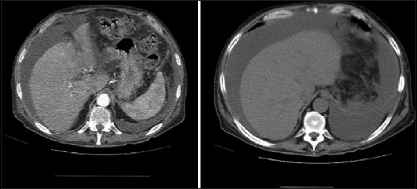
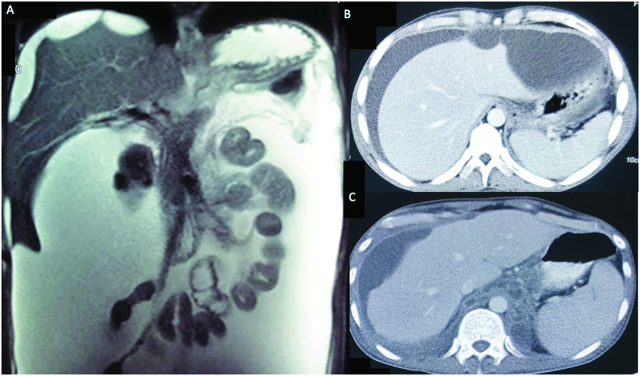
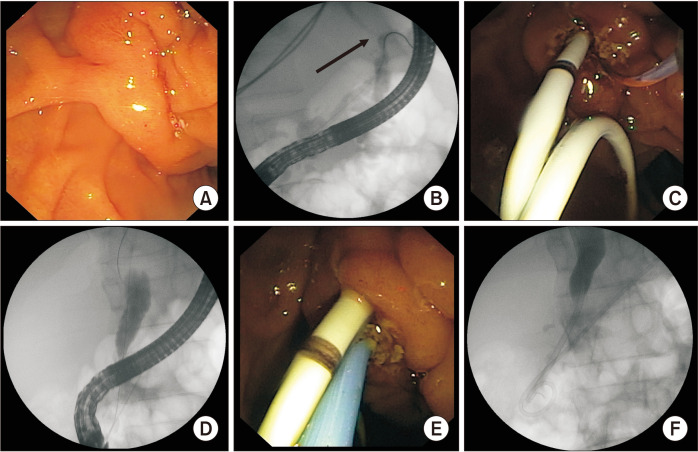
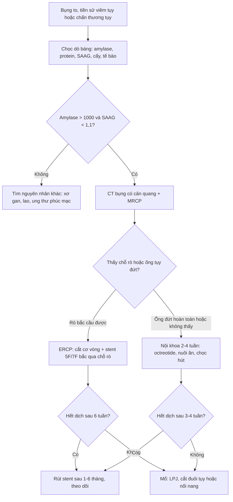
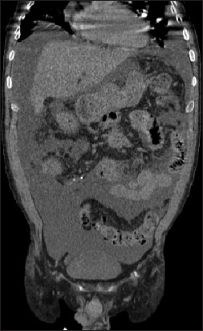
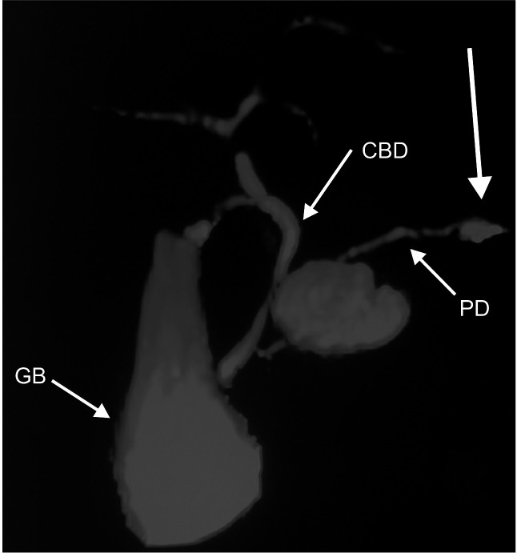

# 1736 — Cổ trướng tụy và rò tụy nội bộ (pancreatic ascites / internal pancreatic fistula)

**Tags:** `pattern:co-truong-tuy` `pattern:dich-tiet-amylase-cao` `pattern:ro-ong-tuy` `pattern:ong-tuy-dut` `pattern:gia-nang-tuy-vo` `pattern:co-truong-gia-xo-gan` `pattern:scalloping-tang` `vung:tuy` `vung:phuc-mac` `vung:o-bung` `vung:mong-phoi` `protocol:CT-bung` `protocol:MRCP` `protocol:ERCP` `protocol:EUS` `protocol:choc-do-bang` `protocol:noi-soi-o-bung` `score:SAAG`
**Mức chắc chắn (certainty):** tổng hợp y văn (literature synthesis) — 1 tổng quan cập nhật 2025, 1 đoàn hệ nội soi can thiệp 68 ca, 1 đoàn hệ nội soi can thiệp 53 ca, 1 loạt phẫu thuật 14 ca, 1 loạt 3 ca về dấu scalloping, và 1 ca lâm sàng gần đây. **Không có RCT**, không có guideline chuẩn hóa — chính tổng quan 2025 cũng ghi rõ điều này; mọi ngưỡng dưới đây là tổng hợp từ các loạt quan sát.

> **Vì sao bài này quan trọng:** bài **1730** vừa chốt **hội chứng ống tụy đứt (DPDS)** — nơi ống tụy mất liên tục và đuôi tụy "sống" trong ổ dịch; **1683** chốt hoại tử tụy nhiễm khuẩn; nhưng thể **dịch tụy chảy tự do vào phúc mạc** lại **không có ổ dịch khu trú nào để nhìn thấy** — bệnh nhân chỉ có **bụng to ra**, và hình ảnh chỉ là **dịch báng**. Đây là lý do chẩn đoán muộn nhất trong nhóm biến chứng tụy, và là lý do **chọc dò báng mà không gửi amylase** là sai lầm hay gặp nhất.

> **Sửa tiền đề của backlog (trung thực nguồn):** backlog ghi ngưỡng **"amylase dịch báng > 1.000 U/L"**. Y văn dùng nhiều đơn vị khác nhau: tổng quan 2025 viết **> 1.000 mg/dL** (đơn vị trong bài gốc), các loạt can thiệp viết **> 1.000 IU/dL** hoặc **> 1.000 S units/100 mL**. Bài này giữ con số **1.000** và ghi rõ **đơn vị theo từng nguồn**, đồng thời nhấn mạnh **amylase huyết thanh bình thường không loại trừ** — vì đây mới là điểm quyết định trên lâm sàng.

## 1. Tổng quan bệnh học – cơ chế hình ảnh – vì sao "chỉ thấy dịch báng"

- **Định nghĩa:** **cổ trướng tụy (pancreatic ascites)** là dịch báng **giàu amylase** do tụy rò dịch vào **khoang phúc mạc**. Cùng nhóm với **tràn dịch màng phổi do tụy** (rò ra sau phúc mạc → trung thất → màng phổi); cả hai gọi chung là **rò tụy nội bộ (internal pancreatic fistula, IPF)**.
- **Cơ chế — vì sao trước hay sau:** ống tụy **vỡ thành trước** → dịch vào **phúc mạc** → **cổ trướng**; vỡ **thành sau** → dịch vào **khoang sau phúc mạc/trung thất** → **tràn dịch màng phổi** (thường **trái**). Đây là lý do **cùng một tổn thương ống tụy** cho hai bệnh cảnh hoàn toàn khác nhau trên hình ảnh.
- **Nguyên nhân:** **viêm tụy mạn** (thường do rượu) và **chấn thương tụy**; cơ chế hay gặp nhất là **nang giả tụy vỡ** — chiếm **tới 80%** ca cổ trướng tụy, **20%** còn lại do **vỡ trực tiếp ống tụy**. Ở **viêm tụy cấp hoại tử**, hoại tử biểu mô ống làm ống mất chức năng → rò.
- **Tần suất định lượng:** cổ trướng tụy chiếm **0,4–1,0%** mọi ca cổ trướng (Mỹ), **3,2%** trong một loạt Trung Quốc; gặp ở **4%** bệnh nhân viêm tụy mạn (loạt khác **3,5%**) và **6–14%** bệnh nhân **nang giả tụy**; IPF chiếm **< 1%** biến chứng của viêm tụy mạn (loạt phẫu thuật 411 ca: **3,4%**). Tuổi hay gặp **20–50**, nam nhiều hơn nữ.
- **TẠI SAO dịch báng lại "tự duy trì":** dịch tụy giàu **amylase/lipase** gây **viêm phúc mạc hóa học** → tăng tính thấm mao mạch → **thoát dịch tiếp tục**; kèm **dẫn lưu bạch mạch bị suy giảm** → dịch tích lại. Đây là lý do **chọc hút đơn thuần không chữa khỏi**: phải **cắt nguồn rò** (stent bắc qua chỗ rò hoặc mổ).
- **TẠI SAO hình ảnh chỉ thấy "dịch báng":** dịch tự do **không có vỏ**, lan theo khoang phúc mạc → trên CT chỉ là **dịch đồng tỷ trọng nước** ở mọi khoang, **không có thành**; trong khi **nang giả tụy** là **khối có vỏ xơ** khu trú. Vì vậy **không thể chẩn đoán bằng hình ảnh đơn thuần** — chẩn đoán là **hóa sinh dịch báng**.
- **Vì sao CT bỏ sót đường rò:** CECT chỉ thấy **chỗ rò 48,5%** (loạt 68 ca), **50%** trong loạt của O'Toole; **phối hợp với MRCP nâng lên 94%**. **MRCP** có độ nhạy **~90%**, đặc hiệu cao, **không xâm lấn**; **ERCP** là **chuẩn vàng** vì vừa thấy đường rò (**98,4%** trong loạt 63 ca đặt stent được) vừa điều trị được.
- **Ngưỡng định lượng cần nhớ:** amylase dịch báng **> 1.000** (U/L hoặc IU/dL theo nguồn); protein dịch báng **> 3 g/dL**; **SAAG < 1,1 g/dL** (dịch tiết, **không** do tăng áp cửa). **Amylase huyết thanh thường bình thường hoặc chỉ tăng nhẹ** → **không dùng để loại trừ**.

## 2. Mẫu hình + chẩn đoán phân biệt theo vị trí (Gamut)

Bốn câu hỏi trước khi gọi "cổ trướng do xơ gan": **(1) SAAG bao nhiêu? (2) amylase dịch báng bao nhiêu? (3) có ổ dịch/nang giả quanh tụy không? (4) có đường rò ống tụy trên MRCP/ERCP không?**

- **A. Cổ trướng tụy "thuần" (không ổ dịch khu trú):** bụng to, **SAAG < 1,1**, **amylase dịch báng rất cao** (có ca **60.000 U/L**), **không thấy nang giả**; CT chỉ có dịch. Đây là thể **dễ chẩn đoán nhầm xơ gan nhất**.
- **B. Cổ trướng tụy sau vỡ nang giả:** có **nang giả** (gặp **71,4%** trong loạt phẫu thuật) + dịch báng; trên CT thấy **vỏ nang mất liên tục** ở chỗ vỡ.
- **C. Cổ trướng "phức tạp" sau viêm tụy hoại tử:** dịch báng + **ổ hoại tử/tụ dịch quanh tụy**; dễ nhầm với **WON bội nhiễm** — nhưng **khí trong ổ** mới là dấu nhiễm (bài 1683), còn **dịch báng tự do** là dấu rò.
- **D. Tràn dịch màng phổi do tụy (thể sau):** tràn dịch **lượng nhiều, thường trái**, **amylase dịch màng phổi rất cao**, **không có nguyên nhân tim–phổi**; có thể **kèm cổ trướng** (**20,8%** ca trong loạt 53 bệnh nhân).
- **E. Rò tụy–dạ dày/ruột non (pancreatico-enteric fistula):** hiếm, thường sau can thiệp; hình ảnh **hơi trong ổ dịch/ống tụy**, tiêu chảy phân mỡ.
- **F. Thể "giả cổ trướng do tăng áp cửa" ở bệnh nhân xơ gan có sẵn:** bệnh nhân **xơ gan + viêm tụy mạn** → **SAAG > 1,1** vẫn có thể **kèm** cổ trướng tụy; **SAAG cao không loại trừ** nếu amylase dịch báng cao.

**Gamut theo hình ảnh "dịch báng + bất thường tụy":** cổ trướng tụy, nang giả tụy vỡ, DPDS, WON, ung thư tụy gây cổ trướng ác tính, lao phúc mạc, giả nhầy phúc mạc, cổ trướng do xơ gan, hội chứng Budd–Chiari.

## 3. Bảng so sánh phân biệt (ma trận đối chiếu)

| Thực thể (entity) | Hình ảnh điển hình | Chốt vào (rule-in) | Chốt loại (rule-out) | Gợi ý xác nhận |
|---|---|---|---|---|
| **Cổ trướng tụy** | Dịch tự do nhiều, **không vỏ**, có/không nang giả; tụy teo–vôi hóa (viêm mạn) | **Amylase dịch báng > 1.000**, **protein > 3 g/dL**, **SAAG < 1,1** | **SAAG > 1,1 + amylase dịch báng thấp** → loại | **Chọc dò + amylase**; MRCP/ERCP tìm rò |
| **Cổ trướng do xơ gan** | Gan **bờ nham nhở**, lách to, tuần hoàn bàng hệ, dịch tự do | **SAAG ≥ 1,1 g/dL**, amylase dịch báng **thấp** | **Amylase rất cao** → loại xơ gan đơn thuần | SAAG, albumin, Doppler cửa, elastography |
| **Nang giả tụy** | **Khối có vỏ xơ**, dịch khu trú cạnh tụy, có thể chèn ép dạ dày | **Vỏ nang rõ + không có dịch tự do lan tỏa** | **Dịch tự do khắp ổ bụng** → không phải nang đơn thuần | CT/MRI; amylase dịch nang |
| **DPDS (ống tụy đứt)** | **Đuôi tụy "sống" trong ổ dịch**, ống mất tín hiệu **≥ 2 cm**, teo đuôi tụy | **MRCP: mất liên tục ống + ổ dịch bao quanh đuôi tụy** | **Ống liên tục + rò bắc cầu được bằng stent** → không phải DPDS | MRCP, ERCP; xem bài 1730 |
| **WON bội nhiễm** | Ổ hoại tử có vỏ, **khí trong ổ**, đông đặc quanh | **Khí trong ổ + sốt + WBC tăng** | **Không khí, dịch tự do** → nghiêng cổ trướng tụy | CT, cấy dịch; xem bài 1683 |
| **Cổ trướng ác tính** | **Scalloping** tạng, nốt phúc mạc, dày mạc treo, **bướu nguyên phát** | **Tế bào ác tính trong dịch + nốt phúc mạc** | **Amylase rất cao + tụy bệnh lý** → loại | Cytology dịch báng, CT ngực–bụng, CA 19-9 |
| **Lao phúc mạc** | **Scalloping**, dày phúc mạc, hạch, **dịch tiết** | **PCR/IGRA + ADA cao + hình ảnh phúc mạc dày** | **Amylase > 1.000** → loại lao đơn thuần | PCR lao dịch báng, nội soi ổ bụng + sinh thiết |
| **Giả nhầy phúc mạc** | **Scalloping** rõ, **dịch nhầy**, vôi hóa | **Dịch nhầy + tế bào nhầy + u ruột thừa** | **Amylase rất cao** → loại | Cytology, CT, phẫu thuật |
| **Tràn dịch màng phổi do tụy** | Tràn dịch **trái** lượng nhiều, không có ổ phổi | **Amylase dịch màng phổi rất cao** | **Amylase thấp** → loại | Chọc dò màng phổi + MRCP |

*Nam 67 tuổi, viêm tụy hoại tử nặng có cổ trướng tụy và tràn dịch màng phổi: CT có cản quang — **dịch tự do lan tỏa** trong ổ bụng (không có vỏ), kèm ổ hoại tử/tụ dịch quanh tụy. Dấu chốt để phân biệt với **nang giả tụy** (khối có vỏ, khu trú). Nguồn: Bathobakae L et al., *Ann Gastroenterol* 2025 (PMC12070342) Fig. 1, **CC BY-NC-SA 4.0**.*

### Dấu hiệu "bẫy" trên CT: scalloping tạng

- **Scalloping (lõm bờ tạng)** — bờ **gan/lách** bị **lõm hình cung** do khối/dịch ngoài tạng ép vào — kinh điển của **giả nhầy phúc mạc** và **carcinomatosis phúc mạc**, nhưng **cũng gặp trong cổ trướng tụy** (3 ca: **16 tuổi** chấn thương tụy, amylase dịch báng **60.000 U/L**; **31 tuổi** viêm tụy cấp do rượu; **54 tuổi** viêm tụy chấn thương độ 4).
- **Hệ quả:** thấy scalloping **không được** kết luận ung thư; phải **gửi amylase dịch báng** và tìm bệnh tụy. Cơ chế: **dịch/ổ dịch tụy ép lên mặt tạng**.

*Ba ca cổ trướng tụy: (A) MRI T2W — cổ trướng lượng nhiều + **lõm bờ gan**; (B) CT — lõm **thùy trái gan** kèm dịch và ổ dịch; (C) CT — cổ trướng + **bờ gan bị lõm**. Dấu hiệu này **không đặc hiệu** cho ung thư. Nguồn: Kumar A et al., *Pleura Peritoneum* 2020 (PMC7469503) Fig. 1, **CC BY 4.0**.*

## 4. Protocol chụp – xét nghiệm + thuật toán xử trí

**Bước 1 — chọc dò báng (bắt buộc, vừa chẩn đoán vừa điều trị):** gửi **amylase, protein, albumin (tính SAAG), LDH, tế bào, cấy, cytology**. Ngưỡng: **amylase > 1.000**, **protein > 3 g/dL**, **SAAG < 1,1 g/dL**.

**Bước 2 — hình ảnh:** **CT bụng có cản quang** (đánh giá tụy, nang giả, ổ hoại tử, biến chứng mạch) → **MRCP** (tìm chỗ rò, đánh giá ống tụy; độ nhạy **~90%**) → **ERCP** khi nghi rò và có ý định can thiệp (chuẩn vàng, thấy rò **98,4%**). **EUS** khi MRCP/ERCP không kết luận, hoặc để **chọc hút ổ dịch đo amylase**.

**Bước 3 — điều trị theo bậc:**
1. **Nội khoa 2–4 tuần:** nhịn ăn/ăn ít mỡ, **nuôi ăn tĩnh mạch hoặc qua ống mũi–hỗng tràng**, **octreotide** (100 µg × 3/ngày dưới da hoặc truyền), chọc hút báng giải áp. Tỉ lệ thành công **25–60%** sau 1 tháng; **thất bại 40–60%**; mốc chờ **3–4 tuần** là **kinh nghiệm, không phải bằng chứng**.
2. **Nội soi can thiệp (endotherapy):** **cắt cơ vòng Oddi + đặt stent nhựa 5F/7F bắc qua chỗ rò**; rút stent sau **1–6 tháng** hoặc khi hết dịch. Loạt **68 ca**: kỹ thuật thành công **92,6%**, hết rò sau **6 tuần 76,4%**, **đặt stent vượt qua chỗ rò là yếu tố duy nhất dự báo thành công (OR 6,5; 95% CI 1,211–34,94; p = 0,03)**; viêm tụy nhẹ sau thủ thuật **8,1%**. Loạt **53 ca**: hết cổ trướng/tràn dịch **73,6%**.

*(A) Núm tá lớn; (B) chụp ống tụy — **rò ở đuôi tụy** (mũi tên); (C) **stent nhựa bắc qua chỗ rò** sau cắt cơ vòng; (D–F) các thì đặt stent và kiểm tra. Đây là can thiệp có bằng chứng tốt nhất: bắc qua chỗ rò → hết rò **76,4%** sau 6 tuần. Nguồn: Sundaram S et al., *Ann Hepatobiliary Pancreat Surg* 2022 (PMC9721253) Fig. 2, **CC BY-NC 4.0**.*

3. **Mổ:** khi thất bại nội khoa + nội soi, hoặc **DPDS/ống đứt hoàn toàn** không bắc cầu được. Chọn theo giải phẫu: **nối tụy–hỗng tràng bên–bên (LPJ)** khi ống **> 7 mm** (làm **78,5%** ca trong loạt 14), **cắt đuôi tụy** khi rò ở đuôi, **nối nang–hỗng tràng** khi có nang giả. Loạt 14 ca: **không tử vong chu phẫu**, biến chứng **28,5%**, **đái tháo đường mới 30,7%**, **không tái phát sau 60 tháng**.

**Theo dõi:** amylase dịch báng/ dịch dẫn lưu, lượng dịch, cân nặng, albumin; **CT/MRCP lặp** nếu dịch không giảm sau 2 tuần; kiểm tra **đái tháo đường** sau mổ (30,7% ca mới mắc).

## 5. Biến thể bình thường và cạm bẫy

- **Cạm bẫy 1 — chọc dò rồi không gửi amylase:** đây là lỗi hay gặp nhất; dịch "vàng chanh" trông như xơ gan. **Amylase dịch báng là xét nghiệm quyết định**, không phải amylase máu.
- **Cạm bẫy 2 — amylase huyết thanh bình thường:** trong cổ trướng tụy, **amylase/lipase máu thường bình thường hoặc chỉ tăng nhẹ** (viêm tụy "cận lâm sàng"); **không được** dùng amylase máu bình thường để loại trừ.
- **Cạm bẫy 3 — SAAG cao:** bệnh nhân **xơ gan + viêm tụy mạn** có thể có **SAAG > 1,1**; nếu amylase dịch báng cao thì vẫn là cổ trướng tụy (ca gần đây: cổ trướng tái phát **giả tăng áp cửa**, gan bờ nham nhở, **tĩnh mạch cửa thông**, cuối cùng do rò ống tụy).
- **Cạm bẫy 4 — scalloping bị đọc là carcinomatosis:** xem mục 3; **3 ca** cổ trướng tụy có scalloping. Luôn gửi cytology **và** amylase.
- **Cạm bẫy 5 — nhầm cổ trướng tụy với nang giả/WON:** nang giả **có vỏ**; WON **có vỏ + có thể có khí**; cổ trướng tụy là **dịch tự do**. Trên CT, "không thấy ổ dịch" **không loại trừ** rò tụy.
- **Cạm bẫy 6 — stent không bắc qua chỗ rò:** vẫn tắc nghẽn đường thoát → **thất bại**; đây là yếu tố dự báo duy nhất trong loạt 68 ca (**OR 6,5**). Nếu ống đứt hoàn toàn (DPDS) thì stent thường **không** giải quyết được → cần mổ/EUS.
- **Cạm bẫy 7 — coi dịch báng tụy là "vô khuẩn":** cổ trướng tụy **có thể bị nhiễm** (đã có ca **viêm phúc mạc do Salmonella** trên nền cổ trướng tụy, và ca **SBP** do rò ống tụy ở bệnh nhân không xơ gan) → **luôn cấy dịch** và cân nhắc kháng sinh khi sốt/đau tăng.
- **Biến thể bình thường:** **dịch báng lượng ít sau viêm tụy cấp** có thể **tự khỏi** (50–60% rò tụy nội bộ tự khỏi theo y văn) → **không phải mọi ca đều cần can thiệp ngay**; theo dõi 2–4 tuần ở ca nhẹ.

## 6. Tự lượng giá — Blind Quiz ngay trên trang tĩnh

**Ca 1 — nam 67 tuổi, viêm tụy hoại tử, bụng to dần**

- Gợi ý lâm sàng: **67 tuổi**, viêm tụy hoại tử nặng, **bụng to**, khó thở; siêu âm thấy dịch tự do; xét nghiệm máu: **amylase máu chỉ tăng nhẹ**.
- Câu hỏi: (a) Mô tả dịch trên CT? (b) Xét nghiệm nào **chốt** chẩn đoán? (c) Vì sao amylase máu bình thường không loại trừ?

<b>Bấm để hiện đáp án (findings + chẩn đoán)</b>

- **Dấu hiệu:** **dịch tự do lan tỏa** trong ổ bụng, **không có vỏ**, kèm **ổ hoại tử/tụ dịch quanh tụy** và tràn dịch màng phổi.
- **Chẩn đoán:** **cổ trướng tụy** (pancreatic ascites) sau viêm tụy hoại tử.
- **Chốt:** **chọc dò báng → amylase > 1.000**, protein **> 3 g/dL**, **SAAG < 1,1**.
- **Vì sao amylase máu bình thường:** dịch tụy rò vào phúc mạc **không làm tăng amylase máu** đáng kể; men tập trung trong dịch báng.
- Nguồn ảnh: Bathobakae L et al., *Ann Gastroenterol* 2025 (PMC12070342) Fig. 1, **CC BY-NC-SA 4.0**.

**Ca 2 — nam 40 tuổi, cổ trướng tái phát, "đã điều trị xơ gan 6 tháng"**

- Gợi ý: **40 tuổi**, uống rượu nhiều, **bụng to tái phát** nhiều lần, đã dùng lợi tiểu; **SAAG 1,3 g/dL**; **không có tuần hoàn bàng hệ**, tĩnh mạch cửa thông.
- Câu hỏi: (a) Vì sao SAAG cao mà vẫn nghi cổ trướng tụy? (b) Cần làm gì tiếp? (c) Ba chẩn đoán phân biệt khi thấy **scalloping gan**?

<b>Bấm để hiện đáp án (findings + chẩn đoán)</b>

- **Dấu hiệu:** cổ trướng lượng nhiều, **dịch "phức tạp"** (có thành phần không đồng nhất) quanh tụy; tụy teo, có vôi hóa/ống giãn.
- **Vì sao:** **SAAG cao không loại trừ** cổ trướng tụy — đặc biệt khi bệnh nhân **có xơ gan nền**; quyết định là **amylase dịch báng**. Trong loạt ca gần đây, bệnh nhân **xơ gan** (bờ gan nham nhở, ứ sắt ở tế bào Kupffer) vẫn có **rò ống tụy** là nguyên nhân thật.
- **Tiếp theo:** **amylase + protein dịch báng**, **MRCP**, rồi **ERCP** nếu thấy rò.
- **Scalloping gan — 3 nhóm:** **giả nhầy phúc mạc**, **carcinomatosis phúc mạc**, **lao phúc mạc**; và **cổ trướng tụy** là nguyên nhân lành tính cần nhớ.
- Nguồn ảnh: Bathobakae L et al., *Ann Gastroenterol* 2025 (PMC12070342) Fig. 2, **CC BY-NC-SA 4.0**.

**Ca 3 — nam 34 tuổi, rò ống tụy ở đuôi, MRCP thấy đường rò**

- Gợi ý: **34 tuổi**, viêm tụy mạn do rượu, **cổ trướng tái phát**, amylase dịch báng **> 1.000**; CT **không thấy rõ chỗ rò**.
- Câu hỏi: (a) Dấu hiệu trên MRCP? (b) Vì sao CT âm không loại trừ? (c) Can thiệp nào có bằng chứng tốt nhất?

<b>Bấm để hiện đáp án (findings + chẩn đoán)</b>

- **Dấu hiệu:** **đường rò từ đuôi tụy** vào **nang giả ở cổ/thân tụy** (mũi tên); ống tụy giãn, có chỗ hẹp.
- **Vì sao:** CECT chỉ thấy chỗ rò **48,5–50%**; **phối hợp MRCP nâng lên 94%**; MRCP nhạy **~90%**.
- **Can thiệp:** **ERCP + cắt cơ vòng + stent 5F/7F bắc qua chỗ rò** — hết rò **76,4%** sau 6 tuần, và **bắc qua chỗ rò là yếu tố dự báo duy nhất (OR 6,5)**. Nếu ống **đứt hoàn toàn** (DPDS) → **mổ** (LPJ/cắt đuôi tụy).
- Nguồn ảnh: Sundaram S et al., *Ann Hepatobiliary Pancreat Surg* 2022 (PMC9721253) Fig. 1, **CC BY-NC 4.0**.

**Ca 4 — nam 31 tuổi, viêm tụy cấp do rượu, bờ gan lõm trên CT**

- Gợi ý: **31 tuổi**, đau bụng, bụng to; **không có tiền sử ung thư**; CT thấy **bờ gan lõm hình cung**.
- Câu hỏi: (a) Gọi tên dấu hiệu? (b) Chẩn đoán phân biệt? (c) Xét nghiệm nào phân biệt nhanh nhất?

<b>Bấm để hiện đáp án (findings + chẩn đoán)</b>

- **Dấu hiệu:** **scalloping bờ gan** do dịch/ổ dịch tụy ép vào mặt tạng.
- **Chẩn đoán:** **cổ trướng tụy** (ca này sau viêm tụy cấp do rượu).
- **Phân biệt:** **giả nhầy phúc mạc**, **carcinomatosis phúc mạc**, **lao phúc mạc** — và **cổ trướng tụy** (lành tính).
- **Phân biệt nhanh:** **amylase dịch báng** (rất cao trong cổ trướng tụy, có ca **60.000 U/L**) + **cytology** (tế bào ác tính trong carcinomatosis).
- Nguồn ảnh: Kumar A et al., *Pleura Peritoneum* 2020 (PMC7469503) Fig. 1, **CC BY 4.0**.

## Bài liên quan chéo
- [1730 – Hội chứng ống tụy đứt (DPDS)](../1730-hoi-chung-ong-tuy-dut/lesson.md)
- [1683 – Hoại tử tụy nhiễm khuẩn & step-up approach](../1683-hoai-tu-tuy-nhiem-khuan-step-up/lesson.md)
- [135 – Viêm tụy cấp (Atlanta)](../135-viem-tuy-Atlanta/lesson.md)
- [146 – Huyết khối tĩnh mạch lách & nhồi máu lách](../146-huyet-khoi-tm-lach-va-nhoi-mau-lach/lesson.md)
- [040 – Tràn dịch màng phổi](../040-tran-dich-mang-phoi/lesson.md)
- [100 – Tổng quan hệ Bụng](../100-tong-quan-he-bung/lesson.md)

## Ảnh
- `images/1736_co-truong-tuy_CT_PMC12070342-Fig1-CCBYNCSA.jpg` — CT cổ trướng tụy sau viêm tụy hoại tử.
- `images/1736_co-truong-tuy_CT-coronal_PMC12070342-Fig2-CCBYNCSA.jpg` — CT cổ trướng "phức tạp".
- `images/1736_ro-tuy_MRCP_PMC9721253-Fig1-CCBYNC.jpg` — MRCP đường rò từ đuôi tụy.
- `images/1736_ro-tuy_ERCP-stent_PMC9721253-Fig2-CCBYNC.jpg` — ERCP: rò + stent bắc qua.
- `images/1736_co-truong-tuy_Scalloping_PMC7469503-Fig1-CCBY.jpg` — scalloping bờ gan.
- Nguồn + giấy phép từng ảnh: `images/CREDITS.md`.

> Không dùng để chẩn đoán độc lập khi chưa có người hướng dẫn.
