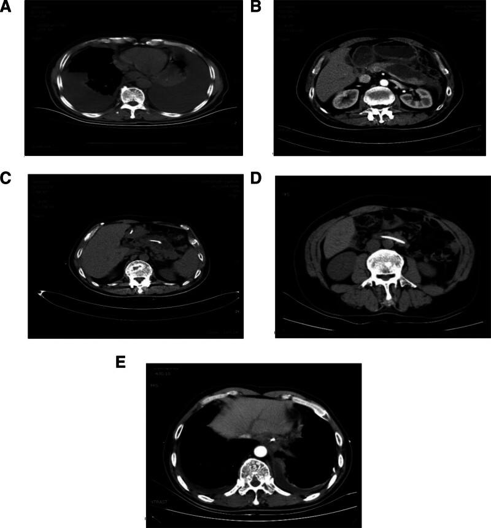
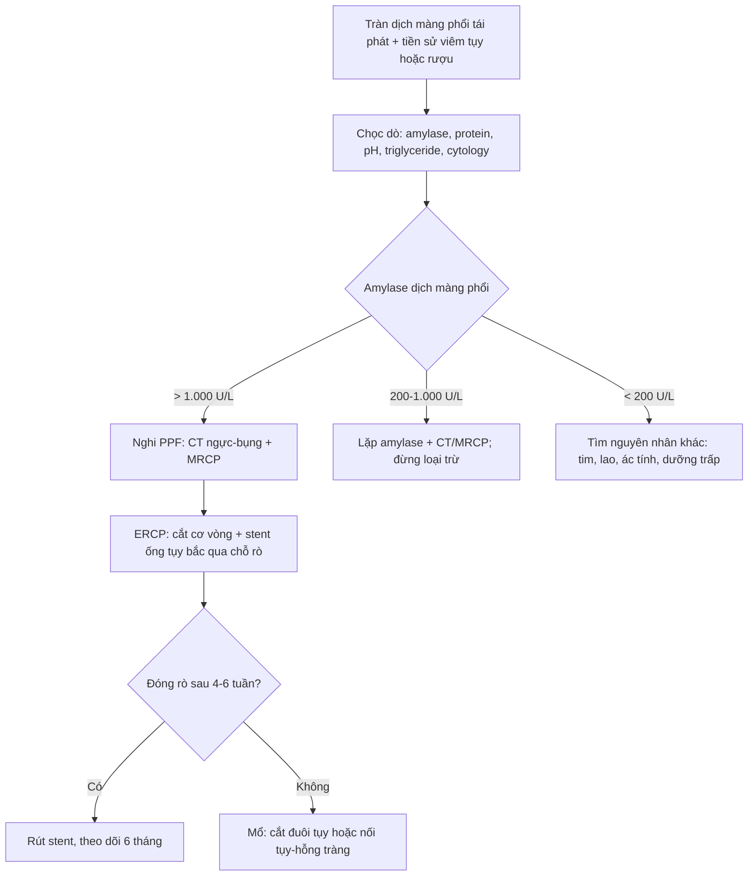
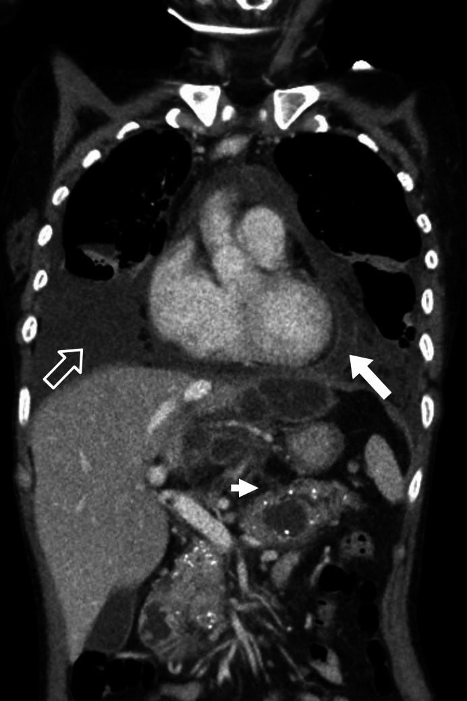
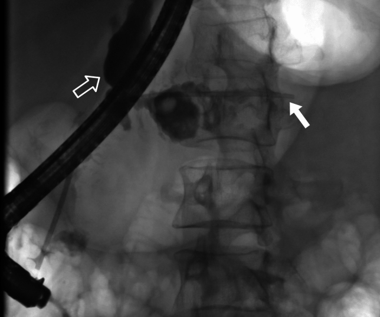

# 1737 — Rò tụy–màng phổi: tràn dịch màng phổi tái phát giàu amylase / Pancreaticopleural fistula

**Tags:** `pattern:tran-dich-mang-phoi-tai-phat` `pattern:amylase-cao` `pattern:ro-ong-tuy` `pattern:gia-nang-tuy` `pattern:trung-that-tuy` `pattern:trao-doi-dich-xuyen-hoanh` `vung:mong-phoi` `vung:trung-that` `vung:tuy` `vung:o-bung` `protocol:CT-nguc-bung` `protocol:MRCP` `protocol:ERCP` `protocol:EUS` `protocol:choc-do-mang-phoi`
**Mức chắc chắn (certainty):** tổng hợp y văn (literature synthesis) — 1 tổng quan 91 ca (2025), 1 đoàn hệ 48 ca đặt stent nội soi (2026), 1 đoàn hệ tiến cứu 22 ca (2022), 1 loạt 4 ca, 2 tổng quan về hình ảnh và 1 ca nguyên văn. **Không có RCT**; mọi ngưỡng dưới đây là tổng hợp từ loạt quan sát, và bài ghi rõ khi các nguồn dùng ngưỡng khác nhau.

> **Vì sao bài này quan trọng:** bài **1736** vừa chốt **cổ trướng tụy** — dịch tụy chảy vào **phúc mạc**. Nhưng khi ống tụy vỡ ra **phía sau**, dịch đi qua **khoang sau phúc mạc → trung thất → màng phổi**, và bệnh nhân đến với **khó thở**, không đau bụng. Đây là lý do bệnh nhân thường được khám **tim–phổi–lao** nhiều tuần trước khi ai đó nghĩ tới tụy. Sai lầm chết người không phải bỏ sót một hình ảnh đẹp, mà là **dẫn lưu màng phổi đơn thuần** — ống dẫn lưu sẽ chảy mãi vì **nguồn rò chưa được cắt**.

> **Sửa tiền đề của backlog (trung thực nguồn):** backlog ghi "tràn dịch màng phổi TRÁI". Thực tế **trái 54–86%, phải 13–34%, hai bên 9–19%** — thể **phải** không hiếm và là bẫy hay bị loại trừ. Bài giữ cả ba khả năng.

## 1. Tổng quan bệnh học – cơ chế hình ảnh – vì sao "chỉ thấy tràn dịch"

- **Định nghĩa:** **rò tụy–màng phổi (pancreaticopleural fistula, PPF)** là đường thông giữa **ống tụy/nang giả tụy** và **khoang màng phổi**, làm dịch tụy giàu enzym chảy liên tục vào màng phổi.
- **Hai kiểu tràn dịch do tụy — phải phân biệt ngay từ đầu:**
  | Kiểu | Cơ chế | Đặc điểm dịch | Diễn tiến |
  |---|---|---|---|
  | **Tràn dịch phản ứng** (reactive) | Viêm tụy cấp gây viêm màng phổi hóa học | Nhỏ, thường **trái**, amylase **< 100 U/L**, protein **< 3 g/dL** | Tự hết khi tụy hồi phục; gặp ở **3–17%** viêm tụy cấp |
  | **Rò tụy–màng phổi (PPF)** | Ống tụy vỡ/nang giả vỡ tạo đường rò | **Lớn, tái phát nhanh**, amylase **thường > 1.000 U/L** (tới **446.600 U/L** trong y văn), protein **> 3 g/dL** | Không tự hết nếu không cắt nguồn; tái phát sau rút ống |
- **TẠI SAO dịch đi từ bụng lên ngực:** ổ bụng có **áp lực dương**, lồng ngực có **áp lực âm** trong thì thở vào → **gradient áp lực một chiều** hút dịch tụy qua các **lỗ hoành (hiatus)** — chủ yếu **lỗ thực quản và lỗ động mạch chủ**. Đây là lý do (a) dịch tái tích **rất nhanh** sau chọc hút, và (b) **dẫn lưu màng phổi không bao giờ chữa khỏi** — nguồn sản xuất vẫn nằm dưới cơ hoành.
- **TẠI SAO amylase màng phổi rất cao mà amylase máu bình thường:** amylase là protein **~54 kDa**, khuếch tán được qua màng phổi; nhưng **amylase được sản xuất liên tục** vào khoang màng phổi và **hấp thu qua bạch mạch rất chậm**, nên nồng độ tích tụ cao gấp hàng trăm lần huyết thanh. Amylase máu chỉ **tăng nhẹ hoặc bình thường** (do tái hấp thu chậm) — **amylase máu bình thường KHÔNG loại trừ PPF**.
- **Vì sao đau ngực/khó thở chứ không đau bụng:** dịch tụy gây **viêm màng phổi hóa học** và **chiếm thể tích** → khó thở, đau ngực, ho. Trong 91 ca: **khó thở 74,73%**, **đau ngực 46,15%**, ho **12,09%**, đau bụng chỉ **31,87%**, sốt **15,38%**.
- **Dịch tụy trông thế nào:** thường **dịch tiết**, màu **nâu đỏ–xanh sẫm** (không phải màu rơm), protein **> 3 g/dL**, glucose thấp–trung bình, tế bào chủ yếu **lympho**. Màu sắc là gợi ý rẻ tiền nhưng hữu ích.
- **Dịch tễ và ngưỡng định lượng:**
  - PPF chiếm **< 1%** mọi tràn dịch màng phổi; gặp ở **3–7%** bệnh nhân viêm tụy; trong **viêm tụy mạn** là **0,4–2,49%**.
  - **Giới:** nam **84,62%** (91 ca); tuổi trung vị **51 (41–58)**, khoảng **3–81**.
  - **Nguyên nhân:** viêm tụy mạn **78,02%**, viêm tụy cấp **7,69%**, u **2,20%**, chấn thương **2,20%**, đột biến gen **3,30%**; **rượu 52,75%**, **nang giả tụy 29,67%**.
  - **Vị trí vỡ ống tụy:** **thân 39,56%**, **đuôi 30,77%**, **đầu 21,98%**, thân–đuôi **3,30%**, cổ **2,20%**.
  - **Bên tràn dịch:** **trái 57,14%**, **phải 34,07%**, **hai bên 8,79%**; **lượng lớn 93,41%**. Loạt Helsinki 48 ca: trái **54%**, phải **21%**, hai bên **19%**, **trung thất 10%**.
  - **Tràn dịch màng tim/tim do amylase** gặp trong **4%**, cổ trướng kèm theo **20%**.

## 2. Mẫu hình + chẩn đoán phân biệt theo vị trí và theo amylase (Gamut)

- **Mẫu hình cốt lõi:** *tràn dịch màng phổi một bên, lượng lớn, tái phát nhanh sau chọc hút, ở người có tiền sử viêm tụy/rượu* → **amylase dịch màng phổi** là xét nghiệm chốt hướng.
- **Gamut theo bên:**
  - **Trái (54–86%)**: ổn định nhất về giải phẫu — đuôi/thân tụy sát hoành trái, đường rò qua lỗ thực quản/ĐMC.
  - **Phải (13–34%)**: đường rò chạy sau tĩnh mạch chủ hoặc qua lỗ thực quản sang phải; **không được loại trừ PPF chỉ vì dịch bên phải**. Trong loạt Helsinki, 1 ca thân tụy rò thẳng vào **màng phổi phải** kèm dịch màng tim.
  - **Hai bên (9–19%)**: thường do **nang giả trung thất** vỡ vào cả hai khoang hoặc rò lượng lớn; đây là thể dễ bị chẩn đoán nhầm nhất.
- **Gamut theo amylase dịch màng phổi:**
  - **Rất cao (> 10.000 U/L):** PPF gần như là chẩn đoán duy nhất; **vỡ thực quản (Boerhaave)** cũng tăng nhưng thường **< 5.000** và có bối cảnh nôn dữ dội, tràn khí trung thất.
  - **Trung bình (200–1.000 U/L):** PPF thể ít lưu lượng, tràn dịch phản ứng do tụy, ung thư biểu mô tiết amylase (phổi/buồng trứng), lao màng phổi.
  - **Bình thường (< 150 U/L):** loại PPF, nghĩ tràn dịch tim/thận/lao/ác tính.
- **Gamut theo hình ảnh:**
  - **Thấy đường rò/nang giả** dưới hoành hoặc **nang giả trung thất** → PPF gần như chắc chắn.
  - **Chỉ thấy dịch + xẹp phổi** → vẫn phải làm amylase dịch; hình ảnh âm tính không loại trừ.
  - **Dịch màng phổi khu trú (encapsulated)** hoặc **dày màng phổi** → nghĩ PPF đã lâu, có thể **bội nhiễm** (26,67% trong loạt 15 ca có ổ dịch khu trú).

## 3. Bảng so sánh phân biệt (ma trận đối chiếu)

| Thực thể (entity) | Hình ảnh điển hình | Chốt vào (rule-in) | Chốt loại (rule-out) | Gợi ý xác nhận |
|---|---|---|---|---|
| **Rò tụy–màng phổi (PPF)** | Tràn dịch **một bên, lượng lớn**, tái phát nhanh; nang giả tụy/ống tụy giãn; đường rò xuyên hoành trên CT coronal hoặc MRCP | **Amylase dịch màng phổi > 1.000 U/L** + protein **> 3 g/dL** + tiền sử viêm tụy; **thấy đường rò** trên MRCP/ERCP | Dịch nhỏ, amylase **< 100 U/L**, tự hết khi tụy hồi phục → tràn dịch phản ứng | CT ngực–bụng có cản quang + MRCP; ERCP xác nhận và điều trị |
| **Tràn dịch phản ứng do viêm tụy cấp** | Lượng **nhỏ–trung bình**, thường trái, đáy phổi; tụy phù/hoại tử | Bối cảnh viêm tụy cấp đang tiến triển; amylase dịch **thấp** | **Amylase dịch > 1.000 + tái phát sau hút** → không phải phản ứng đơn thuần | Theo dõi 48–72 giờ; amylase dịch nếu tái phát |
| **Vỡ thực quản (Boerhaave)** | Tràn dịch trái + **tràn khí trung thất**, tràn khí màng phổi; thực quản dày | **Nôn dữ dội + tam chứng Mackler**; dịch **pH thấp**, có hạt thức ăn | Amylase rất cao **không** loại trừ Boerhaave — phải xem pH và CT | CT ngực có uống cản quang tan trong nước; nội soi ống mềm |
| **Tràn dịch ác tính** | Lượng lớn, tái phát; nốt màng phổi, dày màng phổi; u phổi/vú/buồng trứng | **Tế bào ác tính** trong dịch; amylase có thể tăng do ung thư tiết amylase | Amylase **> 10.000** + đường rò trên hình ảnh → nghĩ PPF hơn | Cytology, CT ngực–bụng–khung chậu, PET/CT |
| **Lao màng phổi** | Dịch tiết lympho, thường một bên; dày màng phổi | **ADA > 40 U/L**, lympho > 80%, Xpert dương | Amylase rất cao + tiền sử viêm tụy/rượu → nghĩ PPF | ADA, Xpert, cấy dịch; **không** điều trị lao thử khi amylase > 1.000 |
| **Tràn dịch dưỡng trấp (chylothorax)** | Dịch **đục sữa**, một hoặc hai bên; sau mổ/chấn thương | **Triglyceride > 110 mg/dL** (1,24 mmol/L), chilomicron dương | Dịch **màu nâu đỏ–xanh**, triglyceride thấp → không phải dưỡng trấp | Điện di lipoprotein, triglyceride dịch |
| **Mủ màng phổi (empyema)** | Dịch khu trú, **split pleura sign**, bóng khí nếu rò | **pH < 7,20**, glucose thấp, LDH cao, mủ | Amylase rất cao + protein > 3 mà không mủ → PPF bội nhiễm | Cấy dịch, CT có cản quang |

*(A) tràn dịch hai bên lượng lớn lúc vào; (B) nang giả tụy; (C) dây dẫn ERCP đi vào nang giả; (D) nang giả xẹp sau dẫn lưu ống tụy 1 tuần; (E) tràn dịch còn lại. Nguồn: Zhao C và cs., *Medicine (Baltimore)* 2025, PMC11709174, CC BY 4.0.*

## 4. Protocol chụp + phân tầng điều trị

- **Bước 1 — chứng minh dịch giàu amylase:** chọc dò màng phổi, gửi **amylase, lipase, protein, LDH, glucose, pH, triglyceride, tế bào, cấy, cytology**. Ngưỡng thực hành: **> 1.000 U/L** là chốt kinh điển; loạt Helsinki dùng **> 200 U/L** cộng với hình ảnh; **không có ngưỡng thống nhất** — vì vậy **amylase 400–1.000 U/L vẫn phải đối chiếu lâm sàng và hình ảnh**, không được loại trừ.
- **Bước 2 — tìm đường rò:**
  - **CT ngực–bụng–khung chậu có cản quang thì tĩnh mạch cửa**, lát **1–2 mm**, **dựng coronal/sagittal**: tìm nang giả, ống tụy giãn, vôi hóa tụy mạn, dịch sau phúc mạc và **đường rò xuyên hoành**. CT có thể **bỏ sót đường rò** khi ống tụy không giãn hoặc dịch đã dẫn lưu hết.
  - **MRCP (tốt nhất là MRCP có secretin)**: không xâm lấn, thấy **toàn bộ cây ống tụy**, chỗ hẹp/đứt; **độ nhạy ~80%**; âm giả khi có **nhiều nang giả hoặc cổ trướng** làm giảm chất lượng ảnh.
  - **ERCP**: vừa **chẩn đoán** (đặt được catheter: chẩn đoán **80%**, thấy đường rò **59–74%**; loạt khác **46–78%**) vừa **điều trị** (cắt cơ vòng + stent ống tụy). Đây là lý do ERCP vẫn là bước tiếp theo khi amylase cao, **không cần chờ MRCP**.
  - **EUS**: đường vào thay thế khi không tiếp cận được qua nhú tá tràng hoặc cần **dẫn lưu xuyên thành**.
- **Bước 3 — phân tầng điều trị (bằng chứng quan sát, không RCT):**
  - **Nội khoa trước/đồng thời:** nhịn ăn, **nuôi ăn tĩnh mạch**, **octreotide/somatostatin**, dẫn lưu màng phổi. Nội khoa đơn thuần **thất bại 59–69%**.
  - **Nội soi can thiệp (ưu tiên):** **stent ống tụy 5–7 Fr** bắc qua chỗ rò, lưu **4–6 tuần**; nếu có ổ dịch khu trú → **dẫn lưu xuyên thành**. Thành công **50–86,36%**; loạt 22 ca: **95,45%** thành công lâm sàng, **86,36%** thành công sau 1 năm, thời gian điều trị trung bình **191 ngày (88–712)**; loạt 48 ca: **90%**, trung vị **3 lần ERCP** (1–8), đóng rò sau **2,3 tháng** (1–24); **22 ca (73%) đặt stent vượt qua chỗ đứt → thành công 100%**.
  - **Mổ:** khi nội soi thất bại, ống tụy tắc hoàn toàn, rò đuôi tụy phức tạp. Thành công **80–94%**, nhưng **tử vong 10–17%** và biến chứng cao → không phải lựa chọn đầu tay.
  - **Theo dõi:** **6 tháng** là trung vị trong y văn, nhưng ca nguyên văn theo **5 năm**; tái phát **2,2%** (91 ca). Siêu âm/CT/MRCP khi có triệu chứng quay lại.

- **Theo dõi ống dẫn lưu:** lượng dịch **giảm dần** là dấu hiệu đóng rò; nếu vẫn **> 500 mL/ngày sau 1 tuần** → kiểm tra tắc stent/ổ dịch chưa dẫn lưu.
- **Không có chỉ định** đặt stent ống tụy "dự phòng" cho mọi viêm tụy cấp — chỉ khi có bằng chứng rò.

## 5. Biến thể bình thường và cạm bẫy

- **Cạm bẫy 1 — lấy dịch ở bên "sai":** trong PPF hai bên, **amylase hai bên có thể chênh hàng chục lần** (ca nguyên văn: **53.844 U/L bên trái vs 1.365 U/L bên phải**). Nếu chỉ chọc bên phải, kết quả **1.365 U/L** vẫn cao nhưng dễ bị đọc là "tăng nhẹ". **Luôn chọc bên tràn nhiều hơn**, và nếu nghi ngờ thì **đo cả hai bên**.
- **Cạm bẫy 2 — amylase máu bình thường:** đã gặp ca **amylase niệu 333 U/L (bình thường)** mà amylase màng phổi **53.844 U/L**. Không dùng amylase máu để loại trừ.
- **Cạm bẫy 3 — chẩn đoán nhầm lao:** dịch lympho ưu thế + sốt nhẹ + tổn thương đáy phổi → dễ điều trị lao. **ADA thấp, amylase rất cao, tiền sử rượu/viêm tụy** là bộ ba phản biện. Điều trị lao muộn làm tăng nguy cơ **dày màng phổi, ổ cặn** và bỏ sót nguồn rò.
- **Cạm bẫy 4 — Boerhaave:** amylase dịch cũng tăng (do nước bọt), nhưng có **tràn khí trung thất**, **pH dịch thấp**, **hạt thức ăn**, bệnh cảnh **nôn dữ dội**. Đừng chỉ nhìn amylase.
- **Cạm bẫy 5 — dẫn lưu màng phổi "thành công":** phổi nở, bệnh nhân dễ thở hơn, nhưng ống vẫn chảy **hàng trăm mL/ngày**; đây là **dấu hiệu nguồn rò còn**, không phải "dịch dai dẳng vô căn". Rút ống sớm → tái tích dịch và **bội nhiễm**.
- **Cạm bẫy 6 — nang giả trung thất đơn độc:** trên CT chỉ thấy khối dịch trung thất, dễ chẩn đoán **nang phế quản/nang thực quản/u trung thất**. Tìm **đuôi tụy sát hoành**, **vôi hóa tụy**, và **amylase dịch chọc hút**.
- **Cạm bẫy 7 — cạm bẫy mặt cắt (theo Argon):** dịch quanh gan–lách có thể là **cổ trướng** chứ không phải tràn dịch màng phổi. Dùng **dấu crus lệch (displaced crus sign)** và **dấu bare area**: dịch màng phổi đẩy **crus ra sau**, cổ trướng nằm **trước crus** và **không vào bare area**. Với PPF, dịch có thể **có cả hai** — đây là lý do phải chụp **toàn bộ ngực–bụng**, không chỉ một vùng.

## 6. Tự lượng giá — Blind Quiz

**Ca 1 — Nam 61 tuổi, khó thở và đau ngực 4 ngày, tiền sử viêm tụy cấp 9 tháng trước. Nhìn CT trước, mô tả trước khi mở đáp án.**

- Gợi ý: bệnh nhân đã được điều trị viêm tụy, sau đó chỉ còn "đau bụng từng đợt". Không sốt.
- Câu hỏi: (1) Có mấy bất thường chính trên CT? (2) Xét nghiệm dịch màng phổi nào nên gửi đầu tiên? (3) Vì sao dẫn lưu màng phổi đơn thuần sẽ thất bại?

<b>Bấm để hiện đáp án (findings + chẩn đoán)</b>

- **Dấu hiệu:** (A) **tràn dịch hai bên lượng lớn**; (B) **nang giả tụy** cạnh thân tụy; (C) **dây dẫn ERCP đi vào nang giả**; (D) nang giả **xẹp sau 1 tuần dẫn lưu ống tụy**; (E) tràn dịch còn lại.
- **Chẩn đoán:** **rò tụy–màng phổi** do nang giả tụy vỡ vào khoang màng phổi.
- **Số liệu của ca:** amylase dịch màng phổi **53.844 U/L bên trái** và **1.365 U/L bên phải**; amylase niệu **333 U/L (bình thường)**; CA125 dịch màng phổi **1.859 U/L**. Đã dẫn lưu **4.180 mL trái + 2.470 mL phải + 495 mL qua ống tụy** trong 13 ngày.
- **Vì sao dẫn lưu đơn thuần thất bại:** áp lực bụng–ngực dương/âm tạo **dòng chảy một chiều liên tục**; phải **giảm áp ống tụy** (stent) hoặc **cắt nguồn rò**.
- Nguồn ảnh: Zhao C, Yao W, Wang Z, *Medicine (Baltimore)* 2025;104(1):e41184 (PMC11709174), CC BY 4.0.

**Ca 2 — Nam 55 tuổi, khó thở, tràn dịch màng phổi PHẢI. Tiền sử viêm tụy do rượu.**

- Câu hỏi: Mũi tên đặc và mũi tên rỗng chỉ gì? Vì sao đây là PPF chứ không phải tràn dịch ác tính? Bước tiếp theo?

<b>Bấm để hiện đáp án</b>

- **Mũi tên rỗng:** dịch giàu amylase trong **khoang màng phổi phải**. **Mũi tên đặc:** dịch trong **màng tim**. **Mũi tên nhỏ:** **đường rò** từ **thân tụy** đi lên qua hoành.
- **Chẩn đoán:** **PPF thể phải** — chứng minh rằng **bên phải không loại trừ** PPF; trong loạt này **21%** bệnh nhân có tràn dịch phải.
- **Bước tiếp theo:** chọc dò → amylase (thường **> 1.000 U/L**) → **ERCP cắt cơ vòng + stent ống tụy**; dẫn lưu màng phổi chỉ để giải áp.
- Nguồn ảnh: Bäck M và cs., *Surg Endosc* 2026;40(5):3843–3851 (PMC13161290), CC BY 4.0.

**Ca 3 — Cùng bệnh nhân Ca 2, sau khi đặt stent ống tụy.**

- Câu hỏi: Stent nằm ở đâu, có bắc qua chỗ rò không? Thời gian lưu stent và tiêu chí thành công?

<b>Bấm để hiện đáp án</b>

- **Stent nhựa** trong **ống tụy chính** (mũi tên đặc); **đường rò** (mũi tên rỗng) đã được bắc qua. Trong loạt 48 ca, **22 ca (73%)** đặt stent **vượt qua chỗ đứt** → **thành công 100%**.
- **Thời gian:** stent lưu **4–6 tuần**; đóng rò trung vị **2,3 tháng** (1–24). Thành công chung **90%**, không tái phát trong loạt.
- **Tiêu chí thành công:** hết dịch màng phổi + **đóng đường rò trên hình ảnh** + rút được dẫn lưu.
- Nguồn ảnh: Bäck M và cs., *Surg Endosc* 2026 (PMC13161290), CC BY 4.0.

## Bài liên quan chéo
- [1736 – Cổ trướng tụy & rò tụy nội bộ](../1736-co-truong-tuy-ro-tuy-noi-bo/lesson.md) (thể dịch vào phúc mạc — cùng cơ chế, khác khoang)
- [1730 – Hội chứng ống tụy đứt (DPDS)](../1730-hoi-chung-ong-tuy-dut/lesson.md)
- [1683 – Hoại tử tụy nhiễm khuẩn & step-up](../1683-hoai-tu-tuy-nhiem-khuan-step-up/lesson.md)
- [135 – Viêm tụy cấp (Atlanta)](../135-viem-tuy-Atlanta/lesson.md)
- [040 – Tràn dịch màng phổi](../040-tran-dich-mang-phoi/lesson.md) (dịch màng phổi vs cổ trướng, crus sign)
- [079 – Tràn dịch dưỡng trấp (chylothorax)](../079-tran-dich-duong-trap-chylothorax/lesson.md)
- [102 – Viêm tụy sau ERCP](../102-viem-tui-mat-va-viem-tuy-sau-stent-mat-ercp/lesson.md)

## Ảnh
- `1737_ro-tuy-mang-phoi_CT_PMC11709174-Fig1-CCBY.jpg` — Zhao C và cs., *Medicine (Baltimore)* 2025 (PMC11709174), **CC BY 4.0**, nguyên bản.
- `1737_ro-tuy-mang-phoi_CT-coronal_PMC13161290-Fig2-CCBY.jpg` — Bäck M và cs., *Surg Endosc* 2026 (PMC13161290), **CC BY 4.0**, nguyên bản.
- `1737_ro-tuy-mang-phoi_ERCP-stent_PMC13161290-Fig3-CCBY.jpg` — Bäck M và cs., *Surg Endosc* 2026 (PMC13161290), **CC BY 4.0**, nguyên bản.
- `1737_ro-tuy-mang-phoi_ERCP-drain_PMC9574034-Fig1-CCBY.jpg` — Jagielski M, Piątkowski J, Jackowski M, *Front Cell Infect Microbiol* 2022;12:939137 (PMC9574034), **CC BY 4.0**, nguyên bản.
- Chi tiết giấy phép từng ảnh: `images/CREDITS.md`.

> Không dùng để chẩn đoán độc lập khi chưa có người hướng dẫn.
