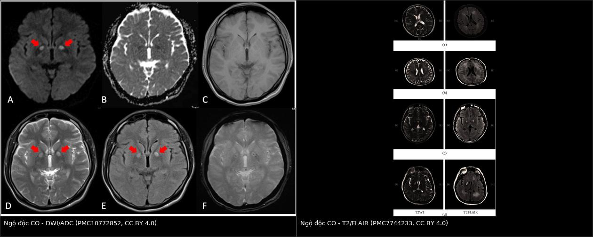
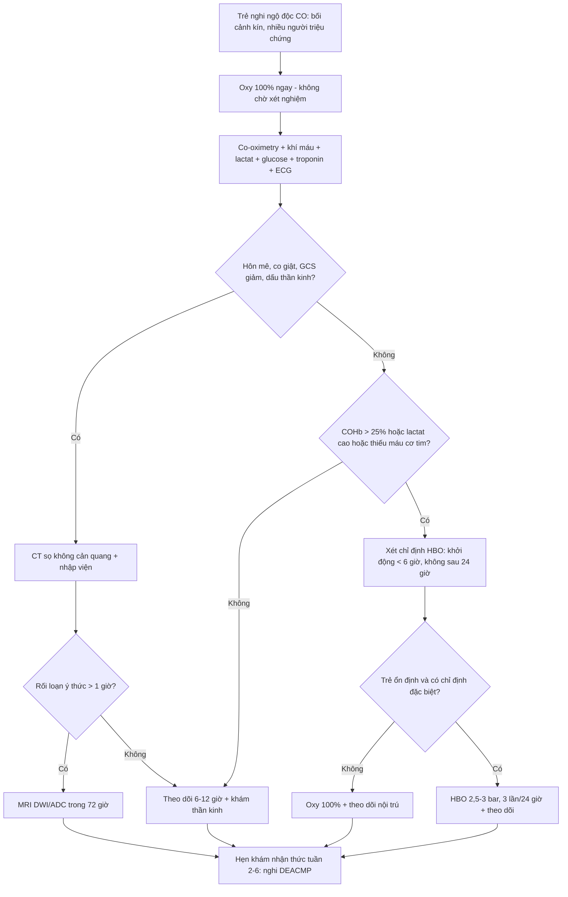
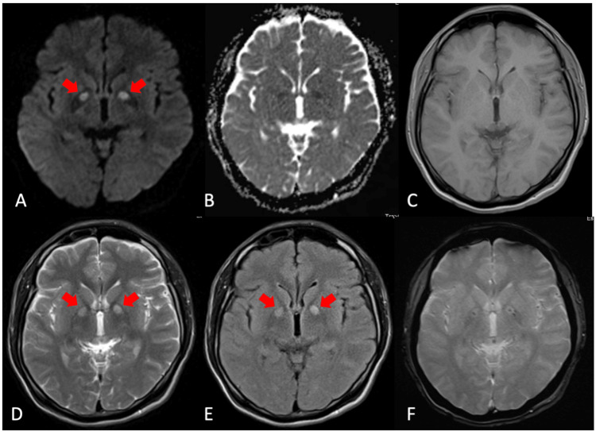
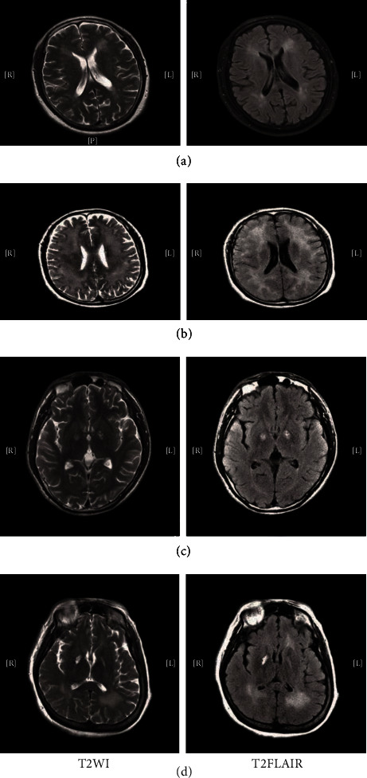

# 1738 — Ngộ độc carbon monoxid (CO) do khói lửa và khí đốt ở trẻ: COHb KHÔNG đo được độ nặng, khi nào chụp MRI não, khi nào cần HBO

**Tags:** `pattern:hoai-tu-thieu-ox` `pattern:ton-thuong-doi-xung-nhan-beo` `pattern:han-che-khuech-tan` `pattern:hinh-anh-binh-thuong` `vung:nao` `vung:phoi` `vung:toan-than` `score:COHb` `score:GCS` `score:lactate` `protocol:MRI-DWI-ADC` `protocol:oxy-100` `protocol:HBO`
**Mức chắc chắn (certainty):** tổng hợp y văn (literature synthesis) — ghép **thuần tập 113 trẻ** theo dõi **3,6 ± 1,5 năm** (Sci Rep 2024, PMC11612167), **nghiên cứu tiến cứu 154 bệnh nhân DWI–DNS** (Diagnostics 2020, PMC7555258), **hướng dẫn S2k 2021** (GMS Ger Med Sci, PMC8607608 — CC BY 4.0), **nghiên cứu tiến cứu đa trung tâm 255 ca** (PLoS One 2021, PMC8213185) và **2 loạt ca có hình MRI** (Cureus 2023, PMC10772852; Behav Neurol 2020, PMC7744233). Không có ca do nhóm tự chụp; mọi ảnh đều là ca **người lớn**, dùng để dạy **mẫu hình ảnh**, không dùng để suy ra tỉ lệ ở trẻ.

> **Câu hỏi thực hành:** bé trai **5 tuổi** được bố bế vào cấp cứu lúc **7 giờ sáng**, sau đêm ngủ trong phòng tắm kín có **bình nóng lạnh gas**. Trẻ **lơ mơ, nôn 2 lần**, mẹ và em 3 tháng cũng **đau đầu**. Khí máu: **lactat 6,8 mmol/L**, pH 7,28, **PaO₂ 96 mmHg**, **SpO₂ 99%**. COHb đo tại cửa: **6,1%** (đã thở oxy trên xe cứu thương 25 phút). CT sọ không cản quang: **bình thường**. Bố hỏi: *"COHb chỉ 6% mà sao cháu vẫn lơ mơ? Có cần chụp MRI không, và có phải vào buồng tăng áp không?"*
> Bài chốt **sáu điểm**: **(1) COHb là số đo THỜI ĐIỂM, không phải thước đo độc tính** — nửa đời COHb trên khí trời **4–5 giờ**, trên oxy **~1 giờ**, ở **2,5 ATA chỉ 20 phút**; đo sau khi đã thở oxy thì con số luôn thấp hơn thực tế; **(2) COHb bình thường ở trẻ sơ sinh đã có ca 22% mà không triệu chứng, trong khi 3% đã có triệu chứng** — nên **quyết định theo lâm sàng + lactat + bối cảnh**, không theo ngưỡng COHb đơn thuần; **(3) SpO₂ 99% là bẫy** — pulse oximeter đọc COHb **như oxyhemoglobin** (COHb 70% vẫn hiện SpO₂ 92%); **(4) CT sọ thường BÌNH THƯỜNG trong giờ đầu** — MRI **DWI/ADC** mới thấy hạn chế khuếch tán, và nên chụp **trong 72 giờ** nếu trẻ hôn mê **> 1 giờ**; **(5) tổn thương điển hình là HAI BÊN ĐỐI XỨNG ở nhân bèo (globus pallidus) ± chất trắng quanh não thất**, không phải ổ đơn độc; **(6) HBO chỉ khi có chỉ định đặc biệt** — bằng chứng ở trẻ **yếu**, phải khởi động **< 6 giờ** và **không có giá trị sau 24 giờ**, trong khi trẻ **không ổn định thì chỉ oxy 100%**.

*Trái: MRI **DWI/ADC/T1/T2/FLAIR/GRE** của người đàn ông 34 tuổi trong một vụ ngộ độc hộ gia đình (vợ và 3 con cùng phơi nhiễm) — **DWI tăng, ADC giảm** ở **nhân bèo hai bên** (mũi tên đỏ), T1 giảm, T2/FLAIR tăng, GRE có điểm giảm tín hiệu nhỏ. Phải: **T2WI/FLAIR** của một loạt **bệnh não muộn sau ngộ độc CO (DEACMP)** — tăng tín hiệu **chất trắng hai bên** và **nhân bèo**. Ảnh ghép letterbox giữ nguyên tỉ lệ (Cureus 2023, PMC10772852, CC BY 4.0; Behav Neurol 2020, PMC7744233, CC BY 4.0).*

## 1. Tổng quan bệnh học – cơ chế hình ảnh: vì sao "ngộ độc nặng" mà phim chụp trắng trơn, và vì sao COHb không phải thước đo

- **Nguồn phơi nhiễm ở trẻ — bối cảnh quan trọng hơn hình ảnh:** CO sinh ra từ **đốt cháy không hoàn toàn** (gas, than, củi, xăng dầu). Trong **113 trẻ** nhập viện vì ngộ độc CO, **89,4% (101/113)** do **bình nóng lạnh gas đặt trong phòng tắm kín**, **9,7% (11/113)** do **sưởi bằng lửa**, 1 ca do **bố để trẻ trong xe đang nổ máy** (Sci Rep 2024, PMC11612167). Đây là lý do phải **hỏi bối cảnh** (phòng kín, nhiều người cùng triệu chứng, mùa lạnh) trước khi hỏi "chụp gì".
- **Dịch tễ để không bỏ sót:** gánh nặng toàn cầu **137 ca/million dân**, **4,6 tử vong/million**; tỉ lệ mắc có **hai đỉnh: trẻ 0–14 tuổi và người 20–39 tuổi** (Diagnostics 2025, PMC11899572). Ở Mỹ khoảng **50.000 ca cấp cứu/năm**, tử vong **1–3%** (cùng bài).
- **Cơ chế phân tử — ba tầng, mỗi tầng để lại một dấu hiệu đo được:**
  1. **CO gắn hemoglobin mạnh gấp 200–250 lần oxy** → tạo **carboxyhemoglobin (COHb)**, vừa **giảm khả năng chuyên chở oxy** vừa **đẩy đường cong phân ly sang trái** (oxy khó nhả cho mô). CO gắn **myoglobin mạnh gấp 60 lần** oxy → tổn thương cơ tim.
  2. **Ức chế cytochrome c oxidase (phức hợp IV)** → chặn hô hấp ty thể, giảm ATP, tăng chuyển hóa yếm khí → **toan lactic**. Vì vậy **lactat là dấu hiệu sinh hóa của độc tính mô**, không phải COHb (xem dưới).
  3. **Viêm – oxy hóa – chết tế bào:** CO làm **peroxy hóa lipid, tăng ROS, hoạt hóa tiểu cầu và bạch cầu**, tổn thương nội mô, huyết khối vi mạch — đây là cơ sở của tổn thương **chất trắng và nhân bèo** muộn, kể cả khi COHb đã về bình thường (Diagnostics 2025, PMC11899572).
- **TẠI SAO COHb KHÔNG tương quan với độ nặng — bốn lý do định lượng:**
  1. **Động học thải:** nửa đời COHb **4–5 giờ** khi thở khí trời, **~1 giờ** khi thở oxy, và **20 phút ở 2,5 ATA** (J Clin Med 2024, PMC11084260). Mỗi phút chờ đợi làm con số tụt, trong khi **tổn thương mô đã xảy ra**.
  2. **Đo muộn/đã thở oxy:** bệnh nhân được oxy tại hiện trường — như ca mở bài — có COHb **6,1%** dù lâm sàng nặng. Hướng dẫn S2k nói rõ: **"COHb âm tính không loại trừ ngộ độc CO nếu bệnh sử và triệu chứng phù hợp"**, và **theo dõi COHb đơn thuần không dùng để quản lý điều trị** (GMS Ger Med Sci 2021, PMC8607608).
  3. **Biến thiên sinh học:** một **trẻ sơ sinh không triệu chứng ở COHb 22%**, trong khi một trẻ khác **có triệu chứng ở 3%** (S2k 2021, PMC8607608) — cùng một ngưỡng, hai kết cục.
  4. **Không tương quan thống kê:** trong **72 ca**, COHb trung vị nhóm có di chứng thần kinh muộn (DNS) là **30%** (10–43) so với **25%** (10–44) nhóm không DNS, **p = 0,7**; COHb không dự báo việc phải dùng HBO (**p = 0,9**), còn **khám thần kinh bất thường** mới là yếu tố dự báo (**OR 18,6**; p = 0,004) (Am J Emerg Med 2020, PMID 31889577). Trong **113 trẻ**, phân tích đa biến chỉ giữ lại **bất thường hình ảnh sọ** và **rối loạn ý thức > 1 ngày** (Sci Rep 2024, PMC11612167).
- **TẠI SAO não là cơ quan bị đánh dấu — và vì sao hai bên đối xứng:**
  - **Nhân bèo (globus pallidus)** là vùng **nhu cầu chuyển hóa cao, giàu myelin, nằm ở vùng tưới máu tận–phân thủy**, nên nhạy với **thiếu oxy–thiếu máu cục bộ toàn thể**; CO còn gây **nhiễm độc trực tiếp oligodendrocyte và tế bào thần kinh** → vị trí tổn thương **đối xứng** là quy luật, không phải ngẫu nhiên. Bất thường MRI ở **nhân bèo** gặp ở **19,9%** bệnh nhân ngộ độc CO nói chung; ngoài ra **vỏ não, hồi hải mã, chất trắng quanh não thất**; **thân não và đồi thị hiếm** (Sci Rep 2024, PMC11612167, dẫn y văn).
  - **Chuỗi thời gian trên MRI — giải thích bằng vật lý tín hiệu:**
    - **Giờ đầu – 72 giờ:** **phù độc tế bào** → nước **chuyển từ ngoài vào trong tế bào**, chuyển động Brown bị giới hạn → **DWI tăng, ADC giảm**. Đây là dấu hiệu **sớm nhất** và **nhạy hơn CT**.
    - **Vài ngày – vài tuần:** **hoại tử – hủy myelin** → nước tự do tăng → **T2/FLAIR tăng**, **T1 giảm**; ADC có thể **giả hóa (pseudonormalization)** rồi **tăng** khi mô mềm hóa.
    - **GRE/SWI:** điểm **giảm tín hiệu** nhỏ = **vi xuất huyết** (ca trong ảnh có).
    - **CT:** chỉ thấy **giảm đậm độ** khi đã đủ phù; vì vậy **CT bình thường trong giờ đầu là quy luật**. Trong một loạt **20 ca DEACMP**, CT bất thường tới **87,5%**, nhưng đó là **bệnh não muộn**, không phải cấp (Behav Neurol 2020, PMC7744233).
  - **Bệnh não muộn (DEACMP/DNS):** sau **khoảng tỉnh (lucid interval)** 2–40 ngày, bệnh nhân **sa sút trí tuệ, Parkinson, múa giật, rối loạn tâm thần, đái không kiểm soát**; định nghĩa DNS trong y văn trải **2–240 ngày** sau ra viện (Am J Emerg Med 2020, PMID 31889577). Cơ chế không chỉ thiếu oxy: **hủy myelin do miễn dịch, chết tế bào oligodendrocyte, tổn thương vi mạch** (Neural Regen Res 2020, PMC7749483 — tổng quan cơ chế).
- **Tim — cơ quan thứ hai, dễ bỏ sót ở trẻ:** CO gắn myoglobin, gây **thiếu máu cơ tim, loạn nhịp, tụt huyết áp**; men tim có thể tăng **rất cao** (ca trong loạt 5 ca: **troponin T 1314 ng/L**) (Cureus 2024, PMC10884778). Vì vậy **ECG + troponin** là một phần của "bộ xét nghiệm CO", không phải xét nghiệm tùy chọn.
- **Vì sao trẻ KHÁC người lớn — bốn điểm thực hành:**
  1. **HbF gắn CO mạnh hơn HbA** và **thải chậm hơn** → **thai và trẻ sơ sinh** có thể nặng hơn mẹ dù mẹ nhẹ; có ca **COHb thai 61%** trong khi mẹ **7%** sau 1 giờ thở oxy (S2k 2021, PMC8607608).
  2. **Trẻ có triệu chứng SỚM hơn nhưng hồi phục nhanh hơn**, và **nửa đời COHb ở trẻ ngắn hơn người lớn** (S2k 2021) — nghĩa là **COHb ở trẻ càng kém tin cậy** để phân tầng.
  3. **Trẻ nhỏ không mô tả được**: biểu hiện có thể chỉ là **quấy khóc, nôn, bú kém, co giật**; trong 113 trẻ, **59,3%** vào viện vì **rối loạn ý thức**, **32,7%** vì **chóng mặt/đau đầu** (Sci Rep 2024).
  4. **Dự trữ sinh lý mỏng:** dung tích cặn chức năng nhỏ, tần số thở cao → lượng khí độc vào tính theo kg lớn hơn; dễ **hạ đường huyết, hạ thân nhiệt** đồng thời.

## 2. Mẫu hình + chẩn đoán phân biệt theo vị trí (Gamut)

- **Bốn mẫu hình (pattern) — theo thứ tự thường gặp ở trẻ:**
  1. **Hôn mê/co giật + toan lactic + CT sọ bình thường** — mẫu hình **cấp cứu**, chẩn đoán bằng **bối cảnh + lactat**, không bằng ảnh. Đây là mẫu hình của ca mở bài.
  2. **Hai bên đối xứng nhân bèo** trên MRI (DWI tăng/ADC giảm sớm; T2/FLAIR tăng muộn) ± **vi xuất huyết** trên GRE — mẫu hình **đặc hiệu nhất**, gặp ở **19,9%** bệnh nhân ngộ độc CO nói chung.
  3. **Chất trắng lan tỏa hai bên** (quanh não thất, bán bầu dục, thể chai) — mẫu hình của **DEACMP**; trong **154 bệnh nhân** chụp DWI, **31,8%** có tổn thương não cấp, và tổn thương **chất trắng** là yếu tố liên quan DNS mạnh nhất (**OR 6,741**; 95% CI 1,843–24,660) (Diagnostics 2020, PMC7555258).
  4. **Hình ảnh hoàn toàn bình thường** — không loại trừ; trong **113 trẻ**, nhóm không di chứng vẫn có **4% (4/100)** bất thường hình ảnh, còn nhóm di chứng **61,5% (8/13)** (Sci Rep 2024).
- **Gamut theo vị trí "hai bên đối xứng nhân bèo" — 6 nguyên nhân phải nghĩ:**
  - **Ngộ độc CO** — bối cảnh cháy/khí gas, tổn thương GP ± chất trắng, **hồi phục qua giai đoạn tỉnh rồi tái phát** (DEACMP).
  - **Ngộ độc cyanid/H₂S** — ức chế cytochrome giống CO; **lactat rất cao, PaO₂ bình thường**, bối cảnh cháy kín/cống (xem bài 1720).
  - **Ngộ độc methanol** — hay gặp **putamen** hơn là GP, kèm **toan chuyển hóa khoảng trống anion**, bệnh sử rượu.
  - **Thiếu oxy–thiếu máu cục bộ toàn thể (ngưng tim, đuối nước, ngạt)** — tổn thương **GP + vỏ não + hải mã**, bối cảnh rõ.
  - **Bệnh não do opioid (CHANTER syndrome)** — tiền sử opioid, tổn thương **hai bên GP + hải mã + tiểu não**.
  - **Bệnh chuyển hóa/di truyền ở trẻ** — **Leigh, Wilson, glutaric aciduria type 1**, hạ đường huyết kéo dài — đối xứng nhưng **bối cảnh không có phơi nhiễm**, có thể **tăng lactate mạn**.
- **Gamut "hôn mê + toan lactic + CT bình thường" ở trẻ (thứ tự nghĩ):** **CO** → **cyanid/H₂S** (nếu cháy kín) → **methemoglobin** (SpO₂ "kẹt", MetHb > 1,5%) → **hạ đường huyết** → **co giật kéo dài** → **sốc nhiễm khuẩn** → **rối loạn chuyển hóa bẩm sinh**.
- **Cờ đỏ (red flag) ở trẻ — có một trong các dấu hiệu này là nhập viện, không theo dõi ngoại trú:** **hôn mê từ lúc nào > 1 giờ**, **co giật**, **GCS giảm**, **dấu thần kinh khu trú**, **lactat > 5 mmol/L**, **toan pH < 7,30**, **đau ngực/ECG bất thường/troponin tăng**, **thai nhi đang bị ảnh hưởng** (mẹ mang thai), và **nhiều người trong cùng hộ có triệu chứng**.

## 3. Bảng so sánh phân biệt (ma trận đối chiếu)

| Thực thể (entity) | Hình ảnh / xét nghiệm điển hình | Chốt vào (rule-in) | Chốt loại (rule-out) | Gợi ý xác nhận |
|---|---|---|---|---|
| **Ngộ độc CO cấp** | **CT sọ thường bình thường**; MRI **DWI nhân bèo hai bên tăng, ADC giảm** sớm; **T2/FLAIR tăng muộn**; **COHb** đo sớm (nửa đời 4–5 giờ khí trời) | **Bối cảnh phơi nhiễm + nhiều người cùng triệu chứng + lactat tăng + đáp ứng oxy 100%**; **GP hai bên** trên MRI | **COHb bình thường/6% KHÔNG loại trừ** nếu đã thở oxy; CT bình thường **không loại trừ** | Co-oximetry máu (không phải SpO₂), lactat, MRI DWI/ADC |
| **Ngộ độc cyanid (khói lửa)** | CT ngực/sọ thường bình thường; **lactat rất cao, PaO₂ bình thường, gradient A–V hẹp** | **Cháy kín + hôn mê/ngưng tim + lactat > 10 + PaO₂ bình thường**, hồi phục sau **hydroxocobalamin** | **COHb cao không loại trừ cyanid** (hai khí cùng tồn tại) | Đáp ứng hydroxocobalamin; co-oximetry **không đo cyanid** |
| **Methemoglobin** | Xanh tím, **SpO₂ kẹt ~85%** dù PaO₂ cao; **MetHb > 1,5%** | **MetHb cao + máu sô-cô-la + không đáp ứng oxy** | **SpO₂ bình thường trên khí máu → nghĩ CO/cyanid hơn** | Co-oximetry đa bước sóng |
| **H₂S (cống, hầm biogas)** | Hình ảnh thường bình thường; toan lactic; bối cảnh **không cháy**, mùi trứng thối | **Bối cảnh hầm/cống + hôn mê nhanh + lactat cao** | Không có phơi nhiễm → loại | Bệnh sử; không có xét nghiệm nhanh |
| **Ngưng tim/ngạt (thiếu oxy toàn thể)** | **GP + vỏ não + hải mã**; phù lan tỏa; **ADC giảm lan rộng** hơn CO | **Tiền sử ngưng tim/đuối nước/treo cổ** | Có phơi nhiễm CO rõ thì không loại trừ CO | Bệnh sử, ECG, troponin, MRI |
| **DEACMP (bệnh não muộn)** | **T2/FLAIR tăng chất trắng hai bên ± GP**; **T1 giảm**; CT có thể **87,5% bất thường** | **Khoảng tỉnh 2–40 ngày rồi sa sút trí tuệ/Parkinson/rối loạn tâm thần** | MRI bình thường lúc cấp **không loại trừ** DEACMP về sau | MRI lặp ở tuần 2–6; đánh giá nhận thức |
| **Hạ đường huyết / bệnh chuyển hóa** | Tổn thương **đối xứng** GP/vỏ, nhưng **không có phơi nhiễm**; lactate mạn tính | **Glucose thấp, bối cảnh nhịn ăn/bệnh lý**, hồi phục sau glucose | Có phơi nhiễm gas + nhiều người bệnh → ít nghĩ | Glucose mao mạch, amoniac, acid hữu cơ |

- **Ảnh ghép đối chiếu:** `images/composite_mri-co-nao.jpg` — DWI/ADC (giờ đầu) đặt cạnh T2/FLAIR (bệnh não muộn), cùng tổn thương **nhân bèo/chất trắng hai bên** nhưng **hai thời điểm sinh lý khác nhau**.

## 4. Protocol chụp – xét nghiệm + hệ phân tầng điều trị

- **Nguyên tắc: oxy trước, ảnh sau, và không chờ COHb.** Thứ tự tại cửa cấp cứu:
  1. **Đường thở – thở – tuần hoàn**; **oxy 100%** qua mask có túi dự trữ/ HFNC; **đặt nội khí quản** nếu hôn mê, co giật, bỏng đường thở; **thở máy FiO₂ 1,0** ở trẻ đã đặt ống cho tới khi **hết triệu chứng và COHb < 3%** (S2k 2021, PMC8607608).
  2. **Lấy máu cùng lúc:** **co-oximetry (COHb, MetHb)**, **khí máu động mạch + tĩnh mạch**, **lactat**, **glucose**, **điện giải**, **creatinin, men gan, CK**, **troponin**, **ECG 12 chuyển đạo**. Nhớ: **SpO₂ bình thường không phải bằng chứng** — pulse oximeter hai bước sóng **đọc COHb như oxyhemoglobin** (COHb 70% vẫn hiện **SpO₂ 92%**) (J Clin Med 2024, PMC11084260).
  3. **Chẩn đoán hình ảnh — chỉ định theo lâm sàng, không thường quy:**
     - **CT sọ không cản quang** khi: hôn mê, co giật, GCS giảm, chấn thương đầu, dấu thần kinh khu trú — để loại trừ chảy máu/chấn thương, **không để "tìm CO"**.
     - **MRI sọ có DWI/ADC** khi: **rối loạn ý thức > 1 giờ**, co giật, hoặc bất thường thần kinh kéo dài; **thời điểm tốt nhất là trong 72 giờ** sau phơi nhiễm (Sci Rep 2024, PMC11612167). Chuỗi tối thiểu: **DWI + ADC + T2/FLAIR + T1 ± GRE/SWI** (GRE để tìm vi xuất huyết).
     - **MRI lặp ở tuần 2–6** nếu nghi **DEACMP** (khoảng tỉnh rồi sa sút) — không cần chụp lại sớm nếu lâm sàng ổn.
     - **X-quang ngực** khi có hít khói/bỏng đường thở (tìm xẹp phổi, phù phổi, tràn khí); **CT ngực** chỉ khi nghi biến chứng phổi hoặc chấn thương.
  4. **Phân tầng nhập viện (S2k 2021):**
     - **Có triệu chứng → luôn nhập viện.**
     - **Không triệu chứng:** COHb **≤ 5%** (người hút thuốc **≤ 10%**) → **không cần nhập viện** ở người lớn; nhưng **trẻ em và thai phụ nên được mời nhập viện/theo dõi** (khuyến cáo mạnh, đồng thuận 100%).
- **Chỉ định HBO (bảng phân tầng — theo S2k 2021 và J Clin Med 2024, PMC11084260):**

| Chỉ định HBO | Ngưỡng / ghi chú |
|---|---|
| **Ngất, hôn mê, co giật** | Chỉ định kinh điển, không phụ thuộc COHb |
| **Rối loạn ý thức, dấu tiểu não, dấu thần kinh khu trú** | Khám thần kinh bất thường dự báo DNS **OR 18,6** |
| **COHb > 25%** | Ngưỡng được nhiều phác đồ dùng; **nhưng không dùng một mình** |
| **Toan chuyển hóa nặng / thiếu máu cơ tim / loạn nhịp** | Lactat cao, troponin tăng, ST thay đổi |
| **Thai nhi bị ảnh hưởng** | Thai distress, ngất của mẹ; COHb thai có thể **cao hơn mẹ** |
| **Thời gian** | Khởi động **< 6 giờ**; **không khuyến cáo sau 24 giờ**; **3 lần/24 giờ** đầu; áp lực **2,5–3 bar** |
| **Biến chứng** | Barotrauma **0,72%**; cân nhắc **vận chuyển và thời gian ra khỏi ICU** ở trẻ |

- **Điểm khác biệt ở TRẺ (quan trọng nhất của bài):** hướng dẫn S2k nêu rõ **bằng chứng HBO ở trẻ không đủ**, **không được suy ra trực tiếp từ người lớn**, và HBO ở trẻ **chỉ nên làm khi có chỉ định đặc biệt**, vì phải **vận chuyển, nằm ngoài ICU, nguy cơ barotrauma**. Nghiên cứu hồi cứu lớn từ Đài Loan **không thấy khác biệt tử vong** giữa trẻ có/không HBO (dẫn trong S2k 2021). Trong thuần tập **113 trẻ**, tiêu chuẩn dùng HBO là **triệu chứng thần kinh/tim mạch, toan nặng, hoặc COHb ≥ 25%**, và **trẻ không ổn định chỉ được oxy 100%** (Sci Rep 2024, PMC11612167). Nếu trẻ **ổn định, không triệu chứng thần kinh**: theo dõi nội trú + oxy là đủ; **không chuyển tuyến chỉ vì COHb**.
- **Bằng chứng HBO còn mỏng — nói thật với gia đình:** nghiên cứu tiến cứu đa trung tâm **255 ca**, DNS **13/171 (7,6%)** ở nhóm HBO so với **3/84 (3,6%)** ở nhóm chỉ oxy (**p = 0,212**); số buổi HBO trong 24 giờ đầu **liên quan DNS** (OR 2,082; 1,101–3,937) — nhưng đây là **confounding do bệnh nặng hơn được chỉ định nhiều buổi** (PLoS One 2021, PMC8213185). Kết luận thực hành: **HBO không phải "thuốc giải độc"**, và **không được trì hoãn oxy 100% để chờ buồng tăng áp**.
- **Theo dõi sau ra viện — nơi bệnh não muộn được bắt:**
  - **Hẹn khám thần kinh/nhận thức ở tuần 2–6** cho **mọi trẻ hôn mê > 1 giờ hoặc có bất thường hình ảnh**; hỏi **trí nhớ, học tập, tính cách, dáng đi, đái không kiểm soát**.
  - **Tỉ lệ thực tế:** **11,5% (13/113)** trẻ có bất thường nhận thức sau **3,6 năm**; trong số đó **38,5% (5/13)** có động kinh trong đợt cấp và **53,8% (7/13)** tổn thương cơ quan khác (Sci Rep 2024).
  - **Tư vấn phòng bệnh:** **kiểm tra bình nóng lạnh gas, ống khói, lắp đầu báo CO**, không dùng **than/lò sưởi trong phòng kín**, không để trẻ ngủ trong phòng tắm có bình gas.

## 5. Biến thể bình thường và cạm bẫy

- **Cạm bẫy 1 — "SpO₂ 99% thì không thiếu oxy".** Pulse oximeter hai bước sóng **không phân biệt COHb với oxyhemoglobin**; COHb 70% vẫn cho SpO₂ ~92% (J Clin Med 2024). Ở trẻ, đây là lý do hay bị **cho về nhà**.
- **Cạm bẫy 2 — "COHb 6% thì nhẹ".** Đã thở oxy 25 phút thì **6% tương đương mức cao hơn nhiều lúc phơi nhiễm** (nửa đời ~1 giờ trên oxy). Quyết định theo **lâm sàng + lactat**, không theo con số (S2k 2021).
- **Cạm bẫy 3 — "CT bình thường thì não lành".** CT chỉ đổi đậm độ khi đã đủ phù; **MRI DWI trong 72 giờ** mới thấy phù độc tế bào. Ca mở bài: **CT bình thường, trẻ vẫn lơ mơ, lactat 6,8** — cần **MRI**, không phải yên tâm.
- **Cạm bẫy 4 — bỏ sót "người thứ hai".** Ngộ độc hộ gia đình: **vợ và 3 con** cùng phơi nhiễm trong ca có ảnh (Cureus 2023). Trẻ **nhẹ triệu chứng** vẫn có thể **đang toan lactic**; phải **khám và đo lactat cho mọi người trong nhà**.
- **Cạm bẫy 5 — "chỉ là viêm dạ dày/ngộ độc thức ăn".** Ở trẻ, **nôn và đau bụng** là biểu hiện thường gặp; **mùa đông + phòng kín + nhiều người nôn** là bối cảnh phải nghĩ CO.
- **Cạm bẫy 6 — "đã tỉnh là xong".** **DEACMP** xuất hiện sau **khoảng tỉnh 2–40 ngày** (định nghĩa DNS tới **240 ngày**); **không hẹn khám lại là bỏ sót**. Trong loạt 20 ca DEACMP, **95%** có suy giảm nhận thức lúc vào, còn **25%** ở tháng thứ 6 — tức **một phần hồi phục nhưng không phải tất cả** (Behav Neurol 2020, PMC7744233).
- **Cạm bẫy 7 — nhầm "hai bên đối xứng nhân bèo" là bệnh khác.** Nếu **không có bối cảnh phơi nhiễm**, phải nghĩ **Leigh/Wilson/CHANTER/ngưng tim**; nếu **có phơi nhiễm** thì **không cần sinh thiết** — hình ảnh + bối cảnh là đủ.
- **Cạm bẫy 8 — dùng hình ảnh để quyết định HBO.** Không có bằng chứng rằng **mức độ tổn thương trên MRI** là tiêu chuẩn chọn HBO; chỉ định vẫn dựa **lâm sàng + COHb + toan + tim**. Ảnh dùng để **tiên lượng và theo dõi**, không phải "vé vào buồng tăng áp".
- **Biến thể bình thường dễ nhầm:** **điểm giảm tín hiệu nhỏ trên GRE** ở người lớn tuổi có thể là **vi xuất huyết do tăng huyết áp**; ở trẻ **không có tiền sử** thì nghĩ **vi xuất huyết do CO**. **Giãn khoang quanh mạch (Virchow–Robin)** không phải tổn thương chất trắng. **COHb nền 5–10% ở người hút thuốc** không phải ngộ độc.

## 6. Tự lượng giá — Blind Quiz

**Ca 1 — Nam 34 tuổi, bất tỉnh trong nhà, vợ và 3 con cũng đau đầu. Nhìn 6 ô MRI, mô tả trước khi mở đáp án.**

- Gợi ý lâm sàng: máy phát điện chạy trong nhà sau bão; cả gia đình 5 người cùng triệu chứng; bệnh nhân hôn mê, thở nhanh, lactat tăng.
- Câu hỏi: Tổn thương ở đâu, hai bên hay một bên? Chuỗi xung nào chốt tổn thương **cấp**? Vì sao T1 giảm mà T2 tăng? 3 chẩn đoán phân biệt của "nhân bèo hai bên"?

<b>Bấm để hiện đáp án (findings + chẩn đoán)</b>

- Dấu hiệu: **(A) DWI tăng** và **(B) ADC giảm** ở **nhân bèo hai bên** (mũi tên đỏ) → **phù độc tế bào**; **(C) T1 giảm**, **(D) T2 và (E) FLAIR tăng** cùng vùng; **(F) GRE** có **điểm giảm tín hiệu nhỏ** (vi xuất huyết). Không có ổ choán chỗ, không di lệch đường giữa.
- Chẩn đoán: **bệnh não do ngộ độc CO** — vì **hạn chế khuếch tán đối xứng hai nhân bèo** trong bối cảnh **cả hộ cùng phơi nhiễm máy phát điện**.
- Vì sao T1 giảm/T2 tăng: phù độc tế bào làm **nước nội bào tăng** (T1 dài, T2 dài); DWI/ADC là chuỗi **nhạy nhất trong 72 giờ đầu**; GRE phát hiện **vi xuất huyết** — dấu hiệu tổn thương mạch máu nhỏ.
- Phân biệt: **ngộ độc methanol** (thường **putamen**, toan khoảng trống anion), **thiếu oxy toàn thể sau ngưng tim** (thêm vỏ não/hải mã, ADC giảm lan rộng), **CHANTER do opioid** (GP + hải mã + tiểu não), **bệnh Leigh ở trẻ** (không có phơi nhiễm, tăng lactate mạn).
- **Phản biện:** bệnh nhân này là **người lớn 34 tuổi**, không phải trẻ — ảnh dùng để dạy **mẫu hình**, còn tỉ lệ và ngưỡng ở trẻ lấy từ **Sci Rep 2024 (PMC11612167)** và **S2k 2021 (PMC8607608)**.
- Nguồn ảnh: Cureus 2023, **PMC10772852**, CC BY 4.0 (nguyên bản, không crop).

**Ca 2 — Bé gái 9 tuổi, hôn mê 2 ngày, tỉnh lại 10 ngày, rồi sa sút trí nhớ và đi loạng choạng. Nhìn 2 chuỗi xung, đoán trước khi mở đáp án.**

- Gợi ý lâm sàng: ngộ độc CO do sưởi than trong phòng kín; ra viện tỉnh táo; ngày 10 xuất hiện **quên, thờ ơ, dáng đi nhỏ bước**; không sốt, không chấn thương mới.
- Câu hỏi: Tổn thương ở đâu? Đây là tổn thương **cấp** hay **muộn**? Cơ chế nào giải thích "khoảng tỉnh"? Chẩn đoán phân biệt với tái phát thiếu oxy/viêm não?

<b>Bấm để hiện đáp án (findings + chẩn đoán)</b>

- Dấu hiệu: **T2WI và T2-FLAIR tăng tín hiệu đối xứng ở chất trắng hai bên quanh não thất và nhân bèo** (các hàng a–d), không có hiệu ứng choán chỗ; đây là **hủy myelin/hoại tử muộn**, không phải phù cấp.
- Chẩn đoán: **bệnh não muộn sau ngộ độc CO (DEACMP)** — **khoảng tỉnh 2–40 ngày** rồi **sa sút nhận thức, Parkinson, rối loạn tâm thần**; trong loạt 20 ca, **95%** có suy giảm nhận thức lúc vào và **25%** còn ở tháng thứ 6 (Behav Neurol 2020, PMC7744233).
- Vì sao có "khoảng tỉnh": tổn thương cấp do thiếu oxy **không giải thích hết**; cơ chế muộn gồm **hủy myelin do viêm/miễn dịch, chết oligodendrocyte, tổn thương vi mạch** (Neural Regen Res 2020, PMC7749483).
- Phân biệt: **thiếu oxy tái diễn** (bệnh sử mới), **viêm não tự miễn** (sốt, dịch não tủy), **bệnh chuyển hóa** (không có phơi nhiễm), **tái phát ngộ độc** (đo COHb/khí gas lần nữa).
- **Phản biện:** ảnh này từ loạt **bệnh nhân người lớn** (tuổi trung bình 61) — mẫu hình **chất trắng + nhân bèo** giống ở trẻ, nhưng **tiên lượng trẻ có thể tốt hơn**; đừng lấy tỉ lệ người lớn áp cho trẻ.
- Nguồn ảnh: Behav Neurol 2020, **PMC7744233**, CC BY 4.0.

**Ca 3 — Bé trai 3 tuổi, COHb 4% sau 40 phút thở oxy, tỉnh, không dấu thần kinh, lactat 1,8 mmol/L. Nhìn sơ đồ, quyết định trước khi đọc đáp án.**

- Gợi ý lâm sàng: cả nhà 4 người đau đầu, bình gas phòng tắm rò; trẻ **tỉnh, chơi, ăn được**, khám thần kinh bình thường; không nôn, không co giật.
- Câu hỏi: Có chỉ định HBO không? Có cần CT/MRI không? Cho về được không, và hẹn gì?

<b>Bấm để hiện đáp án (findings + chẩn đoán)</b>

- **Không có chỉ định HBO:** không hôn mê/ngất/co giật, không dấu thần kinh, COHb 4% (< 25%), lactat bình thường, không thiếu máu cơ tim. Theo S2k 2021, **trẻ không triệu chứng vẫn nên được mời nhập viện theo dõi** (khác người lớn), nhưng **không chuyển tuyến chỉ vì COHb**.
- **Không cần CT/MRI:** không rối loạn ý thức > 1 giờ, không dấu khu trú. Chỉ theo dõi lâm sàng **6–12 giờ**; nếu xuất hiện **nôn tái diễn, lơ mơ, co giật, dáng đi bất thường** → chụp.
- **Cho về khi nào:** sau **6–12 giờ không triệu chứng**, có người lớn theo dõi, **hẹn khám lại 24–48 giờ** và **khám nhận thức/thần kinh nếu có bất kỳ thay đổi**; dặn **bỏ bình gas/kiểm tra ống khói, lắp đầu báo CO**.
- **Ghi chú:** COHb 4% **không chứng minh nhẹ** nếu trẻ từng hôn mê — nhưng ca này **không có** triệu chứng thần kinh; quyết định dựa **lâm sàng**, đúng nguyên tắc của bài.
- Nguồn: S2k 2021, **PMC8607608**; Sci Rep 2024, **PMC11612167**.

## Bài liên quan chéo
- [1720 – Ngộ độc cyanid do khói lửa ở trẻ](../1720-ngo-doc-cyanid-khoi-lua-o-tre/lesson.md) (khí độc đi cùng trong cùng đám cháy: lactat rất cao, PaO₂ bình thường, CT bình thường)
- [090 – Bỏng hít đường thở ở trẻ](../090-bong-hit-duong-tho-o-tre/lesson.md) (phần đường thở của cùng bối cảnh cháy)
- [087 – Viêm phổi hít dầu hỏa/hydrocarbon](../087-viem-phoi-hit-dau-hoa-hydrocarbon/lesson.md) (hít chất độc — cơ chế tổn thương phổi)
- [1698 – Hội chứng tắc mạch do silicone](../1698-hoi-chung-tac-mach-silicone/lesson.md) (bệnh cảnh "thiếu oxy mô + hình ảnh phổi" khác nguồn gốc)

## Ảnh
- `images/1738_ngo-doc-co_MRI-DWI-ADC_PMC10772852-F1.jpg` — Cureus 2023, PMC10772852, **CC BY 4.0**.
- `images/1738_ngo-doc-co_MRI-T2-FLAIR_PMC7744233-F1.jpg` — Behav Neurol 2020, PMC7744233, **CC BY 4.0**.
- `images/composite_mri-co-nao.jpg` — ảnh ghép letterbox từ 2 ảnh trên (giữ nguyên tỉ lệ, không crop), CC BY 4.0.
- Chi tiết giấy phép từng ảnh: `images/CREDITS.md`.

> Không dùng để chẩn đoán độc lập khi chưa có người hướng dẫn.
