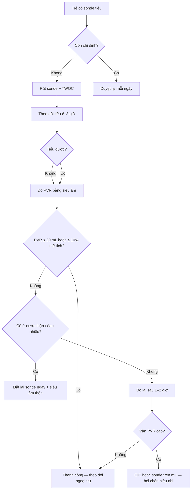
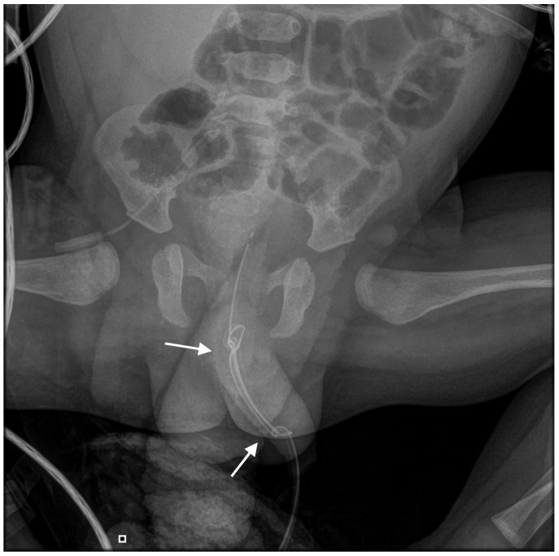
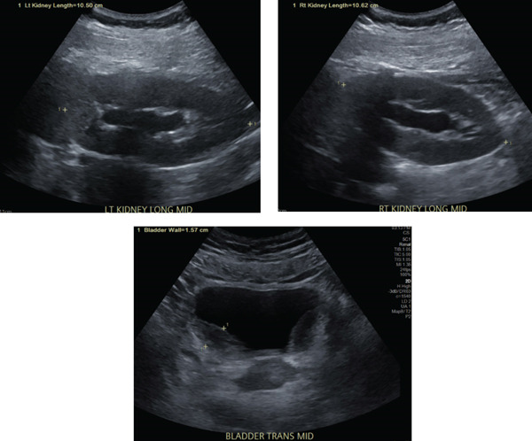
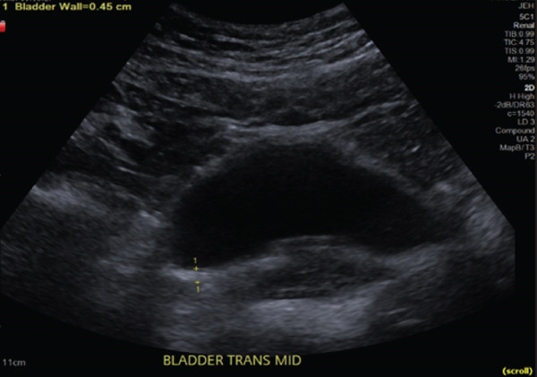

# 1739 — Cai sonde tiểu ở trẻ & thử cai sonde (TWOC) / Urinary catheter removal and trial without catheter in children

**Tags:** `pattern:bi-tieu` `pattern:thanh-bang-quang-day` `pattern:u-nuoc-than` `vung:bang-quang` `vung:tieu-khung` `protocol:SA-tieu-khung` `protocol:MCUG` `protocol:cai-sonde`

**Mức chắc chắn (certainty):** tổng hợp y văn (literature synthesis) — số liệu từ **ba đoàn hệ nhi khoa có can thiệp quy trình rút sonde** (PICU PMC6708639; chỉnh hình nhi PMC9497829 và PMC13460471), **một loạt 12 trẻ tổn thương niệu đạo do sonde** (PMC11762777), **một ca kết nút sonde ở nhũ nhi** (PMC13214670) và **dữ liệu người lớn về thời gian lưu sonde** (PMC2631699; PMC13138540). Ngưỡng thể tích bàng quang/tồn dư là **thực hành nhi khoa** (công thức Koff), không phải từ thử nghiệm ngẫu nhiên.

> **Bài này là mặt "quyết định rút sonde" — chẩn đoán CAUTI (cấy, ngưỡng, kháng sinh) đã có ở [3086](../3086-cauti-o-tre/lesson.md).** Câu chốt: **mỗi ngày giữ sonde là một ngày tăng nguy cơ**, và **rút sớm không làm tăng bí tiểu nếu có quy trình**. Ba con số: **(1)** nguy cơ nhiễm **~5%/ngày** (PMC2631699), **OR 1,07 mỗi ngày lưu** (người lớn, PMC13138540); **(2)** rút sonde **ngày hậu phẫu 1** giảm đặt lại ở khoa từ **19,1% xuống 2,2%** và thời gian lưu **3 → 1 ngày**, **không tăng UTI** (PMC13460471); **(3)** quy trình điều dưỡng rút sonde giảm **28% ngày sonde**, **CAUTI PICU 4,8 → 0,8/1.000 ngày sonde** (PMC6708639).

## 1. Tổng quan bệnh học – cơ chế hình ảnh (TẠI SAO)

### 1.1 Vì sao "rút sonde" là điều trị, không phải thủ thuật phụ

- Trong **24–48 giờ**, vi khuẩn bám mặt ngoài và lòng sonde, tạo **màng sinh học (biofilm)** bằng polysaccharide. Biofilm **che vi khuẩn khỏi kháng sinh và bạch cầu** → **còn sonde thì ổ nhiễm còn**; kháng sinh đơn thuần thường chỉ "dập" triệu chứng rồi tái phát.
- **Nguy cơ tích lũy theo thời gian:** trung bình **5%/ngày** với sonde lưu ngắn (PMC2631699); ở đoàn hệ người lớn, **mỗi ngày lưu thêm OR 1,07** và **sonde latex OR 3,8** so với silicone (PMC13138540). Ở trẻ, **số ngày có sonde** là biến số can thiệp được — không phải "số phận".
- **Vì sao trẻ khác người lớn:** niệu đạo **ngắn, hẹp**; sơ sinh/nhũ nhi thường dùng **sonde nuôi ăn 5–6 Fr** vì không có Foley cỡ nhỏ → ống **dài, mềm, dễ cuộn và kết nút** (ước **0,2/100.000 lần đặt sonde**, PMC13214670). Sang chấn niệu đạo do đặt sonde ở bé trai **13,4/1.000 lần** (PMC11762777) — đây là **cái giá của việc đặt lại sonde không cần thiết**.

### 1.2 Sinh lý bàng quang trẻ: ngưỡng để quyết định "đủ nước tiểu chưa"

- **Thể tích bàng quang mong đợi = (tuổi + 2) × 30 mL** (công thức Koff; dùng trong bài 1744). Trẻ 4 tuổi ≈ **180 mL**.
- **Nước tiểu tồn dư (post-void residual, PVR)** sau khi đi tiểu: **≤ 20 mL** hoặc **≤ 10% thể tích mong đợi** là chấp nhận được trong thực hành; **> 20 mL** cần đo lại sau khi bàng quang đầy đủ, và **> 10% thể tích** gợi ý **bàng quang không tống xuất hết** (cầu bàng quang yếu hoặc tắc đường ra).
- **Vì sao phải chờ 6–8 giờ sau rút:** bàng quang chỉ có cảm giác buồn tiểu khi đạt **~50% thể tích**; đo PVR ngay sau rút khi bàng quang rỗng sẽ **bỏ sót bí tiểu**.
- **Cơ chế bí tiểu sau rút sonde:** (1) **cầu bàng quang giảm co** do giãn quá mức/giảm trương lực; (2) **thuốc** — opioid, thuốc gây mê, kháng cholinergic, epidural; (3) **tắc đường ra** — van niệu đạo sau, hẹp niệu đạo, sỏi, phù nề sau can thiệp; (4) **nhiễm trùng niệu** gây co thắt; (5) **yếu tố tâm lý/lo âu** ở trẻ lớn.

### 1.3 TẠI SAO hình ảnh học có vai trò trong quyết định rút

- **Siêu âm thận – bàng quang trước và sau rút** trả lời 3 câu: **(1) có ứ nước thận không? (2) thành bàng quang dày bao nhiêu? (3) PVR còn bao nhiêu?**
- **Thành bàng quang bình thường khi căng ≤ 3 mm**; **> 3–5 mm** là dày. Ca minh hoạ (viêm bàng quang tăng bạch cầu ái toan, không phải CAUTI) có thành sau **15,7 mm** kèm **ứ nước nhẹ hai bên**, giảm còn **4,5 mm** sau điều trị (PMC13449030) — cho thấy **cùng mặt cắt, cùng độ căng** mới so sánh được.
- **Ứ nước thận độ 1–2** thường do trào ngược/tắc tạm; **độ 3–4** (nhu mô mỏng, đài thận dạng gậy) là **tắc nghẽn thực sự** — phải giải áp **trước** khi bàn chuyện rút sonde.
- **MCUG không thường quy**: chỉ khi UTI sốt tái phát, nghi trào ngược độ cao, hoặc bất thường giải phẫu (PMC10252788).

## 2. Mẫu hình + chẩn đoán phân biệt theo vị trí (gamut)

- **Trẻ không tiểu được sau rút sonde → 6 nhóm, theo cơ chế:**
  1. **Cầu bàng quang giảm co (detrusor underactivity)** — sonde lưu lâu, bàng quang giãn, opioid/epidural; siêu âm: bàng quang căng, thành mỏng, **không ứ nước thận**.
  2. **Tắc đường ra (outlet obstruction)** — van niệu đạo sau, hẹp niệu đạo, sỏi, phù nề; siêu âm: **ứ nước thận + thành bàng quang dày**, có thể thấy **niệu đạo giãn**.
  3. **Bàng quang thần kinh** — tủy sống, thoát vị tủy, bất thường cùng; tiền sử thần kinh, **PVR cao mạn**, ứ nước.
  4. **Nhiễm trùng niệu** — tiểu buốt, nước tiểu đục; **bí tiểu do co thắt**; cấy dương.
  5. **Sang chấn/biến chứng sonde** — đau niệu đạo, chảy máu, **cản trở khi rút**, kết nút, đường hầm giả.
  6. **Yếu tố tâm lý/thói quen** — trẻ lớn, đau khi tiểu, sợ hãi; **loại trừ** bằng PVR và siêu âm bình thường.

## 3. Bảng so sánh phân biệt (ma trận đối chiếu)

| Thực thể (entity) | Hình ảnh / lâm sàng điển hình | Chốt vào (rule-in) | Chốt loại (rule-out) | Gợi ý xác nhận |
|---|---|---|---|---|
| **Cầu bàng quang giảm co (do sonde/thuốc)** | Bàng quang căng, thành **mỏng**, **không ứ nước thận**; sau rút sonde không buồn tiểu | **PVR > 10% thể tích + không tắc + thuốc/epidural/opioid** | Ứ nước thận + thành dày → nghĩ tắc, không phải cầu yếu đơn thuần | Siêu âm PVR; ngừng opioid/kháng cholinergic; CIC tạm |
| **Tắc đường ra (PUV/hẹp niệu đạo/sỏi)** | **Ứ nước thận**, thành bàng quang **dày**, bàng quang căng; dòng tiểu yếu | **Ứ nước thận + PVR cao + dòng tiểu yếu** | Siêu âm thận bình thường + dòng tiểu tốt → ít nghĩ tắc cao | Siêu âm + MCUG; soi niệu đạo khi nghi hẹp |
| **Bàng quang thần kinh** | Bàng quang **hình tháp/cột**, thành dày, ứ nước; tiền sử tủy | **PVR cao mạn + bất thường thần kinh/tủy** | Không có bệnh thần kinh, PVR về bình thường → ít nghĩ | Siêu âm + niệu động học (urodynamics) |
| **Nhiễm trùng niệu** | Thành bàng quang dày không đều, cặn trong lòng; cấy dương | **Triệu chứng niệu + cấy qua sonde ≥ 50.000 CFU/mL** (bài 3086) | Cấy âm + không triệu chứng → không phải nhiễm | Cấy nước tiểu đúng cách |
| **Sang chấn / kết nút sonde** | **X-quang bụng: sonde cuộn/kết nút**; đau, chảy máu khi rút | **Cản trở khi rút + đau niệu đạo** | Rút trơn, không đau → loại | **Ngừng kéo**, X-quang, hội chẩn niệu nhi |

## 4. Protocol chụp + hệ phân độ/điểm chuẩn hóa

### 4.1 Nguyên tắc: duyệt lại sonde mỗi ngày

- **Chỉ định còn không?** Nếu hết chỉ định (theo dõi huyết động ổn, hết bí tiểu, hết rửa bàng quang) → **rút ngay**, không chờ "đủ ngày".
- **Không "luyện bàng quang" bằng kẹp sonde** định kỳ: không có bằng chứng lợi ích, làm tăng nguy cơ nhiễm và bí tiểu; **không khuyến cáo**.
- **Ghi nhận ngày đặt, ngày rút, lý do** — đây là dữ liệu để audit.

### 4.2 Quy trình thử cai sonde (TWOC — trial without catheter)

1. **Chuẩn bị:** cho trẻ uống đủ nước; **ngừng opioid/kháng cholinergic nếu có thể**; điều trị nhiễm trùng niệu đang hoạt động trước khi thử (nếu có).
2. **Rút sonde** nhẹ nhàng, **dừng ngay nếu gặp lực cản** (nguy cơ kết nút/đường hầm giả).
3. **Theo dõi 6–8 giờ:** trẻ phải **tiểu tự nhiên**; ghi thể tích, đau, có tiểu máu.
4. **Đo PVR bằng siêu âm** sau lần tiểu đầu tiên khi bàng quang đã đầy: **≤ 20 mL hoặc ≤ 10% thể tích mong đợi** → thành công.
5. **Nếu PVR cao hoặc không tiểu:** đo lại sau 1–2 giờ; nếu vẫn cao → **đặt lại sonde/CIC**; **không chờ quá 8–12 giờ** ở trẻ có ứ nước thận hoặc đau nhiều.

### 4.3 Khi TWOC thất bại: chọn đường dẫn lưu

| Lựa chọn | Chỉ định | Ưu điểm | Nhược điểm |
|---|---|---|---|
| **CIC (thông niệu đạo ngắt quãng sạch)** | Bàng quang thần kinh, cầu yếu hồi phục | Ít nhiễm hơn sonde lưu, giữ sinh hoạt | Cần người chăm/thành thạo; sang chấn nếu kỹ thuật sai |
| **Sonde niệu đạo lưu** | Ngắn hạn, bí tiểu cấp chưa rõ nguyên nhân | Nhanh, sẵn có | Nhiễm **5%/ngày**, sang chấn niệu đạo **13,4/1.000** (PMC11762777) |
| **Sonde trên xương mu (suprapubic)** | **Niệu đạo không tiếp cận được** (chấn thương, hẹp, PUV), cần dẫn lưu kéo dài | Tránh niệu đạo, dễ chăm sóc | Thủ thuật xâm lấn (nguy cơ tổn thương ruột/mạch), nhiễm, sỏi bàng quang |

### 4.4 Lưu đồ quyết định

### 4.5 Bằng chứng cho quy trình rút sớm

- **Rút ngày hậu phẫu 1** ở trẻ mổ chỉnh hình có epidural: **đặt lại ở khoa 2,2% vs 19,1%** (p = 0,003), thời gian lưu **1 vs 3 ngày** (p < 0,001), **không khác UTI** (PMC13460471). Trước đó, nhóm epidural đặt sonde **93% vs 17%**, lưu **3 vs 1 ngày** (PMC9497829) — **"giữ đến hết epidural" là thói quen, không phải chỉ định**.
- **Giao quyền rút cho điều dưỡng** theo chỉ định lâm sàng: **giảm 28% ngày sonde**, **CAUTI PICU 4,8 → 0,8/1.000 ngày sonde** (PMC6708639); có "bác sĩ phụ trách an toàn" giảm **tỷ lệ sử dụng sonde 0,44 → 0,39** (PMC4684390).
- **Sonde silicone thay latex** và **giảm số ngày lưu** có thể **giảm ~50%** CAUTI xác nhận bằng cấy (dữ liệu người lớn, PMC13138540).

## 5. Biến thể bình thường và cạm bẫy

- **Đo PVR quá sớm** sau rút (bàng quang chưa đầy) → **âm tính giả**, cho rút rồi trẻ bí tiểu tại nhà. Cho uống nước, chờ **6–8 giờ**.
- **PVR cao thoáng qua do lo âu** ở trẻ lớn: đo lại khi trẻ thoải mái; **không đặt lại sonde ngay** nếu trẻ vẫn tiểu được và không đau.
- **Kẹp sonde "luyện bàng quang"** không có bằng chứng; có thể gây **trào ngược, nhiễm, đau**.
- **Rút sonde gặp lực cản** = **không kéo mạnh**: có thể **kết nút** (nhũ nhi), bóng chưa xả hết, hoặc **đường hầm giả**; chụp X-quang bụng, gọi niệu nhi (ca PMC13214670 phải mổ bàng quang gỡ nút).
- **Bơm bóng trước khi thấy nước tiểu** → bóng trong niệu đạo → đau, chảy máu, hẹp về sau. Quy tắc: **thấy nước tiểu rồi mới bơm**.
- **Sau giải áp tắc nghẽn:** có thể **đái nhiều sau tắc (post-obstructive diuresis)** — theo dõi điện giải, không nhầm là "hồi phục hoàn toàn".
- **Sốt sau rút sonde 24–48 giờ** vẫn có thể là CAUTI (ổ đã hình thành trước rút) — cấy lại, đừng mặc định "đã rút là hết" (xem bài 3086).

## 6. Tự lượng giá — Blind Quiz

**Ca 1 — Bé trai 6 tháng (hội chứng Crouzon) đặt sonde nuôi ăn 6 Fr sau mổ sọ. Ngày hậu phẫu 6, rút sonde gặp lực cản, bé đau và quấy.**

- Gợi ý: sonde mềm cỡ nhỏ, lưu 6 ngày; không sốt.
- Hỏi: Thấy gì trên phim? Vì sao **không được kéo mạnh**? Xử trí tiếp theo?

<b>Bấm để hiện đáp án</b>

- **Dấu hiệu:** sonde tạo **hai nút** — nút đôi ở **niệu đạo xa** (mũi tên dưới) và **một nút** ở **niệu đạo gần cổ bàng quang** (mũi tên trên); ống cuộn trong bàng quang/niệu đạo.
- **Chẩn đoán:** **kết nút sonde (catheter knotting)** — biến chứng hiếm (~0,2/100.000 lần đặt sonde ở trẻ) nhưng điển hình ở nhũ nhi dùng sonde nuôi ăn dài/mềm.
- **Vì sao không kéo:** kéo mạnh làm rách niệu đạo, tạo **đường hầm giả**, hẹp niệu đạo về sau. Ca này phải **mổ bàng quang gỡ nút**.
- **Xử trí:** dừng kéo → **X-quang bụng** xác nhận → hội chẩn niệu nhi; nếu nút ở niệu đạo xa có thể thử gỡ qua nội soi, không thì mổ.
- Nguồn ảnh: Gkialas K et al., Reports 2026 (PMC13214670), Fig. 1 — **CC BY 4.0**.

**Ca 2 — Bé gái 5 tuổi, tiểu buốt, tiểu máu, sốt nhẹ; sonde tiểu đã rút 3 ngày, tiểu ít.**

- Hỏi: Mô tả bất thường trên 3 mặt cắt. Có nên rút sonde/đặt lại ngay không? Cần làm gì tiếp?

<b>Bấm để hiện đáp án</b>

- **Dấu hiệu:** hai thận có **ứ nước nhẹ hai bên** (đài thận giãn); thành sau bàng quang **dày không đều tới 15,7 mm**.
- **Chẩn đoán trong ca gốc:** **viêm bàng quang tăng bạch cầu ái toan (eosinophilic cystitis)** — **không phải CAUTI**; đây là ví dụ về **thành bàng quang dày + ứ nước** phải loại trừ **tắc đường ra** trước khi cho rút sonde.
- **Bài học:** thành bàng quang dày và ứ nước nhẹ **không đặc hiệu**; cấy nước tiểu đúng cách + siêu âm lặp lại sau điều trị.
- Nguồn ảnh: Hoyt L et al., Case Rep Urol 2026 (PMC13449030), Fig. 1 — **CC BY 4.0**.

**Ca 3 — Cùng bệnh nhi sau 6 tuần điều trị, hết triệu chứng.**

<b>Bấm để hiện đáp án</b>

- **Dấu hiệu:** thành sau bàng quang giảm còn **4,5 mm**; hình dạng đều hơn.
- **Ý nghĩa:** theo dõi **cùng mặt cắt, cùng độ căng bàng quang** mới đánh giá được đáp ứng; bình thường thành bàng quang khi căng **≤ 3 mm**.
- Nguồn ảnh: Hoyt L et al., Case Rep Urol 2026 (PMC13449030), Fig. 4 — **CC BY 4.0**.

## Bài liên quan chéo
- [3086 – Nhiễm khuẩn đường niệu liên quan catheter (CAUTI) ở trẻ](../3086-cauti-o-tre/lesson.md) (chẩn đoán, cấy, ngưỡng, kháng sinh)
- [1744 – Bí tiểu cấp ở bé gái](../1744-bi-tieu-cap-be-gai/lesson.md) (thể tích bàng quang theo tuổi, đặt sonde)
- [1702 – Túi niệu đạo sau tạo hình niệu đạo ở trẻ](../1702-tui-nieu-dao-sau-tao-hinh-nieu-dao-o-tre/lesson.md) (biến chứng niệu đạo sau can thiệp)
- [1719 – Bàng quang đôi và nang niệu rốn](../1719-bang-quang-doi-va-nang-nieu-ron/lesson.md) (khối vùng bàng quang)

## Ảnh
- 3 ảnh **CC BY 4.0**, nguyên bản, không crop/ghép; nguồn + giấy phép từng ảnh trong `images/CREDITS.md`.

> Không dùng để chẩn đoán độc lập khi chưa có người hướng dẫn.
