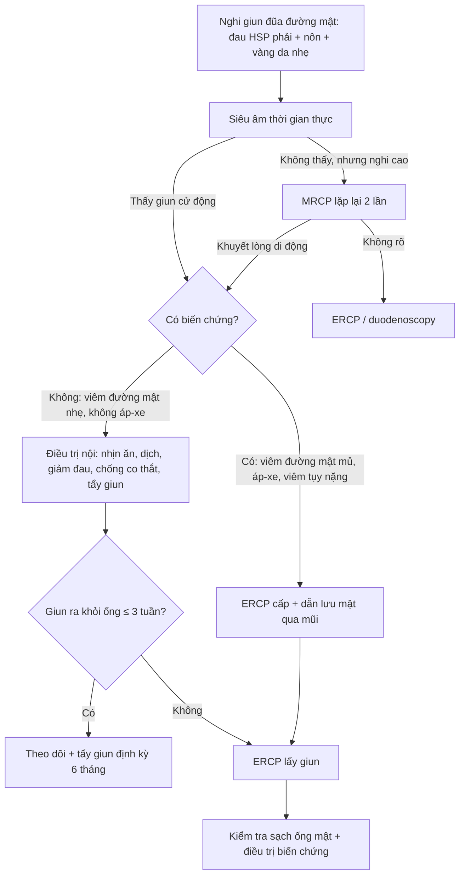
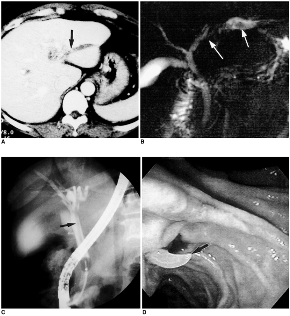
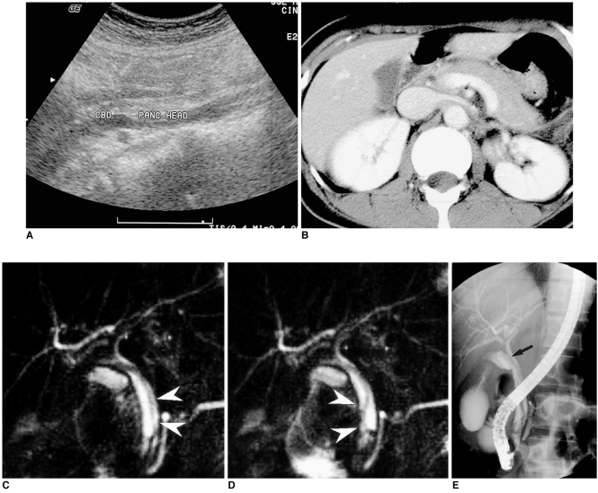
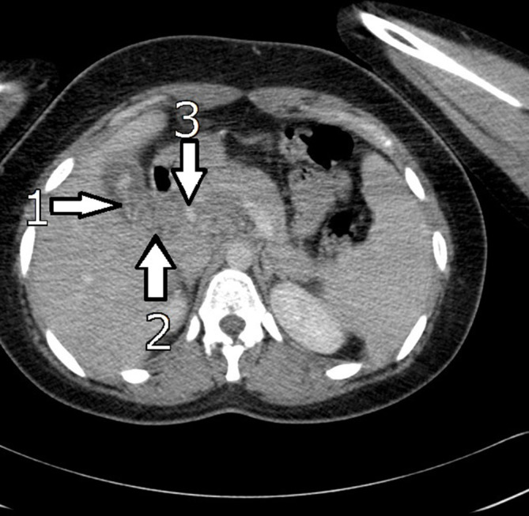
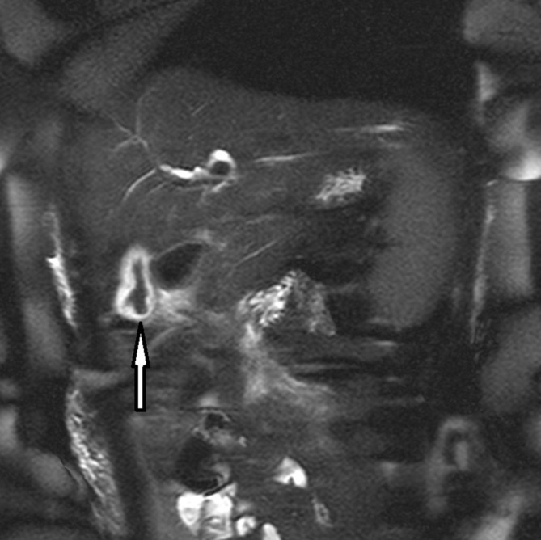

# 174 — Giun đũa đường mật (biliary ascariasis): dấu "bốn đường", ống mật giả tắc & khi nào can thiệp

**Tags:** `pattern:khuyet-long` `vung:duong-mat` `anatomy:ong-mat-chu` `protocol:MRCP` `protocol:ERCP`
**Mức chắc chắn (certainty):** tổng hợp y văn (literature synthesis) — bài tổng quan của Khuroo 2016 (WJG, PMC5011666) + hai ca nguyên văn có ảnh (Hwang 2001, PMC2718117; Keshvala 2019, PMC6945261) + tổng quan hệ thống ca bệnh (Cureus 2022, PMC9840414). Số liệu lấy trực tiếp từ các bài này; chỗ chưa kiểm chứng ghi rõ.

## 1. Tổng quan bệnh học – cơ chế hình ảnh

- **Dịch tễ (số của Khuroo 2016):** nhiễm *Ascaris lumbricoides* toàn cầu **~25% dân số, ước 1,4 tỉ người**; mỗi năm **1,2–2 triệu ca bệnh lâm sàng** và **~20.000 ca tử vong**. Ở vùng dịch tễ (Kashmir), giun đũa đường mật–tụy (hepatobiliary and pancreatic ascariasis, HPA) là nguyên nhân của **36,7%** ca bệnh đường mật, **23%** viêm tụy cấp, **14,5%** áp-xe gan và **12,5%** sỏi đường mật.
- **Hình thái quyết định hình ảnh:** giun trưởng thành dài, trụ, phân biệt đực/cái — đực **15–30 cm × 2–4 mm**, cái **20–40 cm × 3–6 mm** (đường kính vừa khít lòng ống mật chủ); sống **6–18 tháng**; từ trứng đến giun trưởng thành **~4 tháng**. Khi chui vào ống mật chủ (common bile duct, CBD), con giun vừa **kích thích làm ống giãn nhẹ**, vừa **vẫn cử động** — hai yếu tố tạo nên hình ảnh đặc trưng.
- **TẠI SAO siêu âm thấy "bốn đường" (four-line sign):** vỏ kitin và thành cơ của giun **phản âm mạnh** → trên cắt dọc thấy **2 đường sáng mặt ngoài + 2 đường sáng mặt trong**, kẹp giữa là **lòng ống tiêu hóa chứa dịch, không phản âm**. Giun **không tạo bóng lưng** (không cản âm như sỏi) vì cấu trúc mềm, và **cử động** khi quan sát thời gian thực — hai đặc điểm này là chốt phân biệt với sỏi.
- **TẠI SAO MRCP thấy khuyết lòng:** mật có T2 rất dài → sáng trên chuỗi T2 nặng (MRCP); giun là **mô mềm, T2 ngắn hơn mật nhiều** → **khuyết lòng hình ống, trơn, dài** nằm trong lòng ống sáng. Chụp lặp lại vài giây sau thấy khuyết lòng **đổi vị trí** = giun còn sống (Hwang 2001 ghi nhận đúng nghiệm pháp này).
- **TẠI SAO CT yếu hơn:** tỉ trọng giun gần với mật/mô mềm, đường kính chỉ vài mm và nằm chéo mặt cắt → dễ bỏ sót hoặc chỉ thấy "dải tăng tỉ trọng nhẹ trong ống giãn". CT có giá trị khi tìm **biến chứng** (áp-xe gan, viêm tụy, thủng) chứ không phải để phát hiện con giun.
- **Cơ chế biến chứng:** giun vào ống mật qua nhú Vater, **chui ra–vào nhiều lần**; cử động trong ống mật kéo dài **~10 ngày** trên siêu âm theo dõi (Khuroo 2016). Khi giun chết trong ống, xác giun + trứng thành **nhân sỏi bùn/sỏi sắc tố nâu** → **sỏi trong gan và viêm đường mật mủ tái phát (recurrent pyogenic cholangitis)** — đây là di chứng muộn quan trọng nhất.

## 2. Mẫu hình + chẩn đoán phân biệt theo vị trí (gamut)

**Mẫu hình chung:** *khuyết lòng dài, trơn, không cản quang, đổi vị trí/cử động, trong ống mật giãn nhẹ* + bệnh cảnh **đau hạ sườn phải – nôn – vàng da nhẹ**, thường ở người từ vùng dịch tễ hoặc đã can thiệp đường mật.

- **Trong ống mật chủ:** giun đũa (chốt: cử động + không bóng lưng), **sỏi ống mật chủ** (bóng lưng, có thể đổi vị trí theo tư thế nhưng không tự cử động), **cục máu đông (hemobilia)** sau chấn thương/sinh thiết, **khí trong đường mật** sau cắt cơ Oddi (rất sáng, có artifact), **stent nhựa** (hình ống đôi, có tiền sử đặt), **u nhầy nhú trong ống (IPNB)** (khuyết lòng bám thành, không di động, ống giãn không tương xứng).
- **Trong túi mật:** giun đũa (dấu **"mắt bò"** — vòng sáng quanh con giun cuộn trong túi mật phù nề), sỏi/bùn mật, polyp cholesterol, máu cục.
- **Trong ống tụy:** giun đũa gây **viêm tụy cấp** (khuyết lòng dài trong ống tụy giãn, tụy phù nề) — bệnh cảnh nặng, có thể hoại tử.
- **Ngoài lòng ống:** áp-xe gan (giun chui vào nhu mô qua vết rách ống mật nhỏ) — khi thấy giun trong đường mật **phải chủ động tìm áp-xe/viêm tụy**, đừng dừng ở chẩn đoán "có giun".

**Gamut theo bệnh cảnh lâm sàng (Khuroo 2016 chia 6 thể):** đau quặn mật; viêm đường mật cấp; viêm túi mật không sỏi; áp-xe gan; viêm tụy cấp; và **sỏi trong gan/viêm đường mật mủ tái phát** (di chứng).

## 3. Bảng so sánh phân biệt (ma trận đối chiếu)

| Thực thể (entity) | Hình ảnh điển hình (US / MRCP / CT) | Chốt vào (rule-in) | Chốt loại (rule-out) | Gợi ý xác nhận |
|---|---|---|---|---|
| **Giun đũa đường mật** | US: dấu **bốn đường**, không bóng lưng, **cử động**; MRCP: khuyết lòng **dài–trơn–hình ống**, đổi vị trí giữa 2 lần chụp; CT: dải tăng tỉ trọng nhẹ trong ống giãn | **Cử động thời gian thực hoặc đổi vị trí trên MRCP lặp lại** | Không bóng lưng + không bám thành + ống giãn nhẹ đồng đều → loại sỏi/u | US thời gian thực 3–5 phút; MRCP lặp lại sau 5 giây; ERCP/duodenoscopy |
| **Sỏi ống mật chủ** | US: cung phản âm + **bóng lưng**; MRCP: khuyết lòng **tròn/bầu dục**, bờ rõ, thường ở đoạn thấp | **Bóng lưng sau cung phản âm** | Khuyết lòng **dài, trơn, rời thành và di động** → nghĩ giun | US + MRCP; EUS nếu sỏi nhỏ |
| **Cục máu đông (hemobilia)** | Khuyết lòng không đều, có thể dài; tiền sử chấn thương/sinh thiết/ERCP; mật có thể tăng tỉ trọng | **Tiền sử can thiệp/chấn thương + khuyết lòng thay đổi nhanh trong vài ngày** | Vỏ giun đều, hai thành song song, cử động → giun | CT có cản quang, theo dõi 48–72 giờ |
| **Khí đường mật** | Rất sáng trên CT, **không thấy trên MRCP** (khí không tín hiệu), có thể hình ống; sau cắt cơ Oddi | **Tỉ trọng khí trên CT + tiền sử can thiệp** | Không sáng trên MRCP → loại khí | CT cửa sổ khí |
| **IPNB / u nhú trong ống** | Khuyết lòng **bám thành, không di động**, ống mật giãn **không tương xứng** với kích thước u, có thể có nhầy | **Bám thành + không cử động + giãn ống mạn** | Khuyết lòng di động, trơn, rời thành → giun | MRCP + cholangioscopy + sinh thiết |
| **Viêm đường mật mủ tái phát (di chứng)** | Sỏi/bùn trong gan, hẹp ống, giãn không đều, có thể thấy xác giun canxi hóa | **Sỏi sắc tố nâu trong gan + tiền sử giun** | Không có sỏi/bùn, chỉ khuyết lòng di động → còn giun sống | CT + MRCP; ERCP lấy sỏi |

## 4. Protocol chụp + thuật toán xử trí

**Chẩn đoán hình ảnh (thứ tự thực hành):**

1. **Siêu âm bụng (đầu tay, bắt buộc):** nhịn ăn 6–8 giờ; dùng đầu dò convex, khảo sát **thời gian thực 3–5 phút** dọc ống mật chủ và túi mật, ghi lại video nếu thấy cấu trúc nghi giun. Tìm **dấu bốn đường**, mất bóng lưng, cử động, giãn ống mật, túi mật phù nề, dịch quanh tụy. Khuroo 2016: siêu âm phát hiện giun trong ống mật **24/26 ca (92,3%)**; **20/20 ca có ≥ 2 giun** nhưng chỉ **4/6 ca có 1 giun** — **một con giun dễ bị bỏ sót**.
2. **MRCP (khi siêu âm âm hoặc cần bản đồ đường mật):** chuỗi T2 3D nặng T2, không cần gadolinium; đọc **khuyết lòng hình ống** và **so sánh 2 lần chụp cách nhau vài giây** để chứng minh di động. MRCP thay ERCP khi **không dự kiến can thiệp** (Khuroo 2016).
3. **CT bụng có cản quang:** không dùng để phát hiện giun; dùng khi nghi **áp-xe gan, viêm tụy hoại tử, thủng đường mật** hoặc phân biệt khí/sỏi.
4. **ERCP ± duodenoscopy:** vừa chẩn đoán vừa điều trị; soi tá tràng thấy giun thò ra–vào nhú Vater; chụp đường mật thấy **khuyết lòng dài, trơn**, có thể hình vòng/loop.
5. **Xét nghiệm hỗ trợ:** bạch cầu ái toan tăng; **soi phân tìm trứng có giá trị thấp ở vùng dịch tễ** (tỉ lệ nhiễm nền 30–90% — Khuroo 2016); trứng âm tính không loại trừ (có thể chỉ có giun đực).

**Không có hệ phân độ RADS riêng** — quyết định dựa trên **thời gian giun lưu trong ống** và **biến chứng**:

**Điều trị (số liệu từ nguồn):**
- **Nội khoa trước:** nhịn ăn, dịch tĩnh mạch, giảm đau/chống co thắt, kháng sinh nếu viêm đường mật. Điều trị bảo tồn **giải quyết hoàn toàn triệu chứng 68–80%** ca (Cureus 2022).
- **Tẩy giun:** albendazole **400 mg liều duy nhất**, hoặc mebendazole **500 mg liều duy nhất**, hoặc mebendazole **100 mg × 2/ngày × 3 ngày** (Cureus 2022). Khuroo 2016 khuyến cáo **không bơm thuốc tẩy giun trực tiếp vào ống mật** vì làm giun chết tại chỗ, cản trở giun tự ra.
- **ERCP can thiệp khi:** triệu chứng không giảm và/hoặc giun **không ra khỏi ống sau 3 tuần**; giun đã chết trong ống; ca tái phát; **viêm đường mật mủ cần ERCP + dẫn lưu mật qua mũi cấp cứu** (Khuroo 2016; Cureus 2022).
- **Lưu ý kỹ thuật:** cắt cơ Oddi (sphincterotomy) **tạo đường vào thuận lợi cho giun tái xâm nhập** — nguồn Cureus 2022 khuyến cáo **tránh cắt cơ rộng** khi chỉ để lấy giun; đây là điểm cần cân nhắc theo từng ca, không phải chống chỉ định tuyệt đối.
- **Phòng tái phát:** tẩy giun định kỳ **mỗi 6 tháng** làm giảm tái phát (Cureus 2022); điều trị giun ở ruột cho cả gia đình/vùng dịch tễ; cải thiện vệ sinh.

**Ca minh họa có số (Keshvala 2019):** nữ 25 tuổi từ vùng dịch tễ, sốt + đau thượng vị; bilirubin **61 µmol/L**, ALP **398 U/L**, GGT **438 U/L**, amylase **102 U/L**; siêu âm: túi mật phù nề, **OMC 6 mm** (giãn nhẹ), không sỏi; CT: cấu trúc **đường cong tăng tỉ trọng** trong túi mật lan vào OMC; MRCP: khuyết lòng **giảm tín hiệu** trong lòng túi mật/OMC. Điều trị **mebendazole 3 ngày**, lâm sàng và xét nghiệm **bình thường sau 4 tuần**, không cần can thiệp.

## 5. Biến thể bình thường và cạm bẫy

- **Giun trong túi mật ≠ giun trong ống mật:** giun cuộn trong túi mật cho **dấu "mắt bò"** (vòng sáng quanh cấu trúc tối), không phải khuyết lòng dài; Khuroo phát hiện **13/13 ca** giun trong túi mật bằng siêu âm, trong khi ERCP **kém** phát hiện vị trí này — đừng chỉ làm ERCP rồi kết luận âm.
- **Bỏ sót giun đơn độc/ở bóng Vater:** siêu âm chỉ thấy **4/6 ca một giun**; giun nằm ở nhú hoặc tá tràng có thể **không thấy trên siêu âm** → nếu lâm sàng điển hình mà hình ảnh âm, làm **duodenoscopy/ERCP** hoặc MRCP lặp lại.
- **Sỏi giả do bùn mật:** bùn có thể phản âm và **không bóng lưng** như giun; khác ở chỗ **không có cấu trúc hai thành song song** và **không cử động**.
- **Khí sau cắt cơ Oddi** rất sáng trên CT nhưng **không thấy trên MRCP**; đừng chẩn đoán "giun" chỉ vì thấy cấu trúc sáng trong ống trên CT.
- **Satisfaction of search:** thấy giun rồi dừng → bỏ sót **áp-xe gan, viêm tụy hoại tử, thủng ống mật**; và bỏ sót **sỏi sắc tố** (di chứng) ở ca tái phát.
- **Tiền sử can thiệp đường mật** (cắt cơ Oddi, nối mật–ruột Roux-en-Y) làm giun **dễ vào đường mật hơn** — nguồn Cureus 2022; đây là yếu tố nguy cơ cần hỏi.
- **Đừng nhầm với IPNB/u nhú:** khuyết lòng bám thành, không di động, ống giãn mạn tính và có nhầy → cần cholangioscopy/sinh thiết, không điều trị tẩy giun.

## 6. Tự lượng giá — Blind Quiz ngay trên trang tĩnh

**Ca 1 — Nữ 44 tuổi, đau hạ sườn phải tái diễn, không sốt. Xem 3 chuỗi ảnh: CT (A), MRCP (B), ERCP (C).**

- Gợi ý: ống mật trong gan trái giãn; không thấy sỏi cản quang.
- Câu hỏi: (1) Mô tả khuyết lòng trên MRCP và ERCP. (2) Ba chẩn đoán phân biệt? (3) Dấu hiệu nào chốt giun đũa?

<b>Bấm để hiện đáp án (findings + chẩn đoán)</b>

- **Findings:** CT (A) giãn ống mật trong gan trái, có cấu trúc **tăng tỉ trọng nhẹ** trong lòng ống (mũi tên). MRCP (B) và ERCP (C) cho **khuyết lòng dài, trơn, hình ống** trong ống mật giãn — không bóng lưng, không bám thành. (D) là hình nội soi tá tràng thấy giun ở nhú.
- **Chẩn đoán:** giun đũa đường mật.
- **Vì sao:** cấu trúc **dài–trơn–rời thành** trong lòng ống mật, không cản quang, kèm giãn ống nhẹ; sỏi sẽ **tròn + bóng lưng**, u nhú sẽ **bám thành**.
- **Phản biện:** ca này không có ảnh siêu âm thời gian thực — nếu chỉ có MRCP tĩnh, **không phân biệt được giun sống/chết**; cần thêm siêu âm hoặc MRCP lặp lại.
- **Nguồn ảnh:** Hwang CM et al., *Korean J Radiol* 2001, PMC2718117 Fig. 1 — CC BY-NC 4.0 (giữ nguyên bản).

**Ca 2 — Cùng bệnh nhân thứ hai: siêu âm (A), CT (B), hai lát MRCP cách nhau 5 giây (C, D), ERCP (E).**

- Gợi ý: ống mật chủ giãn nhẹ, tụy hơi phù.
- Câu hỏi: (1) Trên MRCP C và D, khuyết lòng có gì thay đổi? (2) Thay đổi đó nói lên điều gì? (3) Nếu khuyết lòng **không** đổi vị trí thì nghĩ gì?

<b>Bấm để hiện đáp án (findings + chẩn đoán)</b>

- **Findings:** siêu âm (A) thấy cấu trúc ống trong OMC; CT (B) tụy phù nề nhẹ; MRCP (C) có khuyết lòng hình ống (đầu mũi tên) trong OMC; **5 giây sau (D) khuyết lòng đã đổi vị trí/hình dạng**; ERCP (E) xác nhận và lấy giun.
- **Chẩn đoán:** giun đũa đường mật còn sống gây viêm tụy nhẹ.
- **Vì sao:** khuyết lòng **di chuyển giữa hai lần chụp liên tiếp** = vật thể tự do, mềm, còn sống; sỏi không tự đổi vị trí trong vài giây, u càng không.
- **Nếu không đổi vị trí:** nghĩ **giun đã chết** (xác giun thành nhân sỏi), **sỏi/bùn**, **cục máu đông**, hoặc **u nhú** — cần ERCP/cholangioscopy.
- **Nguồn ảnh:** Hwang CM et al., *Korean J Radiol* 2001, PMC2718117 Fig. 2 — CC BY-NC 4.0 (giữ nguyên bản).

**Ca 3 — Nữ 25 tuổi, sốt và đau thượng vị sau chuyến đi; CT (A) và MRCP (B).**

- Gợi ý: túi mật phù nề, không thấy sỏi; OMC 6 mm.
- Câu hỏi: (1) Cấu trúc bất thường nằm ở đâu? (2) Vì sao ban đầu chẩn đoán nhầm là viêm túi mật do sỏi? (3) Bước hình ảnh nào xác nhận?

<b>Bấm để hiện đáp án (findings + chẩn đoán)</b>

- **Findings:** CT: cấu trúc **đường cong, tăng tỉ trọng** trong lòng túi mật (1) lan vào **OMC đoạn gần** (2), đầu tụy phù nề (3). MRCP: **khuyết lòng giảm tín hiệu** trong túi mật/OMC.

- **Chẩn đoán:** giun đũa đường mật + viêm tụy nhẹ; điều trị mebendazole 3 ngày, hồi phục hoàn toàn sau 4 tuần.
- **Vì sao nhầm:** giun trong túi mật gây **viêm túi mật không sỏi** (đau, sốt, thành túi mật dày) — hình ảnh giống viêm túi mật thông thường; chỉ khi **nhìn kỹ lòng túi mật** mới thấy cấu trúc đường cong.
- **Nguồn ảnh:** Keshvala C et al., *BJR Case Rep* 2019, PMC6945261 Fig. 2–3 — CC BY 4.0.

## Bài liên quan chéo
- [100 – Tổng quan hệ Bụng](../100-tong-quan-he-bung/lesson.md)
- [128 – Ký sinh trùng đường mật (sán lá gan nhỏ)](../128-ky-sinh-trung-duong-mat/lesson.md)
- [139 – Sán lá gan & nang sán](../139-san-la-gan/lesson.md)
- [131 – Tắc mật: sỏi, u, hẹp lành tính](../131-tac-mat/lesson.md)
- [138 – Sỏi trong gan & viêm đường mật mủ tái phát](../138-soi-trong-gan-viem-duong-mat-mu/lesson.md)
- [135 – Viêm tụy cấp (Atlanta)](../135-viem-tuy-Atlanta/lesson.md)
- [102 – Viêm túi mật & viêm tụy sau ERCP](../102-viem-tui-mat-va-viem-tuy-sau-stent-mat-ercp/lesson.md)
- [179 – Hoại tử ống mật sau can thiệp u gan](../179-bien-chung-duong-mat-sau-can-thiep-u-gan/lesson.md)

> Không dùng để chẩn đoán độc lập khi chưa có người hướng dẫn.
