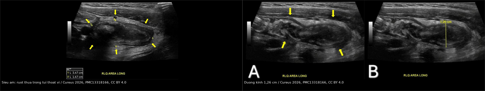
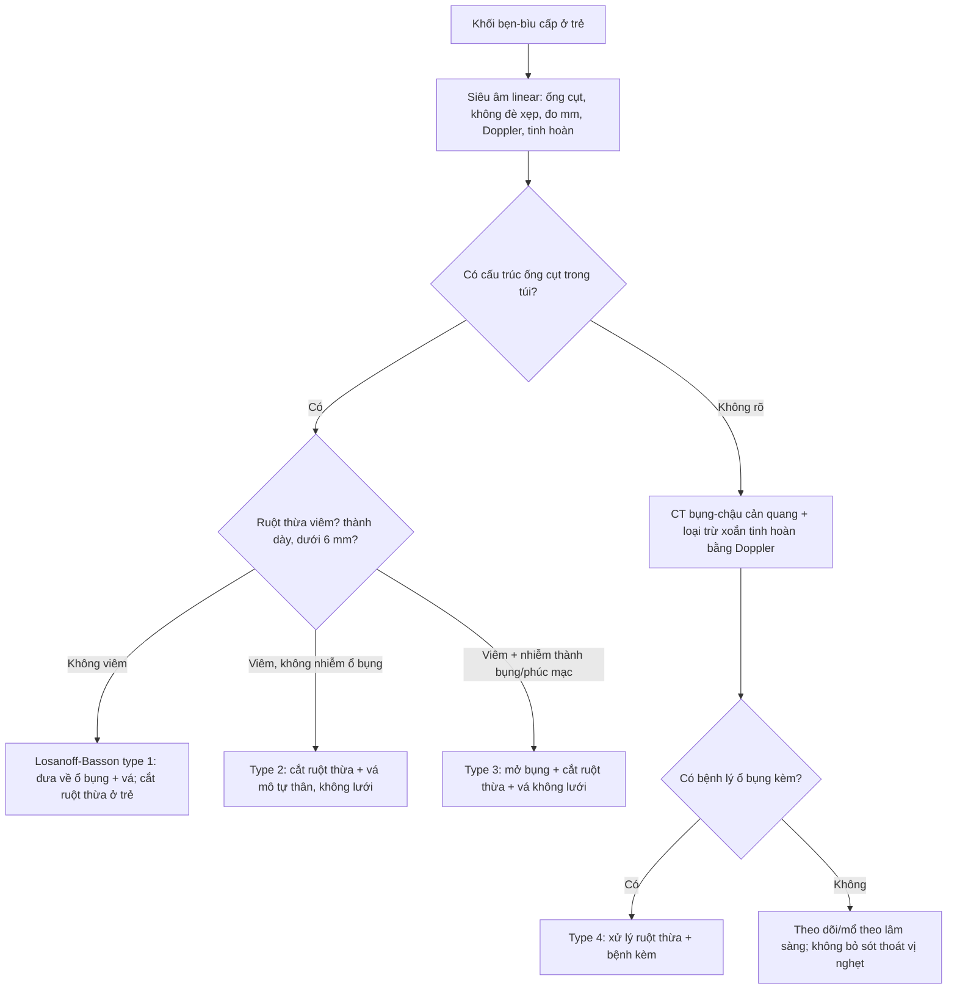
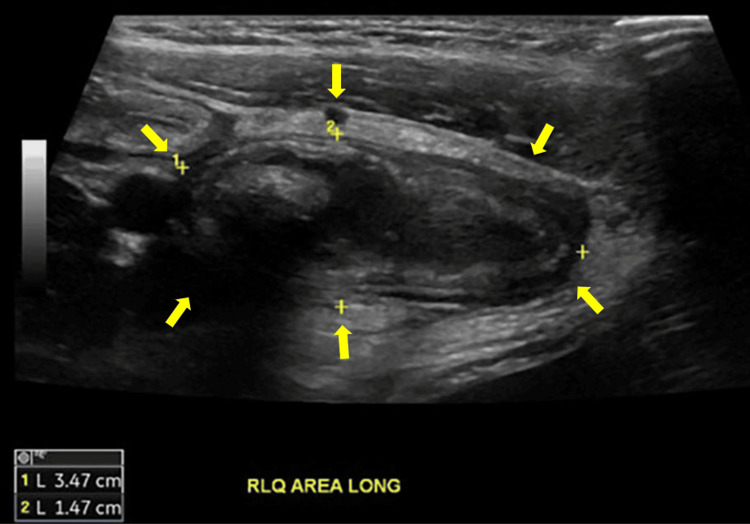
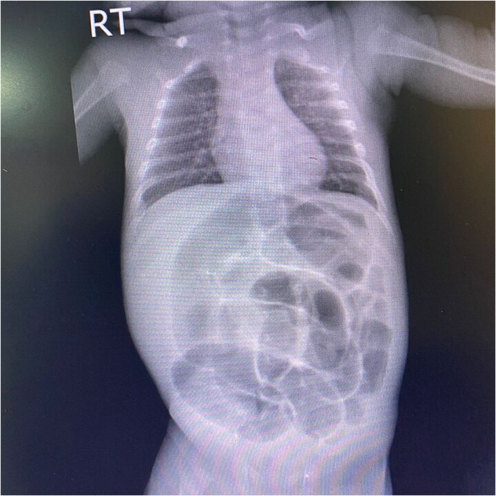
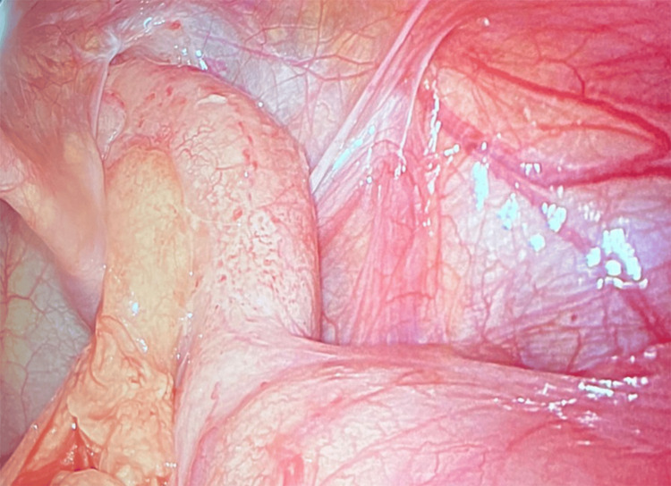

# 1740 — Thoát vị Amyand ở trẻ: ruột thừa nằm trong túi thoát vị bẹn — khi nào cắt ruột thừa, khi nào đặt lưới

**Tags:** `pattern:khoi-ben-biu` `pattern:ruot-thua-trong-tui-thoat-vi` `pattern:khong-de-xep` `vung:bung` `vung:benh-biu` `score:Losanoff-Basson` `protocol:sieua-am-ben-biu` `protocol:CT-bung`
**Mức chắc chắn (certainty):** tổng hợp y văn (literature synthesis) — ghép **tổng quan hệ thống 2023 về đặt lưới và thái độ với ruột thừa** (Diagnostics 2023, PMC10706417), **ca nhi 8 tuổi có siêu âm trước mổ** (Cureus 2026, PMC13318166), **ca sơ sinh non tháng 33 tuần 6 ngày bị thoát vị nghẹt chứa manh tràng + ruột thừa hoại tử** (J Surg Case Rep 2026, PMC13019284) và **ca người lớn chẩn đoán trước mổ bằng POCUS** (Clin Pract Cases Emerg Med 2026, PMC13135435).

> **Câu hỏi thực hành:** bé trai **8 tuổi** vào cấp cứu vì **sưng–đau bẹn phải 2 ngày**, nay **không đẩy lên được**, kèm **nôn 2 lần**, **38,2°C**. Siêu âm tuyến đầu: một **cấu trúc hình ống cụt, không đè xẹp, đường kính 12,6 mm**, có **sợi cản âm** bên trong, nằm trong túi thoát vị bẹn. Bố hỏi: *"Có phải thoát vị nghẹt không? Mổ thì có phải cắt ruột thừa không, và có đặt lưới được không?"*
> Bài chốt **sáu điểm**: **(1) tần suất có thật và đủ để nghĩ tới** — ruột thừa trong túi thoát vị bẹn gặp ở **0,19–1,7%** các ca thoát vị bẹn (trung bình **< 1%**), viêm ruột thừa trong túi chỉ **0,07–0,13%**; **(2) trẻ gặp NHIỀU GẤP 3 LẦN người lớn** vì **ống phúc tinh mạc (processus vaginalis) chưa đóng** — cơ chế giải thích tại sao đây là bệnh cảnh nhi; **(3) chẩn đoán trước mổ được bằng siêu âm** — tiêu chí là **hình ống cụt, không đè xẹp, > 6 mm, có tăng sinh mạch trên Doppler**, không phải "thấy được ruột thừa"; **(4) phân loại Losanoff–Basson quyết định mổ gì** — type 1 (ruột thừa lành) → cắt ruột thừa ở trẻ + vá không lưới; type 2 (viêm, không nhiễm khuẩn ổ bụng) → cắt ruột thừa + vá mô tự thân; type 3 (có nhiễm khuẩn ổ bụng/thành bụng) → mở bụng; type 4 (có bệnh lý ổ bụng kèm) → xử lý cả hai; **(5) ở trẻ, lưới KHÔNG phải lựa chọn đầu tay** — vì nguyên nhân thường là ống phúc tinh mạc tồn tại, vá mô tự thân giải quyết đúng cơ chế; **(6) chẩn đoán muộn có tử vong 14–30%** (giảm còn **5,5%** nếu điều trị sớm), chủ yếu do nhiễm khuẩn huyết — nên **không được xem là "chỉ là thoát vị nghẹt"**.

*Trái: cấu trúc hình ống cụt (**ruột thừa**) nằm trong túi thoát vị vùng bẹn phải, thành dày, **không đè xẹp** (mũi tên vàng). Phải: đo đường kính **1,26 cm (12,6 mm)**, lòng có **sợi cản âm** gợi ý appendicolith. Ảnh của **bé trai 8 tuổi** — siêu âm là phương tiện chẩn đoán trước mổ hợp lý nhất ở trẻ. Ảnh ghép letterbox giữ nguyên tỉ lệ (Cureus 2026, PMC13318166, CC BY 4.0).*

## 1. Tổng quan bệnh học – cơ chế hình ảnh: vì sao ruột thừa chui được vào túi bẹn ở trẻ

- **Định nghĩa:** **thoát vị Amyand** là sự hiện diện của **ruột thừa (vermis)** trong túi thoát vị bẹn, **có hoặc không có viêm** (Diagnostics 2023, PMC10706417). Tên gọi từ ca mổ năm **1735** của Claudius Amyand trên một bệnh nhi **11 tuổi** — vừa là ca thoát vị Amyand đầu tiên, vừa là **ca cắt ruột thừa thành công đầu tiên** trong lịch sử.
- **Tần suất — bốn con số cần nhớ:**
  1. Ruột thừa trong túi thoát vị bẹn: **0,19–1,7%** các ca thoát vị bẹn, trung bình **< 1%** (Diagnostics 2023; Cureus 2026 ghi **0,2–1,7%**).
  2. Viêm ruột thừa trong túi: **0,07–0,13%** các ca thoát vị bẹn (Cureus 2026, PMC13318166; J Surg Case Rep 2026, PMC13019284).
  3. Viêm ruột thừa trong túi chiếm **0,1%** tổng số ca viêm ruột thừa (Diagnostics 2023).
  4. **Trẻ gặp gấp 3 lần người lớn** (Cureus 2026) — vì lý do giải phẫu dưới đây.
- **TẠI SAO trẻ gặp nhiều hơn — cơ chế giải phẫu:** ở thai nhi, **ống phúc tinh mạc (processus vaginalis)** nối khoang phúc mạc với bìu và **đóng lại** quanh thời điểm sinh. Nếu ống **tồn tại (patent processus vaginalis, PPV)**, ruột thừa có thể **trượt theo ống** xuống ống bẹn. Ở người lớn, ống đã đóng nên ruột thừa chỉ vào túi qua **dây xơ nối túi với tinh hoàn** — cơ chế hiếm và khác. Đây là lý do thoát vị Amyand là **bệnh cảnh nhi**, và cũng là lý do **vá mô tự thân đóng ống phúc tinh mạc** là cách xử lý đúng cơ chế ở trẻ (Diagnostics 2023).
- **TẠI SAO ruột thừa bị viêm khi đã vào túi — vòng xoắn bệnh sinh:** cổ túi thoát vị **hẹp hơn** lòng ruột thừa → **ứ trệ tĩnh mạch và bạch mạch** → phù thành → lòng bị tắc → **vi khuẩn phát triển** → viêm → **dính vào túi** → càng không đẩy lên được. Vòng xoắn này giải thích vì sao **triệu chứng giống thoát vị nghẹt** (đau, khối không đẩy lên, nôn) hơn là giống viêm ruột thừa điển hình (đau hố chậu phải, sốt, bạch cầu tăng).
- **TẠI SAO bên TRÁI hiếm nhưng quan trọng:** thoát vị Amyand trái chỉ xảy ra khi có **bất thường vị trí**: **đảo tạng (situs inversus)**, **manh tràng di động (floating cecum)**, **ruột xoay bất toàn (malrotation)** hoặc **ruột thừa quá di động** (Diagnostics 2023; ca **bé trai 4 tháng** thoát vị Amyand trái nghẹt, J Med Case Rep 2025, PMC12236001). Thấy ruột thừa bên trái → **phải tìm bất thường vị trí**, không chỉ mổ túi.
- **TẠI SAO siêu âm là phương tiện đầu tay — vật lý đơn giản:** ruột thừa trong túi bẹn nằm **rất nông**, chỉ dưới da và cân cơ, nên đầu dò **linear tần số cao (7,5–12 MHz)** cho hình ảnh tốt hơn nhiều so với ổ bụng sâu. Tiêu chí chẩn đoán là **tổ hợp**: **hình ống cụt (blind-ended)**, **không đè xẹp được (non-compressible)** — đây là tiêu chí **mạnh nhất** vì ruột non bình thường đè xẹp được, **đường kính > 6 mm**, **thành dày**, **tăng sinh mạch trên Doppler**, **appendicolith** (sợi cản âm kèm bóng lưng). Ca nhi trong bài có **12,6 mm** và **appendicolith** (Cureus 2026).
- **TẠI SAO CT vẫn có chỗ:** CT bụng–chậu có cản quang xác định **vị trí, mức viêm, áp-xe, manh tràng hoại tử, dịch ổ bụng** và loại trừ bệnh lý khác; nhưng ở trẻ, **liều bức xạ** và **cần an thần** khiến CT là bước **sau siêu âm**, không phải bước đầu. Trong ca sơ sinh non tháng, chẩn đoán thực tế vẫn thường **đặt ra trong mổ** (J Surg Case Rep 2026).
- **TẠI SAO chẩn đoán muộn nguy hiểm:** khi ruột thừa vỡ trong túi kín, nhiễm khuẩn lan vào **mô dưới da bẹn–bìu** và **ổ bụng** qua ống phúc tinh mạc. Tử vong do chẩn đoán muộn **14–30%**, giảm còn **5,5%** khi điều trị sớm (Diagnostics 2023, PMC10706417).

## 2. Mẫu hình + chẩn đoán phân biệt theo vị trí (Gamut)

- **Bốn mẫu hình lâm sàng – hình ảnh ở trẻ:**
  1. **Tình cờ trong mổ thoát vị bẹn** — ruột thừa lành (type A), không triệu chứng; phổ biến nhất trong các loạt người lớn, và vẫn là cách phát hiện chính ở trẻ.
  2. **Khối bẹn–bìu không đẩy lên + dấu viêm tại chỗ** — đỏ da bìu, ấn đau, có thể sốt; siêu âm thấy ống cụt không đè xẹp > 6 mm.
  3. **Bệnh cảnh "thoát vị nghẹt" có nôn + bụng chướng** — ruột thừa viêm/hoại tử đã gây tắc hoặc kéo manh tràng vào túi; đây là mẫu hình nặng nhất, đặc biệt ở **sơ sinh non tháng**.
  4. **Khối bẹn–bìu kèm sốt, hồng ban lan rộng** — nghi **áp-xe/hoại tử** hoặc **viêm mô tế bào**; cần mổ cấp cứu, không chờ hình ảnh.
- **Gamut "khối bẹn–bìu cấp ở trẻ" — 8 nguyên nhân phải loại trừ:** **thoát vị bẹn nghẹt chứa ruột non** → **thoát vị Amyand** → **thoát vị Littre** (túi chứa túi thừa Meckel) → **tràn dịch màng tinh hoàn (hydrocele)** → **xoắn tinh hoàn** → **viêm mào tinh–tinh hoàn** → **hạch bẹn viêm** → **tinh hoàn ẩn/không xuống bìu**.
- **Gamut theo vị trí lỗ thoát vị:** **bẹn (inguinal)** → Amyand, Littre, thoát vị nghẹt ruột non; **đùi (femoral)** → **De Garengeot** (ruột thừa trong thoát vị đùi — thường người lớn, nữ); **rốn/bụng giữa** → thoát vị rốn nghẹt; **sau mổ (incisional)** → **thoát vị Amyand type 5** theo phân loại Rikki.
- **Gamut "viêm ruột thừa ở trẻ < 3 tuổi":** **thoát vị Amyand** → **viêm ruột thừa thông thường** (hiếm, chẩn đoán muộn) → **viêm ruột thừa do dị vật** → **bệnh Hirschsprung biến chứng** → **lồng ruột–viêm ruột thừa**.
- **Cờ đỏ:** **khối bẹn không đẩy lên được + nôn + bụng chướng**, **da bìu đỏ tím**, **sốt > 38°C**, **bạch cầu tăng**, **trẻ sơ sinh chỉ quấy khóc và bỏ bú**, **không có phân/không trung tiện > 24 giờ**. Ở sơ sinh non tháng, **không nôn không loại trừ** — ca trong bài chỉ có **quấy khóc, đỏ bìu, bú kém, không đi phân 24 giờ** (J Surg Case Rep 2026).

## 3. Bảng so sánh phân biệt (ma trận đối chiếu)

| Thực thể (entity) | Hình ảnh điển hình (US/CT) | Chốt vào (rule-in) | Chốt loại (rule-out) | Gợi ý xác nhận |
|---|---|---|---|---|
| **Amyand — ruột thừa lành (type 1)** | Ống cụt trong túi bẹn, **không đè xẹp**, **≤ 6 mm**, không tăng sinh mạch, không dịch quanh | **Hình ống cụt nằm trong túi thoát vị** trên US/CT, không dấu viêm | **Ruột non trong túi** có nhu động, đè xẹp được → không phải ruột thừa | US linear; CT nếu không rõ |
| **Amyand — viêm ruột thừa (type 2)** | Ống cụt **> 6 mm** (ca trong bài **12,6 mm**), thành dày, **tăng sinh mạch**, **appendicolith**, dịch quanh | **Đường kính > 6 mm + không đè xẹp + appendicolith ± tăng sinh mạch** | Chỉ thấy quai ruột giãn, không có cấu trúc ống cụt → nghĩ nghẹt ruột non | US Doppler; CT xác nhận mức viêm/áp-xe |
| **Amyand type 3 (có nhiễm khuẩn ổ bụng)** | Ruột thừa vỡ, **dịch tự do**, khí ngoài lòng ruột, dày phúc mạc | **Dịch tự do + khí tự do + viêm phúc mạc** trên CT | Không dịch tự do, chỉ viêm tại chỗ → type 2 | CT; mổ mở bụng |
| **Thoát vị nghẹt ruột non** | Nhiều quai ruột giãn, **dấu hiệu tắc ruột**, mất nhu động, thành ruột dày | **Quai ruột giãn + mức nước–hơi + không nhu động trong túi** | Có cấu trúc ống cụt riêng → nghĩ Amyand | US/CT; mổ cấp cứu |
| **De Garengeot (thoát vị đùi)** | Ruột thừa trong **túi thoát vị đùi**, dưới dây chằng bẹn | **Vị trí dưới dây chằng bẹn + ống cụt** | Vị trí trên dây chằng bẹn → Amyand | US/CT; đường mổ khác |
| **Tràn dịch màng tinh hoàn** | Dịch **vô âm** quanh tinh hoàn, **đè xẹp**, không có ống cụt | **Dịch thuần nhất + tinh hoàn bình thường trong dịch** | Thấy cấu trúc ống cụt → Amyand | US; đèn soi sáng |
| **Xoắn tinh hoàn** | Tinh hoàn **giảm tưới máu/không tưới máu** trên Doppler, dây tinh xoắn | **Mất tín hiệu Doppler + đau dữ dội khởi phát đột ngột** | Tưới máu bình thường, có ống cụt → Amyand | US Doppler **cấp cứu**; không chờ CT |
| **Viêm mào tinh–tinh hoàn** | Mào tinh to, **tăng sinh mạch**, tinh hoàn bình thường | **Đau + tăng sinh mạch mào tinh + dấu Prehn** | Không có ống cụt; khối riêng ở bẹn → nghĩ thoát vị | US Doppler; xét nghiệm nước tiểu |

- **Ảnh ghép đối chiếu:** `images/composite_sieu-am-amyand.jpg` — cùng một bệnh nhi: cấu trúc ống cụt không đè xẹp và số đo **1,26 cm**.

## 4. Protocol chụp + phân loại Losanoff–Basson

- **Siêu âm bẹn–bìu (bước 1, bắt buộc):**
  - Đầu dò **linear 7,5–12 MHz**, khảo sát **cả hai bên**, cả tư thế **nằm và đứng/Valsalva** ở trẻ lớn.
  - Ghi rõ: **đường kính trước–sau (mm)**, **có đè xẹp được không**, **thành (mm)**, **Doppler**, **appendicolith**, **dịch quanh**, **tình trạng tinh hoàn** (loại trừ xoắn).
  - **Không thấy ruột thừa không loại trừ Amyand** — cổ túi hẹp, ruột thừa có thể nằm sau manh tràng/thoát vị vào sâu.
- **CT bụng–chậu có cản quang (bước 2):** khi siêu âm không kết luận, nghi **áp-xe/vỡ**, nghi **bệnh lý ổ bụng kèm** (type 4), hoặc cần đánh giá **manh tràng**. Ở trẻ, cân nhắc **ALARA** nhưng không trì hoãn khi có cờ đỏ.
- **X-quang bụng:** chỉ để tìm **dấu hiệu tắc ruột/khí tự do**; ca sơ sinh trong bài có **giãn hơi lan tỏa nhiều quai, không có khí tự do** — không đặc hiệu cho Amyand.
- **Phân loại Losanoff–Basson (dùng để quyết định mổ):**

| Type | Mô tả | Xử trí đề xuất |
|---|---|---|
| **I** | Ruột thừa **lành** trong thoát vị bẹn | Đưa ruột thừa về ổ bụng + **vá lưới**; **cắt ruột thừa chỉ ở trẻ/người trẻ** |
| **II** | **Viêm ruột thừa cấp** trong túi, **không nhiễm khuẩn ổ bụng** | **Cắt ruột thừa + vá mô tự thân** (không lưới) |
| **III** | Viêm ruột thừa **có nhiễm khuẩn thành bụng/phúc mạc** | **Mở bụng + cắt ruột thừa + vá không lưới** |
| **IV** | Viêm ruột thừa **kèm bệnh lý ổ bụng khác** | Cắt ruột thừa (qua túi hoặc mở bụng) + **xử lý bệnh kèm** |

- **Điểm khác biệt ở TRẺ (quan trọng nhất):** vì nguyên nhân là **ống phúc tinh mạc tồn tại**, **lưới không phải lựa chọn đầu tay** (Diagnostics 2023); **vá mô tự thân** giải quyết cả túi và cơ chế. Với **ruột thừa lành**, nhiều tác giả vẫn **cắt ruột thừa ở trẻ** vì nguy cơ viêm ruột thừa trong đời còn dài và để tránh chẩn đoán nhầm sau này — nhưng đây là **tranh luận**, không phải đồng thuận; phải giải thích cho gia đình.
- **Không đặt lưới khi có nhiễm khuẩn tại chỗ:** nguy cơ **nhiễm lưới** và **rò**. Khi buộc phải đặt trong trường nhiễm, có báo cáo dùng **lưới sinh học/lưới lỗ lớn** kèm kháng sinh, nhưng bằng chứng **yếu** ở trẻ (Diagnostics 2023).
- **Kháng sinh:** truyền **trước mổ** khi có dấu viêm/nghẹt; phổ bao phủ **gram âm + kỵ khí**; thời gian tùy mức nhiễm (type 2 thường **24 giờ**, type 3 theo nhiễm ổ bụng).

## 5. Biến thể bình thường và cạm bẫy

- **Cạm bẫy 1 — "chỉ là thoát vị nghẹt, mổ đơn giản".** Nếu không nghĩ tới Amyand, phẫu thuật viên có thể **đẩy ruột thừa viêm trở lại ổ bụng** hoặc **cắt nhầm quai ruột**. Luôn **mở túi và nhìn nội dung** trước khi quyết định; chuẩn bị sẵn khả năng **cắt ruột thừa** và **mở bụng**.
- **Cạm bẫy 2 — siêu âm âm tính.** Cổ túi hẹp, ruột thừa **sau manh tràng** hoặc **co nhỏ** có thể không thấy. Ở trẻ có khối bẹn không đẩy lên + cờ đỏ, **siêu âm âm tính không loại trừ**.
- **Cạm bẫy 3 — bên trái.** Thoát vị Amyand trái gần như luôn kèm **bất thường vị trí** (đảo tạng, manh tràng di động, ruột xoay bất toàn). Phải **khám/tìm** trước khi mổ để không bỏ sót.
- **Cạm bẫy 4 — trẻ sơ sinh không có triệu chứng kinh điển.** Ca sơ sinh **33 tuần 6 ngày, 1460 g** chỉ có **quấy khóc, đỏ bìu, bú kém, không đi phân 24 giờ**; trong mổ thấy **manh tràng còn sống + ruột thừa hoại tử** (J Surg Case Rep 2026). **Không nôn không loại trừ tắc/hoại tử.**
- **Cạm bẫy 5 — đặt lưới trong trường nhiễm.** Lưới trong mô đã nhiễm làm tăng **nhiễm lưới, rò, mổ lại**; ở trẻ còn làm mất cơ hội **vá mô tự thân** đúng cơ chế.
- **Cạm bẫy 6 — bỏ sót xoắn tinh hoàn.** Khối bìu đau cấp ở trẻ luôn phải **khảo sát Doppler tinh hoàn** trước khi kết luận "thoát vị nghẹt". Hai bệnh có thể **cùng tồn tại**.
- **Cạm bẫy 7 — đọc "ruột thừa bình thường" là không cần cắt.** Ở trẻ, ruột thừa lành trong túi vẫn là **tranh luận**; quyết định dựa trên **tuổi, nguy cơ gây mê, khả năng theo dõi** và **giải thích gia đình**, không có "đúng tuyệt đối".
- **Biến thể bình thường dễ nhầm:** **tràn dịch màng tinh hoàn** ở sơ sinh (hay gặp, tự tiêu), **hạch bẹn nhỏ**, **tinh hoàn di động**, **mỡ trong ống bẹn** — đều **không phải ống cụt không đè xẹp**.

## 6. Tự lượng giá — Blind Quiz

**Ca 1 — Bé trai 8 tuổi, sưng–đau bẹn phải 2 ngày, không đẩy lên được, sốt 38,2°C. Nhìn siêu âm, mô tả trước khi mở đáp án.**

- Gợi ý lâm sàng: nôn 2 lần, bụng mềm, tinh hoàn phải đau ít, Doppler tinh hoàn bình thường.
- Câu hỏi: Cấu trúc trong túi là gì? Dấu hiệu nào chốt? Đường kính bao nhiêu thì coi là viêm? Có cần CT không?

<b>Bấm để hiện đáp án (findings + chẩn đoán)</b>

- Dấu hiệu: **cấu trúc hình ống cụt, không đè xẹp**, thành dày, có **sợi cản âm** trong lòng (appendicolith); nằm trong túi thoát vị bẹn phải.
- Chẩn đoán: **thoát vị Amyand có viêm ruột thừa (Losanoff–Basson type 2)** — vì **ống cụt > 6 mm + không đè xẹp + appendicolith** trong túi bẹn.
- Số đo: **12,6 mm** (1,26 cm) trên ảnh — vượt ngưỡng **> 6 mm**.
- Xử trí: **cắt ruột thừa + vá mô tự thân**, không lưới khi có viêm; kháng sinh gram âm/kỵ khí; **không cần CT** nếu siêu âm rõ và không nghi áp-xe.
- Nguồn ảnh: Cureus 2026, **PMC13318166**, CC BY 4.0.

**Ca 2 — Bé trai sơ sinh non tháng 33 tuần 6 ngày, 1460 g, bìu phải đỏ–sưng 1 ngày, quấy khóc, bú kém. Nhìn X-quang bụng, mô tả trước khi mở đáp án.**

- Gợi ý lâm sàng: không nôn, không đi phân 24 giờ, bụng chướng, da bìu đỏ tím.
- Câu hỏi: Dấu hiệu X-quang là gì? Có khí tự do không? Chẩn đoán nào phải nghĩ tới? Xử trí?

<b>Bấm để hiện đáp án (findings + chẩn đoán)</b>

- Dấu hiệu: **giãn hơi lan tỏa nhiều quai ruột**, không có **khí tự do** dưới cơ hoành; không có mức nước–hơi điển hình.
- Chẩn đoán: hình ảnh **gợi ý tắc ruột/hoại tử**, không đặc hiệu; trong mổ xác định **thoát vị Amyand nghẹt chứa manh tràng còn sống + ruột thừa hoại tử** (J Surg Case Rep 2026, PMC13019284).
- Vì sao dễ bỏ sót: sơ sinh **không nôn**, chỉ **quấy khóc + đỏ bìu + bú kém**; X-quang không phân biệt được nguyên nhân.
- Xử trí: **mổ cấp cứu**, cắt ruột thừa, đánh giá manh tràng, vá không lưới; kháng sinh.
- Nguồn ảnh: J Surg Case Rep 2026, **PMC13019284**, CC BY 4.0.

**Ca 3 — Bé trai 5 tuổi, khối bẹn phải tái diễn nhiều tháng, hôm nay đau và không đẩy lên. Trong mổ thấy cấu trúc trong túi. Nhìn ảnh, mô tả trước khi mở đáp án.**

- Gợi ý lâm sàng: không sốt, bạch cầu bình thường, siêu âm trước mổ không kết luận.
- Câu hỏi: Cấu trúc này là gì? Đây là type nào? Cắt hay giữ? Vá gì?

<b>Bấm để hiện đáp án (findings + chẩn đoán)</b>

- Dấu hiệu: **ruột thừa nằm trong túi thoát vị bẹn**, thành còn hồng, không hoại tử, không mủ.
- Chẩn đoán: **thoát vị Amyand type 1 (ruột thừa lành)** — bệnh cảnh phát hiện trong mổ.
- Xử trí: ở trẻ, **cắt ruột thừa** hợp lý (nguy cơ viêm về sau, tránh chẩn đoán nhầm) + **vá mô tự thân** đóng ống phúc tinh mạc; **không lưới** là lựa chọn đầu tay.
- Phản biện: với **ruột thừa lành**, cắt hay giữ vẫn **tranh luận**; ở người lớn nhiều tác giả chỉ **đưa ruột thừa về ổ bụng**; quyết định phải dựa trên tuổi và giải thích gia đình.
- Nguồn ảnh: Cureus 2026, **PMC13318166**, CC BY 4.0.

## Bài liên quan chéo
- [1668 – Viêm ruột thừa ở trẻ dưới 3 tuổi](../1668-viem-ruot-thua-o-tre-duoi-3-tuoi/lesson.md) (chẩn đoán muộn, biểu hiện không điển hình)
- [161 – Viêm ruột thừa cấp](../161-viem-ruot-thua-cap/lesson.md) (tiêu chuẩn siêu âm ruột thừa: > 6 mm, không đè xẹp)
- [631 – Đau bìu cấp không do xoắn](../631-dau-biu-cap-khong-do-xoan/lesson.md) (phân biệt viêm mào tinh, tràn dịch, hạch)
- [636 – Cấp cứu niệu–sinh dục nhi](../636-cap-cuu-nieu-sinh-duc-nhi/lesson.md) (khối bìu cấp và xoắn tinh hoàn)

## Ảnh
- `images/1740_amyand-hernia_US_Cureus-2026-Fig1.jpg`, `...-Fig2.jpg`, `...-Intraop_Cureus-2026-Fig3.jpg` — Cureus 2026, **PMC13318166**, **CC BY 4.0**.
- `images/1740_amyand-hernia_XR_JSCR-2026-Fig1.jpg` — J Surg Case Rep 2026, **PMC13019284**, **CC BY 4.0**.
- `images/composite_sieu-am-amyand.jpg` — ảnh ghép letterbox từ 2 ảnh siêu âm PMC13318166 (giữ nguyên tỉ lệ, không crop), CC BY 4.0.
- Chi tiết giấy phép từng ảnh: `images/CREDITS.md`.

> Không dùng để chẩn đoán độc lập khi chưa có người hướng dẫn.
