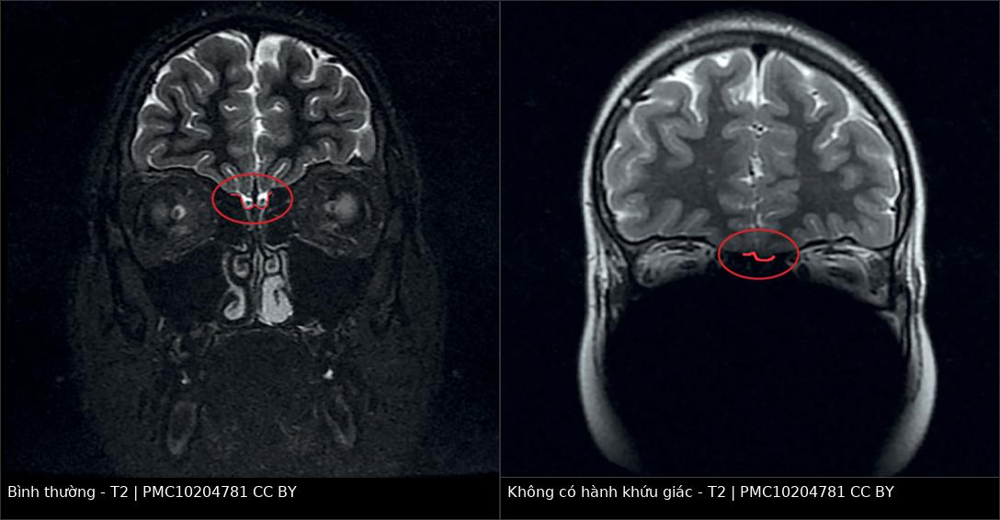
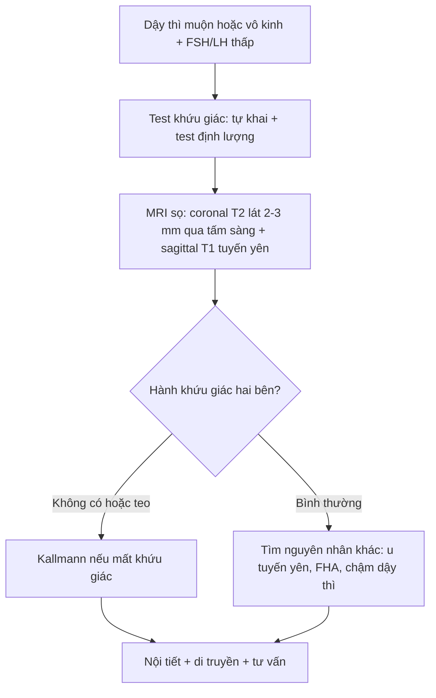
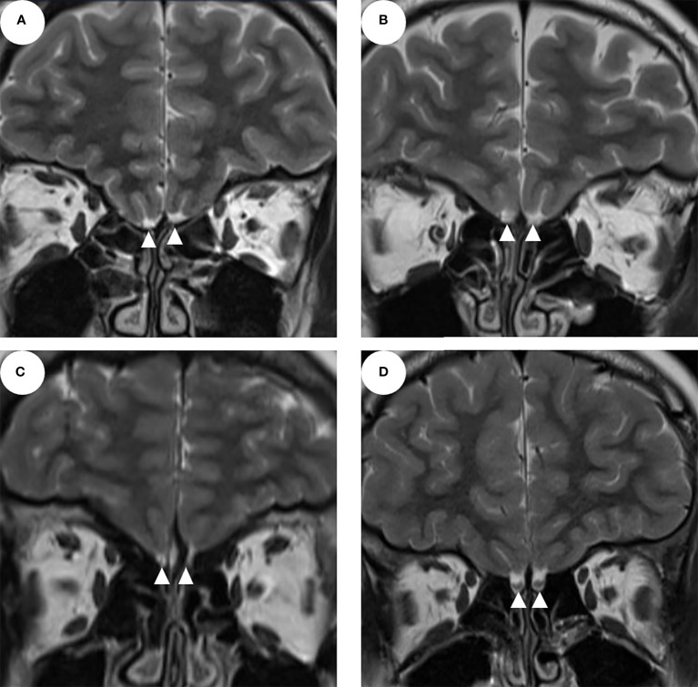

# 1741 — Hội chứng Kallmann: thiểu sản/không có hành khứu giác trên MRI / Kallmann syndrome: olfactory bulb aplasia–hypoplasia on MRI

**Tags:** `pattern:thieu-san-hanh-khuu-giac` `pattern:khong-co-hanh-khuu-giac` `pattern:day-thi-muon` `pattern:vo-kinh` `pattern:khong-khoi-ho-yen` `vung:ho-yen` `vung:nao` `vung:nen-so` `protocol:MRI-hanh-khuu-giac` `protocol:do-the-tich-hanh-khuu-giac` `protocol:MRI-tuyen-yen` `score:SROS` `protocol:test-khuu-giac`

**Mức chắc chắn (certainty):** tổng hợp y văn (literature synthesis) — ghép **1 nghiên cứu 71 bệnh nhân CHH có định lượng hành khứu giác** (*Frontiers in Endocrinology* 2022, PMC9523726, CC BY) và **1 nghiên cứu so sánh 19 bệnh nhân CHH với 15 người chứng** (*Problems of Endocrinology* 2023, PMC10204781, CC BY 4.0). Phần di truyền và biểu hiện ngoài sinh dục đối chiếu **GeneReviews** (link trong `sources.md`), không dùng ảnh. Không có thử nghiệm ngẫu nhiên về ngưỡng kích thước hành khứu giác.

> **Câu chốt:** ở trẻ **dậy thì muộn + FSH/LH thấp**, mất khứu giác không phải "triệu chứng phụ" mà là **cửa vào chẩn đoán**: GnRH và hành khứu giác **cùng xuất phát từ lá khứu giác**, nên **không có hành khứu giác hai bên** trên MRI coronal T2 lát 2–3 mm là **dấu hiệu mô học–phôi thai** của Kallmann, không chỉ là "thiểu sản giải phẫu". Ba điều quyết định: (1) **96% Kallmann** có bất thường hành khứu giác hai bên, nhưng **33% CHH không mất khứu giác cũng có** — nên **không chẩn đoán chỉ bằng ảnh**; (2) **9 bệnh nhân không có hành khứu giác vẫn ngửi bình thường** — ảnh không thay thế test khứu giác; (3) MRI còn phải trả lời **"có khối hố yên hay không"**, vì u tuyến yên và vô kinh do chức năng là hai hàng phân biệt chính.

## 1. Tổng quan bệnh học – cơ chế hình ảnh

### 1.1 Phôi thai học: một đường di trú, hai bệnh cảnh

- **Tế bào GnRH** không sinh ra tại hạ đồi: chúng **di trú từ lá khứu giác (olfactory placode)** dọc theo **sợi trục khứu giác** qua **tấm sàng** vào **hành khứu giác** rồi tới hạ đồi. **Hành khứu giác** là giá đỡ giải phẫu của cuộc di trú này.
- **Đột biến gen di trú** (ANOS1/KAL1 liên kết X, FGFR1, FGF8, PROKR2, PROK2, CHD7, SOX10…) → **GnRH không tới hạ đồi** + **hành khứu giác không hình thành** → **suy sinh dục trung ương + mất/giảm khứu giác** = **hội chứng Kallmann (KS)**.
- **Dịch tễ:** CHH (suy sinh dục trung ương bẩm sinh) gặp **1:4.000–10.000**; **KS chiếm 50–60%** CHH (PMC9523726). Vì vậy mỗi ca dậy thì muộn cần **hỏi khứu giác trước khi chụp**, không chụp "toàn bộ" rồi mới nghĩ.
- **Biểu hiện ngoài sinh dục** (gợi ý Kallmann hơn CHH không mất khứu giác): **đồng vận bàn tay (synkinesia)**, **sứt môi/chẻ vòm**, **điếc tiếp nhận**, **bất sản thận một bên**, **dính ngón/ngắn ngón**. Trong loạt 71 bệnh nhân, các bất thường này **gặp nhiều hơn ở KS** nhưng **khác biệt không có ý nghĩa thống kê** — tức **không thể dựa vào dị tật ngoài sinh dục để loại trừ**.

### 1.2 TẠI SAO hình ảnh trông như vậy — vật lý + mô bệnh

| Cấu trúc / dấu hiệu | Vì sao có tín hiệu đó | Hệ quả thực hành |
|---|---|---|
| **Hành khứu giác bình thường** | Mô thần kinh **giàu nước, ít mỡ** → **T2 trung bình–hơi tăng**, **T1 trung bình**, kích thước **vài mm**; nằm trong **rãnh khứu giác** trên mặt ổ mắt thùy trán | Phải thấy **cấu trúc hình bầu dục** ngay trên **tấm sàng**, **tách khỏi dịch não tủy** |
| **Không có hành khứu giác (aplasia)** | Không có mô thần kinh → **chỉ còn rãnh khứu giác chứa dịch não tủy** (**T2 sáng đồng nhất**, **T1 tối**) | "Rãnh rỗng" = **không có hành**; đừng gọi là "hành teo" khi **không thấy mô** ở mọi lát |
| **Thiểu sản (hypoplasia)** | Hành còn nhưng **thể tích giảm**: giảm số nơ-ron và sợi trục → **thể tích giảm** | Cần **đo**, không ước lượng mắt: **chiều cao, chiều rộng, thể tích** |
| **Phù/ngấm thuốc bất thường** | Hành khứu giác **không có hàng rào máu–não kiểu mạch máu**, nhưng **không ngấm thuốc bệnh lý** ở Kallmann | Ngấm thuốc/nốt **không** phải Kallmann → nghĩ u, viêm, di căn |
| **Mất tín hiệu do lát cắt dày** | Hành chỉ **2–3 mm**: lát **5 mm** có thể **bỏ sót hoàn toàn** do hiệu ứng thể tích | **Bắt buộc lát 2–3 mm**, coronal, vuông góc tấm sàng |

- **Ngưỡng định lượng đo được (không phải "nhỏ/thấy mờ"):**

| Đại lượng | Kallmann / CHH | Người chứng | Nguồn |
|---|---|---|---|
| Chiều cao hành khứu giác phải | **1,0 mm** [0,2; 1,8] | **3,0 mm** [2,5; 3,2] | PMC10204781 |
| Chiều rộng hành khứu giác phải | **1,0 mm** [0,2; 1,9] | **2,5 mm** [2,0; 3,0] | PMC10204781 |
| Chiều cao hành khứu giác trái | **0,8 mm** [0,0; 1,2] | **3,0 mm** [2,7; 3,2] | PMC10204781 |
| Chiều rộng hành khứu giác trái | **0,8 mm** [0,0; 1,2] | **2,5 mm** [2,0; 3,0] | PMC10204781 |
| Thể tích hành khứu giác trung bình | **2,40 ± 10,72 mm³** (KS) | **37,58 ± 20,64 mm³** (CHH không mất khứu giác) | PMC9523726 |
| Độ sâu rãnh khứu giác trung bình | **2,64 ± 3,07 mm** (KS) | **6,82 ± 2,31 mm** (CHH không mất khứu giác) | PMC9523726 |
| Tỉ lệ bất thường hành khứu giác | **96%** (27/28) hai bên ở KS | **33%** (9/27) ở CHH không mất khứu giác | PMC9523726 |
| Tỉ lệ bất thường trên toàn nhóm CHH | **94,7%** (18/19) thiểu sản/không có một hoặc hai bên | — | PMC10204781 |

- **Vì sao thể tích lại quan trọng hơn "có/không":** hành khứu giác là cấu trúc **nhỏ, dài**, nên **một chiều** dễ bị đọc sai do mặt cắt; **thể tích (planimetry nhiều lát × độ dày + khoảng hở)** phản ánh **khối lượng mô thần kinh** và **tương quan với điểm khứu giác** (trong loạt 71 ca, **OBV và OSD là yếu tố độc lập** dự báo chức năng khứu giác).

## 2. Mẫu hình + chẩn đoán phân biệt theo mẫu hình (gamut)

Đọc theo **cái nhìn đầu tiên trên coronal T2 qua tấm sàng**:

- **A. Không thấy hành khứu giác hai bên + rãnh khứu giác nông + dậy thì muộn:** **Kallmann** (KS) — chẩn đoán gần như chắc khi kèm **mất khứu giác**.
- **B. Hành khứu giác hai bên teo, còn mô + rãnh nông:** **Kallmann thể thiểu sản** hoặc **CHH không mất khứu giác** — **không phân biệt được bằng ảnh**, phải làm **test khứu giác**.
- **C. Hành khứu giác một bên không có, bên kia bình thường:** **bất sản một bên** — thường **khứu giác bình thường** (6 ca trong loạt 71), **không đủ chẩn đoán Kallmann**.
- **D. Hành khứu giác bình thường nhưng mất khứu giác:** **mất khứu giác mắc phải** (sau chấn thương, sau viêm mũi xoang mạn, sau nhiễm virus), **hoặc Kallmann hiếm** (4% KS có ảnh bình thường).
- **E. Không có hành khứu giác nhưng khứu giác bình thường:** **bất sản bẩm sinh đơn độc** — có thật (3 ca hai bên trong loạt 71), **không được chẩn đoán Kallmann chỉ vì ảnh**.
- **F. Bất thường đường giữa kèm theo:** **loạn sản vách trong suốt – thị thần kinh (septo-optic dysplasia)**, **thoát vị não nền sọ**, **CHARGE (CHD7)** — phải đọc **toàn bộ não**, không dừng ở hành khứu giác.
- **G. Có khối hố yên/tuyến yên:** **u tuyến yên, viêm tuyến yên, craniopharyngioma** — đây là **hàng phân biệt của dậy thì muộn**, không phải của mất khứu giác.

> **Nguyên tắc gamut:** *hành khứu giác trả lời "có phải Kallmann không"*, còn *hố yên trả lời "có khối chèn ép không"*. Một ca dậy thì muộn cần **cả hai** mặt phẳng đọc.

## 3. Bảng so sánh phân biệt (ma trận đối chiếu)

| Thực thể (entity) | Hình ảnh điển hình (MRI coronal T2 2–3 mm) | Chốt vào (rule-in) | Chốt loại (rule-out) | Gợi ý xác nhận |
|---|---|---|---|---|
| **Kallmann (KS)** | **Không có/teo hành khứu giác HAI bên**, **rãnh khứu giác nông** (OSD **2,64 mm**), thể tích hành **2,40 mm³**; tuyến yên thường bình thường | **Mất khứu giác + không có hành hai bên + FSH/LH thấp** | **Hành khứu giác bình thường hai bên** → không phải KS (trừ 4% ngoại lệ) | Test khứu giác; gen ANOS1/FGFR1/PROKR2; MRI hố yên |
| **CHH không mất khứu giác (nCHH)** | **33%** có bất thường hành (thường **một bên**, 22%); OSD **6,82 mm**, thể tích **37,58 mm³** | **FSH/LH thấp + khứu giác bình thường + không có bất thường hành hai bên** | **Mất khứu giác rõ** → nghiêng KS | Test khứu giác; theo dõi dậy thì |
| **Bất sản hành khứu giác đơn độc** | **Không có hành hai bên**, **rãnh khứu giác bình thường**, **không có bất thường não khác** | **Không có hành hai bên + khứu giác BÌNH THƯỜNG + trục sinh dục bình thường** | **FSH/LH thấp + mất khứu giác** → không còn "đơn độc" | Test khứu giác; nội tiết lặp lại |
| **Mất khứu giác mắc phải** | Hành **teo nhưng còn**, **rãnh khứu giác sâu bình thường**, có **mảng xơ/não mềm** sau chấn thương hoặc **dày niêm mạc xoang** | **Tiền sử chấn thương/viêm mũi + teo hành mắc phải** | **Không có hành bẩm sinh + rãnh nông** → nghi bẩm sinh | Hỏi tiền sử; nội soi mũi; test khứu giác |
| **Septooptic dysplasia** | **Thiểu sản thị thần kinh + vắng vách trong suốt + bất thường tuyến yên**, kèm **bất sản hành khứu giác** | **Tam chứng đường giữa** | **Thị thần kinh và vách trong suốt bình thường** | MRI toàn não; khám thị lực |
| **U tuyến yên / viêm tuyến yên** | Khối hố yên; viêm: **ngấm đồng nhất, cuống dày, mất chấm sáng T1** | **Khối hố yên + prolactin cao hoặc suy tuyến yên** | **Hố yên trống, không khối** | Prolactin, nội tiết; MRI động học |
| **Vô kinh do chức năng (FHA)** | **Hành khứu giác bình thường**, tuyến yên bình thường/teo nhẹ | **FSH/LH thấp + khứu giác bình thường + bối cảnh giảm cân/stress** | **Mất khứu giác hoặc không có hành** → không phải FHA | Chẩn đoán loại trừ; cân nặng, tâm lý |

*Ảnh ghép — **coronal T2**, cùng độ phân giải; khác biệt nằm ở **có hay không mô hành khứu giác** ngay trên tấm sàng. Nguồn: *Problems of Endocrinology* 2023, PMC10204781, CC BY 4.0; ghép bằng `tools/make_composite.py` (letterbox nền đen, không crop/kéo giãn).*

## 4. Protocol chụp + hệ phân độ/điểm chuẩn hóa

### 4.1 Khi nào chụp — và chụp gì

- **Chỉ định:** dậy thì muộn/vô kinh nguyên phát + **FSH/LH thấp hoặc bình thường thấp**, đặc biệt khi **tự khai mất/giảm khứu giác**, có **dị tật ngoài sinh dục**, hoặc **không có tiến triển dậy thì sau 14 tuổi (nữ) / 14–15 tuổi (nam)**.
- **Trình tự hình ảnh tối thiểu:**
  1. **Coronal T2, lát 2–3 mm, FOV nhỏ (16–18 cm)**, mặt cắt **vuông góc với tấm sàng** — không dùng lát 5 mm.
  2. **Sagittal T1 tuyến yên** (không tiêm) — tìm khối, chấm sáng thùy sau, cuống.
  3. **Coronal T1 sau tiêm** chỉ khi nghi khối/viêm tuyến yên.
- **Đo và ghi 4 số:** (1) **chiều cao hành** (mm); (2) **chiều rộng hành** (mm); (3) **thể tích hành** (mm³, nếu có phần mềm); (4) **độ sâu rãnh khứu giác** (mm, đo ở lát coronal qua **bó khứu giác**, tính từ mặt ổ mắt tới đáy rãnh).
- **Đọc thêm:** vách trong suốt, thị thần kinh, tuyến yên, có **thoát vị não nền sọ** hay **dày niêm mạc xoang** (mất khứu giác mắc phải).

### 4.2 Hai thang đo chức năng hay dùng trong bài gốc

| Công cụ | Cấu trúc | Ngưỡng/diễn giải | Vai trò |
|---|---|---|---|
| **SROS** (Self-reported Olfactory Scale) | 5 mức tự khai | **Độ chính xác 91,5%**, **sens 0,857**, **spec 0,972** so với test khứu giác khách quan | Nhanh, rẻ; **bỏ sót người không than phiền** |
| **MRI-OA** (MRI of olfactory apparatus) | Bất thường cấu trúc + OBV + OSD | **Độ chính xác 92,7%**, **sens 0,964**, **spec 0,889**, **AUC 0,927** | Khách quan; **sens cao hơn SROS** nhưng **spec thấp hơn** |

- **Diễn giải thực hành:** **MRI-OA rất nhạy** (bỏ sót ít Kallmann) nhưng **không đặc hiệu tuyệt đối** — vì **33% nCHH cũng có bất thường hành**. Vì vậy **ảnh dương tính không đủ chẩn đoán**, cần **test khứu giác**; còn **ảnh âm tính** gần như loại Kallmann (chỉ 4% ngoại lệ).
- **Không có "score" chính thức cho Kallmann**: đây là **chẩn đoán phối hợp** hình ảnh + khứu giác + nội tiết + di truyền; đừng gán BI-RADS/Lung-RADS kiểu phân độ cho bài này.

## 5. Biến thể bình thường và cạm bẫy

- **Biến thể 1 — hành khứu giác "không thấy" do lát cắt dày:** hành chỉ **2–3 mm**; lát **5 mm** có thể **nằm ngoài mặt cắt** hoặc bị hòa với dịch não tủy. Luôn **đặt lại lát mỏng** trước khi kết luận "không có hành".
- **Biến thể 2 — bất sản một bên:** gặp ở **22%** nCHH trong loạt 71 ca; **6 ca bất sản một bên ngửi bình thường**. Không chẩn đoán Kallmann, không điều trị hormon chỉ vì ảnh.
- **Biến thể 3 — bất sản hai bên mà khứu giác bình thường:** **3 ca** trong loạt 71; hiếm nhưng có thật, thường ở nam CHH. Đây là lý do **test khứu giác bắt buộc**, không thể thay bằng ảnh.
- **Cạm bẫy 1 — "thấy rãnh là thấy hành":** rãnh khứu giác **luôn tồn tại** dù không có hành; cái cần thấy là **mô hành** (tín hiệu trung gian) tách khỏi **dịch não tủy T2 sáng**. Ảnh composite ở mục 3 cho thấy rõ: bên phải **vẫn có rãnh**, nhưng **rỗng**.
- **Cạm bẫy 2 — bỏ qua hố yên:** Kallmann có thể **kèm** u tuyến yên/dị tật đường giữa; ngược lại, u tuyến yên gây **dậy thì muộn + tăng prolactin** và **hành khứu giác bình thường**. Đọc **cả hai vùng** trên cùng một lần chụp.
- **Cạm bẫy 3 — mất khứu giác mắc phải bị gọi là Kallmann:** sau **chấn thương đầu**, **viêm mũi xoang mạn**, **nhiễm virus**, hành khứu giác **teo dần nhưng vẫn còn mô** và **rãnh khứu giác sâu bình thường**; hỏi tiền sử và soi mũi trước khi quy kết bẩm sinh.
- **Cạm bẫy 4 — thoả mãn tìm kiếm:** thấy bất sản hành khứu giác rồi dừng, bỏ **thiểu sản thị thần kinh, vắng vách trong suốt, thoát vị não nền sọ** — những thứ đổi hoàn toàn tư vấn di truyền và tiên lượng.

## 6. Tự lượng giá — Blind Quiz

**Ca 1 — Nam 16 tuổi, chưa dậy thì, không phân biệt được mùi cà phê từ nhỏ. Nhìn 4 ảnh A–D, mô tả trước khi mở đáp án.**

- Câu hỏi: (1) A–C khác D ở cấu trúc nào? (2) Ba chẩn đoán phân biệt? (3) Dấu hiệu nào chốt Kallmann?

<b>Bấm để hiện đáp án (findings + chẩn đoán)</b>

- **Findings:** A–C — **không thấy mô hành khứu giác** trên tấm sàng; chỉ có **rãnh khứu giác nông chứa dịch não tủy** (tam giác trắng). D — **hành khứu giác bình thường** hai bên (tam giác trắng bao quanh cấu trúc hình bầu dục).
- **Chẩn đoán:** **hội chứng Kallmann** — bất sản hành khứu giác hai bên + dậy thì muộn + mất khứu giác.
- **Phân biệt:** **CHH không mất khứu giác** (hành bình thường hoặc chỉ một bên), **bất sản hành khứu giác đơn độc** (khứu giác bình thường), **mất khứu giác mắc phải** (hành còn nhưng teo, rãnh sâu bình thường).
- **Vì sao:** GnRH và hành khứu giác **cùng di trú từ lá khứu giác**; mất hành hai bên phản ánh **thất bại di trú**, không phải "biến thể nhỏ".
- Nguồn ảnh: *Frontiers in Endocrinology* 2022, PMC9523726, CC BY.

**Ca 2 — Nữ 19 tuổi, vô kinh nguyên phát, FSH/LH thấp, khứu giác bình thường trên test. So sánh hai ảnh.**

- Câu hỏi: ảnh phải có chẩn đoán Kallmann không? Cần thêm dữ kiện gì?

<b>Bấm để hiện đáp án (findings + chẩn đoán)</b>

- **Findings:** trái — **mô hành khứu giác** hai bên trong rãnh khứu giác; phải — **không có mô hành**, rãnh khứu giác **rỗng, nông**.
- **Chẩn đoán:** **không đủ chẩn đoán Kallmann**. Bất sản hành khứu giác **hai bên** có thể gặp ở người **khứu giác bình thường** (3 ca trong loạt 71) và ở **CHH không mất khứu giác** (33% có bất thường hành). Cần **test khứu giác định lượng** + **nội tiết** + **di truyền**.
- **Vì sao:** MRI-OA **nhạy 0,964 nhưng đặc hiệu 0,889** — chính vì nhóm "ảnh dương, chức năng bình thường" này.
- **Cạm bẫy:** gọi "Kallmann" chỉ vì ảnh → **điều trị hormon và tư vấn di truyền sai** cho người không mất khứu giác.
- Nguồn ảnh: *Problems of Endocrinology* 2023, PMC10204781, CC BY 4.0; ảnh ghép `tools/make_composite.py`.

**Ca 3 — Nam 15 tuổi, dậy thì muộn, ngửi bình thường, MRI coronal T2: không thấy hành khứu giác hai bên, rãnh khứu giác sâu 7 mm, tuyến yên bình thường.**

- Câu hỏi: (1) Bạn đo gì để phân biệt thiểu sản với bất sản? (2) Có cần chụp lại lát mỏng không? (3) Kết luận nào **không** được phép đưa ra?

<b>Bấm để hiện đáp án (findings + chẩn đoán)</b>

- **Findings:** **rãnh khứu giác 7 mm** (gần mức bình thường 6,82 mm) nhưng **không có mô hành** — cần đo **chiều cao, chiều rộng, thể tích** ở **lát 2–3 mm** trước khi kết luận.
- **Chẩn đoán:** **bất sản hành khứu giác hai bên** trên hình ảnh; **không** chẩn đoán Kallmann vì **khứu giác bình thường** và **rãnh khứu giác không nông**.
- **Không được kết luận:** "Kallmann chắc chắn" hoặc "không cần test khứu giác". Ngược lại, cũng **không** được nói "không có bệnh" khi **FSH/LH thấp** — cần **đánh giá nội tiết đầy đủ** (nguyên nhân trung ương khác: u, viêm, hội chứng đường giữa).
- **Vì sao:** bất sản hành khứu giác **không đồng nghĩa mất khứu giác**; mối liên hệ là **thống kê**, không phải **quy tắc tuyệt đối**.
- Nguồn số liệu: PMC9523726 (OSD 6,82 mm ở nCHH) và PMC10204781 (kích thước hành).

## Bài liên quan chéo

- [1675 – Vô kinh trung ương trên MRI tuyến yên](../1675-vo-kinh-trung-uong-mri-tuyen-yen/lesson.md)
- [245 – U tuyến yên chảy máu/nhồi máu (pituitary apoplexy)](../245-u-tuyen-yen-chay-mau-nhoi-mau-pituitary-apoplexy/lesson.md)
- [1696 – Bệnh Cushing do u tuyến yên: MRI 3T động học & BIPSS](../1696-benh-cushing-u-tuyen-yen/lesson.md)

## Ảnh

- 3 ảnh gốc **CC BY 4.0 / CC BY** (PMC9523726, PMC10204781) + **1 ảnh ghép** tạo bằng `tools/make_composite.py`. Chi tiết từng ảnh: `images/CREDITS.md`.
- Không dùng ảnh nguồn không rõ giấy phép; không crop, không kéo giãn.

> Không dùng để chẩn đoán độc lập khi chưa có người hướng dẫn.
