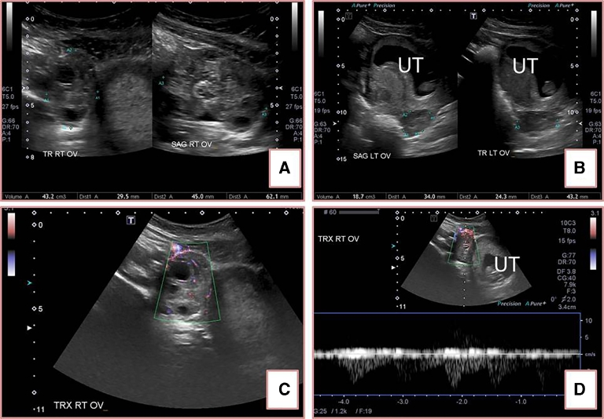
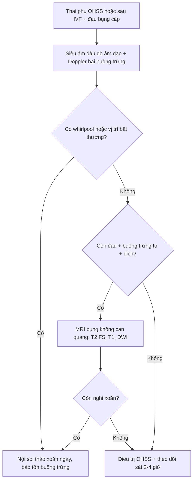
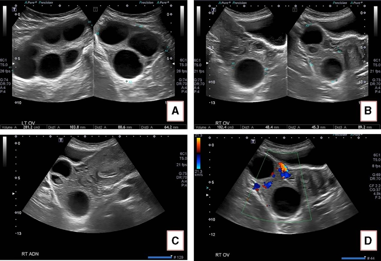
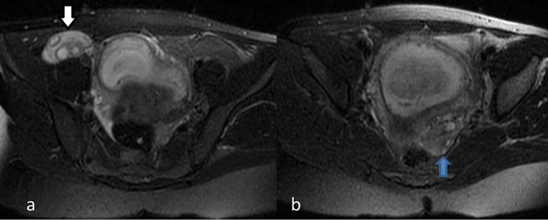

# 1742 — Xoắn buồng trứng trên buồng trứng quá kích (OHSS): buồng trứng to nhất chưa chắc đã xoắn, Doppler còn dòng không loại trừ

**Tags:** `pattern:xoan-buong-trung` `pattern:buong-trung-da-nang` `pattern:dau-bung-cap` `pattern:doppler-binh-thuong` `pattern:dich-o-bung` `vung:buong-trung` `vung:phan-phu` `vung:tieu-khung` `protocol:TVUS-Doppler` `protocol:MRI-bung` `score:whirlpool`

**Mức chắc chắn (certainty):** tổng hợp y văn (literature synthesis) — **2 ca nguyên văn có ảnh Doppler và MRI** (*Radiology Case Reports* 2018, PMC6138859, CC BY-NC-ND) + **1 ca nguyên văn có dấu whirlpool** (*Radiology Case Reports* 2023, PMC10369376, CC BY-NC-ND) dùng cho số liệu, không dùng ảnh. Đây là **ca loạt nhỏ**, không phải nghiên cứu đoàn hệ; các tỉ lệ dưới đây lấy đúng như bài nguồn trích dẫn.

> **Câu chốt:** trên **buồng trứng quá kích (OHSS)**, hai quy tắc thường dùng để chẩn đoán xoắn đều **sai**: (1) **"buồng trứng to bất đối xứng là bên xoắn"** — trong ca 2, bên **to 281 cm³ thì bình thường**, bên **nhỏ hơn bị xoắn**; (2) **"còn dòng chảy là không xoắn"** — ca 1 có **cả dòng động mạch và tĩnh mạch** trên Doppler nhưng vẫn xoắn. Chẩn đoán phải dựa vào **dấu trực tiếp của cuống xoắn (whirlpool)**, **vị trí buồng trứng bất thường**, **phù mô đệm T2** và **diễn tiến lâm sàng**, không dựa vào một dấu duy nhất.

## 1. Tổng quan bệnh học – cơ chế hình ảnh

### 1.1 Vì sao OHSS là "ổ" của xoắn buồng trứng

- **OHSS** làm **tăng tính thấm mao mạch** (VEGF) → **thoát dịch vào khoang thứ ba** → **cổ trướng, cô đặc máu, buồng trứng to nhiều nang**. Buồng trứng **nặng, dài cuống** và **di động bất thường** trong dịch cổ trướng — đúng điều kiện cơ học để **xoắn quanh dây chằng chậu–buồng trứng và/hoặc dây chằng buồng trứng–tử cung**.
- **Dịch tễ (theo bài nguồn):** xoắn buồng trứng chiếm **2,7%** các cấp cứu ngoại khoa ở nữ; **tới 80%** xảy ra ở tuổi sinh sản; **1/5.000 thai kỳ**; sau **IVF 0,2–0,46%**; **tới 33%** ở người **có OHSS và đang mang thai** (PMC6138859); bài ca whirlpool ghi **tới 16%** ở thai phụ có OHSS (PMC10369376). Hai con số khác nguồn — dùng **khoảng 16–33%** để không tuyệt đối hoá.
- **Bên phải hay xoắn hơn** do **đại tràng sigma** chiếm chỗ bên trái, hạn chế di động — nhưng **không đủ** để loại trừ bên trái (ca 2 xoắn bên phải dù buồng trứng trái to hơn nhiều).

### 1.2 TẠI SAO hình ảnh trông như vậy — vật lý + mô bệnh

| Dấu hiệu | Vì sao có | Hệ quả thực hành |
|---|---|---|
| **Buồng trứng to, nhiều nang sát vỏ** | OHSS: **nhiều nang noãn** + **phù mô đệm** → thể tích tăng; nang bị **đẩy ra ngoại vi** vì mô đệm phù ở trung tâm | "Chuỗi ngọc" nang ngoại vi **không đặc hiệu** — OHSS không xoắn cũng có |
| **Phù mô đệm T2 tăng tín hiệu** | Ứ dịch + phù tế bào do **tắc tĩnh mạch–bạch mạch trước** → nước tự do tăng → **T2 sáng**, **T1 trung bình/thấp**; **không ngấm thuốc bất thường** | Dấu **sớm nhất** trên MRI; đối xứng với bên lành giúp phát hiện |
| **Doppler còn dòng động mạch** | Buồng trứng có **nguồn máu kép**: **động mạch buồng trứng** (từ động mạch chủ bụng) + **nhánh tử cung** qua dây chằng buồng trứng–tử cung → **tắc một nhánh không làm mất tín hiệu** | **Không được loại trừ xoắn khi còn dòng**; dòng **tĩnh mạch mất trước** là dấu sớm hơn nhưng **khó và không nhạy** |
| **Whirlpool sign** | Cuống mạch **xoắn nhiều vòng** → trên siêu âm, mạch và mô cuống tạo **xoáy ốc** quanh trục | **Dấu trực tiếp**, **giá trị dự báo dương > 90%** (PMC10369376 dẫn Moro); **đặc hiệu nhất** trong các dấu siêu âm |
| **Dịch tự do** | Dịch thoát mạch (OHSS) + **dịch tiết từ buồng trứng thiếu máu** | Có ở cả hai bệnh cảnh → **không phân biệt** được một mình |
| **Buồng trứng "xanh đen" khi mổ** | Ứ máu + thiếu máu → **màu sắc không dự báo khả năng sống**: sau tháo xoắn, màu hồi phục nhanh | **Không cắt buồng trứng chỉ vì màu**; tháo xoắn rồi đánh giá lại |

- **Ngưỡng định lượng của 2 ca nguồn:**

| Đại lượng | Ca 1 | Ca 2 |
|---|---|---|
| Tuổi thai | **11 tuần 3 ngày** | **9 tuần 3 ngày** |
| Thể tích buồng trứng | **phải 43,2 cm³** (xoắn) vs **trái 18,7 cm³** | **trái 281 cm³** (không xoắn) vs **phải 102 cm³** (xoắn; chú thích hình ghi 10 cm³ — xem ghi chú) |
| Doppler | **Có cả dòng động mạch và tĩnh mạch** trong buồng trứng xoắn | **Có dòng** trong buồng trứng xoắn |
| Thời gian đau trước nhập viện | **12 giờ** | **5 ngày**, tăng dần |
| Xử trí | nội soi tháo xoắn, bảo tồn | nội soi tháo xoắn, bảo tồn |

> **Ghi chú trung thực nguồn:** ở ca 2, phần ca bệnh ghi buồng trứng phải **102 cm³**, còn chú thích Figure 4 ghi **10 cm³**. Đây là **lỗi biên tập của bài gốc** (đã kiểm lại toàn văn PMC6138859); kết luận **không đổi**: bên bị xoắn là bên **nhỏ hơn nhiều** so với bên 281 cm³.

## 2. Mẫu hình + chẩn đoán phân biệt theo mẫu hình (gamut)

Đọc theo **cái nhìn đầu tiên trên siêu âm đầu dò âm đạo**:

- **A. Buồng trứng to + cuống xoáy ốc (whirlpool) ± nang ngoại vi:** **xoắn buồng trứng** — **chẩn đoán gần như chắc**, mổ nội soi.
- **B. Buồng trứng to hai bên nhiều nang + cổ trướng + không whirlpool:** **OHSS đơn thuần** — điều trị nội khoa; **nhưng không loại trừ xoắn ngắt quãng**.
- **C. Buồng trứng to một bên + phù mô đệm + vị trí bất thường (giữa tử cung và bàng quang):** **xoắn** — dấu **vị trí** quan trọng hơn **kích thước** trong OHSS.
- **D. Buồng trứng to + Doppler mất dòng tĩnh mạch, còn động mạch:** **xoắn sớm** — ưu tiên mổ; nhưng **còn cả hai dòng vẫn không loại trừ**.
- **E. Đau hố chậu + sốt + dịch ổ bụng:** **áp-xe phần phụ / viêm phần phụ** — kháng sinh, dẫn lưu; **không mổ tháo xoắn**.
- **F. Đau + dịch + βhCG dương + không thấy túi thai trong tử cung:** **thai ngoài tử cung** — chẩn đoán bằng βhCG + siêu âm, không phải bằng Doppler buồng trứng.
- **G. Đau bụng quanh rốn/di lệch + sốt + bạch cầu:** **viêm ruột thừa** — đặc biệt khi buồng trứng bình thường nhưng **không thấy ruột thừa**.

## 3. Bảng so sánh phân biệt (ma trận đối chiếu)

| Thực thể (entity) | Hình ảnh điển hình | Chốt vào (rule-in) | Chốt loại (rule-out) | Gợi ý xác nhận |
|---|---|---|---|---|
| **Xoắn buồng trứng trên OHSS** | Buồng trứng **to, nhiều nang**, **phù mô đệm T2**, **vị trí bất thường**; **whirlpool** ở cuống; Doppler **có thể còn dòng** | **Whirlpool sign** + đau cấp + buồng trứng to bất thường vị trí | **Whirlpool âm + không đau + không phù mô đệm** mới tạm loại; **Doppler bình thường KHÔNG loại** | Siêu âm lặp 2–4 giờ; MRI T2 FS; nội soi khi còn nghi |
| **OHSS đơn thuần** | **Hai buồng trứng to đối xứng**, nhiều nang, **cổ trướng**, không whirlpool; mô đệm phù **lan tỏa hai bên** | **Cổ trướng + hai buồng trứng to + Hct tăng** | **Whirlpool hoặc phù đệm một bên rõ** → không còn "đơn thuần" | Hct, creatinin, albumin; siêu âm lặp |
| **Nang xuất huyết buồng trứng** | Khối **không đồng nhất**, **lưới fibrin**, **không có mô đệm phù lan tỏa**; Doppler **vòng tưới máu quanh khối** | **Khối dạng lưới + đau khởi phát đột ngột** | **Buồng trứng toàn bộ phù + nang ngoại vi đều** → nghi xoắn/OHSS | MRI T1/T2 FS (máu bán cấp sáng T1) |
| **Thai ngoài tử cung** | **Khối cạnh tử cung**, **túi thai giả**, dịch; buồng trứng **bình thường hoặc có nang hoàng thể** | **βhCG dương + không thấy túi trong tử cung** | **βhCG âm** | βhCG lặp; siêu âm đầu dò |
| **Viêm ruột thừa** | Ruột thừa **> 6 mm**, không xẹp, **tăng tưới máu**, có **appendicolith**; buồng trứng bình thường | **Ruột thừa > 6 mm + đau hố chậu phải** | **Ruột thừa bình thường thấy rõ** | CT/MRI khi siêu âm không kết luận |
| **Huyết khối tĩnh mạch buồng trứng** | **Tĩnh mạch giãn, có huyết khối**, **không whirlpool**; thường **sau sinh hoặc sau mổ** | **Huyết khối trong tĩnh mạch + sốt/đau hố chậu** | **Không có huyết khối + có whirlpool** | CTV/MRV; kháng đông |
| **Áp-xe phần phụ** | Khối **dày thành, tăng tưới máu**, **dịch mủ**, dính; sốt, CRP cao | **Khối viêm + sốt + CRP tăng** | **Whirlpool + không sốt** | Kháng sinh; dẫn lưu nếu cần |

*Ảnh — (A, B) buồng trứng phải **43,2 cm³** so với trái **18,7 cm³**; (C) **color Doppler còn tín hiệu** trong nhu mô; (D) **phổ động mạch bình thường**. Đây là ca chứng minh **"còn dòng" không loại trừ xoắn**. Nguồn: *Radiology Case Reports* 2018, PMC6138859, CC BY-NC-ND (nguyên bản, không crop).*

## 4. Protocol chụp + hệ phân độ/điểm chuẩn hóa

### 4.1 Đường đi chẩn đoán

- **Siêu âm là bước 1**, không phải CT (tránh bức xạ ở thai): đầu dò âm đạo hoặc đầu dò bụng nếu thai lớn; **đánh giá cả hai buồng trứng**, ghi **thể tích (cm³)**, **vị trí tương quan với tử cung**, **mô đệm**, **nang**, **dịch tự do**, và **cuống mạch**.
- **Doppler:** màu + phổ **ở cả hai buồng trứng và cuống**; đặt **thang vận tốc thấp** để bắt dòng chậm; **ghi rõ có/không dòng động mạch, tĩnh mạch** — nhưng **không dùng làm tiêu chuẩn loại trừ**.
- **Dấu trực tiếp cần tìm:** **whirlpool** ở cuống (xoáy ốc), **"follicular ring sign"** (nang xếp vòng quanh mô đệm phù), **buồng trứng nằm giữa tử cung và bàng quang**.
- **MRI (khi siêu âm không kết luận):** **T2 FS** (phù mô đệm), **T1** (máu), **DWI**; **không cản quang** ở thai phụ. Dấu MRI: **buồng trứng to, phù mô đệm T2 tăng, nang ngoại vi, xoắn cuống, dịch tự do**.
- **Ngưỡng thời gian:** **tháo xoắn trong 24 giờ đầu** được xem là mốc tốt nhất để cứu buồng trứng (PMC6138859 dẫn y văn); trì hoãn làm **giảm khả năng hồi phục chức năng** và tăng nguy cơ **huyết khối, hoại tử**.
- **Không có RADS cho xoắn buồng trứng**: không gán O-RADS (O-RADS dành cho **khối phần phụ**, không phải cấp cứu xoắn). Đây là **chẩn đoán phối hợp lâm sàng–siêu âm**, không phải phân độ.

### 4.2 Xử trí sau chẩn đoán (điều ảnh hưởng tới đọc phim)

- **Nội soi tháo xoắn, bảo tồn buồng trứng** kể cả khi buồng trứng **xanh đen**; đánh giá lại **màu và tưới máu sau tháo xoắn** trước khi quyết định.
- **Cố định buồng trứng (oophoropexy)** khi **xoắn tái phát**, **không có khối nguyên nhân**, hoặc **buồng trứng còn lại duy nhất**.
- **Trong OHSS:** xử trí nội khoa song song (dịch, điện giải, chống đông dự phòng khi có chỉ định); **không chọc hút nang** chỉ để "làm nhỏ buồng trứng" nếu chưa có chỉ định khác.

## 5. Biến thể bình thường và cạm bẫy

- **Cạm bẫy 1 — "bên to là bên xoắn":** đúng ngoài OHSS, **sai trong OHSS**. Ca 2: **trái 281 cm³ không xoắn**, **phải 102 cm³ xoắn**. Trong OHSS, **đối xứng kích thước mất giá trị**; đọc **vị trí** và **phù mô đệm một bên**.
- **Cạm bẫy 2 — Doppler bình thường:** ca 1 có **cả dòng động mạch và tĩnh mạch**. Nguyên nhân: **nguồn máu kép** + **tắc tĩnh mạch trước động mạch**; dòng có thể **còn tới khi hoại tử**. **Không loại trừ xoắn bằng Doppler**.
- **Cạm bẫy 3 — whirlpool âm tính:** xoắn **ngắt quãng** hoặc **xoắn cuống ngắn** có thể không thấy xoáy ốc; **siêu âm lặp sau 2–4 giờ** hoặc **MRI** khi lâm sàng còn nghi.
- **Cạm bẫy 4 — nhầm phù mô đệm với "nang xuất huyết":** nang xuất huyết có **lưới fibrin trong lòng nang**, mô đệm **không phù lan tỏa**; xoắn có **phù mô đệm toàn buồng trứng** và **nang bị đẩy ngoại vi**.
- **Cạm bẫy 5 — "buồng trứng xanh là phải cắt":** màu **không tương quan** với khả năng sống; **tháo xoắn rồi chờ** là chuẩn mực, cắt buồng trứng chỉ khi **hoại tử rõ/không hồi phục** hoặc **nghi ác tính**.
- **Biến thể bình thường:** **buồng trứng to nhiều nang hai bên** sau kích thích rụng trứng **không có xoắn** — đây là **OHSS**, không phải xoắn; đừng mổ chỉ vì "buồng trứng to".

## 6. Tự lượng giá — Blind Quiz

**Ca 1 — Thai 11 tuần 3 ngày sau IVF, đau hố chậu phải 12 giờ, buồng nôn. Nhìn ảnh A–D.**

- Câu hỏi: (1) Thể tích hai buồng trứng? (2) Doppler nói gì? (3) Có loại trừ được xoắn không?

<b>Bấm để hiện đáp án (findings + chẩn đoán)</b>

- **Findings:** buồng trứng **phải 43,2 cm³**, trái **18,7 cm³**; **color Doppler còn tín hiệu** trong nhu mô; **phổ động mạch bình thường**; ít dịch tự do.
- **Chẩn đoán:** **xoắn buồng trứng phải** — xác nhận khi mổ; **Doppler bình thường không loại trừ**.
- **Vì sao:** **nguồn máu kép** (động mạch buồng trứng + nhánh tử cung) và **tắc tĩnh mạch trước động mạch**; dòng động mạch có thể còn dù cuống đã xoắn.
- **Xử trí:** nội soi **tháo xoắn trong 24 giờ**, bảo tồn buồng trứng; màu xanh đen **không phải chỉ định cắt**.
- Nguồn ảnh: *Radiology Case Reports* 2018, PMC6138859, CC BY-NC-ND.

**Ca 2 — Thai 9 tuần 3 ngày sau IVF, đau 5 ngày, bạch cầu 17 × 10⁹/L. Siêu âm: hai buồng trứng to nhiều nang; trái 281 cm³, phải nhỏ hơn nhiều; Doppler còn dòng ở buồng trứng phải.**

- Câu hỏi: (1) Chẩn đoán hình ảnh là gì? (2) Bên nào xoắn? (3) Vì sao "bên to nhất" không phải đáp án?

<b>Bấm để hiện đáp án (findings + chẩn đoán)</b>

- **Findings:** **hai buồng trứng to nhiều nang** (OHSS); **trái 281 cm³**, **phải 102 cm³** (chú thích hình ghi 10 cm³ — lỗi biên tập của bài gốc); **Doppler còn dòng ở buồng trứng phải**; ít dịch tự do.
- **Chẩn đoán:** **OHSS + xoắn buồng trứng PHẢI** — bên **nhỏ hơn** mới xoắn; bên trái to nhưng bình thường khi mổ.
- **Vì sao:** trong OHSS, **cả hai buồng trứng đều to** → **bất đối xứng kích thước mất giá trị**; phải dựa vào **vị trí bất thường**, **phù mô đệm một bên**, **whirlpool** và **diễn tiến đau**.
- **Cạm bẫy:** mổ theo "bên to" sẽ **tháo xoắn nhầm bên lành** và **bỏ sót bên xoắn**.
- Nguồn ảnh: *Radiology Case Reports* 2018, PMC6138859, CC BY-NC-ND.

**Ca 3 — Cùng ca 2, MRI bụng không cản quang: T2 FS axial.**

- Câu hỏi: (1) Dấu hiệu chính trên MRI? (2) MRI thêm được gì so với siêu âm? (3) Khi nào chọn MRI thay vì mổ ngay?

<b>Bấm để hiện đáp án (findings + chẩn đoán)</b>

- **Findings:** buồng trứng phải **to, mô đệm T2 tăng tín hiệu** (mũi tên trắng), so với buồng trứng trái **tín hiệu bình thường** (mũi tên xanh); **dịch tự do** hố chậu phải.
- **Chẩn đoán:** **phù mô đệm do xoắn** — dấu **sớm**, xuất hiện trước hoại tử; MRI xác nhận **một bên** và **loại trừ viêm ruột thừa**.
- **Khi nào MRI:** siêu âm **không thấy whirlpool**, không loại trừ được viêm ruột thừa/khối khác, hoặc **thai phụ** cần tránh bức xạ; **không thay thế** mổ khi lâm sàng rõ.
- **Vì sao T2 sáng:** tắc **tĩnh mạch–bạch mạch** → ứ nước nội bào/kẽ → tăng tín hiệu T2; **chưa** có hoại tử (hoại tử sẽ **giảm tín hiệu T2** và **mất ngấm thuốc**).
- Nguồn ảnh: *Radiology Case Reports* 2018, PMC6138859, CC BY-NC-ND.

## Bài liên quan chéo

- [1669 – Hội chứng quá kích buồng trứng (OHSS)](../1669-hoi-chung-qua-kich-buong-trung/lesson.md)
- [1632 – Trữ mô buồng trứng trước dậy thì](../1632-tru-mo-buong-trung-truoc-day-thi/lesson.md)
- [1630 – Khối phần phụ nghi ác trong thai](../1630-khoi-phan-phu-nghi-ac-trong-thai/lesson.md)

## Ảnh

- 3 ảnh gốc **CC BY-NC-ND 4.0** (PMC6138859) — dùng **nguyên bản**, **không crop, không ghép, không tạo phái sinh** (điều kiện ND). Chi tiết từng ảnh: `images/CREDITS.md`.
- Ảnh bài PMC10369376 **không dùng** (tệp JPG trong gói toàn văn rỗng); chỉ dùng số liệu từ bài đó.

> Không dùng để chẩn đoán độc lập khi chưa có người hướng dẫn.
