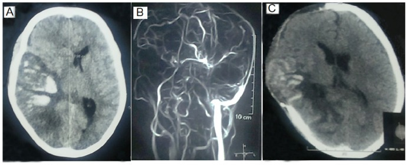
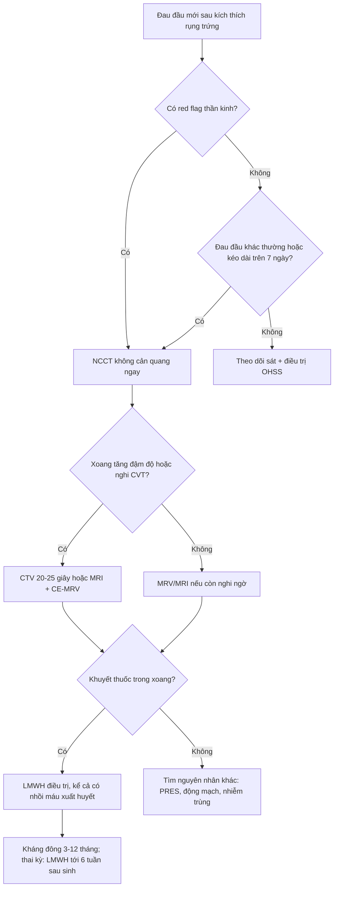
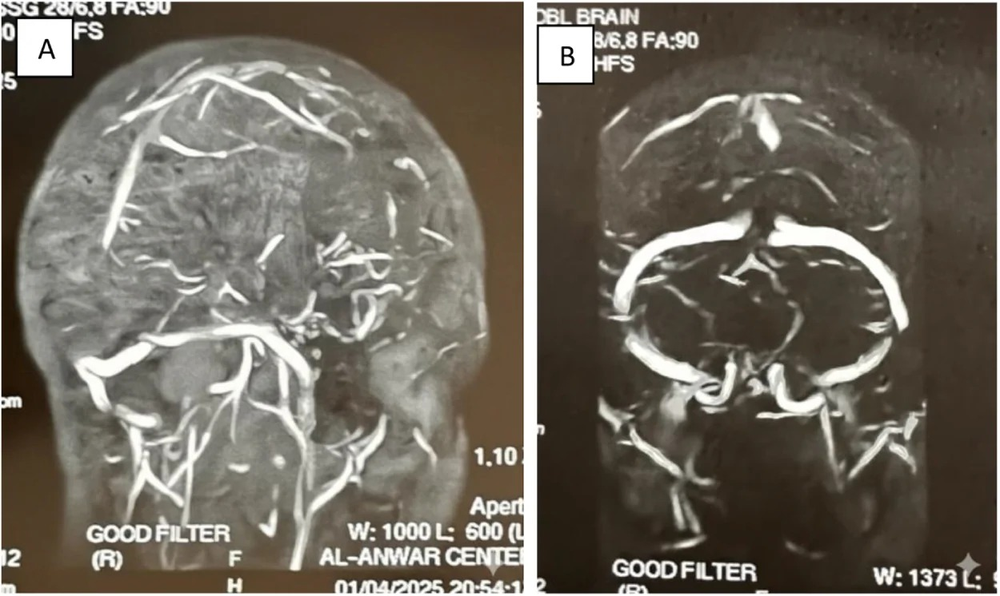

# 1743 — Huyết khối xoang tĩnh mạch não & tĩnh mạch cảnh trong ở OHSS: đau đầu "khác thường" sau kích thích rụng trứng

**Tags:** `pattern:huyet-khoi-xoang` `pattern:khuyet-dong-chay` `pattern:dau-dau-sau-IVF` `pattern:nhoi-mau-tinh-mach` `pattern:co-dac-mau` `vung:nao` `vung:xoang-tinh-mach` `vung:buong-trung` `vung:phan-phu` `protocol:NCCT` `protocol:CTV` `protocol:MRV` `protocol:MRI-nao` `score:ASRM-OHSS`

**Mức chắc chắn (certainty):** tổng hợp y văn (literature synthesis) — số liệu dịch tễ và thời điểm lấy từ **tổng quan 2025 về huyết khối ở IVF** (PMC11856335, CC BY 4.0) và **tổng quan 2026 về huyết khối trong hỗ trợ sinh sản** (PMC13704087, CC BY 4.0); số liệu chẩn đoán–tiên lượng lấy từ **nghiên cứu 97 ca nghi CVT có D-dimer định lượng** (PMC13705930, CC BY 4.0), **đoàn hệ 98 ca CVT nặng** (PMC12072781, CC BY 4.0), **ca nguyên văn + tổng quan SSS** (PMC13354439, CC BY 4.0) và **tổng quan hình ảnh theo vị trí giải phẫu** (PMC13588991, CC BY 4.0). **Không có ca CVT–OHSS nào có ảnh dùng được giấy phép mở** trong lượt này → **2 ảnh minh họa dấu hiệu** lấy từ hai bài CVT không–OHSS, ghi rõ nguồn; **không gán bệnh sử OHSS cho ảnh của người khác**. Con số "7 ca CVST trong y văn OHSS" lấy từ tổng quan ca của Sachar & Rajamani 2016 (PMID 27396697, không có toàn văn mở).

> **Câu chốt:** ở người **vừa kích thích rụng trứng**, một cơn **đau đầu mới, dữ dội hoặc kèm bất thường thần kinh** là **huyết khối xoang tĩnh mạch não (CVT) cho tới khi loại trừ** — không phải "đau đầu do OHSS". **CT không cản quang bình thường và D-dimer bình thường đều KHÔNG loại trừ** (trong một đoàn hệ, chỉ **89,1%** ca có D-dimer âm là thực sự không có CVT — tức NPV 89,1%; âm giả nhiều hơn khi đau đầu đơn thuần kéo dài > 7 ngày — PMC13705930, PMC13354439). Chẩn đoán phải bằng **CTV hoặc MRI + MRV**, và **kháng đông điều trị được khởi động kể cả khi đã có nhồi máu xuất huyết**.

## 1. Tổng quan bệnh học – cơ chế hình ảnh

### 1.1 Vì sao OHSS tạo huyết khối — tam giác Virchow bị phá cả ba cạnh

- **Ứ trệ (stasis):** buồng trứng to **> 10–12 cm** chèn ép tĩnh mạch chậu, cộng với **bất động** vì đau bụng/cổ trướng → dòng tĩnh mạch chậm. Xoang màng cứng **không có van**, dòng chảy **chậm và không đập**, nên huyết khối từ **bóng cảnh–xích-ma** lan ngược lên xoang ngang rồi xoang dọc trên.
- **Tăng đông (hypercoagulability):** estrogen cao và hCG làm **giảm protein C, protein S, antithrombin**, **tăng yếu tố VIII và von Willebrand**, **giảm ADAMTS13**; OHSS nặng còn kèm **cô đặc máu** (Hct **> 45%**) và tăng VEGF — VEGF vừa gây thoát dịch vừa hoạt hóa nội mô (PMC11856335, PMC13704087).
- **Tổn thương nội mô (endothelial injury):** thoát mạch và phù mô đệm làm tăng tính thấm, bộc lộ mô dưới nội mô; đây là lý do huyết khối ở OHSS hay xuất hiện ở **vị trí bất thường** (tĩnh mạch cảnh trong, xoang não, tĩnh mạch tạng) chứ không chỉ chi dưới (PMC11856335).

**Ngưỡng và thời điểm cần nhớ:**

| Đại lượng | Số liệu | Nguồn |
|---|---|---|
| Huyết khối sau IVF (mọi thể) | **~0,2%** chu kỳ; **VTE 0,1–0,5%**; huyết khối động mạch hiếm hơn | PMC11856335 |
| OHSS trung bình–nặng | **3–8%** các chu kỳ IVF thành công | PMC11856335 |
| OHSS làm tăng nguy cơ huyết khối | **~2% theo nguy cơ tuyệt đối** | PMC11856335 |
| Thời điểm VTE sau hCG | trung bình **26,6 ngày** (huyết khối động mạch ~**10 ngày**) | PMC11856335 |
| CVT trong dân số chung | **1,3/100.000 người/năm**; **0,5–3%** mọi đột quỵ người lớn | PMC13705930 |
| CVST trong y văn OHSS | **7 ca** được tổng quan (tuổi trung bình **34 ± 4,9**) | Sachar & Rajamani 2016, PMID 27396697 |
| Tử vong do huyết khối xoang dọc trên | **4–16%**, tùy mức nặng và thời gian đến viện | PMC13354439 |
| CVT phải thở máy | **18,4%**; tử vong **27,8%**; **90,7%** ca sống có kết cục tốt (mRS 0–2) lúc 3 tháng | PMC12072781 |

> **Suy luận có ghi nhãn:** vì VTE trung bình xuất hiện **26,6 ngày sau hCG**, cửa sổ nguy cơ **không chỉ vài ngày đầu** — phải tiếp tục cảnh giác suốt **tam cá nguyệt 1** và cho tới khi OHSS thoái lui. Đây là suy luận từ con số trung bình, không phải khuyến cáo hạng A.

### 1.2 TẠI SAO hình ảnh trông như vậy — vật lý + mô bệnh

| Dấu hiệu | Vì sao có (vật lý/mô bệnh) | Hệ quả thực hành |
|---|---|---|
| **Tăng đậm độ trong xoang trên NCCT** | Huyết khối co rút, hồng cầu cô đặc → **50–80 HU**, trong khi máu đang chảy **30–40 HU**; cutoff **61 HU** cho **Se 77,1% / Sp 92,5%**, AUC **0,88** (PMC11813980, PMC13588991) | Dấu hiệu **sớm nhưng không nhạy**; phải đo HU và so với **Hct**, động mạch cảnh trong, động mạch nền |
| **Dấu "empty delta" trên CTV** | Cản quang **không vào được lòng xoang bị tắc**, nhưng **màng cứng quanh xoang vẫn ngấm** → tam giác sáng–tối | Thì tĩnh mạch muộn **20–25 giây** (xoang hang **45 giây**); **âm giả** nếu chụp quá sớm hoặc huyết khối ngấm thuốc bằng lòng mạch (PMC13588991) |
| **Mất tín hiệu trên MRV** | Không còn dòng chảy → không có tín hiệu; **CE-MRV tốt hơn TOF-MRV** cho huyết khối tĩnh mạch vỏ não | TOF có **khoảng trống dòng giả** (xoang giảm sản, hạt màng nhện, dòng xoáy) — cần ảnh T1/T2 đối chiếu |
| **T1 sáng ở giai đoạn bán cấp** | **Deoxyhemoglobin** (cấp, < 3 ngày) đẳng tín hiệu T1, giảm T2; **methemoglobin nội bào** (bán cấp sớm) → **T1 sáng, T2 tối**; **methemoglobin ngoại bào** (bán cấp muộn) → **T1 và T2 đều sáng** (PMC13588991) | **T1 sáng không có ở giờ đầu** → MRI sớm có thể âm tính; **3D T1 black-blood** giúp thấy huyết khối cấp |
| **SWI/T2\* "blooming"** | Methemoglobin và hemosiderin gây **méo từ trường** → tín hiệu tối lan rộng | Nhạy với **huyết khối tĩnh mạch vỏ não** và xuất huyết trong ổ nhồi máu |
| **Nhồi máu tĩnh mạch** | Áp lực tĩnh mạch tăng → **phù vận mạch**, rồi **phù độc tế bào** và **xuất huyết**; không theo lãnh thổ động mạch | Tổn thương **hai bên cạnh đường giữa**, **đồi thị hai bên** (xoang sâu) hoặc **vỏ não một vùng** — dễ bị đọc thành "đột quỵ động mạch" |

- **Vì sao huyết khối xoang sâu nguy hiểm hơn:** xoang thẳng và tĩnh mạch não trong dẫn lưu **đồi thị–hạch nền**; tắc → **phù đồi thị hai bên, hôn mê**, tiên lượng xấu hơn nhiều so với xoang dọc trên. Trong đoàn hệ 98 ca CVT nặng, **85,7%** tổn thương xoang nông, **4,1%** xoang sâu, **10,2%** cả hai (PMC12072781).
- **Vì sao có xuất huyết mà vẫn phải kháng đông:** xuất huyết là **hậu quả của tắc tĩnh mạch**, không phải chống chỉ định; AHA/AHA-ASA khuyến cáo **khởi động kháng đông điều trị kể cả khi có nhồi máu xuất huyết**, vì lợi ích chống lan huyết khối lớn hơn nguy cơ lan rộng ổ máu (PMC13354439).

## 2. Mẫu hình + chẩn đoán phân biệt theo vị trí (gamut)

### 2.1 Theo vị trí xoang — triệu chứng và hình ảnh đi kèm

- **Xoang dọc trên (SSS):** đau đầu **đường giữa**, yếu **hai chi dưới** hoặc yếu nửa người, co giật; nhồi máu **hai bên cạnh đường giữa** + xuất huyết. Đây là vị trí hay gặp nhất và là nơi **"empty delta"** dễ thấy nhất.
- **Xoang ngang–xích-ma:** đau sau tai/cổ, **yếu nửa người đối bên**, **thất ngôn** nếu bên trái; huyết khối lan từ **tai giữa/viêm xương chũm** hoặc từ **tĩnh mạch cảnh trong**.
- **Xoang thẳng – tĩnh mạch não trong (xoang sâu):** **rối loạn ý thức, hôn mê, co giật**, tổn thương **đồi thị/hạch nền hai bên**; tiên lượng xấu nhất.
- **Tĩnh mạch vỏ não đơn thuần:** đau đầu + **co giật cục bộ**, CTV dễ bỏ sót; **SWI và T1 black-blood** nhạy hơn.
- **Tĩnh mạch cảnh trong (IJV):** đau/sưng cổ một bên, **liệt dây IX–XII (hội chứng Collet–Sicard)** khi lan tới bóng cảnh; có thể là **nguồn lan lên xoang xích-ma**. Siêu âm cổ là bước không được bỏ khi đau đầu kèm đau cổ.
- **Xoang hang:** đau mắt, **lồi mắt, liệt vận nhãn, giảm cảm giác V1–V2**; thường do nhiễm trùng vùng mặt–xoang, không điển hình cho OHSS.

### 2.2 Gamut nguyên nhân ở người sau IVF

- **OHSS (bài này):** đau bụng + cổ trướng + buồng trứng to + **cô đặc máu** → huyết khối.
- **Thai kỳ sau IVF:** tăng đông sinh lý, đỉnh **tam cá nguyệt 1** và **6 tuần sau sinh**.
- **Tăng đông di truyền/mắc phải:** yếu tố V Leiden, prothrombin G20210A, thiếu antithrombin, **hội chứng kháng phospholipid**; lưu ý bằng chứng **không đồng nhất** — một số nghiên cứu không xác nhận tăng đông di truyền là yếu tố chính ở IVF (PMC11856335).
- **Nguyên nhân khác:** nhiễm trùng tai–xoang–màng não, chấn thương, u chèn ép xoang, đặt catheter tĩnh mạch cảnh, bất động kéo dài.

### 2.3 Phân biệt nhanh "đau đầu sau IVF" — 3 câu hỏi tại giường

1. **Đau đầu có "khác thường" không?** Khởi phát đột ngột, đau nhất trong đời, kèm nôn, sốt, co giật, yếu liệt, nhìn mờ, phù gai → **phải chụp**.
2. **Có dấu hiệu thần kinh khu trú hoặc rối loạn ý thức không?** Có → **CVT/xuất huyết/nhồi máu**, không chờ D-dimer.
3. **Có bằng chứng OHSS nặng không?** Hct **> 45%**, creatinin **> 1,1 mg/dL**, nước tiểu **< 30 mL/giờ**, cổ trướng lượng nhiều → ngưỡng thấp để chụp và dự phòng.

## 3. Bảng so sánh phân biệt (ma trận đối chiếu)

| Thực thể (entity) | Hình ảnh điển hình | Chốt vào (rule-in) | Chốt loại (rule-out) | Gợi ý xác nhận |
|---|---|---|---|---|
| **CVT do OHSS (bài này)** | NCCT: xoang tăng đậm độ **50–80 HU**; CTV: **khuyết thuốc/empty delta**; MRV: mất dòng; MRI: T1 sáng bán cấp, SWI tối | **Khuyết thuốc trong lòng xoang + bối cảnh IVF/OHSS + đau đầu mới** | Xoang ngấm đều thì tĩnh mạch muộn; **không có khuyết thuốc** trên CTV/MRV chất lượng tốt | CTV tĩnh mạch muộn **20–25 giây**; MRI + CE-MRV; siêu âm cổ tìm IJV |
| **Nhồi máu động mạch** | Vùng **theo lãnh thổ** (MCA/ACA/PCA), bờ rõ, **không vượt đường giữa**; mạch máu lớn tắc trên CTA | **Tổn thương theo lãnh thổ + tắc mạch trên CTA** | Tổn thương **hai bên cạnh đường giữa/đồi thị hai bên** → nghĩ tĩnh mạch | CTA/MRA; DWI–ADC; siêu âm tim nếu trẻ |
| **PRES** | Phù **vỏ–dưới vỏ sau** hai bên, **T2/FLAIR sáng**, **không theo mạch máu**, thường **không xuất huyết** | **Phù đối xứng vùng chẩm–đỉnh + tăng huyết áp/thai sản** | Có **khuyết thuốc xoang** hoặc xuất huyết lớn → không đơn thuần PRES | MRI; MRV loại trừ CVT; theo dõi huyết áp |
| **Apoplexy tuyến yên** | Khối yên **xuất huyết/hoại tử**, T1 sáng, đau đầu **sau gáy**, **bán manh hai bên**, suy thượng thận cấp | **Đau đầu đột ngột + bán manh + cortisol thấp + khối yên xuất huyết** | Xoang dọc trên bình thường; không có khuyết thuốc xoang | MRI yên; cortisol/ACTH; nội tiết cấp cứu |
| **Viêm màng não/viêm não** | Rãnh màng não ngấm thuốc, mủ trong khoang dưới nhện; não bình thường sớm | **Sốt + cứng gáy + dịch não tủy viêm** | Dịch não tủy vô khuẩn, không sốt → ít nghĩ | Chọc dò dịch não tủy **sau** khi loại trừ tăng áp lực/tổn thương choán chỗ |
| **Đau đầu sau chọc dò/tê tủy** | Không tổn thương thực thể; **đau tăng khi đứng, giảm khi nằm** | **Tư thế điển hình + sau chọc dò < 5 ngày** | Đau liên tục, không theo tư thế, có dấu thần kinh → không phải | MRI sọ (phù não, tụt hạnh nhân) nếu nặng; không cần CTV |
| **Huyết khối IJV đơn thuần** | Tĩnh mạch cảnh **không xẹp**, hồi âm trong lòng, mất dòng Doppler | **Khuyết thuốc trong IJV + đau/sưng cổ** | IJV xẹp hoàn toàn, dòng bình thường | Siêu âm Doppler cổ; CTV cổ–sọ nếu lan lên |
| **Migraine có aura** | MRI/CT bình thường; không khuyết thuốc | **Tiền sử migraine + đau đầu kiểu cũ, không dấu thần kinh mới** | **Đau đầu "kiểu khác" hoặc kéo dài > 7 ngày** → không quy cho migraine | Chụp khi có red flag; không dùng D-dimer để trấn an |

*Nguồn: Journal of Clinical Medicine 2025, Hình 1, PMC12072781, CC BY 4.0. (A, C) CT không cản quang: ổ nhồi máu xuất huyết lớn vùng chẩm–đỉnh phải, xóa rãnh và đè đẩy đường giữa; (B) MRV: mất tín hiệu dòng chảy trong các xoang bị huyết khối. Ảnh minh họa dấu hiệu, không phải ca OHSS.*

## 4. Protocol chụp + hệ phân độ/điểm chuẩn hóa

### 4.1 Khi nào chụp

- **Chụp ngay** nếu sau kích thích rụng trứng có: đau đầu **đột ngột/dữ dội nhất trong đời**, đau đầu **mới và kéo dài > 7 ngày** không đáp ứng giảm đau, **nôn tái diễn**, **co giật**, **yếu liệt/dị cảm**, **rối loạn ý thức**, **nhìn mờ/phù gai**, hoặc **sốt kèm cứng gáy**.
- **Ngưỡng thấp** khi OHSS nặng: Hct **> 45%**, creatinin **> 1,1 mg/dL**, nước tiểu **< 30 mL/giờ**, cổ trướng nhiều, hoặc có tiền sử huyết khối/tăng đông.
- **Không chờ D-dimer** để quyết định chụp khi có dấu hiệu thần kinh khu trú. D-dimer định lượng cutoff **0,5 mg/L**: **Se 90,74%**, **Sp 95,35%**, **NPV 89,13%**, **AUC 0,967**; tăng ở **90,7%** ca CVT và **4,7%** ca không CVT (PMC13705930). **NPV 89% nghĩa là còn ~11% âm giả** — không đủ để loại trừ.

### 4.2 Chọn modality

- **Bước 1 — NCCT không cản quang:** loại trừ **xuất huyết não**, tìm **xoang tăng đậm độ/cord sign** (cutoff **61 HU**, Se 77,1%/Sp 92,5%) và dấu hiệu tăng áp lực nội sọ. NCCT **có thể hoàn toàn bình thường** trong CVT.
- **Bước 2 — CTV:** thì tĩnh mạch muộn **20–25 giây** (xoang hang **45 giây**), tìm **empty delta**; nhanh, sẵn có ở cấp cứu, nhưng **không dùng khi suy thận nặng/dị ứng cản quang** và **kém nhạy hơn MRI** với huyết khối tĩnh mạch vỏ não.
- **Bước 3 — MRI + MRV (ưu tiên nếu có, đặc biệt khi mang thai):** T1 black-blood, T2/FLAIR, **SWI**, DWI/ADC, **CE-MRV** (tốt hơn TOF-MRV cho tĩnh mạch vỏ não). MRI còn cho thấy **nhồi máu/phù/xuất huyết** và phân biệt nguyên nhân khác.
- **Siêu âm Doppler cổ** khi đau/sưng cổ: tìm **huyết khối IJV** — có thể là nguồn lan lên xoang.
- **Theo dõi:** chụp lại **3–6 tháng** để đánh giá tái thông và phát hiện huyết khối mạn; không chụp lại quá sớm vì huyết khối **ngấm thuốc dần** có thể trông "đầy" giả.

### 4.3 Điều trị — phần quyết định của bài

- **Kháng đông điều trị ngay khi chẩn đoán:** **LMWH** (enoxaparin **1 mg/kg mỗi 12 giờ** hoặc tương đương) là lựa chọn ưu tiên trong thai kỳ/OHSS; **khởi động kể cả khi đã có nhồi máu xuất huyết** (PMC13354439, PMC13704087).
- **Chuyển sang kháng vitamin K (INR 2–3) hoặc DOAC** khi ổn định; **DOAC không dùng trong thai kỳ/cho bú**. Tổng thời gian **3–12 tháng**, tùy yếu tố nguy cơ **thoáng qua hay tồn tại** (PMC13354439).
- **Nếu đang mang thai:** tiếp tục LMWH **suốt thai kỳ và ít nhất 6 tuần sau sinh**; phối hợp sản khoa–huyết học (PMC13704087).
- **Xử trí OHSS song song:** bù thể tích thận trọng, theo dõi Hct/creatinin/nước tiểu, **cabergoline 0,5 mg/ngày × 8 ngày**, chọc dẫn lưu cổ trướng khi chèn ép hô hấp, **dự phòng LMWH liều dự phòng ở OHSS nặng cho tới khi thoái lui** (PMC13704087; liều/thời gian chi tiết xem bài 1669).
- **Không dùng kháng đông dự phòng thường quy cho mọi chu kỳ IVF** — chỉ cá thể hóa theo nguy cơ (PMC13704087).

## 5. Biến thể bình thường và cạm bẫy

- **NCCT bình thường không loại trừ:** huyết khối **< 3 ngày** có thể **đẳng tín hiệu T1**, xoang chưa kịp tăng đậm độ; **âm tính giả** hay gặp khi huyết khối **một xoang đơn độc** hoặc đau đầu đã **> 7 ngày** (PMC13354439, PMC13588991).
- **D-dimer bình thường không loại trừ:** NPV **89,1%** trong đoàn hệ; **âm giả** tăng khi đau đầu đơn thuần, triệu chứng **> 7 ngày**, hoặc huyết khối **giới hạn một xoang** (PMC13705930, PMC13354439). Ca minh họa trong bài nguồn có D-dimer **483** (bài gốc ghi µg/mL, ngưỡng 0–654 — đơn vị thực tế thường dùng là µg/L FEU) nhưng vẫn tắc xoang dọc trên.
- **"Khoảng trống" trên MRV TOF không phải huyết khối:** **hạt màng nhện**, **xoang giảm sản**, **dòng xoáy**, hoặc **thì chụp sớm** đều tạo khuyết giả; **CE-MRV** và ảnh T1/T2 đối chiếu là cách phân biệt (PMC13588991).
- **Huyết khối ngấm thuốc muộn:** trên thì muộn, lòng xoang có thể **ngấm đầy giả** che mất huyết khối → **luôn so với NCCT** và chụp **nhiều pha** (PMC13588991).
- **Nhồi máu hai bên đồi thị:** dễ bị đọc là "nhồi máu động mạch nền" hoặc "bệnh não chuyển hóa"; **huyết khối xoang sâu** là nguyên nhân chữa được — phải xem MRV.
- **Xuất huyết trong ổ nhồi máu không phải chống chỉ định kháng đông** — chậm kháng đông vì sợ chảy máu là sai lầm chết người (PMC13354439).
- **Quy hết đau đầu cho "OHSS" hoặc "migraine":** ở người trẻ sau IVF, **đau đầu kiểu mới** là red flag; đừng để **satisfaction of search** vì đã có buồng trứng to và cổ trướng.
- **Hct bình thường sau truyền dịch:** cô đặc máu có thể bị **pha loãng giả** sau khi truyền — đánh giá **xu hướng Hct** và creatinin, không dựa một lần xét nghiệm.

## 6. Tự lượng giá — Blind Quiz

**Ca 1 — Nữ 49 tuổi, đau đầu dữ dội 5 ngày, D-dimer 483 (bài gốc ghi µg/mL, ngưỡng 0–654). Nhìn MRV, mô tả trước.**

- Gợi ý lâm sàng: đau đầu **khởi phát khi thức dậy**, kèm **cứng gáy**, khác hẳn cơn migraine trước đây; không sốt, không yếu liệt.
- Câu hỏi: Dấu hiệu chính trên MRV? Vì sao D-dimer bình thường không loại trừ? 3 chẩn đoán phân biệt và bước tiếp theo?

<b>Bấm để hiện đáp án (findings + chẩn đoán)</b>

- **Findings:** (A) MRV coronal và (B) axial sau tiêm: **khuyết thuốc trong lòng xoang dọc trên** — dòng cản quang bị gián đoạn, không thấy tín hiệu trong lòng xoang tại vị trí huyết khối.
- **Chẩn đoán:** **huyết khối xoang dọc trên (CVT)**. D-dimer **483 µg/L** nằm trong ngưỡng nhưng **NPV chỉ ~89%**; đau đầu đơn thuần kéo dài 5 ngày là đúng cửa sổ **âm giả** — hình ảnh mới là chốt.
- **Phân biệt:** migraine có aura, đau đầu sau chọc dò, viêm màng não; **khuyết thuốc xoang** loại hai bệnh sau, còn migraine không có khuyết thuốc.
- **Bước tiếp theo:** kháng đông điều trị (LMWH → kháng vitamin K), tìm yếu tố nguy cơ, chụp lại 3–6 tháng.
- Nguồn ảnh: *Annals of Medicine and Surgery* 2026, Hình 2, PMC13354439, CC BY 4.0.

**Ca 2 — CVT nặng: co giật, yếu nửa người, CT có ổ xuất huyết lớn. Có nên kháng đông?**

- Gợi ý lâm sàng: bệnh nhân CVT được theo dõi trong đoàn hệ 98 ca (PMC12072781), diễn tiến **co giật và rối loạn ý thức**, phải thở máy.
- Câu hỏi: Vì sao ổ xuất huyết này là **nhồi máu tĩnh mạch** chứ không phải xuất huyết tự phát? Có kháng đông không? Nguy cơ tử vong?

<b>Bấm để hiện đáp án (findings + chẩn đoán)</b>

- **Findings:** CT (A, C): **ổ nhồi máu xuất huyết lớn vùng chẩm–đỉnh**, phù xung quanh, xóa rãnh, đè đẩy đường giữa; MRV (B): **mất tín hiệu dòng chảy** trong các xoang bị huyết khối.
- **Vì sao tĩnh mạch:** xuất huyết **không theo lãnh thổ động mạch**, vượt đường giữa, kèm phù lan rộng và **bằng chứng tắc xoang trên MRV**; nhồi máu động mạch thường có bờ theo lãnh thổ và không làm mất dòng xoang.
- **Điều trị:** **vẫn kháng đông điều trị** — xuất huyết là hậu quả của tắc tĩnh mạch, không phải chống chỉ định; theo dõi sát và xử trí tăng áp lực nội sọ.
- **Tiên lượng:** trong đoàn hệ này **18,4%** phải thở máy, tử vong **27,8%** ở nhóm thở máy; **90,7%** ca sống có kết cục tốt lúc 3 tháng — cứu được nếu nhận ra và điều trị sớm.
- Nguồn ảnh: *Journal of Clinical Medicine* 2025, Hình 1, PMC12072781, CC BY 4.0.

## Bài liên quan chéo
- [1669 – Hội chứng quá kích buồng trứng](../1669-hoi-chung-qua-kich-buong-trung/lesson.md) — phân độ ASRM, Hct > 45%, VTE 0,1–0,5%, xử trí OHSS.
- [1742 – Xoắn buồng trứng trên OHSS](../1742-xoan-buong-trung-ohss/lesson.md) — đau bụng cấp trên cùng bệnh nhân; đừng bỏ sót huyết khối khi đau đầu.
- [1623 – Huyết khối tĩnh mạch buồng trứng sau sinh](../1623-huyet-khoi-tinh-mach-buong-trung-sau-sinh/lesson.md) — cùng cơ chế ứ trệ–tăng đông ở vùng chậu.
- [1783 – Huyết khối xoang sau chấn thương đầu ở trẻ](../1783-huyet-khoi-xoang-sau-chan-thuong-dau-tre/lesson.md) — cùng dấu hiệu NCCT/CTV, khác bối cảnh.
- [1781 – Huyết khối tĩnh mạch não ở trẻ thiếu máu/huyết tán](../1781-huyet-khoi-tinh-mach-nao-tre-thieu-mau-huyet-tan/lesson.md) — mô hình bệnh lý tăng đông tại chỗ.
- [245 – U tuyến yên chảy máu/nhồi máu (pituitary apoplexy)](../245-u-tuyen-yen-chay-mau-nhoi-mau-pituitary-apoplexy/lesson.md) — hàng phân biệt của "đau đầu + bán manh" ở người trẻ.
- [216 – Dị dạng mạch não & huyết khối xoang](../216-di-dang-mach-CVST/lesson.md) — tổng quan mạch–xoang và phân biệt AVM.

> Không dùng để chẩn đoán độc lập khi chưa có người hướng dẫn.
