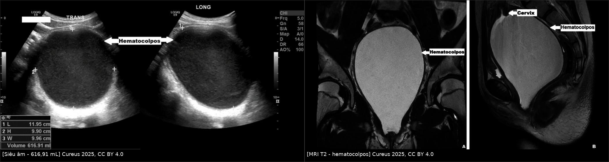
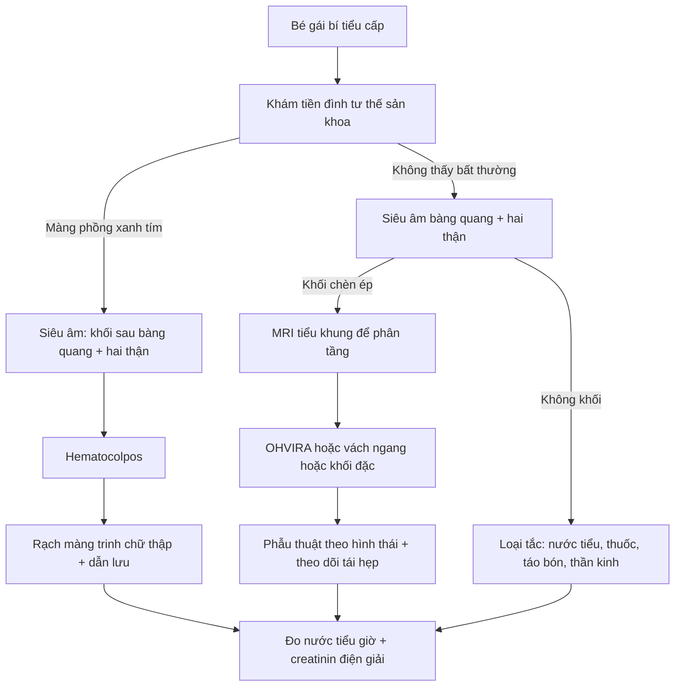
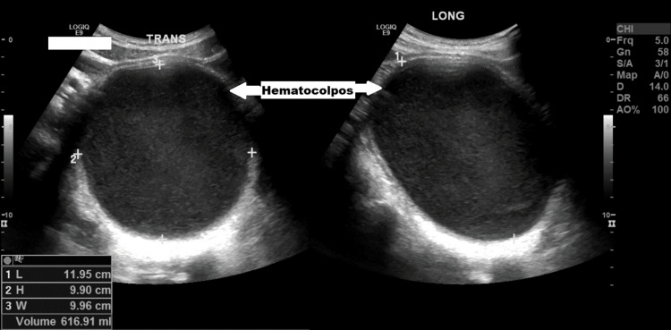
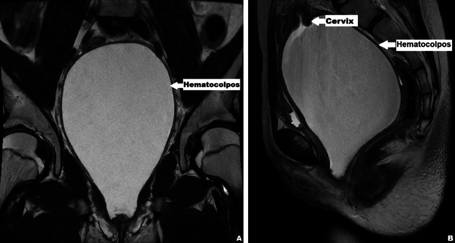
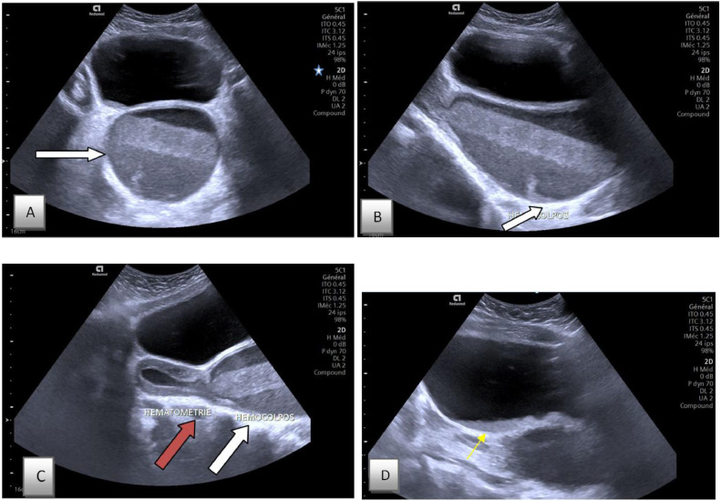

# 1744 — Bí tiểu cấp ở bé gái: khối chèn ép cổ bàng quang – niệu đạo / Acute urinary retention in girls

**Tags:** `pattern:bi-tieu` `pattern:khong-hoi-am` `pattern:u-mau-am-dao` `pattern:chen-ep` `vung:am-dao` `vung:bang-quang` `vung:tieu-khung` `vung:co-tu-cung` `anatomy:tieu-khung-nu` `protocol:SA-tieu-khung` `protocol:MRI-tieu-khung`
**Mức chắc chắn (certainty):** tổng hợp y văn (literature synthesis) — định nghĩa và dịch tễ từ đoàn hệ 56 đợt bí tiểu cấp nhi (PMC11883049) và loạt 17 bệnh nhi hydrometrocolpos (PMC13614824); hình ảnh là **ca nguyên văn có số đo** (617 mL — PMC12665289; 500 mL — PMC11378082; 700 mL — PMC13165485). Không có RCT cho nhóm bệnh này; các khuyến cáo là đồng thuận thực hành.

## 1. Tổng quan bệnh học – cơ chế hình ảnh

- **Định nghĩa bí tiểu cấp (acute urinary retention, AUR) ở trẻ:** không thể làm rỗng bàng quang theo ý muốn **quá 12 giờ**, với thể tích nước tiểu **lớn hơn dung tích kỳ vọng theo tuổi = (tuổi + 2) × 30 mL**, hoặc **sờ thấy bàng quang căng** (PMC11883049). Đây là định nghĩa dùng được ở cấp cứu vì không cần siêu âm trước khi đặt sonde.
- **Dịch tễ — vì sao phải nhớ:** AUR nhi khoa **30,2/100.000 lượt khám cấp cứu nhi**, trong đó **chỉ 33% là bé gái** — nghĩa là ở bé gái, AUR hiếm nhưng **mỗi ca đều phải giải thích được bằng một nguyên nhân cơ học hoặc thần kinh**, không được quy cho "nhiễm trùng niệu" rồi cho về (PMC11259769). Trong 56 đợt AUR nhi (PMC11883049): sau mổ **23%**, thuốc **13%**, nhiễm trùng niệu **11%**, hẹp bao quy đầu/viêm quy đầu **11%** (chỉ gặp ở bé trai), **táo bón 11%**, ung thư **9%**, không rõ **18%**; đặt sonde niệu đạo thành công **92%**, tự hết **16%**.
- **Vì sao khối trong tiểu khung chèn được đường tiểu:** niệu đạo nữ **ngắn (≈ 4 cm)** và **tựa lên thành trước âm đạo**; bàng quang nằm ngay sau khớp mu, đáy bàng quang **áp lên vòm âm đạo**. Khi âm đạo căng đầy máu/dịch, khối **nâng và đẩy cổ bàng quang ra trước – lên trên**, đồng thời **gập góc niệu đạo**; tam giác bàng quang bị kéo căng nên **detrusor không thể co thắng lực cản** → nước tiểu ứ, bàng quang căng đau. Vì vậy bé vẫn có thể **rỉ nước tiểu (overflow incontinence)** chứ không phải vô niệu — đây là lý do hay bị đánh giá nhẹ.
- **Vì sao ứ nước thận đi kèm:** áp lực trong bàng quang cao truyền ngược lên **đoạn niệu quản trong thành**, làm **hở van một chiều** và ứ nước – ứ niệu quản **hai bên**. Trong loạt 17 bệnh nhi hydrometrocolpos, **17/17 có ứ nước thận – niệu quản** do chèn ép đường niệu dưới (PMC13614824) → **siêu âm thận là phần bắt buộc của protocol**, không phải "làm thêm".
- **Vì sao hình ảnh phân biệt được "máu ứ" với "nang/dịch":**
  - **Siêu âm:** khối **hình con nhộng, đường giữa, sau bàng quang**; máu ứ cho **echo bên trong mức thấp – vừa ("fish-net"/reticular)** do hồng cầu lắng và fibrin, khác nang đơn thuần **trong kính, không echo**. Đo **3 đường kính** và **thể tích** (máy tự tính) — ca dưới đây **11,95 × 9,90 × 9,96 cm = 616,91 mL**.
  - **MRI:** máu ứ **T1 sáng** (methemoglobin), **T2 tùy tuổi máu** (cấp: tối; bán cấp muộn: sáng); **không ngấm thuốc** ở phần dịch (chỉ thành ngấm) → loại khối đặc; **DWI không hạn chế thật** trừ khi ứ mủ (pyocolpos → ADC thấp, gặp khi có sốt).
  - **CT:** máu ứ **≈ 30–60 HU**, cao hơn nước tiểu **0–10 HU**, nhưng **không dùng đầu tay ở trẻ** vì liều — chỉ khi nghi u đặc/chấn thương.
- **Con số phải nhớ:** **màng trinh kín 1/1.000 – 1/10.000** trẻ gái, và **≈ 50% trong số đó có bí tiểu** (PMC11378082). **Hydrometrocolpos 1/16.000** trẻ gái sinh sống (PMC13614824). Thể tích ứ thường **500–700 mL** ở tuổi dậy thì (500 mL — PMC11378082; 617 mL — PMC12665289; 700 mL — PMC13165485) — đủ để giải thích cả chèn ép niệu đạo và ứ nước thận.
- **Sau khi giải áp:** nước tiểu có thể **thoát rất nhiều (post-obstructive diuresis)** do giãn bể thận và mất cân bằng Na–nước; ngưỡng thực hành là **> 2 mL/kg/giờ kéo dài ≥ 2 giờ** → phải bù dịch theo lượng nước tiểu và **xét nghiệm điện giải – creatinin**, không truyền dịch mù.

## 2. Mẫu hình + chẩn đoán phân biệt theo vị trí (gamut)

- **Mẫu hình chung:** bé gái **đau bụng dưới cấp, bàng quang căng sờ thấy, không đi tiểu được (hoặc rỉ liên tục)**, có thể **đau quặn theo chu kỳ** và **vô kinh nguyên phát** nếu nguyên nhân là tắc đường sinh dục.
- **Gamut theo TẦNG giảm áp (nhớ "Â – B – N – C"), kèm nhóm KHÔNG do tắc:**
  1. **Âm đạo (hay gặp nhất ở tuổi dậy thì):**
     - **Màng trinh kín → ứ máu âm đạo (hematocolpos)**: màng **phồng xanh tím ở tiền đình khi rặn**, khối sau bàng quang; có thể kèm **ứ máu buồng tử cung** (hematometra). Chiếm phần lớn AUR do nguyên nhân phụ khoa.
     - **Vách ngang âm đạo**, **bất sản/hẹp cổ tử cung** → ứ máu tầng trên.
     - **OHVIRA (Herlyn–Werner–Wunderlich)**: tử cung hai sừng – hai cổ + **một nửa âm đạo tắc** + **bất sản thận cùng bên**; khối **một bên**, bên kia vẫn hành kinh (chi tiết: bài 1671).
     - **Hydrocolpos ở sơ sinh** (ứ dịch do estrogen mẹ) và **u cơ vân thể chùm nho (botryoides)** ở trẻ nhỏ — khối nhiều thùy sa ra âm hộ, chảy máu/dịch.
  2. **Buồng trứng:** **xoắn buồng trứng** (đau cấp + nôn; khối chèn ít khi gây bí tiểu nhưng nang lớn **> 5–10 cm** có thể đẩy bàng quang), **nang/khối buồng trứng lớn**.
  3. **Niệu đạo – bàng quang:** **nang tuyến Skene/paraurethral** (khối cạnh lỗ niệu đạo, hay gặp ở sơ sinh), **sa niệu đạo** (viền đỏ tím quanh lỗ niệu đạo, chảy máu), **sỏi niệu đạo**, **túi thừa bàng quang**, **ureterocele sa ra lỗ niệu đạo** (khối tròn, có thể gây bí tiểu từng cơn).
  4. **Cùng cụt – vùng chậu sau:** **u quái cùng cụt** (khối mông – cùng cụt, có thể trước cùng cụt), **thoát vị màng não trước cùng cụt** (khối nang sau trực tràng, **cấm chọc**), **áp-xe vùng chậu**, **khối bạch huyết (lymphangioma)**.
  5. **Không do tắc (phải loại trước khi mổ):** **táo bón/ứ phân** (nguyên nhân 11% trong đoàn hệ), **nhiễm trùng niệu – viêm âm hộ**, **thuốc kháng cholinergic/opioid**, **rối loạn đi tiểu không thần kinh (dysfunctional voiding)**, **bệnh tủy – đuôi ngựa/tủy quấn (tethered cord), viêm tủy ngang**, **hội chứng Fowler** ở bé lớn.

## 3. Bảng so sánh phân biệt (ma trận đối chiếu)

| Thực thể (entity) | Hình ảnh điển hình | Chốt vào (rule-in) | Chốt loại (rule-out) | Gợi ý xác nhận |
|---|---|---|---|---|
| **Màng trinh kín / ứ máu âm đạo** | Khối **con nhộng đường giữa sau bàng quang**, echo trong mức thấp; MRI T1 sáng; **không ngấm thuốc** | **Màng phồng xanh tím ở tiền đình + vô kinh nguyên phát + đau chu kỳ**; thể tích ứ **500–700 mL** | Có **lỗ màng trinh thấy được** và không ứ máu → không phải; khối **đặc/ngấm thuốc** → nghĩ u | Khám tiền đình **bắt buộc**; US 3 đường kính; MRI khi cần phân tầng |
| **OHVIRA (nửa âm đạo tắc)** | **Hai sừng tử cung, hai cổ**, một nửa âm đạo căng máu **một bên**; **không thấy thận cùng bên** | **Bộ ba didelphys + hemivagina tắc + bất sản thận cùng bên** trên MRI | **Hai thận bình thường + không có nửa âm đạo tắc** → loại | MRI tiểu khung **bắt buộc**; US đơn thuần bỏ sót thận mất |
| **Vách ngang âm đạo / hẹp cổ tử cung** | Ứ máu **âm đạo trên ± buồng tử cung**, âm đạo dưới xẹp | **Vô kinh + khối giữa + không thấy cổ tử cung bình thường** | Màng trinh kín (khối sát tiền đình, màng mỏng) → loại bằng khám | MRI để đo **độ dày vách** và khoảng cách tới cổ tử cung |
| **Xoắn buồng trứng** | Buồng trứng **to, phù, nang > 5 cm**, **dòng chảy Doppler giảm/mất**, dịch quanh | **Đau cấp + nôn + không dòng chảy** | Có dòng chảy rõ + không đau cấp → ít nghĩ xoắn | Doppler màu **và** đen trắng; mổ nội soi khi còn nghi |
| **Nang Skene / sa niệu đạo** | Khối **cạnh lỗ niệu đạo** (Skene) hoặc **viền niêm mạc tím lòi ra** (sa niệu đạo) | **Khối khu trú ngay lỗ niệu đạo**, không phải khối âm đạo | Khối ở **vòm âm đạo/sau bàng quang** → không phải Skene | Khám tư thế sản khoa; US đầu dò nhỏ |
| **U quái cùng cụt** | Khối **cùng cụt – mông**, đặc/nang hỗn hợp, **có thể vôi hóa**; đẩy trực tràng – bàng quang | **Khối vùng cùng cụt + AFP tăng** (thể chưa trưởng thành) | Khối **hoàn toàn trong tiểu khung, không liên tục với cùng cụt** → loại | MRI chậu – cùng cụt; AFP; **không chọc** |
| **Táo bón / ứ phân** | Trực tràng **giãn chứa phân**, đẩy bàng quang ra trước | **Bí tiểu + bón kéo dài**, hết sau tháo phân | Vẫn bí tiểu **sau khi tháo sạch phân** → phải tìm nguyên nhân khác | X-quang bụng/US; **theo dõi lại sau 24–48 giờ** |
| **Rối loạn đi tiểu / nhiễm trùng niệu** | Bàng quang **căng nhưng không có khối chèn**, thành dày; nước tiểu có bạch cầu/nitrit | **Không khối + đáp ứng kháng sinh/điều trị hành vi** | Có **khối sau bàng quang** → không được dừng ở chẩn đoán này | Cấy nước tiểu; US sau khi đặt sonde; niệu động học nếu tái diễn |

*Trái: siêu âm tiểu khung — khối echo trong **11,95 × 9,90 × 9,96 cm, 616,91 mL** sau bàng quang. Phải: MRI T2 coronal/sagittal — **âm đạo căng máu (hematocolpos)**, cổ tử cung bị đẩy lên. Nguồn: *Cureus* 2025 (PMC12665289), CC BY 4.0. Ảnh ghép letterbox, giữ nguyên tỷ lệ.*

## 4. Protocol chụp + xử trí theo bậc

- **Bước 0 — trước hình ảnh:** hỏi **chu kỳ kinh – vô kinh nguyên phát – đau quặn chu kỳ**, thuốc, táo bón, chấn thương; **khám tiền đình ở tư thế sản khoa** (màng phồng xanh tím = chốt lâm sàng). **Không đặt sonde mù khi thấy màng căng phồng** — sonde không qua được và làm rách màng, mất dấu hiệu.
- **Siêu âm tiểu khung (đầu tay, không bức xạ):** đo **3 đường kính + thể tích** khối, xác định **trước/sau bàng quang**, đo **thành bàng quang**, **thể tích nước tiểu tồn dư**, và **bắt buộc khảo sát hai thận** (ứ nước, niệu quản). Sau khi giải áp, **siêu âm lại** để chứng minh khối xẹp và thận giảm ứ.
- **MRI tiểu khung** (không cần cản quang trừ khi nghi u đặc): chỉ định khi **siêu âm không phân loại được tầng tắc**, **nghi OHVIRA/dị dạng Müller**, **khối đặc**, hoặc cần **đo vách – khoảng cách tới cổ tử cung** trước mổ. MRI là yếu tố **giảm chẩn đoán nhầm** trong OHVIRA (OR 0,157 — PMC12589279, xem bài 1671).
- **Xét nghiệm:** tổng phân tích nước tiểu + cấy, **creatinin – điện giải**, công thức máu (nhiễm trùng/ứ mủ), β-hCG **chỉ khi cần** (tuổi dậy thì, phân biệt thai).
- **Giải áp:** **sonde niệu đạo** là bước đầu, thành công **92%** (PMC11883049); nếu thất bại → **chọc hút trên mu (suprapubic)** hoặc sonde trên mu. Ghi lại **thể tích nước tiểu lần đầu** (500 mL — PMC11378082) và **theo dõi nước tiểu theo giờ**.
- **Xử trí nguyên nhân (không chỉ đặt sonde):**
  - **Màng trinh kín:** **rạch hình chữ thập (cruciate hymenectomy)** + cắt mô thừa, dẫn lưu **≈ 600–700 mL** máu ứ; kháng sinh nếu ứ mủ.
  - **OHVIRA/vách ngang:** cắt vách – mở thông qua **nội soi âm đạo** khi có thể; theo dõi tái hẹp.
  - **U quái cùng cụt / khối đặc:** MRI + AFP, phối hợp ngoại nhi – ung thư.
  - **Táo bón:** tháo phân **rồi đánh giá lại** — không kết luận "do táo bón" khi chưa loại khối.
- **Flowchart xử trí:**

- **Theo dõi sau giải áp:** **post-obstructive diuresis** (> 2 mL/kg/giờ ≥ 2 giờ), **hạ Na/K**, **creatinin**; siêu âm thận lại sau **24–48 giờ**; hẹn khám **chu kỳ** và **tái hẹp** sau mổ.

## 5. Biến thể bình thường và cạm bẫy

- **Ứ dịch âm đạo ở sơ sinh (mucocolpos/hydrocolpos do estrogen mẹ):** khối dịch nhỏ, **tự thoái triển trong vài tuần** — chỉ can thiệp khi **chèn ép niệu quản/bí tiểu** hoặc khối tăng dần. Đừng mổ vì "thấy dịch".
- **Trào ngược âm đạo (vesicovaginal reflux/urocolpos):** nước tiểu **trào vào âm đạo khi đi tiểu**, siêu âm thấy dịch âm đạo **sau đi tiểu** nhưng **hết khi chụp lại sau khi đứng – đi tiểu lại**; đây là biến thể chức năng, **không phải ứ máu** — phân biệt bằng **echo và thời điểm chụp**.
- **Bàng quang căng giả "khối nang":** nếu siêu âm trước khi đặt sonde, bàng quang căng có thể bị đọc là khối; **đặt sonde rồi chụp lại** phân biệt.
- **Bẫy "hài lòng với chẩn đoán đầu":** ca 12 tuổi (PMC11259769) được cho là **bí tiểu do táo bón**, tháo phân xong đi tiểu được và **ra viện**, **2 ngày sau quay lại** với màng phồng xanh tím và ứ máu âm đạo. **Táo bón là yếu tố thúc đẩy, không loại trừ khối chèn ép** — phải hẹn khám lại và khám tiền đình.
- **Khám sinh dục ngoài "bình thường" không loại trừ:** ở ca đầu tiên, khám ngoài **không ghi nhận bất thường**, chẩn đoán chỉ đặt được khi **nhìn kỹ tiền đình**. Luôn **kê mỏm – tách môi bé** và mô tả **màng, lỗ niệu đạo, cùng đồ**.
- **Đặt sonde đơn thuần không giải quyết nguyên nhân:** bí tiểu tái phát sau rút sonde là dấu hiệu **khối chưa được xử lý**, không phải "bàng quang lười".

## 6. Tự lượng giá — Blind Quiz

**Ca 1 — Bé gái 13 tuổi, bí tiểu 24 giờ, đau bụng dưới 2 tháng. Siêu âm tiểu khung:**

- Gợi ý lâm sàng: chưa có kinh, đau âm ỉ tăng dần, tiểu khó.
- Câu hỏi: Khối nằm ở đâu so với bàng quang? Thể tích bao nhiêu? 3 chẩn đoán phân biệt và dấu hiệu nào chốt?

<b>Bấm để hiện đáp án (findings + chẩn đoán)</b>

- Dấu hiệu: khối **echo trong, hình con nhộng, sau bàng quang**, đo **11,95 × 9,90 × 9,96 cm**, thể tích **616,91 mL**; bàng quang bị đẩy ra trước.
- Chẩn đoán: **ứ máu âm đạo do màng trinh kín** — vì khối đúng đường giữa sau bàng quang + vô kinh + đau chu kỳ; màng trinh kín chiếm **1/1.000–1/10.000** trẻ gái và **≈ 50%** có bí tiểu.
- Xử trí: rạch chữ thập, dẫn lưu **≈ 600 mL**.
- Nguồn: *Cureus* 2025;17(10):e95827. PMCID PMC12665289. CC BY 4.0.

**Ca 2 — Cùng bệnh nhi, MRI T2 coronal và sagittal:**

- Câu hỏi: Vì sao MRI được chỉ định? Tín hiệu nào nói khối là máu chứ không phải nang?

<b>Bấm để hiện đáp án</b>

- Dấu hiệu: **âm đạo căng rộng, tín hiệu T2 không đồng nhất**, đẩy **cổ tử cung lên trên**; không có khối đặc ngấm thuốc.
- Vì sao MRI: xác định **tầng tắc**, loại **dị dạng Müller/OHVIRA**, và đo **khoảng cách tới cổ tử cung** trước mổ.
- Tín hiệu: máu ứ **T1 sáng** (methemoglobin) và **T2 thay đổi theo tuổi máu**; khối **không ngấm thuốc** ở phần dịch → máu, không phải u.
- Nguồn: *Cureus* 2025 (PMC12665289), Fig. 2. CC BY 4.0.

**Ca 3 — Bé gái 11 tuổi, bí tiểu cấp, chưa có kinh. Siêu âm bụng – tiểu khung 4 mặt cắt:**

- Câu hỏi: Hai khoang nào cùng căng? Dấu hiệu nào cho biết bàng quang bị chèn? Bước tiếp theo?

<b>Bấm để hiện đáp án</b>

- Dấu hiệu: **(A, B)** khối echo trong **chèn bàng quang ra trước**; **(C)** hai khoang: **HEMATOMETRA** (mũi tên đỏ) và **HEMATOCOLPOS** (mũi tên trắng) — ứ máu cả buồng tử cung và âm đạo; **(D)** cổ tử cung/âm đạo trên.
- Chẩn đoán: **màng trinh kín gây ứ máu âm đạo – buồng tử cung**, bí tiểu do chèn ép; sonde dẫn lưu **500 mL** nước tiểu trước đó.
- Bước tiếp: **rạch chữ thập + dẫn lưu**, kháng sinh nếu ứ mủ, siêu âm lại thận sau 24–48 giờ; **tầm soát dị dạng Müller/OHVIRA nếu khối một bên**.
- Nguồn: *Radiology Case Reports* 2024;19(11):4970–4973 (PMC11378082), Fig. 1. CC BY-NC-ND 4.0 — dùng nguyên bản, không chỉnh sửa.

## Bài liên quan chéo
- [1671 – Ứ máu âm đạo – tử cung ở trẻ vị thành niên](../1671-u-mau-am-dao-tu-cung-tre-vi-thanh-nien/lesson.md)
- [1701 – U quái cùng cụt](../1701-duong-mo-u-quai-cung-cut/lesson.md)
- [1719 – Bàng quang đôi và nang niệu rốn](../1719-bang-quang-doi-va-nang-nieu-ron/lesson.md)
- [1672 – U máu bánh nhau (hội chứng gương)](../1672-u-mau-banh-nhau/lesson.md)
- [1746 – Hội chứng gương do phù thai](../1746-hoi-chung-guong/lesson.md)

## Ảnh
- `images/1744_bi-tieu-cap_US-PMC12665289-F1.jpg` — siêu âm khối 616,91 mL, CC BY 4.0.
- `images/1744_bi-tieu-cap_MRI-PMC12665289-F2.jpg` — MRI T2 coronal/sagittal, CC BY 4.0.
- `images/1744_bi-tieu-cap_US-PMC11378082-F1.jpg` — siêu âm 4 mặt cắt, CC BY-NC-ND 4.0 (nguyên bản).
- `images/composite_1744_US-MRI.jpg` — ảnh ghép từ hai ảnh CC BY 4.0 cùng bài.
- Nguồn + giấy phép từng ảnh: `images/CREDITS.md`.

> Không dùng để chẩn đoán độc lập khi chưa có người hướng dẫn.
